---
mdx:
  format: md
---

# Blockchain & Distributed Ledger Patterns (Consensus, Merkle Trees, Smart Contracts, Oracles, Multi-Sig, Channels)

> **Note**: Patterns marked with **(Interview Imp - Java)** are frequently asked in Java interviews
>
> **How to read this file:** Every section ends with a **📘 Terms Explained** table. If you see a word you don't know, check the table right below that section. Each pattern goes from the basic idea to a plain-Java model of how it works inside, usage with Java blockchain libraries, pitfalls, interview questions and a mini cheat sheet.
>
> **What is this file about?** The master list's **Blockchain & Distributed Ledger Patterns** (#401–410). A blockchain is a **shared, append-only ledger kept by many computers that do not trust each other**. Everything in this file exists to answer one question: *how do strangers agree on one history without a boss?* For Java engineers it matters because banks, supply-chain and payment companies run on JVM platforms (Hyperledger Fabric chaincode in Java, Hyperledger Besu and R3 Corda written in Java/Kotlin, `web3j` to talk to Ethereum), and because the building blocks (hash chains, Merkle trees, Byzantine quorums, signatures, idempotent commit protocols) show up in ordinary distributed-systems interviews.
>
> **What lives elsewhere:** Crash-fault consensus (Raft, Paxos), quorums, leader election and consistent hashing are in [07_Distributed_Systems_Pattern.md](../03_System_Design/07_Distributed_Systems_Pattern.md). Hashing, signatures, encryption and key management are in [06_Security_Pattern.md](../03_System_Design/06_Security_Pattern.md). Event sourcing (an append-only log as the source of truth) is in [05_Data_Management_Pattern.md](../03_System_Design/05_Data_Management_Pattern.md#2-event-sourcing-pattern-interview-imp---java). [Section 9](#9-blockchain-patterns-and-the-building-blocks-they-reuse) maps them.
>
> **Verified code:** Every main "Complete Java Example" is **plain Java 17 (no libraries; only `java.security` for hashing and ECDSA signatures)** and was compiled and run **three times** with identical output. Nothing connects to a real blockchain. Key pairs are generated fresh on each run, but the examples print only results that do not depend on the keys (accepted/rejected), so the output is the same every time. Solidity, `web3j`, Hyperledger and cloud snippets are usage examples and were **not** executed. This is not financial or investment advice; the guide explains engineering ideas only.

---

## Table of Contents
- [Big Picture: How a Ledger Without a Boss Works](#big-picture-how-a-ledger-without-a-boss-works)
1. [Proof of Work](#1-proof-of-work)
   - [1.1 What Is It?](#11-what-is-it)
   - [1.2 Why Do We Need It?](#12-why-do-we-need-it)
   - [1.3 How It Works](#13-how-it-works)
   - [1.4 Types and Variants](#14-types-and-variants)
   - [1.5 Complete Java Example - Mining, a Hash Chain and Tampering](#15-complete-java-example---mining-a-hash-chain-and-tampering)
   - [1.6 PoW in Java](#16-pow-in-java)
   - [1.7 Pros and Cons](#17-pros-and-cons)
   - [1.8 Pitfalls, Interview Questions and Cheat Sheet](#18-pitfalls-interview-questions-and-cheat-sheet)
2. [Proof of Stake](#2-proof-of-stake)
   - [2.1 What Is It?](#21-what-is-it)
   - [2.2 Why Do We Need It?](#22-why-do-we-need-it)
   - [2.3 How It Works](#23-how-it-works)
   - [2.4 Types and Variants](#24-types-and-variants)
   - [2.5 Complete Java Example - Stake-Weighted Selection and Slashing](#25-complete-java-example---stake-weighted-selection-and-slashing)
   - [2.6 PoS in Java](#26-pos-in-java)
   - [2.7 Pros and Cons](#27-pros-and-cons)
   - [2.8 Pitfalls, Interview Questions and Cheat Sheet](#28-pitfalls-interview-questions-and-cheat-sheet)
3. [Merkle Tree](#3-merkle-tree-interview-imp---java) **(Interview Imp - Java)**
   - [3.1 What Is It?](#31-what-is-it)
   - [3.2 Why Do We Need It?](#32-why-do-we-need-it)
   - [3.3 How It Works](#33-how-it-works)
   - [3.4 Types and Variants](#34-types-and-variants)
   - [3.5 Complete Java Example - Build a Tree, Prove a Transaction, Detect Tampering](#35-complete-java-example---build-a-tree-prove-a-transaction-detect-tampering)
   - [3.6 Merkle Trees in Java](#36-merkle-trees-in-java)
   - [3.7 Pros and Cons](#37-pros-and-cons)
   - [3.8 Pitfalls, Interview Questions and Cheat Sheet](#38-pitfalls-interview-questions-and-cheat-sheet)
4. [Byzantine Fault Tolerance (BFT)](#4-byzantine-fault-tolerance-bft)
   - [4.1 What Is It?](#41-what-is-it)
   - [4.2 Why Do We Need It?](#42-why-do-we-need-it)
   - [4.3 How It Works](#43-how-it-works)
   - [4.4 Types and Variants](#44-types-and-variants)
   - [4.5 Complete Java Example - 2f+1 Quorums, Faulty Nodes, a Lying Leader and Quorum Overlap](#45-complete-java-example---2f1-quorums-faulty-nodes-a-lying-leader-and-quorum-overlap)
   - [4.6 BFT in Java](#46-bft-in-java)
   - [4.7 Pros and Cons](#47-pros-and-cons)
   - [4.8 Pitfalls, Interview Questions and Cheat Sheet](#48-pitfalls-interview-questions-and-cheat-sheet)
5. [Smart Contracts and Tokens](#5-smart-contracts-and-tokens-interview-imp---java) **(Interview Imp - Java)**
   - [5.1 What Are They?](#51-what-are-they)
   - [5.2 Why Do We Need Them?](#52-why-do-we-need-them)
   - [5.3 How It Works](#53-how-it-works)
   - [5.4 Types and Variants](#54-types-and-variants)
   - [5.5 Complete Java Example - A Token With Allowances, Gas and Revert, and the Re-Entrancy Bug](#55-complete-java-example---a-token-with-allowances-gas-and-revert-and-the-re-entrancy-bug)
   - [5.6 Smart Contracts From Java](#56-smart-contracts-from-java)
   - [5.7 Pros and Cons](#57-pros-and-cons)
   - [5.8 Pitfalls, Interview Questions and Cheat Sheet](#58-pitfalls-interview-questions-and-cheat-sheet)
6. [Oracle Pattern](#6-oracle-pattern)
   - [6.1 What Is It?](#61-what-is-it)
   - [6.2 Why Do We Need It?](#62-why-do-we-need-it)
   - [6.3 How It Works](#63-how-it-works)
   - [6.4 Types and Variants](#64-types-and-variants)
   - [6.5 Complete Java Example - Median vs Mean, Staleness and a Quorum](#65-complete-java-example---median-vs-mean-staleness-and-a-quorum)
   - [6.6 Oracles in Java and Solidity](#66-oracles-in-java-and-solidity)
   - [6.7 Pros and Cons](#67-pros-and-cons)
   - [6.8 Pitfalls, Interview Questions and Cheat Sheet](#68-pitfalls-interview-questions-and-cheat-sheet)
7. [Multi-Signature](#7-multi-signature)
   - [7.1 What Is It?](#71-what-is-it)
   - [7.2 Why Do We Need It?](#72-why-do-we-need-it)
   - [7.3 How It Works](#73-how-it-works)
   - [7.4 Types and Variants](#74-types-and-variants)
   - [7.5 Complete Java Example - A 2-of-3 Wallet With Real ECDSA Signatures](#75-complete-java-example---a-2-of-3-wallet-with-real-ecdsa-signatures)
   - [7.6 Multisig in Java and Solidity](#76-multisig-in-java-and-solidity)
   - [7.7 Pros and Cons](#77-pros-and-cons)
   - [7.8 Pitfalls, Interview Questions and Cheat Sheet](#78-pitfalls-interview-questions-and-cheat-sheet)
8. [State Channels and Sidechains](#8-state-channels-and-sidechains)
   - [8.1 What Are They?](#81-what-are-they)
   - [8.2 Why Do We Need Them?](#82-why-do-we-need-them)
   - [8.3 How It Works](#83-how-it-works)
   - [8.4 Types and Variants](#84-types-and-variants)
   - [8.5 Complete Java Example - 1,000 Off-Chain Payments, a Cheating Close, and a Two-Way Peg](#85-complete-java-example---1000-off-chain-payments-a-cheating-close-and-a-two-way-peg)
   - [8.6 Channels and Sidechains From Java](#86-channels-and-sidechains-from-java)
   - [8.7 Pros and Cons](#87-pros-and-cons)
   - [8.8 Pitfalls, Interview Questions and Cheat Sheet](#88-pitfalls-interview-questions-and-cheat-sheet)
9. [Blockchain Patterns and the Building Blocks They Reuse](#9-blockchain-patterns-and-the-building-blocks-they-reuse)
10. [How the Blockchain Patterns Fit Together](#10-how-the-blockchain-patterns-fit-together)
11. [Blockchain & Distributed Ledger Patterns Cheat Sheet](#11-blockchain--distributed-ledger-patterns-cheat-sheet)

---

## Big Picture: How a Ledger Without a Boss Works

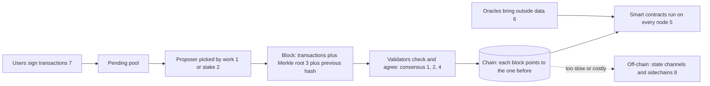

| Question | Pattern | Section |
|---|---|---|
| Who gets to add the next block, and what makes cheating expensive? | Proof of Work, Proof of Stake | [1](#1-proof-of-work), [2](#2-proof-of-stake) |
| How do I prove one transaction is in a block without sending the whole block? | Merkle tree | [3](#3-merkle-tree-interview-imp---java) |
| What if some nodes lie or act maliciously, not just crash? | Byzantine Fault Tolerance | [4](#4-byzantine-fault-tolerance-bft) |
| How is business logic run and agreed on by everybody? | Smart contract, token | [5](#5-smart-contracts-and-tokens-interview-imp---java) |
| How does the chain learn about the outside world (prices, weather)? | Oracle | [6](#6-oracle-pattern) |
| How do several people approve one action? | Multi-signature | [7](#7-multi-signature) |
| How do I get thousands of payments per second? | State channel, sidechain | [8](#8-state-channels-and-sidechains) |

### 📘 Terms Explained

| Term | Meaning |
|---|---|
| **Ledger** | A record of transactions |
| **Block** | A batch of transactions plus a header (previous hash, Merkle root, timestamp, proof) |
| **Hash** | A fixed-size fingerprint of data; change one bit and the hash changes completely (SHA-256) |
| **Node** | A computer that stores and verifies the chain |
| **Consensus** | The rule by which nodes agree on the single valid history |
| **Public / private key** | A key pair used for digital signatures: sign with the private key, anyone verifies with the public key |
| **Permissioned / permissionless** | Only approved participants / anyone can join |
| **Immutable** | Practically impossible to change after the fact |

---

# 1. Proof of Work

## 1.1 What Is It?

**Proof of Work (PoW)** (#401) is a consensus rule where the node that wants to add a block must first solve a **hard puzzle that is easy to check**: find a number (the *nonce*) so that the block's hash starts with a required number of zeros. The only way to find it is to try again and again (**mining**), which costs electricity and time. Bitcoin uses PoW.

> **Cost to write, ease to verify.** Finding the nonce takes millions of tries; checking it takes one hash.

## 1.2 Why Do We Need It?

| Problem | How PoW helps |
|---|---|
| Anyone can create 1,000 fake identities (**Sybil attack**) | Voting power is tied to computing power, which can't be faked |
| Who decides the next block? | The first miner to solve the puzzle (a lottery weighted by hash power) |
| Rewriting history | Changing block *k* means redoing the work for block *k* and every block after it, faster than the honest network |
| Agreement among strangers | "The longest chain (most accumulated work) wins" |

## 1.3 How It Works

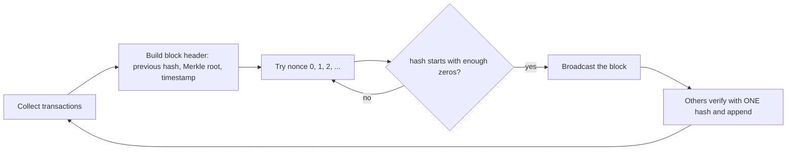

1. **Hash chain:** each block stores the hash of the previous block, so changing an old block changes every later hash.
2. **Difficulty:** the required zeros. Each extra hex zero makes the puzzle about **16×** harder on average. Bitcoin retargets the difficulty every 2,016 blocks so blocks keep arriving about every 10 minutes.
3. **Longest (heaviest) chain rule:** if two miners find blocks at the same time (a **fork**), nodes keep both briefly; the branch that grows first wins and the other is abandoned (an **orphan**). This is why you wait for several **confirmations**.
4. **51% attack:** an attacker with more than half of the hash power can out-run the honest chain and rewrite recent history (double-spend). For big chains this is extremely expensive; small chains have been attacked.

## 1.4 Types and Variants

| Variant | Note |
|---|---|
| **Bitcoin (SHA-256 PoW)** | Hash power from specialised ASIC machines |
| **Memory-hard PoW (Scrypt, Ethash, RandomX)** | Designed to resist ASICs |
| **Proof of Work + difficulty adjustment** | Keeps block time stable as hash power changes |
| **Hashcash** | The PoW idea used to rate-limit email spam (Adam Back, 1997) |
| **Proof of Space / Time** | Chia: prove storage instead of computation |
| **Proof of Authority** | A small set of known validators (permissioned networks, Section 4) |
| **Proof of Stake** | Replace work with locked money ([Section 2](#2-proof-of-stake)) |

## 1.5 Complete Java Example - Mining, a Hash Chain and Tampering

**What it shows:** (1) how the number of hashes needed grows with difficulty; (2) a 4-block chain where each block stores the previous block's hash; (3) an attacker who edits an old transaction: the block no longer matches its hash, and even re-mining that single block breaks the link to the next block.

```java
import java.nio.charset.StandardCharsets;
import java.security.MessageDigest;
import java.util.*;

public class PowDemo {

    static String sha256(String s) {
        try {
            StringBuilder sb = new StringBuilder();
            for (byte b : MessageDigest.getInstance("SHA-256").digest(s.getBytes(StandardCharsets.UTF_8))) sb.append(String.format("%02x", b));
            return sb.toString();
        } catch (Exception e) { throw new RuntimeException(e); }
    }

    static class Block {
        final int index; final String prevHash, data; long nonce; String hash;
        Block(int index, String prevHash, String data) { this.index = index; this.prevHash = prevHash; this.data = data; }
        String compute() { return sha256(index + "|" + prevHash + "|" + data + "|" + nonce); }
        // proof of work: find a nonce so that the hash starts with 'difficulty' zeros
        long mine(int difficulty) {
            String target = "0".repeat(difficulty); long tries = 0;
            nonce = 0;
            while (true) { tries++; hash = compute(); if (hash.startsWith(target)) return tries; nonce++; }
        }
    }

    static boolean valid(List<Block> chain, int difficulty, StringBuilder why) {
        for (int i = 0; i < chain.size(); i++) {
            Block b = chain.get(i);
            if (!b.hash.equals(b.compute())) { why.append("block ").append(i).append(" hash does not match its contents"); return false; }
            if (!b.hash.startsWith("0".repeat(difficulty))) { why.append("block ").append(i).append(" lacks proof of work"); return false; }
            if (i > 0 && !b.prevHash.equals(chain.get(i - 1).hash)) { why.append("block ").append(i).append(" does not point to block ").append(i - 1); return false; }
        }
        return true;
    }

    public static void main(String[] args) {
        // 1) work grows with difficulty (each extra hex zero is ~16x more work on average)
        System.out.println("1) hashes tried to mine the same block at different difficulties");
        for (int d = 1; d <= 5; d++) {
            Block b = new Block(1, "0000prev", "Asha pays Ben 5");
            long tries = b.mine(d);
            System.out.printf("   difficulty %d (hash starts with %s): %,9d tries   hash=%s...%n", d, "0".repeat(d), tries, b.hash.substring(0, 16));
        }

        // 2) build a small chain
        int difficulty = 4;
        List<Block> chain = new ArrayList<>();
        Block genesis = new Block(0, "0", "genesis"); genesis.mine(difficulty); chain.add(genesis);
        String[] txs = {"Asha pays Ben 5", "Ben pays Chen 2", "Chen pays Dev 1"};
        long total = 0;
        for (int i = 0; i < txs.length; i++) {
            Block b = new Block(i + 1, chain.get(i).hash, txs[i]);
            total += b.mine(difficulty); chain.add(b);
        }
        System.out.println("2) chain of " + chain.size() + " blocks mined at difficulty " + difficulty + " (" + String.format("%,d", total) + " hashes for the 3 new blocks)");
        for (Block b : chain) System.out.println("   #" + b.index + " prev=" + b.prevHash.substring(0, Math.min(8, b.prevHash.length())) + " hash=" + b.hash.substring(0, 12) + "... nonce=" + b.nonce + " data='" + b.data + "'");
        StringBuilder why = new StringBuilder();
        System.out.println("   valid? " + valid(chain, difficulty, why));

        // 3) tamper with history
        Block victim = chain.get(1);
        Block forged = new Block(victim.index, victim.prevHash, "Asha pays Ben 500");
        forged.nonce = victim.nonce; forged.hash = victim.hash;                  // attacker changes the data but keeps the old hash
        chain.set(1, forged);
        why.setLength(0);
        System.out.println("3) attacker edits block 1 ('5' -> '500'): valid? " + valid(chain, difficulty, why) + "  (" + why + ")");
        forged.mine(difficulty);                                                  // attacker redoes the work for block 1
        why.setLength(0);
        System.out.println("   attacker re-mines block 1: valid? " + valid(chain, difficulty, why) + "  (" + why + ")");
        System.out.println("   -> the later blocks still point to the OLD hash of block 1, so the attacker must re-mine blocks 2 and 3 as well,");
        System.out.println("      and do it faster than the honest network keeps adding new blocks (that needs more than 50% of the hash power)");
    }
}
```

**Output** (identical on all 3 runs):

```text
1) hashes tried to mine the same block at different difficulties
   difficulty 1 (hash starts with 0):         1 tries   hash=0b217948bbb267c2...
   difficulty 2 (hash starts with 00):       572 tries   hash=0097b4d40175fdf0...
   difficulty 3 (hash starts with 000):     3,916 tries   hash=0003fe98682edc35...
   difficulty 4 (hash starts with 0000):    61,430 tries   hash=00008bd59c21bc18...
   difficulty 5 (hash starts with 00000):   470,953 tries   hash=00000e08fc7776e0...
2) chain of 4 blocks mined at difficulty 4 (75,538 hashes for the 3 new blocks)
   #0 prev=0 hash=00004a57b560... nonce=3886 data='genesis'
   #1 prev=00004a57 hash=0000352d229e... nonce=3519 data='Asha pays Ben 5'
   #2 prev=0000352d hash=0000daf5e65a... nonce=11407 data='Ben pays Chen 2'
   #3 prev=0000daf5 hash=0000f766f118... nonce=60609 data='Chen pays Dev 1'
   valid? true
3) attacker edits block 1 ('5' -> '500'): valid? false  (block 1 hash does not match its contents)
   attacker re-mines block 1: valid? false  (block 2 does not point to block 1)
   -> the later blocks still point to the OLD hash of block 1, so the attacker must re-mine blocks 2 and 3 as well,
      and do it faster than the honest network keeps adding new blocks (that needs more than 50% of the hash power)
```

**What the output shows**
- **1:** difficulty 1 → 1 try, 2 → 572, 3 → 3,916, 4 → 61,430, 5 → **470,953**. These are the tries for *one* block (a single sample, so the ratio isn't exactly 16× each step; on average it is). Verifying any of them takes one hash.
- **2:** every block's `prev` is the first 8 characters of the previous block's hash, and every hash begins with `0000` (the difficulty-4 proof of work).
- **3:** the attacker changes `5` to `500` in block 1. The stored hash no longer matches the contents → invalid. Re-mining block 1 repairs block 1, **but block 2 still points to the old hash of block 1**, so block 2 is now invalid, and so is everything after it. The attacker must redo the work for blocks 1, 2 and 3 and then outrun the honest network that keeps extending the real chain. That cost is the security.

## 1.6 PoW in Java

```java
// The core of mining in a few lines (the example above, production would use a hardware miner)
MessageDigest sha = MessageDigest.getInstance("SHA-256");
long nonce = 0;
while (true) {
    byte[] hash = sha.digest((header + nonce).getBytes(UTF_8));
    if (leadingZeroBits(hash) >= difficultyBits) break;       // real chains compare the hash with a numeric target
    nonce++;
}
```
Bitcoin actually applies SHA-256 **twice** and compares the result to a 256-bit **target** number (hash ≤ target), not a count of zero characters. In real projects:
- **Bitcoin Java libraries:** `bitcoinj` (wallets, SPV verification).
- **Ethereum:** `web3j`; **Hyperledger Besu** (a full Ethereum client written in Java) runs the network.
- A normal business application does not mine; it **reads** the chain through a node and **waits for confirmations** before trusting a payment.

## 1.7 Pros and Cons

| Pros | Cons |
|---|---|
| Open to anyone, simple, battle-tested (Bitcoin since 2009) | Huge energy use |
| Cheating costs real-world resources | Slow (about 10 minutes per Bitcoin block, probabilistic finality) |
| No need to know the participants | Mining power concentrates (pools, ASIC makers); 51% risk for small chains |

## 1.8 Pitfalls, Interview Questions and Cheat Sheet

**Common pitfalls**
- Treating a transaction as final after 0 or 1 confirmations (forks happen).
- Believing "immutable" means "cannot be changed by anyone" (it means expensive to change).
- Confusing the nonce with the difficulty target.
- Using PoW in a closed consortium (wasteful; use BFT or proof of authority).

**Interview questions**
1. *What is Proof of Work?* → A puzzle that is costly to solve and trivial to verify; solving it earns the right to add a block.
2. *Why does it make tampering hard?* → Hash chain plus work: changing one block requires redoing it and all later blocks faster than the honest majority.
3. *What is a 51% attack?* → Controlling most of the hash power to rewrite recent history or double-spend.
4. *What are confirmations?* → The number of blocks built on top of the block with your transaction; more confirmations = lower chance of reversal.
5. *PoW vs PoS?* → PoW burns energy to earn the right to propose; PoS locks money (stake) that can be destroyed (slashing) if you cheat.

**Cheat sheet**
```
Block = (index, prevHash, data/Merkle root, nonce);  valid if hash(block) < target
Hard to find (millions of tries), trivial to verify (1 hash)
Longest/heaviest chain wins; wait for N confirmations; tampering = redo all later blocks
Attack: >50% hash power; Cost: energy; Used by: Bitcoin
```

### 📘 Terms Explained

| Term | Meaning |
|---|---|
| **Proof of Work** | Evidence that computation was spent, checked by one hash |
| **Mining** | Repeatedly trying nonces to find a valid hash |
| **Nonce** | "Number used once": the value miners change to get a new hash |
| **Difficulty / target** | How rare a valid hash must be |
| **Fork / orphan block** | Two valid blocks at the same height / the one that loses |
| **Confirmation** | A block added after yours; each one makes reversal less likely |
| **Sybil attack** | Creating many fake identities to gain influence |
| **51% attack** | Majority control of mining power |
| **ASIC** | Hardware built just to compute one hash function fast |

---

# 2. Proof of Stake

## 2.1 What Is It?

**Proof of Stake (PoS)** (#402) replaces computing power with **locked-up money**. Participants (**validators**) deposit (**stake**) coins as a guarantee. The protocol picks validators to propose and vote on blocks, with probability proportional to their stake. A validator who cheats **loses part of the stake** (**slashing**). Ethereum switched from PoW to PoS in September 2022 ("The Merge"), cutting its energy use by well over 99%.

## 2.2 Why Do We Need It?

| Goal | PoS approach |
|---|---|
| Stop the energy waste of PoW | No mining race; selection is a (pseudo-)random draw |
| Make attacks expensive | To control the vote you must own and risk a large amount of stake |
| Faster finality | Validators vote on blocks, so blocks can be *finalised* (not just probably final) |
| Punish misbehaviour directly | Slashing destroys the cheater's own money |

## 2.3 How It Works

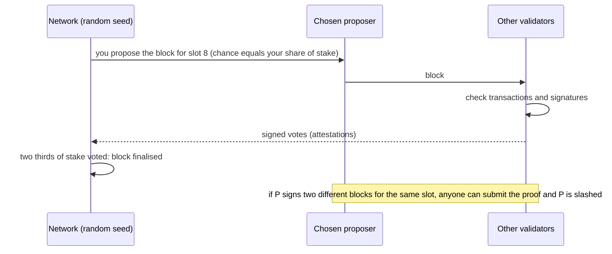

1. **Selection:** probability = your stake ÷ total stake (usually with a verifiable random function or a random beacon).
2. **Voting:** other validators attest. A supermajority of stake (two thirds) finalises.
3. **Rewards:** fees and new coins go to honest validators in proportion to their stake.
4. **Slashing:** double-signing or signing contradictory votes burns a part of the stake and ejects the validator. Being offline costs small **inactivity penalties**.
5. **Nothing-at-stake problem:** with no cost to voting, a validator could vote on *every* fork. Slashing for conflicting votes removes that incentive.

## 2.4 Types and Variants

| Variant | Note |
|---|---|
| **Chain-based PoS** | Pick a proposer, longest chain (Peercoin, early designs) |
| **BFT-style PoS** | Validators run a BFT vote each block, instant finality (Tendermint / Cosmos, [Section 4](#4-byzantine-fault-tolerance-bft)) |
| **Casper FFG + LMD GHOST (Ethereum)** | Epochs, 32 slots, finality votes, 32 ETH per validator |
| **Delegated PoS (DPoS)** | Token holders vote for a small set of delegates (EOS, Tron); faster, more centralised |
| **Liquid staking** | A tradable token represents staked coins (adds new risks) |
| **Proof of Authority** | Known approved validators, no stake (private/consortium networks) |

## 2.5 Complete Java Example - Stake-Weighted Selection and Slashing

**What it shows:** four validators with different stakes propose blocks for 100,000 slots. Each one proposes in proportion to its stake. One validator then signs two conflicting blocks, is slashed and ejected, and the shares of the others rise.

```java
import java.util.*;

public class PosDemo {

    static class Validator {
        final String name; long stake; int proposed = 0; boolean slashed = false;
        Validator(String name, long stake) { this.name = name; this.stake = stake; }
    }

    // pick a block proposer with probability proportional to stake
    static Validator pick(List<Validator> vs, Random r) {
        long total = vs.stream().filter(v -> !v.slashed).mapToLong(v -> v.stake).sum();
        long ticket = (long) (r.nextDouble() * total), acc = 0;
        for (Validator v : vs) { if (v.slashed) continue; acc += v.stake; if (ticket < acc) return v; }
        throw new IllegalStateException();
    }

    public static void main(String[] args) {
        List<Validator> vs = List.of(new Validator("Asha", 3200), new Validator("Ben", 1600), new Validator("Chen", 800), new Validator("Dev", 400));
        long total = vs.stream().mapToLong(v -> v.stake).sum();
        Random r = new Random(42);

        int slots = 100_000;
        for (int i = 0; i < slots; i++) pick(vs, r).proposed++;
        System.out.println("1) " + slots + " block slots, proposer chosen in proportion to stake (no mining, no energy):");
        for (Validator v : vs)
            System.out.printf("   %-5s stake=%5d (%5.1f%% of total)   proposed %6d blocks (%5.1f%%)%n", v.name, v.stake, 100.0 * v.stake / total, v.proposed, 100.0 * v.proposed / slots);

        // 2) slashing: a validator that signs two different blocks for the same slot loses part of its stake
        Validator cheater = vs.get(1);
        long before = cheater.stake;
        long penalty = before / 2;
        cheater.stake -= penalty;
        System.out.println("2) " + cheater.name + " signs two conflicting blocks for slot 7 -> slashed " + penalty + " of " + before + " (stake now " + cheater.stake + ") and is ejected");
        cheater.slashed = true;

        for (Validator v : vs) v.proposed = 0;
        for (int i = 0; i < slots; i++) pick(vs, r).proposed++;
        long active = vs.stream().filter(v -> !v.slashed).mapToLong(v -> v.stake).sum();
        System.out.println("3) next " + slots + " slots without " + cheater.name + ":");
        for (Validator v : vs) System.out.printf("   %-5s stake=%5d  proposed %6d (%5.1f%%)%s%n", v.name, v.stake, v.proposed, 100.0 * v.proposed / slots, v.slashed ? "  <- ejected" : "");

        // 4) cost of an attack: to control a majority of the vote you must own more than half of the total stake
        System.out.println("4) to outvote everyone you need > 50% of the active stake = more than " + active / 2 + " units, and that stake is destroyed if the attack is detected");
    }
}
```

**Output** (identical on all 3 runs):

```text
1) 100000 block slots, proposer chosen in proportion to stake (no mining, no energy):
   Asha  stake= 3200 ( 53.3% of total)   proposed  53301 blocks ( 53.3%)
   Ben   stake= 1600 ( 26.7% of total)   proposed  26644 blocks ( 26.6%)
   Chen  stake=  800 ( 13.3% of total)   proposed  13378 blocks ( 13.4%)
   Dev   stake=  400 (  6.7% of total)   proposed   6677 blocks (  6.7%)
2) Ben signs two conflicting blocks for slot 7 -> slashed 800 of 1600 (stake now 800) and is ejected
3) next 100000 slots without Ben:
   Asha  stake= 3200  proposed  72732 ( 72.7%)
   Ben   stake=  800  proposed      0 (  0.0%)  <- ejected
   Chen  stake=  800  proposed  18126 ( 18.1%)
   Dev   stake=  400  proposed   9142 (  9.1%)
4) to outvote everyone you need > 50% of the active stake = more than 2200 units, and that stake is destroyed if the attack is detected
```

**What the output shows**
- **1:** Asha owns 53.3% of the stake and proposed 53.3% of the blocks; Ben 26.7% → 26.6%; Chen 13.3% → 13.4%; Dev 6.7% → 6.7%. Selection is proportional to stake, with small random variation. No energy was spent racing.
- **2:** Ben double-signs, loses **half** of his stake (800 of 1,600) and is ejected.
- **3:** the remaining validators' shares increase (Asha 72.7%). Note the **centralisation pressure**: the biggest staker proposes most blocks, which is why designs add caps, committees and many validators.
- **4:** an attacker needs more than half of the active stake (over 2,200 units here) and would lose it if caught.

## 2.6 PoS in Java

```java
// Weighted random selection (the heart of the example): the same technique as a weighted load balancer
long total = validators.stream().mapToLong(v -> v.stake).sum();
long ticket = (long) (random.nextDouble() * total), acc = 0;
for (Validator v : validators) { acc += v.stake; if (ticket < acc) return v; }
// Production uses a verifiable random function / on-chain randomness (RANDAO), never java.util.Random
```
- **Staking and querying from Java:** `web3j` calls an Ethereum node's JSON-RPC (`eth_getBalance`, `eth_call`); validators run client software (**Hyperledger Besu** is Java) plus a consensus client.
- **Cosmos/Tendermint, Polkadot** have JVM client libraries for reading chain data; staking logic runs in the node.
- Business applications usually integrate through a node provider (Infura, Alchemy) or their own Besu node, and track **finality** instead of counting confirmations.

## 2.7 Pros and Cons

| Pros | Cons |
|---|---|
| Very low energy use | The rich get richer (rewards proportional to stake) |
| Economic punishment of cheaters, faster finality | More complex protocol; new attack classes (long-range, nothing-at-stake) |
| Lower hardware barrier | Stake can concentrate in exchanges and staking pools |

## 2.8 Pitfalls, Interview Questions and Cheat Sheet

**Common pitfalls**
- Running the same validator key on two machines (an accidental double-sign gets you slashed).
- Weak randomness in proposer selection.
- Ignoring the unbonding period (stake cannot be withdrawn immediately, on purpose).
- Assuming PoS is "less secure" or "more secure" in general; it is a different security model.

**Interview questions**
1. *How does PoS pick the next block producer?* → A random draw weighted by stake.
2. *What is slashing?* → Destroying part of a validator's stake when it provably breaks the rules (double-signing).
3. *What is the nothing-at-stake problem?* → Without a penalty validators could support every fork; slashing fixes it.
4. *PoW vs PoS trade-offs?* → PoW: energy as security, open entry, probabilistic finality. PoS: locked capital as security, much cheaper, faster finality, stake concentration risk.
5. *What is finality?* → The point at which a block can no longer be reverted without destroying a large amount of stake (PoS) or work (PoW, probabilistically).

**Cheat sheet**
```
Validator locks stake -> chosen with probability stake/total -> proposes; others attest (2/3 stake = finalised)
Cheat (double-sign) => slashed + ejected;  offline => small penalty
Weakness: wealth concentration;  Used by: Ethereum, Cosmos, Cardano, Solana (variants)
```

### 📘 Terms Explained

| Term | Meaning |
|---|---|
| **Proof of Stake** | Consensus where voting power comes from locked coins |
| **Validator** | A participant that stakes coins and verifies/proposes blocks |
| **Stake** | The coins locked as a guarantee |
| **Slashing** | Confiscating part of the stake for provable cheating |
| **Attestation** | A validator's signed vote on a block |
| **Finality** | The block can no longer be reverted (at a stated cost) |
| **Epoch / slot** | A time period / a single block opportunity |
| **VRF** | Verifiable random function: randomness that can be checked by others |
| **Delegated PoS** | Holders vote for delegates that validate on their behalf |

---

# 3. Merkle Tree (Interview Imp - Java)

## 3.1 What Is It?

A **Merkle tree** (#409), named after Ralph Merkle, is a binary tree of hashes. Each leaf is the hash of one transaction (or file chunk). Each parent is the hash of its two children joined together. The single hash at the top is the **Merkle root**: a fingerprint of *all* the data below it.

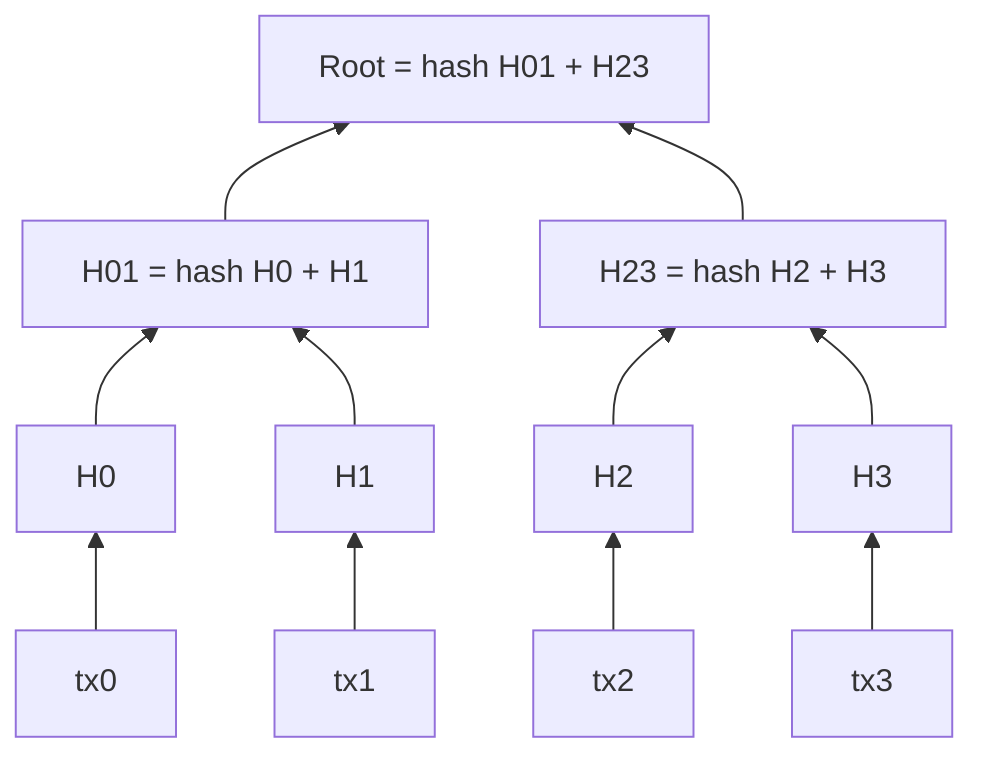

The same structure is used in **Git** (commits and trees), **Cassandra and DynamoDB** (anti-entropy repair), **IPFS**, **certificate transparency logs**, **ZFS/Btrfs** and **BitTorrent v2**.

## 3.2 Why Do We Need It?

| Problem | Merkle tree solution |
|---|---|
| A phone wallet wants to know "is my payment in this block?" without downloading all 2,000 transactions | The node sends a short **proof**: the sibling hashes along the path to the root (about log₂ n hashes) |
| Detect whether two big data sets are identical | Compare two root hashes |
| Find *which* part differs | Walk down the tree comparing child hashes (O(log n)) |
| Prove data was not changed | Any change in any leaf changes the root |
| Block header must stay small | The header holds only the 32-byte root |

## 3.3 How It Works

1. **Build:** hash every transaction. Pair neighbours, hash each pair, repeat until one hash remains. If a level has an odd number of nodes, the last one is paired with itself (Bitcoin's rule).
2. **Proof for leaf *i*:** collect the **sibling** hash at every level on the way up (and whether it is left or right).
3. **Verify:** start from the hash of the transaction, combine it with each sibling in the right order, and compare the final result with the trusted root from the block header.
4. **Cost:** proof size is about log₂(n) hashes: 20 hashes (640 bytes) for a block with a million transactions.

## 3.4 Types and Variants

| Variant | Note |
|---|---|
| **Binary Merkle tree** | The classic (Bitcoin) |
| **Merkle Patricia Trie** | Ethereum's state: a Merkle-hashed key→value trie, supports proofs of account balances |
| **Sparse Merkle tree** | Huge key space with mostly empty leaves; proves absence too |
| **Hash list / hash chain** | A flat list (less efficient proof) |
| **Merkle DAG** | Git and IPFS: nodes may be shared |
| **Merkle mountain range** | Append-only variant for logs |
| **Verkle trees** | Newer, much smaller proofs (Ethereum roadmap) |
| **SPV (Simplified Payment Verification)** | Light clients keep only block headers and ask for Merkle proofs |

## 3.5 Complete Java Example - Build a Tree, Prove a Transaction, Detect Tampering

**What it shows:** a tree over 8 transactions (4 levels), a 3-hash proof that `tx5` is in the block, failed verification of a forged transaction, proof sizes for bigger blocks, root change after a one-character edit, and the odd-count duplication weakness.

```java
import java.nio.charset.StandardCharsets;
import java.security.MessageDigest;
import java.util.*;

public class MerkleDemo {

    static String h(String s) {
        try {
            StringBuilder sb = new StringBuilder();
            for (byte b : MessageDigest.getInstance("SHA-256").digest(s.getBytes(StandardCharsets.UTF_8))) sb.append(String.format("%02x", b));
            return sb.toString();
        } catch (Exception e) { throw new RuntimeException(e); }
    }
    static String s(String hash) { return hash.substring(0, 8); }

    // levels.get(0) = leaves, last level = [root]
    static List<List<String>> build(List<String> txs) {
        List<List<String>> levels = new ArrayList<>();
        List<String> level = new ArrayList<>();
        for (String t : txs) level.add(h(t));
        levels.add(level);
        while (level.size() > 1) {
            List<String> next = new ArrayList<>();
            for (int i = 0; i < level.size(); i += 2) {
                String left = level.get(i), right = i + 1 < level.size() ? level.get(i + 1) : left;     // odd node is paired with itself
                next.add(h(left + right));
            }
            levels.add(next); level = next;
        }
        return levels;
    }

    record Step(String sibling, boolean siblingIsLeft) {}

    static List<Step> proof(List<List<String>> levels, int index) {
        List<Step> steps = new ArrayList<>();
        for (int lvl = 0; lvl < levels.size() - 1; lvl++) {
            List<String> level = levels.get(lvl);
            int sib = (index % 2 == 0) ? index + 1 : index - 1;
            String sibHash = sib < level.size() ? level.get(sib) : level.get(index);
            steps.add(new Step(sibHash, index % 2 == 1));
            index /= 2;
        }
        return steps;
    }

    static boolean verify(String tx, List<Step> steps, String root) {
        String cur = h(tx);
        for (Step st : steps) cur = st.siblingIsLeft() ? h(st.sibling() + cur) : h(cur + st.sibling());
        return cur.equals(root);
    }

    public static void main(String[] args) {
        List<String> txs = List.of("tx0 Asha>Ben 5", "tx1 Ben>Chen 2", "tx2 Chen>Dev 1", "tx3 Dev>Esha 4", "tx4 Esha>Fay 3", "tx5 Fay>Gus 2", "tx6 Gus>Hal 1", "tx7 Hal>Asha 9");
        List<List<String>> levels = build(txs);
        String root = levels.get(levels.size() - 1).get(0);
        System.out.println("1) 8 transactions -> tree with " + levels.size() + " levels; root = " + s(root) + "...");
        for (int i = levels.size() - 1; i >= 0; i--)
            System.out.println("   level " + i + ": " + levels.get(i).stream().map(MerkleDemo::s).toList());

        int idx = 5;
        List<Step> p = proof(levels, idx);
        System.out.println("2) proof that '" + txs.get(idx) + "' is in the block: " + p.size() + " hashes " + p.stream().map(x -> (x.siblingIsLeft() ? "L:" : "R:") + s(x.sibling())).toList());
        System.out.println("   verify with only the tx, the " + p.size() + " hashes and the root: " + verify(txs.get(idx), p, root));
        System.out.println("   verify a forged tx 'tx5 Fay>Gus 2000' with the same proof : " + verify("tx5 Fay>Gus 2000", p, root));

        // 3) proof size grows like log2(n)
        for (int n : new int[]{8, 1_000, 1_000_000}) {
            int steps = (int) Math.ceil(Math.log(n) / Math.log(2));
            System.out.printf("3) block with %,9d transactions: proof needs %2d hashes (%d bytes) instead of sending all %,d transactions%n", n, steps, steps * 32, n);
        }

        // 4) any change in any transaction changes the root
        List<String> changed = new ArrayList<>(txs); changed.set(3, "tx3 Dev>Esha 40");
        String root2 = build(changed).get(build(changed).size() - 1).get(0);
        System.out.println("4) change one character in tx3: root " + s(root) + "... -> " + s(root2) + "...  (equal? " + root.equals(root2) + ")");

        // 5) odd number of transactions: the last one is paired with itself
        List<String> seven = txs.subList(0, 7);
        List<String> sevenDup = new ArrayList<>(seven); sevenDup.add(seven.get(6));
        String rootOdd = build(seven).get(build(seven).size() - 1).get(0), rootDup = build(sevenDup).get(build(sevenDup).size() - 1).get(0);
        System.out.println("5) 7 transactions and the same 7 + a copy of the last one give the same root: " + rootOdd.equals(rootDup)
                + "   (a known Bitcoin weakness, CVE-2012-2459: blocks with duplicated trailing transactions share a root)");
    }
}
```

**Output** (identical on all 3 runs):

```text
1) 8 transactions -> tree with 4 levels; root = 21414fae...
   level 3: [21414fae]
   level 2: [2823cb93, b20e266e]
   level 1: [df8737a4, fc887f5e, 321517fd, 27b1e4b8]
   level 0: [b0c6e2ae, 5590eb67, d89fb500, afd65c2c, d8d3ff25, d5c6cffa, 2b43efde, e513f57c]
2) proof that 'tx5 Fay>Gus 2' is in the block: 3 hashes [L:d8d3ff25, R:27b1e4b8, L:2823cb93]
   verify with only the tx, the 3 hashes and the root: true
   verify a forged tx 'tx5 Fay>Gus 2000' with the same proof : false
3) block with         8 transactions: proof needs  3 hashes (96 bytes) instead of sending all 8 transactions
3) block with     1,000 transactions: proof needs 10 hashes (320 bytes) instead of sending all 1,000 transactions
3) block with 1,000,000 transactions: proof needs 20 hashes (640 bytes) instead of sending all 1,000,000 transactions
4) change one character in tx3: root 21414fae... -> e7289595...  (equal? false)
5) 7 transactions and the same 7 + a copy of the last one give the same root: true   (a known Bitcoin weakness, CVE-2012-2459: blocks with duplicated trailing transactions share a root)
```

**What the output shows**
- **1:** 8 leaves → 4 levels → one root. Each printed hash is shortened to 8 characters.
- **2:** the proof for `tx5` is only **3 hashes** (left sibling `d8d3ff25` of tx4, right sibling `27b1e4b8`, left sibling `2823cb93`). Using just the transaction, those 3 hashes and the root, verification returns **true**. A forged amount (`2000`) with the same proof returns **false**.
- **3:** 1,000,000 transactions need only a 20-hash proof (640 bytes). That is why light wallets work on phones.
- **4:** changing one character in one transaction changes the root completely.
- **5:** with 7 transactions the last is paired with itself, so "7 transactions" and "the same 7 plus a copy of the last" produce the **same root**. This was a real Bitcoin weakness (CVE-2012-2459). Defences: reject blocks with duplicate transactions, or use domain-separated hashing for leaves vs inner nodes (a leaf-prefix and node-prefix byte also prevents leaf/node confusion attacks).

## 3.6 Merkle Trees in Java

```java
// Using Guava's hashing and a simple recursive build (production: use a vetted library)
List<byte[]> level = txs.stream().map(t -> sha256(concat(new byte[]{0x00}, t))).toList();      // 0x00 prefix = leaf
while (level.size() > 1) {
    List<byte[]> next = new ArrayList<>();
    for (int i = 0; i < level.size(); i += 2) {
        byte[] left = level.get(i), right = i + 1 < level.size() ? level.get(i + 1) : left;
        next.add(sha256(concat(new byte[]{0x01}, left, right)));                               // 0x01 prefix = inner node
    }
    level = next;
}
```
- **bitcoinj:** `PartialMerkleTree` / `Block.verifyTransactions` for SPV proofs.
- **web3j / Besu:** `eth_getProof` returns a Merkle-Patricia proof of an account or storage slot.
- **Git** in Java: JGit uses the same Merkle structure (commit → tree → blob).
- **Data sync:** Cassandra's repair builds Merkle trees over token ranges to find differing partitions without comparing every row ([07_Distributed_Systems_Pattern.md](../03_System_Design/07_Distributed_Systems_Pattern.md)).

## 3.7 Pros and Cons

| Pros | Cons |
|---|---|
| Tiny proofs (O(log n)) | Updating one leaf needs O(log n) rehashing |
| Tamper-evident; quick comparison of large data | Proves inclusion, not that the data itself is *true* |
| Efficient synchronisation | Odd-node and second-preimage subtleties need careful implementation |

## 3.8 Pitfalls, Interview Questions and Cheat Sheet

**Common pitfalls**
- No leaf/inner-node domain separation (second-preimage attack).
- Duplicating the last node when the count is odd without rejecting duplicate transactions.
- Sending the proof without the left/right order.
- Trusting a root that did not come from a verified block header.
- Using a weak or non-cryptographic hash.

**Interview questions**
1. *What is a Merkle tree and what is it used for?* → A hash tree whose root fingerprints all leaves; used for efficient inclusion proofs and data comparison (blockchains, Git, Cassandra repair, IPFS).
2. *How big is a Merkle proof?* → About log₂(n) hashes.
3. *How does SPV work?* → A light client stores block headers (with the Merkle root) and asks a full node for the sibling hashes to verify a transaction.
4. *What happens if you change one transaction?* → Its leaf hash changes, and so does every hash on the path up, including the root.
5. *Where else do you see Merkle trees?* → Git, IPFS, certificate transparency, ZFS, DynamoDB/Cassandra anti-entropy.

**Cheat sheet**
```
leaf = H(tx);  parent = H(left + right);  odd node pairs with itself;  root in the block header
Proof = sibling hashes up the path (+ left/right);  verify by recomputing up to the root
Size  : log2(n) hashes;  Detects : any change;  Variants: Patricia trie (Ethereum), sparse, Verkle
Safety: prefix leaves vs nodes; reject duplicate txs
```

### 📘 Terms Explained

| Term | Meaning |
|---|---|
| **Merkle tree** | A tree where each node is the hash of its children |
| **Merkle root** | The top hash that fingerprints all the data |
| **Merkle proof** | The sibling hashes needed to recompute the root from one leaf |
| **SPV / light client** | A client that verifies using only block headers and proofs |
| **Leaf** | The bottom of the tree: a hash of one data item |
| **Second-preimage attack** | Finding different data with the same hash (or passing an inner node as a leaf) |
| **Anti-entropy** | Background process that compares replicas and repairs differences |
| **Patricia trie** | A compressed prefix tree; Ethereum hashes it to form a Merkle-Patricia trie |

---

# 4. Byzantine Fault Tolerance (BFT)

## 4.1 What Is It?

Most distributed systems (Raft, Paxos, [07_Distributed_Systems_Pattern.md](../03_System_Design/07_Distributed_Systems_Pattern.md)) assume nodes fail by **crashing**. A **Byzantine fault** (#410) is worse: a node may **lie, send different answers to different peers, collude, or be hacked**. **BFT** protocols reach agreement correctly as long as **fewer than one third** of the nodes are Byzantine:

> **n ≥ 3f + 1** nodes are needed to tolerate **f** Byzantine nodes (for example 4 nodes tolerate 1; 7 tolerate 2).

The name comes from the *Byzantine Generals Problem* (Lamport, Shostak, Pease, 1982): generals must agree to attack or retreat while some may be traitors sending conflicting messages.

## 4.2 Why Do We Need It?

| Setting | Why crash-fault tolerance is not enough |
|---|---|
| Consortium blockchains (banks, supply chains) | Members don't fully trust each other |
| Public blockchains | Anyone can be malicious |
| Aerospace and safety systems | Faulty hardware can send *wrong* data, not only stop |
| Critical infrastructure with security threats | A compromised node is Byzantine by definition |

## 4.3 How It Works

A simplified PBFT-style round (Castro & Liskov, 1999) with a **leader** (primary) and **replicas**:

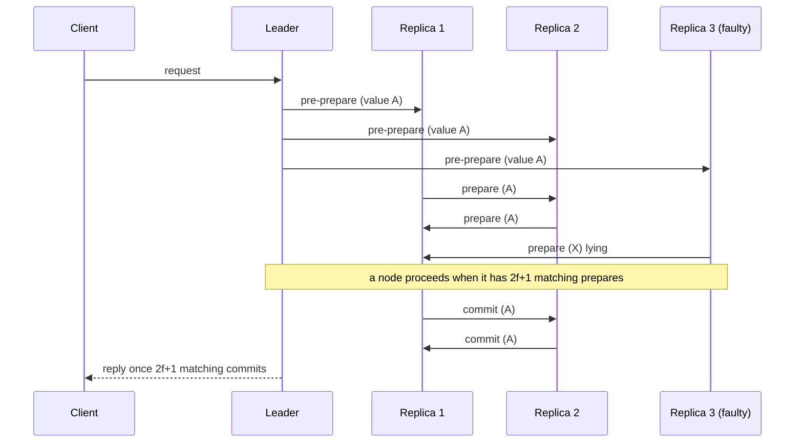

**Why 2f+1 out of 3f+1?** Take any two quorums of size 2f+1 in a system of 3f+1: they overlap in at least **f+1** nodes. At most f of those are Byzantine, so **at least one honest node is in both quorums**, and an honest node never votes for two different values in the same slot, so two conflicting decisions are impossible (**safety**). With 3f+1 nodes, 2f+1 honest nodes still exist even if f are faulty or silent, so progress is possible (**liveness**).

If the leader is faulty (sends different values to different replicas), no value gets 2f+1 votes; replicas time out and run a **view change** to elect a new leader.

## 4.4 Types and Variants

| Protocol | Notes |
|---|---|
| **PBFT** | The classic; O(n²) messages per decision, suitable for tens of nodes |
| **Tendermint / CometBFT** | BFT with rotating proposers, instant finality (Cosmos) |
| **HotStuff** | Linear communication, basis of LibraBFT/DiemBFT |
| **IBFT / QBFT** | Used by Hyperledger Besu / Quorum private networks |
| **Hyperledger Fabric** | Pluggable ordering service (Raft by default, BFT options in newer versions) |
| **Nakamoto consensus (PoW)** | Probabilistic, tolerates up to <50% hash power, no fixed membership |
| **Crash-fault: Raft / Paxos** | n = 2f + 1; cheaper but cannot handle lying nodes |
| **Proof of Authority** | A few known validators, often running a BFT-style protocol |

## 4.5 Complete Java Example - 2f+1 Quorums, Faulty Nodes, a Lying Leader and Quorum Overlap

**What it shows:** one voting round with different numbers of Byzantine nodes (commit or no commit), a leader that sends two different values, and a brute-force check that any two quorums of size 2f+1 in 3f+1 nodes overlap in f+1 nodes.

```java
import java.util.*;

public class BftDemo {

    // One voting round of a PBFT-style protocol: the leader proposes a value, every node votes for what it received,
    // a value is COMMITTED when at least 2f+1 nodes voted for the same value (f = number of faults the system must tolerate).
    static String round(int n, int f, Set<Integer> byzantine, boolean leaderEquivocates) {
        int quorum = 2 * f + 1;
        Map<String, Integer> votes = new TreeMap<>();
        for (int node = 0; node < n; node++) {
            String received = "BLOCK-A";
            if (leaderEquivocates && node % 2 == 1) received = "BLOCK-B";                // a lying leader sends different values to different nodes
            String vote = byzantine.contains(node) ? "BLOCK-X" : received;                // faulty nodes vote for anything
            votes.merge(vote, 1, Integer::sum);
        }
        String winner = null;
        for (var e : votes.entrySet()) if (e.getValue() >= quorum) winner = e.getKey();
        return "votes=" + votes + " quorum=" + quorum + " -> " + (winner == null ? "NO COMMIT (stalls, would trigger a view change)" : "COMMIT " + winner);
    }

    public static void main(String[] args) {
        System.out.println("1) n = 3f + 1 nodes tolerate f Byzantine (arbitrarily misbehaving) nodes");
        System.out.println("   n=4, f=1, node 3 faulty            : " + round(4, 1, Set.of(3), false));
        System.out.println("   n=4, f=1, leader sends two values  : " + round(4, 1, Set.of(), true));
        System.out.println("   n=4 but 2 nodes faulty (f too big) : " + round(4, 1, Set.of(2, 3), false));
        System.out.println("   n=7, f=2, nodes 5,6 faulty         : " + round(7, 2, Set.of(5, 6), false));
        System.out.println("   n=7, f=2, three faulty (too many)  : " + round(7, 2, Set.of(4, 5, 6), false));

        // 2) why 2f+1 out of 3f+1: any two quorums overlap in at least f+1 nodes, so at least one HONEST node is in both
        for (int f = 1; f <= 3; f++) {
            int n = 3 * f + 1, q = 2 * f + 1, minOverlap = Integer.MAX_VALUE;
            List<Integer> masks = new ArrayList<>();
            for (int m = 0; m < (1 << n); m++) if (Integer.bitCount(m) == q) masks.add(m);
            for (int a : masks) for (int b : masks) minOverlap = Math.min(minOverlap, Integer.bitCount(a & b));
            System.out.printf("2) f=%d: n=%d, quorum=%d; smallest overlap between ANY two quorums = %d (f+1 = %d) -> they always share an honest node%n", f, n, q, minOverlap, f + 1);
        }

        // 3) crash-fault protocols (Raft/Paxos) are cheaper: n = 2f + 1 and a simple majority
        for (int f = 1; f <= 3; f++) System.out.printf("3) tolerate %d faulty nodes: crash-only (Raft) needs %d nodes, Byzantine (PBFT) needs %d nodes%n", f, 2 * f + 1, 3 * f + 1);
    }
}
```

**Output** (identical on all 3 runs):

```text
1) n = 3f + 1 nodes tolerate f Byzantine (arbitrarily misbehaving) nodes
   n=4, f=1, node 3 faulty            : votes={BLOCK-A=3, BLOCK-X=1} quorum=3 -> COMMIT BLOCK-A
   n=4, f=1, leader sends two values  : votes={BLOCK-A=2, BLOCK-B=2} quorum=3 -> NO COMMIT (stalls, would trigger a view change)
   n=4 but 2 nodes faulty (f too big) : votes={BLOCK-A=2, BLOCK-X=2} quorum=3 -> NO COMMIT (stalls, would trigger a view change)
   n=7, f=2, nodes 5,6 faulty         : votes={BLOCK-A=5, BLOCK-X=2} quorum=5 -> COMMIT BLOCK-A
   n=7, f=2, three faulty (too many)  : votes={BLOCK-A=4, BLOCK-X=3} quorum=5 -> NO COMMIT (stalls, would trigger a view change)
2) f=1: n=4, quorum=3; smallest overlap between ANY two quorums = 2 (f+1 = 2) -> they always share an honest node
2) f=2: n=7, quorum=5; smallest overlap between ANY two quorums = 3 (f+1 = 3) -> they always share an honest node
2) f=3: n=10, quorum=7; smallest overlap between ANY two quorums = 4 (f+1 = 4) -> they always share an honest node
3) tolerate 1 faulty nodes: crash-only (Raft) needs 3 nodes, Byzantine (PBFT) needs 4 nodes
3) tolerate 2 faulty nodes: crash-only (Raft) needs 5 nodes, Byzantine (PBFT) needs 7 nodes
3) tolerate 3 faulty nodes: crash-only (Raft) needs 7 nodes, Byzantine (PBFT) needs 10 nodes
```

**What the output shows**
- **n=4, f=1, one faulty node:** three honest votes for `BLOCK-A` meet the quorum of 3 → **COMMIT**. The faulty vote for `BLOCK-X` is outvoted.
- **A lying leader** (sends `A` to some nodes and `B` to others): 2 votes each, neither reaches 3 → **no commit**, no wrong decision. The system stalls safely and a view change would replace the leader.
- **Too many faulty nodes** (2 of 4, or 3 of 7): the quorum is not reached → no commit. Note: here the faulty nodes merely failed to help. If *more* than f nodes can collude, the system can be made to commit conflicting values; that is why the f < n/3 bound is a hard limit.
- **2:** brute force over every pair of quorums confirms the overlap is exactly f+1 (2, 3, 4 for f = 1, 2, 3), so any two quorums share at least one honest node.
- **3:** the price of distrust: tolerating 3 faulty nodes takes 7 nodes with crash-only protocols and 10 with Byzantine ones, plus far more messages.

## 4.6 BFT in Java

```java
// Hyperledger Besu private network with QBFT (genesis.json fragment)
// { "config": { "chainId": 1337, "qbft": { "blockperiodseconds": 2, "epochlength": 30000, "requesttimeoutseconds": 4 } } }
// Run 4 validators: tolerates 1 Byzantine one (n >= 3f+1).  Add validators by voting:  qbft_proposeValidatorVote(address, true)

// Hyperledger Fabric chaincode in Java: business logic that the ordering service + endorsing peers agree on
public class AssetContract implements ContractInterface {
    @Transaction public void transfer(Context ctx, String assetId, String newOwner) {
        Asset a = read(ctx, assetId);
        if (!a.owner().equals(ctx.getClientIdentity().getId())) throw new ChaincodeException("not the owner");
        ctx.getStub().putState(assetId, serialize(a.withOwner(newOwner)));
    }
}
```
Use the **endorsement policy** ("2 of 3 organisations must sign") as the business-level analogue of a Byzantine quorum. Libraries: **BFT-SMaRt** (a Java BFT state-machine-replication library), **Tendermint** apps through ABCI (Java ABCI servers exist), **Corda** notaries (can be BFT clusters).

## 4.7 Pros and Cons

| Pros | Cons |
|---|---|
| Safe even if a third of nodes are malicious | n ≥ 3f + 1 and heavy messaging (O(n²) in classic PBFT) |
| Immediate finality (no forks) | Doesn't scale to thousands of validators without tricks |
| Good for known membership | Membership management and key distribution are required |

## 4.8 Pitfalls, Interview Questions and Cheat Sheet

**Common pitfalls**
- Using a crash-fault protocol (Raft) when members may be malicious.
- Deploying exactly 3 nodes and expecting to tolerate 1 Byzantine failure (needs 4).
- All validators run by one organisation or in one cloud account (a single compromise = all faulty).
- Ignoring network partitions and timeouts in view-change logic.
- Confusing "Byzantine" with "unreliable network".

**Interview questions**
1. *What is a Byzantine fault?* → A node that behaves arbitrarily: crashes, lies, equivocates or is controlled by an attacker.
2. *Why n ≥ 3f + 1?* → To still have a quorum of honest nodes (2f+1) when f are faulty and f more are slow; and any two quorums must share an honest node.
3. *Raft vs PBFT?* → Raft: crash faults, n = 2f+1, simple majority, much faster. PBFT: Byzantine faults, n = 3f+1, 2f+1 quorums, more messages.
4. *How does a blockchain handle Byzantine behaviour differently?* → PoW/PoS use economics (work, stake, slashing) to tolerate adversaries in an open network; BFT protocols use quorum voting among known validators.
5. *What happens if the leader is Byzantine?* → No quorum forms, timers fire, and a view change elects a new leader.

**Cheat sheet**
```
Crash faults : n = 2f+1, majority (Raft/Paxos)        Byzantine faults: n = 3f+1, quorum 2f+1 (PBFT)
Two quorums of 2f+1 overlap in >= f+1 nodes => at least one honest node in both => no conflicting commits
Bad leader => no quorum => view change.   Used by: Tendermint, QBFT/IBFT (Besu), HotStuff, BFT-SMaRt
```

### 📘 Terms Explained

| Term | Meaning |
|---|---|
| **Byzantine fault** | A node behaving arbitrarily or maliciously |
| **BFT** | Byzantine Fault Tolerance |
| **f** | The maximum number of faulty nodes the system tolerates |
| **Quorum** | The minimum number of matching votes needed to decide (2f+1) |
| **Safety / Liveness** | Nothing wrong is decided / something is eventually decided |
| **Equivocation** | Sending different messages to different peers |
| **View change** | Replacing a suspected faulty leader |
| **State machine replication** | Many replicas applying the same ordered commands to stay identical |
| **PBFT** | Practical Byzantine Fault Tolerance |

---

# 5. Smart Contracts and Tokens (Interview Imp - Java)

## 5.1 What Are They?

- **Smart contract (#403):** a program stored **on the blockchain** that runs the same way on **every validating node**. Users call its functions by sending transactions. Its code and data live at an address on the chain; nobody can quietly change the rules (unless the contract allows upgrades). Examples: Ethereum (Solidity, executed by the EVM), Hyperledger Fabric ("chaincode", which can be written in Java), Corda ("CorDapps" in Java/Kotlin).
- **Token (#404):** a *ledger entry managed by a smart contract*: a table of `address → balance` plus rules (`transfer`, `approve`, `transferFrom`). The most famous standards on Ethereum: **ERC-20** (interchangeable "fungible" tokens like a stablecoin), **ERC-721** (unique NFTs), **ERC-1155** (mixed).

> A smart contract is neither "smart" nor a legal contract. It is a deterministic program whose execution everyone verifies.

## 5.2 Why Do We Need Them?

| Need | How a contract helps |
|---|---|
| Automatic escrow, payment on a condition | Code holds the money and releases it by rule, with no intermediary |
| A shared source of truth for assets and balances | The token contract *is* the ledger |
| Multiple companies automating a shared process | Same code executed and agreed by all |
| Composability | Contracts call each other (a lending contract uses a token contract) |

## 5.3 How It Works

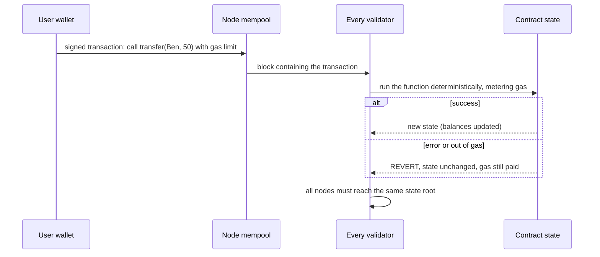

Key ideas:
1. **Deterministic execution:** same input → same output on every node. No random numbers, no clock reads, no network calls inside the contract (that is why [oracles](#6-oracle-pattern) exist).
2. **Gas:** every operation costs gas; the caller sets a limit. Gas stops infinite loops and pays validators. If gas runs out, **all changes are rolled back** but the fee is still charged.
3. **Atomicity:** a transaction either fully succeeds or is fully reverted.
4. **Immutability:** deployed code can't be edited; bugs are permanent unless you built an upgrade mechanism (proxy pattern) or a pause switch.
5. **Public state:** everything on a public chain is visible to everyone, so never store secrets.
6. **ERC-20 core functions:** `balanceOf`, `transfer`, `approve(spender, amount)`, `transferFrom(owner, to, amount)`, `allowance`; events `Transfer`, `Approval`.

**The classic bug: re-entrancy.** If a contract sends money to another contract *before* it updates its own books, the receiver's code can call back into the first contract while its balance still looks unspent, and withdraw repeatedly (The DAO hack, 2016, about $60 million). The cure is **checks-effects-interactions**: check conditions, update state, and only then call out; plus a re-entrancy lock.

## 5.4 Types and Variants

| Variant | Note |
|---|---|
| **EVM contracts (Solidity, Vyper)** | Ethereum and compatible chains (Polygon, BNB Chain, Avalanche C-Chain) |
| **WASM contracts (Rust)** | Solana (Rust), Polkadot, CosmWasm |
| **Chaincode (Java, Go, JavaScript)** | Hyperledger Fabric; business-network logic |
| **Corda flows/contracts (Java/Kotlin)** | Contracts verify transactions between parties; not global state |
| **Fungible token (ERC-20)** | Currency, shares, stablecoins |
| **Non-fungible token (ERC-721)** | Unique items: tickets, deeds, art |
| **Security / utility / governance tokens** | Different legal and economic purposes (consult a lawyer) |
| **Stablecoin / CBDC** | Tokens pegged to a currency, issued by companies or central banks |
| **Upgradeable proxies** | A fixed address delegating to replaceable logic (adds trust in the admin) |
| **Formal verification & audits** | Reduce the risk of permanent bugs |

## 5.5 Complete Java Example - A Token With Allowances, Gas and Revert, and the Re-Entrancy Bug

**What it shows:** (1) an ERC-20-style token (`transfer`, `approve`, `transferFrom`) with overflow-safe arithmetic; (2) a transaction runner that meters gas and restores the previous state if anything fails, including running out of gas half-way; (3) a bank with a re-entrancy bug and the checks-effects-interactions fix.

```java
import java.util.*;

public class ContractDemo {

    // ================= Token contract (ERC-20 style) =================
    static class Token {
        final String symbol; long totalSupply;
        final Map<String, Long> balances = new TreeMap<>();
        final Map<String, Long> allowances = new HashMap<>();            // key "owner>spender"
        Token(String symbol, String creator, long supply) { this.symbol = symbol; totalSupply = supply; balances.put(creator, supply); }

        long balanceOf(String a) { return balances.getOrDefault(a, 0L); }
        void transfer(String from, String to, long amount) {
            if (amount <= 0) throw new IllegalStateException("amount must be positive");
            if (balanceOf(from) < amount) throw new IllegalStateException("insufficient balance: " + from + " has " + balanceOf(from));
            balances.put(from, balanceOf(from) - amount);
            balances.put(to, Math.addExact(balanceOf(to), amount));       // addExact throws on overflow instead of wrapping around silently
        }
        void approve(String owner, String spender, long amount) { allowances.put(owner + ">" + spender, amount); }
        void transferFrom(String spender, String owner, String to, long amount) {
            long allowed = allowances.getOrDefault(owner + ">" + spender, 0L);
            if (allowed < amount) throw new IllegalStateException("allowance too low: " + allowed);
            allowances.put(owner + ">" + spender, allowed - amount);
            transfer(owner, to, amount);
        }
    }

    // ================= Gas metering + all-or-nothing execution =================
    static class OutOfGas extends RuntimeException { OutOfGas(String m) { super(m); } }
    static class Vm {
        long gasLeft;
        Vm(long gas) { gasLeft = gas; }
        void burn(long units, String op) { gasLeft -= units; if (gasLeft < 0) throw new OutOfGas("out of gas during " + op); }
    }
    // run a transaction: if anything throws, restore the snapshot (revert). Gas is still paid.
    static String execute(Token t, long gasLimit, java.util.function.Consumer<Vm> body) {
        Map<String, Long> snapshot = new TreeMap<>(t.balances);
        Vm vm = new Vm(gasLimit);
        try { body.accept(vm); return "SUCCESS, gas used " + (gasLimit - vm.gasLeft); }
        catch (RuntimeException e) { t.balances.clear(); t.balances.putAll(snapshot); return "REVERTED (" + e.getMessage() + "), state restored, gas used " + (gasLimit - Math.max(vm.gasLeft, 0)); }
    }

    // ================= Re-entrancy: the classic smart-contract bug =================
    interface Receiver { void receive(Bank bank, long amount); }
    static class Bank {
        final Map<String, Long> deposits = new HashMap<>(); long vaultBalance = 0; final boolean safe; int callbacks = 0;
        Bank(boolean safe) { this.safe = safe; }
        void deposit(String who, long amt) { deposits.merge(who, amt, Long::sum); vaultBalance += amt; }
        void withdrawAll(String who, Receiver r) {
            long amt = deposits.getOrDefault(who, 0L);
            if (amt == 0 || vaultBalance < amt) return;
            if (safe) deposits.put(who, 0L);              // checks-effects-interactions: update the books BEFORE calling out
            vaultBalance -= amt; callbacks++;
            r.receive(this, amt);                         // external call: the receiver's code runs now
            if (!safe) deposits.put(who, 0L);             // vulnerable: books updated AFTER the external call
        }
    }

    public static void main(String[] args) {
        Token t = new Token("COIN", "Asha", 1000);
        t.transfer("Asha", "Ben", 300);
        t.approve("Ben", "Shop", 100);
        t.transferFrom("Shop", "Ben", "Chen", 60);
        System.out.println("1) token balances " + t.balances + "  total supply " + t.totalSupply + " (sum = " + t.balances.values().stream().mapToLong(Long::longValue).sum() + ")");
        System.out.println("   remaining Shop allowance on Ben: " + t.allowances.get("Ben>Shop"));
        try { t.transferFrom("Shop", "Ben", "Chen", 60); } catch (IllegalStateException e) { System.out.println("   second transferFrom of 60 rejected: " + e.getMessage()); }

        System.out.println("2) all-or-nothing execution with gas");
        System.out.println("   enough gas  : " + execute(t, 1000, vm -> { vm.burn(100, "transfer"); t.transfer("Asha", "Dev", 50); vm.burn(100, "transfer"); t.transfer("Asha", "Esha", 50); }));
        System.out.println("   balances    : " + t.balances);
        System.out.println("   too little  : " + execute(t, 150, vm -> { vm.burn(100, "transfer 1"); t.transfer("Asha", "Dev", 50); vm.burn(100, "transfer 2"); t.transfer("Asha", "Esha", 50); }));
        System.out.println("   balances    : " + t.balances + "  <- the first transfer was undone as well");
        System.out.println("   bad logic   : " + execute(t, 1000, vm -> { vm.burn(10, "transfer"); t.transfer("Chen", "Dev", 5_000); }));

        System.out.println("3) re-entrancy");
        for (boolean safe : new boolean[]{false, true}) {
            Bank bank = new Bank(safe);
            bank.deposit("honest-1", 500); bank.deposit("honest-2", 500); bank.deposit("attacker", 100);
            long[] stolen = {0};
            Receiver evil = new Receiver() {
                int depth = 0;
                public void receive(Bank b, long amount) { stolen[0] += amount; if (++depth < 5) b.withdrawAll("attacker", this); }     // call withdraw again from inside the callback
            };
            bank.withdrawAll("attacker", evil);
            System.out.printf("   %-30s attacker deposited 100, took out %d, vault left with %d%n", safe ? "checks-effects-interactions:" : "vulnerable (effects after call):", stolen[0], bank.vaultBalance);
        }
    }
}
```

**Output** (identical on all 3 runs):

```text
1) token balances {Asha=700, Ben=240, Chen=60}  total supply 1000 (sum = 1000)
   remaining Shop allowance on Ben: 40
   second transferFrom of 60 rejected: allowance too low: 40
2) all-or-nothing execution with gas
   enough gas  : SUCCESS, gas used 200
   balances    : {Asha=600, Ben=240, Chen=60, Dev=50, Esha=50}
   too little  : REVERTED (out of gas during transfer 2), state restored, gas used 150
   balances    : {Asha=600, Ben=240, Chen=60, Dev=50, Esha=50}  <- the first transfer was undone as well
   bad logic   : REVERTED (insufficient balance: Chen has 60), state restored, gas used 10
3) re-entrancy
   vulnerable (effects after call): attacker deposited 100, took out 500, vault left with 600
   checks-effects-interactions:   attacker deposited 100, took out 100, vault left with 1000
```

**What the output shows**
- **1:** Asha 700, Ben 240, Chen 60, total supply still 1,000 (a ledger never creates or loses tokens in a transfer). Ben approved the Shop for 100, and the Shop spent 60 through `transferFrom`, leaving an allowance of 40. A second `transferFrom` of 60 is rejected.
- **2 enough gas:** two transfers cost 200 gas and both stick. **Too little gas:** the second operation runs out of gas → the **first transfer is undone too** (Dev and Esha balances unchanged) and the gas used is still charged. **Bad logic:** an overdraft attempt reverts with the reason.
- **3 re-entrancy:** the attacker deposited **100** but the vulnerable bank paid out **500** (its callback re-entered `withdrawAll` while its balance was still 100, five times) and the vault dropped from 1,100 to 600. With checks-effects-interactions (books updated before the external call) the attacker gets only **100** and the vault keeps its 1,000.

## 5.6 Smart Contracts From Java

```solidity
// Solidity (not Java): a minimal escrow, safe against re-entrancy
contract Escrow {
    mapping(address => uint256) public deposits;
    function deposit() external payable { deposits[msg.sender] += msg.value; }

    function withdraw() external {
        uint256 amount = deposits[msg.sender];       // 1. checks
        require(amount > 0, "nothing to withdraw");
        deposits[msg.sender] = 0;                    // 2. effects  (update state FIRST)
        (bool ok, ) = msg.sender.call{value: amount}("");   // 3. interactions (call out LAST)
        require(ok, "transfer failed");
    }
}
```

```java
// web3j: call and send transactions from a Spring Boot service (generated wrapper class from the compiled contract)
Web3j web3 = Web3j.build(new HttpService("https://eth-node.example.com"));           // your own node or Infura/Alchemy
Credentials creds = Credentials.create(privateKeyFromVault);                         // never hard-code keys
TransactionManager tm = new RawTransactionManager(web3, creds, chainId);

Escrow escrow = Escrow.load(contractAddress, web3, tm, new DefaultGasProvider());
BigInteger mine = escrow.deposits(creds.getAddress()).send();                         // read: free (eth_call)
TransactionReceipt r = escrow.deposit(BigInteger.valueOf(1_000_000)).send();          // write: costs gas, waits for the receipt
if (!"0x1".equals(r.getStatus())) throw new IllegalStateException("reverted: " + r.getTransactionHash());
// events: escrow.depositEventFlowable(startBlock, endBlock).subscribe(e -> updateDatabase(e));   // index the chain into your DB
```

```java
// Hyperledger Fabric chaincode in Java: same ideas, permissioned network, no gas
@Contract(name = "TokenContract") @Default
public class TokenContract implements ContractInterface {
    @Transaction
    public void transfer(Context ctx, String from, String to, long amount) {
        long fromBal = balance(ctx, from);
        if (fromBal < amount) throw new ChaincodeException("insufficient balance");
        put(ctx, from, fromBal - amount);
        put(ctx, to, balance(ctx, to) + amount);          // Fabric runs this as an atomic read-write set; conflicts are detected at commit
    }
}
```
**Application integration rules:** read through a node with caching; wait for the required **confirmations/finality** before updating your database; handle **reorgs** (rollback your copy); make your own handlers **idempotent** (events can repeat); keep private keys in an HSM/KMS; simulate (`eth_call`, `estimateGas`) before sending; and audit every contract before holding real value.

## 5.7 Pros and Cons

| Pros | Cons |
|---|---|
| Automatic, transparent, tamper-resistant execution | Bugs are permanent and public; losses are real (re-entrancy, overflow, access control) |
| No intermediary for escrow-type logic | Gas costs, throughput limits, public data |
| Composable building blocks | Deterministic sandbox: no outside data without oracles |
| Auditable by anyone | Legal and regulatory uncertainty |

## 5.8 Pitfalls, Interview Questions and Cheat Sheet

**Common pitfalls**
- **Re-entrancy** (external call before state update).
- Integer overflow/underflow in old Solidity (<0.8); use checked arithmetic.
- Missing access control (anyone can call `mint` or `withdrawAll`).
- Trusting `tx.origin`, block timestamps or on-chain "randomness".
- Unbounded loops (gas exhaustion makes the function unusable).
- Storing secrets on-chain.
- Treating a transaction as final too early (reorgs) or assuming it can be cancelled.

**Interview questions**
1. *What is a smart contract?* → A deterministic program stored on a blockchain and executed identically by all validating nodes.
2. *What is gas and why does it exist?* → A fee per operation; it stops infinite loops, prices computation and pays validators.
3. *What happens when a transaction fails half-way?* → Everything is reverted; the gas used is still charged.
4. *What is a re-entrancy attack and how do you prevent it?* → A callback re-calls the vulnerable function before state was updated; use checks-effects-interactions, a re-entrancy guard and pull-payments.
5. *ERC-20 vs ERC-721?* → Fungible, interchangeable balances vs unique tokens with distinct ids.
6. *Why `approve` and `transferFrom`?* → Lets a contract (an exchange, a shop) move a limited amount of your tokens on your behalf.
7. *How does a Java back end work with a contract?* → web3j wrapper/JSON-RPC, event indexing, confirmation handling, idempotent processing, key management in a vault.

**Cheat sheet**
```
Contract = deterministic code + state on every node;  call = signed transaction;  gas metered, failure => full revert
Token (ERC-20): balances + transfer / approve / transferFrom;  ERC-721 = unique ids
Safe pattern: checks -> effects (update state) -> interactions (external calls)
Java: web3j (Ethereum), Fabric chaincode (Java), Corda; wait for finality; idempotent event handlers; keys in HSM/KMS
```

### 📘 Terms Explained

| Term | Meaning |
|---|---|
| **Smart contract** | A program stored and executed on a blockchain |
| **EVM** | Ethereum Virtual Machine: the runtime that executes contracts |
| **Gas** | The unit of computation cost in a transaction |
| **Revert** | Undoing all state changes of a failed transaction |
| **ERC-20 / ERC-721** | Standard interfaces for fungible / non-fungible tokens |
| **Allowance** | The amount a spender may take from an owner's balance |
| **Re-entrancy** | Calling back into a contract before it finished updating its state |
| **Chaincode** | Hyperledger Fabric's name for a smart contract |
| **Reorg** | The chain switches to a different recent history, undoing some blocks |
| **web3j** | A Java library for Ethereum |

---

# 6. Oracle Pattern

## 6.1 What Is It?

A blockchain is a **closed world**: contracts can only see data already on the chain, and they must be deterministic, so they cannot call a web API (different nodes might get different answers). An **oracle** (#405) is the service that **brings outside information onto the chain** (a price, a sports score, the weather, a shipment scan, a random number) in a way the contract can trust.

> The oracle problem: a blockchain removes the need to trust a bank, but a single oracle brings the trust back. Good designs spread the trust.

## 6.2 Why Do We Need It?

| Contract that needs... | Outside data |
|---|---|
| A loan that liquidates when collateral falls | ETH/USD price |
| Crop insurance | Rainfall or satellite data |
| Flight-delay insurance | Flight status |
| Supply-chain payment on delivery | IoT scan of a container ([09_IoT_Pattern.md](09_IoT_Pattern.md)) |
| Fair lottery | Verifiable randomness |

## 6.3 How It Works

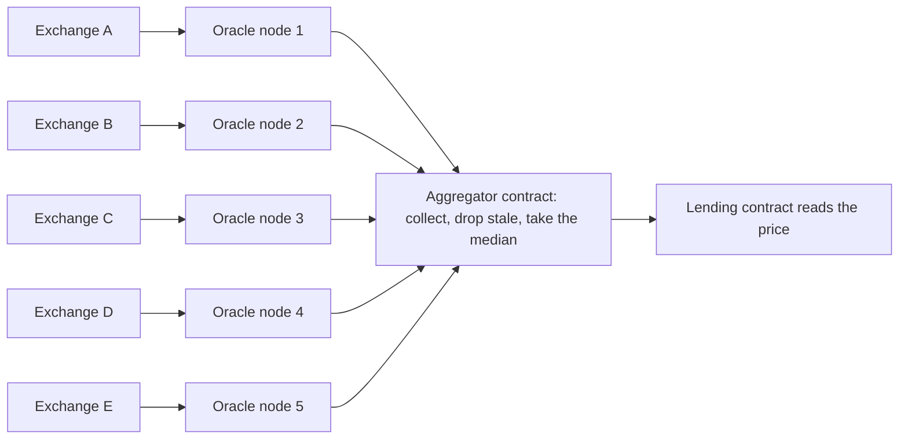

Defences used by good oracle designs:
1. **Many independent sources and many independent nodes** (no single point of failure).
2. **Median, not mean:** one wild value can't drag the median; the median survives up to ⌊(n−1)/2⌋ liars.
3. **Freshness:** reject data older than a limit (heartbeat and deviation thresholds).
4. **Minimum number of reports** (quorum).
5. **Deviation checks** against other sources or against a time-weighted average price (TWAP).
6. **Economic security:** oracle nodes stake collateral and are slashed for bad data.
7. **Cryptographic proofs** where possible (signed data, TLS proofs, zero-knowledge proofs).
8. **Circuit breakers:** pause the contract if the price moves implausibly fast.

## 6.4 Types and Variants

| Variant | Meaning |
|---|---|
| **Inbound oracle** | Brings external data in (price feed) |
| **Outbound oracle** | Lets a contract trigger an action outside (open a lock, send an email) |
| **Software vs hardware oracle** | Web APIs vs sensors/IoT devices |
| **Centralised oracle** | One operator, simple, but a single point of trust and failure |
| **Decentralised oracle network** | Chainlink, Pyth, Band, API3: many nodes, aggregation, staking |
| **Pull vs push** | Data published regularly on-chain (push) vs fetched with a signed proof when needed (pull) |
| **Verifiable randomness (VRF)** | Random number plus a proof it wasn't manipulated |
| **Consensus oracle / prediction market** | Humans vote on real-world outcomes (UMA, Augur) |
| **Time-weighted average (TWAP)** | Average price over time from a DEX, resists short manipulation |

## 6.5 Complete Java Example - Median vs Mean, Staleness and a Quorum

**What it shows:** five price reports aggregated by a rule set (at least 3 fresh reports, maximum age 60 s). Honest data, one liar, two liars, stale data, and a single thin source.

```java
import java.util.*;

public class OracleDemo {

    record Report(String source, double price, long timestamp) {}

    // Aggregation rules a contract could apply before accepting an external number
    static String aggregate(List<Report> reports, long now, int minSources, long maxAgeSeconds, double maxDeviation) {
        List<Report> fresh = new ArrayList<>();
        for (Report r : reports) if (now - r.timestamp() <= maxAgeSeconds) fresh.add(r);
        if (fresh.size() < minSources) return "REJECT: only " + fresh.size() + " fresh reports (need " + minSources + ")";
        double[] p = fresh.stream().mapToDouble(Report::price).sorted().toArray();
        double median = p.length % 2 == 1 ? p[p.length / 2] : (p[p.length / 2 - 1] + p[p.length / 2]) / 2;
        double mean = Arrays.stream(p).average().orElse(0);
        List<String> outliers = new ArrayList<>();
        for (Report r : fresh) if (Math.abs(r.price() - median) / median > maxDeviation) outliers.add(r.source());
        return String.format("median=%.2f (mean would be %.2f), outliers ignored by the median: %s, from %d fresh reports", median, mean, outliers, fresh.size());
    }

    public static void main(String[] args) {
        long now = 10_000;
        List<Report> honest = List.of(new Report("exchange-A", 2000.10, now - 5), new Report("exchange-B", 1999.80, now - 8),
                new Report("exchange-C", 2000.40, now - 3), new Report("exchange-D", 2000.00, now - 12), new Report("exchange-E", 1999.60, now - 9));
        System.out.println("1) five honest sources           : " + aggregate(honest, now, 3, 60, 0.02));

        List<Report> attacked = new ArrayList<>(honest);
        attacked.set(4, new Report("exchange-E", 1.00, now - 2));              // one compromised source reports a crazy price
        System.out.println("2) one source lies (price 1.00)  : " + aggregate(attacked, now, 3, 60, 0.02));

        List<Report> twoLiars = new ArrayList<>(attacked);
        twoLiars.set(3, new Report("exchange-D", 1.00, now - 2));
        System.out.println("3) two of five lie               : " + aggregate(twoLiars, now, 3, 60, 0.02));

        List<Report> stale = new ArrayList<>();
        for (Report r : honest) stale.add(new Report(r.source(), r.price(), now - 3_600));
        System.out.println("4) all reports are 1 hour old    : " + aggregate(stale, now, 3, 60, 0.02));

        List<Report> flash = new ArrayList<>(List.of(new Report("only-dex", 1200.00, now - 1)));
        System.out.println("5) a single (manipulable) source : " + aggregate(flash, now, 1, 60, 0.02) + "   <- one thin market can be pushed around with a flash loan");

        System.out.println("6) the median survives up to floor((n-1)/2) liars (n=5 -> 2); the mean is ruined by one");
    }
}
```

**Output** (identical on all 3 runs):

```text
1) five honest sources           : median=2000.00 (mean would be 1999.98), outliers ignored by the median: [], from 5 fresh reports
2) one source lies (price 1.00)  : median=2000.00 (mean would be 1600.26), outliers ignored by the median: [exchange-E], from 5 fresh reports
3) two of five lie               : median=1999.80 (mean would be 1200.46), outliers ignored by the median: [exchange-D, exchange-E], from 5 fresh reports
4) all reports are 1 hour old    : REJECT: only 0 fresh reports (need 3)
5) a single (manipulable) source : median=1200.00 (mean would be 1200.00), outliers ignored by the median: [], from 1 fresh reports   <- one thin market can be pushed around with a flash loan
6) the median survives up to floor((n-1)/2) liars (n=5 -> 2); the mean is ruined by one
```

**What the output shows**
- **1:** five agreeing sources: median 2000.00.
- **2:** one source reports 1.00. The **median is still 2000.00** (the liar is flagged as an outlier), but the **mean would have been 1600.26**, enough to trigger wrong liquidations.
- **3:** two liars out of five: the median moves a little (1999.80) but stays near the truth. Three liars would control it.
- **4:** all data is an hour old → the contract refuses to answer (a stale price is worse than no price).
- **5:** a single source passes mechanically (it satisfies "1 source") but this configuration shouldn't be allowed: one thin market can be pushed with a **flash loan** (borrow a huge amount for one transaction to move the price, exploit a contract that trusts it, repay). Real incidents have drained millions this way.
- **6:** the rule of thumb for the median's resilience.

## 6.6 Oracles in Java and Solidity

```solidity
// Consuming a Chainlink price feed (Solidity)
AggregatorV3Interface feed = AggregatorV3Interface(0x...);          // address of the ETH/USD feed on your chain
(, int256 price, , uint256 updatedAt, ) = feed.latestRoundData();
require(block.timestamp - updatedAt < 1 hours, "stale price");      // always check freshness
require(price > 0, "bad price");
```

```java
// A Java oracle node: fetch from several APIs, aggregate, sign, publish (simplified)
@Scheduled(fixedRate = 30_000)
void report() {
    List<Double> quotes = sources.parallelStream().map(this::fetchPrice).filter(Objects::nonNull).toList();
    if (quotes.size() < 3) { log.warn("too few sources"); return; }
    double median = median(quotes);
    if (Math.abs(median - lastPublished) / lastPublished > 0.005 || Duration.between(lastAt, now()).toMinutes() >= 60) {   // deviation or heartbeat
        priceFeedContract.submit(BigInteger.valueOf(Math.round(median * 1e8))).send();                                   // web3j call, signed with the node's key
        lastPublished = median; lastAt = now();
    }
}
```
Integration notes: protect each oracle node's key, run nodes in separate infrastructure, monitor feed freshness as an SLO, and put a **circuit breaker** in your contract. For off-chain Java systems, the same idea appears as [Anti-Corruption Layer](12_Legacy_Migration_Pattern.md) and input validation on third-party feeds.

## 6.7 Pros and Cons

| Pros | Cons |
|---|---|
| Lets contracts react to the real world | Reintroduces trust in the data source |
| Aggregation and staking make manipulation costly | Extra cost and latency (data must be written on-chain) |
| Standardised feeds (Chainlink, Pyth) | Thin markets and flash loans can distort even good feeds |

## 6.8 Pitfalls, Interview Questions and Cheat Sheet

**Common pitfalls**
- Using the spot price of a single decentralised exchange pool as the oracle (flash-loan manipulation).
- No staleness check, so an outage silently freezes the price.
- Mean instead of median.
- One oracle operator or one data source.
- Using on-chain "randomness" (block hash, timestamp) that miners/validators can influence.
- No fallback when the feed stops (liquidations can't run or run wrongly).

**Interview questions**
1. *What is the oracle problem?* → Contracts can't fetch off-chain data themselves; whoever supplies it becomes a trusted party that can lie.
2. *Why can't a contract just call an API?* → Execution must be deterministic and identical on every node; network responses vary.
3. *How do decentralised oracle networks reduce trust?* → Many nodes and sources, median aggregation, staking/slashing, freshness checks.
4. *What is a flash loan attack on an oracle?* → Temporarily distorting a thin market's price inside one transaction to exploit a contract that reads that price.
5. *Median or mean?* → Median: robust to outliers up to ⌊(n−1)/2⌋ bad values.

**Cheat sheet**
```
Oracle = data bridge into a deterministic chain;  trust the AGGREGATE, not one source
Rules: >= N sources, median, max age, deviation/heartbeat updates, staking, circuit breaker
Attacks: stale data, single thin market + flash loan, compromised node, manipulated randomness
Tools: Chainlink / Pyth / Band; VRF for randomness; TWAP for DEX prices
```

### 📘 Terms Explained

| Term | Meaning |
|---|---|
| **Oracle** | A service that delivers off-chain data to a blockchain |
| **Price feed** | A regularly updated on-chain price |
| **Median** | The middle value of a sorted list |
| **Heartbeat** | A forced update after a maximum time, even without price change |
| **Flash loan** | An uncollateralised loan that must be repaid within the same transaction |
| **TWAP** | Time-weighted average price |
| **VRF** | Verifiable random function |
| **Circuit breaker** | A rule that pauses operations when something looks abnormal |
| **Staleness** | How old the latest data is |

---

# 7. Multi-Signature

## 7.1 What Is It?

**Multi-signature (multisig)** (#408) requires **M out of N** key holders to approve an action before it is executed (for example **2-of-3**: any two of three owners). It is the digital version of "two authorised signatures on a cheque", and works at the wallet level (Bitcoin multisig scripts, Gnosis **Safe** on Ethereum) and at the contract level (admin actions such as upgrades, treasury payments).

## 7.2 Why Do We Need It?

| Risk | How multisig helps |
|---|---|
| One stolen or leaked key empties the wallet | An attacker needs **M** keys |
| One lost key loses the funds forever | Any M of N can still sign |
| A single insider can steal | Separation of duties: several people must agree |
| Company treasury, DAO funds, exchange cold wallets, contract upgrade rights | Standard governance control |
| Escrow between buyer, seller and arbitrator | 2-of-3 resolves disputes |

## 7.3 How It Works

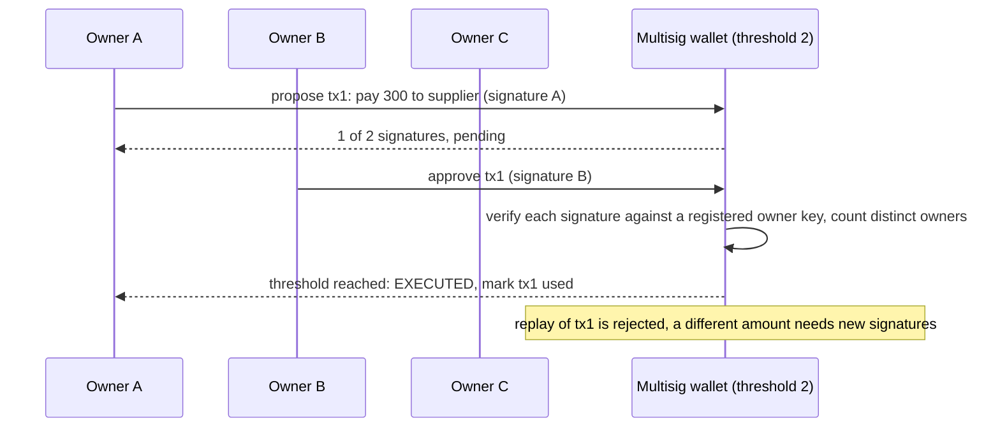

Rules that make it secure:
1. Everyone signs the **same message** that contains the transaction id, destination and amount.
2. The wallet counts **distinct, registered owners** with **valid** signatures (no duplicates, no outsiders).
3. Each transaction can be executed **once** (nonce / executed set) to prevent replay.
4. Keys are held in **separate places** (different people, devices, hardware wallets, jurisdictions).
5. Owner changes and threshold changes themselves require M signatures.

## 7.4 Types and Variants

| Variant | Note |
|---|---|
| **Script-based multisig (Bitcoin P2SH/P2WSH)** | Several signatures in one transaction |
| **Smart-contract multisig (Safe, formerly Gnosis Safe)** | Flexible owners, modules, spending limits |
| **Threshold signatures / MPC (TSS)** | The key is **split** so no one ever holds it; produces ONE normal signature (Fireblocks, many custodians) |
| **Schnorr / BLS aggregation** | Several signatures combined into one |
| **Time-locked multisig** | Actions wait a delay so others can react (admin timelocks) |
| **Social recovery** | Friends/guardians can recover a lost wallet |
| **Enterprise approvals** | The same M-of-N idea in HSM-based signing workflows |

## 7.5 Complete Java Example - A 2-of-3 Wallet With Real ECDSA Signatures

**What it shows:** a wallet with three registered owners and a threshold of 2. It rejects one signature, accepts two valid ones, rejects a replay, ignores a signature from a non-owner, rejects signatures made for a different amount, and checks the balance. It uses `java.security` ECDSA (P-256) signatures.

```java
import java.nio.charset.StandardCharsets;
import java.security.*;
import java.util.*;

public class MultiSigDemo {

    static byte[] sign(PrivateKey k, String message) throws Exception {
        Signature s = Signature.getInstance("SHA256withECDSA"); s.initSign(k); s.update(message.getBytes(StandardCharsets.UTF_8)); return s.sign();
    }
    static boolean verify(PublicKey k, String message, byte[] sig) throws Exception {
        Signature s = Signature.getInstance("SHA256withECDSA"); s.initVerify(k); s.update(message.getBytes(StandardCharsets.UTF_8));
        try { return s.verify(sig); } catch (SignatureException e) { return false; }
    }

    // M-of-N wallet: a transaction executes only when at least 'threshold' DIFFERENT owners have signed it
    static class MultiSigWallet {
        final Map<String, PublicKey> owners; final int threshold; long balance;
        final Set<String> executed = new HashSet<>();
        MultiSigWallet(Map<String, PublicKey> owners, int threshold, long balance) { this.owners = owners; this.threshold = threshold; this.balance = balance; }

        String submit(String txId, String to, long amount, Map<String, byte[]> signatures) throws Exception {
            if (executed.contains(txId)) return "REJECT replay of " + txId;
            String message = txId + "|" + to + "|" + amount;                       // everyone signs the SAME message
            Set<String> valid = new TreeSet<>();
            for (var e : signatures.entrySet()) {
                PublicKey key = owners.get(e.getKey());
                if (key != null && verify(key, message, e.getValue())) valid.add(e.getKey());       // unknown signers and bad signatures don't count; a map has one entry per owner
            }
            if (valid.size() < threshold) return "REJECT only " + valid.size() + " valid owner signature(s) " + valid + ", need " + threshold;
            if (amount > balance) return "REJECT insufficient funds";
            balance -= amount; executed.add(txId);
            return "EXECUTED pay " + amount + " to " + to + " (signed by " + valid + "), balance now " + balance;
        }
    }

    public static void main(String[] args) throws Exception {
        KeyPairGenerator gen = KeyPairGenerator.getInstance("EC"); gen.initialize(256);
        KeyPair asha = gen.generateKeyPair(), ben = gen.generateKeyPair(), chen = gen.generateKeyPair(), mallory = gen.generateKeyPair();
        Map<String, PublicKey> owners = new LinkedHashMap<>(Map.of("Asha", asha.getPublic()));
        owners.put("Ben", ben.getPublic()); owners.put("Chen", chen.getPublic());
        MultiSigWallet wallet = new MultiSigWallet(owners, 2, 1000);              // 2-of-3

        String msg1 = "tx1|supplier|300";
        System.out.println("wallet: 2-of-3 owners (Asha, Ben, Chen), balance 1000");
        System.out.println("1) one signature  : " + wallet.submit("tx1", "supplier", 300, Map.of("Asha", sign(asha.getPrivate(), msg1))));
        System.out.println("2) two signatures : " + wallet.submit("tx1", "supplier", 300, Map.of("Asha", sign(asha.getPrivate(), msg1), "Chen", sign(chen.getPrivate(), msg1))));
        System.out.println("3) replay of tx1  : " + wallet.submit("tx1", "supplier", 300, Map.of("Asha", sign(asha.getPrivate(), msg1), "Chen", sign(chen.getPrivate(), msg1))));

        String msg2 = "tx2|supplier|400";
        System.out.println("4) Mallory (not an owner) pretends to be Ben: " + wallet.submit("tx2", "supplier", 400,
                Map.of("Asha", sign(asha.getPrivate(), msg2), "Ben", sign(mallory.getPrivate(), msg2))));

        String msgOld = "tx3|supplier|10";
        System.out.println("5) signatures for a DIFFERENT amount (10) reused for 900: " + wallet.submit("tx3", "attacker", 900,
                Map.of("Asha", sign(asha.getPrivate(), msgOld), "Ben", sign(ben.getPrivate(), msgOld))));

        String msg4 = "tx4|supplier|900";
        System.out.println("6) valid 2-of-3 but amount exceeds balance: " + wallet.submit("tx4", "supplier", 900,
                Map.of("Ben", sign(ben.getPrivate(), msg4), "Chen", sign(chen.getPrivate(), msg4))));
        String msg5 = "tx5|supplier|200";
        System.out.println("7) Ben + Chen approve a smaller payment    : " + wallet.submit("tx5", "supplier", 200,
                Map.of("Ben", sign(ben.getPrivate(), msg5), "Chen", sign(chen.getPrivate(), msg5))));
        System.out.println("   losing one key (say Chen's) does not lose the funds, and one stolen key cannot spend alone");
    }
}
```

**Output** (identical on all 3 runs):

```text
wallet: 2-of-3 owners (Asha, Ben, Chen), balance 1000
1) one signature  : REJECT only 1 valid owner signature(s) [Asha], need 2
2) two signatures : EXECUTED pay 300 to supplier (signed by [Asha, Chen]), balance now 700
3) replay of tx1  : REJECT replay of tx1
4) Mallory (not an owner) pretends to be Ben: REJECT only 1 valid owner signature(s) [Asha], need 2
5) signatures for a DIFFERENT amount (10) reused for 900: REJECT only 0 valid owner signature(s) [], need 2
6) valid 2-of-3 but amount exceeds balance: REJECT insufficient funds
7) Ben + Chen approve a smaller payment    : EXECUTED pay 200 to supplier (signed by [Ben, Chen]), balance now 500
   losing one key (say Chen's) does not lose the funds, and one stolen key cannot spend alone
```

**What the output shows**
- **1–2:** one valid signature isn't enough; Asha + Chen reach the threshold and the payment executes (balance 1000 → 700).
- **3:** replaying the same transaction id is rejected.
- **4:** "Ben's" signature was made with Mallory's key, so it fails verification against Ben's registered public key → only 1 valid signature.
- **5:** signatures were made over a different message (amount 10, to `supplier`); they do not verify for amount 900 to `attacker`. A signature is bound to the exact message, so approvals can't be reused for a bigger payment.
- **6–7:** a valid 2-of-3 approval can still fail business checks (insufficient funds); Ben + Chen can approve a smaller payment that succeeds.
- Java's built-in EC provider supports P-256 (`secp256r1`). **Bitcoin and Ethereum use secp256k1**, which needs a library such as Bouncy Castle or web3j's crypto module.

## 7.6 Multisig in Java and Solidity

```solidity
// Minimal M-of-N confirmation pattern (Solidity, simplified)
mapping(uint => mapping(address => bool)) public confirmed;
function confirm(uint txId) external onlyOwner {
    require(!executed[txId], "already executed");
    confirmed[txId][msg.sender] = true;
    if (countConfirmations(txId) >= threshold) { executed[txId] = true; _execute(txId); }
}
```

```java
// Verify an M-of-N approval workflow in a Spring Boot back office (the same logic as the demo, with keys from an HSM/KMS)
boolean approved(Payment p, Map<String, byte[]> signatures) {
    Set<String> distinct = signatures.entrySet().stream()
            .filter(e -> approvers.containsKey(e.getKey()))
            .filter(e -> verifier.verify(approvers.get(e.getKey()), canonical(p), e.getValue()))
            .map(Map.Entry::getKey).collect(Collectors.toSet());
    return distinct.size() >= p.requiredApprovals();           // e.g. 2 for normal payments, 3 above 100,000
}
```
Practical rules: use a battle-tested contract (Safe) instead of writing your own; keep owners on different hardware wallets; add a **timelock** for upgrades; test key-loss and key-compromise recovery drills; sign structured data (EIP-712) so owners see what they approve.

## 7.7 Pros and Cons

| Pros | Cons |
|---|---|
| No single point of compromise | Slower: needs coordination |
| Protects against loss of one key | More complex setup; lost keys beyond N−M are fatal |
| Clear governance and audit trail | Owners may be tricked into signing a malicious transaction ("blind signing") |
| Works on most chains | Contract multisigs carry smart-contract risk |

## 7.8 Pitfalls, Interview Questions and Cheat Sheet

**Common pitfalls**
- Counting the same owner twice, or counting non-owners.
- Signing a message that doesn't include the destination, amount or a nonce (replay, tampering).
- All keys stored on one laptop or cloud account.
- A 1-of-1 "multisig" or threshold equal to 1.
- Owners approving what they cannot read (blind signing).
- No recovery plan for a lost key.

**Interview questions**
1. *What is multisig?* → A scheme needing M of N signatures to authorise an action.
2. *Why 2-of-3 instead of 3-of-3?* → Tolerates the loss of one key while still preventing a single key from acting alone.
3. *Multisig vs threshold signature (MPC)?* → Multisig collects several separate signatures (visible on-chain); MPC splits one key so a single ordinary signature is produced, and no one ever holds the whole key.
4. *How do you prevent replay?* → Include a unique transaction id/nonce in the signed message and mark executed transactions.
5. *Where else is this idea used?* → Two-person rule for production deployments, M-of-N approval for payments, key-ceremony splits, endorsement policies in Hyperledger Fabric.

**Cheat sheet**
```
M-of-N: count DISTINCT registered owners with VALID signatures over the SAME message (txId | to | amount)
Replay protection: nonce / executed set;  keys in separate places;  timelock for admin changes
Variants: script multisig, contract multisig (Safe), MPC/threshold signatures, social recovery
```

### 📘 Terms Explained

| Term | Meaning |
|---|---|
| **Multisig (M-of-N)** | Needs M valid signatures from N owners |
| **Digital signature (ECDSA)** | Proof, made with a private key, that the key holder approved a message |
| **Threshold** | The number of required signatures (M) |
| **Replay attack** | Reusing a valid approval to repeat an action |
| **MPC / TSS** | Multi-party computation / threshold signature: shared key control without assembling the key |
| **Timelock** | A forced delay between approval and execution |
| **HSM** | Hardware security module: tamper-resistant key storage |
| **Blind signing** | Approving a transaction without being able to read what it does |

---

# 8. State Channels and Sidechains

## 8.1 What Are They?

Blockchains are slow and expensive because every node processes every transaction. Two classic ways to **scale** by moving most activity off the main chain:

- **State channel (#406):** two (or a few) parties lock funds in a contract on the main chain, then exchange **signed balance updates directly, off-chain**, as many as they want. Only the **opening** and the **closing** (final balances) touch the chain. Examples: Bitcoin **Lightning Network**, Ethereum Raiden.
- **Sidechain (#407):** a **separate blockchain with its own validators and rules**, connected to the main chain by a **two-way peg**: lock coins on the main chain, mint equal coins on the sidechain; burn them on the sidechain to unlock on the main chain. Examples: Liquid (Bitcoin), Polygon PoS (Ethereum sidechain-style), Gnosis Chain.

(Rollups are a related, newer idea: execute off-chain but post data and proofs to the main chain, so they inherit its security. Sidechains do **not** inherit it.)

## 8.2 Why Do We Need Them?

| Problem | State channel | Sidechain |
|---|---|---|
| 1,000 micro-payments between two parties would cost 1,000 fees | **2 on-chain transactions** (open, close) | |
| Main chain is congested and fees are high | Instant, near-free updates | Cheaper, faster blocks on a separate chain |
| Need different rules (privacy, fast finality, special features) | | Own consensus and virtual machine |
| Streaming payments (pay per second of video, per kWh) | Natural fit | |

## 8.3 How It Works

**State channel**

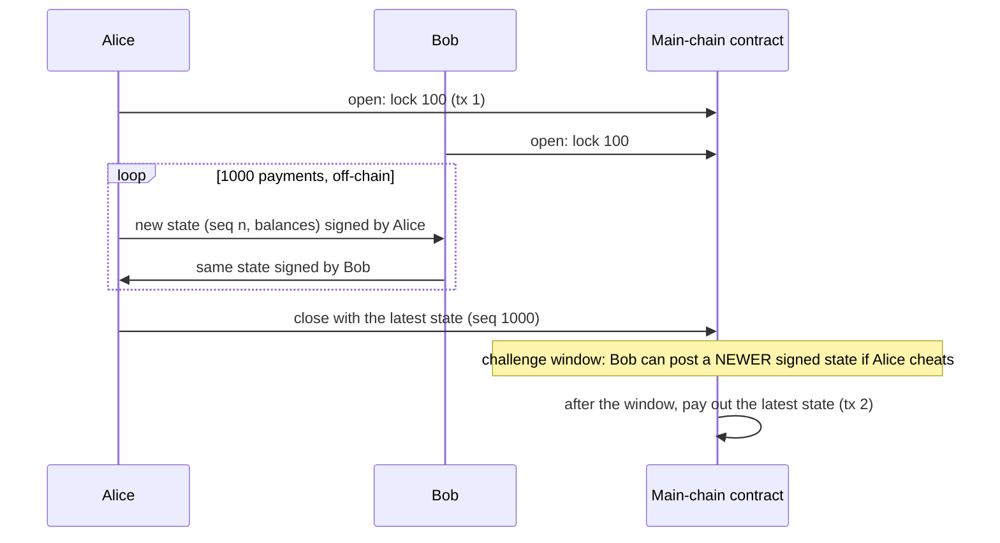

1. Each update has an increasing **sequence number** and is **signed by both parties**.
2. Anyone can close with *any* signed state, including an old one, so a **challenge window** lets the other party submit a newer state; the highest sequence number wins and the cheater may be penalised.
3. Parties must **watch the chain** (or use a watchtower service) during the window.
4. Multi-hop networks (Lightning) route payments through channels using hash-locked contracts (HTLC).

**Sidechain two-way peg**

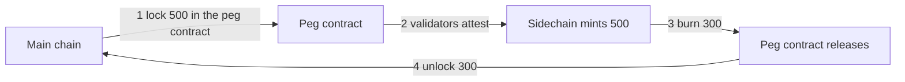

Invariant: **coins locked on the main chain = supply on the sidechain**. The peg is only as secure as the sidechain's validators or the bridge operators. Bridge hacks have been among the biggest losses in the industry.

## 8.4 Types and Variants

| Variant | Note |
|---|---|
| **Payment channel** | State channel limited to payments (Lightning) |
| **Generalised state channel** | Any contract logic between the parties (games, auctions) |
| **Channel network / hub** | Route through intermediaries with HTLCs |
| **Watchtower** | A third party that watches the chain and challenges for you while you are offline |
| **Federated sidechain** | A group of known signers controls the peg (Liquid) |
| **Independent PoS sidechain** | Own validator set (Polygon PoS, Gnosis Chain) |
| **Plasma** | Child chains with fraud-proof exits (mostly replaced by rollups) |
| **Optimistic / ZK rollup** | Post data to the main chain; fraud or validity proofs; inherits main-chain security |
| **Bridge** | General cross-chain asset transfer (often the weakest link) |

## 8.5 Complete Java Example - 1,000 Off-Chain Payments, a Cheating Close, and a Two-Way Peg

**What it shows:** Alice and Bob open a channel (100.00 each, amounts kept in cents). They make 1,000 payments of 0.05 off-chain. They close honestly; then Alice tries to close with an old state and Bob challenges with the newest one. A forged state is rejected. Finally, a sidechain peg keeps `locked = minted` through deposits and withdrawals. States are signed with real ECDSA signatures.

```java
import java.nio.charset.StandardCharsets;
import java.security.*;
import java.util.*;

public class ChannelDemo {

    static byte[] sign(PrivateKey k, String m) throws Exception { Signature s = Signature.getInstance("SHA256withECDSA"); s.initSign(k); s.update(m.getBytes(StandardCharsets.UTF_8)); return s.sign(); }
    static boolean verify(PublicKey k, String m, byte[] sig) throws Exception { Signature s = Signature.getInstance("SHA256withECDSA"); s.initVerify(k); s.update(m.getBytes(StandardCharsets.UTF_8)); return s.verify(sig); }

    record State(int seq, long balA, long balB) { String text() { return "channel-1|" + seq + "|" + balA + "|" + balB; } }
    record Signed(State state, byte[] sigA, byte[] sigB) {}

    // ================= STATE CHANNEL: the "chain" only sees open + close (+ dispute) =================
    static class OnChainChannelContract {
        final PublicKey a, b; final long depositA, depositB; int onChainTxs = 0;
        Signed pendingClose; long challengeEndsAt;
        OnChainChannelContract(PublicKey a, PublicKey b, long dA, long dB) { this.a = a; this.b = b; depositA = dA; depositB = dB; onChainTxs++; }       // 1 tx: open (both lock funds)

        boolean bothSigned(Signed s) throws Exception { return verify(a, s.state().text(), s.sigA()) && verify(b, s.state().text(), s.sigB()); }

        String startClose(Signed s, long now) throws Exception {
            onChainTxs++;
            if (!bothSigned(s)) return "REJECT: not signed by both parties";
            if (s.state().balA() + s.state().balB() != depositA + depositB) return "REJECT: balances do not add up to the deposits";
            pendingClose = s; challengeEndsAt = now + 100;
            return "close requested with seq " + s.state().seq() + " (A=" + s.state().balA() / 100.0 + ", B=" + s.state().balB() / 100.0 + "), challenge window until t=" + challengeEndsAt;
        }
        String challenge(Signed newer, long now) throws Exception {
            onChainTxs++;
            if (now > challengeEndsAt) return "too late, window closed";
            if (!bothSigned(newer)) return "REJECT challenge: bad signatures";
            if (newer.state().seq() <= pendingClose.state().seq()) return "REJECT challenge: not newer";
            pendingClose = newer;
            return "CHALLENGE ACCEPTED: replaced with seq " + newer.state().seq() + " (the cheater is overruled)";
        }
        String finalizeClose(long now) {
            onChainTxs++;
            if (pendingClose == null) return "nothing to finalize";
            if (now <= challengeEndsAt) return "wait, window still open";
            return "FINAL payout A=" + pendingClose.state().balA() / 100.0 + " B=" + pendingClose.state().balB() / 100.0 + " (seq " + pendingClose.state().seq() + ")";
        }
    }

    // ================= SIDECHAIN: two-way peg =================
    static class Peg {
        long lockedOnMain = 0, supplyOnSide = 0;
        void deposit(long amt) { lockedOnMain += amt; supplyOnSide += amt; }                       // lock on main -> mint on side
        void withdraw(long amt) { if (amt > supplyOnSide) throw new IllegalStateException("cannot burn more than exists on the side chain"); supplyOnSide -= amt; lockedOnMain -= amt; }   // burn on side -> unlock on main
        boolean invariantHolds() { return lockedOnMain == supplyOnSide; }
    }

    public static void main(String[] args) throws Exception {
        KeyPairGenerator gen = KeyPairGenerator.getInstance("EC"); gen.initialize(256);
        KeyPair alice = gen.generateKeyPair(), bob = gen.generateKeyPair();

        OnChainChannelContract chain = new OnChainChannelContract(alice.getPublic(), bob.getPublic(), 10_000, 10_000);
        System.out.println("1) channel opened on-chain: Alice 100.00, Bob 100.00 (amounts are kept in cents; on-chain transactions so far: " + chain.onChainTxs + ")");

        // 1000 off-chain payments of 0.05 each from Alice to Bob (amounts in cents: 5 cents). Nothing touches the chain.
        long a = 10_000, b = 10_000; Signed latest = null, atSeq3 = null;
        for (int i = 1; i <= 1000; i++) {
            a -= 5; b += 5;
            State st = new State(i, a, b);
            Signed s = new Signed(st, sign(alice.getPrivate(), st.text()), sign(bob.getPrivate(), st.text()));
            if (i == 3) atSeq3 = s; latest = s;
        }
        System.out.println("2) 1000 off-chain payments of 0.05, each state signed by both. Latest: seq " + latest.state().seq() + " A=" + latest.state().balA() / 100.0 + " B=" + latest.state().balB() / 100.0 + "   on-chain transactions: still " + chain.onChainTxs);

        System.out.println("3) honest close:");
        System.out.println("   " + chain.startClose(latest, 0));
        System.out.println("   " + chain.finalizeClose(150));

        OnChainChannelContract c2 = new OnChainChannelContract(alice.getPublic(), bob.getPublic(), 10_000, 10_000);
        System.out.println("4) Alice cheats by closing with an OLD state (seq 3, where she still had more money):");
        System.out.println("   " + c2.startClose(atSeq3, 0));
        System.out.println("   Bob is watching the chain and answers within the window: " + c2.challenge(latest, 50));
        System.out.println("   " + c2.finalizeClose(150));
        System.out.println("   total on-chain transactions for 1000 payments: open + close + challenge + finalize = " + c2.onChainTxs + " (not 1000)");

        Signed forged = new Signed(new State(5000, 0, 20_000), latest.sigA(), latest.sigB());
        OnChainChannelContract c3 = new OnChainChannelContract(alice.getPublic(), bob.getPublic(), 10_000, 10_000);
        System.out.println("5) forged state with copied signatures: " + c3.startClose(forged, 0));

        Peg peg = new Peg();
        peg.deposit(500); peg.deposit(250); peg.withdraw(300);
        System.out.println("6) sidechain two-way peg: locked on main chain = " + peg.lockedOnMain + ", supply on sidechain = " + peg.supplyOnSide + ", always equal: " + peg.invariantHolds());
        try { peg.withdraw(10_000); } catch (IllegalStateException e) { System.out.println("   over-withdraw blocked: " + e.getMessage()); }
        System.out.println("   the sidechain has its OWN validators: if they collude, they can mint without a matching lock, so the peg is only as safe as the sidechain/bridge");
    }
}
```

**Output** (identical on all 3 runs):

```text
1) channel opened on-chain: Alice 100.00, Bob 100.00 (amounts are kept in cents; on-chain transactions so far: 1)
2) 1000 off-chain payments of 0.05, each state signed by both. Latest: seq 1000 A=50.0 B=150.0   on-chain transactions: still 1
3) honest close:
   close requested with seq 1000 (A=50.0, B=150.0), challenge window until t=100
   FINAL payout A=50.0 B=150.0 (seq 1000)
4) Alice cheats by closing with an OLD state (seq 3, where she still had more money):
   close requested with seq 3 (A=99.85, B=100.15), challenge window until t=100
   Bob is watching the chain and answers within the window: CHALLENGE ACCEPTED: replaced with seq 1000 (the cheater is overruled)
   FINAL payout A=50.0 B=150.0 (seq 1000)
   total on-chain transactions for 1000 payments: open + close + challenge + finalize = 4 (not 1000)
5) forged state with copied signatures: REJECT: not signed by both parties
6) sidechain two-way peg: locked on main chain = 450, supply on sidechain = 450, always equal: true
   over-withdraw blocked: cannot burn more than exists on the side chain
   the sidechain has its OWN validators: if they collude, they can mint without a matching lock, so the peg is only as safe as the sidechain/bridge
```

**What the output shows**
- **1–2:** 1,000 payments, each signed by both, and the on-chain transaction count is **still 1**. The latest state: Alice 50.00, Bob 150.00 (1,000 × 0.05 = 50.00 moved).
- **3:** an honest close with the latest state; after the challenge window the payout is final.
- **4:** Alice tries to close with the old state `seq 3` (99.85 / 100.15), where she had more money. The old state is **validly signed by both**, so the contract must accept it at first. **Bob challenges** within the window with `seq 1000`; the higher sequence number wins and the payout is 50.00 / 150.00. In total **4 on-chain transactions** (open, close, challenge, finalise) replaced 1,000 payments.
- **5:** a forged state that reuses the real signatures fails verification (the signatures cover the exact state text).
- **6:** the peg keeps `locked = supply = 450` after deposits of 500 and 250 and a withdrawal of 300; withdrawing more than exists is blocked. The last line is the trust caveat: the sidechain's own validators can break the invariant, so the sidechain's security is **not** the main chain's security.

## 8.6 Channels and Sidechains From Java

```java
// Lightning: talk to an LND node over gRPC (Java stubs generated from lnd's .proto files)
LightningGrpc.LightningBlockingStub lnd = LightningGrpc.newBlockingStub(channel);
SendResponse r = lnd.sendPaymentSync(SendRequest.newBuilder().setPaymentRequest(invoice).build());   // pay an invoice off-chain
if (!r.getPaymentError().isEmpty()) throw new PaymentException(r.getPaymentError());
```

```java
// Your own channel client keeps the LATEST co-signed state durably, plus a watcher thread
@Scheduled(fixedDelay = 10_000)
void watch() {
    ChannelClosing closing = chain.pendingClose(channelId);
    if (closing != null && closing.seq() < store.latest(channelId).seq())
        chain.challenge(channelId, store.latest(channelId));           // answer within the window, or use a watchtower service
}
```
Sidechains from Java: they are EVM-compatible, so `web3j` works unchanged against their RPC endpoint (`chainId` is different). Treat **bridges** as high-risk: set deposit/withdraw limits, wait for the bridge's finality rules, monitor the lock/mint invariant, and never assume a bridged token equals the original in a contract's risk model.

## 8.7 Pros and Cons

| | State channel | Sidechain |
|---|---|---|
| Pros | Instant, nearly free, private between the parties; main-chain security for the funds | General purpose, cheap, fast, own features and tooling |
| Cons | Both parties must lock funds and stay online/watch; limited to the participants; liquidity locked; routing complexity | Weaker, separate security; bridge risk; users must trust the sidechain validators |

## 8.8 Pitfalls, Interview Questions and Cheat Sheet

**Common pitfalls**
- Not storing every co-signed state durably (losing the latest state means a cheater can win).
- Missing the challenge window while offline (no watchtower).
- Signing a state without a sequence number or channel id (replay across channels).
- Locking funds in a channel you can't easily close.
- Treating a sidechain token as having main-chain security.
- Poorly audited bridges: mint without a matching lock.

**Interview questions**
1. *What is a state channel?* → Parties lock funds on-chain, exchange signed updates off-chain, and settle the final state on-chain.
2. *How is cheating prevented?* → Every update is co-signed with an increasing sequence number; closing starts a challenge window in which a newer signed state overrides an older one.
3. *Sidechain vs rollup?* → A sidechain has its own security and validators; a rollup posts data/proofs to the main chain and inherits its security.
4. *What is a two-way peg?* → Lock on one chain, mint on the other, burn to unlock; the locked amount must equal the minted amount.
5. *Why are bridges risky?* → They concentrate funds and rely on a small validator set or complex code; many large hacks targeted them.
6. *When use a channel and when a sidechain?* → A channel for many payments between a fixed set of parties; a sidechain for a general-purpose, cheaper environment where you accept different security.

**Cheat sheet**
```
Channel : open (1 tx) -> unlimited co-signed updates (seq n) off-chain -> close (1 tx) ; challenge window; highest seq wins
Needs   : watch the chain (or watchtower), keep the latest state
Sidechain: own chain + two-way peg (lock/mint, burn/unlock) ; invariant locked == minted ; security = sidechain/bridge, NOT main chain
Rollup  : inherits main-chain security (post data + proofs)
```

### 📘 Terms Explained

| Term | Meaning |
|---|---|
| **State channel** | An off-chain agreement between parties, settled on-chain only at the end |
| **Challenge window** | The time during which a newer state can override a closing claim |
| **Sequence number** | A counter that orders channel states; the highest valid one wins |
| **Watchtower** | A service that watches the chain and challenges cheating for you |
| **HTLC** | Hashed time-lock contract: enables multi-hop channel payments |
| **Sidechain** | A separate blockchain linked to a main chain by a peg |
| **Two-way peg** | The mechanism to move assets between chains (lock/mint, burn/unlock) |
| **Bridge** | Software and contracts that move assets or messages across chains |
| **Rollup** | A scaling method that executes off-chain and posts data and proofs on-chain |
| **Lightning Network** | Bitcoin's payment-channel network |

---

# 9. Blockchain Patterns and the Building Blocks They Reuse

| Blockchain pattern | The same idea in ordinary systems | Detailed file |
|---|---|---|
| Hash chain / Proof of Work | Hash-linked audit logs, tamper-evident logging, Git history | [06_Security_Pattern.md](../03_System_Design/06_Security_Pattern.md), [10_Observability_Pattern.md](../03_System_Design/10_Observability_Pattern.md) |
| Proof of Stake | Weighted random selection (load balancing), bonding and penalties | [01_Scalability_Pattern.md](../03_System_Design/01_Scalability_Pattern.md) |
| Merkle tree | Git, Cassandra/Dynamo anti-entropy repair, IPFS, certificate transparency | [07_Distributed_Systems_Pattern.md](../03_System_Design/07_Distributed_Systems_Pattern.md), [03_Data_Storage_Pattern.md](03_Data_Storage_Pattern.md) |
| Byzantine fault tolerance | Quorums, leader election, consensus (Raft/Paxos), state-machine replication | [07_Distributed_Systems_Pattern.md](../03_System_Design/07_Distributed_Systems_Pattern.md) |
| Smart contract | Stored procedures, state machines, event-sourced aggregates, sagas with compensation | [05_Data_Management_Pattern.md](../03_System_Design/05_Data_Management_Pattern.md), [02_Enterprise_Application_Pattern.md](../02_HLD/02_Enterprise_Application_Pattern.md) |
| Token ledger | Double-entry bookkeeping; account ledgers (payments) | [11_Domain_Specific_Pattern.md](11_Domain_Specific_Pattern.md#8-multi-currency-pattern-interview-imp---java) |
| Oracle | Anti-Corruption Layer, input validation, redundancy and median voting for sensors | [12_Legacy_Migration_Pattern.md](12_Legacy_Migration_Pattern.md), [09_IoT_Pattern.md](09_IoT_Pattern.md) |
| Multi-signature | Two-person rule, separation of duties, M-of-N approval workflows, endorsement policies | [06_Security_Pattern.md](../03_System_Design/06_Security_Pattern.md) |
| State channel | Batching, optimistic concurrency, sequence numbers, snapshot plus final settlement | [04_Messaging_Pattern.md](../03_System_Design/04_Messaging_Pattern.md), [05_Data_Management_Pattern.md](../03_System_Design/05_Data_Management_Pattern.md) |
| Sidechain / bridge | Federation, gateways, two-phase commit style lock/release across systems | [02_Microservices_Pattern.md](02_Microservices_Pattern.md), [04_Integration_Pattern.md](04_Integration_Pattern.md) |
| Block explorer / indexer | CQRS read model, Change Data Capture from the chain into a database | [05_Data_Management_Pattern.md](../03_System_Design/05_Data_Management_Pattern.md) |

**Coverage check (master list #401–410):** Proof of Work (401) in Section 1; Proof of Stake (402) in Section 2; Smart Contract (403) and Token (404) in Section 5; Oracle Pattern (405) in Section 6; State Channel (406) and Sidechain (407) in Section 8; Multi-Signature (408) in Section 7; Merkle Tree (409) in Section 3; Byzantine Fault Tolerance (410) in Section 4.

**When NOT to use a blockchain.** If one organisation controls the data, a normal database is simpler, faster and cheaper. A blockchain makes sense when **several parties who don't fully trust each other** need a **shared, tamper-evident record** and there is no neutral party they all accept. Even then, ask whether a signed audit log, a database with hash chaining, or a consortium database service is enough.

### 📘 Terms Explained

| Term | Meaning |
|---|---|
| **Building block** | A general technique that blockchains reuse |
| **Double-entry bookkeeping** | Recording every movement as a debit and a matching credit |
| **Tamper-evident log** | A log where any change is detectable (hash chaining) |
| **Indexer** | A service that reads the chain and stores the data in a database for fast queries |

---

# 10. How the Blockchain Patterns Fit Together

A tokenised supply-chain payment shows most pieces working together:

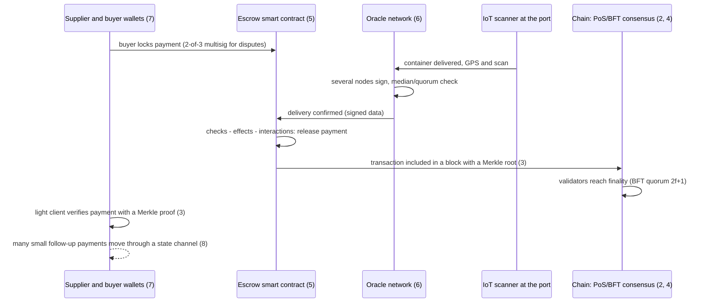

**A decision guide**

| Need | Pattern |
|---|---|
| Agreement among strangers in an open network | PoW or PoS |
| Agreement among a known group (banks, suppliers) | BFT / Raft-based permissioned chain (Fabric, Besu QBFT, Corda) |
| Prove inclusion cheaply (mobile wallet, data sync) | Merkle proof |
| Automate a rule that several parties trust | Smart contract (audited) |
| Use real-world data in a contract | Decentralised oracle with median, freshness, staking |
| No single person can move funds | Multisig / MPC |
| Many tiny payments between the same parties | State channel |
| A cheaper chain with different rules | Sidechain (accept lower security) or rollup |

**Three rules shared by all blockchain patterns**
- **Security comes from incentives and cryptography, not from trust.** Always ask "what does cheating cost, and who pays?"
- **Finality is a probability or a quorum**, so wait for it before acting.
- **Everything is public and permanent:** design for audits, never store secrets or personal data on a public chain, and plan for bugs before deployment.

### 📘 Terms Explained

| Term | Meaning |
|---|---|
| **Finality** | The point after which a transaction will not be reversed |
| **Permissioned chain** | A blockchain where only approved participants run nodes |
| **Rollup** | An off-chain execution layer that posts data and proofs to the main chain |

---

# 11. Blockchain & Distributed Ledger Patterns Cheat Sheet

| Pattern | Core idea | Key rule | Java / tooling |
|---|---|---|---|
| **Proof of Work** | Costly puzzle, trivial to verify | Longest/heaviest chain; wait for confirmations | bitcoinj (read), hash utilities |
| **Proof of Stake** | Locked stake gives the right to propose/vote | Slash double-signing; weighted selection | Besu, web3j (read/query) |
| **Merkle tree** **(Interview Imp - Java)** | Hash tree, root fingerprints all data | Proof = log₂ n sibling hashes; prefix leaf vs node | bitcoinj, JGit, own code |
| **Byzantine Fault Tolerance** | Agree despite lying nodes | n ≥ 3f+1, quorum 2f+1; view change | Besu QBFT, BFT-SMaRt, Tendermint ABCI |
| **Smart contract** **(Interview Imp - Java)** | Deterministic code on every node | Gas, revert, checks-effects-interactions | web3j, Fabric Java chaincode, Corda |
| **Token** **(Interview Imp - Java)** | Ledger entries managed by a contract | ERC-20 `transfer/approve/transferFrom`; supply invariant | web3j wrappers |
| **Oracle** | Bridge to off-chain data | Many sources, median, freshness, staking | Chainlink feeds, custom Java oracle node |
| **State channel** | Off-chain co-signed updates, settle on-chain | Increasing sequence number, challenge window | LND gRPC (Lightning) |
| **Sidechain** | Separate chain + two-way peg | locked == minted; security ≠ main chain | web3j against another RPC |
| **Multi-signature** | M-of-N approvals | Distinct valid owners over the same message; replay protection | `java.security` ECDSA, Safe |

**Top interview one-liners**
```
PoW: hash(block) below a target; costly to find, one hash to verify; tampering means redoing all later blocks
PoS: stake gives selection probability and can be slashed for double-signing; far less energy than PoW
Merkle tree: root = fingerprint of all leaves; inclusion proof = ~log2(n) sibling hashes (SPV light clients)
BFT: n >= 3f+1 tolerates f liars; quorum 2f+1; any two quorums share an honest node; Raft needs only 2f+1 nodes for crashes
Smart contract: deterministic + gas + atomic revert; use checks-effects-interactions against re-entrancy
Oracle: a contract cannot call an API; trust the median of many fresh, staked sources, not one feed
Multisig: M of N distinct owners sign the same message; nonce stops replay; MPC splits the key instead
State channel: open, N off-chain co-signed states, close; highest sequence wins in the challenge window
Sidechain: own validators + peg; bridge risk; a rollup inherits main-chain security instead
```

### 📘 Terms Explained

| Term | Meaning |
|---|---|
| **Interview one-liner** | A short, memorable answer you can expand on |
| **Cheat sheet** | A one-page summary for revision |
| **Besu / Fabric / Corda** | Java-based Ethereum client / permissioned ledger platform with Java chaincode / JVM distributed-ledger platform |
