---
mdx:
  format: md
---

# AI/ML System Design Patterns (Serving, Experimentation, Features, Registry, Monitoring, Learning Strategies)

> **Note**: Patterns marked with **(Interview Imp - Java)** are frequently asked in Java interviews
>
> **How to read this file:** Every section ends with a **📘 Terms Explained** table. If you see a word you don't know, check the table right below that section. Each pattern goes from the basic idea to a plain-Java simulation, Spring Boot / library usage, pitfalls, interview questions and a mini cheat sheet.
>
> **What is this file about?** The master list's **AI/ML Patterns** (#411–427). This is **ML system design**, not machine-learning theory: how a Java backend engineer *serves, tests, rolls out, monitors and feeds* models that data scientists train. For the maths and Python side (training, scikit-learn, neural networks) see [../ai-ml/AI_ML_Roadmap.md](../../ai-ml/AI_ML_Roadmap.md) and [../ai-ml/Python_Complete_Guide.md](../../ai-ml/Python_Complete_Guide.md). Recommenders are covered in [11_Domain_Specific_Pattern.md](11_Domain_Specific_Pattern.md#7-recommendation-systems).
>
> **What lives elsewhere:** Canary and blue-green releases ([09_Deployment_Pattern.md](../03_System_Design/09_Deployment_Pattern.md)), metrics/alerts/tracing ([10_Observability_Pattern.md](../03_System_Design/10_Observability_Pattern.md)), Kafka and queues ([04_Messaging_Pattern.md](../03_System_Design/04_Messaging_Pattern.md)), Redis and stores ([03_Data_Storage_Pattern.md](03_Data_Storage_Pattern.md)). [Section 13](#13-ml-patterns-and-the-building-blocks-they-reuse) maps ML patterns to them.
>
> **Verified code:** Every main "Complete Java Example" is **plain Java 17 (no libraries)** and was compiled and run **three times** with identical output (fixed random seeds). The "models" are deliberately tiny (a few weights) so the *system behaviour* is visible. To run one, save it as `<ClassName>.java` and run `javac <ClassName>.java && java <ClassName>`. Spring Boot, ONNX Runtime, MLflow, Feast and Kafka snippets are usage examples and were **not** executed.

---

## Table of Contents
- [Big Picture: The Life of a Model in Production](#big-picture-the-life-of-a-model-in-production)
1. [ML System Architecture and Batch vs Online Prediction](#1-ml-system-architecture-and-batch-vs-online-prediction-interview-imp---java) **(Interview Imp - Java)**
   - [1.1 What Is It?](#11-what-is-it)
   - [1.2 Why Do We Need It?](#12-why-do-we-need-it)
   - [1.3 How It Works](#13-how-it-works)
   - [1.4 Types and Variants](#14-types-and-variants)
   - [1.5 Complete Java Example - Batch Table vs Online Scoring (Cost and Freshness)](#15-complete-java-example---batch-table-vs-online-scoring-cost-and-freshness)
   - [1.6 Serving in Spring Boot](#16-serving-in-spring-boot)
   - [1.7 Pros and Cons](#17-pros-and-cons)
   - [1.8 Pitfalls, Interview Questions and Cheat Sheet](#18-pitfalls-interview-questions-and-cheat-sheet)
2. [A/B Testing Models](#2-ab-testing-models-interview-imp---java) **(Interview Imp - Java)**
   - [2.1 What Is It?](#21-what-is-it)
   - [2.2 Why Do We Need It?](#22-why-do-we-need-it)
   - [2.3 How It Works](#23-how-it-works)
   - [2.4 Types and Variants](#24-types-and-variants)
   - [2.5 Complete Java Example - Sticky Assignment, a z-Test, and the Peeking Mistake](#25-complete-java-example---sticky-assignment-a-z-test-and-the-peeking-mistake)
   - [2.6 A/B Testing in Spring Boot](#26-ab-testing-in-spring-boot)
   - [2.7 Pros and Cons](#27-pros-and-cons)
   - [2.8 Pitfalls, Interview Questions and Cheat Sheet](#28-pitfalls-interview-questions-and-cheat-sheet)
3. [Shadow Mode and Canary Model Deployment](#3-shadow-mode-and-canary-model-deployment-interview-imp---java) **(Interview Imp - Java)**
   - [3.1 What Are They?](#31-what-are-they)
   - [3.2 Why Do We Need Them?](#32-why-do-we-need-them)
   - [3.3 How It Works](#33-how-it-works)
   - [3.4 Types and Variants](#34-types-and-variants)
   - [3.5 Complete Java Example - Shadowing a Buggy Model, Then a Canary That Rolls Back](#35-complete-java-example---shadowing-a-buggy-model-then-a-canary-that-rolls-back)
   - [3.6 Shadow and Canary in Spring Boot](#36-shadow-and-canary-in-spring-boot)
   - [3.7 Pros and Cons](#37-pros-and-cons)
   - [3.8 Pitfalls, Interview Questions and Cheat Sheet](#38-pitfalls-interview-questions-and-cheat-sheet)
4. [Multi-Armed Bandit](#4-multi-armed-bandit)
   - [4.1 What Is It?](#41-what-is-it)
   - [4.2 Why Do We Need It?](#42-why-do-we-need-it)
   - [4.3 How It Works](#43-how-it-works)
   - [4.4 Types and Variants](#44-types-and-variants)
   - [4.5 Complete Java Example - Fixed Split vs Epsilon-Greedy vs UCB1 vs Thompson Sampling](#45-complete-java-example---fixed-split-vs-epsilon-greedy-vs-ucb1-vs-thompson-sampling)
   - [4.6 Bandits in Spring Boot](#46-bandits-in-spring-boot)
   - [4.7 Pros and Cons](#47-pros-and-cons)
   - [4.8 Pitfalls, Interview Questions and Cheat Sheet](#48-pitfalls-interview-questions-and-cheat-sheet)
5. [Feature Store](#5-feature-store-interview-imp---java) **(Interview Imp - Java)**
   - [5.1 What Is It?](#51-what-is-it)
   - [5.2 Why Do We Need It?](#52-why-do-we-need-it)
   - [5.3 How It Works](#53-how-it-works)
   - [5.4 Types and Variants](#54-types-and-variants)
   - [5.5 Complete Java Example - Point-in-Time Leakage and Training/Serving Skew](#55-complete-java-example---point-in-time-leakage-and-trainingserving-skew)
   - [5.6 Feature Store in Java and Spring](#56-feature-store-in-java-and-spring)
   - [5.7 Pros and Cons](#57-pros-and-cons)
   - [5.8 Pitfalls, Interview Questions and Cheat Sheet](#58-pitfalls-interview-questions-and-cheat-sheet)
6. [Model Registry and Data Versioning](#6-model-registry-and-data-versioning)
   - [6.1 What Are They?](#61-what-are-they)
   - [6.2 Why Do We Need Them?](#62-why-do-we-need-them)
   - [6.3 How It Works](#63-how-it-works)
   - [6.4 Types and Variants](#64-types-and-variants)
   - [6.5 Complete Java Example - Dataset Hashes, Promotion Gate and Rollback](#65-complete-java-example---dataset-hashes-promotion-gate-and-rollback)
   - [6.6 Registry in Java and Spring](#66-registry-in-java-and-spring)
   - [6.7 Pros and Cons](#67-pros-and-cons)
   - [6.8 Pitfalls, Interview Questions and Cheat Sheet](#68-pitfalls-interview-questions-and-cheat-sheet)
7. [ML Pipeline Pattern](#7-ml-pipeline-pattern)
   - [7.1 What Is It?](#71-what-is-it)
   - [7.2 Why Do We Need It?](#72-why-do-we-need-it)
   - [7.3 How It Works](#73-how-it-works)
   - [7.4 Types and Variants](#74-types-and-variants)
   - [7.5 Complete Java Example - A DAG with Topological Order, Crash and Resume](#75-complete-java-example---a-dag-with-topological-order-crash-and-resume)
   - [7.6 Pipelines in Java and Spring](#76-pipelines-in-java-and-spring)
   - [7.7 Pros and Cons](#77-pros-and-cons)
   - [7.8 Pitfalls, Interview Questions and Cheat Sheet](#78-pitfalls-interview-questions-and-cheat-sheet)
8. [Model Monitoring and Concept Drift Detection](#8-model-monitoring-and-concept-drift-detection-interview-imp---java) **(Interview Imp - Java)**
   - [8.1 What Are They?](#81-what-are-they)
   - [8.2 Why Do We Need It?](#82-why-do-we-need-it)
   - [8.3 How It Works](#83-how-it-works)
   - [8.4 Types and Variants](#84-types-and-variants)
   - [8.5 Complete Java Example - PSI and KS for Data Drift, Accuracy Alerts for Concept Drift](#85-complete-java-example---psi-and-ks-for-data-drift-accuracy-alerts-for-concept-drift)
   - [8.6 Monitoring in Java and Spring](#86-monitoring-in-java-and-spring)
   - [8.7 Pros and Cons](#87-pros-and-cons)
   - [8.8 Pitfalls, Interview Questions and Cheat Sheet](#88-pitfalls-interview-questions-and-cheat-sheet)
9. [Ensemble Pattern](#9-ensemble-pattern)
   - [9.1 What Is It?](#91-what-is-it)
   - [9.2 Why Do We Need It?](#92-why-do-we-need-it)
   - [9.3 How It Works](#93-how-it-works)
   - [9.4 Types and Variants](#94-types-and-variants)
   - [9.5 Complete Java Example - When Voting Helps and When It Doesn't](#95-complete-java-example---when-voting-helps-and-when-it-doesnt)
   - [9.6 Ensembles in Java and Spring](#96-ensembles-in-java-and-spring)
   - [9.7 Pros and Cons](#97-pros-and-cons)
   - [9.8 Pitfalls, Interview Questions and Cheat Sheet](#98-pitfalls-interview-questions-and-cheat-sheet)
10. [Transfer Learning](#10-transfer-learning)
   - [10.1 What Is It?](#101-what-is-it)
   - [10.2 Why Do We Need It?](#102-why-do-we-need-it)
   - [10.3 How It Works](#103-how-it-works)
   - [10.4 Types and Variants](#104-types-and-variants)
   - [10.5 Complete Java Example - Pretrained vs From-Scratch With Only 8 Labelled Rows](#105-complete-java-example---pretrained-vs-from-scratch-with-only-8-labelled-rows)
   - [10.6 Transfer Learning in Java and Spring](#106-transfer-learning-in-java-and-spring)
   - [10.7 Pros and Cons](#107-pros-and-cons)
   - [10.8 Pitfalls, Interview Questions and Cheat Sheet](#108-pitfalls-interview-questions-and-cheat-sheet)
11. [Federated Learning](#11-federated-learning)
   - [11.1 What Is It?](#111-what-is-it)
   - [11.2 Why Do We Need It?](#112-why-do-we-need-it)
   - [11.3 How It Works](#113-how-it-works)
   - [11.4 Types and Variants](#114-types-and-variants)
   - [11.5 Complete Java Example - FedAvg on Three Clients With Private Data](#115-complete-java-example---fedavg-on-three-clients-with-private-data)
   - [11.6 Federated Learning in Java and Spring](#116-federated-learning-in-java-and-spring)
   - [11.7 Pros and Cons](#117-pros-and-cons)
   - [11.8 Pitfalls, Interview Questions and Cheat Sheet](#118-pitfalls-interview-questions-and-cheat-sheet)
12. [Active Learning](#12-active-learning)
   - [12.1 What Is It?](#121-what-is-it)
   - [12.2 Why Do We Need It?](#122-why-do-we-need-it)
   - [12.3 How It Works](#123-how-it-works)
   - [12.4 Types and Variants](#124-types-and-variants)
   - [12.5 Complete Java Example - Random Labelling vs Uncertainty Sampling](#125-complete-java-example---random-labelling-vs-uncertainty-sampling)
   - [12.6 Active Learning in Java and Spring](#126-active-learning-in-java-and-spring)
   - [12.7 Pros and Cons](#127-pros-and-cons)
   - [12.8 Pitfalls, Interview Questions and Cheat Sheet](#128-pitfalls-interview-questions-and-cheat-sheet)
13. [ML Patterns and the Building Blocks They Reuse](#13-ml-patterns-and-the-building-blocks-they-reuse)
14. [How the ML Patterns Fit Together](#14-how-the-ml-patterns-fit-together)
15. [AI/ML Patterns Cheat Sheet](#15-aiml-patterns-cheat-sheet)

---

## Big Picture: The Life of a Model in Production

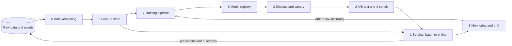

| Stage | Question it answers | Pattern |
|---|---|---|
| Serving | How does the prediction reach the user? | Batch vs online prediction |
| Rollout | Is the new model safe? | Shadow mode, canary |
| Experiment | Is the new model better for the business? | A/B test, multi-armed bandit |
| Inputs | Same features in training and serving? | Feature store |
| Lineage | Which model, trained on which data? | Registry, data versioning |
| Automation | Can we retrain without heroics? | Pipeline pattern |
| Health | Has the world changed since training? | Monitoring, drift detection |
| Learning strategy | How to learn with little data / private data / few labels? | Transfer, federated, active learning, ensembles |

### 📘 Terms Explained

| Term | Meaning |
|---|---|
| **Model** | A function learned from data that turns inputs (features) into a prediction |
| **Training / Inference** | Learning the model from data / using it to predict |
| **Feature** | One input value for the model (for example "purchases in the last 30 days") |
| **MLOps** | DevOps practices for machine learning: automate, version, deploy, monitor models |
| **Label** | The correct answer for a training example |

---

# 1. ML System Architecture and Batch vs Online Prediction (Interview Imp - Java)

## 1.1 What Is It?

**Model-View-Controller for ML (#411)** is the idea of separating three parts, just like MVC in web apps:

| MVC part | In an ML system | Owner |
|---|---|---|
| **Model** | Training code, experiments, the trained artifact | Data science team (Python) |
| **Serving / Controller** | A service that loads the artifact, fetches features and returns predictions | Backend team (Java / Spring) |
| **View** | The product UI that shows or uses the prediction | Frontend / app team |

The model can be replaced without touching the UI. The UI never knows if the answer came from an ML model, a rule or a cache.

**Prediction modes**
- **Batch prediction (#412):** score *many* records on a schedule (nightly), store results in a table, look them up later.
- **Online prediction (#413):** score *one* record when the request arrives, in milliseconds.

## 1.2 Why Do We Need It?

| Need | Batch | Online |
|---|---|---|
| Result needed instantly with fresh data (fraud check at payment) | No | **Yes** |
| Millions of items, results needed hours later (email recommendations) | **Yes** | Wasteful |
| Heavy model (minutes per run) | **Yes** | Too slow |
| Inputs change during the session ("just viewed 6 items") | Stale | **Yes** |
| Cost control | Cheap per prediction | Needs always-on servers |

## 1.3 How It Works

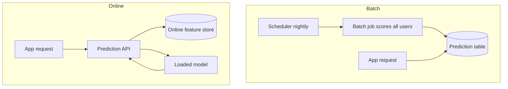

**Online serving checklist:** load the model once at startup (not per request), keep the feature lookup fast (Redis/online store), set a **timeout and a fallback** (default score or rule) so a slow model can't block checkout, batch small requests together (micro-batching) for GPU models, and log every request + prediction for monitoring and retraining.

## 1.4 Types and Variants

| Variant | Meaning | Use |
|---|---|---|
| **Batch scoring** | Precompute for everyone | Recommendations by email, churn lists |
| **Online (synchronous) inference** | REST/gRPC call per request | Fraud, search ranking, pricing |
| **Streaming inference** | Score events from Kafka as they arrive | Anomaly detection, live alerts |
| **Hybrid** | Batch value by default, online when fresh activity exists | Most large systems |
| **Embedded model** | Model runs inside the Java service (ONNX Runtime, DJL) | Low latency, no network hop |
| **Model server** | Separate service (TorchServe, Triton, TF Serving, KServe) | Many models, GPUs, independent scaling |
| **Edge inference** | Model runs on the device | Privacy, offline use (see [IoT patterns](09_IoT_Pattern.md)) |

## 1.5 Complete Java Example - Batch Table vs Online Scoring (Cost and Freshness)

**What it shows:** the same tiny model is run in batch (all 10,000 users at midnight) and online (only the 300 users who show up). The batch score is stale for a user who browsed a lot after midnight.

```java
import java.util.*;

public class ServingDemo {

    // The "model": a tiny linear scorer. Same model for batch and online; only WHEN the features are read differs.
    static double score(int purchases90d, int views1h) {
        return Math.min(1.0, 0.04 * purchases90d + 0.15 * views1h);
    }

    record User(int id, int purchases90d, int views1hNow, int views1hLastMidnight) {}

    public static void main(String[] args) {
        int totalUsers = 10_000, activeToday = 300;
        Random rnd = new Random(7);
        List<User> users = new ArrayList<>();
        for (int i = 0; i < totalUsers; i++) {
            boolean active = i < activeToday;
            users.add(new User(i, rnd.nextInt(10), active ? 1 + rnd.nextInt(6) : 0, 0));
        }

        // 1) BATCH: score everyone at midnight, store in a key-value table
        Map<Integer, Double> batchTable = new HashMap<>();
        int batchPredictions = 0;
        for (User u : users) { batchTable.put(u.id(), score(u.purchases90d(), u.views1hLastMidnight())); batchPredictions++; }

        // 2) ONLINE: compute on request using fresh features (only users who actually show up)
        int onlinePredictions = 0;
        double maxGap = 0; User worst = null;
        for (User u : users) {
            if (u.views1hNow() == 0) continue;                       // inactive users never ask
            onlinePredictions++;
            double fresh = score(u.purchases90d(), u.views1hNow());
            double stale = batchTable.get(u.id());
            if (fresh - stale > maxGap) { maxGap = fresh - stale; worst = u; }
        }

        System.out.println("1) predictions computed   batch=" + batchPredictions + "   online=" + onlinePredictions
                + "   (batch wasted " + (batchPredictions - onlinePredictions) * 100 / batchPredictions + "% on users who never came back)");
        System.out.printf("2) freshness: user %d bought %d times, looked at %d items in the last hour%n",
                worst.id(), worst.purchases90d(), worst.views1hNow());
        System.out.printf("   batch score (from midnight) = %.2f   online score (fresh) = %.2f   gap = %.2f%n",
                batchTable.get(worst.id()), score(worst.purchases90d(), worst.views1hNow()), maxGap);

        // 3) HYBRID: use the batch value unless the user has fresh activity
        int usedBatch = 0, usedOnline = 0;
        for (User u : users) { if (u.views1hNow() > 0) usedOnline++; else usedBatch++; }
        System.out.println("3) hybrid: served from the batch table for " + usedBatch + " users, computed online for " + usedOnline);
    }
}
```

**Output** (identical on all 3 runs):

```text
1) predictions computed   batch=10000   online=300   (batch wasted 97% on users who never came back)
2) freshness: user 55 bought 2 times, looked at 6 items in the last hour
   batch score (from midnight) = 0.08   online score (fresh) = 0.98   gap = 0.90
3) hybrid: served from the batch table for 9700 users, computed online for 300
```

**What the output shows**
- **Cost:** batch scored 10,000 users; only 300 came back. **97%** of the batch work was never used. Online scored exactly the 300 who asked.
- **Freshness:** user 55 looked at 6 items in the last hour. The midnight batch score said **0.08**, the fresh score is **0.98**. For a "show a discount now" decision the batch value would be wrong.
- **Hybrid:** use the cheap batch table for the 9,700 quiet users and compute online only for the 300 active ones.

## 1.6 Serving in Spring Boot

```java
// Embedded model with ONNX Runtime (exported from Python): load ONCE, reuse for every request
@Component
public class FraudModel {
    private final OrtEnvironment env = OrtEnvironment.getEnvironment();
    private final OrtSession session;

    public FraudModel(@Value("${model.path}") String path) throws OrtException {
        this.session = env.createSession(path, new OrtSession.SessionOptions());
    }

    public float score(float[] features) throws OrtException {
        try (OnnxTensor in = OnnxTensor.createTensor(env, new float[][]{features});
             OrtSession.Result out = session.run(Map.of("input", in))) {
            return ((float[][]) out.get(0).getValue())[0][0];
        }
    }
}

@RestController
class PredictionController {
    private final FraudModel model; private final FeatureClient features;

    @PostMapping("/predict")
    @TimeLimiter(name = "model", fallbackMethod = "fallback")          // Resilience4j: never block the checkout
    public CompletableFuture<Prediction> predict(@RequestBody PredictRequest req) {
        return CompletableFuture.supplyAsync(() -> {
            float[] f = features.online(req.userId());                   // Redis / Feast online store
            return new Prediction(model.score(f), "v7");
        });
    }
    Prediction fallback(PredictRequest req, Throwable t) { return new Prediction(0.5f, "fallback-rule"); }
}
```

```java
// Batch: Spring Batch job or Spark; write results to a key-value table
@Scheduled(cron = "0 0 1 * * *")
public void nightlyScoring() { userRepo.streamAll().map(u -> new Score(u.id(), model.score(featuresFor(u)))).forEach(scoreStore::put); }
```

## 1.7 Pros and Cons

| | Batch | Online |
|---|---|---|
| Pros | Cheap, simple, easy to test, results can be inspected before use | Fresh, personalised to the moment, no wasted work |
| Cons | Stale, scores users who never return, big output tables | Latency budget, always-on infra, harder scaling, feature-lookup dependency |

## 1.8 Pitfalls, Interview Questions and Cheat Sheet

**Common pitfalls**
- Loading the model on every request.
- No timeout or fallback, so one slow model call blocks checkout.
- Different feature code in training and serving (see [Section 5](#5-feature-store-interview-imp---java)).
- Not logging inputs and predictions, so you can't debug or retrain.
- Serving a model without a version in the response.

**Interview questions**
1. *Batch or online prediction?* → Online when you need fresh inputs and an instant answer; batch when volume is huge and staleness is acceptable. Hybrid is common.
2. *How do you serve a model from Java?* → Embedded runtime (ONNX Runtime/DJL) for low latency, or call a model server over gRPC/REST.
3. *What if the model is slow or down?* → Timeout + circuit breaker + fallback (default score, rule, or last cached prediction) ([02_Reliability_Pattern.md](../03_System_Design/02_Reliability_Pattern.md)).
4. *How do you scale inference?* → Stateless replicas behind a load balancer, autoscale on CPU/GPU/queue depth, micro-batching, model quantisation, caching of repeated inputs.
5. *Where does training happen vs serving?* → Offline in Python/Spark; serving in the backend; connected through the model registry and feature store.

**Cheat sheet**
```
MVC for ML : model (train) / serving (controller) / UI (view), replaceable independently
Batch      : schedule -> score all -> table -> lookup   (cheap, stale)
Online     : request -> fetch features -> model -> answer (fresh, latency budget)
Hybrid     : batch default, online when fresh activity
Always     : load once, timeout + fallback, log inputs/outputs, return model version
```

### 📘 Terms Explained

| Term | Meaning |
|---|---|
| **Inference** | Using a trained model to produce a prediction |
| **Batch prediction** | Scoring many records at once on a schedule |
| **Online prediction** | Scoring one record per request, in real time |
| **ONNX** | A portable model file format that many runtimes can load |
| **Model server** | A dedicated service that hosts and runs models |
| **Micro-batching** | Grouping a few requests so the model processes them together |
| **Quantisation** | Shrinking a model by using smaller numbers (for example 8-bit) for speed |
| **Fallback** | A safe default answer when the model can't respond in time |

---

# 2. A/B Testing Models (Interview Imp - Java)

## 2.1 What Is It?

**A/B testing a model** means showing model A (current) to one random group of users and model B (new) to another, at the same time, then comparing a **business metric** (conversion, revenue, watch time). Offline accuracy tells you the model is *good*; only an A/B test tells you it makes the *product* better.

## 2.2 Why Do We Need It?

- A higher AUC offline does not guarantee more sales (the data was old, or users react differently).
- Comparing "this week vs last week" mixes the model effect with holidays, campaigns and weather.
- Randomising users at the same moment removes those outside effects.

## 2.3 How It Works

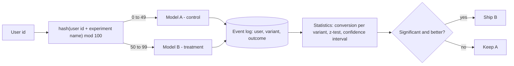

1. **Assign** by hashing the user id with the experiment name: the same user always sees the same variant (sticky), and different experiments split users independently.
2. **Decide the sample size in advance** (from the expected lift and the baseline rate).
3. **Run for full weekly cycles**, do not stop at the first good-looking number.
4. **Test** the difference: for conversion rates use a two-proportion **z-test**: `z = (pB − pA) / sqrt(p(1−p)(1/nA + 1/nB))`. `|z| > 1.96` means p < 0.05.
5. Check **guardrail metrics** (latency, errors, revenue per user) so a "win" doesn't hurt something else.

## 2.4 Types and Variants

| Variant | Meaning |
|---|---|
| **A/B** | Two variants |
| **A/B/n** | Several variants (needs correction for multiple comparisons) |
| **Multivariate** | Several factors at once |
| **Interleaving** | For ranking: mix results of both rankers in one list and see which gets clicks (needs less traffic) |
| **Holdout group** | A small group never gets any new model, to measure long-term total effect |
| **Switchback** | Alternate the variant over time (for marketplaces where users affect each other) |
| **A/A test** | Both groups get the same model, to check the experiment system itself |
| **Sequential testing** | Special statistics that make early stopping valid |

## 2.5 Complete Java Example - Sticky Assignment, a z-Test, and the Peeking Mistake

**What it shows:** stable hash bucketing, a significance test on simulated conversions, and a simulation of 1,000 A/A tests (no real difference) showing how often you falsely find a "winner" if you stop at the first good-looking check.

```java
import java.util.*;

public class AbTestDemo {

    // Stable assignment: the same user always lands in the same bucket for this experiment
    static String variant(String userId, String experiment) {
        int bucket = Math.floorMod((userId + ":" + experiment).hashCode(), 100);
        return bucket < 50 ? "A" : "B";
    }

    static double normalCdf(double z) {                      // Abramowitz-Stegun approximation
        double t = 1 / (1 + 0.2316419 * Math.abs(z));
        double d = 0.3989423 * Math.exp(-z * z / 2);
        double p = d * t * (0.3193815 + t * (-0.3565638 + t * (1.781478 + t * (-1.821256 + t * 1.330274))));
        return z > 0 ? 1 - p : p;
    }
    static double zScore(int convA, int nA, int convB, int nB) {
        double pA = (double) convA / nA, pB = (double) convB / nB, pool = (double) (convA + convB) / (nA + nB);
        return (pB - pA) / Math.sqrt(pool * (1 - pool) * (1.0 / nA + 1.0 / nB));
    }

    public static void main(String[] args) {
        // 1) assignment is stable and about 50/50
        int a = 0, b = 0;
        for (int i = 0; i < 10_000; i++) if (variant("user" + i, "ranker-v2").equals("A")) a++; else b++;
        System.out.println("1) 10000 users: A=" + a + " B=" + b + "   user42 -> " + variant("user42", "ranker-v2")
                + ", asked again -> " + variant("user42", "ranker-v2"));

        // 2) a real test: A converts 10.0%, B converts 11.5%
        Random rnd = new Random(1);
        int n = 20_000, ca = 0, cb = 0;
        for (int i = 0; i < n; i++) { if (rnd.nextDouble() < 0.100) ca++; if (rnd.nextDouble() < 0.115) cb++; }
        double z = zScore(ca, n, cb, n);
        double p = 2 * (1 - normalCdf(Math.abs(z)));
        System.out.printf("2) A: %d/%d = %.2f%%   B: %d/%d = %.2f%%   z=%.2f   p-value=%.4f   -> %s%n",
                ca, n, 100.0 * ca / n, cb, n, 100.0 * cb / n, z, p, p < 0.05 ? "significant" : "not significant");

        // 3) A/A test (both groups identical): how often do we wrongly "find" a winner?
        int sims = 1000, finalFalse = 0, peekFalse = 0, checks = 10, perCheck = 500;
        Random r2 = new Random(2);
        for (int s = 0; s < sims; s++) {
            int xa = 0, xb = 0, seen = 0; boolean peeked = false;
            for (int c = 1; c <= checks; c++) {
                for (int i = 0; i < perCheck; i++) { if (r2.nextDouble() < 0.1) xa++; if (r2.nextDouble() < 0.1) xb++; }
                seen += perCheck;
                if (Math.abs(zScore(xa, seen, xb, seen)) > 1.96) peeked = true;       // would have stopped here
            }
            if (peeked) peekFalse++;
            if (Math.abs(zScore(xa, seen, xb, seen)) > 1.96) finalFalse++;
        }
        System.out.printf("3) 1000 A/A tests, false 'winner' rate: look once at the end = %.1f%%   peek 10 times and stop at first 'win' = %.1f%%%n",
                100.0 * finalFalse / sims, 100.0 * peekFalse / sims);
    }
}
```

**Output** (identical on all 3 runs):

```text
1) 10000 users: A=4997 B=5003   user42 -> B, asked again -> B
2) A: 2004/20000 = 10.02%   B: 2412/20000 = 12.06%   z=6.51   p-value=0.0000   -> significant
3) 1000 A/A tests, false 'winner' rate: look once at the end = 5.0%   peek 10 times and stop at first 'win' = 19.8%
```

**What the output shows**
- **1:** 10,000 users split 4,997 / 5,003, and user 42 gets variant B every time.
- **2:** with 20,000 users each, 10.02% vs 12.06% gives z = 6.51 and p < 0.0001: significant. The observed 12.06% is slightly above the 11.5% used to generate the data, which is normal sampling noise.
- **3:** when both groups are identical, looking once at the end falsely declares a winner **5.0%** of the time (the 5% we agreed to accept). If you check 10 times and stop at the first "significant" reading, the false winner rate jumps to **19.8%**. This is the **peeking problem**: use a fixed sample size or a sequential test.

## 2.6 A/B Testing in Spring Boot

```java
@Service
public class ExperimentService {
    public String variant(String userId, String experiment) {
        int bucket = Math.floorMod((userId + ":" + experiment).hashCode(), 100);    // for production use a stronger hash (murmur3)
        return bucket < config.treatmentPercent(experiment) ? "B" : "A";
    }
}

@PostMapping("/rank")
public RankResponse rank(@RequestBody RankRequest req) {
    String v = experiments.variant(req.userId(), "ranker-v2");
    List<Item> items = v.equals("B") ? rankerV2.rank(req) : rankerV1.rank(req);
    events.publish(new Exposure(req.userId(), "ranker-v2", v, Instant.now()));       // log WHO saw WHAT, once per user
    return new RankResponse(items, v);
}
// later: join Exposure events with Purchase events by userId and compute conversion per variant
```
Feature-flag tools (LaunchDarkly, Unleash, Optimizely, GrowthBook, Statsig) provide assignment, exposure logging and the statistics.

## 2.7 Pros and Cons

| Pros | Cons |
|---|---|
| Measures real business impact | Needs enough traffic and time |
| Controls for outside effects | Users in different variants can interact (marketplaces) |
| Safe: only a share of users is exposed | Engineering effort for assignment and logging |

## 2.8 Pitfalls, Interview Questions and Cheat Sheet

**Common pitfalls**
- **Peeking** and stopping early.
- Assigning by request instead of by user (the same user flips between variants).
- Logging an exposure for users who never reached the feature (dilutes the effect).
- **Sample ratio mismatch**: the split is not 50/50 (a bug in assignment or logging).
- Testing many metrics and celebrating the one that happens to be significant.
- Novelty effect: users click on anything new for a week.

**Interview questions**
1. *How do you assign users to variants?* → Deterministic hash of user id + experiment name into buckets; sticky and independent across experiments.
2. *Offline metric improved but the A/B test didn't. Why?* → Offline data differs from live traffic, feedback loops, or the metric isn't what users value.
3. *What is a p-value?* → The probability of seeing a difference at least this large if there were no real difference.
4. *What is peeking and how do you avoid it?* → Repeatedly checking and stopping at the first significant result inflates false positives; fix the sample size or use sequential tests.
5. *How long should a test run?* → Until the pre-computed sample size is reached, covering whole weekly cycles.

**Cheat sheet**
```
Assign   : hash(userId + experiment) mod 100, sticky
Measure  : conversion per variant, z-test, guardrail metrics
Decide   : fixed sample size (no peeking), full weeks
Check    : A/A test, sample-ratio mismatch, exposure logging
```

### 📘 Terms Explained

| Term | Meaning |
|---|---|
| **Control / Treatment** | The current model / the new model being tested |
| **Conversion rate** | Share of users who did the wanted action (buy, click) |
| **p-value** | Chance of a difference this big happening by luck alone |
| **Significance level (0.05)** | The false-alarm rate you accept |
| **z-test** | A statistical test comparing two proportions |
| **Guardrail metric** | A metric that must not get worse (latency, errors, revenue) |
| **Sample ratio mismatch** | The actual split differs from the planned split, signalling a bug |
| **Peeking** | Checking results repeatedly and stopping early |

---

# 3. Shadow Mode and Canary Model Deployment (Interview Imp - Java)

## 3.1 What Are They?

- **Shadow mode (#415):** the new model receives a copy of live traffic and makes predictions, but **its answers are thrown away** (only logged). Users still get the old model's answer. Zero user risk.
- **Canary model deployment (#416):** the new model serves a **small share of real traffic** (1% → 5% → 25% → 50% → 100%). If guardrails fail, traffic returns to the old model automatically.

They are the same idea as [canary and dark-launch deployments](../03_System_Design/09_Deployment_Pattern.md) applied to models, where the extra risk is that a model can be *wrong without crashing*.

## 3.2 Why Do We Need Them?

| Risk | Which pattern catches it |
|---|---|
| New model crashes on odd inputs (null feature) | Shadow (errors logged, no user impact) |
| New model is much slower | Shadow / canary latency metrics |
| New model disagrees wildly with the old one | Shadow disagreement rate |
| Model is fine technically but hurts business | Canary + [A/B test](#2-ab-testing-models-interview-imp---java) |
| Bug only shows at scale | Gradual canary ramp |

## 3.3 How It Works

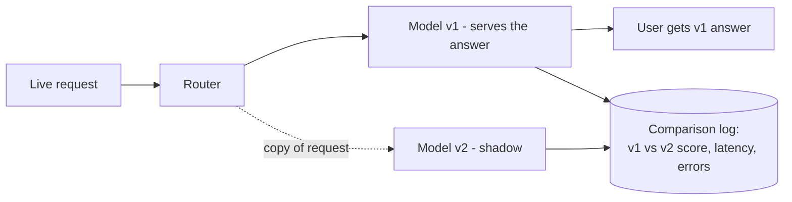

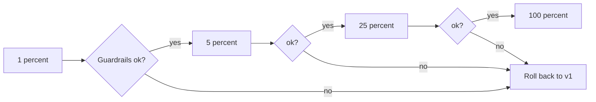

**Guardrails for a model:** error rate, latency p99, **prediction distribution** (the average score shouldn't jump), business metric (click-through), and a **minimum sample size** before any decision (a 1% canary with 10 requests proves nothing).

## 3.4 Types and Variants

| Variant | Meaning |
|---|---|
| **Shadow** | Duplicate traffic, discard the new answer |
| **Canary** | Real answers for a small share |
| **Blue-green** | Two full environments, switch all at once (fast rollback) |
| **Champion / challenger** | Keep the best model as champion; challengers are tested against it |
| **Replay testing** | Re-run recorded historical traffic through the new model |
| **Dark launch** | Run in production, hidden from users (similar to shadow) |
| **Gradual by segment** | First employees, then one country, then everyone |

## 3.5 Complete Java Example - Shadowing a Buggy Model, Then a Canary That Rolls Back

**What it shows:** v2 has a hidden bug (fails when a feature is missing). In shadow mode the bug is found without affecting anyone. Then, a canary ramp shows why very small stages prove nothing and how the 25% stage triggers the rollback.

```java
import java.util.*;

public class ShadowCanaryDemo {

    record Request(int id, double a, double b) {}

    // v1 = current production model
    static double v1(Request r) { return 1 / (1 + Math.exp(-(1.2 * r.a() - 0.8 * r.b()))); }
    // v2 = new model: slightly different weights AND a bug: it fails on ids divisible by 40 (a missing-feature case nobody tested)
    static double v2(Request r) {
        if (r.id() % 40 == 0) throw new IllegalStateException("feature 'b' is null");
        return 1 / (1 + Math.exp(-(1.3 * r.a() - 0.7 * r.b())));
    }

    public static void main(String[] args) {
        Random rnd = new Random(5);
        List<Request> traffic = new ArrayList<>();
        for (int i = 1; i <= 4000; i++) traffic.add(new Request(i, rnd.nextGaussian(), rnd.nextGaussian()));

        // ---------- 1. SHADOW: serve v1, run v2 silently on the same requests, compare ----------
        int disagree = 0, errors = 0; double diffSum = 0; int compared = 0;
        for (Request r : traffic) {
            double live = v1(r);                                   // this is what the user gets
            try {
                double shadow = v2(r);                             // result is only logged
                compared++; diffSum += Math.abs(live - shadow);
                if ((live > 0.5) != (shadow > 0.5)) disagree++;
            } catch (RuntimeException e) { errors++; }
        }
        System.out.printf("1) SHADOW on %d requests: v2 errors=%d (%.2f%%)  decisions that differ=%d (%.2f%%)  mean |score diff|=%.3f%n",
                traffic.size(), errors, 100.0 * errors / traffic.size(), disagree, 100.0 * disagree / compared, diffSum / compared);
        System.out.println("   users saw only v1 answers, so the bug cost nothing");

        // ---------- 2. CANARY: real traffic share grows only while guardrails hold ----------
        int[] stages = {1, 5, 25, 50, 100};
        double maxErrorRate = 0.01; int minSamples = 100;
        System.out.println("2) CANARY ramp (guardrail: v2 error rate <= 1% once there are >= 100 requests)");
        int cursor = 0; boolean rolledBack = false;
        for (int pct : stages) {
            int windowSize = 1000, v2Count = 0, v2Errors = 0;
            for (int i = 0; i < windowSize; i++) {
                Request r = traffic.get((cursor + i) % traffic.size());
                if (Math.floorMod(r.id() * 31, 100) < pct) {       // deterministic routing by request id
                    v2Count++;
                    try { v2(r); } catch (RuntimeException e) { v2Errors++; }
                }
            }
            cursor += windowSize;
            double rate = v2Count == 0 ? 0 : (double) v2Errors / v2Count;
            boolean enough = v2Count >= minSamples;
            String verdict = enough && rate > maxErrorRate ? "ROLL BACK" : (enough ? "ok, continue" : "too few samples, wait");
            System.out.printf("   %3d%% of traffic: v2 got %4d requests, %3d errors (%.2f%%)  -> %s%n", pct, v2Count, v2Errors, 100 * rate, verdict);
            if (verdict.equals("ROLL BACK")) { rolledBack = true; break; }
        }
        System.out.println("   final state: " + (rolledBack ? "100% on v1, v2 pulled back for fixing" : "v2 fully promoted"));
    }
}
```

**Output** (identical on all 3 runs):

```text
1) SHADOW on 4000 requests: v2 errors=100 (2.50%)  decisions that differ=113 (2.90%)  mean |score diff|=0.020
   users saw only v1 answers, so the bug cost nothing
2) CANARY ramp (guardrail: v2 error rate <= 1% once there are >= 100 requests)
     1% of traffic: v2 got   10 requests,   5 errors (50.00%)  -> too few samples, wait
     5% of traffic: v2 got   50 requests,   5 errors (10.00%)  -> too few samples, wait
    25% of traffic: v2 got  250 requests,  10 errors (4.00%)  -> ROLL BACK
   final state: 100% on v1, v2 pulled back for fixing
```

**What the output shows**
- **Shadow:** v2 raised errors on **2.5%** of requests and its decisions differ from v1 on **2.9%** of the others. Users never noticed, because they were served v1.
- **Canary 1% and 5%:** v2 got only 10 and 50 requests. 5 errors out of 10 *looks* alarming, but the rule says "wait until 100 requests" so a decision on 10 requests is not made. This prevents both panic rollbacks and false confidence.
- **Canary 25%:** 250 requests, 4% error rate, above the 1% guardrail, so the system **rolls back automatically** to 100% v1.

## 3.6 Shadow and Canary in Spring Boot

```java
@PostMapping("/predict")
public Prediction predict(@RequestBody PredictRequest req) {
    Prediction live = champion.predict(req);                       // the answer the user gets

    if (shadowEnabled) {
        shadowExecutor.submit(() -> {                              // async: must NEVER slow down or break the user path
            try {
                Prediction p = challenger.predict(req);
                metrics.record(req.id(), live.score(), p.score());                          // Micrometer + comparison store
            } catch (Exception e) { metrics.counter("shadow.error").increment(); }
        });
    }
    return live;
}
```

**Canary with Kubernetes / service mesh (traffic split by weight, no code):**
```yaml
# Istio VirtualService: 95% to model v1, 5% to v2
http:
  - route:
      - destination: { host: model-service, subset: v1 }
        weight: 95
      - destination: { host: model-service, subset: v2 }
        weight: 5
```
Argo Rollouts / Flagger automate the ramp: they query Prometheus (error rate, latency, a business metric) at each step and roll back on failure ([09_Deployment_Pattern.md](../03_System_Design/09_Deployment_Pattern.md)).

## 3.7 Pros and Cons

| Pros | Cons |
|---|---|
| Shadow: no user risk, tests with real data | Shadow doubles compute cost |
| Canary: limits the blast radius | Needs good metrics and a minimum sample size |
| Automated rollback is fast | Shadow cannot measure user reaction (clicks), only agreement |

## 3.8 Pitfalls, Interview Questions and Cheat Sheet

**Common pitfalls**
- Shadow traffic with **side effects** (the shadow model sends an email or charges a card). Shadow must be read-only.
- Running the shadow call synchronously, so it slows or breaks users.
- Judging a canary on a handful of requests.
- Only watching technical metrics (HTTP 200) but not prediction quality.
- Canary users aren't random (for example all from one country), so the comparison is biased.

**Interview questions**
1. *Shadow vs canary?* → Shadow: new model sees copies of traffic and its answers are discarded. Canary: new model answers a small share of real users.
2. *What would make you roll back automatically?* → Error rate, latency, an unusual prediction distribution or a business metric crossing a threshold with enough samples.
3. *How do you compare models in shadow mode?* → Log both predictions per request id; measure disagreement, score difference, latency and errors; later compare with the true outcomes when labels arrive.
4. *Why not just A/B test directly?* → A/B tests expose real users to a possibly broken model. Shadow first finds crashes and silly outputs for free.
5. *Blue-green vs canary for ML?* → Blue-green flips everything at once (fast rollback); canary ramps gradually (less risk, needs more machinery).

**Cheat sheet**
```
Shadow : copy traffic, run async, discard answer, compare + log     -> finds crashes and drift, zero user risk
Canary : 1% -> 5% -> 25% -> 100%, guardrails + minimum samples      -> auto rollback
Gate   : error rate, latency, score distribution, business metric
Rule   : shadow code must be read-only and off the user's critical path
```

### 📘 Terms Explained

| Term | Meaning |
|---|---|
| **Shadow mode** | Running a new model on live traffic without using its answers |
| **Canary** | Giving a new version to a small share of real users first |
| **Champion / challenger** | The current best model / a model trying to replace it |
| **Guardrail** | A metric limit that triggers a stop or rollback |
| **Rollback** | Returning traffic to the previous version |
| **Blast radius** | How many users a failure can affect |
| **Traffic splitting** | Routing a percentage of requests to each version |
| **Argo Rollouts / Flagger** | Kubernetes tools that automate canary releases |

---

# 4. Multi-Armed Bandit

## 4.1 What Is It?

The name comes from a gambler facing several slot machines ("one-armed bandits") with unknown payouts. Each pull gives a bit of information, but time spent on a bad machine is wasted. This is the **explore vs exploit** problem:

- **Explore:** try options to learn which is best.
- **Exploit:** use the best option found so far to earn the most.

A **bandit** automatically moves traffic towards the better variant *while the experiment is still running*, unlike an A/B test that keeps a fixed split until the end.

## 4.2 Why Do We Need It?

| Situation | Why a bandit helps |
|---|---|
| Testing 5 headlines/banners/rankers | A/B/n wastes traffic on the 4 losers |
| Short-lived content (flash sale, news) | No time for a long test |
| Each wrong choice costs money | Minimise **regret** (reward lost versus always picking the best) |
| Preferences change over time | Keeps exploring a little |

## 4.3 How It Works

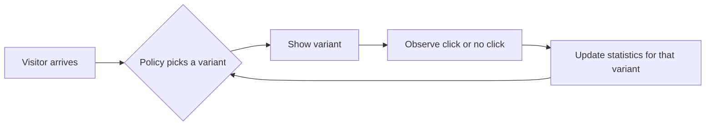

| Policy | Idea |
|---|---|
| **Epsilon-greedy** | With probability ε (say 10%) pick a random variant, otherwise the best so far |
| **UCB1** | Pick the variant with the highest **optimistic estimate**: average + a bonus for being little-tested |
| **Thompson sampling** | Keep a Beta distribution of each variant's conversion rate; sample from each; show the highest sample. Uncertain variants get sampled high sometimes (exploration), proven good ones win mostly (exploitation) |
| **Contextual bandit** | The choice also depends on the user/context (features), e.g. LinUCB |

## 4.4 Types and Variants

| Variant | Note |
|---|---|
| **Stochastic bandit** | Rewards come from fixed unknown distributions |
| **Contextual bandit** | Uses user features; the base of many personalisation systems |
| **Non-stationary bandit** | Forgets old data (sliding window / discount) when tastes change |
| **Bandit vs A/B** | A/B gives cleaner statistics; a bandit gives more reward during the test |
| **Reinforcement learning** | Bandit = single step decisions; RL = sequences with long-term effects |

## 4.5 Complete Java Example - Fixed Split vs Epsilon-Greedy vs UCB1 vs Thompson Sampling

**What it shows:** three banner variants with hidden conversion rates 5%, 10% and 12%, shown to 10,000 visitors under four policies. Same random seed for all, so the comparison is fair.

```java
import java.util.*;

public class BanditDemo {
    static final double[] TRUE_P = {0.05, 0.10, 0.12};         // unknown to the algorithms
    static final int PULLS = 10_000;

    interface Policy { int choose(int[] wins, int[] tries, int t, Random r); }

    // Thompson sampling needs Beta(a,b) samples; build them from two Gamma samples (Marsaglia-Tsang)
    static double gamma(double shape, Random r) {
        double d = shape - 1.0 / 3, c = 1 / Math.sqrt(9 * d);
        while (true) {
            double x = r.nextGaussian(), v = 1 + c * x;
            if (v <= 0) continue;
            v = v * v * v;
            double u = r.nextDouble();
            if (Math.log(u) < 0.5 * x * x + d - d * v + d * Math.log(v)) return d * v;
        }
    }
    static double beta(double a, double b, Random r) { double x = gamma(a, r), y = gamma(b, r); return x / (x + y); }

    static void run(String name, Policy p, long seed) {
        Random env = new Random(seed), pr = new Random(seed + 99);
        int k = TRUE_P.length; int[] wins = new int[k], tries = new int[k]; int total = 0;
        for (int t = 0; t < PULLS; t++) {
            int arm = p.choose(wins, tries, t, pr);
            tries[arm]++;
            if (env.nextDouble() < TRUE_P[arm]) { wins[arm]++; total++; }
        }
        double best = TRUE_P[2] * PULLS;
        System.out.printf("   %-22s conversions=%4d  regret=%6.1f  pulls per variant=%s%n", name, total, best - total, Arrays.toString(tries));
    }

    public static void main(String[] args) {
        System.out.println("3 variants with hidden conversion rates 5%, 10%, 12%; " + PULLS + " visitors");
        run("fixed A/B/C split", (w, t, i, r) -> i % 3, 11);
        run("epsilon-greedy 10%", (w, t, i, r) -> {
            if (r.nextDouble() < 0.1 || i < 3) return i < 3 ? i : r.nextInt(3);
            int best = 0; for (int a = 1; a < 3; a++) if ((double) w[a] / Math.max(1, t[a]) > (double) w[best] / Math.max(1, t[best])) best = a;
            return best;
        }, 11);
        run("UCB1", (w, t, i, r) -> {
            for (int a = 0; a < 3; a++) if (t[a] == 0) return a;
            int best = 0; double bv = -1;
            for (int a = 0; a < 3; a++) { double v = (double) w[a] / t[a] + Math.sqrt(2 * Math.log(i + 1) / t[a]); if (v > bv) { bv = v; best = a; } }
            return best;
        }, 11);
        run("Thompson sampling", (w, t, i, r) -> {
            int best = 0; double bv = -1;
            for (int a = 0; a < 3; a++) { double s = beta(1 + w[a], 1 + t[a] - w[a], r); if (s > bv) { bv = s; best = a; } }
            return best;
        }, 11);
        System.out.println("regret = conversions lost compared with always showing the best variant (12% x " + PULLS + " = " + (int) (0.12 * PULLS) + ")");
    }
}
```

**Output** (identical on all 3 runs):

```text
3 variants with hidden conversion rates 5%, 10%, 12%; 10000 visitors
   fixed A/B/C split      conversions= 880  regret= 320.0  pulls per variant=[3334, 3333, 3333]
   epsilon-greedy 10%     conversions=1140  regret=  60.0  pulls per variant=[387, 335, 9278]
   UCB1                   conversions=1020  regret= 180.0  pulls per variant=[1171, 3548, 5281]
   Thompson sampling      conversions=1152  regret=  48.0  pulls per variant=[132, 818, 9050]
regret = conversions lost compared with always showing the best variant (12% x 10000 = 1200)
```

**What the output shows**
- **Fixed split** keeps showing the 5% variant to a third of the visitors: 880 conversions, regret 320.
- **Epsilon-greedy** finds the 12% variant quickly (9,278 of 10,000 pulls): 1,140 conversions, regret 60. It keeps wasting 10% on random picks forever.
- **UCB1** explores for much longer (its bonus term is large with these low rates): regret 180, better than the fixed split but worse than the others here.
- **Thompson sampling** has the lowest regret (48) and almost never shows the 5% variant (132 pulls).
- These are single runs with one seed: ordering on other seeds can vary. The robust lesson is that adaptive policies beat a fixed split on total reward.

## 4.6 Bandits in Spring Boot

```java
@Service
public class BannerBandit {
    private final Map<String, double[]> stats = new ConcurrentHashMap<>();       // variant -> {wins, losses}

    public String choose(List<String> variants) {
        return variants.stream().max(Comparator.comparingDouble(v -> sampleBeta(stats.computeIfAbsent(v, k -> new double[]{1, 1})))).get();
    }
    public void reward(String variant, boolean clicked) {
        stats.get(variant)[clicked ? 0 : 1] += 1;                                // persist in Redis for several servers
    }
}
```
Use `org.apache.commons.math3.distribution.BetaDistribution` for sampling. For production: keep counts in Redis (`HINCRBY`), log every decision with the probability of choosing it (needed for later offline analysis), and let a small fixed share of traffic run randomly as a sanity check.

## 4.7 Pros and Cons

| Pros | Cons |
|---|---|
| Less traffic wasted on bad variants | Harder to get clean statistics (no fixed sample) |
| Adapts if preferences drift | Delayed rewards (purchase days later) complicate updates |
| Good for many variants | Sensitive to implementation bugs and non-stationarity |

## 4.8 Pitfalls, Interview Questions and Cheat Sheet

**Common pitfalls**
- Rewards that arrive late (the bandit keeps picking based on incomplete data).
- A shared counter updated by many servers without atomicity.
- Using a bandit when you need a clean causal estimate to report to management (use an A/B test).
- Never exploring again after a lucky start.
- Choosing a metric (clicks) that doesn't reflect real value (revenue).

**Interview questions**
1. *Explore vs exploit?* → Trying new options to learn vs using the current best to earn.
2. *Bandit vs A/B test?* → Bandit maximises reward during the experiment; A/B gives a cleaner measurement of the difference.
3. *How does Thompson sampling work?* → Sample a plausible conversion rate from each variant's Beta distribution and show the highest; uncertainty makes exploration happen automatically.
4. *What is regret?* → Reward lost compared with always choosing the best variant.
5. *When would you use a contextual bandit?* → When the best choice depends on the user (personalised ranking, offers).

**Cheat sheet**
```
Explore vs exploit; goal = minimum regret
Epsilon-greedy : 10% random, 90% best so far
UCB1           : average + sqrt(2 ln t / n)
Thompson       : sample Beta(1+wins, 1+losses) per variant, pick the max
Use            : many variants, short life, cost of a bad variant is high
Don't use      : you need a clean, reportable causal effect -> A/B test
```

### 📘 Terms Explained

| Term | Meaning |
|---|---|
| **Arm** | One option to choose (a banner, a ranker) |
| **Reward** | The result of a choice (click = 1, no click = 0) |
| **Regret** | Total reward lost versus always playing the best arm |
| **Exploration / Exploitation** | Learning about options / using the best known option |
| **Beta distribution** | A distribution over a probability, updated by counting successes and failures |
| **UCB (upper confidence bound)** | "Optimism in the face of uncertainty": estimate + uncertainty bonus |
| **Contextual bandit** | A bandit whose choice depends on features of the current user |

---

# 5. Feature Store (Interview Imp - Java)

## 5.1 What Is It?

A **feature store** is a central place where model inputs (**features**) are defined once, computed once, stored, and served to both **training** and **serving**. It has two halves:

- **Offline store** (data lake / warehouse): the full history of feature values, used to build training sets.
- **Online store** (Redis, DynamoDB, Cassandra): only the *latest* value per entity, served in milliseconds at prediction time.

Examples: Feast (open source), Tecton, SageMaker Feature Store, Vertex AI Feature Store, Databricks Feature Store.

## 5.2 Why Do We Need It?

| Problem | Meaning | How a feature store helps |
|---|---|---|
| **Training/serving skew** | Training code computes "purchases in 30 days" one way, the Java service another | One definition for both |
| **Data leakage** | Training rows accidentally use information from the future | **Point-in-time correct** joins |
| **Duplicate work** | Five teams each compute "user age" | Shared, discoverable features |
| **Slow serving** | Computing features from raw logs at request time | Precomputed, in the online store |
| **No lineage** | Nobody knows who owns a feature | Registry with owner, description, freshness |

## 5.3 How It Works

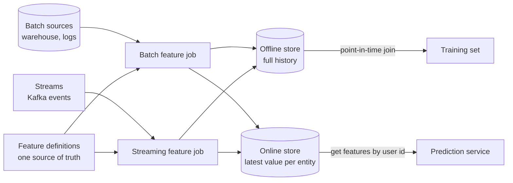

**Point-in-time correctness.** If the label "churned" is known on day 90, the feature must be computed **as it was on day 90**, using only events before that day. Using events from day 100 leaks the future into training. The model then looks brilliant in testing and fails in production.

**Materialization:** a scheduled job copies the newest feature values from the offline store to the online store.

## 5.4 Types and Variants

| Variant | Meaning |
|---|---|
| **Batch features** | Computed daily/hourly (30-day purchase count) |
| **Streaming features** | Updated per event (clicks in the last 5 minutes) |
| **On-demand features** | Computed at request time from the request itself (cart total, time of day) |
| **Entity** | The thing a feature is about: user, product, merchant, device |
| **Feature view / group** | A set of related features with the same entity and source |
| **TTL** | How long a feature value is considered fresh |
| **Embeddings store** | Vectors from a model, served via a vector index |

## 5.5 Complete Java Example - Point-in-Time Leakage and Training/Serving Skew

**What it shows:** the same purchase log gives a *different* training feature when the future leaks in, and the offline vs serving implementations of the "same" feature disagree by one on a boundary day.

```java
import java.util.*;

public class FeatureStoreDemo {

    record Purchase(String user, int day) {}
    record Label(String user, int day, boolean churned) {}      // "did the user churn?" known at 'day'

    // ---------- offline feature: purchases in the 30 days BEFORE 'asOfDay' ----------
    static int purchases30d(List<Purchase> log, String user, int asOfDay, boolean leaky) {
        int n = 0;
        for (Purchase p : log) {
            if (!p.user().equals(user)) continue;
            boolean inWindow = p.day() > asOfDay - 30 && p.day() <= asOfDay;
            boolean leakWindow = p.day() > asOfDay - 30;          // also counts purchases AFTER the label date
            if (leaky ? leakWindow && p.day() <= asOfDay + 60 : inWindow) n++;
        }
        return n;
    }

    // ---------- the same feature computed a second way in the serving code (skew!) ----------
    static int purchases30dServing(List<Purchase> log, String user, int today) {
        int n = 0;
        for (Purchase p : log) if (p.user().equals(user) && p.day() >= today - 30 && p.day() <= today) n++;   // off-by-one: >= vs >
        return n;
    }

    public static void main(String[] args) {
        List<Purchase> log = List.of(
            new Purchase("asha", 10), new Purchase("asha", 25), new Purchase("asha", 40),
            new Purchase("ben", 5),
            new Purchase("ben", 100), new Purchase("ben", 105), new Purchase("ben", 110));   // ben comes back AFTER day 90
        List<Label> labels = List.of(new Label("asha", 45, false), new Label("ben", 90, true));   // ben looked churned at day 90

        System.out.println("1) training rows: purchases_30d for each label date");
        System.out.println("   user  labelDay churned  correct(as-of)  leaky(uses the future)");
        for (Label l : labels)
            System.out.printf("   %-5s %8d %7s %14d %22d%n", l.user(), l.day(), l.churned(),
                    purchases30d(log, l.user(), l.day(), false), purchases30d(log, l.user(), l.day(), true));
        System.out.println("   -> the leaky column shows 'ben' with 3 purchases although he was churned on day 90:");
        System.out.println("      the model would learn 'many purchases = churn', which is false in production");

        System.out.println("2) training/serving skew: offline vs serving code for the same feature");
        int today = 40;
        int offline = purchases30d(log, "asha", today, false), serving = purchases30dServing(log, "asha", today);
        System.out.println("   asha on day " + today + ": offline=" + offline + "  serving=" + serving
                + (offline != serving ? "   <- MISMATCH (boundary day counted twice differently)" : "   match"));
        System.out.println("   fix: ONE feature definition used for both training and serving (the feature store's job)");
    }
}
```

**Output** (identical on all 3 runs):

```text
1) training rows: purchases_30d for each label date
   user  labelDay churned  correct(as-of)  leaky(uses the future)
   asha        45   false              2                      2
   ben         90    true              0                      3
   -> the leaky column shows 'ben' with 3 purchases although he was churned on day 90:
      the model would learn 'many purchases = churn', which is false in production
2) training/serving skew: offline vs serving code for the same feature
   asha on day 40: offline=2  serving=3   <- MISMATCH (boundary day counted twice differently)
   fix: ONE feature definition used for both training and serving (the feature store's job)
```

**What the output shows**
- **Leakage:** `ben` was marked churned on day 90, but the leaky query counted his *later* comebacks (days 100–110): 3 purchases. The correct as-of value is **0**. A model trained on the leaky column learns "many purchases means churned", the opposite of reality.
- **Skew:** for the same user and day, offline code (`> today − 30`) says **2** but the serving code (`>= today − 30`) says **3**. Such off-by-one differences silently degrade accuracy. The fix is not careful reading but **one shared definition**.

## 5.6 Feature Store in Java and Spring

```java
// Serving: fetch online features just before predicting (Feast over gRPC/HTTP, or Redis directly)
@Component
class FeatureClient {
    private final StringRedisTemplate redis;

    float[] online(long userId) {
        List<Object> v = redis.opsForHash().multiGet("fs:user_features:" + userId,
                List.of("purchases_30d", "avg_basket", "days_since_last_order"));
        if (v.contains(null)) metrics.counter("features.missing").increment();       // missing features are a top cause of bad predictions
        return toFloatArray(v, DEFAULTS);                                              // documented defaults, not silent zeros
    }
}
```

```python
# Feature definition (Feast, Python side) - written ONCE, used by training and serving
user_stats = FeatureView(name="user_stats", entities=[user], ttl=timedelta(days=2),
    schema=[Field(name="purchases_30d", dtype=Int64), Field(name="avg_basket", dtype=Float32)],
    source=warehouse_table)
# training set:   store.get_historical_features(entity_df_with_timestamps, features=[...])   <- point-in-time join
# serving:        store.get_online_features(features=[...], entity_rows=[{"user": 42}])
```

**Operational points:** monitor feature **freshness** (how old is the newest value?) and **missing rate**; version feature definitions; set a TTL so stale values aren't served as if they were fresh.

## 5.7 Pros and Cons

| Pros | Cons |
|---|---|
| Removes training/serving skew | Another platform to run and own |
| Point-in-time joins prevent leakage | Needs governance (naming, owners, deprecation) |
| Reuse across teams and models | Overkill for one small model |
| Low-latency feature serving | Two stores to keep consistent |

## 5.8 Pitfalls, Interview Questions and Cheat Sheet

**Common pitfalls**
- Computing a feature separately in Python (training) and Java (serving).
- Joining on "latest value" instead of "value at label time".
- Missing features replaced by 0 silently (0 is a real value for many features).
- Serving stale values because the materialization job failed.
- Putting personal data into a shared store without access control.

**Interview questions**
1. *What problem does a feature store solve?* → Consistency of features between training and serving, reuse, and low-latency access.
2. *Offline vs online store?* → Offline: history for training (warehouse). Online: latest values for real-time lookups (key-value store).
3. *What is data leakage and how do you prevent it?* → Using future information in training features; prevent with point-in-time joins.
4. *What is training/serving skew?* → The same feature computed differently in training and serving; fix with shared definitions.
5. *How do you serve features within 10 ms?* → Precompute, store in Redis/DynamoDB keyed by entity id, batch lookups, colocate with the service.

**Cheat sheet**
```
Define once -> compute (batch + stream) -> offline store (history) + online store (latest)
Training : point-in-time join (value AS OF the label time)
Serving  : get by entity id from the online store, TTL, default values documented
Watch    : freshness, missing-rate, skew checks
```

### 📘 Terms Explained

| Term | Meaning |
|---|---|
| **Feature** | A measurable input to a model |
| **Entity** | The object a feature describes (user, product) |
| **Offline store** | Large historical storage used to create training data |
| **Online store** | Fast storage with the latest values for real-time lookups |
| **Point-in-time join** | A join that uses only data available at the moment of the label |
| **Data leakage** | Training with information the model won't have in production |
| **Training/serving skew** | Feature values differ between training and serving |
| **Materialization** | Copying fresh feature values from offline to online store |
| **Feast** | Popular open-source feature store |

---

# 6. Model Registry and Data Versioning

## 6.1 What Are They?

- **Model registry (#419):** a catalogue of trained models with **versions**, **stages** (staging, production, archived), metrics, and links to the code and data that produced them. Examples: MLflow Model Registry, SageMaker Model Registry, Vertex AI Model Registry.
- **Data versioning (#425):** recording *exactly which version of the data* a model was trained on (a dataset id or content hash), like Git for datasets. Examples: DVC, lakeFS, Delta Lake time travel, Iceberg snapshots.

Together they answer: **"Which model is serving, who approved it, and what data and code created it?"**

## 6.2 Why Do We Need Them?

| Problem | Example |
|---|---|
| Can't reproduce a model | "It was better last month but nobody knows why" |
| Unsafe releases | Someone copies a `.pkl` file onto the server by hand |
| No rollback | The new model is bad and the old file was overwritten |
| Audit and regulation | Auditors ask which data trained the credit-scoring model |
| Silent data change | A dataset was fixed upstream, and results changed without anyone noticing |

## 6.3 How It Works

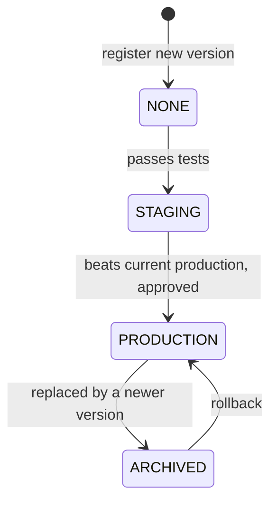

**What each registry entry stores:** model name + version number, the artifact location, metrics (AUC, latency), the **code commit**, the **dataset hash/version**, the **feature definitions version**, who registered and approved it, and the current stage.

**Data versioning idea:** compute a **content hash** (SHA-256) of the dataset (or of its file manifest). The same data always gives the same hash; changing even one value changes it. Store the hash with the model, then you can detect "same code, different data".

**Serving by stage, not by number:** the service loads `models:/churn/Production`. Promoting or rolling back is a registry change, not a redeploy.

## 6.4 Types and Variants

| Tool / idea | Note |
|---|---|
| **MLflow** | Tracking + registry, open source, REST and Java client |
| **DVC** | Git-like versioning of large data files, remote storage |
| **lakeFS** | Git-style branches and commits on an object-store data lake |
| **Delta Lake / Iceberg / Hudi** | Table formats with time travel (`VERSION AS OF`) |
| **Model cards** | A document describing a model's purpose, data, limits and risks |
| **Approval workflow** | Human review before production (regulated domains) |
| **Lineage graph** | Data → features → model → deployment, traceable end to end |

## 6.5 Complete Java Example - Dataset Hashes, Promotion Gate and Rollback

**What it shows:** a SHA-256 hash that changes when one label changes, a registry with stages, a gate that refuses a model worse than production, and a rollback.

```java
import java.nio.charset.StandardCharsets;
import java.security.MessageDigest;
import java.util.*;

public class RegistryDemo {

    enum Stage { NONE, STAGING, PRODUCTION, ARCHIVED }
    record ModelVersion(String name, int version, String dataHash, double auc, Stage stage) {
        ModelVersion withStage(Stage s) { return new ModelVersion(name, version, dataHash, auc, s); }
    }

    static String sha256(String text) throws Exception {
        StringBuilder sb = new StringBuilder();
        for (byte b : MessageDigest.getInstance("SHA-256").digest(text.getBytes(StandardCharsets.UTF_8))) sb.append(String.format("%02x", b));
        return sb.toString().substring(0, 10);
    }

    static class Registry {
        private final Map<String, List<ModelVersion>> models = new LinkedHashMap<>();

        ModelVersion register(String name, String dataHash, double auc) {
            List<ModelVersion> list = models.computeIfAbsent(name, k -> new ArrayList<>());
            ModelVersion v = new ModelVersion(name, list.size() + 1, dataHash, auc, Stage.NONE);
            list.add(v); return v;
        }
        Optional<ModelVersion> production(String name) {
            return models.get(name).stream().filter(v -> v.stage() == Stage.PRODUCTION).findFirst();
        }
        private void set(String name, int version, Stage s) {
            List<ModelVersion> l = models.get(name);
            l.set(version - 1, l.get(version - 1).withStage(s));
        }
        // gate: only promote if it beats the current production model
        String promote(String name, int version) {
            ModelVersion cand = models.get(name).get(version - 1);
            Optional<ModelVersion> cur = production(name);
            if (cur.isPresent() && cand.auc() <= cur.get().auc())
                return "REFUSED v" + version + " (AUC " + cand.auc() + " <= production v" + cur.get().version() + " " + cur.get().auc() + ")";
            cur.ifPresent(c -> set(name, c.version(), Stage.ARCHIVED));
            set(name, version, Stage.PRODUCTION);
            return "PROMOTED v" + version + " to production (AUC " + cand.auc() + ")";
        }
        String rollback(String name) {
            ModelVersion cur = production(name).orElseThrow();
            ModelVersion prev = models.get(name).stream().filter(v -> v.stage() == Stage.ARCHIVED).reduce((x, y) -> y).orElseThrow();
            set(name, cur.version(), Stage.ARCHIVED); set(name, prev.version(), Stage.PRODUCTION);
            return "ROLLED BACK v" + cur.version() + " -> v" + prev.version();
        }
        void print(String name) { models.get(name).forEach(v -> System.out.println("   " + v)); }
    }

    public static void main(String[] args) throws Exception {
        // 1) data versioning: a hash of the training data identifies exactly what a model saw
        String data1 = "u1,5,0\nu2,3,1\nu3,9,0";
        String data2 = "u1,5,0\nu2,3,1\nu3,9,1";               // ONE label changed
        System.out.println("1) dataset hash v1=" + sha256(data1) + "  same data again=" + sha256(data1) + "  one label changed=" + sha256(data2));

        // 2) register, gate, promote, roll back
        Registry reg = new Registry();
        reg.register("churn", sha256(data1), 0.81);
        reg.register("churn", sha256(data2), 0.84);
        reg.register("churn", sha256(data2), 0.79);
        System.out.println("2) " + reg.promote("churn", 1));
        System.out.println("   " + reg.promote("churn", 2));
        System.out.println("   " + reg.promote("churn", 3));
        System.out.println("   " + reg.rollback("churn"));
        System.out.println("3) registry state:");
        reg.print("churn");
        ModelVersion prod = reg.production("churn").get();
        System.out.println("4) serving loads: models:/churn/Production -> v" + prod.version() + ", trained on data " + prod.dataHash());
    }
}
```

**Output** (identical on all 3 runs):

```text
1) dataset hash v1=3c37f679af  same data again=3c37f679af  one label changed=d20541f4e2
2) PROMOTED v1 to production (AUC 0.81)
   PROMOTED v2 to production (AUC 0.84)
   REFUSED v3 (AUC 0.79 <= production v2 0.84)
   ROLLED BACK v2 -> v1
3) registry state:
   ModelVersion[name=churn, version=1, dataHash=3c37f679af, auc=0.81, stage=PRODUCTION]
   ModelVersion[name=churn, version=2, dataHash=d20541f4e2, auc=0.84, stage=ARCHIVED]
   ModelVersion[name=churn, version=3, dataHash=d20541f4e2, auc=0.79, stage=NONE]
4) serving loads: models:/churn/Production -> v1, trained on data 3c37f679af
```

**What the output shows**
- **Data hash:** same data → `3c37f679af`; changing one label gives `d20541f4e2`. Two models trained with the same hash saw the same data.
- **Gate:** v1 is promoted; v2 (AUC 0.84) replaces it; v3 (0.79) is **refused** because it is worse than production.
- **Rollback:** v2 returns to ARCHIVED and v1 is production again. The serving code still loads "Production" without changing.

## 6.6 Registry in Java and Spring

```java
// MLflow REST: fetch the production model's location at startup (or on a refresh signal)
@Component
class ModelLoader {
    private final RestClient mlflow = RestClient.create("http://mlflow:5000");

    ModelRef production(String name) {
        var res = mlflow.get().uri("/api/2.0/mlflow/registered-models/get-latest-versions?name={n}&stages=Production", name)
                        .retrieve().body(LatestVersions.class);
        return res.versions().get(0);                      // version, source (artifact URI), run_id
    }
}
```

```python
# Registering (training side, Python): metrics + data hash are logged with the model
with mlflow.start_run():
    mlflow.log_param("data_hash", dataset_hash)
    mlflow.log_metric("auc", auc)
    mlflow.sklearn.log_model(model, "model", registered_model_name="churn")
```

Add the model **version** to every prediction response and log line, so a bad decision can be traced to the model that made it. For a quick rollback, keep the previous version's artifact warm in memory.

## 6.7 Pros and Cons

| Pros | Cons |
|---|---|
| Reproducibility and audit trail | Process overhead for small teams |
| Safe promotion and one-step rollback | Hashing and storing big datasets costs space/time |
| Clear ownership | Registry becomes critical infrastructure |

## 6.8 Pitfalls, Interview Questions and Cheat Sheet

**Common pitfalls**
- Registering only the model file, not the data and code versions.
- "Latest" instead of an explicit stage or version (surprise upgrades).
- Overwriting a dataset in place (no way back).
- Promoting by metric alone without [shadow/canary checks](#3-shadow-mode-and-canary-model-deployment-interview-imp---java).
- Not recording the feature definition version.

**Interview questions**
1. *What is a model registry?* → A versioned catalogue of models with stages, metrics and lineage, used to promote and roll back models safely.
2. *How do you make a model reproducible?* → Record code commit, dataset version/hash, parameters, feature definitions and random seeds.
3. *How does serving pick the model?* → By stage name (`Production`) or pinned version from the registry.
4. *How do you roll back a bad model?* → Move the Production stage back to the previous version; the service reloads it.
5. *How do you version a 1 TB dataset?* → Content-addressed manifests (DVC/lakeFS) or table-format snapshots (Delta/Iceberg), not copies.

**Cheat sheet**
```
Registry : name + version + stage (None/Staging/Production/Archived) + metrics + code commit + data hash
Gate     : promote only if it beats production (+ shadow/canary + approval)
Serving  : load by stage, return model version in every response
Data     : content hash / snapshot id stored with the model
Rollback : change the stage pointer
```

### 📘 Terms Explained

| Term | Meaning |
|---|---|
| **Model registry** | A catalogue of model versions and their stages |
| **Artifact** | The saved model file(s) |
| **Stage** | A lifecycle label: staging, production, archived |
| **Lineage** | The chain from raw data through features to the model |
| **Content hash (SHA-256)** | A fingerprint of data; any change gives a different value |
| **Time travel (table formats)** | Querying a table as it was at an earlier version |
| **Model card** | A short document describing a model's purpose, data and limits |
| **Reproducibility** | Being able to recreate the same model from recorded inputs |

---

# 7. ML Pipeline Pattern

## 7.1 What Is It?

An **ML pipeline** (#420) is a chain of automated steps from raw data to a registered model, for example: `ingest → validate → build features → train → evaluate → register → deploy`. It is the "Pipes and Filters" idea ([01_Architectural_Pattern.md](../02_HLD/01_Architectural_Pattern.md)) used as a **DAG** (directed acyclic graph): each step declares which steps it depends on, and an orchestrator runs them in a valid order.

## 7.2 Why Do We Need It?

| Problem with notebooks and manual steps | Pipeline fix |
|---|---|
| "Run cells 1–40 in the right order" | Declared dependencies |
| Retraining needs a person | Scheduled or triggered runs |
| A crash at step 6 means starting over | Cache finished steps; resume |
| Nobody knows which data fed which model | Every run logged with inputs and outputs |
| Quality problems reach production | Validation and evaluation **gates** stop bad runs |

## 7.3 How It Works

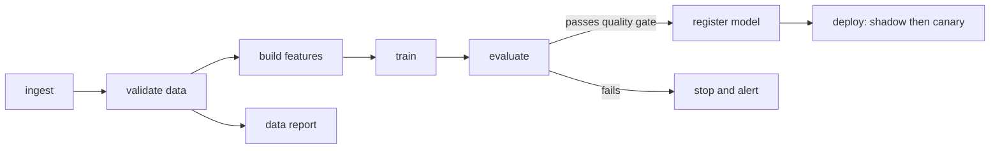

1. **Topological order:** a step runs only after all its dependencies finished (Kahn's algorithm: repeatedly pick steps with zero unfinished dependencies).
2. **Caching:** if a step's code and inputs are unchanged, skip it and reuse the stored output.
3. **Gates:** data validation (schema, null rates, ranges) before training; evaluation (metric must beat the current model) before registering.
4. **Triggers:** schedule (weekly), new data arrival, or a [drift alert](#8-model-monitoring-and-concept-drift-detection-interview-imp---java).
5. **Idempotent steps:** re-running a step with the same input gives the same output.

## 7.4 Types and Variants

| Orchestrator | Note |
|---|---|
| **Kubeflow Pipelines, Argo Workflows** | Kubernetes-native DAGs |
| **Apache Airflow** | General workflow scheduler (Python DAGs) |
| **Dagster, Prefect, Metaflow, ZenML** | Developer-friendly Python orchestrators |
| **Spring Batch** | Java batch jobs with restartable steps (good for the Java side) |
| **Spring Cloud Data Flow** | Streaming and batch pipelines |
| **SageMaker / Vertex AI Pipelines** | Managed cloud services |
| **Continuous training (CT)** | Pipeline reruns automatically when data or drift triggers it |

## 7.5 Complete Java Example - A DAG with Topological Order, Crash and Resume

**What it shows:** seven steps with dependencies are ordered automatically, the training step crashes on the first run, and the second run skips everything that already finished.

```java
import java.util.*;
import java.util.function.*;

public class PipelineDemo {

    static class Step {
        final String name; final List<String> deps; final Supplier<String> work; final boolean failsFirstTime;
        Step(String name, List<String> deps, Supplier<String> work, boolean failsFirstTime) {
            this.name = name; this.deps = deps; this.work = work; this.failsFirstTime = failsFirstTime;
        }
    }

    static Map<String, Step> steps = new LinkedHashMap<>();
    static void add(String name, List<String> deps, Supplier<String> w, boolean fails) { steps.put(name, new Step(name, deps, w, fails)); }

    // Kahn's algorithm: a step may run only after all its dependencies
    static List<String> order() {
        Map<String, Integer> indeg = new TreeMap<>();
        for (Step s : steps.values()) indeg.put(s.name, s.deps.size());
        Deque<String> ready = new ArrayDeque<>();
        indeg.forEach((k, v) -> { if (v == 0) ready.add(k); });
        List<String> out = new ArrayList<>();
        while (!ready.isEmpty()) {
            String n = ready.poll(); out.add(n);
            for (Step s : steps.values()) if (s.deps.contains(n) && indeg.merge(s.name, -1, Integer::sum) == 0) ready.add(s.name);
        }
        if (out.size() != steps.size()) throw new IllegalStateException("cycle in the pipeline");
        return out;
    }

    static final Map<String, String> cache = new HashMap<>();     // step name -> output (a real system keys by input hash)
    static int attempt = 0;

    static void run(String label) {
        attempt++;
        System.out.println(label);
        for (String n : order()) {
            Step s = steps.get(n);
            if (cache.containsKey(n)) { System.out.println("   " + n + ": cached (skipped)"); continue; }
            if (s.failsFirstTime && attempt == 1) { System.out.println("   " + n + ": FAILED -> pipeline stops here"); return; }
            cache.put(n, s.work.get());
            System.out.println("   " + n + ": ran -> " + cache.get(n));
        }
        System.out.println("   pipeline finished");
    }

    public static void main(String[] args) {
        add("ingest",        List.of(),                              () -> "10000 rows", false);
        add("validate",      List.of("ingest"),                      () -> "schema ok, 0 nulls", false);
        add("features",      List.of("validate"),                    () -> "42 features", false);
        add("train",         List.of("features"),                    () -> "model v7, AUC 0.84", true);   // e.g. out of memory
        add("evaluate",      List.of("train"),                       () -> "passes quality gate", false);
        add("register",      List.of("evaluate"),                    () -> "registered as staging", false);
        add("split-report",  List.of("validate"),                    () -> "report written", false);

        System.out.println("execution order (topological): " + order());
        run("run 1 (training crashes):");
        run("run 2 (resume: finished steps are skipped):");
    }
}
```

**Output** (identical on all 3 runs):

```text
execution order (topological): [ingest, validate, features, split-report, train, evaluate, register]
run 1 (training crashes):
   ingest: ran -> 10000 rows
   validate: ran -> schema ok, 0 nulls
   features: ran -> 42 features
   split-report: ran -> report written
   train: FAILED -> pipeline stops here
run 2 (resume: finished steps are skipped):
   ingest: cached (skipped)
   validate: cached (skipped)
   features: cached (skipped)
   split-report: cached (skipped)
   train: ran -> model v7, AUC 0.84
   evaluate: ran -> passes quality gate
   register: ran -> registered as staging
   pipeline finished
```

**What the output shows**
- **Order:** `split-report` only needs `validate`, so it can run before `train`; `train` waits for `features`; `register` is last. The order comes from the declared dependencies, not from a person.
- **Run 1:** the pipeline stops at the failing `train` step but keeps the results of the four finished steps.
- **Run 2:** finished steps are **cached (skipped)**; only `train`, `evaluate` and `register` run. In a real system the cache key is a hash of the step's code and inputs, so changed data forces a re-run.

## 7.6 Pipelines in Java and Spring

```java
// Spring Batch: each step is restartable; failed jobs resume from the failed step
@Bean Job retrainJob(JobRepository repo, Step ingest, Step validate, Step features, Step train, Step evaluate, Step register) {
    return new JobBuilder("retrain", repo)
            .start(ingest).next(validate).next(features).next(train)
            .next(evaluate)
            .on("FAILED").end()                          // quality gate failed -> stop, alert
            .from(evaluate).on("COMPLETED").to(register)
            .end().build();
}

@Scheduled(cron = "0 0 3 * * SUN")                       // weekly retrain
public void kickOff() { launcher.run(retrainJob, new JobParametersBuilder().addLong("ts", System.currentTimeMillis()).toJobParameters()); }
```
Trigger it from a drift alert too (a message on a topic). The training step itself often calls Python (a container, a Spark job, a SageMaker training job). Java orchestrates, Python trains.

## 7.7 Pros and Cons

| Pros | Cons |
|---|---|
| Repeatable, automated, auditable | Upfront engineering effort |
| Fast recovery from partial failures | Orchestrator is more infrastructure |
| Quality gates before production | Complex DAGs are hard to debug |

## 7.8 Pitfalls, Interview Questions and Cheat Sheet

**Common pitfalls**
- No data validation step, so garbage data trains a model.
- Non-deterministic steps (random seeds not fixed) that make runs incomparable.
- Caching by file name instead of content hash.
- Tight coupling of steps through shared mutable files.
- Auto-deploying every retrained model without gates.

**Interview questions**
1. *What is an ML pipeline?* → An automated, ordered chain of steps from data to a registered/deployed model, expressed as a DAG.
2. *How does the orchestrator decide the order?* → Topological sort of the dependency graph.
3. *How do you avoid recomputing everything?* → Cache step outputs keyed by a hash of code + inputs.
4. *What gates would you add?* → Data validation, evaluation versus the current model, fairness/bias checks, shadow/canary.
5. *What is continuous training?* → Automatically retraining and redeploying on a schedule, new data, or drift alerts.

**Cheat sheet**
```
Pipeline = DAG of idempotent steps: ingest -> validate -> features -> train -> evaluate -> register -> deploy
Order    = topological sort;  Resume = cache by hash(code + inputs)
Gates    = data validation, metric must beat production, then shadow/canary
Trigger  = schedule | new data | drift alert
Java     = Spring Batch / orchestrate;  Python/Spark = heavy training
```

### 📘 Terms Explained

| Term | Meaning |
|---|---|
| **Pipeline** | A chain of processing steps |
| **DAG** | Directed acyclic graph: steps with one-way dependencies and no loops |
| **Orchestrator** | The tool that schedules and runs the DAG |
| **Topological sort** | Ordering steps so every step comes after its dependencies |
| **Idempotent step** | Re-running it with the same input gives the same result |
| **Quality gate** | A check that must pass for the pipeline to continue |
| **Continuous training** | Automatic retraining when conditions are met |
| **Kahn's algorithm** | A simple method to compute a topological order |

---

# 8. Model Monitoring and Concept Drift Detection (Interview Imp - Java)

## 8.1 What Are They?

A model is trained on yesterday's world. In production the world changes, so it can silently get worse. Unlike a normal bug, nothing crashes: the service returns 200 OK with bad answers.

- **Model monitoring (#426):** watching the system (latency, errors), the **inputs** (feature distributions), the **outputs** (prediction distribution) and the **outcomes** (accuracy once true labels arrive).
- **Drift detection (#427):** recognising that the data or the relationship it was trained on has changed.

| Kind of drift | What changed | Example | How to detect |
|---|---|---|---|
| **Data (covariate) drift** | The input distribution | New customers are younger; a sensor is recalibrated | Compare feature distributions: PSI, KS test |
| **Prediction drift** | The output distribution | Fraud score average doubles | Compare score histograms |
| **Concept drift** | The relationship between input and label | Same transaction pattern is now fraud after a new scam appears | Accuracy/AUC on labelled data; PSI won't show it |
| **Label (prior) drift** | The share of each class | Fraud rate goes from 0.1% to 1% | Label rate over time |

## 8.2 Why Do We Need It?

- Models decay: seasonality, new products, competitor moves, pandemics, upstream data changes (a column starts arriving in different units).
- Labels often arrive **late** (a loan default is known after months). You need early-warning signals that don't need labels: **input and prediction drift**.
- Without monitoring, you find out from customers.

## 8.3 How It Works

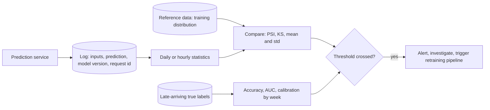

**Population Stability Index (PSI)** compares the share of data falling in each bin (usually deciles of the reference data) between reference and live data:

`PSI = Σ (live% − ref%) × ln(live% / ref%)`

Common rule of thumb: **< 0.10 stable**, **0.10–0.25 moderate drift**, **> 0.25 major drift**.

**Kolmogorov-Smirnov (KS) statistic:** the largest gap between the two cumulative distributions (0 = identical, 1 = completely different).

## 8.4 Types and Variants

| Signal | Needs labels? | Speed | Catches |
|---|---|---|---|
| Latency, error rate, throughput | No | Instant | Infrastructure problems |
| Feature drift (PSI, KS, chi-square for categories) | No | Fast | Data changes |
| Missing/null rate, out-of-range values | No | Fast | Broken upstream pipelines |
| Prediction distribution | No | Fast | Many model problems |
| Accuracy, AUC, calibration | **Yes** | Delayed | Everything, including concept drift |
| Business KPI (conversion, fraud loss) | No (but slow) | Slow | What actually matters |
| Slice metrics (by country, device) | Sometimes | Varies | Hidden unfairness or regional failure |

Tools: Evidently, WhyLabs, Arize, Fiddler, SageMaker Model Monitor, plus Prometheus/Grafana for service metrics ([10_Observability_Pattern.md](../03_System_Design/10_Observability_Pattern.md)).

## 8.5 Complete Java Example - PSI and KS for Data Drift, Accuracy Alerts for Concept Drift

**What it shows:** a feature that slowly shifts over four weeks is flagged by PSI and KS. Then a second case where the *input* looks the same but the rule behind the label changes: only accuracy reveals it.

```java
import java.util.*;

public class DriftDemo {

    // Population Stability Index: compare the share of data per bin between reference and live data
    static double psi(double[] ref, double[] live, int bins) {
        double[] sorted = ref.clone(); Arrays.sort(sorted);
        double[] edges = new double[bins - 1];
        for (int i = 1; i < bins; i++) edges[i - 1] = sorted[(int) ((long) i * sorted.length / bins)];   // reference deciles
        double[] pr = share(ref, edges), pl = share(live, edges);
        double sum = 0;
        for (int i = 0; i < bins; i++) sum += (pl[i] - pr[i]) * Math.log(pl[i] / pr[i]);
        return sum;
    }
    static double[] share(double[] x, double[] edges) {
        double[] c = new double[edges.length + 1];
        for (double v : x) { int b = 0; while (b < edges.length && v > edges[b]) b++; c[b]++; }
        for (int i = 0; i < c.length; i++) c[i] = Math.max(c[i], 0.5) / x.length;                 // avoid log(0)
        return c;
    }
    // Kolmogorov-Smirnov: biggest gap between the two cumulative distributions
    static double ks(double[] a, double[] b) {
        double[] x = a.clone(), y = b.clone(); Arrays.sort(x); Arrays.sort(y);
        int i = 0, j = 0; double d = 0;
        while (i < x.length && j < y.length) {
            if (x[i] <= y[j]) i++; else j++;
            d = Math.max(d, Math.abs((double) i / x.length - (double) j / y.length));
        }
        return d;
    }
    static String verdict(double psi) { return psi < 0.10 ? "stable" : psi < 0.25 ? "moderate drift - investigate" : "MAJOR drift - retrain/alert"; }

    static double[] sample(int n, double mean, double sd, Random r) {
        double[] a = new double[n]; for (int i = 0; i < n; i++) a[i] = mean + sd * r.nextGaussian(); return a;
    }

    public static void main(String[] args) {
        Random rnd = new Random(3);
        double[] reference = sample(20_000, 0, 1, rnd);                 // feature at training time
        System.out.println("1) data drift on one feature (reference = training data, mean 0, sd 1)");
        double[][] weeks = {{0, 1}, {0.15, 1}, {0.4, 1.1}, {0.8, 1.3}};
        for (int w = 0; w < weeks.length; w++) {
            double[] live = sample(5_000, weeks[w][0], weeks[w][1], rnd);
            double p = psi(reference, live, 10);
            System.out.printf("   week %d  live mean=%.2f sd=%.2f   PSI=%.3f  KS=%.3f   %s%n", w + 1, weeks[w][0], weeks[w][1], p, ks(reference, live), verdict(p));
        }

        // concept drift: inputs look the same, but the RELATIONSHIP between input and label changes
        System.out.println("2) concept drift: input distribution unchanged, but the rule behind the label changes");
        int[] weeksLabels = {1, 2, 3, 4, 5, 6};
        for (int w : weeksLabels) {
            double threshold = w <= 3 ? 0.0 : 0.8;                       // from week 4 customers behave differently
            int correct = 0, n = 2000;
            for (int i = 0; i < n; i++) {
                double x = rnd.nextGaussian();
                boolean truth = x > threshold;
                boolean predicted = x > 0.0;                              // the model still uses the old rule
                if (truth == predicted) correct++;
            }
            double acc = 100.0 * correct / n;
            System.out.printf("   week %d  accuracy=%.1f%%  %s%n", w, acc, acc < 90 ? "<- ALERT: accuracy fell below 90%" : "");
        }
        System.out.println("   PSI on the input would stay near 0 here, so only label-based monitoring catches concept drift");
    }
}
```

**Output** (identical on all 3 runs):

```text
1) data drift on one feature (reference = training data, mean 0, sd 1)
   week 1  live mean=0.00 sd=1.00   PSI=0.002  KS=0.009   stable
   week 2  live mean=0.15 sd=1.00   PSI=0.021  KS=0.059   stable
   week 3  live mean=0.40 sd=1.10   PSI=0.139  KS=0.154   moderate drift - investigate
   week 4  live mean=0.80 sd=1.30   PSI=0.492  KS=0.285   MAJOR drift - retrain/alert
2) concept drift: input distribution unchanged, but the rule behind the label changes
   week 1  accuracy=100.0%  
   week 2  accuracy=100.0%  
   week 3  accuracy=100.0%  
   week 4  accuracy=72.5%  <- ALERT: accuracy fell below 90%
   week 5  accuracy=68.9%  <- ALERT: accuracy fell below 90%
   week 6  accuracy=71.9%  <- ALERT: accuracy fell below 90%
   PSI on the input would stay near 0 here, so only label-based monitoring catches concept drift
```

**What the output shows**
- **Data drift:** PSI rises with the shift: 0.002 (stable) → 0.021 → 0.139 (investigate) → **0.492 (major)**. KS grows in the same direction (0.009 → 0.285).
- **Concept drift:** accuracy is 100% for three weeks, then collapses to about 70% when customer behaviour changes in week 4, while the inputs have the *same* distribution. PSI on the inputs would still be near 0, so **only label-based monitoring detects concept drift**. Since labels may arrive late, you need both kinds of monitoring.

## 8.6 Monitoring in Java and Spring

```java
@Component
class PredictionLogger {
    private final MeterRegistry metrics;
    private final KafkaTemplate<String, PredictionEvent> kafka;

    void log(PredictRequest req, float[] features, Prediction p) {
        metrics.summary("model.score", "model", p.version()).record(p.score());          // prediction distribution in Prometheus
        metrics.timer("model.latency", "model", p.version());
        for (int i = 0; i < features.length; i++)
            if (Float.isNaN(features[i])) metrics.counter("feature.null", "idx", String.valueOf(i)).increment();
        kafka.send("predictions", req.id(), new PredictionEvent(req.id(), p.version(), features, p.score(), Instant.now()));
    }
}
// Later, join "predictions" with the "outcomes" topic by request id to compute live accuracy per week
```

**Alert rules (Prometheus):** `avg_over_time(model_score[1d])` differs from the training mean by more than 3σ; null-rate > 2%; p99 latency; PSI > 0.25 from the batch drift job. Pair every alert with a **runbook**: check the upstream data, roll back to the previous model, trigger the [retraining pipeline](#7-ml-pipeline-pattern).

## 8.7 Pros and Cons

| Pros | Cons |
|---|---|
| Catches silent failure early | Needs logging infrastructure and storage |
| Drift signals work before labels arrive | Thresholds can cause false alarms |
| Triggers retraining automatically | Concept drift needs labels (often delayed) |

## 8.8 Pitfalls, Interview Questions and Cheat Sheet

**Common pitfalls**
- Only monitoring HTTP status and latency.
- Reference data that is not the training data (or is outdated).
- Averaging across all users, hiding a failing segment.
- Alert fatigue from tiny, harmless drift.
- Retraining automatically on drifted data without a quality gate (can lock in a bug).
- Forgetting that a model's own decisions change the data it later sees (feedback loop).

**Interview questions**
1. *Data drift vs concept drift?* → Data drift: inputs change. Concept drift: the input→label relationship changes. Concept drift needs label-based metrics.
2. *What is PSI and its thresholds?* → A distribution-comparison score; <0.1 stable, 0.1–0.25 moderate, >0.25 major drift.
3. *How do you monitor when labels arrive late?* → Use input and prediction drift as early warning and track accuracy when labels arrive.
4. *What would you do on a drift alert?* → Check upstream data first (often a pipeline bug), look at slices, roll back or retrain through the pipeline and gate.
5. *What do you log for every prediction?* → Request id, timestamp, model version, input features, output, and later the outcome.

**Cheat sheet**
```
Monitor  : service (latency, errors) + inputs (PSI/KS, nulls) + outputs (score distribution) + outcomes (accuracy)
PSI      : sum((live% - ref%) * ln(live%/ref%)) ; <0.1 ok, 0.1-0.25 watch, >0.25 act
Concept drift needs labels; data drift does not
Log      : request id, model version, features, prediction -> join with outcomes later
Response : runbook -> check upstream -> rollback or retrain via pipeline + gate
```

### 📘 Terms Explained

| Term | Meaning |
|---|---|
| **Model decay** | A model becoming less accurate over time |
| **Data (covariate) drift** | The input data distribution changes |
| **Concept drift** | The relationship between inputs and the correct answer changes |
| **PSI** | Population Stability Index: a score for how much a distribution moved |
| **KS statistic** | The maximum distance between two cumulative distributions |
| **Reference data** | The data the model was trained on, used as the baseline |
| **Calibration** | Whether a predicted 80% really happens about 80% of the time |
| **Slice** | A subset of data (for example one country) monitored on its own |
| **Runbook** | A written step-by-step response to an alert |

---

# 9. Ensemble Pattern

## 9.1 What Is It?

An **ensemble** (#421) combines the predictions of several models to get a better, more stable answer than any single model. Think of asking five doctors instead of one.

## 9.2 Why Do We Need It?

- One model can overfit, or be unlucky with the data it saw. Averaging smooths individual mistakes.
- Different models make different mistakes. When errors are **independent**, a vote cancels them.
- Most winning solutions in data competitions are ensembles.

## 9.3 How It Works

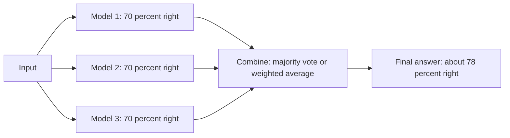

| Technique | Idea | Examples |
|---|---|---|
| **Bagging** | Train many models on random resamples of the data, average them | Random Forest |
| **Boosting** | Train models one after another; each fixes the previous one's mistakes | XGBoost, LightGBM, AdaBoost |
| **Stacking** | A "meta-model" learns how to combine the models' outputs | Kaggle-style stacks |
| **Hard voting** | Majority of class votes | Classification |
| **Soft voting** | Average the predicted probabilities (optionally weighted) | Usually better than hard voting |
| **Mixture of experts** | A gate picks which expert handles each input | Large language models |

**The key condition is diversity.** If all models make the *same* mistakes (same data, same features, same algorithm), voting gives almost nothing.

## 9.4 Types and Variants

| Variant | Cost | Note |
|---|---|---|
| Few strong models (GBM + neural net) | Moderate | Common in production |
| Hundreds of trees (forest/boosting) | Low per tree | One library call |
| Model cascade | Cheap model first; expensive model only for uncertain cases | Saves latency and money |
| Ensemble of prompts / LLMs | High | Self-consistency, "LLM as judge" |
| Distilled single model | One-time cost | Train a small model to copy the ensemble for cheap serving |

## 9.5 Complete Java Example - When Voting Helps and When It Doesn't

**What it shows:** models that are each right 70% of the time. Independent errors → a majority vote of 3 reaches about 78%, of 11 about 92%. Correlated errors → almost no gain. Soft voting can overturn a hard vote.

```java
import java.util.*;

public class EnsembleDemo {
    static final int N = 100_000;

    public static void main(String[] args) {
        // Each model is right 70% of the time on a yes/no question.
        double acc = 0.70;

        // 1) independent errors: three models vote
        Random r = new Random(4);
        int[] right = new int[3]; int voteRight = 0;
        for (int i = 0; i < N; i++) {
            int votes = 0;
            for (int m = 0; m < 3; m++) if (r.nextDouble() < acc) { right[m]++; votes++; }
            if (votes >= 2) voteRight++;
        }
        System.out.printf("1) independent errors:  model accuracies = %.1f%% %.1f%% %.1f%%   majority vote of 3 = %.1f%%%n",
                100.0 * right[0] / N, 100.0 * right[1] / N, 100.0 * right[2] / N, 100.0 * voteRight / N);

        // 2) 11 independent models
        int v11 = 0;
        for (int i = 0; i < N; i++) { int votes = 0; for (int m = 0; m < 11; m++) if (r.nextDouble() < acc) votes++; if (votes >= 6) v11++; }
        System.out.printf("2) 11 independent models, majority vote = %.1f%%%n", 100.0 * v11 / N);

        // 3) correlated errors: models all trained on the same data tend to make the SAME mistake
        double sharedMistake = 0.80;                     // 80% of the time all three share one outcome
        int corr = 0;
        for (int i = 0; i < N; i++) {
            int votes = 0;
            if (r.nextDouble() < sharedMistake) { boolean ok = r.nextDouble() < acc; votes = ok ? 3 : 0; }
            else for (int m = 0; m < 3; m++) if (r.nextDouble() < acc) votes++;
            if (votes >= 2) corr++;
        }
        System.out.printf("3) highly correlated models (same mistakes), majority vote = %.1f%%   <- almost no gain%n", 100.0 * corr / N);

        // 4) weighted average of probabilities (soft voting)
        double[] p = {0.9, 0.4, 0.45};                   // model scores for "fraud"
        double[] w = {0.5, 0.25, 0.25};                  // weights from validation performance
        double soft = 0; for (int i = 0; i < 3; i++) soft += p[i] * w[i];
        int hard = 0; for (double s : p) if (s > 0.5) hard++;
        System.out.printf("4) scores %s: hard vote says %s, weighted average = %.3f -> %s%n",
                Arrays.toString(p), hard >= 2 ? "fraud" : "not fraud", soft, soft > 0.5 ? "fraud" : "not fraud");
    }
}
```

**Output** (identical on all 3 runs):

```text
1) independent errors:  model accuracies = 70.0% 69.9% 70.0%   majority vote of 3 = 78.4%
2) 11 independent models, majority vote = 92.2%
3) highly correlated models (same mistakes), majority vote = 71.7%   <- almost no gain
4) scores [0.9, 0.4, 0.45]: hard vote says not fraud, weighted average = 0.663 -> fraud
```

**What the output shows**
- **1:** three 70% models, independent errors → **78.4%** (the exact maths for "at least 2 of 3 correct" is 0.784).
- **2:** eleven independent 70% models → **92.2%**. More diverse voters = better.
- **3:** when models share their mistakes (here 80% of cases they all agree), the vote gets only **71.7%**: the ensemble costs 3× the compute for almost no benefit.
- **4:** scores 0.9, 0.4, 0.45. Hard voting counts only one vote for "fraud" and says *not fraud*; the weighted average (0.663) says **fraud** because the most reliable model is very confident.

## 9.6 Ensembles in Java and Spring

```java
@Service
public class FraudEnsemble {
    private final List<Scorer> models;          // GBM (ONNX), neural net (ONNX), rules engine
    private final double[] weights = {0.5, 0.3, 0.2};   // fitted on validation data

    public double score(float[] f) {
        double total = 0;
        for (int i = 0; i < models.size(); i++) total += weights[i] * models.get(i).score(f);
        return total;
    }
}

// Cascade: cheap model first, expensive one only when unsure
double s = cheap.score(f);
if (s > 0.2 && s < 0.8) s = expensive.score(f);
```
Run models in parallel (`CompletableFuture.allOf`) so the latency is the slowest model, not the sum. Register the ensemble as **one** versioned model in the [registry](#6-model-registry-and-data-versioning) with its member versions listed.

## 9.7 Pros and Cons

| Pros | Cons |
|---|---|
| Higher accuracy and stability | N× compute and latency |
| Reduces variance and overfitting | Harder to explain and debug |
| Robust against one weak member | More artifacts to version and monitor |

## 9.8 Pitfalls, Interview Questions and Cheat Sheet

**Common pitfalls**
- Ensembling near-identical models (no diversity).
- Fitting ensemble weights on the training set instead of validation data.
- Latency budget exceeded because members run one after another.
- A single member's feature pipeline breaks and silently skews the vote.

**Interview questions**
1. *Why does an ensemble work?* → Independent errors cancel when predictions are averaged or voted.
2. *Bagging vs boosting?* → Bagging trains in parallel on resamples and averages (reduces variance); boosting trains sequentially to fix errors (reduces bias).
3. *Hard vs soft voting?* → Hard counts class votes; soft averages probabilities and keeps confidence information.
4. *What is a model cascade and why use it?* → Cheap model handles easy cases, expensive one only uncertain ones; saves cost and latency.
5. *Downside in production?* → Cost, latency, complexity; sometimes distil the ensemble into one model.

**Cheat sheet**
```
Bagging  : parallel resamples, average          (Random Forest)
Boosting : sequential error-fixing              (XGBoost, LightGBM)
Stacking : meta-model combines outputs
Works only with DIVERSE errors; prefer soft voting; weights from validation data
Serve    : parallel calls, cascade for cost, register as one versioned model
```

### 📘 Terms Explained

| Term | Meaning |
|---|---|
| **Ensemble** | A group of models whose outputs are combined |
| **Bagging** | Training models on random resamples and averaging them |
| **Boosting** | Training models in sequence, each correcting the earlier ones |
| **Stacking** | Using a model to learn how to combine other models |
| **Hard / soft voting** | Majority of class votes / average of probabilities |
| **Variance / bias** | Sensitivity to the training sample / systematic error |
| **Model cascade** | Cheap model first, expensive model for hard cases |
| **Distillation** | Training a small model to mimic a big one or an ensemble |

---

# 10. Transfer Learning

## 10.1 What Is It?

**Transfer learning** (#422) means starting from a model already trained on a large, related task and adapting it to your small task, instead of training from nothing. Example: take an image model trained on millions of photos and fine-tune it on 500 photos of your own products.

## 10.2 Why Do We Need It?

| Need | How transfer helps |
|---|---|
| Little labelled data | The early layers already know general patterns (edges, grammar) |
| Limited compute and time | Fine-tuning takes minutes or hours instead of weeks |
| Better accuracy than training alone on small data | Starts close to a good solution |
| Using large language models | Fine-tune or adapt a foundation model |

## 10.3 How It Works

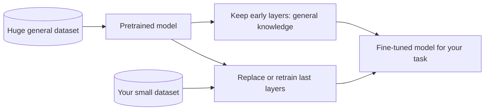

| Approach | What is trained | When |
|---|---|---|
| **Feature extraction** | Freeze everything, train only a new final layer | Very little data, similar domain |
| **Fine-tuning** | Unfreeze some or all layers, train with a **small learning rate** | More data, domain differs |
| **Parameter-efficient (LoRA, adapters)** | Train small add-on matrices, keep the base model fixed | Large models, limited GPU |
| **Prompting / RAG** | No weights change; give the model instructions and documents | Language models, fastest to ship |

## 10.4 Types and Variants

| Variant | Meaning |
|---|---|
| **Inductive transfer** | Same input type, a new task (image classes → your classes) |
| **Domain adaptation** | Same task, different data distribution (product photos → factory photos) |
| **Zero-/few-shot** | The pretrained model already works with zero or a few examples |
| **Multi-task** | Train one model on several related tasks |
| **Negative transfer** | The source task is too different and *hurts* performance |

## 10.5 Complete Java Example - Pretrained vs From-Scratch With Only 8 Labelled Rows

**What it shows:** a tiny logistic-regression "model" first trained on a large related task A (5,000 rows), then used for a new task B that has only 8 labelled rows. Accuracy is measured on 20,000 held-out task-B rows. Three starting points are compared.

```java
import java.util.*;

public class TransferDemo {

    record Point(double x1, double x2, int y) {}

    static List<Point> make(int n, double w1, double w2, long seed) {
        Random r = new Random(seed); List<Point> out = new ArrayList<>();
        for (int i = 0; i < n; i++) {
            double a = r.nextGaussian(), b = r.nextGaussian();
            out.add(new Point(a, b, w1 * a + w2 * b + 0.3 * r.nextGaussian() > 0 ? 1 : 0));
        }
        return out;
    }
    static double sigmoid(double z) { return 1 / (1 + Math.exp(-z)); }

    // logistic regression, full-batch gradient descent
    static double[] train(List<Point> data, double[] init, int epochs, double lr) {
        double[] w = init.clone();
        for (int e = 0; e < epochs; e++) {
            double g0 = 0, g1 = 0;
            for (Point p : data) { double err = sigmoid(w[0] * p.x1() + w[1] * p.x2()) - p.y(); g0 += err * p.x1(); g1 += err * p.x2(); }
            w[0] -= lr * g0 / data.size(); w[1] -= lr * g1 / data.size();
        }
        return w;
    }
    static double accuracy(double[] w, List<Point> data) {
        int ok = 0; for (Point p : data) if ((sigmoid(w[0] * p.x1() + w[1] * p.x2()) > 0.5 ? 1 : 0) == p.y()) ok++;
        return 100.0 * ok / data.size();
    }

    public static void main(String[] args) {
        // Task A (lots of data): the rule is roughly 2*x1 - 1.5*x2.  Task B (tiny data): 2.2*x1 - 1.2*x2 (similar, not identical).
        List<Point> taskA = make(5000, 2.0, -1.5, 1);
        List<Point> taskBtrain = make(8, 2.2, -1.2, 2);
        List<Point> taskBtest = make(20000, 2.2, -1.2, 3);

        double[] pretrained = train(taskA, new double[]{0, 0}, 300, 0.5);
        System.out.printf("1) pretrained on task A (5000 rows): weights = [%.2f, %.2f]%n", pretrained[0], pretrained[1]);

        double[] zero = {0, 0}, wrong = {-1.0, 1.0};
        int[] epochs = {1, 5, 20, 100};
        System.out.println("2) task B has only 8 labelled rows; accuracy on 20000 test rows after N training epochs");
        System.out.println("   epochs   from scratch (zeros)   from bad random-like start   from pretrained (transfer)");
        for (int e : epochs)
            System.out.printf("   %6d %17.1f%% %24.1f%% %26.1f%%%n", e,
                    accuracy(train(taskBtrain, zero, e, 0.5), taskBtest),
                    accuracy(train(taskBtrain, wrong, e, 0.5), taskBtest),
                    accuracy(train(taskBtrain, pretrained, e, 0.5), taskBtest));
        System.out.printf("3) with 0 epochs of fine-tuning, the pretrained model alone already scores %.1f%% on task B%n", accuracy(pretrained, taskBtest));
    }
}
```

**Output** (identical on all 3 runs):

```text
1) pretrained on task A (5000 rows): weights = [4.82, -3.62]
2) task B has only 8 labelled rows; accuracy on 20000 test rows after N training epochs
   epochs   from scratch (zeros)   from bad random-like start   from pretrained (transfer)
        1              84.2%                      9.1%                       94.0%
        5              83.9%                      4.5%                       93.6%
       20              83.4%                     80.5%                       92.4%
      100              85.1%                     84.8%                       90.3%
3) with 0 epochs of fine-tuning, the pretrained model alone already scores 94.2% on task B
```

**What the output shows**
- **Pretrained model with zero fine-tuning:** **94.2%** on task B, since the rules are similar.
- **From scratch on 8 rows:** about **84-85%**: it can learn the direction but not the sharpness.
- **A wrong starting point (−1, +1):** **9.1%** after 1 epoch, since it begins pointing the opposite way, and recovers slowly (80.5% after 20 epochs). A bad initialisation costs a lot of training.
- **Fine-tuning can hurt:** the pretrained model goes from 94.0% (1 epoch) down to **90.3%** after 100 epochs, because it gradually over-fits the 8 rows. That's why fine-tuning uses a **small learning rate, few epochs and early stopping on a validation set**.

## 10.6 Transfer Learning in Java and Spring

Fine-tuning is normally done in Python (PyTorch/TensorFlow/Hugging Face). Java is the **serving** side:

```python
# Fine-tune only the new head of a pretrained image model (Python side)
model = torchvision.models.resnet50(weights="IMAGENET1K_V2")
for p in model.parameters(): p.requires_grad = False          # freeze the base
model.fc = torch.nn.Linear(model.fc.in_features, 12)          # new head for our 12 product classes
# train only model.fc with a small learning rate, then export:  torch.onnx.export(model, ...)
```

```java
// Java side: Deep Java Library (DJL) can load pretrained models directly, no Python at runtime
Criteria<Image, Classifications> criteria = Criteria.builder()
        .setTypes(Image.class, Classifications.class)
        .optModelUrls("djl://ai.djl.pytorch/resnet")           // or your own exported ONNX/TorchScript file
        .build();
try (ZooModel<Image, Classifications> model = criteria.loadModel();
     Predictor<Image, Classifications> predictor = model.newPredictor()) {
    Classifications result = predictor.predict(ImageFactory.getInstance().fromFile(path));
}
```
For language models, **Spring AI** provides clients for hosted models and vector stores (RAG). That often replaces fine-tuning.

## 10.7 Pros and Cons

| Pros | Cons |
|---|---|
| Works with small datasets | Source model's biases and licence come along |
| Much cheaper than training from scratch | Negative transfer when domains differ too much |
| Faster to production | Large pretrained models are heavy to serve |

## 10.8 Pitfalls, Interview Questions and Cheat Sheet

**Common pitfalls**
- Fine-tuning with a large learning rate, which destroys the pretrained knowledge ("catastrophic forgetting").
- Different preprocessing than the pretrained model expects (image size, normalisation, tokenizer).
- Over-fitting a tiny dataset with too many epochs.
- Ignoring the pretrained model's licence and the origin of its training data.
- Assuming the source and target domains are close enough without testing.

**Interview questions**
1. *What is transfer learning?* → Reusing a model trained on a big task as the starting point for a related small task.
2. *Feature extraction vs fine-tuning?* → Freeze the base and train a new head, vs also updating some or all base layers with a small learning rate.
3. *When does it fail?* → When the source domain differs too much (negative transfer) or the preprocessing doesn't match.
4. *How would you use it from a Java backend?* → Fine-tune in Python, export to ONNX/TorchScript, serve with ONNX Runtime/DJL.
5. *Fine-tuning vs RAG for an LLM?* → Fine-tuning changes the model's behaviour/style; RAG adds fresh or private knowledge at query time without retraining. RAG is usually cheaper and easier to update.

**Cheat sheet**
```
Pretrained model + small own data -> adapt
Small data  : freeze base, train new head          Medium data: fine-tune with small LR, early stopping
Large models: LoRA / adapters, or RAG instead of weight changes
Check       : same preprocessing, validation set, domain similarity, licence
Java        : serve exported model (ONNX Runtime, DJL); train in Python
```

### 📘 Terms Explained

| Term | Meaning |
|---|---|
| **Pretrained model** | A model already trained on a large dataset |
| **Fine-tuning** | Continuing training on your own data, usually gently |
| **Freezing layers** | Locking weights so they don't change during training |
| **Catastrophic forgetting** | Losing old knowledge when training too hard on new data |
| **Learning rate** | The step size of weight updates |
| **LoRA** | A cheap fine-tuning method that trains small add-on matrices |
| **RAG** | Retrieval-augmented generation: give a language model relevant documents at query time |
| **Negative transfer** | Pretraining that makes the new task worse |
| **DJL** | Deep Java Library: run deep-learning models in Java |

---

# 11. Federated Learning

## 11.1 What Is It?

**Federated learning** (#423) trains a shared model **without collecting the raw data in one place**. Each participant (phone, hospital, bank branch) trains on its own data locally and sends only the **model update** (weights or gradients) to a server. The server combines the updates (**Federated Averaging, FedAvg**) and sends the improved model back.

Example: your phone keyboard learns your typing without uploading your messages.

## 11.2 Why Do We Need It?

| Reason | Example |
|---|---|
| **Privacy and regulation** | Patient records cannot leave the hospital (HIPAA/GDPR) |
| **Data too big or costly to move** | Billions of phones |
| **Data ownership** | Banks want a joint fraud model but won't share customers |
| **Latency** | Learning on the device with fresh data |

## 11.3 How It Works

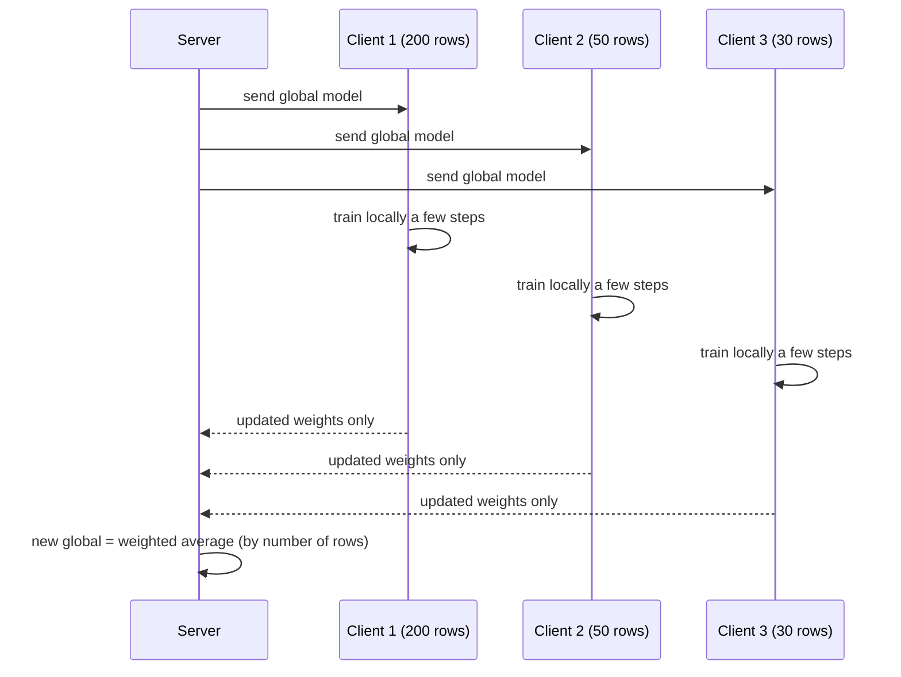

**FedAvg:** `global = Σ (nᵢ / N) × weightsᵢ`, so clients with more data count more. Repeat for many rounds.

**Extra protections:** *secure aggregation* (the server only sees the sum of updates), *differential privacy* (add noise so one person's data can't be reverse-engineered), compression of updates, and robustness checks against malicious clients.

## 11.4 Types and Variants

| Variant | Meaning |
|---|---|
| **Cross-device** | Millions of unreliable phones, a few take part in each round |
| **Cross-silo** | A few reliable organisations (hospitals, banks) |
| **Horizontal FL** | Clients have the same features, different users |
| **Vertical FL** | Clients have different features about the same users (bank + retailer) |
| **Decentralised / gossip** | No central server; peers exchange updates |
| **Personalised FL** | A global model plus a small local adaptation per client |
| **Frameworks** | Flower, TensorFlow Federated, NVIDIA FLARE, FATE, PySyft |

## 11.5 Complete Java Example - FedAvg on Three Clients With Private Data

**What it shows:** three clients hold 200, 50 and 30 private rows of a relationship `y = 3x + 1`. Their data is differently distributed. Only weights travel. After 10 rounds the global model is compared with central training on pooled data and with the smallest client training alone.

```java
import java.util.*;

public class FederatedDemo {

    record Sample(double x, double y) {}

    // each client (a phone or a hospital) holds its own data; truth is y = 3x + 1 (+ noise)
    static List<Sample> clientData(int n, double xMean, long seed) {
        Random r = new Random(seed); List<Sample> out = new ArrayList<>();
        for (int i = 0; i < n; i++) { double x = xMean + r.nextGaussian(); out.add(new Sample(x, 3 * x + 1 + 0.3 * r.nextGaussian())); }
        return out;
    }

    // a few local gradient-descent steps starting from the global model
    static double[] localTrain(double[] global, List<Sample> data, int steps, double lr) {
        double w = global[0], b = global[1];
        for (int s = 0; s < steps; s++) {
            double gw = 0, gb = 0;
            for (Sample p : data) { double e = w * p.x() + b - p.y(); gw += e * p.x(); gb += e; }
            w -= lr * gw / data.size(); b -= lr * gb / data.size();
        }
        return new double[]{w, b};
    }
    static double mse(double[] m, List<Sample> data) {
        double s = 0; for (Sample p : data) { double e = m[0] * p.x() + m[1] - p.y(); s += e * e; } return s / data.size();
    }

    public static void main(String[] args) {
        List<List<Sample>> clients = List.of(clientData(200, -2, 1), clientData(50, 0, 2), clientData(30, 2.5, 3));
        List<Sample> test = clientData(5000, 0.5, 9);
        int totalN = clients.stream().mapToInt(List::size).sum();

        System.out.println("3 clients hold 200, 50 and 30 private rows. The server never sees a row, only model weights.");
        double[] global = {0, 0};
        System.out.println("round   global weights (w, b)    test MSE");
        for (int round = 1; round <= 10; round++) {
            double[] avg = {0, 0};
            for (List<Sample> c : clients) {
                double[] local = localTrain(global, c, 5, 0.05);
                avg[0] += local[0] * c.size() / totalN;                  // FedAvg: weighted by how much data each client has
                avg[1] += local[1] * c.size() / totalN;
            }
            global = avg;
            if (round == 1 || round == 2 || round == 5 || round == 10)
                System.out.printf("%5d   (%.3f, %.3f)             %.3f%n", round, global[0], global[1], mse(global, test));
        }

        // comparison: what each client could learn alone, and centralised training on pooled data
        List<Sample> pooled = new ArrayList<>(); clients.forEach(pooled::addAll);
        double[] central = localTrain(new double[]{0, 0}, pooled, 500, 0.05);
        double[] smallAlone = localTrain(new double[]{0, 0}, clients.get(2), 500, 0.05);
        System.out.printf("centralised (all data in one place): MSE=%.3f   federated after 10 rounds: MSE=%.3f   smallest client alone: MSE=%.3f%n",
                mse(central, test), mse(global, test), mse(smallAlone, test));
        System.out.println("true model is w=3, b=1");
    }
}
```

**Output** (identical on all 3 runs):

```text
3 clients hold 200, 50 and 30 private rows. The server never sees a row, only model weights.
round   global weights (w, b)    test MSE
    1   (1.762, -0.339)             5.345
    2   (2.334, -0.326)             3.247
    5   (2.685, 0.022)             1.472
   10   (2.830, 0.457)             0.514
centralised (all data in one place): MSE=0.092   federated after 10 rounds: MSE=0.514   smallest client alone: MSE=0.131
true model is w=3, b=1
```

**What the output shows**
- **Progress:** the global model moves towards the true `w = 3, b = 1`: MSE falls 5.35 → 3.25 → 1.47 → **0.51** over 10 rounds. No row ever left a client.
- **Not yet converged:** centralised training on the pooled data reaches MSE **0.092**, so after 10 rounds federated is still behind. More rounds or more local steps close the gap. Federated learning pays a cost in accuracy/speed for the privacy it gives.
- **Smallest client alone** (30 rows): MSE 0.131 on this run, better than the federated model after 10 rounds. With enough rounds, the benefit of federation shows when each client's data is **narrow or unrepresentative**; here client 3's data happened to be informative on its own. The comparison depends on how skewed the clients are, so test on your data.

## 11.6 Federated Learning in Java and Spring

Training runs on the clients (often Python/Android/iOS); the **coordinator** is a service you can write in Java:

```java
@Service
public class FedAvgCoordinator {
    private double[] global = new double[DIM];
    private final List<ClientUpdate> received = new CopyOnWriteArrayList<>();      // {clientId, weights, numExamples}

    @PostMapping("/rounds/{round}/update")
    public void receive(@PathVariable int round, @RequestBody ClientUpdate u) {
        if (round != currentRound || !auth.isRegistered(u.clientId())) throw new ResponseStatusException(HttpStatus.FORBIDDEN);
        received.add(u);
        if (received.size() >= MIN_CLIENTS_PER_ROUND) aggregate();
    }

    private synchronized void aggregate() {
        long total = received.stream().mapToLong(ClientUpdate::numExamples).sum();
        double[] next = new double[DIM];
        for (ClientUpdate u : received)
            for (int i = 0; i < DIM; i++) next[i] += u.weights()[i] * u.numExamples() / total;
        global = next; received.clear(); currentRound++;
    }
}
```
Production systems add secure aggregation, update clipping and noise (differential privacy), signed updates, client sampling and drop-out handling. On Android, TensorFlow Lite / ML Kit on-device training; with Flower, the server strategy is configured instead of hand-written.

## 11.7 Pros and Cons

| Pros | Cons |
|---|---|
| Raw data stays where it is | Slower to converge than central training |
| Helps with privacy law and data ownership | Non-uniform client data ("non-IID") hurts accuracy |
| Learns from fresh on-device data | Updates can still leak information; needs DP/secure aggregation |
| Saves data transfer | Hard to debug; clients are unreliable and heterogeneous |

## 11.8 Pitfalls, Interview Questions and Cheat Sheet

**Common pitfalls**
- Assuming "data never leaves" means "perfect privacy" (gradients can leak).
- Averaging unweighted when clients have very different data sizes.
- Ignoring clients that drop out or send poisoned updates.
- Communication cost: sending big models every round.
- Not evaluating on a held-out dataset representing all clients.

**Interview questions**
1. *What is federated learning?* → Training a shared model across many parties by sharing model updates instead of raw data.
2. *What is FedAvg?* → The server averages client weights, weighted by their number of examples, each round.
3. *Main challenges?* → Non-IID data, communication cost, unreliable clients, privacy leakage, poisoning.
4. *How is privacy strengthened?* → Secure aggregation and differential privacy.
5. *Cross-device vs cross-silo?* → Millions of phones vs a handful of institutions.

**Cheat sheet**
```
Round: server sends global model -> clients train locally -> send weights only -> server averages (weighted by n)
Privacy extras : secure aggregation, differential privacy, clipping
Hard parts     : non-IID data, communication, dropouts, poisoning
Use when       : data cannot be centralised (privacy, law, size)
```

### 📘 Terms Explained

| Term | Meaning |
|---|---|
| **Federated learning** | Training across many parties without sharing raw data |
| **FedAvg** | Federated Averaging: weighted average of client models |
| **Round** | One cycle of send, local train, send back, aggregate |
| **Non-IID** | Clients' data have different distributions |
| **Secure aggregation** | Cryptography so the server only sees the combined update |
| **Differential privacy** | Adding noise so no single person's data can be identified |
| **Gradient / weights** | The numbers a model learns / the update direction |
| **Model poisoning** | A malicious client sending harmful updates |

---

# 12. Active Learning

## 12.1 What Is It?

**Active learning** (#424) lets the model **choose which examples a human should label next**, so you reach good accuracy with far fewer labels. Labels are often the most expensive part of ML (doctors labelling scans, annotators reading documents).

The usual strategy is **uncertainty sampling**: ask for the example the model is *least sure* about.

## 12.2 Why Do We Need It?

| Problem | Active learning helps because |
|---|---|
| Millions of unlabelled items, a small labelling budget | Label the most informative ones first |
| Expensive experts | Fewer expert hours |
| Imbalanced data (rare fraud) | Focus on borderline and rare cases instead of random easy ones |
| Continuous improvement | Production uncertainty feeds a review queue |

## 12.3 How It Works

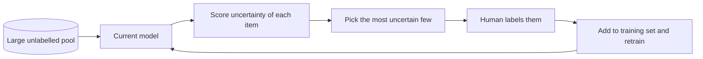

| Query strategy | Picks | Note |
|---|---|---|
| **Uncertainty sampling** | Predictions closest to 50/50 (or lowest max probability) | Simple and strong |
| **Margin sampling** | Smallest gap between top two classes | Multi-class |
| **Entropy sampling** | Highest entropy of the class probabilities | Multi-class |
| **Query by committee** | Items where an ensemble disagrees most | Needs several models |
| **Diversity sampling** | Items unlike those already labelled | Avoids asking 50 near-duplicates |
| **Expected model change** | Items that would change the model most | Costly to compute |

## 12.4 Types and Variants

| Variant | Meaning |
|---|---|
| **Pool-based** | Choose from a fixed pool of unlabelled data (most common) |
| **Stream-based** | Decide for each arriving item: label or skip |
| **Batch mode** | Pick e.g. 100 items per round (labelling humans work in batches) |
| **Human-in-the-loop in production** | Low-confidence predictions go to a review queue, whose labels are used for retraining |
| **Weak supervision / auto-labelling** | Combine rules and models to create noisy labels cheaply |

## 12.5 Complete Java Example - Random Labelling vs Uncertainty Sampling

**What it shows:** 2,000 unlabelled numbers with a hidden rule (`label = 1` when `x > 0.62`). A classifier is a threshold between the largest known 0 and smallest known 1. Random sampling labels random items; active learning always labels the item **closest to the current boundary**.

```java
import java.util.*;

public class ActiveLearnDemo {
    static final double TRUE_THRESHOLD = 0.62;          // hidden rule: label = 1 when x > 0.62

    // classifier = threshold halfway between the largest known 0 and the smallest known 1
    static double fit(TreeMap<Double, Integer> labelled) {
        double maxNeg = 0.0, minPos = 1.0;
        for (var e : labelled.entrySet()) { if (e.getValue() == 0) maxNeg = Math.max(maxNeg, e.getKey()); else minPos = Math.min(minPos, e.getKey()); }
        return (maxNeg + minPos) / 2;
    }
    static int label(double x) { return x > TRUE_THRESHOLD ? 1 : 0; }

    static double errorRate(double threshold, double[] pool) {
        int wrong = 0; for (double x : pool) if ((x > threshold ? 1 : 0) != label(x)) wrong++;
        return 100.0 * wrong / pool.length;
    }

    public static void main(String[] args) {
        Random r = new Random(8);
        double[] pool = new double[2000];
        for (int i = 0; i < pool.length; i++) pool[i] = r.nextDouble();
        int[] checkpoints = {2, 4, 6, 8, 10, 15};

        // --- random sampling: a human labels random items ---
        TreeMap<Double, Integer> rnd = new TreeMap<>();
        List<Double> randomErr = new ArrayList<>();
        Random pick = new Random(21);
        for (int n = 1; n <= 15; n++) {
            double x = pool[pick.nextInt(pool.length)]; rnd.put(x, label(x));
            if (Arrays.stream(checkpoints).anyMatch(c -> c == rnd.size()) ) randomErr.add(errorRate(fit(rnd), pool));
        }

        // --- active learning: label the item the model is LEAST sure about (closest to the current boundary) ---
        TreeMap<Double, Integer> act = new TreeMap<>();
        act.put(0.0, 0); act.put(1.0, 1);                                   // two seed labels
        List<Double> activeErr = new ArrayList<>();
        Set<Double> used = new HashSet<>(act.keySet());
        while (act.size() < 17) {
            double boundary = fit(act); double best = -1, bd = 9;
            for (double x : pool) if (!used.contains(x) && Math.abs(x - boundary) < bd) { bd = Math.abs(x - boundary); best = x; }
            act.put(best, label(best)); used.add(best);
            int labelsUsed = act.size() - 2;
            if (Arrays.stream(checkpoints).anyMatch(c -> c == labelsUsed)) activeErr.add(errorRate(fit(act), pool));
        }

        System.out.println("hidden rule: label = 1 if x > 0.62.  Error = % of 2000 unlabelled items classified wrongly.");
        System.out.println("labels bought   random sampling   active (uncertainty sampling)");
        for (int i = 0; i < checkpoints.length; i++)
            System.out.printf("%13d %15.2f%% %22.2f%%%n", checkpoints[i], randomErr.get(i), activeErr.get(i));
    }
}
```

**Output** (identical on all 3 runs):

```text
hidden rule: label = 1 if x > 0.62.  Error = % of 2000 unlabelled items classified wrongly.
labels bought   random sampling   active (uncertainty sampling)
            2           15.45%                   0.70%
            4            1.55%                   2.25%
            6            1.55%                   0.25%
            8            1.55%                   0.00%
           10            1.55%                   0.00%
           15            2.65%                   0.00%
```

**What the output shows**
- (Active learning starts with 2 free seed labels at the two ends, 0.0 and 1.0; the "labels bought" column counts the extra labels.)
- **Active learning** zooms in on the boundary: error 0.70% with only 2 labels, and **0.00% from 8 labels onwards**.
- **Random sampling** is not always worse early: at 4 labels it has 1.55% against 2.25% for active, since two lucky random picks may fall close to the boundary. But it **plateaus** (1.55% for 6–10 labels, then 2.65% at 15, the extra random labels landed far from the boundary and added nothing). The 2-label row for random (15.45%) shows how unlucky random picks can be.
- Active learning shines when most items are "easy" and only a thin band near the boundary is informative. In high dimensions it needs more care (diversity, batch selection).

## 12.6 Active Learning in Java and Spring

```java
// Production loop: low-confidence predictions go to a human review queue
@PostMapping("/classify")
public Result classify(@RequestBody Document doc) {
    Prediction p = model.predict(doc);
    if (p.confidence() < 0.65) {
        reviewQueue.add(new ReviewTask(doc.id(), p));               // an annotator sees it in the labelling tool
        return Result.pending(p);                                    // or return the best guess flagged as "uncertain"
    }
    return Result.of(p);
}

@KafkaListener(topics = "human-labels")
public void onLabel(LabelEvent e) { trainingStore.add(e.docId(), e.label()); }          // feeds the next retraining run

@Scheduled(cron = "0 0 2 * * *")
void nightly() { if (trainingStore.newLabels() >= 200) pipeline.trigger("retrain"); }  // ties into the ML pipeline
```
Tools: Label Studio, Prodigy, Labelbox, Amazon SageMaker Ground Truth (labelling UIs with active-learning hooks); modAL and small-text (Python libraries).

## 12.7 Pros and Cons

| Pros | Cons |
|---|---|
| Far fewer labels for the same accuracy (often) | Needs a working model before it can choose |
| Focuses expert time where it matters | Can be biased towards weird outliers and noisy items |
| Natural fit with human review queues | Sampling bias: labelled data no longer represents the real distribution |

## 12.8 Pitfalls, Interview Questions and Cheat Sheet

**Common pitfalls**
- Starting with no labelled data at all (cold start); label a random seed set first.
- Asking for labels on noisy, ambiguous items that even experts cannot decide.
- Evaluating on the actively sampled labels (biased). Keep a **random** test set.
- Labelling one item per round when annotators work in batches.
- Querying many near-duplicates (no diversity).

**Interview questions**
1. *What is active learning?* → The model selects the most informative unlabelled examples for humans to label, to reduce labelling cost.
2. *How do you measure uncertainty?* → Probability near 0.5, lowest top-class probability, small margin, high entropy, or committee disagreement.
3. *What is the risk?* → Sampling bias and outliers; always keep a randomly sampled evaluation set.
4. *How does it fit in production?* → Low-confidence predictions go to a review queue; new labels feed retraining.
5. *Active learning vs semi-supervised learning?* → Active asks humans for labels on chosen items; semi-supervised uses the structure of unlabelled data without asking.

**Cheat sheet**
```
Loop     : train -> score uncertainty on the pool -> human labels the top-k -> retrain
Pick     : uncertainty / margin / entropy / committee + diversity
Evaluate : on a RANDOM held-out set, not on the chosen labels
Prod     : confidence < threshold -> review queue -> labels -> retraining pipeline
```

### 📘 Terms Explained

| Term | Meaning |
|---|---|
| **Active learning** | The model chooses which examples to get labelled |
| **Unlabelled pool** | The collection of examples without answers yet |
| **Uncertainty sampling** | Choosing the examples the model is least sure about |
| **Query strategy** | The rule for picking the next examples |
| **Human-in-the-loop** | A person reviews or labels items inside the automated workflow |
| **Annotator** | A person who labels data |
| **Sampling bias** | The chosen data differs from the real data distribution |
| **Weak supervision** | Creating rough labels automatically with rules or models |

---

# 13. ML Patterns and the Building Blocks They Reuse

| ML pattern | Reuses | Detailed file |
|---|---|---|
| Online prediction service | Circuit Breaker, Timeout, Fallback, Load Balancer, Autoscaling | [02_Reliability_Pattern.md](../03_System_Design/02_Reliability_Pattern.md), [01_Scalability_Pattern.md](../03_System_Design/01_Scalability_Pattern.md) |
| Batch prediction | Scheduler, Spring Batch, Key-value store | [03_Data_Storage_Pattern.md](03_Data_Storage_Pattern.md) |
| A/B test, canary, shadow | Feature flags, Canary and Blue-Green deployment, Dark launch | [09_Deployment_Pattern.md](../03_System_Design/09_Deployment_Pattern.md), [12_Legacy_Migration_Pattern.md](12_Legacy_Migration_Pattern.md) |
| Feature store | Cache-Aside, CDC, Redis/Cassandra, Event streaming | [03_Data_Storage_Pattern.md](03_Data_Storage_Pattern.md), [04_Messaging_Pattern.md](../03_System_Design/04_Messaging_Pattern.md) |
| Registry and data versioning | Event Sourcing (immutable history), Content hashing, Artifact repositories | [05_Data_Management_Pattern.md](../03_System_Design/05_Data_Management_Pattern.md) |
| Pipeline | Pipes and Filters, Saga-style resume, Idempotent steps | [01_Architectural_Pattern.md](../02_HLD/01_Architectural_Pattern.md), [04_Integration_Pattern.md](04_Integration_Pattern.md) |
| Monitoring and drift | Metrics, Logging, Alerting, Distributed tracing | [10_Observability_Pattern.md](../03_System_Design/10_Observability_Pattern.md) |
| Federated learning | Secure aggregation (Security patterns), Scatter-Gather | [06_Security_Pattern.md](../03_System_Design/06_Security_Pattern.md), [04_Integration_Pattern.md](04_Integration_Pattern.md) |
| Recommender serving | Candidate generation + ranking, caching | [11_Domain_Specific_Pattern.md](11_Domain_Specific_Pattern.md#7-recommendation-systems) |
| Edge inference | Edge computing, device twins | [09_IoT_Pattern.md](09_IoT_Pattern.md) |

**Coverage check (master list #411–427):** MVC for ML (411) and batch/online prediction (412, 413) in Section 1; A/B testing models (414) in 2; shadow mode (415) and canary model deployment (416) in 3; multi-armed bandit (417) in 4; feature store (418) in 5; model registry (419) and data versioning (425) in 6; pipeline (420) in 7; model monitoring (426) and concept drift detection (427) in 8; ensemble (421) in 9; transfer learning (422) in 10; federated learning (423) in 11; active learning (424) in 12.

### 📘 Terms Explained

| Term | Meaning |
|---|---|
| **Building block** | A general pattern reused inside an ML solution |
| **Scatter-Gather** | Send a request to many parties and combine their replies |
| **Dark launch** | Run a feature in production without showing it to users |

---

# 14. How the ML Patterns Fit Together

A typical loop for a fraud model at a payment company:

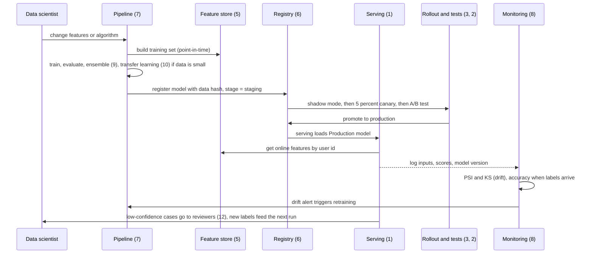

**A way to remember the order**
1. **Data and features** (5, 6): version the data, define features once.
2. **Training** (7, 9, 10, 11, 12): pipeline, ensembles, transfer, federated and active learning decide *how* you learn under constraints (little data, private data, few labels).
3. **Release** (6, 3, 2, 4): registry, shadow, canary, A/B test or bandit.
4. **Run** (1): batch, online or hybrid serving with timeouts and fallbacks.
5. **Watch** (8): monitor, detect drift, loop back to step 2.

**Three rules shared by all ML patterns**
- **Version everything** (data, code, features, model).
- **Never trust a model blindly**: test it on shadow traffic and small canaries, watch it forever.
- **Keep the same feature logic in training and serving.**

### 📘 Terms Explained

| Term | Meaning |
|---|---|
| **Feedback loop** | Model outputs that influence the data the model later learns from |
| **Closed loop** | Monitoring that triggers retraining automatically |
| **MLOps** | Practices that make this whole loop reliable |

---

# 15. AI/ML Patterns Cheat Sheet

| Pattern | Core idea | Key rule | Java building block |
|---|---|---|---|
| **Batch vs online prediction** **(Interview Imp - Java)** | Precompute vs compute on request | Online for fresh inputs; hybrid common; timeout + fallback | Spring Batch, ONNX Runtime, DJL, Resilience4j |
| **A/B testing models** **(Interview Imp - Java)** | Random split, measure business metric | Sticky hashing, fixed sample size, no peeking | Feature-flag service, z-test, Kafka events |
| **Shadow / canary** **(Interview Imp - Java)** | Copy traffic, then ramp gradually | Read-only shadow; guardrails + minimum samples | Istio / Argo Rollouts / Flagger, Micrometer |
| **Multi-armed bandit** | Shift traffic to winners while testing | Minimise regret; Thompson sampling | Commons Math, Redis counters |
| **Feature store** **(Interview Imp - Java)** | Define once, offline + online | Point-in-time joins; avoid skew | Feast, Redis, Kafka |
| **Registry + data versioning** | Versions, stages, lineage | Serve by stage; store data hash | MLflow, DVC, Delta/Iceberg |
| **ML pipeline** | DAG of idempotent steps | Gates + caching + resume | Spring Batch, Airflow, Kubeflow |
| **Monitoring + drift** **(Interview Imp - Java)** | Watch inputs, outputs, outcomes | PSI >0.25 = act; concept drift needs labels | Micrometer, Prometheus, Evidently |
| **Ensemble** | Combine diverse models | Needs diversity; soft voting | Parallel calls, cascade |
| **Transfer learning** | Adapt a pretrained model | Small LR, validation, same preprocessing | DJL, ONNX Runtime, Spring AI |
| **Federated learning** | Share weights, not data | FedAvg weighted by n; add DP | Coordinator service, Flower |
| **Active learning** | Model chooses what to label | Uncertainty sampling; random test set | Review queue, Label Studio |

**Top interview one-liners**
```
Serving: load the model once, timeout + fallback, return the model version, log inputs and outputs
A/B: hash(user + experiment) mod 100, decide the sample size first, never stop at the first significant result
Rollout: shadow (read-only, async) -> canary (guardrails + minimum samples) -> A/B -> promote via registry
Bandit: explore vs exploit; Thompson sampling gives the lowest regret in practice; keep A/B when you need clean evidence
Feature store: one definition, offline for training (point-in-time), online for serving (latest value)
Registry: model + stage + data hash + code commit; rollback = move the Production pointer
Pipeline: DAG, topological order, cache by hash, quality gates, triggered by schedule or drift
Drift: PSI/KS for data drift without labels; accuracy for concept drift with labels
Ensemble needs diversity; transfer learning needs a small learning rate; federated learning moves weights not data
Active learning: label the most uncertain items, evaluate on a random set
```

### 📘 Terms Explained

| Term | Meaning |
|---|---|
| **Interview one-liner** | A short memorable answer you can expand on |
| **Cheat sheet** | A one-page summary for quick revision |
| **Spring AI** | A Spring project for calling AI models and vector stores from Java |
