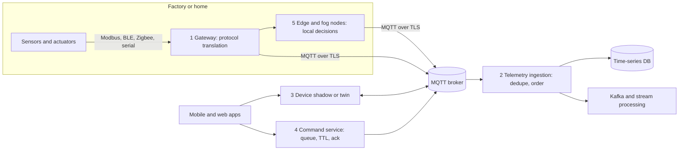
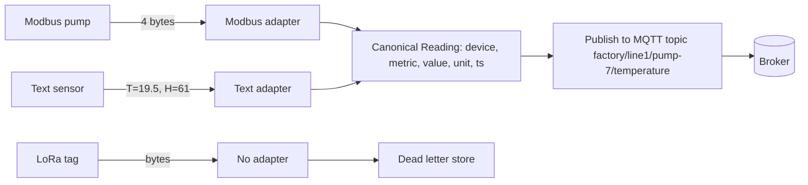
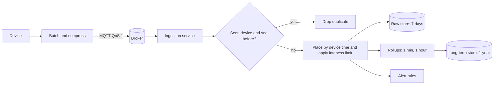
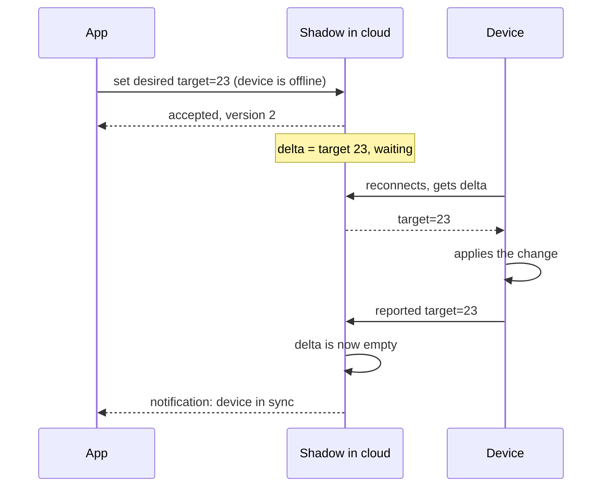
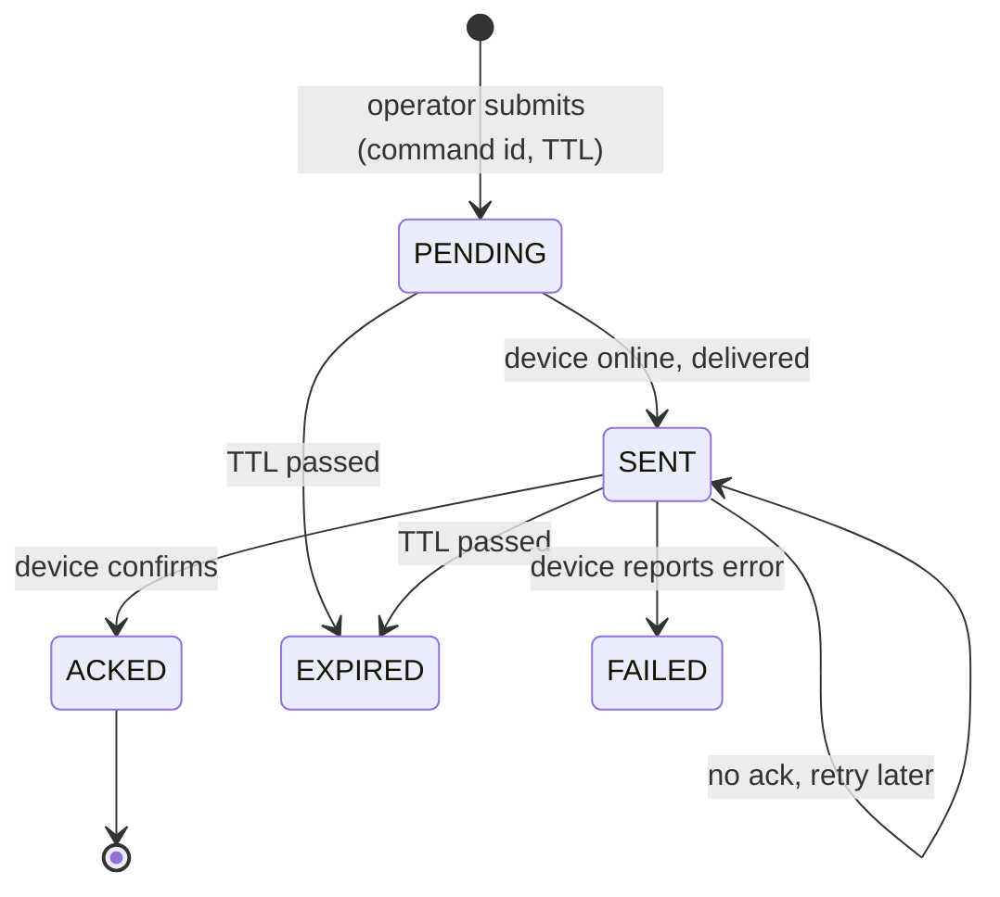
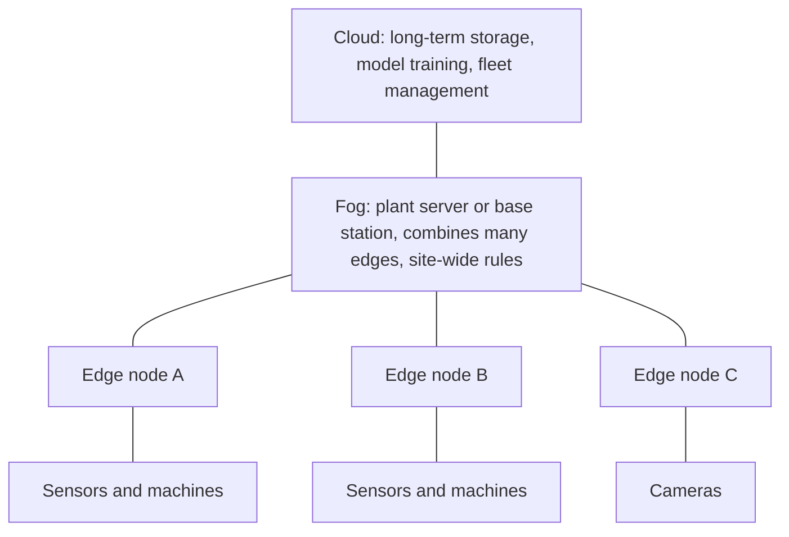
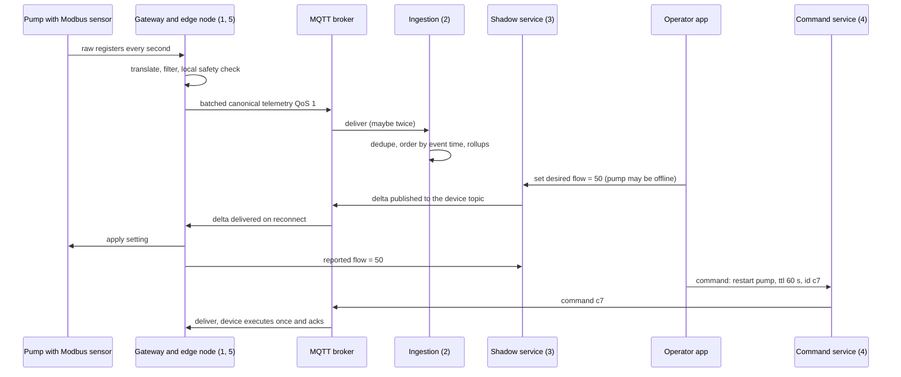

---
mdx:
  format: md
---

# IoT Patterns (Gateway, Protocol Translation, Telemetry, Shadow/Twin, Commands, Edge/Fog)

> **Note**: Patterns marked with **(Interview Imp - Java)** are frequently asked in Java interviews
>
> **How to read this file:** Every section ends with a **📘 Terms Explained** table. If you see a word you don't know, check the table right below that section. Each pattern goes from the basic idea to a plain-Java simulation, Spring Boot / library usage, pitfalls, interview questions and a mini cheat sheet.
>
> **What is this file about?** The master list's **IoT Patterns** (#428–435): how to connect thousands or millions of small devices (sensors, meters, valves, cameras) to a backend. Devices are different from normal clients: they have **weak CPUs, tiny memory, flaky networks, and they go offline for hours**. Every pattern here exists because of those facts. Java appears on three levels: the **gateway** (Eclipse Kura, Spring Integration, Camel), the **cloud ingestion** (Spring Boot + Kafka + MQTT broker), and Java-based devices (Raspberry Pi, Android).
>
> **What lives elsewhere:** Message brokers and queues ([04_Messaging_Pattern.md](../03_System_Design/04_Messaging_Pattern.md)), message translators and routers ([04_Integration_Pattern.md](04_Integration_Pattern.md)), time-series storage ([03_Data_Storage_Pattern.md](03_Data_Storage_Pattern.md#6-time-series-databases)), the Command design pattern ([04_Behavioral_Pattern.md](../01_LLD/04_Behavioral_Pattern.md)), device security (certificates, mTLS, [06_Security_Pattern.md](../03_System_Design/06_Security_Pattern.md)), and over-the-air updates (staged rollout, [09_Deployment_Pattern.md](../03_System_Design/09_Deployment_Pattern.md)). [Section 6](#6-iot-patterns-and-the-building-blocks-they-reuse) maps them.
>
> **Verified code:** Every main "Complete Java Example" is **plain Java 17 (no libraries)** and was compiled and run **three times** with identical output (fixed seeds). To run one, save it as `<ClassName>.java` and run `javac <ClassName>.java && java <ClassName>`. Spring Boot, Eclipse Paho, Kafka and cloud-service snippets are usage examples and were **not** executed. Byte sizes in the telemetry example are **assumed**, to illustrate the idea.

---

## Table of Contents
- [Big Picture: From Sensor to Dashboard](#big-picture-from-sensor-to-dashboard)
1. [Device Gateway and Protocol Translation](#1-device-gateway-and-protocol-translation-interview-imp---java) **(Interview Imp - Java)**
   - [1.1 What Are They?](#11-what-are-they)
   - [1.2 Why Do We Need Them?](#12-why-do-we-need-them)
   - [1.3 How It Works](#13-how-it-works)
   - [1.4 Types and Variants](#14-types-and-variants)
   - [1.5 Complete Java Example - Modbus Bytes and Text Frames to One JSON Format](#15-complete-java-example---modbus-bytes-and-text-frames-to-one-json-format)
   - [1.6 Gateway in Java and Spring](#16-gateway-in-java-and-spring)
   - [1.7 Pros and Cons](#17-pros-and-cons)
   - [1.8 Pitfalls, Interview Questions and Cheat Sheet](#18-pitfalls-interview-questions-and-cheat-sheet)
2. [Telemetry Pattern](#2-telemetry-pattern)
   - [2.1 What Is It?](#21-what-is-it)
   - [2.2 Why Do We Need It?](#22-why-do-we-need-it)
   - [2.3 How It Works](#23-how-it-works)
   - [2.4 Types and Variants](#24-types-and-variants)
   - [2.5 Complete Java Example - Batching, Delta Encoding, Deduplication, Lateness and Downsampling](#25-complete-java-example---batching-delta-encoding-deduplication-lateness-and-downsampling)
   - [2.6 Telemetry in Java and Spring](#26-telemetry-in-java-and-spring)
   - [2.7 Pros and Cons](#27-pros-and-cons)
   - [2.8 Pitfalls, Interview Questions and Cheat Sheet](#28-pitfalls-interview-questions-and-cheat-sheet)
3. [Device Shadow and Device Twin](#3-device-shadow-and-device-twin)
   - [3.1 What Are They?](#31-what-are-they)
   - [3.2 Why Do We Need It?](#32-why-do-we-need-it)
   - [3.3 How It Works](#33-how-it-works)
   - [3.4 Types and Variants](#34-types-and-variants)
   - [3.5 Complete Java Example - Offline Device, Desired State, Delta and Re-Sync](#35-complete-java-example---offline-device-desired-state-delta-and-re-sync)
   - [3.6 Shadow in Java and Spring](#36-shadow-in-java-and-spring)
   - [3.7 Pros and Cons](#37-pros-and-cons)
   - [3.8 Pitfalls, Interview Questions and Cheat Sheet](#38-pitfalls-interview-questions-and-cheat-sheet)
4. [Command Pattern for IoT](#4-command-pattern-for-iot)
   - [4.1 What Is It?](#41-what-is-it)
   - [4.2 Why Do We Need It?](#42-why-do-we-need-it)
   - [4.3 How It Works](#43-how-it-works)
   - [4.4 Types and Variants](#44-types-and-variants)
   - [4.5 Complete Java Example - Offline Queue, Expiry, Lost Ack and Idempotent Execution](#45-complete-java-example---offline-queue-expiry-lost-ack-and-idempotent-execution)
   - [4.6 Commands in Java and Spring](#46-commands-in-java-and-spring)
   - [4.7 Pros and Cons](#47-pros-and-cons)
   - [4.8 Pitfalls, Interview Questions and Cheat Sheet](#48-pitfalls-interview-questions-and-cheat-sheet)
5. [Edge Computing and Fog Computing](#5-edge-computing-and-fog-computing)
   - [5.1 What Are They?](#51-what-are-they)
   - [5.2 Why Do We Need Them?](#52-why-do-we-need-them)
   - [5.3 How It Works](#53-how-it-works)
   - [5.4 Types and Variants](#54-types-and-variants)
   - [5.5 Complete Java Example - Edge Nodes Summarise, Act Locally During an Outage, and a Fog Layer Combines Them](#55-complete-java-example---edge-nodes-summarise-act-locally-during-an-outage-and-a-fog-layer-combines-them)
   - [5.6 Edge and Fog in Java and Spring](#56-edge-and-fog-in-java-and-spring)
   - [5.7 Pros and Cons](#57-pros-and-cons)
   - [5.8 Pitfalls, Interview Questions and Cheat Sheet](#58-pitfalls-interview-questions-and-cheat-sheet)
6. [IoT Patterns and the Building Blocks They Reuse](#6-iot-patterns-and-the-building-blocks-they-reuse)
7. [How the IoT Patterns Fit Together](#7-how-the-iot-patterns-fit-together)
8. [IoT Patterns Cheat Sheet](#8-iot-patterns-cheat-sheet)

---

## Big Picture: From Sensor to Dashboard



| Pattern | The problem it solves |
|---|---|
| Device gateway | Devices can't all speak the cloud's protocol or hold a secure connection |
| Protocol translation | Every device family uses a different format |
| Telemetry | Millions of small, repeated readings arriving late, twice, or out of order |
| Device shadow / twin | The device is offline most of the time but the app needs an answer now |
| Command | Controlling a device that may be offline, slow, or unsafe to command twice |
| Edge / fog computing | Latency, bandwidth cost and outages make the cloud too far away |

### 📘 Terms Explained

| Term | Meaning |
|---|---|
| **IoT** | Internet of Things: physical devices with sensors/actuators connected to a network |
| **Sensor / Actuator** | A device that measures something / a device that does something (valve, motor, light) |
| **MQTT** | A lightweight publish/subscribe protocol designed for small devices and bad networks |
| **Broker** | The server that receives published messages and forwards them to subscribers |
| **Edge** | Computing close to the devices |
| **Telemetry** | Measurements sent from devices to the cloud |

---

# 1. Device Gateway and Protocol Translation (Interview Imp - Java)

## 1.1 What Are They?

- **Device gateway (#428):** a component (a small computer on site, or a cloud service) that **manages device connections**: authentication, connection state, buffering, security, and a single secure link upstream.
- **Protocol translation (#429):** converting each device's native format (Modbus registers, BLE characteristics, a vendor's text lines, LoRa bytes) into **one canonical message** (for example JSON with `device`, `metric`, `value`, `unit`, `ts`) that cloud services understand.

It is the **Adapter** + **Message Translator** + **Canonical Data Model** patterns ([03_Structural_Pattern.md](../01_LLD/03_Structural_Pattern.md), [04_Integration_Pattern.md](04_Integration_Pattern.md)) applied to hardware.

## 1.2 Why Do We Need Them?

| Reality | Consequence |
|---|---|
| Devices speak 20 different protocols (Modbus, OPC UA, BLE, Zigbee, LoRaWAN, serial) | Backend would need 20 parsers |
| Many devices can't do TLS or HTTP | Gateway terminates security for them |
| Devices sit behind firewalls and NAT; cloud can't call in | The gateway opens one outbound connection |
| Local networks lose their internet link | Gateway buffers and forwards later |
| Millions of devices | A gateway tier lets you control and rate-limit them |

## 1.3 How It Works



1. **Authenticate** the device (X.509 certificate, token, pre-shared key); reject unknown ids.
2. **Decode** the payload with the adapter for its protocol (check length, units, signed/unsigned numbers, byte order).
3. **Normalise** to the canonical model, with a timestamp (device time if reliable, else gateway time).
4. **Publish** on a topic hierarchy such as `site/line/device/metric`. MQTT wildcards allow `site/line1/+/temperature` (one level) and `site/#` (everything below).
5. **Isolate failures:** bad frames go to a dead-letter store; they never crash the gateway.

## 1.4 Types and Variants

| Variant | Meaning |
|---|---|
| **Edge gateway (hardware)** | A small Linux box on site (Eclipse Kura, Azure IoT Edge, AWS IoT Greengrass) |
| **Cloud gateway / device hub** | Managed service: AWS IoT Core, Azure IoT Hub, Google IoT successors, EMQX, HiveMQ |
| **Protocol gateway** | Pure translation (Modbus ↔ MQTT, OPC UA ↔ MQTT) |
| **Device registry** | Database of device ids, certificates, metadata, groups |
| **Direct connection** | Capable devices talk MQTT/CoAP/HTTP straight to the cloud (no gateway) |
| **Common IoT protocols** | **MQTT** (pub/sub, small), **CoAP** (UDP, tiny devices), **AMQP** (enterprise messaging), **HTTP** (simple), **LwM2M** (device management), **OPC UA** (industry) |

## 1.5 Complete Java Example - Modbus Bytes and Text Frames to One JSON Format

**What it shows:** two protocol adapters behind one gateway. A Modbus frame (signed 16-bit registers scaled by 10) and a text frame both become the same JSON. Bad frames and unknown protocols are isolated in a dead-letter list.

```java
import java.util.*;

public class GatewayDemo {

    // The common ("canonical") message every upstream service understands
    record Reading(String deviceId, String metric, double value, String unit, long ts) {
        String json() { return String.format("{\"device\":\"%s\",\"metric\":\"%s\",\"value\":%s,\"unit\":\"%s\",\"ts\":%d}", deviceId, metric, value, unit, ts); }
    }

    interface ProtocolAdapter { boolean supports(String protocol); List<Reading> translate(String deviceId, byte[] payload, long ts); }

    // Modbus-style device: 2 registers of 16 bits, signed, scaled by 10 (e.g. 0x00E1 = 225 -> 22.5 degrees)
    static class ModbusAdapter implements ProtocolAdapter {
        public boolean supports(String p) { return p.equals("modbus"); }
        public List<Reading> translate(String id, byte[] b, long ts) {
            if (b.length != 4) throw new IllegalArgumentException("modbus frame must be 4 bytes, got " + b.length);
            short temp = (short) (((b[0] & 0xFF) << 8) | (b[1] & 0xFF));
            int hum = ((b[2] & 0xFF) << 8) | (b[3] & 0xFF);
            return List.of(new Reading(id, "temperature", temp / 10.0, "C", ts), new Reading(id, "humidity", hum / 10.0, "%", ts));
        }
    }

    // Cheap sensor sending text "T=22.5;H=48"
    static class TextAdapter implements ProtocolAdapter {
        public boolean supports(String p) { return p.equals("text"); }
        public List<Reading> translate(String id, byte[] b, long ts) {
            List<Reading> out = new ArrayList<>();
            for (String kv : new String(b).split(";")) {
                String[] p = kv.split("=");
                if (p.length != 2) throw new IllegalArgumentException("bad pair '" + kv + "'");
                out.add(switch (p[0]) {
                    case "T" -> new Reading(id, "temperature", Double.parseDouble(p[1]), "C", ts);
                    case "H" -> new Reading(id, "humidity", Double.parseDouble(p[1]), "%", ts);
                    default -> throw new IllegalArgumentException("unknown key " + p[0]);
                });
            }
            return out;
        }
    }

    static class Gateway {
        final List<ProtocolAdapter> adapters = List.of(new ModbusAdapter(), new TextAdapter());
        final List<String> deadLetters = new ArrayList<>();
        final Map<String, String> topicMap = new LinkedHashMap<>();

        void receive(String protocol, String deviceId, byte[] payload, long ts) {
            for (ProtocolAdapter a : adapters) {
                if (!a.supports(protocol)) continue;
                try {
                    for (Reading r : a.translate(deviceId, payload, ts)) {
                        String topic = "factory/line1/" + r.deviceId() + "/" + r.metric();        // MQTT-style topic hierarchy
                        System.out.println("   publish " + topic + "  " + r.json());
                    }
                } catch (RuntimeException e) {
                    deadLetters.add(deviceId + ": " + e.getMessage());                            // never lose or crash on bad data
                    System.out.println("   REJECTED from " + deviceId + " -> dead-letter (" + e.getMessage() + ")");
                }
                return;
            }
            deadLetters.add(deviceId + ": unsupported protocol " + protocol);
            System.out.println("   REJECTED from " + deviceId + " -> unsupported protocol '" + protocol + "'");
        }
    }

    public static void main(String[] args) {
        Gateway gw = new Gateway();
        System.out.println("1) three devices speaking three different languages -> one JSON format");
        gw.receive("modbus", "pump-7", new byte[]{0x00, (byte) 0xE1, 0x01, (byte) 0xE0}, 1000);   // 225 -> 22.5 C, 480 -> 48.0 %
        gw.receive("modbus", "pump-8", new byte[]{(byte) 0xFF, (byte) 0xCE, 0x01, 0x2C}, 1000);   // -50 -> -5.0 C (signed!), 300 -> 30.0 %
        gw.receive("text",   "sensor-3", "T=19.5;H=61".getBytes(), 1000);
        System.out.println("2) bad input is isolated");
        gw.receive("modbus", "pump-9", new byte[]{0x00, 0x01}, 1000);
        gw.receive("text",   "sensor-4", "T=abc".getBytes(), 1000);
        gw.receive("lora",   "tag-1", new byte[]{1, 2, 3}, 1000);
        System.out.println("3) dead letters kept for inspection: " + gw.deadLetters.size());
    }
}
```

**Output** (identical on all 3 runs):

```text
1) three devices speaking three different languages -> one JSON format
   publish factory/line1/pump-7/temperature  {"device":"pump-7","metric":"temperature","value":22.5,"unit":"C","ts":1000}
   publish factory/line1/pump-7/humidity  {"device":"pump-7","metric":"humidity","value":48.0,"unit":"%","ts":1000}
   publish factory/line1/pump-8/temperature  {"device":"pump-8","metric":"temperature","value":-5.0,"unit":"C","ts":1000}
   publish factory/line1/pump-8/humidity  {"device":"pump-8","metric":"humidity","value":30.0,"unit":"%","ts":1000}
   publish factory/line1/sensor-3/temperature  {"device":"sensor-3","metric":"temperature","value":19.5,"unit":"C","ts":1000}
   publish factory/line1/sensor-3/humidity  {"device":"sensor-3","metric":"humidity","value":61.0,"unit":"%","ts":1000}
2) bad input is isolated
   REJECTED from pump-9 -> dead-letter (modbus frame must be 4 bytes, got 2)
   REJECTED from sensor-4 -> dead-letter (For input string: "abc")
   REJECTED from tag-1 -> unsupported protocol 'lora'
3) dead letters kept for inspection: 3
```

**What the output shows**
- **1:** `0x00E1` = 225 → 22.5 °C. `pump-8` sends `0xFFCE`, which as a **signed** 16-bit number is −50 → −5.0 °C. Reading it as unsigned would give 65,486 → 6,548.6 °C. Signedness and scaling are the most common protocol-translation bugs.
- **2:** a truncated frame (2 bytes instead of 4), a text value that isn't a number, and an unsupported protocol are all rejected without stopping the gateway and are kept in a dead-letter list (3 items).
- **Topics:** each metric gets its own topic, so a dashboard can subscribe to just `factory/line1/+/temperature`.

## 1.6 Gateway in Java and Spring

```java
// Eclipse Paho: connect once, outbound, with a last-will message so the cloud knows if the gateway dies
MqttConnectOptions opts = new MqttConnectOptions();
opts.setAutomaticReconnect(true);
opts.setCleanSession(false);                                           // broker keeps queued messages while we are offline
opts.setSocketFactory(SslUtil.getSocketFactory(caCert, clientCert, clientKey));      // mutual TLS
opts.setWill("factory/line1/gateway-1/status", "offline".getBytes(), 1, true);
MqttClient client = new MqttClient("ssl://broker.example.com:8883", "gateway-1", new MemoryPersistence());
client.connect(opts);
client.publish("factory/line1/pump-7/temperature", json.getBytes(), 1, false);       // QoS 1 = at least once
```

```java
// Spring Integration: MQTT in, translate, route to Kafka
@Bean IntegrationFlow ingest(MqttPahoClientFactory f) {
    return IntegrationFlows.from(new MqttPahoMessageDrivenChannelAdapter("cloud-ingest", f, "factory/+/+/+"))
            .transform(Message.class, m -> translator.toCanonical(m.getHeaders().get(MqttHeaders.RECEIVED_TOPIC, String.class), (byte[]) m.getPayload()))
            .route(Reading.class, r -> r.metric(), r -> r.channelMapping("temperature", "tempChannel").defaultOutputToParentFlow())
            .get();
}
```
Libraries: **Eclipse Milo** (OPC UA), **j2mod / Apache PLC4X** (Modbus and many PLC protocols), **Apache Camel** (hundreds of connectors), **Eclipse Kura** (Java OSGi gateway framework), **Eclipse Hono / Ditto** (IoT cloud connectivity and digital twins).

## 1.7 Pros and Cons

| Pros | Cons |
|---|---|
| Backend sees one clean format | The gateway is a single point of failure per site (needs redundancy) |
| Security and buffering in one place | Another thing to patch and monitor |
| Easy to add a new device type (one new adapter) | Adapters for odd vendor protocols are tedious |

## 1.8 Pitfalls, Interview Questions and Cheat Sheet

**Common pitfalls**
- Wrong byte order (big/little endian), signedness or scaling factor.
- Trusting device clocks (they drift or reset to 1970 after a power cut).
- One shared password for all devices (one leak compromises everything). Use per-device credentials.
- Gateway crashes on malformed frames.
- Unbounded buffers on the gateway that fill the disk when the link is down.

**Interview questions**
1. *What does an IoT gateway do?* → Connects local devices, translates protocols, secures and buffers traffic, and forwards it to the cloud.
2. *Why MQTT for IoT?* → Small headers, publish/subscribe, persistent sessions, QoS levels, last-will messages; works over unreliable links.
3. *How do you add a new device type?* → Write an adapter that maps its format to the canonical model; no change in the backend.
4. *How do you authenticate millions of devices?* → Per-device X.509 certificates (mutual TLS) provisioned at manufacture or first boot; device registry; certificate rotation.
5. *What happens to a malformed message?* → Rejected into a dead-letter store with the reason; alert if the rate rises.

**Cheat sheet**
```
Gateway    : authenticate -> decode (endianness, sign, scale) -> canonical model -> publish topic
Topics     : site/line/device/metric ; + = one level, # = all below
MQTT       : QoS 0/1/2, retained, last will, persistent sessions
Isolation  : bad frame -> dead letter, never a crash;  per-device credentials
Libraries  : Paho, Spring Integration, Camel, Milo, PLC4X, Kura, Ditto
```

### 📘 Terms Explained

| Term | Meaning |
|---|---|
| **Gateway** | A hub that connects local devices to the cloud |
| **Protocol adapter** | Code that converts one device protocol to the canonical format |
| **Canonical data model** | One common message format used by all upstream services |
| **Modbus** | An old, simple industrial protocol using numbered 16-bit registers |
| **Endianness** | The order of bytes in a multi-byte number |
| **Last will** | An MQTT message the broker publishes if a client disconnects unexpectedly |
| **Retained message** | An MQTT message the broker stores and gives to new subscribers |
| **mTLS** | Mutual TLS: both server and client prove their identity with certificates |
| **Dead-letter store** | Where messages that can't be processed are kept for inspection |

---

# 2. Telemetry Pattern

## 2.1 What Is It?

**Telemetry (#432)** is the continuous stream of measurements a device sends to the cloud: temperature, GPS position, battery level, vibration, power use. The pattern covers how to **collect, send, receive, order, store and shrink** this stream when you have millions of devices.

## 2.2 Why Do We Need It?

| Problem | Example |
|---|---|
| Huge volume | 1 million devices × 1 reading/second = 86 billion readings a day |
| Weak, costly networks | Cellular data is paid per byte; battery dies if the radio is on too long |
| At-least-once delivery | Retries create **duplicates** |
| Out-of-order and late data | A device reconnects and uploads the last hour |
| Wrong device clocks | Timestamps may be wrong |
| Storage cost | Keeping raw 1 Hz data forever is wasteful |

## 2.3 How It Works



**Sender side:** include `deviceId`, a **sequence number** and the **device timestamp** in every message; **batch** several readings per message; use **delta encoding** and compact formats (CBOR, Protobuf) instead of verbose JSON; send only on change ("report by exception") with a periodic heartbeat.

**Receiver side:** **idempotent** ingestion (dedupe by `deviceId + seq`), place data by **event time**, use a **watermark** (how late is too late), then **downsample** (rollups) and **expire** raw data (retention).

## 2.4 Types and Variants

| Variant | Meaning |
|---|---|
| **Periodic** | Every N seconds |
| **Report by exception (change of value)** | Only when the value changes by more than a threshold |
| **Batched / store-and-forward** | Device buffers while offline and uploads later |
| **Streaming** | Continuous high-rate data (vibration), processed by Kafka/Flink |
| **Event telemetry** | Discrete events (door opened, error code) |
| **Metrics vs logs vs traces** | Telemetry in operations has the same ideas ([10_Observability_Pattern.md](../03_System_Design/10_Observability_Pattern.md)) |
| **Formats** | JSON (easy), CBOR/Protobuf (compact), line protocol for time-series DBs |

## 2.5 Complete Java Example - Batching, Delta Encoding, Deduplication, Lateness and Downsampling

**What it shows:** batching reduces bytes sent; delta encoding makes values tiny; an ingestion class removes duplicates, orders by device time and drops readings that are too late; 60 raw values collapse into one rollup row. (Header and reading sizes are **assumed** numbers.)

```java
import java.util.*;

public class TelemetryDemo {

    record Msg(String device, long seq, long deviceTs, double value) {}

    // Ingestion: network delivers AT LEAST ONCE and out of order, so the receiver must deduplicate and tolerate lateness
    static class Ingest {
        final Map<String, Set<Long>> seen = new HashMap<>();
        final TreeMap<Long, Double> series = new TreeMap<>();           // ordered by DEVICE time, not arrival time
        int duplicates = 0, late = 0;
        long watermark = 0;

        void accept(Msg m, long maxLateness) {
            if (!seen.computeIfAbsent(m.device(), k -> new HashSet<>()).add(m.seq())) { duplicates++; return; }
            if (m.deviceTs() < watermark - maxLateness) { late++; return; }               // too late to be useful for live dashboards
            series.put(m.deviceTs(), m.value());
            watermark = Math.max(watermark, m.deviceTs());
        }
    }

    public static void main(String[] args) {
        // 1) batching: one reading per second, sent individually vs in batches of 10
        int seconds = 60, batch = 10;
        int individual = seconds, batched = (seconds + batch - 1) / batch;
        int headerBytes = 60, readingBytes = 12;
        System.out.println("1) 60 readings: individual messages=" + individual + " (" + individual * (headerBytes + readingBytes) + " bytes)   batches of "
                + batch + "=" + batched + " (" + (batched * headerBytes + seconds * readingBytes) + " bytes)  [assumed 60-byte protocol header, 12-byte reading]");

        // 2) delta encoding: send the difference from the previous value, which is tiny for slow signals
        double[] temps = {21.5, 21.5, 21.6, 21.6, 21.7, 21.7, 21.7, 21.8, 21.8, 21.9};
        StringBuilder deltas = new StringBuilder();
        for (int i = 1; i < temps.length; i++) deltas.append(String.format("%+.1f ", temps[i] - temps[i - 1]));
        System.out.println("2) values " + temps[0] + " ... " + temps[temps.length - 1] + " -> first value + deltas: " + deltas.toString().trim());

        // 3) at-least-once delivery: duplicates and out-of-order arrival
        Ingest in = new Ingest();
        long[][] arrivals = {   // seq, deviceTs
            {1, 100}, {2, 110}, {2, 110}, {4, 130}, {3, 120}, {5, 140}, {5, 140}, {6, 150}, {1, 100}, {7, 20}};
        for (long[] a : arrivals) in.accept(new Msg("sensor-1", a[0], a[1], 20 + a[0] * 0.1), 30);
        System.out.println("3) 10 messages arrived -> stored=" + in.series.size() + "  duplicates dropped=" + in.duplicates + "  too-late dropped=" + in.late);
        System.out.println("   series in device-time order: " + in.series.keySet() + "   (message 3 arrived after 4 but is placed correctly)");

        // 4) downsampling for storage and charts: 1 Hz raw -> 1 minute average/min/max
        Random r = new Random(5);
        double sum = 0, min = 1e9, max = -1e9;
        for (int i = 0; i < 60; i++) { double v = 22 + r.nextGaussian() * 0.3; sum += v; min = Math.min(min, v); max = Math.max(max, v); }
        System.out.printf("4) 60 raw readings -> 1 row: avg=%.2f min=%.2f max=%.2f  (keep raw for 7 days, 1-min rollups for 1 year)%n", sum / 60, min, max);

        // 5) MQTT quality of service levels
        System.out.println("5) MQTT QoS: 0 = at most once (fire and forget), 1 = at least once (may duplicate -> dedupe like step 3), 2 = exactly once (4-step handshake, slowest)");
    }
}
```

**Output** (identical on all 3 runs):

```text
1) 60 readings: individual messages=60 (4320 bytes)   batches of 10=6 (1080 bytes)  [assumed 60-byte protocol header, 12-byte reading]
2) values 21.5 ... 21.9 -> first value + deltas: +0.0 +0.1 +0.0 +0.1 +0.0 +0.0 +0.1 +0.0 +0.1
3) 10 messages arrived -> stored=6  duplicates dropped=3  too-late dropped=1
   series in device-time order: [100, 110, 120, 130, 140, 150]   (message 3 arrived after 4 but is placed correctly)
4) 60 raw readings -> 1 row: avg=22.01 min=21.08 max=22.87  (keep raw for 7 days, 1-min rollups for 1 year)
5) MQTT QoS: 0 = at most once (fire and forget), 1 = at least once (may duplicate -> dedupe like step 3), 2 = exactly once (4-step handshake, slowest)
```

**What the output shows**
- **1:** 60 individual messages cost 4,320 bytes (60-byte header each); 6 batches cost 1,080 bytes (the header is paid 6 times). The same data in a quarter of the bytes, and far fewer radio wake-ups.
- **2:** slowly changing temperature becomes `+0.0 +0.1 +0.0 …`: tiny numbers that compress well.
- **3:** of 10 arrivals, **3 were duplicates** (retries) and **1 was too late** (device time 20 when the watermark was already at 150). The 6 stored readings are ordered by **device time** [100…150]. Message 3 arrived after message 4 but is placed correctly.
- **4:** 60 raw values become one row with average, minimum and maximum. This is the standard raw → rollup retention scheme.
- **5:** MQTT QoS 1 may deliver twice, so step 3's deduplication is mandatory.

## 2.6 Telemetry in Java and Spring

```java
@Component
class TelemetryConsumer {
    @KafkaListener(topics = "telemetry", containerFactory = "batchFactory")
    void consume(List<ConsumerRecord<String, byte[]>> records) {
        List<Reading> rows = records.stream().map(r -> decoder.decode(r.value())).filter(dedupe::isNew).toList();
        influx.writePoints(rows);                              // batch write to the time-series DB
    }
}

// Idempotent dedupe with Redis (device + sequence number, expiring key)
boolean isNew(Reading r) { return Boolean.TRUE.equals(redis.opsForValue().setIfAbsent("seen:" + r.deviceId() + ":" + r.seq(), "1", Duration.ofHours(24))); }
```
Use the device id as the **Kafka key**, so all readings of one device go to one partition and stay ordered. Time-series stores: InfluxDB, TimescaleDB, Prometheus remote-write, Cassandra ([03_Data_Storage_Pattern.md](03_Data_Storage_Pattern.md#6-time-series-databases)). Stream processing: Kafka Streams / Flink for windowed aggregates and anomaly alerts. Cloud ingestion rules (AWS IoT Rules, Azure IoT Hub routing) can send messages directly to storage.

## 2.7 Pros and Cons

| Pros | Cons |
|---|---|
| Cheap data usage with batching and deltas | Batching adds latency (up to the batch interval) |
| Correct results despite duplicates and reordering | Needs sequence numbers and a dedupe store |
| Bounded storage with rollups | Rollups lose detail (keep raw long enough for debugging) |

## 2.8 Pitfalls, Interview Questions and Cheat Sheet

**Common pitfalls**
- Using arrival time instead of device (event) time, so charts have the wrong shape after an outage.
- No dedupe, so retries double-count (energy meters!).
- Trusting device clocks without sanity checks (year 1970, far future).
- A "thundering herd" of 1 million devices reconnecting and uploading at the same second after an outage. Add random jitter and backoff.
- Averaging values with different units or missing values treated as 0.
- Unbounded cardinality (a unique id in the metric name), which makes time-series databases explode.

**Interview questions**
1. *How do you handle duplicates and out-of-order telemetry?* → Sequence numbers + idempotent writes; order by event time with a watermark; late data policy.
2. *How do you reduce bandwidth and battery use?* → Batch, report by exception, delta encoding, binary formats, longer sleep intervals.
3. *What do you do with 86 billion points a day?* → Partition by device, write in batches to a time-series store, keep raw for a short time and rollups longer, compress.
4. *MQTT QoS levels?* → 0 at most once, 1 at least once (duplicates possible), 2 exactly once (4-way handshake, slowest). Most systems use QoS 1 + idempotent consumers.
5. *Why key Kafka messages by device id?* → To keep per-device order within a partition.

**Cheat sheet**
```
Device : deviceId + seq + device timestamp, batch, delta/CBOR, report by exception, jitter on reconnect
Cloud  : dedupe(deviceId, seq) -> order by event time (watermark) -> raw (days) -> rollups (months/years)
Kafka  : key = deviceId (per-device order);  QoS 1 + idempotent consumer
Alerts : on the stream (windows), not on the stored rollups
```

### 📘 Terms Explained

| Term | Meaning |
|---|---|
| **Telemetry** | Automatic remote measurement data from devices |
| **Sequence number** | A counter in each message used to detect duplicates and gaps |
| **Event time vs arrival time** | When the reading was taken / when it reached the server |
| **Watermark** | The point in event time before which late data is no longer accepted |
| **Delta encoding** | Sending the change from the previous value instead of the value |
| **Rollup / downsampling** | Replacing many raw points by summary values (average, min, max) |
| **Retention** | How long data is kept before deletion |
| **CBOR** | A compact binary JSON-like format for small devices |
| **Thundering herd** | Many clients acting at the same instant and overloading the server |

---

# 3. Device Shadow and Device Twin

## 3.1 What Are They?

A **device shadow** (#430, AWS IoT term) or **device twin** (#433, Azure IoT Hub term) is a **cloud-side copy of a device's state**, kept as a small JSON document. Applications talk to the *shadow* instead of the device. The device synchronises with its shadow whenever it is online.

```javascript
// (comments added for explanation; real JSON has none)
{
  "state": {
    "desired":  { "target": 23, "light": "on" },     // what the app WANTS
    "reported": { "target": 20, "light": "off" },    // what the device LAST SAID it is
    "delta":    { "target": 23, "light": "on" }      // desired minus reported = what is still to do
  },
  "version": 4
}
```

## 3.2 Why Do We Need It?

| Problem without a shadow | With a shadow |
|---|---|
| The app asks the device directly; it is offline → error | The app reads/writes the shadow instantly |
| Device powers on after 3 days and doesn't know what changed | It fetches the `delta` and catches up |
| Many apps polling a tiny device drain its battery | Apps read the cloud copy, not the device |
| Two apps set conflicting values | One document with versions, optimistic concurrency |
| "What is the state of device X?" needs a live connection | The last reported state is always available |

## 3.3 How It Works



Three kinds of data:
- **Reported:** written only by the device.
- **Desired:** written only by applications / the cloud.
- **Metadata / tags:** timestamps, version numbers, searchable labels (location, owner).

**Optimistic concurrency:** each update carries the `version` it was based on; a stale version is rejected so two writers don't silently overwrite each other.

## 3.4 Types and Variants

| Variant | Meaning |
|---|---|
| **AWS IoT Device Shadow** | Classic and named shadows, `desired`/`reported`/`delta`, MQTT topics `$aws/things/{name}/shadow/...` |
| **Azure IoT Hub device twin** | `tags`, `properties.desired`, `properties.reported`, queryable |
| **Eclipse Ditto** | Open-source digital-twin framework with a Java implementation |
| **Digital twin (broader)** | A full model of a physical asset used for simulation and analytics (Azure Digital Twins, DTDL) |
| **Device twin vs shadow** | Same idea, different vendor naming; "digital twin" often means richer simulation |
| **Command vs desired state** | Desired state = "make it so, eventually" (declarative); command = "do this now" ([Section 4](#4-command-pattern-for-iot)) |

## 3.5 Complete Java Example - Offline Device, Desired State, Delta and Re-Sync

**What it shows:** the device is online and in sync; goes offline; the app changes settings and reads the shadow without contacting the device; the device reconnects, applies the delta and reports; then a local button press makes the shadow briefly stale.

```java
import java.util.*;

public class ShadowDemo {

    // The cloud keeps a "shadow" (twin) of each device: what the device last REPORTED and what the app DESIRES
    static class Shadow {
        final Map<String, Object> reported = new TreeMap<>(), desired = new TreeMap<>();
        int version = 0;

        void app(String key, Object value) { desired.put(key, value); version++; }                 // app asks: "set thermostat to 22"
        void deviceReport(Map<String, Object> state) { reported.putAll(state); version++; }       // device says: "this is my state"

        Map<String, Object> delta() {                                                              // what the device still has to do
            Map<String, Object> d = new TreeMap<>();
            for (var e : desired.entrySet()) if (!Objects.equals(reported.get(e.getKey()), e.getValue())) d.put(e.getKey(), e.getValue());
            return d;
        }
    }

    static class Device {
        final Map<String, Object> state = new TreeMap<>(Map.of("target", 20, "light", "off"));
        boolean online = true;
        void applyDelta(Map<String, Object> delta) { state.putAll(delta); }
    }

    public static void main(String[] args) {
        Shadow shadow = new Shadow(); Device dev = new Device();
        shadow.deviceReport(dev.state);
        System.out.println("1) device online and in sync");
        System.out.println("   reported=" + shadow.reported + "  desired=" + shadow.desired + "  delta=" + shadow.delta());

        System.out.println("2) the device loses its network; the user changes settings in the app");
        dev.online = false;
        shadow.app("target", 23);
        shadow.app("light", "on");
        System.out.println("   app reads the shadow instantly (no call to the offline device): reported=" + shadow.reported);
        System.out.println("   desired=" + shadow.desired + "  delta=" + shadow.delta() + "   <- waiting for the device");

        System.out.println("3) the device reconnects, asks for the delta, applies it and reports back");
        dev.online = true;
        Map<String, Object> delta = shadow.delta();
        dev.applyDelta(delta);
        shadow.deviceReport(dev.state);
        System.out.println("   device state=" + dev.state + "  delta now=" + shadow.delta() + "  shadow version=" + shadow.version);

        System.out.println("4) the device state changes locally (someone pressed a button); the shadow learns when it reports");
        dev.state.put("light", "off");
        System.out.println("   before report: reported light=" + shadow.reported.get("light") + " (stale), device really has light=" + dev.state.get("light"));
        shadow.deviceReport(dev.state);
        System.out.println("   after report : reported light=" + shadow.reported.get("light") + "  delta=" + shadow.delta() + "   <- desired 'on' still differs, the cloud may re-send it");
    }
}
```

**Output** (identical on all 3 runs):

```text
1) device online and in sync
   reported={light=off, target=20}  desired={}  delta={}
2) the device loses its network; the user changes settings in the app
   app reads the shadow instantly (no call to the offline device): reported={light=off, target=20}
   desired={light=on, target=23}  delta={light=on, target=23}   <- waiting for the device
3) the device reconnects, asks for the delta, applies it and reports back
   device state={light=on, target=23}  delta now={}  shadow version=4
4) the device state changes locally (someone pressed a button); the shadow learns when it reports
   before report: reported light=on (stale), device really has light=off
   after report : reported light=off  delta={light=on}   <- desired 'on' still differs, the cloud may re-send it
```

**What the output shows**
- **2:** while the device is offline, the app's write is **accepted immediately** (desired changes) and a read returns the last reported state (`target=20`, `light=off`). The `delta` lists exactly what remains.
- **3:** after reconnecting, the device applies the delta, reports back, and the delta becomes empty.
- **4:** the shadow is **eventually consistent**: after a local button press, `reported light=on` is **stale** until the device reports again. Because `desired` still says `on`, the delta is non-empty again. Whether the cloud re-sends it or the device wins is a **policy decision**: define who has priority, and expire old desired values.

## 3.6 Shadow in Java and Spring

```java
// AWS IoT Device Shadow over MQTT (the device side, using Paho or AWS IoT Device SDK for Java)
String base = "$aws/things/thermostat-17/shadow";
client.subscribe(base + "/update/delta", 1, (topic, msg) -> {          // device listens for the delta
    Map<String, Object> delta = mapper.readValue(msg.getPayload(), Map.class);
    apply(delta.get("state"));
    publish(base + "/update", "{\"state\":{\"reported\":" + currentStateJson() + "}}");      // tell the cloud we are now in sync
});
client.publish(base + "/get", new byte[0], 1, false);                  // on boot: ask for the current shadow
```

```java
// The application side: Spring Boot service using the AWS SDK v2 (update desired, read reported)
@Service
class ThermostatService {
    private final IotDataPlaneClient iot;
    void setTarget(String thing, int celsius) {
        String payload = "{\"state\":{\"desired\":{\"target\":" + celsius + "}}}";
        iot.updateThingShadow(r -> r.thingName(thing).payload(SdkBytes.fromUtf8String(payload)));      // returns immediately; the device catches up later
    }
    String lastKnown(String thing) { return iot.getThingShadow(r -> r.thingName(thing)).payload().asUtf8String(); }
}
```
Azure: `DeviceTwin` in the Azure IoT SDK for Java (`getTwin`, `updateTwin`, desired-property callbacks). Open source: **Eclipse Ditto** gives you things, policies and a REST/WebSocket API on your own infrastructure.

## 3.7 Pros and Cons

| Pros | Cons |
|---|---|
| Apps work while the device is offline | State may be stale (eventual consistency) |
| Simple catch-up on reconnect (delta) | Conflicts need a policy (who wins) |
| Decouples apps from the device's connection | Document size limits (devices have small payload budgets) |
| Queryable fleet state | Shadows for millions of devices cost storage and writes |

## 3.8 Pitfalls, Interview Questions and Cheat Sheet

**Common pitfalls**
- Treating `reported` as real time; it is only as fresh as the last report.
- Putting large or fast-changing data (telemetry streams) in the shadow. Use the telemetry path for that.
- Desired values that never expire (a "heater on" from last winter).
- Not using version numbers, so concurrent writers overwrite each other.
- Using the shadow for one-shot actions like "reboot" (use commands).

**Interview questions**
1. *What is a device shadow/twin?* → A cloud copy of a device's state (reported/desired/delta) that lets apps interact with an offline device.
2. *Shadow vs command?* → Shadow is declarative eventual state ("be at 23"); a command is an imperative one-off action ("reboot now") that needs acknowledgements and expiry.
3. *How are conflicts handled?* → Version numbers/optimistic concurrency; clear ownership of `reported` (device) and `desired` (cloud).
4. *Shadow vs digital twin?* → A shadow stores state; a digital twin also models behaviour for simulation, analytics and prediction.
5. *What goes in a shadow?* → Configuration and slowly changing state, not high-rate telemetry.

**Cheat sheet**
```
reported = device says,  desired = app wants,  delta = desired - reported
App writes desired (works offline) -> device pulls delta on reconnect -> device writes reported
Version numbers for concurrency; shadow = eventually consistent, small, slow-changing state
Use telemetry for streams, commands for one-off actions
```

### 📘 Terms Explained

| Term | Meaning |
|---|---|
| **Device shadow** | AWS's name for the cloud copy of device state |
| **Device twin** | Azure's name for the same idea |
| **Reported state** | The state the device last told the cloud |
| **Desired state** | The state applications ask the device to reach |
| **Delta** | The difference between desired and reported |
| **Digital twin** | A richer virtual model of a physical asset, used for simulation |
| **Eventual consistency** | Copies agree after some time, not instantly |
| **Optimistic concurrency** | Reject updates based on an outdated version |

---

# 4. Command Pattern for IoT

## 4.1 What Is It?

The **Command pattern for IoT** (#431) sends **instructions** from the cloud to devices ("open valve", "reboot", "update firmware", "unlock door") reliably, even though the device may be offline, slow, or reachable only by occasional polling. It combines the classic Command design pattern (an action is an **object** with an id, parameters and status) with delivery rules for unreliable networks:

| Ingredient | Why |
|---|---|
| **Command id** | Identifies the command so retries are recognised (idempotency) |
| **Queue per device** | Commands wait while the device is offline |
| **TTL (expiry)** | "Unlock the door" must not run an hour late |
| **Acknowledgement (ack)** | The cloud knows if it was received / executed |
| **Retry with idempotent execution** | Lost acks cause re-delivery; the device must not repeat the action |
| **Status tracking** | PENDING → SENT → ACKED / EXPIRED / FAILED |

## 4.2 Why Do We Need It?

| Problem | Example |
|---|---|
| The device is offline | A valve controller on a mobile network |
| The ack is lost, so the cloud re-sends | The valve opens twice |
| An old command arrives late | A door "unlock" 3 hours after the request |
| Commands arrive in the wrong order | "set-flow-50" before "open-valve" |
| Unsafe actions | Remote "factory reset" or "disable brakes" needs authorisation and audit |
| Many devices | Fleet command: "reboot all pumps in region X" must not overload the network |

## 4.3 How It Works



1. The operator calls the command API with a **command id** (client-generated, so double-clicks don't duplicate).
2. The service stores the command and publishes it on the device's command topic (`devices/valve-1/commands`). With MQTT persistent sessions or a queue, an offline device receives it on reconnect.
3. The device checks `expiresAt` and its own **processed-id list**, executes, and sends an ack with the result.
4. Without an ack, the service retries (with backoff) until the TTL ends.
5. Dangerous commands need **authorisation**, **audit logging**, rate limits and often a **two-person rule**.

**Command vs desired state:** use commands for actions ("reboot", "take a photo"), desired state ([shadow](#3-device-shadow-and-device-twin)) for configuration ("target 23 °C"). Cloud services offer both: AWS IoT *Jobs*, Azure IoT Hub *direct methods* (synchronous, device must be online) and *cloud-to-device messages* (queued).

## 4.4 Types and Variants

| Variant | Meaning |
|---|---|
| **Direct method / RPC** | Synchronous call; fails fast if the device is offline |
| **Queued cloud-to-device message** | Stored until delivered |
| **Job / fleet command** | One command targeted at a group, with rollout rate and abort threshold |
| **OTA firmware update** | A command carrying a URL + checksum; staged rollout ([09_Deployment_Pattern.md](../03_System_Design/09_Deployment_Pattern.md)) |
| **Scheduled command** | Execute at a given time |
| **Undoable command** | Can be reversed (open ↔ close), like the GoF Command with `undo()` |
| **Command with confirmation** | Safety-critical: device asks a human or checks local conditions |

## 4.5 Complete Java Example - Offline Queue, Expiry, Lost Ack and Idempotent Execution

**What it shows:** three commands are queued while a valve controller is offline; one expires before the device reconnects; the ack for another is lost, so the cloud re-sends it, but the device recognises the command id and does **not** open the valve twice.

```java
import java.util.*;

public class CommandDemo {

    enum Status { PENDING, SENT, ACKED, EXPIRED, FAILED }

    static class Command {
        final String id, deviceId, action; final long expiresAt; Status status = Status.PENDING; int attempts = 0;
        Command(String id, String deviceId, String action, long expiresAt) { this.id = id; this.deviceId = deviceId; this.action = action; this.expiresAt = expiresAt; }
        public String toString() { return id + "(" + action + ", " + status + ", attempts=" + attempts + ")"; }
    }

    static class Cloud {
        final Map<String, Command> commands = new LinkedHashMap<>();
        void submit(Command c) { commands.putIfAbsent(c.id, c); }                              // same id twice = same command

        // called when the device is reachable: send every pending, still-valid command
        List<Command> deliver(String deviceId, long now) {
            List<Command> out = new ArrayList<>();
            for (Command c : commands.values()) {
                if (!c.deviceId.equals(deviceId) || (c.status != Status.PENDING && c.status != Status.SENT)) continue;
                if (now > c.expiresAt) { c.status = Status.EXPIRED; continue; }                 // a "unlock door" command must not run an hour later
                c.status = Status.SENT; c.attempts++; out.add(c);
            }
            return out;
        }
        void ack(String id) { commands.get(id).status = Status.ACKED; }
    }

    static class Device {
        final Set<String> executed = new HashSet<>(); int doorOpens = 0;
        void run(Command c) {
            if (!executed.add(c.id)) { System.out.println("   device: " + c.id + " already executed, ignoring the repeat (idempotent)"); return; }
            if (c.action.equals("open-valve")) doorOpens++;
            System.out.println("   device: executing " + c.id + " " + c.action);
        }
    }

    public static void main(String[] args) {
        Cloud cloud = new Cloud(); Device dev = new Device();

        System.out.println("t=0   the device is OFFLINE; the operator queues three commands");
        cloud.submit(new Command("c1", "valve-1", "open-valve", 100));
        cloud.submit(new Command("c2", "valve-1", "set-flow-50", 100));
        cloud.submit(new Command("c3", "valve-1", "open-door", 20));       // short-lived
        cloud.submit(new Command("c1", "valve-1", "open-valve", 100));     // operator double-clicks: ignored by id
        System.out.println("      queue: " + cloud.commands.values());

        System.out.println("t=50  the device reconnects (c3 has expired by now)");
        List<Command> batch = cloud.deliver("valve-1", 50);
        for (Command c : batch) dev.run(c);
        System.out.println("      delivered " + batch.size() + " commands, queue: " + cloud.commands.values());

        System.out.println("t=50  the ACK for c1 is lost on the way back; only c2 is acknowledged");
        cloud.ack("c2");

        System.out.println("t=60  the cloud retries every command that was sent but not acknowledged");
        for (Command c : cloud.deliver("valve-1", 60)) { dev.run(c); cloud.ack(c.id); }
        System.out.println("      final queue: " + cloud.commands.values());
        System.out.println("      valve opened " + dev.doorOpens + " time(s) even though c1 was delivered " + cloud.commands.get("c1").attempts + " times");
    }
}
```

**Output** (identical on all 3 runs):

```text
t=0   the device is OFFLINE; the operator queues three commands
      queue: [c1(open-valve, PENDING, attempts=0), c2(set-flow-50, PENDING, attempts=0), c3(open-door, PENDING, attempts=0)]
t=50  the device reconnects (c3 has expired by now)
   device: executing c1 open-valve
   device: executing c2 set-flow-50
      delivered 2 commands, queue: [c1(open-valve, SENT, attempts=1), c2(set-flow-50, SENT, attempts=1), c3(open-door, EXPIRED, attempts=0)]
t=50  the ACK for c1 is lost on the way back; only c2 is acknowledged
t=60  the cloud retries every command that was sent but not acknowledged
   device: c1 already executed, ignoring the repeat (idempotent)
      final queue: [c1(open-valve, ACKED, attempts=2), c2(set-flow-50, ACKED, attempts=1), c3(open-door, EXPIRED, attempts=0)]
      valve opened 1 time(s) even though c1 was delivered 2 times
```

**What the output shows**
- The duplicate `c1` submitted by a double-click is ignored (`putIfAbsent` on the id): the queue has 3 commands, not 4.
- At t = 50 only `c1` and `c2` are delivered; `c3` ("open-door", TTL 20) is **EXPIRED** and is never sent.
- The ack for `c1` is lost, so it stays `SENT`. At t = 60 the cloud retries it; the device sees `c1` in its executed set and **ignores the repeat**. The valve opened **once** although `c1` was delivered **twice**. At-least-once delivery + idempotent execution = effectively once.

## 4.6 Commands in Java and Spring

```java
@RestController
class CommandController {
    @PostMapping("/devices/{id}/commands")
    ResponseEntity<CommandView> send(@PathVariable String id, @RequestHeader("Idempotency-Key") String commandId,
                                     @RequestBody CommandRequest req, Principal user) {
        authz.check(user, id, req.action());                                    // who may do what to which device
        Command c = commands.createIfAbsent(commandId, id, req.action(), req.params(), Instant.now().plus(req.ttl()));
        mqtt.publish("devices/" + id + "/commands", mapper.writeValueAsBytes(c), 1, false);   // QoS 1, persistent session
        audit.log(user.getName(), c);
        return ResponseEntity.accepted().body(CommandView.of(c));              // 202: accepted, not yet executed
    }
}

@Scheduled(fixedDelay = 15_000)
void retryAndExpire() {
    commands.findByStatusIn(PENDING, SENT).forEach(c -> {
        if (c.expiresAt().isBefore(Instant.now())) commands.markExpired(c);
        else if (c.lastSentAt().plus(backoff(c.attempts())).isBefore(Instant.now())) resend(c);
    });
}
```

```java
// Device side: validate, deduplicate, execute, ack
void onCommand(Command c) {
    if (Instant.now().isAfter(c.expiresAt())) { ack(c, "EXPIRED"); return; }
    if (processed.contains(c.id())) { ack(c, "ALREADY_DONE"); return; }
    execute(c); processed.add(c.id()); persist(processed);          // persist so a reboot doesn't forget
    ack(c, "OK");
}
```
For fleets use AWS IoT Jobs or Azure Automatic Device Management, with a rollout rate (for example 5% of devices per hour) and an abort threshold (stop if 2% fail).

## 4.7 Pros and Cons

| Pros | Cons |
|---|---|
| Works with offline devices | Delay; the caller gets "accepted", not "done" |
| Safe against duplicates and stale commands | Command state must be stored and cleaned up |
| Auditable | Devices must persist their processed-id list |
| Fleet rollouts with abort thresholds | Ordering between commands needs extra design |

## 4.8 Pitfalls, Interview Questions and Cheat Sheet

**Common pitfalls**
- No expiry, so an old "open door" command runs days later.
- Executing non-idempotent commands twice after a lost ack.
- Device forgets its processed ids after a reboot (keep them in flash).
- Treating "published" as "executed". Wait for the ack.
- No authorisation, rate limit or audit trail for dangerous commands.
- A fleet-wide command sent to everyone at once (no staged rollout).

**Interview questions**
1. *How do you send a command to an offline device?* → Queue it (persistent MQTT session, per-device queue, or a job service); the device receives it on reconnect; commands have a TTL.
2. *How do you avoid executing a command twice?* → Command id + the device's processed-id set; at-least-once delivery with idempotent execution.
3. *Command vs desired state?* → Command: one-off imperative action with ack. Desired state: declarative target the device converges to.
4. *How do you roll out a firmware update to 1 million devices?* → Job with staged rollout (1% → 10% → 100%), abort on failure rate, signed firmware with checksum, rollback partition on the device.
5. *Which design pattern is this?* → Command (request as an object), plus Idempotent Receiver and Retry ([04_Messaging_Pattern.md](../03_System_Design/04_Messaging_Pattern.md)).

**Cheat sheet**
```
Command = { id, device, action, params, expiresAt, status }
Flow    : submit (idempotent by id) -> queue -> deliver when online -> ack -> retry until TTL
Device  : check TTL, check processed ids (persisted), execute, ack
Safety  : authz + audit + rate limit; fleet: staged rollout + abort threshold
Pick    : action -> command / job ;  configuration -> device shadow
```

### 📘 Terms Explained

| Term | Meaning |
|---|---|
| **Command** | A request for a device to perform an action |
| **TTL** | Time to live: how long a command stays valid |
| **Ack** | Acknowledgement: the receiver's confirmation |
| **Idempotent execution** | Running the same command twice has the effect of running it once |
| **Direct method** | A synchronous request/response call to an online device |
| **Job** | A command applied to a group of devices with rollout rules |
| **OTA** | Over-the-air update of firmware or software |
| **Persistent session** | The broker keeps a client's subscriptions and queued messages while it is offline |

---

# 5. Edge Computing and Fog Computing

## 5.1 What Are They?

- **Edge computing (#434):** run code **right next to the devices** (on the gateway, the machine, the phone, the camera) instead of in a distant cloud.
- **Fog computing (#435):** an **intermediate layer** between the edge and the cloud (a server in the factory, a base station, a city node) that serves many edge nodes. The term comes from Cisco: "fog is a cloud close to the ground".



| Tier | Typical hardware | Latency to device | Decides... |
|---|---|---|---|
| **Device** | Microcontroller | microseconds | Reflexes (stop motor) |
| **Edge** | Gateway, industrial PC, Raspberry Pi | 1–10 ms | Local control, filtering, inference |
| **Fog** | Server in the building or cell tower | 10–50 ms | Site-wide coordination, aggregation |
| **Cloud** | Data centre | 50–300 ms | Training, history, dashboards |

## 5.2 Why Do We Need Them?

| Driver | Explanation |
|---|---|
| **Latency** | A robot arm or car cannot wait 200 ms for the cloud to say "stop" |
| **Bandwidth and cost** | A camera produces gigabytes; send only the events |
| **Reliability** | A factory must keep running when the internet is down |
| **Privacy / regulation** | Faces, medical or industrial data may need to stay on site |
| **Scale** | The cloud need not see 1,000,000 raw readings per second |

## 5.3 How It Works

Typical edge jobs: **filter** noise, **aggregate** per minute, **detect anomalies** with thresholds or small ML models (TensorFlow Lite, ONNX Runtime), **act locally** (stop, alarm), **buffer** during outages, **forward** summaries and alarms upstream when the link works. The cloud trains models, and pushes new models and rules *down* to the edge (the loop from [08_AI_ML_Pattern.md](08_AI_ML_Pattern.md#1-ml-system-architecture-and-batch-vs-online-prediction-interview-imp---java)).

**Edge vs fog in one sentence:** edge = compute *on or beside the device*; fog = compute *in the local network between devices and cloud*. Many vendors use the words interchangeably.

## 5.4 Types and Variants

| Variant | Meaning |
|---|---|
| **Device edge** | Logic on the microcontroller (TinyML) |
| **Gateway edge** | Linux box with containers (AWS IoT Greengrass, Azure IoT Edge, Eclipse Kura) |
| **On-prem / fog server** | Kubernetes at the plant (K3s, KubeEdge, OpenYurt) |
| **Network edge (MEC)** | Compute at telecom base stations (5G Multi-access Edge Computing) |
| **CDN edge** | Functions at CDN nodes (Cloudflare Workers, Lambda@Edge); same idea for web traffic |
| **Store-and-forward** | Buffer data locally while offline, upload later |
| **Federated / on-device ML** | Learn at the edge ([Federated Learning](08_AI_ML_Pattern.md#11-federated-learning)) |

## 5.5 Complete Java Example - Edge Nodes Summarise, Act Locally During an Outage, and a Fog Layer Combines Them

**What it shows:** three edge nodes read one temperature per second for 10 minutes. Each sends one **summary per minute** upstream instead of 60 raw readings. One machine overheats during a minute when the cloud link is down: the edge decides to stop it **locally**. A fog node computes the site average from the three edge summaries.

```java
import java.util.*;

public class EdgeFogDemo {

    static final double TEMP_ALARM = 80.0;

    record Summary(String node, int minute, double avg, double max, int count) {}

    // EDGE node: sits next to the machine. Reacts locally, sends only summaries + anomalies upstream.
    static class EdgeNode {
        final String name; final List<Summary> upstream = new ArrayList<>(); final List<String> localActions = new ArrayList<>();
        int rawReadings = 0, anomaliesSent = 0, buffered = 0;
        EdgeNode(String name) { this.name = name; }

        void processMinute(int minute, double[] readings, boolean cloudReachable) {
            double sum = 0, max = -1e9; int n = 0;
            if (!cloudReachable) buffered++;                                       // stored locally, uploaded when the link returns
            for (int s = 0; s < readings.length; s++) {
                rawReadings++; n++; sum += readings[s]; max = Math.max(max, readings[s]);
                if (readings[s] > TEMP_ALARM) {                                       // decision made HERE, in microseconds, even if the cloud is down
                    localActions.add(String.format("%s minute %d second %d: %.1f C -> emergency stop (decided locally, cloud reachable=%b)", name, minute, s, readings[s], cloudReachable));
                    anomaliesSent++;
                    break;
                }
            }
            upstream.add(new Summary(name, minute, sum / n, max, n));
        }
    }

    // FOG node: a layer between several edges and the cloud (a plant server). Combines edges, applies site-wide rules.
    static class FogNode {
        double siteAverage(List<EdgeNode> edges, int minute) {
            double s = 0; int n = 0;
            for (EdgeNode e : edges) for (Summary m : e.upstream) if (m.minute() == minute) { s += m.avg(); n++; }
            return s / n;
        }
    }

    public static void main(String[] args) {
        Random r = new Random(9);
        List<EdgeNode> edges = List.of(new EdgeNode("edge-A"), new EdgeNode("edge-B"), new EdgeNode("edge-C"));

        // 10 minutes, one reading per second per machine; edge-B overheats in minute 7 and the cloud link is down during minutes 6-8
        for (int minute = 1; minute <= 10; minute++) {
            for (EdgeNode e : edges) {
                double[] sec = new double[60];
                for (int s = 0; s < 60; s++) sec[s] = 60 + r.nextGaussian() * 2 + (e.name.equals("edge-B") && minute == 7 && s >= 25 ? 25 : 0);
                e.processMinute(minute, sec, !(minute >= 6 && minute <= 8));
            }
        }

        int raw = edges.stream().mapToInt(e -> e.rawReadings).sum();
        int sent = edges.stream().mapToInt(e -> e.upstream.size()).sum();
        System.out.println("1) bandwidth: raw readings produced=" + raw + "   records sent upstream=" + sent
                + "   -> " + (100 - 100 * sent / raw) + "% less data leaves the site");
        System.out.println("2) latency-critical decisions stay at the edge:");
        edges.forEach(e -> e.localActions.forEach(a -> System.out.println("   " + a)));
        System.out.printf("3) fog layer: site-wide average in minute 3 = %.2f C, in minute 7 = %.2f C (combined from 3 edge nodes)%n",
                new FogNode().siteAverage(edges, 3), new FogNode().siteAverage(edges, 7));
        System.out.println("4) while the cloud link was down (minutes 6-8) the edge nodes kept working and buffered " + edges.stream().mapToInt(e -> e.buffered).sum() + " summaries to upload later");
    }
}
```

**Output** (identical on all 3 runs):

```text
1) bandwidth: raw readings produced=1766   records sent upstream=30   -> 99% less data leaves the site
2) latency-critical decisions stay at the edge:
   edge-B minute 7 second 25: 83.2 C -> emergency stop (decided locally, cloud reachable=false)
3) fog layer: site-wide average in minute 3 = 60.15 C, in minute 7 = 60.40 C (combined from 3 edge nodes)
4) while the cloud link was down (minutes 6-8) the edge nodes kept working and buffered 9 summaries to upload later
```

**What the output shows**
- **1:** 1,766 raw readings became **30** upstream records (3 nodes × 10 minutes): about **99% less data** leaves the site. (The raw count is below 1,800 because edge-B stopped reading after its emergency stop in minute 7.)
- **2:** `edge-B` crossed 80 °C at minute 7, second 25, and **stopped the machine locally**, with `cloud reachable=false`. A cloud-only design could not have reacted at all during that outage.
- **3:** the fog layer combines the edge summaries into a site-wide figure (60.15 °C in minute 3, 60.40 °C in minute 7).
- **4:** during the 3-minute outage (minutes 6–8) all three nodes kept summarising; 9 summaries were **buffered locally** for upload after the link returned.

## 5.6 Edge and Fog in Java and Spring

```java
// Edge service: a small Spring Boot (or Quarkus/Micronaut) app running in a container on the gateway
@Component
class EdgeProcessor {
    private final Deque<Summary> outbox = new ArrayDeque<>();       // use an embedded DB (SQLite/H2/MapDB) so it survives a reboot

    @KafkaListener(topics = "local.sensors")                       // or an MQTT subscription to the local broker
    void onReading(Reading r) {
        window.add(r);
        if (r.value() > limit) actuator.emergencyStop(r.deviceId());          // local decision, no cloud round trip
    }

    @Scheduled(fixedRate = 60_000)
    void flushMinute() { outbox.add(window.summaryAndReset()); }

    @Scheduled(fixedDelay = 5_000)
    void upload() {
        while (cloud.isReachable() && !outbox.isEmpty()) {
            cloud.send(outbox.peek());                                              // send first, remove after success: at-least-once, the cloud dedupes
            outbox.poll();
        }
    }
}
```
For Java at the edge consider **GraalVM native image / Quarkus / Micronaut** (small memory, fast start), **Eclipse Kura**, **AWS IoT Greengrass** (Java lambdas/components), **Azure IoT Edge** modules. Orchestration: **K3s / KubeEdge** with GitOps; deploy new versions by canary to a few sites first ([09_Deployment_Pattern.md](../03_System_Design/09_Deployment_Pattern.md)). Security: signed container images, device attestation, secrets in a TPM/secure element.

## 5.7 Pros and Cons

| Pros | Cons |
|---|---|
| Low latency, works offline | Many more machines to deploy, patch and secure |
| Cuts bandwidth and cloud cost | Limited CPU/memory/storage at the edge |
| Data can stay on site | Distributed debugging and versioning are hard |
| Resilient to outages | Edge devices are physically exposed (theft, tampering) |

## 5.8 Pitfalls, Interview Questions and Cheat Sheet

**Common pitfalls**
- Putting safety-critical logic only in the cloud.
- Edge nodes with no buffering limit, or a buffer that is not persistent.
- Forgetting remote updates and monitoring: "set and forget" boxes become unpatched liabilities.
- Different versions of rules on different sites without tracking.
- Pushing heavy ML models that don't fit the hardware (quantise or distil them).
- Treating edge devices as trusted (they can be stolen).

**Interview questions**
1. *Edge vs fog vs cloud?* → Edge: on/next to the device. Fog: local network layer serving many edges. Cloud: central data centre for storage, training, global view.
2. *Why compute at the edge?* → Latency, bandwidth cost, resilience to outages and data privacy.
3. *How do you handle intermittent connectivity?* → Store-and-forward with a persistent outbox, idempotent uploads, backoff and jitter on reconnect.
4. *How do you update thousands of edge nodes?* → Container/OTA updates with signed artifacts, staged rollout, health checks, automatic rollback.
5. *Where does ML fit?* → Train in the cloud, deploy small models to the edge for inference, monitor drift, retrain.

**Cheat sheet**
```
Device -> Edge (ms, local control, filter, summarise) -> Fog (site-wide) -> Cloud (history, training)
Why    : latency, bandwidth, offline operation, privacy
Edge job: filter, aggregate, detect, ACT LOCALLY, buffer, forward
Ops    : signed OTA/container updates, staged rollout, remote monitoring, device attestation
Java   : Quarkus/Micronaut/GraalVM, Kura, Greengrass, Azure IoT Edge, K3s
```

### 📘 Terms Explained

| Term | Meaning |
|---|---|
| **Edge computing** | Processing data near where it is produced |
| **Fog computing** | A layer of compute between the edge and the cloud |
| **MEC** | Multi-access Edge Computing: compute at mobile network base stations |
| **TinyML** | Machine learning on very small microcontrollers |
| **Store-and-forward** | Keep data locally when offline and send it later |
| **Outbox** | A local queue of messages waiting to be uploaded |
| **TPM / secure element** | A hardware chip that safely stores keys |
| **Device attestation** | Proving that a device runs trusted, unmodified software |
| **K3s / KubeEdge** | Lightweight Kubernetes for small machines / for edge nodes |

---

# 6. IoT Patterns and the Building Blocks They Reuse

| IoT pattern | Reuses | Detailed file |
|---|---|---|
| Device gateway, protocol translation | Adapter, Message Translator, Canonical Data Model, Dead Letter Channel | [03_Structural_Pattern.md](../01_LLD/03_Structural_Pattern.md), [04_Integration_Pattern.md](04_Integration_Pattern.md) |
| Telemetry | Publish-Subscribe, Idempotent Consumer, Time-series storage, Competing Consumers, Rollups | [04_Messaging_Pattern.md](../03_System_Design/04_Messaging_Pattern.md), [03_Data_Storage_Pattern.md](03_Data_Storage_Pattern.md) |
| Device shadow / twin | Eventual consistency, Optimistic locking, Document store, CQRS read model | [05_Data_Management_Pattern.md](../03_System_Design/05_Data_Management_Pattern.md), [03_Data_Storage_Pattern.md](03_Data_Storage_Pattern.md) |
| Command pattern | Command (GoF), Retry, Idempotent Receiver, Message TTL, Saga for multi-step jobs | [04_Behavioral_Pattern.md](../01_LLD/04_Behavioral_Pattern.md), [02_Reliability_Pattern.md](../03_System_Design/02_Reliability_Pattern.md) |
| Edge / fog | Cache, Store-and-forward, Strangler Fig for gradual rollout, Canary deployment | [09_Deployment_Pattern.md](../03_System_Design/09_Deployment_Pattern.md), [01_Cloud_Native_Pattern.md](01_Cloud_Native_Pattern.md) |
| Device security | mTLS, certificate rotation, least privilege, secrets | [06_Security_Pattern.md](../03_System_Design/06_Security_Pattern.md) |
| Fleet observability | Metrics, logs, alerting, heartbeat/health check | [10_Observability_Pattern.md](../03_System_Design/10_Observability_Pattern.md) |
| Edge ML | Model registry, federated learning, drift monitoring | [08_AI_ML_Pattern.md](08_AI_ML_Pattern.md) |

**Coverage check (master list #428–435):** Device Gateway (428) and Protocol Translation (429) in Section 1; Device Shadow (430) and Device Twin (433) in Section 3; Command Pattern for IoT (431) in Section 4; Telemetry (432) in Section 2; Edge Computing (434) and Fog Computing (435) in Section 5.

### 📘 Terms Explained

| Term | Meaning |
|---|---|
| **Building block** | A general pattern reused inside an IoT solution |
| **Heartbeat** | A regular "I am alive" message from a device |
| **Fleet** | The whole group of deployed devices |

---

# 7. How the IoT Patterns Fit Together

A smart-factory example:



**How to choose**
1. **Configuration that should "eventually be true"** → device shadow / twin.
2. **One-off actions** → commands with TTL and ack.
3. **Continuous measurements** → telemetry with sequence numbers.
4. **Anything urgent or required while offline** → edge/fog logic.
5. **Anything involving many device types** → gateway with protocol adapters and a canonical model.

**Three rules shared by all IoT patterns**
- **Assume the network is bad:** devices go offline; messages are duplicated, late and reordered.
- **Make everything idempotent:** sequence numbers, command ids, versioned documents.
- **Secure every device individually:** per-device identity, least privilege, signed updates.

### 📘 Terms Explained

| Term | Meaning |
|---|---|
| **Idempotent** | Repeating the operation has the same effect as doing it once |
| **Eventually consistent** | Copies of data agree after some delay |
| **Per-device identity** | A unique credential for each device |

---

# 8. IoT Patterns Cheat Sheet

| Pattern | Core idea | Key rule | Java / tooling |
|---|---|---|---|
| **Device gateway** **(Interview Imp - Java)** | One secure link for many local devices | Per-device auth; buffer; outbound connection only | Eclipse Kura, Paho, Spring Integration |
| **Protocol translation** **(Interview Imp - Java)** | Native format → canonical message | Check endianness, signedness, scale; dead-letter bad frames | Camel, PLC4X, Milo |
| **Telemetry** | Stream of measurements | seq + device time; dedupe; watermark; rollups | Kafka, InfluxDB/Timescale, Flink |
| **Device shadow / twin** | Cloud copy: reported/desired/delta | Eventual consistency; versions; small slow state | AWS IoT Shadow, Azure twin, Eclipse Ditto |
| **Command** | Imperative action with queue + TTL + ack | Idempotent by id; expire; audit | AWS IoT Jobs, Azure C2D, Spring `@Scheduled` retry |
| **Edge computing** | Compute beside the device | Act locally; summarise; buffer | Quarkus/Micronaut, Greengrass, Azure IoT Edge |
| **Fog computing** | Intermediate site layer | Combine edges; site-wide rules | K3s, KubeEdge |

**Top interview one-liners**
```
MQTT: pub/sub, small, QoS 0/1/2, retained, last will, persistent sessions; most systems = QoS 1 + idempotent consumer
Gateway: authenticate -> decode (watch endianness/sign/scale) -> canonical JSON -> publish; bad frame -> dead letter
Telemetry: deviceId + seq + device timestamp; dedupe; order by event time; raw short, rollups long
Shadow: reported (device), desired (app), delta (to do); apps work while the device is offline
Command: id + TTL + ack + idempotent execution; shadow for state, command for actions
Edge: latency, bandwidth, offline, privacy; act locally, forward summaries, store-and-forward
Security: per-device certificates (mTLS), signed OTA updates, least privilege
```

### 📘 Terms Explained

| Term | Meaning |
|---|---|
| **Interview one-liner** | A short, memorable answer you can expand on |
| **Cheat sheet** | A one-page summary for revision |
| **OTA** | Over-the-air update |
