---
mdx:
  format: md
---

# Game Development Patterns (Loop, ECS, Buffers, Pools, Spatial Index, Locator, AI, Steering)

> **Note**: Patterns marked with **(Interview Imp - Java)** are frequently asked in Java interviews
>
> **How to read this file:** Every section ends with a **📘 Terms Explained** table. If you see a word you don't know, check the table right below that section. Each pattern goes from the basic idea to a plain-Java simulation, usage in Java game libraries (libGDX, jMonkeyEngine, LWJGL), pitfalls, interview questions and a mini cheat sheet.
>
> **What is this file about?** The master list's **Game Development Patterns** (#436–448). Games are real-time systems: they must do a lot of work **16 milliseconds at a time** (60 frames per second) without stuttering. That pressure produced patterns that are useful far beyond games: **Object Pool** and **Service Locator** are classic Java interview topics; **Dirty Flag**, **Double Buffer** and **Spatial Partition** appear in rendering, GIS, simulations and caches; **Behavior Trees** appear in robotics. Many of these come from Robert Nystrom's *Game Programming Patterns* book.
>
> **What lives elsewhere:** The Object Pool and Null Object GoF-style versions are in [01_LLD_Design_Patterns.md](../01_LLD/01_LLD_Design_Patterns.md); the State pattern is in [04_Behavioral_Pattern.md](../01_LLD/04_Behavioral_Pattern.md); Dependency Injection and Service Locator in the enterprise sense are in [02_Enterprise_Application_Pattern.md](../02_HLD/02_Enterprise_Application_Pattern.md); thread pools and concurrency in [11_Concurrency_Pattern.md](../03_System_Design/11_Concurrency_Pattern.md). [Section 9](#9-game-patterns-and-the-building-blocks-they-reuse) maps them.
>
> **Verified code:** Every main "Complete Java Example" is **plain Java 17 (no libraries)** and was compiled and run **three times** with identical output (fixed seeds, no wall-clock timing, no graphics). Instead of timing code, which varies from run to run, the examples **count** things (cache misses, pair checks, allocations) so results are exact. To run one, save it as `<ClassName>.java` and run `javac <ClassName>.java && java <ClassName>`. libGDX, jMonkeyEngine and other library snippets are usage examples and were **not** executed.

---

## Table of Contents
- [Big Picture: One Frame of a Game](#big-picture-one-frame-of-a-game)
1. [Game Loop and Update Method](#1-game-loop-and-update-method)
   - [1.1 What Are They?](#11-what-are-they)
   - [1.2 Why Do We Need Them?](#12-why-do-we-need-them)
   - [1.3 How It Works](#13-how-it-works)
   - [1.4 Types and Variants](#14-types-and-variants)
   - [1.5 Complete Java Example - Variable vs Fixed Time Step, and the Spiral of Death](#15-complete-java-example---variable-vs-fixed-time-step-and-the-spiral-of-death)
   - [1.6 In Java and libGDX](#16-in-java-and-libgdx)
   - [1.7 Pros and Cons](#17-pros-and-cons)
   - [1.8 Pitfalls, Interview Questions and Cheat Sheet](#18-pitfalls-interview-questions-and-cheat-sheet)
2. [Component Pattern, Entity-Component-System and Data Locality](#2-component-pattern-entity-component-system-and-data-locality)
   - [2.1 What Are They?](#21-what-are-they)
   - [2.2 Why Do We Need Them?](#22-why-do-we-need-them)
   - [2.3 How It Works](#23-how-it-works)
   - [2.4 Types and Variants](#24-types-and-variants)
   - [2.5 Complete Java Example - Components and Systems, and a Cache-Miss Model for AoS vs SoA](#25-complete-java-example---components-and-systems-and-a-cache-miss-model-for-aos-vs-soa)
   - [2.6 ECS in Java (Ashley / libGDX)](#26-ecs-in-java-ashley--libgdx)
   - [2.7 Pros and Cons](#27-pros-and-cons)
   - [2.8 Pitfalls, Interview Questions and Cheat Sheet](#28-pitfalls-interview-questions-and-cheat-sheet)
3. [Double Buffer and Dirty Flag](#3-double-buffer-and-dirty-flag)
   - [3.1 What Are They?](#31-what-are-they)
   - [3.2 Why Do We Need Them?](#32-why-do-we-need-them)
   - [3.3 How It Works](#33-how-it-works)
   - [3.4 Types and Variants](#34-types-and-variants)
   - [3.5 Complete Java Example - Game of Life In Place vs Double Buffered, and a Transform Hierarchy With Dirty Flags](#35-complete-java-example---game-of-life-in-place-vs-double-buffered-and-a-transform-hierarchy-with-dirty-flags)
   - [3.6 In Java](#36-in-java)
   - [3.7 Pros and Cons](#37-pros-and-cons)
   - [3.8 Pitfalls, Interview Questions and Cheat Sheet](#38-pitfalls-interview-questions-and-cheat-sheet)
4. [Object Pool](#4-object-pool-interview-imp---java) **(Interview Imp - Java)**
   - [4.1 What Is It?](#41-what-is-it)
   - [4.2 Why Do We Need It?](#42-why-do-we-need-it)
   - [4.3 How It Works](#43-how-it-works)
   - [4.4 Types and Variants](#44-types-and-variants)
   - [4.5 Complete Java Example - 1,800 Shots With and Without a Pool](#45-complete-java-example---1800-shots-with-and-without-a-pool)
   - [4.6 Object Pool in Java and Spring](#46-object-pool-in-java-and-spring)
   - [4.7 Pros and Cons](#47-pros-and-cons)
   - [4.8 Pitfalls, Interview Questions and Cheat Sheet](#48-pitfalls-interview-questions-and-cheat-sheet)
5. [Spatial Partition](#5-spatial-partition)
   - [5.1 What Is It?](#51-what-is-it)
   - [5.2 Why Do We Need It?](#52-why-do-we-need-it)
   - [5.3 How It Works](#53-how-it-works)
   - [5.4 Types and Variants](#54-types-and-variants)
   - [5.5 Complete Java Example - 2 Million Pair Checks Reduced With a Uniform Grid (and the Crowd Pitfall)](#55-complete-java-example---2-million-pair-checks-reduced-with-a-uniform-grid-and-the-crowd-pitfall)
   - [5.6 Spatial Partition in Java](#56-spatial-partition-in-java)
   - [5.7 Pros and Cons](#57-pros-and-cons)
   - [5.8 Pitfalls, Interview Questions and Cheat Sheet](#58-pitfalls-interview-questions-and-cheat-sheet)
6. [Service Locator](#6-service-locator-interview-imp---java) **(Interview Imp - Java)**
   - [6.1 What Is It?](#61-what-is-it)
   - [6.2 Why Do We Need It?](#62-why-do-we-need-it)
   - [6.3 How It Works](#63-how-it-works)
   - [6.4 Types and Variants](#64-types-and-variants)
   - [6.5 Complete Java Example - Provide, Replace, Decorate, Test and the Hidden-Dependency Problem](#65-complete-java-example---provide-replace-decorate-test-and-the-hidden-dependency-problem)
   - [6.6 Service Locator vs Dependency Injection in Java and Spring](#66-service-locator-vs-dependency-injection-in-java-and-spring)
   - [6.7 Pros and Cons](#67-pros-and-cons)
   - [6.8 Pitfalls, Interview Questions and Cheat Sheet](#68-pitfalls-interview-questions-and-cheat-sheet)
7. [State Pattern for AI and Behavior Trees](#7-state-pattern-for-ai-and-behavior-trees)
   - [7.1 What Are They?](#71-what-are-they)
   - [7.2 Why Do We Need Them?](#72-why-do-we-need-them)
   - [7.3 How It Works](#73-how-it-works)
   - [7.4 Types and Variants](#74-types-and-variants)
   - [7.5 Complete Java Example - The Same Guard Written as an FSM and as a Behavior Tree](#75-complete-java-example---the-same-guard-written-as-an-fsm-and-as-a-behavior-tree)
   - [7.6 AI in Java (gdx-ai)](#76-ai-in-java-gdx-ai)
   - [7.7 Pros and Cons](#77-pros-and-cons)
   - [7.8 Pitfalls, Interview Questions and Cheat Sheet](#78-pitfalls-interview-questions-and-cheat-sheet)
8. [Steering Behaviors](#8-steering-behaviors)
   - [8.1 What Are They?](#81-what-are-they)
   - [8.2 Why Do We Need Them?](#82-why-do-we-need-them)
   - [8.3 How It Works](#83-how-it-works)
   - [8.4 Types and Variants](#84-types-and-variants)
   - [8.5 Complete Java Example - Seek vs Arrive and Flee With Vectors](#85-complete-java-example---seek-vs-arrive-and-flee-with-vectors)
   - [8.6 Steering in Java (gdx-ai)](#86-steering-in-java-gdx-ai)
   - [8.7 Pros and Cons](#87-pros-and-cons)
   - [8.8 Pitfalls, Interview Questions and Cheat Sheet](#88-pitfalls-interview-questions-and-cheat-sheet)
9. [Game Patterns and the Building Blocks They Reuse](#9-game-patterns-and-the-building-blocks-they-reuse)
10. [How the Game Patterns Fit Together](#10-how-the-game-patterns-fit-together)
11. [Game Development Patterns Cheat Sheet](#11-game-development-patterns-cheat-sheet)

---

## Big Picture: One Frame of a Game

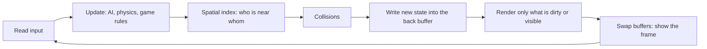

| Pattern | The question it answers | Section |
|---|---|---|
| Game Loop, Update Method | How does time advance, in a way that is the same on every machine? | [1](#1-game-loop-and-update-method) |
| Component, ECS, Data Locality | How do I model thousands of different things without deep inheritance, and keep the CPU cache happy? | [2](#2-component-pattern-entity-component-system-and-data-locality) |
| Double Buffer, Dirty Flag | How do I update state without half-finished results or wasted work? | [3](#3-double-buffer-and-dirty-flag) |
| Object Pool | How do I create thousands of short-lived objects without garbage-collector pauses? | [4](#4-object-pool-interview-imp---java) |
| Spatial Partition | How do I find nearby objects without comparing everyone with everyone? | [5](#5-spatial-partition) |
| Service Locator | How does code get shared services (audio, logging) without passing them everywhere? | [6](#6-service-locator-interview-imp---java) |
| State pattern for AI, Behavior Tree | How do characters decide what to do? | [7](#7-state-pattern-for-ai-and-behavior-trees) |
| Steering Behaviors | How do characters move naturally? | [8](#8-steering-behaviors) |

### 📘 Terms Explained

| Term | Meaning |
|---|---|
| **Frame** | One cycle of reading input, updating the world and drawing the screen |
| **FPS** | Frames per second; 60 FPS means about 16.7 ms per frame |
| **Delta time (dt)** | The time that passed since the previous update |
| **GC (garbage collector) pause** | A moment when the JVM stops the program to free memory; visible in games as a stutter |
| **Entity** | Any object in the game world (player, crate, bullet) |
| **Sprite / mesh** | A 2D image / a 3D model that is drawn on screen |

---

# 1. Game Loop and Update Method

## 1.1 What Are They?

- **Game loop (#436):** the heart of every game: a loop that repeats *forever*: **process input → update the world → render**. Unlike a normal application it does not wait for the user. The world keeps moving.
- **Update method (#437):** each object in the world has an `update()` method that the loop calls once per tick, so it advances itself by one small step (the object keeps its own state between calls).

```java
while (running) {
    processInput();
    update(dt);       // every entity's update(dt)
    render();
}
```

## 1.2 Why Do We Need Them?

| Problem | Solution |
|---|---|
| Game time must pass even if the player does nothing | The loop runs continuously |
| Fast computers run the loop more often, so the game would run too fast | Decouple game speed from CPU speed with time steps |
| Slow computers lag and physics becomes inaccurate or unstable | **Fixed time step** for simulation |
| Hundreds of objects each need to "act" | Update Method: the loop asks each object to act one step |

## 1.3 How It Works

There are three common loop designs:

| Loop | Idea | Problem |
|---|---|---|
| **Fixed delay** (`sleep` to hit 60 FPS) | Simple | Runs slower on slow machines |
| **Variable time step** | `update(dt)` where `dt` is the last frame's duration | Different machines get different results; large `dt` can make physics explode or objects tunnel through walls |
| **Fixed update, variable render** (best for most games) | Simulate in constant slices (for example 10 ms); render as often as possible; interpolate between the last two states | Needs the accumulator logic below |

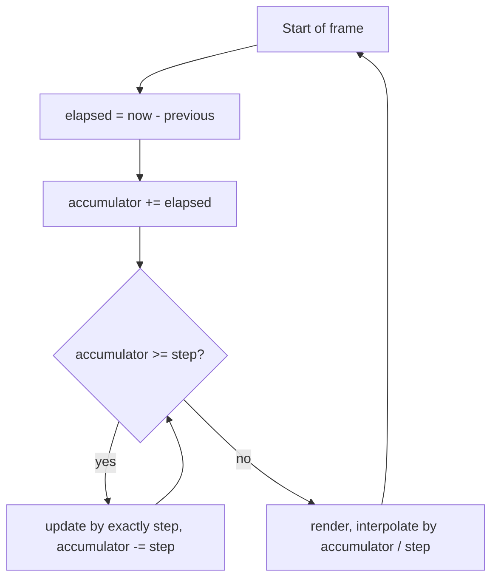

**The accumulator** stores real time not yet simulated. If a frame took 35 ms and the step is 10 ms, the loop runs 3 updates and keeps the 5 ms leftover for the next frame. **Interpolation** draws the picture slightly between the last two states so motion looks smooth even if updates and renders are not aligned.

**The spiral of death:** if one update takes *longer* in real time than the game time it simulates, the backlog grows each frame and the game freezes. Always **cap the number of updates per frame** (or lower the simulation load).

## 1.4 Types and Variants

| Variant | Note |
|---|---|
| **Fixed time step** | Deterministic: great for physics, replays, lock-step multiplayer |
| **Variable time step** | Simple; scale movement by `dt`; fine for simple games |
| **Semi-fixed** | Variable `dt` but clamped to a maximum |
| **Event-driven UI loop** | Desktop apps wait for events instead of looping |
| **Render thread + update thread** | Separate threads (needs [double buffering](#3-double-buffer-and-dirty-flag)) |
| **Server tick** | Online games: the server runs a fixed tick (for example 20/30/64 Hz) and sends snapshots |
| **Update Method with sub-steps** | Objects with their own timers (for example `update(dt)` on animations) |

## 1.5 Complete Java Example - Variable vs Fixed Time Step, and the Spiral of Death

**What it shows:** the same falling ball is simulated for 2.0 s of game time on a fast machine (10 ms frames), a slow machine (50 ms frames) and a slow machine with a 200 ms lag spike. The variable-step version gives three different answers; the fixed-step version gives one. A second experiment shows how the backlog grows when updates are too expensive.

```java
import java.util.*;

public class GameLoopDemo {
    static final double G = 9.81;

    // 1) variable time step: physics uses whatever dt the last frame happened to take
    static double variableStep(int[] frameMs) {
        double y = 100, v = 0;
        for (int ms : frameMs) { double dt = ms / 1000.0; v += G * dt; y -= v * dt; }       // simple Euler integration
        return y;
    }

    // 2) fixed time step: physics always advances in 10 ms slices; leftover time waits in an accumulator
    static double fixedStep(int[] frameMs) {
        double y = 100, v = 0; final int STEP = 10; int accumulator = 0;
        for (int ms : frameMs) {
            accumulator += ms;
            while (accumulator >= STEP) { double dt = STEP / 1000.0; v += G * dt; y -= v * dt; accumulator -= STEP; }
            // render(accumulator / (double) STEP) would interpolate between the last two states here
        }
        return y;
    }

    static int[] constant(int count, int ms) { int[] f = new int[count]; Arrays.fill(f, ms); return f; }

    // 3) spiral of death: every fixed update costs real time; if that is more than the time it simulates, the backlog never shrinks
    static void spiral(int costOfOneUpdateMs, int maxUpdatesPerFrame) {
        int step = 10, frameMs = 16, backlog = 0;
        StringBuilder sb = new StringBuilder("   update costs " + costOfOneUpdateMs + " ms real time, simulates " + step + " ms:  ");
        for (int frame = 1; frame <= 5; frame++) {
            backlog += frameMs;
            int updates = 0;
            while (backlog >= step && updates < maxUpdatesPerFrame) { backlog -= step; backlog += costOfOneUpdateMs; updates++; }   // doing the update takes time too
            sb.append("frame ").append(frame).append(": ").append(updates).append(" updates, backlog ").append(backlog).append(" ms | ");
        }
        System.out.println(sb);
    }

    public static void main(String[] args) {
        int[] spike = constant(36, 50); spike[10] = 200;                                        // 35 x 50 + 200 = 1950 ms ...
        int[] spikeFull = Arrays.copyOf(spike, 37); spikeFull[36] = 50;                          // ... plus one more frame = 2000 ms

        System.out.println("A ball is dropped from 100 m and falls for exactly 2.0 s of game time.");
        System.out.printf("Exact physics says height = %.2f m%n", 100 - 0.5 * G * 4);
        System.out.println("1) height after 2.0 s");
        System.out.println("   machine                              variable step    fixed 10 ms step");
        System.out.printf("   fast (200 frames of 10 ms)           %10.3f m     %10.3f m%n", variableStep(constant(200, 10)), fixedStep(constant(200, 10)));
        System.out.printf("   slow (40 frames of 50 ms)            %10.3f m     %10.3f m%n", variableStep(constant(40, 50)), fixedStep(constant(40, 50)));
        System.out.printf("   slow + one 200 ms lag spike          %10.3f m     %10.3f m%n", variableStep(spikeFull), fixedStep(spikeFull));
        System.out.println("   -> the fixed step gives the SAME answer on every machine (replays, fair multiplayer, stable physics)");

        System.out.println("2) the spiral of death (frame = 16 ms, at most 20 updates per frame)");
        spiral(6, 20);
        spiral(15, 20);
        System.out.println("   -> when an update costs more than it simulates, the backlog grows every frame; the cap stops the game freezing");
    }
}
```

**Output** (identical on all 3 runs):

```text
A ball is dropped from 100 m and falls for exactly 2.0 s of game time.
Exact physics says height = 80.38 m
1) height after 2.0 s
   machine                              variable step    fixed 10 ms step
   fast (200 frames of 10 ms)               80.282 m         80.282 m
   slow (40 frames of 50 ms)                79.890 m         80.282 m
   slow + one 200 ms lag spike              79.742 m         80.282 m
   -> the fixed step gives the SAME answer on every machine (replays, fair multiplayer, stable physics)
2) the spiral of death (frame = 16 ms, at most 20 updates per frame)
   update costs 6 ms real time, simulates 10 ms:  frame 1: 2 updates, backlog 8 ms | frame 2: 4 updates, backlog 8 ms | frame 3: 4 updates, backlog 8 ms | frame 4: 4 updates, backlog 8 ms | frame 5: 4 updates, backlog 8 ms | 
   update costs 15 ms real time, simulates 10 ms:  frame 1: 20 updates, backlog 116 ms | frame 2: 20 updates, backlog 232 ms | frame 3: 20 updates, backlog 348 ms | frame 4: 20 updates, backlog 464 ms | frame 5: 20 updates, backlog 580 ms | 
   -> when an update costs more than it simulates, the backlog grows every frame; the cap stops the game freezing
```

**What the output shows**
- **Exact physics** says 80.38 m. Simple Euler integration is slightly off (80.282 m), which is fine and what we compare against.
- **Variable step:** 80.282 m on the fast machine, 79.890 m on the slow one and 79.742 m with the lag spike. The same game gives different results depending on the machine. In multiplayer or replays, that is a desync.
- **Fixed 10 ms step:** **80.282 m on all three**. Slow machines run several updates per frame to catch up; fast ones run one.
- **Spiral of death:** when an update costs 6 ms of real time for 10 ms of game time, the backlog stays at 8 ms (stable). When it costs 15 ms for 10 ms, the backlog grows by 116 ms every frame and never recovers, even with the cap of 20 updates per frame. The cap keeps the game responsive but the simulation falls behind; the real fix is making the update cheaper or simulating less.

## 1.6 In Java and libGDX

```java
// libGDX: the framework owns the loop and calls render(delta) on your ApplicationListener
public class MyGame extends ApplicationAdapter {
    private static final float STEP = 1f / 60f;
    private float accumulator = 0;

    @Override public void render() {
        float frame = Math.min(Gdx.graphics.getDeltaTime(), 0.25f);      // clamp: avoids the spiral of death after a pause
        accumulator += frame;
        while (accumulator >= STEP) { world.step(STEP, 6, 2); updateEntities(STEP); accumulator -= STEP; }
        float alpha = accumulator / STEP;
        draw(alpha);                                                       // interpolate previous and current state
    }
}
```

```java
// The Update Method: each entity advances itself
interface Entity { void update(float dt); }
class Enemy implements Entity { public void update(float dt) { x += vx * dt; if (health <= 0) removeSelf(); } }
List<Entity> entities = ...; for (Entity e : entities) e.update(STEP);       // careful: do not add/remove during iteration
```
In a Spring Boot **game server** the loop is a `ScheduledExecutorService` with a fixed rate or a dedicated thread using `System.nanoTime()` and `LockSupport.parkNanos` for the tick.

## 1.7 Pros and Cons

| Pros | Cons |
|---|---|
| Fixed step: deterministic, stable physics, replayable | Needs the accumulator and interpolation |
| Update Method: simple, objects are self-contained | Many tiny virtual calls; order of updates matters; adding/removing during update needs care |
| Same code runs on any machine | Not suited to event-driven apps |

## 1.8 Pitfalls, Interview Questions and Cheat Sheet

**Common pitfalls**
- Multiplying by a huge `dt` after a pause (the player falls through the floor).
- Mixing rendering and update logic.
- Using wall-clock time (`System.currentTimeMillis()`) instead of a monotonic clock (`System.nanoTime()`).
- Update order bugs: object A reads B's position before B has moved this frame.
- Modifying the entity list while iterating over it (`ConcurrentModificationException`).
- No cap on updates per frame.

**Interview questions**
1. *What is a game loop?* → A loop that repeatedly processes input, updates the world and renders, independently of user actions.
2. *Why a fixed time step?* → Deterministic, stable physics and the same results on every machine.
3. *What is the accumulator for?* → Remembers real time not yet simulated so updates run in whole fixed steps.
4. *What is the spiral of death and how do you avoid it?* → Updates slower than real time make the backlog grow; clamp frame time and cap updates per frame.
5. *What is the Update Method pattern?* → Each object implements `update()` and the loop calls it every tick.

**Cheat sheet**
```
loop: input -> update (fixed step) -> render (interpolate)
accumulator += frameTime; while (acc >= STEP) { update(STEP); acc -= STEP; } render(acc / STEP)
Clamp frameTime (e.g. 0.25 s); cap updates per frame; use a monotonic clock
Update Method: entity.update(dt) per tick; do not modify the list while iterating
```

### 📘 Terms Explained

| Term | Meaning |
|---|---|
| **Game loop** | The endless loop of input, update and render |
| **Fixed time step** | Simulating in equal slices of game time |
| **Accumulator** | A counter of real time not yet simulated |
| **Interpolation** | Drawing a state between two simulated states for smooth motion |
| **Euler integration** | The simplest way to move things: new position = old position + velocity × dt |
| **Tunneling** | A fast object passing through a thin wall because it moved too far in one step |
| **Desync** | Two machines' simulations drifting apart |
| **Monotonic clock** | A clock that never goes backwards (`System.nanoTime`) |

---

# 2. Component Pattern, Entity-Component-System and Data Locality

## 2.1 What Are They?

**The problem:** with inheritance you get `Enemy → FlyingEnemy → FlyingPoisonedEnemy → …`. Combinations explode and a change high in the tree breaks everything.

- **Component pattern (#438):** an entity is just an **id** (or a container) plus a set of **components**, each holding one concern (`Position`, `Velocity`, `Health`, `Sprite`). Behaviour is **composed**, not inherited. ("Favour composition over inheritance".)
- **Entity-Component-System (ECS) (#439):** a stricter, data-oriented version:
  - **Entity** = just an id number.
  - **Component** = plain **data**, no behaviour.
  - **System** = **logic** that runs over all entities having a certain set of components (`MovementSystem` handles everything with `Position` + `Velocity`).
- **Data locality (#445):** arrange data in memory so the CPU reads it **sequentially**. ECS stores each component type in a contiguous array, which is friendly to the CPU cache.

## 2.2 Why Do We Need Them?

| Reason | Detail |
|---|---|
| **Flexibility** | New enemy = pick components; no new class |
| **Designer-friendly** | Data-driven: entity definitions in JSON/XML, no recompiling |
| **Performance** | Processing 10,000 positions in one tight loop is much faster than chasing 10,000 object pointers |
| **Parallelism** | Systems with no shared data can run on separate threads |
| **Memory cost of cache misses** | A cache miss costs on the order of 100 CPU cycles, while an arithmetic operation costs about 1 |

## 2.3 How It Works

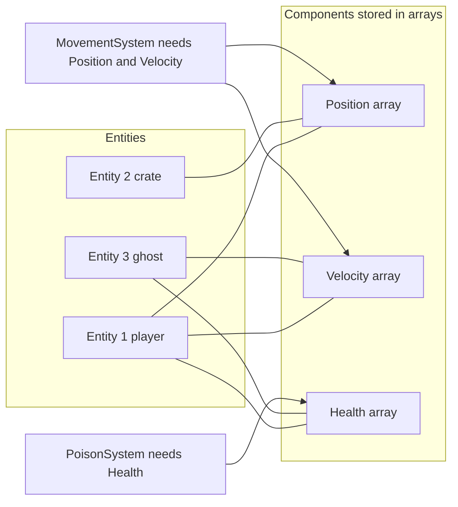

**Why the cache matters.** A CPU does not read single bytes from memory; it fetches a **cache line** (typically 64 bytes). If the next data you need is in the same line, access is nearly free. Compare:

| Layout | In memory | Updating `y` for every entity |
|---|---|---|
| **Array of structures (AoS)**: `Entity[]` of objects with all fields | `x y dx dy name ai inventory …` then `x y dx dy name …` | Each `y` is in a different cache line, so each one costs a miss |
| **Structure of arrays (SoA)**: separate `x[] y[] dx[] dy[]` | `y y y y y y y y …` | One cache line holds 8 `y` values (8 bytes each), so only 1 in 8 reads misses |

In Java objects are references scattered on the heap, so an `ArrayList<Entity>` follows pointers. Primitive arrays (`double[] x`) are contiguous, which is why Java ECS libraries store components in primitive arrays.

## 2.4 Types and Variants

| Variant | Note |
|---|---|
| **Object-composition (Unity-style)** | Entities own component objects with their own `update()`; flexible, less cache-friendly |
| **Pure ECS (data-oriented)** | Components are data, systems hold logic; Unity DOTS, Bevy, EnTT, Flecs |
| **Archetype ECS** | Entities with the same component set stored together in tables (Unity DOTS, Flecs) |
| **Sparse set ECS** | Each component type has its own dense array + index (EnTT, Ashley-like) |
| **Java libraries** | **Ashley** (libGDX), **Artemis-odb**, **Dominion**, **Fleks** (Kotlin) |
| **Hot/cold splitting** | Keep rarely used fields (name, inventory) away from fields touched every frame |

## 2.5 Complete Java Example - Components and Systems, and a Cache-Miss Model for AoS vs SoA

**What it shows:** (1) entities as ids with components in maps; `MovementSystem` moves only entities that have both `Position` and `Velocity`; `PoisonSystem` touches only `Health`. (2) A tiny CPU-cache simulator (64-byte lines, 64 lines) counts the cache misses of updating 10,000 entities stored as 64-byte objects versus separate arrays.

```java
import java.util.*;

public class EcsDemo {

    // ================= 1. Component pattern: an entity is a bag of components, behaviour lives in systems =================
    record Position(double x, double y) {}
    record Velocity(double dx, double dy) {}
    record Health(int hp) {}

    static class World {
        final Map<Integer, Position> positions = new HashMap<>();
        final Map<Integer, Velocity> velocities = new HashMap<>();
        final Map<Integer, Health> health = new HashMap<>();
        int next = 1;
        int spawn() { return next++; }
    }

    // a system works on every entity that has the components it needs
    static void movementSystem(World w, double dt) {
        for (var e : w.velocities.entrySet()) {
            Position p = w.positions.get(e.getKey());
            if (p == null) continue;                                              // has Velocity but no Position: skip
            w.positions.put(e.getKey(), new Position(p.x() + e.getValue().dx() * dt, p.y() + e.getValue().dy() * dt));
        }
    }
    static List<Integer> poisonSystem(World w) {                                  // only entities with Health are touched
        List<Integer> dead = new ArrayList<>();
        for (var e : new ArrayList<>(w.health.entrySet())) {
            int hp = e.getValue().hp() - 40;
            if (hp <= 0) { dead.add(e.getKey()); w.health.remove(e.getKey()); } else w.health.put(e.getKey(), new Health(hp));
        }
        return dead;
    }

    // ================= 2. Data locality: a tiny CPU cache model =================
    // Direct-mapped cache: 64-byte lines, 64 lines (4 KB). Count how many memory accesses miss.
    static class Cache {
        final long[] tags = new long[64]; int misses = 0, accesses = 0;
        Cache() { Arrays.fill(tags, -1); }
        void access(long address) {
            accesses++;
            long line = address / 64; int slot = (int) (line % 64);
            if (tags[slot] != line) { misses++; tags[slot] = line; }
        }
    }

    public static void main(String[] args) {
        // ---- component pattern ----
        World w = new World();
        int player = w.spawn(), crate = w.spawn(), ghost = w.spawn();
        w.positions.put(player, new Position(0, 0)); w.velocities.put(player, new Velocity(2, 1)); w.health.put(player, new Health(100));
        w.positions.put(crate, new Position(5, 5));                                 // no velocity, no health: static scenery
        w.velocities.put(ghost, new Velocity(1, 1));                                // velocity but NO position (not in the world yet)
        w.health.put(ghost, new Health(30));
        movementSystem(w, 0.5);
        System.out.println("1) after movementSystem: player=" + w.positions.get(player) + "  crate=" + w.positions.get(crate) + "  ghost position=" + w.positions.get(ghost));
        System.out.println("   poisonSystem (-40 hp) killed entities " + poisonSystem(w) + ", player hp now " + w.health.get(player).hp());
        System.out.println("   new behaviour = new component + new system; no deep class hierarchy (no FlyingPoisonedBurningEnemy subclass)");

        // ---- data locality ----
        final int N = 10_000;
        // Layout A: array of objects, each 64 bytes (position 16 B + velocity 16 B + name/AI/inventory 32 B we don't need here)
        Cache a = new Cache();
        for (int i = 0; i < N; i++) { long base = (long) i * 64; a.access(base); a.access(base + 8); a.access(base + 16); a.access(base + 24); }      // read x,y,dx,dy
        // Layout B: struct of arrays: x[], y[], dx[], dy[] each 8 bytes per entity, contiguous
        Cache b = new Cache();
        long xs = 0, ys = (long) N * 8, dxs = (long) N * 16, dys = (long) N * 24;
        for (int i = 0; i < N; i++) { b.access(xs + i * 8L); b.access(ys + i * 8L); b.access(dxs + i * 8L); b.access(dys + i * 8L); }
        System.out.printf("2) updating %d entities (read x, y, dx, dy for each)%n", N);
        System.out.printf("   array of 64-byte objects : %d accesses, %d cache misses (%.1f%%)%n", a.accesses, a.misses, 100.0 * a.misses / a.accesses);
        System.out.printf("   struct of arrays (ECS)   : %d accesses, %d cache misses (%.1f%%)%n", b.accesses, b.misses, 100.0 * b.misses / b.accesses);
        // Layout A vs B when a system needs only ONE field (gravity only reads and writes y)
        Cache a1 = new Cache(), b1 = new Cache();
        for (int i = 0; i < N; i++) { a1.access((long) i * 64 + 8); b1.access(ys + i * 8L); }
        System.out.printf("   gravity system, reads only y: objects %d misses (%.1f%%), arrays %d misses (%.1f%%)%n", a1.misses, 100.0 * a1.misses / a1.accesses, b1.misses, 100.0 * b1.misses / b1.accesses);
        System.out.println("   (a simplified model: 64-byte cache lines; real CPUs also prefetch, so absolute numbers differ, the ratio is the lesson)");
    }
}
```

**Output** (identical on all 3 runs):

```text
1) after movementSystem: player=Position[x=1.0, y=0.5]  crate=Position[x=5.0, y=5.0]  ghost position=null
   poisonSystem (-40 hp) killed entities [3], player hp now 60
   new behaviour = new component + new system; no deep class hierarchy (no FlyingPoisonedBurningEnemy subclass)
2) updating 10000 entities (read x, y, dx, dy for each)
   array of 64-byte objects : 40000 accesses, 10000 cache misses (25.0%)
   struct of arrays (ECS)   : 40000 accesses, 5000 cache misses (12.5%)
   gravity system, reads only y: objects 10000 misses (100.0%), arrays 1250 misses (12.5%)
   (a simplified model: 64-byte cache lines; real CPUs also prefetch, so absolute numbers differ, the ratio is the lesson)
```

**What the output shows**
- **1:** the player moved to (1.0, 0.5). The crate has no `Velocity`, so it is untouched. The ghost has `Velocity` but no `Position`, so the movement system skips it. The poison system only looks at entities with `Health`, kills the ghost (30 hp − 40) and leaves the player at 60. New behaviour = new component + system; no subclass.
- **2 (all four fields):** the 64-byte object layout needs **1 miss per entity** (10,000, since x, y, dx, dy share one line); separate arrays need **5,000**, since each array packs 8 values per line. A 2× gain, even though the objects were small.
- **Gravity only reads `y`:** the object layout still needs one line per entity (**100% of accesses miss**) while the array layout misses on **12.5%**, an **8× reduction**. This is the benefit: systems that touch few fields do not drag the rest of the object through the cache.
- The model is simplified (real CPUs prefetch, have several cache levels, and Java adds object headers and pointer chasing), so the absolute numbers differ. The *ratio* is the lesson.

## 2.6 ECS in Java (Ashley / libGDX)

```java
// Ashley (libGDX ECS): components are plain classes, systems iterate matching entities
public class PositionComponent implements Component { public float x, y; }
public class VelocityComponent implements Component { public float dx, dy; }

public class MovementSystem extends IteratingSystem {
    private final ComponentMapper<PositionComponent> pm = ComponentMapper.getFor(PositionComponent.class);
    private final ComponentMapper<VelocityComponent> vm = ComponentMapper.getFor(VelocityComponent.class);

    public MovementSystem() { super(Family.all(PositionComponent.class, VelocityComponent.class).get()); }

    @Override protected void processEntity(Entity e, float dt) {
        PositionComponent p = pm.get(e); VelocityComponent v = vm.get(e);
        p.x += v.dx * dt; p.y += v.dy * dt;
    }
}

Engine engine = new Engine();
engine.addSystem(new MovementSystem());
Entity player = new Entity().add(new PositionComponent()).add(new VelocityComponent());
engine.addEntity(player);
// in the game loop: engine.update(STEP);
```

```java
// Hand-rolled data-oriented storage in plain Java (primitive arrays, indexed by entity id)
final class Bodies { final float[] x, y, dx, dy; int count; Bodies(int cap) { x = new float[cap]; y = new float[cap]; dx = new float[cap]; dy = new float[cap]; } }
static void movement(Bodies b, float dt) { for (int i = 0; i < b.count; i++) { b.x[i] += b.dx[i] * dt; b.y[i] += b.dy[i] * dt; } }   // sequential, cache-friendly
```
Rule: only optimise memory layout after profiling. For a few hundred entities, a plain object model is fine.

## 2.7 Pros and Cons

| Pros | Cons |
|---|---|
| Flexible composition without inheritance trees | More indirection; harder to read for beginners |
| Data-driven; designers can combine behaviours | Communication between components/systems needs care |
| Cache-friendly and parallel-friendly | Overkill for small games; debugging a world of ids is harder than debugging objects |

## 2.8 Pitfalls, Interview Questions and Cheat Sheet

**Common pitfalls**
- "God components" holding everything (it is the same monolith).
- Components with behaviour in a pure ECS.
- Systems with hidden ordering dependencies.
- Creating and removing entities during system iteration without deferring changes.
- Premature optimisation of memory layout.
- Looking up components through `HashMap`s in hot loops (use dense arrays/mappers).

**Interview questions**
1. *Inheritance vs composition in game objects?* → Composition avoids the class explosion and brittle hierarchies; behaviours are mixed per entity.
2. *What is ECS?* → Entities are ids, components are data, systems are logic that iterates entities having certain components.
3. *Why is ECS fast?* → Data of the same type is contiguous, so loops are sequential and cache-friendly.
4. *AoS vs SoA?* → Array of structures keeps all fields of one object together; structure of arrays keeps one field of all objects together. SoA wins when a pass uses few fields.
5. *What is a cache miss and why does it matter?* → A read not found in the CPU cache goes to slow main memory (~100× slower than a cache hit).
6. *Does Java suit ECS?* → Objects are heap-scattered and add headers, so use primitive arrays for hot data.

**Cheat sheet**
```
Entity = id;  Component = data;  System = logic over entities with the needed components
Composition over inheritance; behaviour = a new component + system
SoA beats AoS when a pass reads few fields; cache line = 64 bytes (8 doubles)
Java: Ashley, Artemis-odb, Dominion; primitive arrays for hot data; profile first
```

### 📘 Terms Explained

| Term | Meaning |
|---|---|
| **Component** | A small piece of data or behaviour attached to an entity |
| **System** | Code that processes all entities with specific components |
| **ECS** | Entity-Component-System |
| **Data-oriented design** | Designing around how data is laid out and accessed rather than around objects |
| **Cache line** | The 64-byte block the CPU loads from memory at once |
| **Cache miss** | The needed data is not in the cache, so a slow memory access is required |
| **AoS / SoA** | Array of structures / structure of arrays |
| **Archetype** | The set of component types an entity has; entities with the same archetype are stored together |
| **Composition over inheritance** | Build behaviour by combining parts instead of subclassing |

---

# 3. Double Buffer and Dirty Flag

## 3.1 What Are They?

- **Double buffer (#440):** keep **two copies** of state: the **current** one (read by everybody) and the **next** one (being written). When all writes are done, **swap** them. Nobody ever reads half-updated data.
- **Dirty flag (#441):** mark a value as "changed" (dirty) when its inputs change, and **recompute it lazily**, only when someone reads it and it is dirty. Unchanged values cost nothing.

## 3.2 Why Do We Need Them?

| Pattern | Problem | Fix |
|---|---|---|
| Double buffer | Updating a grid in place, cell A reads neighbour B that already changed this frame, so the result depends on iteration order | Read from the old buffer, write to the new one |
| Double buffer | Drawing while the screen reads the image shows half a frame (**tearing**) | Draw into the back buffer; swap when finished |
| Double buffer | A render thread reads state while the update thread changes it | Render reads the previous snapshot |
| Dirty flag | Recomputing every object's world transform every frame, though nothing moved | Recompute only when a parent changed |

## 3.3 How It Works

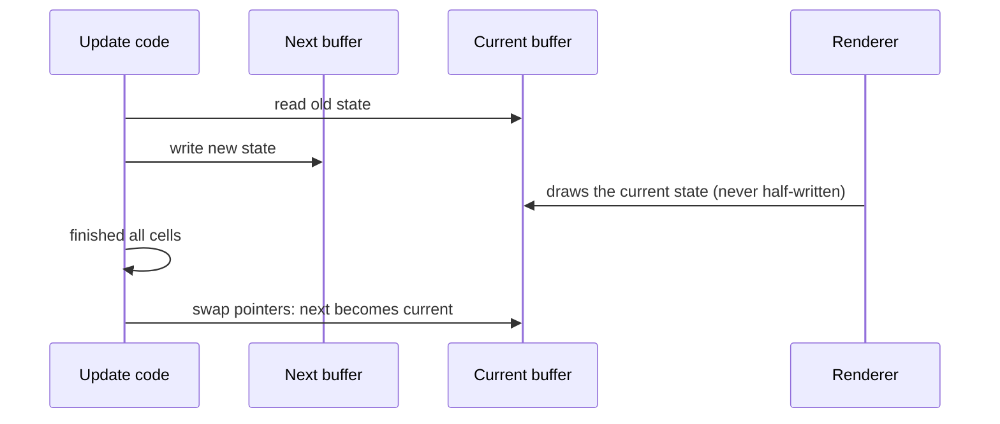

**Swapping is cheap:** swap two references, don't copy data. For rendering, graphics APIs do it for you (`swapBuffers`).

**Dirty flag rules:** (1) changing an input sets the flag (and propagates it to dependents), (2) reading checks the flag, recomputes if dirty and clears it, (3) several changes before the next read cost **one** recomputation.

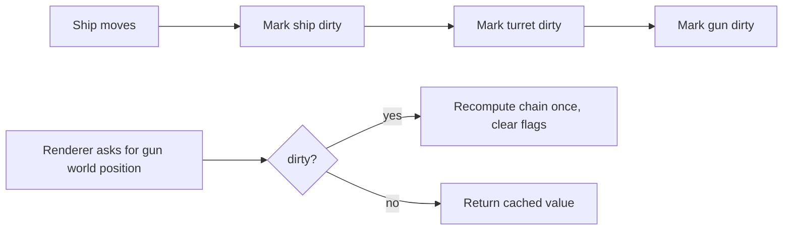

## 3.4 Types and Variants

| Variant | Note |
|---|---|
| **Double buffering (graphics)** | Front/back framebuffer; **triple buffering** adds a third to avoid waiting |
| **Double buffer for simulation state** | Cellular automata, particle systems, AI blackboards |
| **Snapshot / copy-on-write** | Persistent data structures give cheap "previous state" |
| **Dirty flag: transform hierarchies** | Scene graphs recompute world matrices only when needed |
| **Dirty flag: UI / caches** | "Needs redraw", "needs save", derived values; same idea as a cache with invalidation |
| **Observer vs dirty flag** | Observer pushes changes now; dirty flag batches and pulls later |
| **Frame-end swap in multithreading** | Producer fills buffer A while consumer reads B; swap at a safe point |

## 3.5 Complete Java Example - Game of Life In Place vs Double Buffered, and a Transform Hierarchy With Dirty Flags

**What it shows:** (1) a "blinker" in Conway's Game of Life. Updated in place it produces garbage; updated with two buffers it correctly flips from horizontal to vertical. (2) A ship → turret → gun hierarchy where the world position is recomputed only when something above it moved.

```java
import java.util.*;

public class BufferDirtyDemo {

    // ---------- Double buffer: Conway's Game of Life on a 5x5 board ----------
    static final int N = 5;

    static int neighbours(boolean[][] g, int r, int c) {
        int n = 0;
        for (int dr = -1; dr <= 1; dr++) for (int dc = -1; dc <= 1; dc++) {
            if (dr == 0 && dc == 0) continue;
            int rr = r + dr, cc = c + dc;
            if (rr >= 0 && rr < N && cc >= 0 && cc < N && g[rr][cc]) n++;
        }
        return n;
    }
    static boolean rule(boolean alive, int n) { return alive ? (n == 2 || n == 3) : n == 3; }

    static boolean[][] copy(boolean[][] g) { boolean[][] c = new boolean[N][N]; for (int i = 0; i < N; i++) c[i] = g[i].clone(); return c; }

    static void inPlace(boolean[][] g) {                    // WRONG: later cells see already-updated earlier cells
        for (int r = 0; r < N; r++) for (int c = 0; c < N; c++) g[r][c] = rule(g[r][c], neighbours(g, r, c));
    }
    static boolean[][] doubleBuffered(boolean[][] current) {      // RIGHT: read from 'current', write to 'next', then swap
        boolean[][] next = new boolean[N][N];
        for (int r = 0; r < N; r++) for (int c = 0; c < N; c++) next[r][c] = rule(current[r][c], neighbours(current, r, c));
        return next;
    }
    static String show(boolean[][] g) {
        StringBuilder sb = new StringBuilder();
        for (boolean[] row : g) { sb.append("      "); for (boolean b : row) sb.append(b ? '#' : '.'); sb.append('\n'); }
        return sb.toString();
    }

    // ---------- Dirty flag: recompute a world transform only when a parent actually changed ----------
    static class TransformNode {
        final String name; final TransformNode parent; double localX; double worldX; boolean dirty = true;
        final List<TransformNode> children = new ArrayList<>();
        static int recomputations = 0;
        TransformNode(String name, TransformNode parent, double localX) { this.name = name; this.parent = parent; this.localX = localX; if (parent != null) parent.children.add(this); }
        void setLocalX(double x) { localX = x; markDirty(); }
        void markDirty() { if (dirty) return; dirty = true; for (TransformNode c : children) c.markDirty(); }     // cheap: just set flags
        double world() {
            if (dirty) { recomputations++; worldX = (parent == null ? 0 : parent.world()) + localX; dirty = false; }      // expensive part, only when needed
            return worldX;
        }
    }

    public static void main(String[] args) {
        boolean[][] start = new boolean[N][N];
        start[2][1] = start[2][2] = start[2][3] = true;                       // a "blinker": three cells in a row, should flip to vertical

        System.out.println("1) start (a horizontal blinker)\n" + show(start));
        boolean[][] a = copy(start); inPlace(a);
        System.out.println("   update IN PLACE (wrong, cells read half-updated neighbours):\n" + show(a));
        boolean[][] b = doubleBuffered(start);
        System.out.println("   update with TWO BUFFERS (correct, a vertical blinker):\n" + show(b));
        System.out.println("   result is order-independent only with two buffers; the same trick stops screen tearing (draw to the back buffer, then swap)");

        // dirty flag
        TransformNode ship = new TransformNode("ship", null, 100);
        TransformNode turret = new TransformNode("turret", ship, 5);
        TransformNode gun = new TransformNode("gun", turret, 1);
        System.out.println("2) dirty flag: world positions = " + ship.world() + ", " + turret.world() + ", " + gun.world() + "  (recomputations so far: " + TransformNode.recomputations + ")");
        for (int frame = 0; frame < 1000; frame++) { gun.world(); turret.world(); ship.world(); }
        System.out.println("   1000 frames with nothing moving: recomputations still " + TransformNode.recomputations);
        ship.setLocalX(110);
        System.out.println("   ship moves -> everything below is flagged dirty; reading gun.world() = " + gun.world() + " recomputes the chain once (total " + TransformNode.recomputations + ")");
        ship.setLocalX(111); ship.setLocalX(112); ship.setLocalX(113);
        System.out.println("   3 more moves in the same frame, then one read: " + gun.world() + " (total recomputations " + TransformNode.recomputations + ": 3 more, not 9, because flags are set cheaply and the chain is recomputed once on read)");
    }
}
```

**Output** (identical on all 3 runs):

```text
1) start (a horizontal blinker)
      .....
      .....
      .###.
      .....
      .....

   update IN PLACE (wrong, cells read half-updated neighbours):
      .....
      ..##.
      .#.#.
      .....
      .....

   update with TWO BUFFERS (correct, a vertical blinker):
      .....
      ..#..
      ..#..
      ..#..
      .....

   result is order-independent only with two buffers; the same trick stops screen tearing (draw to the back buffer, then swap)
2) dirty flag: world positions = 100.0, 105.0, 106.0  (recomputations so far: 3)
   1000 frames with nothing moving: recomputations still 3
   ship moves -> everything below is flagged dirty; reading gun.world() = 116.0 recomputes the chain once (total 6)
   3 more moves in the same frame, then one read: 119.0 (total recomputations 9: 3 more, not 9, because flags are set cheaply and the chain is recomputed once on read)
```

**What the output shows**
- **1:** the correct next generation of a horizontal blinker is a vertical blinker (three cells in a column). Updating **in place** gave a different, wrong shape, since cells processed later read neighbours already changed in the same generation. With **two buffers** all cells see the same old world. The rule "every cell updates simultaneously" can only be implemented with a second buffer.
- **2:** the first reads compute the three world positions (3 recomputations). **1,000 frames with nothing moving cost 0 more**: cached. Moving the ship sets flags (cheap); the next read recomputes the three nodes (total 6). Three more moves in the same frame followed by one read cost only 3 more recomputations (total 9), not 9 more.

## 3.6 In Java

```java
// Double buffer with swapped references (no copying)
final class World {
    private Cell[][] current = new Cell[H][W], next = new Cell[H][W];
    void step() {
        for (int r = 0; r < H; r++) for (int c = 0; c < W; c++) next[r][c] = rule(current, r, c);     // read current, write next
        Cell[][] t = current; current = next; next = t;                                              // swap
    }
    Cell[][] snapshotForRender() { return current; }     // with threads: publish with a volatile write or an AtomicReference
}
```

```java
// libGDX / LWJGL: the graphics window already uses a double-buffered surface; you draw and call swap
Gdx.gl.glClear(GL20.GL_COLOR_BUFFER_BIT);
batch.begin(); drawEverything(); batch.end();         // drawing goes to the back buffer; the framework swaps for you

// Dirty flag: any derived value
class Node {
    private boolean dirty = true; private Matrix4 world = new Matrix4();
    void setLocal(Matrix4 m) { local.set(m); markDirty(); }
    Matrix4 world() { if (dirty) { world.set(parent.world()).mul(local); dirty = false; } return world; }
}
```
The same dirty-flag idea is Hibernate's "dirty checking" (flush only changed entities), React's re-render on state change, Spring's `@Cacheable` invalidation, and a `modified` flag on an editor document.

## 3.7 Pros and Cons

| | Double buffer | Dirty flag |
|---|---|---|
| Pros | Consistent snapshots, no tearing, safe for readers | Avoids wasted work; changes batch automatically |
| Cons | Doubles the memory; one frame of latency | Easy to forget to set the flag (stale data); flag propagation costs; the lazy cost shows up at unexpected moments |

## 3.8 Pitfalls, Interview Questions and Cheat Sheet

**Common pitfalls**
- Swapping buffers while another thread still reads the old one.
- Forgetting to clear the "next" buffer before reuse (old data leaks).
- Copying buffers every frame instead of swapping references.
- Dirty flags that are set in some code paths but not others (stale caches).
- Dirty flag on data that changes every frame anyway (pure overhead).

**Interview questions**
1. *Why use double buffering?* → So readers see a complete, consistent state, and so updates don't depend on iteration order or cause tearing.
2. *How is swapping done efficiently?* → Swap references/pointers, don't copy.
3. *What is a dirty flag and where have you seen it?* → A "needs recomputing" marker; Hibernate dirty checking, scene graphs, UI invalidation, caches.
4. *Dirty flag vs observer?* → Observer notifies immediately on each change; dirty flag defers and batches work until the value is needed.
5. *What is the risk of a dirty flag?* → Missing an invalidation gives stale results; the classic "two hard things: cache invalidation".

**Cheat sheet**
```
Double buffer: read current, write next, swap references at the end of the update (no copy)
Use for: simultaneous updates (grids, particles), tearing-free rendering, safe cross-thread snapshots
Dirty flag: input changes -> mark dirty (propagate); read -> if dirty recompute + clear; many changes = 1 recompute
Danger: forgotten invalidation = stale data
```

### 📘 Terms Explained

| Term | Meaning |
|---|---|
| **Double buffering** | Using two buffers: one being shown/read, one being written |
| **Swap** | Exchanging which buffer is current |
| **Tearing** | A visible split between two frames when drawing is not synchronised |
| **Dirty flag** | A boolean saying "this derived value is out of date" |
| **Lazy evaluation** | Doing work only when the result is needed |
| **Scene graph** | A tree of objects where children are positioned relative to parents |
| **World transform** | A node's final position in the world after applying all its parents' transforms |
| **Conway's Game of Life** | A grid simulation where each cell's next state depends on its 8 neighbours |

---

# 4. Object Pool (Interview Imp - Java)

## 4.1 What Is It?

An **object pool** (#442) creates a fixed set of objects **once**, hands them out when needed, and takes them back when done, instead of creating a new object each time and leaving the old one for the garbage collector.

In a game: bullets, particles, enemies, sound effects. In Java generally: database connections, threads, buffers, `StringBuilder`s. The idea is the same as a hotel with a fixed number of rooms: guests check in and out; the building is never rebuilt.

## 4.2 Why Do We Need It?

| Problem | Explanation |
|---|---|
| **Allocation cost** | Creating complex objects (connections, large arrays) is slow |
| **GC pauses** | Thousands of short-lived objects per second fill the heap; the garbage collector pauses the game, which shows as a stutter |
| **Memory fragmentation** (native/manual memory) | Repeated alloc/free leaves holes |
| **Predictability** | A fixed pool means a known memory ceiling |

Note: modern JVM allocators and generational GCs make plain small-object allocation very cheap. Pool only when profiling shows allocation or GC pauses are a problem, or when the object is **expensive to create** (connections, threads, large buffers).

## 4.3 How It Works

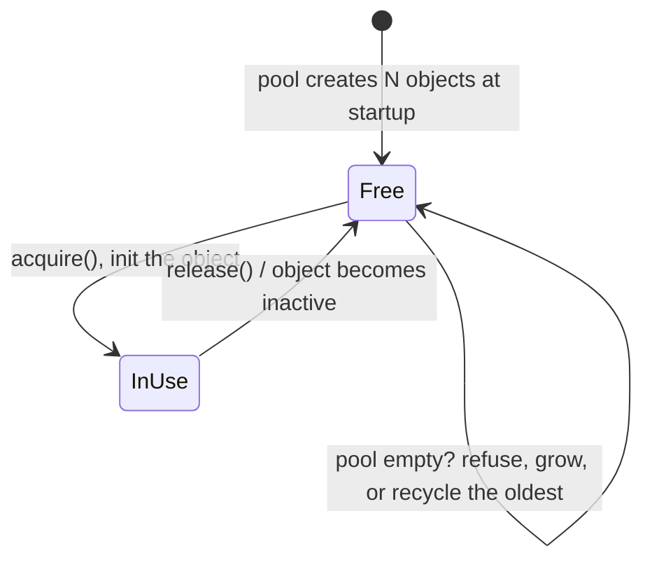

1. **Create** all objects up front and put them on a free list (a stack or queue).
2. **Acquire:** take one from the free list and **initialise it fully** (reset every field).
3. **Release:** return it to the free list when finished (for example a bullet leaves the screen).
4. **When the pool is empty,** choose a policy: refuse the request, grow the pool, wait, or recycle the oldest/least important object (a new explosion may steal the oldest particle).

## 4.4 Types and Variants

| Variant | Note |
|---|---|
| **Fixed-size pool** | Simple, hard cap |
| **Growable pool** | Adds objects when empty (up to a max) |
| **Free-list inside the objects** | Each unused object stores a pointer to the next free one (no separate list; C/C++ trick) |
| **Thread-safe pool** | `ArrayBlockingQueue` / `ConcurrentLinkedQueue` / Apache Commons Pool |
| **Connection pool** | HikariCP, the standard in Spring Boot ([01_Scalability_Pattern.md](../03_System_Design/01_Scalability_Pattern.md)) |
| **Thread pool** | `ExecutorService` ([11_Concurrency_Pattern.md](../03_System_Design/11_Concurrency_Pattern.md)) |
| **Buffer pool** | Netty `PooledByteBufAllocator`, which cuts garbage in network servers |
| **Flyweight (related)** | Share immutable data instead of reusing mutable objects |

## 4.5 Complete Java Example - 1,800 Shots With and Without a Pool

**What it shows:** a game fires 3 bullets per frame for 600 frames. The naive version creates a new `Bullet` for every shot; the pooled version creates 64 bullets once. A final snippet shows the classic bug: a recycled object that was not completely reset.

```java
import java.util.*;

public class PoolDemo {

    static int constructed = 0;                          // how many Bullet objects were ever created

    static class Bullet {
        double x, y, vx, vy; boolean active; final int id;
        Bullet() { id = ++constructed; }
        void init(double x, double y, double vx, double vy) { this.x = x; this.y = y; this.vx = vx; this.vy = vy; active = true; }
        void update() { x += vx; y += vy; if (x > 100 || y > 100) active = false; }          // leaves the screen -> inactive
    }

    // Fixed-size pool: all objects are created up front and reused
    static class BulletPool {
        final Bullet[] all; final Deque<Bullet> free = new ArrayDeque<>(); int refused = 0;
        BulletPool(int size) { all = new Bullet[size]; for (int i = 0; i < size; i++) { all[i] = new Bullet(); free.push(all[i]); } }
        Bullet acquire() { Bullet b = free.poll(); if (b == null) refused++; return b; }     // pool empty: policy = refuse (could also recycle the oldest)
        void releaseInactive() { for (Bullet b : all) if (!b.active && !free.contains(b)) free.push(b); }
    }

    public static void main(String[] args) {
        int frames = 600, firePerFrame = 3;

        // A) naive: new Bullet() every shot, drop it when it leaves the screen (garbage)
        constructed = 0;
        List<Bullet> live = new ArrayList<>(); int maxLiveA = 0;
        for (int f = 0; f < frames; f++) {
            for (int i = 0; i < firePerFrame; i++) { Bullet b = new Bullet(); b.init(0, i * 10, 5, 1); live.add(b); }
            live.forEach(Bullet::update); live.removeIf(b -> !b.active);
            maxLiveA = Math.max(maxLiveA, live.size());
        }
        int createdNaive = constructed;

        // B) pool of 64
        constructed = 0;
        BulletPool pool = new BulletPool(64);
        int maxLiveB = 0, fired = 0;
        for (int f = 0; f < frames; f++) {
            for (int i = 0; i < firePerFrame; i++) { Bullet b = pool.acquire(); if (b != null) { b.init(0, i * 10, 5, 1); fired++; } }
            int liveNow = 0;
            for (Bullet b : pool.all) if (b.active) { b.update(); liveNow++; }
            maxLiveB = Math.max(maxLiveB, liveNow);
            pool.releaseInactive();
        }
        int createdPool = constructed;

        System.out.println(frames + " frames, " + firePerFrame + " shots per frame = " + frames * firePerFrame + " shots requested");
        System.out.println("A) new Bullet() per shot : objects created = " + createdNaive + "   (each one becomes garbage later), max alive at once = " + maxLiveA);
        System.out.println("B) pool of 64 bullets    : objects created = " + createdPool + "   shots fired = " + fired + "   shots refused (pool empty) = " + pool.refused + "   max alive = " + maxLiveB);
        System.out.println("   the pool allocates once; the cost is a hard cap and the need to reset recycled objects completely");

        // reuse bug: forgetting to reset state
        Bullet old = new Bullet(); old.init(0, 0, 5, 1); old.vx = 50;                // a special fast bullet
        old.active = false;
        Bullet reused = old; reused.active = true; reused.x = 0; reused.y = 0;       // BUG: x,y reset but vx,vy NOT reset
        System.out.println("C) pitfall: a recycled bullet that was not fully reset still moves with vx=" + reused.vx + " (should be the default 5)");
    }
}
```

**Output** (identical on all 3 runs):

```text
600 frames, 3 shots per frame = 1800 shots requested
A) new Bullet() per shot : objects created = 1800   (each one becomes garbage later), max alive at once = 60
B) pool of 64 bullets    : objects created = 64   shots fired = 1800   shots refused (pool empty) = 0   max alive = 63
   the pool allocates once; the cost is a hard cap and the need to reset recycled objects completely
C) pitfall: a recycled bullet that was not fully reset still moves with vx=50.0 (should be the default 5)
```

**What the output shows**
- **A:** 1,800 shots → 1,800 `Bullet` objects created, each later garbage. At most 60 were alive at once.
- **B:** a pool of 64 bullets served all 1,800 shots, 0 refused, never more than 63 alive. Only **64 objects** were ever created.
- **Trade-off:** if the pool were smaller than the peak demand (say 40), some shots would be **refused**. Sizing is a decision: measure the peak.
- **C:** a recycled bullet kept `vx = 50.0` from its previous life. Objects taken from a pool must be reset by one `init()` method that sets *every* field, otherwise state leaks between users.

## 4.6 Object Pool in Java and Spring

```java
// Minimal thread-safe pool
public class Pool<T> {
    private final BlockingQueue<T> free;
    private final Consumer<T> reset;

    public Pool(int size, Supplier<T> factory, Consumer<T> reset) {
        this.free = new ArrayBlockingQueue<>(size); this.reset = reset;
        for (int i = 0; i < size; i++) free.add(factory.get());
    }
    public T acquire() { return free.poll(); }               // null if empty: caller decides what to do
    public void release(T obj) { reset.accept(obj); free.offer(obj); }
}
// libGDX ships one: com.badlogic.gdx.utils.Pool<T> with obtain() / free(obj) and the Poolable interface (reset())
```

```java
// Apache Commons Pool 2 for heavier resources
GenericObjectPool<HeavyParser> pool = new GenericObjectPool<>(new BasePooledObjectFactory<>() {
    public HeavyParser create() { return new HeavyParser(); }
    public PooledObject<HeavyParser> wrap(HeavyParser p) { return new DefaultPooledObject<>(p); }
});
pool.setMaxTotal(16);
HeavyParser p = pool.borrowObject();
try { p.parse(data); } finally { pool.returnObject(p); }           // ALWAYS return in finally

// Spring Boot: the DataSource is already a pool (HikariCP): spring.datasource.hikari.maximum-pool-size=20
```
Careful with **thread-local** objects and pools in virtual-thread code (Java 21): prefer pooling shared resources, not one object per thread.

## 4.7 Pros and Cons

| Pros | Cons |
|---|---|
| Fewer allocations and GC pauses | Hard cap and sizing decisions |
| Predictable memory | Stale state bugs if reset is incomplete |
| Essential for expensive resources | Complexity; may be slower than plain allocation for small objects in modern JVMs |
| Keeps objects hot in cache | Leaks if objects are never returned |

## 4.8 Pitfalls, Interview Questions and Cheat Sheet

**Common pitfalls**
- Not resetting recycled objects fully.
- Forgetting to return objects (pool exhaustion); always `finally`.
- Returning an object twice (two users now share it).
- Using an object after returning it to the pool.
- Pooling cheap objects "for performance" without measuring.
- Unbounded pools that hide leaks.

**Interview questions**
1. *What is an object pool and when would you use it?* → Pre-created reusable objects, for expensive-to-create or very frequently created short-lived objects.
2. *Name pools you already use in Java.* → Thread pools (`ExecutorService`), connection pools (HikariCP), `String` pool (intern), Netty buffers.
3. *Pool vs Flyweight?* → Pool reuses mutable objects one user at a time; Flyweight shares immutable state among many users at the same time.
4. *What happens when the pool is empty?* → Block, wait with timeout, grow, refuse, or recycle the oldest, depending on policy.
5. *Risks of pooling?* → Stale state, double release, leaks, over-sizing, and thread-safety.

**Cheat sheet**
```
Create N up front -> acquire() (full init) -> use -> release() (in finally)
Empty pool policy: refuse | grow | wait | recycle oldest
Pool EXPENSIVE objects (connections, threads, big buffers); profile before pooling small ones
Pitfalls: incomplete reset, double release, use-after-release, leaks
```

### 📘 Terms Explained

| Term | Meaning |
|---|---|
| **Object pool** | A set of reusable objects handed out and returned |
| **Acquire / Release (borrow / return)** | Taking an object from the pool / giving it back |
| **Free list** | The list of currently unused objects |
| **Garbage collection (GC)** | The JVM automatically freeing unused objects |
| **GC pause** | A moment when the JVM stops the program to collect garbage |
| **HikariCP** | The default JDBC connection pool in Spring Boot |
| **Flyweight** | A pattern that shares common immutable state across many objects |
| **Use-after-release** | Using an object after returning it to the pool |

---

# 5. Spatial Partition

## 5.1 What Is It?

A **spatial partition** (#443) divides the game world into regions so you can quickly find objects that are **near** a point, without checking every object. The most common question in a game is "what is close to this thing?" (collisions, area damage, vision, picking, AI sensing).

## 5.2 Why Do We Need It?

For *n* objects, checking every pair costs *n × (n − 1) / 2* tests. With 2,000 objects that is about **2 million** checks per frame; at 60 FPS that is 120 million per second, just for collisions. A spatial index reduces it to roughly the number of *nearby* pairs.

## 5.3 How It Works

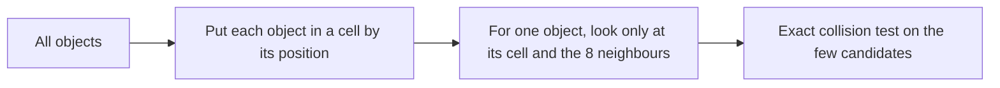

| Structure | Idea | Best for |
|---|---|---|
| **Uniform grid** | Fixed-size square cells; cell = `floor(x / size)` | Evenly spread objects of similar size (the example below) |
| **Quadtree** (2D) / **Octree** (3D) | Recursively split a crowded square into 4 (cube into 8) | Uneven density, a crowd in one corner |
| **k-d tree** | Split along alternating axes | Static points, nearest-neighbour queries |
| **BVH (bounding volume hierarchy)** | Tree of bounding boxes | Ray tracing, physics engines (Bullet, Box2D use dynamic AABB trees) |
| **BSP tree** | Split space by planes | Old 3D engines, static levels |
| **Sweep and prune** | Sort objects along an axis | Mostly-sliding objects |
| **R-tree** | Tree of rectangles, disk friendly | Databases and maps ([11_Domain_Specific_Pattern.md](11_Domain_Specific_Pattern.md#9-geospatial-patterns)) |

**Rule for grid cell size:** at least the largest object's diameter, so interactions can only reach the 8 neighbouring cells. Too small → objects span many cells; too large → too many objects per cell.

**The two phases:** *broad phase* uses the partition to find candidate pairs cheaply; *narrow phase* does the exact geometry test on those candidates.

## 5.4 Types and Variants

| Variant | Note |
|---|---|
| **Static partition** | World geometry that never moves (BSP, static grid) |
| **Dynamic partition** | Rebuilt or updated every frame for moving objects |
| **Loose grid / loose quadtree** | Cells overlap so objects don't need to move between cells at the boundary |
| **Hierarchical grid** | Several grids for different object sizes |
| **Interest management (MMO servers)** | Players only receive updates for objects in nearby cells |
| **Spatial hashing** | The grid stored in a hash map (as in the example), unbounded worlds |

## 5.5 Complete Java Example - 2 Million Pair Checks Reduced With a Uniform Grid (and the Crowd Pitfall)

**What it shows:** 2,000 small balls on a 1000 × 1000 map. Brute force compares all pairs; a uniform grid compares only balls in the same or neighbouring cells. Both find exactly the same collisions. Then 2,000 balls are packed into a 15 × 15 area to show where a uniform grid fails.

```java
import java.util.*;

public class SpatialDemo {

    record Ball(int id, double x, double y, double r) {
        boolean hits(Ball o) { double dx = x - o.x, dy = y - o.y, rr = r + o.r; return dx * dx + dy * dy <= rr * rr; }
    }

    static List<Ball> world(int n, long seed) {
        Random rnd = new Random(seed); List<Ball> out = new ArrayList<>();
        for (int i = 0; i < n; i++) out.add(new Ball(i, rnd.nextDouble() * 1000, rnd.nextDouble() * 1000, 2));
        return out;
    }

    public static void main(String[] args) {
        int n = 2000;
        List<Ball> balls = world(n, 17);

        // 1) brute force: compare every pair
        long checksBrute = 0; Set<String> hitsBrute = new TreeSet<>();
        for (int i = 0; i < n; i++) for (int j = i + 1; j < n; j++) {
            checksBrute++;
            if (balls.get(i).hits(balls.get(j))) hitsBrute.add(i + "-" + j);
        }

        // 2) uniform grid: bucket balls by cell; only compare balls in the same or neighbouring cells
        double cell = 20;                                                        // cell size >= largest possible interaction distance (2r = 4) is enough
        Map<Long, List<Ball>> grid = new HashMap<>();
        for (Ball b : balls) grid.computeIfAbsent(key((int) (b.x() / cell), (int) (b.y() / cell)), k -> new ArrayList<>()).add(b);
        long checksGrid = 0; Set<String> hitsGrid = new TreeSet<>();
        for (Ball b : balls) {
            int cx = (int) (b.x() / cell), cy = (int) (b.y() / cell);
            for (int dx = -1; dx <= 1; dx++) for (int dy = -1; dy <= 1; dy++) {
                for (Ball o : grid.getOrDefault(key(cx + dx, cy + dy), List.of())) {
                    if (o.id() <= b.id()) continue;                              // each pair once
                    checksGrid++;
                    if (b.hits(o)) hitsGrid.add(b.id() + "-" + o.id());
                }
            }
        }

        System.out.println(n + " balls on a 1000 x 1000 map");
        System.out.println("brute force : " + checksBrute + " pair checks, collisions found = " + hitsBrute.size());
        System.out.println("uniform grid: " + checksGrid + " pair checks, collisions found = " + hitsGrid.size());
        System.out.println("same collisions? " + hitsBrute.equals(hitsGrid) + "   work reduced by " + String.format("%.0f", (double) checksBrute / checksGrid) + "x");
        System.out.println("(first collisions: " + hitsGrid.stream().limit(3).toList() + ")");

        // 3) the pitfall: everything in one place (a crowd) makes the grid as slow as brute force
        List<Ball> crowd = new ArrayList<>();
        Random rnd = new Random(3);
        for (int i = 0; i < n; i++) crowd.add(new Ball(i, 500 + rnd.nextDouble() * 15, 500 + rnd.nextDouble() * 15, 2));
        Map<Long, List<Ball>> g2 = new HashMap<>();
        for (Ball b : crowd) g2.computeIfAbsent(key((int) (b.x() / cell), (int) (b.y() / cell)), k -> new ArrayList<>()).add(b);
        long checks2 = 0;
        for (Ball b : crowd) {
            int cx = (int) (b.x() / cell), cy = (int) (b.y() / cell);
            for (int dx = -1; dx <= 1; dx++) for (int dy = -1; dy <= 1; dy++) for (Ball o : g2.getOrDefault(key(cx + dx, cy + dy), List.of())) if (o.id() > b.id()) checks2++;
        }
        System.out.println("crowd of " + n + " balls packed in one 15 x 15 area: grid does " + checks2 + " checks (brute force " + checksBrute + ") -> use a quadtree, which subdivides crowded cells");
    }

    static long key(int cx, int cy) { return ((long) cx << 32) ^ (cy & 0xffffffffL); }
}
```

**Output** (identical on all 3 runs):

```text
2000 balls on a 1000 x 1000 map
brute force : 1999000 pair checks, collisions found = 86
uniform grid: 6989 pair checks, collisions found = 86
same collisions? true   work reduced by 286x
(first collisions: [1039-1613, 1046-1405, 1055-1409])
crowd of 2000 balls packed in one 15 x 15 area: grid does 1999000 checks (brute force 1999000) -> use a quadtree, which subdivides crowded cells
```

**What the output shows**
- **Same answer, far less work:** both find **86** collisions, with the identical set. Brute force needs **1,999,000** pair checks, the grid **6,989**, about **286× fewer**.
- **Crowd pitfall:** with all 2,000 balls in one 15 × 15 area they land in just a couple of cells, so the grid does **1,999,000** checks, the same as brute force. A uniform grid assumes an even spread. Quadtrees avoid this by subdividing only crowded cells.

## 5.6 Spatial Partition in Java

```java
// Quadtree sketch: split a node when it holds too many objects
class Quadtree {
    private static final int MAX = 8, MAX_DEPTH = 8;
    private final Rect bounds; private final int depth; private final List<Body> items = new ArrayList<>(); private Quadtree[] kids;

    void insert(Body b) {
        if (kids != null) { kids[indexFor(b)].insert(b); return; }
        items.add(b);
        if (items.size() > MAX && depth < MAX_DEPTH) { split(); items.forEach(i -> kids[indexFor(i)].insert(i)); items.clear(); }
    }
    void query(Rect area, List<Body> out) {                    // only descend into quadrants that overlap the query area
        if (!bounds.overlaps(area)) return;
        out.addAll(items); if (kids != null) for (Quadtree k : kids) k.query(area, out);
    }
}
```
Libraries: **JTS** (`STRtree`, `Quadtree`, `KdTree`: geometry indexes, widely used in GIS), **libGDX** (`Box2D` has dynamic AABB tree built in), **jMonkeyEngine** (scene graph with bounding volumes). Rebuild the dynamic structure every frame only when objects move a lot; otherwise update incrementally. Use **primitive collections** (fastutil's `Long2ObjectOpenHashMap`) for the grid in hot code to avoid boxing.

## 5.7 Pros and Cons

| Pros | Cons |
|---|---|
| Orders-of-magnitude fewer checks | Extra memory and maintenance per frame |
| Same results as brute force | Wrong structure for the data distribution (grid vs crowd) hurts |
| Used for collisions, vision, networking | Objects crossing cell boundaries need care |

## 5.8 Pitfalls, Interview Questions and Cheat Sheet

**Common pitfalls**
- Cell smaller than the objects, so interactions are missed across non-adjacent cells.
- Forgetting the 8 neighbouring cells (misses collisions at borders).
- Counting each pair twice (check `id > otherId`).
- Rebuilding a huge tree every frame.
- Uniform grid with clustered data.

**Interview questions**
1. *Why do games need spatial partitioning?* → To avoid O(n²) comparisons; only nearby objects can interact.
2. *Grid vs quadtree?* → Grid: simple and fast for evenly spread objects. Quadtree: adapts to uneven density.
3. *What are broad phase and narrow phase?* → Broad phase finds candidate pairs using the index; narrow phase tests exact shapes.
4. *How do you choose the cell size?* → At least the biggest interaction distance; tune against object density.
5. *Where else is this used?* → "Nearby drivers" geo-search (geohash), database R-trees, MMO interest management, ray tracing BVH.

**Cheat sheet**
```
n objects -> n^2/2 pair checks  =>  bucket by position, compare only the cell + 8 neighbours
Broad phase (index) then narrow phase (exact test)
Uniform grid: even spread;  quadtree/octree: uneven;  BVH/AABB tree: physics/ray tracing
Cell size >= largest interaction distance; count each pair once
```

### 📘 Terms Explained

| Term | Meaning |
|---|---|
| **Spatial partition** | Dividing space into regions for fast "what is near here?" queries |
| **Broad phase / narrow phase** | Cheap candidate search / exact collision test |
| **Uniform grid** | Equal square cells |
| **Quadtree / Octree** | A tree that splits a square / cube into 4 / 8 parts recursively |
| **AABB** | Axis-aligned bounding box |
| **BVH** | Bounding volume hierarchy: a tree of boxes |
| **Spatial hashing** | A grid stored in a hash map keyed by cell coordinates |
| **Interest management** | Sending a player only the updates about nearby objects |

---

# 6. Service Locator (Interview Imp - Java)

## 6.1 What Is It?

A **service locator** (#444) is a central registry where code can look up a shared **service** (audio, logging, input, file system) by its **interface**, without knowing the concrete class or how it was created.

```java
Audio audio = Locator.audio();      // who built it? which implementation? the caller doesn't know or care
audio.play("jump.wav");
```

The game starts up, registers the real implementations (`Locator.provide(new RealAudio())`), and the rest of the code just asks.

## 6.2 Why Do We Need It?

| Problem | How the locator helps |
|---|---|
| Services (audio, logging) are needed everywhere | No passing them through ten constructors |
| Want to swap implementations (silent audio for tests, logging decorator for debug) | Change one registration |
| The service may not exist yet | A **Null Object** default avoids `NullPointerException` |
| Singleton problems (hard-wired class, hidden global) | The locator holds an **interface**, not a concrete class |

## 6.3 How It Works

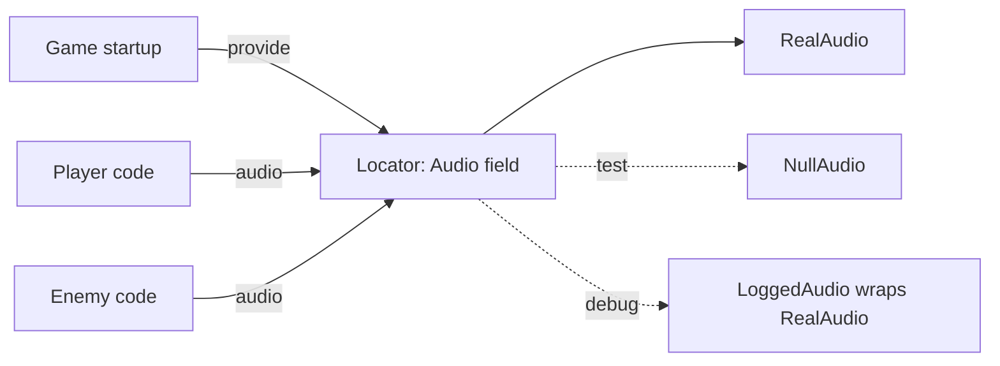

**Making it safe:** (1) keep a **Null Object** as the default so `audio()` never returns `null`; (2) `provide(null)` falls back to the null object; (3) register services at startup before use; (4) expose the interface, never the class.

## 6.4 Types and Variants

| Variant | Note |
|---|---|
| **Static locator** | Static `provide/get` methods (as in the example), simple, global |
| **Registry by key / type** | `locator.get(Audio.class)`, flexible |
| **Lazy service** | Created on first request |
| **Spring `ApplicationContext.getBean()`** | A service locator in disguise when called from your own code |
| **JNDI / `ServiceLoader`** | Java's own lookup mechanisms (`java.util.ServiceLoader`) |
| **Dependency Injection (DI)** | The alternative: dependencies are passed in (constructor), usually by a container (Spring) |

## 6.5 Complete Java Example - Provide, Replace, Decorate, Test and the Hidden-Dependency Problem

**What it shows:** a `Player` that uses `Locator.audio()`. The audio service is a Null Object at first, then the real one, then a logging decorator, then a silent test double. The last steps compare it to constructor injection and show that `provide(null)` is handled safely.

```java
import java.util.*;

public class LocatorDemo {

    interface Audio { String play(String sound); }
    static class RealAudio implements Audio { public String play(String s) { return "(speaker) playing " + s; } }
    static class NullAudio implements Audio { public String play(String s) { return "(silent) skipped " + s; } }          // Null Object: safe default
    static class LoggedAudio implements Audio {                                                                           // decorator added without touching callers
        final Audio inner; final List<String> log;
        LoggedAudio(Audio inner, List<String> log) { this.inner = inner; this.log = log; }
        public String play(String s) { log.add("play(" + s + ")"); return inner.play(s); }
    }

    // ---------- Service Locator: one global registry; code asks for what it needs ----------
    static class Locator {
        private static Audio audio = new NullAudio();                                // default so callers never get null
        static Audio audio() { return audio; }
        static void provide(Audio a) { audio = (a == null) ? new NullAudio() : a; }
    }

    static class Player {                                                           // knows nothing about which Audio it gets
        String jump() { return Locator.audio().play("jump.wav"); }
    }

    // ---------- Dependency injection: the dependency is visible in the constructor ----------
    static class InjectedPlayer {
        final Audio audio;
        InjectedPlayer(Audio audio) { this.audio = audio; }
        String jump() { return audio.play("jump.wav"); }
    }

    public static void main(String[] args) {
        Player p = new Player();
        System.out.println("1) before any setup (Null Object default): " + p.jump());

        Locator.provide(new RealAudio());
        System.out.println("2) game starts and registers the real audio : " + p.jump());

        List<String> log = new ArrayList<>();
        Locator.provide(new LoggedAudio(new RealAudio(), log));
        System.out.println("3) debug build wraps it with logging        : " + p.jump() + "   log=" + log);

        Locator.provide(new NullAudio());
        System.out.println("4) a unit test swaps in a silent service    : " + p.jump());

        // hidden dependency: nothing in Player's API says it needs Audio
        System.out.println("5) hidden dependency: new Player() compiles with no mention of Audio, but jump() depends on global state");
        InjectedPlayer ip = new InjectedPlayer(new RealAudio());
        System.out.println("   with injection the need is explicit: new InjectedPlayer(audio) -> " + ip.jump());

        // order problem
        Locator.provide(null);
        System.out.println("6) providing null falls back to the Null Object instead of a NullPointerException: " + p.jump());
    }
}
```

**Output** (identical on all 3 runs):

```text
1) before any setup (Null Object default): (silent) skipped jump.wav
2) game starts and registers the real audio : (speaker) playing jump.wav
3) debug build wraps it with logging        : (speaker) playing jump.wav   log=[play(jump.wav)]
4) a unit test swaps in a silent service    : (silent) skipped jump.wav
5) hidden dependency: new Player() compiles with no mention of Audio, but jump() depends on global state
   with injection the need is explicit: new InjectedPlayer(audio) -> (speaker) playing jump.wav
6) providing null falls back to the Null Object instead of a NullPointerException: (silent) skipped jump.wav
```

**What the output shows**
- **1:** before setup, the player still works: the default Null Object ignores the call (no `NullPointerException`).
- **2–3:** the real service is registered, then wrapped with a logging decorator. `Player` never changed.
- **4:** a unit test makes the whole game silent with one line.
- **5:** the downside: `new Player()` compiles with no hint that it needs audio. The dependency is **hidden** in the method body, and the global state is shared by every test unless reset. The `InjectedPlayer` version makes the need explicit in its constructor.
- **6:** `provide(null)` is converted into the Null Object.

## 6.6 Service Locator vs Dependency Injection in Java and Spring

```java
// Service Locator: the class pulls what it needs (hidden dependency)
class OrderService {
    void place(Order o) { Mailer m = ServiceLocator.get(Mailer.class); m.send(o); }       // can't see the need from outside
}

// Dependency Injection: the class declares what it needs (explicit dependency)
@Service
class OrderService {
    private final Mailer mailer;
    OrderService(Mailer mailer) { this.mailer = mailer; }             // Spring supplies it; tests pass a mock
}

// Spring's ApplicationContext.getBean(Mailer.class) inside your own code IS a service locator: avoid it in business code.
// Legit uses: framework glue, plugin lookup with java.util.ServiceLoader, a few cross-cutting services in a small game.
```
Game engines: libGDX exposes `Gdx.graphics`, `Gdx.audio`, `Gdx.input` as static service-locator fields; jMonkeyEngine uses `AppState`s and `Application` accessors. In large Java applications prefer DI; in a small game with a handful of global services a locator is often pragmatic.

## 6.7 Pros and Cons

| | Service Locator | Dependency Injection |
|---|---|---|
| Pros | Simple, no container, services available anywhere, easy to swap | Dependencies explicit, easy to test, compile-time checkable |
| Cons | Hidden dependencies, global mutable state, order-of-initialisation bugs, tests can interfere with each other | Needs wiring (container or manual); long constructors reveal design problems (which is also a benefit) |

## 6.8 Pitfalls, Interview Questions and Cheat Sheet

**Common pitfalls**
- Using the locator before a service is registered.
- Tests that leave a fake service registered (leaks into the next test). Reset in `@AfterEach`.
- Locating **concrete classes** instead of interfaces.
- Calling the locator in hot loops (cache the reference).
- Using `ApplicationContext.getBean` everywhere in a Spring app.
- Thread-safety of the registry (make it `volatile` / use a concurrent map).

**Interview questions**
1. *What is the Service Locator pattern?* → A registry that code queries to obtain services by interface.
2. *Service Locator vs Dependency Injection?* → A locator makes the class **pull** its dependencies (hidden); DI **pushes** them in (explicit). DI is easier to test and reason about.
3. *Why is the Service Locator called an anti-pattern by some?* → Hidden dependencies, global state, harder testing, runtime failures instead of compile-time.
4. *When is it acceptable?* → Small applications, games with a few global services, plugin discovery (`ServiceLoader`), and legacy code you can't re-wire.
5. *How do you avoid null in a locator?* → Default Null Object service.
6. *Is Spring's `getBean` a service locator?* → Yes, when used from application code.

**Cheat sheet**
```
Locator: static provide(interface impl) / get(); default = Null Object; swap for tests/debug
Pros: global access + swappable.  Cons: hidden dependencies, global state
DI: constructor injection = explicit dependencies (prefer this)
Spring getBean(...) in business code = locator = avoid;  java.util.ServiceLoader = standard Java locator
```

### 📘 Terms Explained

| Term | Meaning |
|---|---|
| **Service** | A shared capability: audio, logging, file access |
| **Service Locator** | A registry used to find services |
| **Null Object** | A do-nothing implementation used instead of `null` |
| **Dependency Injection** | Giving an object its dependencies from outside |
| **Hidden dependency** | A need that doesn't appear in the class's constructor or method signature |
| **Decorator** | A wrapper that adds behaviour (logging) around a service |
| **Global state** | Data reachable from anywhere and changeable by anyone |
| **`ServiceLoader`** | Java's built-in way to discover implementations of an interface |

---

# 7. State Pattern for AI and Behavior Trees

## 7.1 What Are They?

Game characters (enemies, NPCs) need to **decide what to do**. Two classic ways:

- **State pattern / Finite State Machine (FSM) (#446):** the character is in **exactly one state** (Patrol, Chase, Attack, Flee). Each state defines the behaviour and the **transitions** to other states under certain conditions.
- **Behavior tree (#447):** a tree of tasks evaluated **from the root every tick**. Inner nodes control flow, leaves are conditions and actions. The first branch that succeeds decides the action.

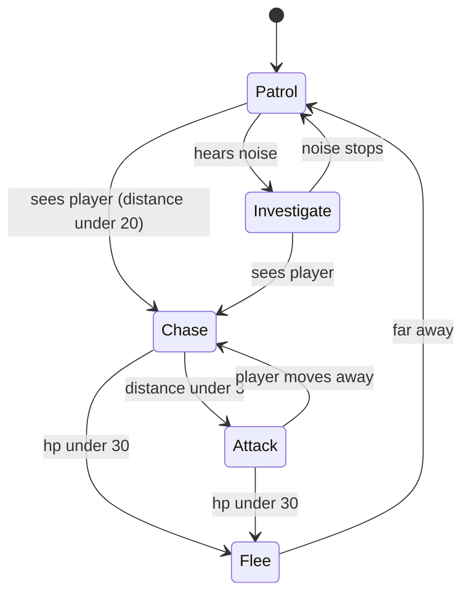

## 7.2 Why Do We Need Them?

| Without a pattern | With it |
|---|---|
| A giant `if/else` ladder inside `update()`, with flags like `isChasing`, `wasHit`, `isFleeing` | Named states, clear transitions |
| Adding "investigate noise" touches ten places | FSM: one new state + its transitions. Tree: one new branch |
| Designers can't read the logic | Behavior trees can be drawn and edited visually |

## 7.3 How It Works

**FSM:** `state = state.next(world)` each tick; `state.update()` does the work. Transitions are edges. The number of edges can grow quickly (n states → up to n² transitions).

**Behavior tree** node types:

| Node | Behaviour |
|---|---|
| **Action (leaf)** | Do something: `Chase`, `Attack` |
| **Condition (leaf)** | Test something: `hp < 30?` returns success/failure |
| **Sequence** (AND) | Run children in order; stop at the first failure; succeeds if all succeed |
| **Selector / Fallback** (OR) | Try children in order; stop at the first success |
| **Decorator** | Modify a child: `Inverter`, `Repeat`, `Cooldown` |
| **Parallel** | Run several children together |
| Result | Each tick returns SUCCESS, FAILURE or RUNNING (long actions) |

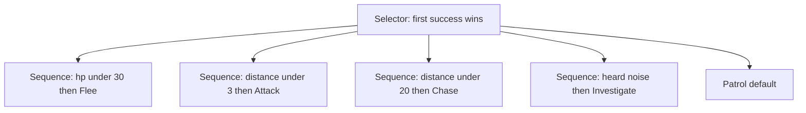

The order of the selector's children is the **priority**: fleeing beats attacking beats chasing.

## 7.4 Types and Variants

| Variant | Note |
|---|---|
| **Enum + switch FSM** | Simple (the example); fine for a few states |
| **State objects (GoF State pattern)** | Each state is a class with `enter/update/exit` ([04_Behavioral_Pattern.md](../01_LLD/04_Behavioral_Pattern.md)) |
| **Hierarchical FSM** | States contain sub-states (Combat → Chase/Attack) |
| **Pushdown automaton** | A stack of states ("return to what I was doing") |
| **Behavior tree** | Reactive, modular, reusable subtrees |
| **GOAP (Goal-Oriented Action Planning)** | The AI plans a sequence of actions to reach a goal |
| **Utility AI** | Score every option; pick the highest |
| **Blackboard** | Shared memory the tree reads and writes (target, last known position) |
| **Libraries** | **gdx-ai** (libGDX: FSM, behavior trees, steering, pathfinding), Spring State Machine (business workflows, not games) |

## 7.5 Complete Java Example - The Same Guard Written as an FSM and as a Behavior Tree

**What it shows:** one story (a player approaches, makes noise, attacks, the guard gets hurt, and the player runs away) fed to both an enum-based FSM and a behavior tree built with `selector`, `sequence`, `condition` and `act`. The two outputs are printed side by side.

```java
import java.util.*;
import java.util.function.*;

public class AiDemo {

    // The world as the guard sees it
    static class Guard {
        int hp = 100; double distanceToPlayer = 50; boolean heardNoise = false; String action = "";
    }

    // ===================== 1. State pattern: a finite state machine =====================
    enum State { PATROL, INVESTIGATE, CHASE, ATTACK, FLEE }

    static State next(State s, Guard g) {
        switch (s) {
            case PATROL:      if (g.distanceToPlayer < 20) return State.CHASE; if (g.heardNoise) return State.INVESTIGATE; return s;
            case INVESTIGATE: if (g.distanceToPlayer < 20) return State.CHASE; if (!g.heardNoise) return State.PATROL; return s;
            case CHASE:       if (g.hp < 30) return State.FLEE; if (g.distanceToPlayer < 3) return State.ATTACK; if (g.distanceToPlayer > 40) return State.PATROL; return s;
            case ATTACK:      if (g.hp < 30) return State.FLEE; if (g.distanceToPlayer >= 3) return State.CHASE; return s;
            default:          if (g.distanceToPlayer > 60) return State.PATROL; return s;                    // FLEE
        }
    }

    // ===================== 2. Behavior tree =====================
    enum Status { SUCCESS, FAILURE }
    interface BT { Status tick(Guard g); }

    static BT condition(Predicate<Guard> p) { return g -> p.test(g) ? Status.SUCCESS : Status.FAILURE; }
    static BT act(String name) { return g -> { g.action = name; return Status.SUCCESS; }; }
    static BT sequence(BT... kids) { return g -> { for (BT k : kids) if (k.tick(g) == Status.FAILURE) return Status.FAILURE; return Status.SUCCESS; }; }    // all must succeed (AND)
    static BT selector(BT... kids) { return g -> { for (BT k : kids) if (k.tick(g) == Status.SUCCESS) return Status.SUCCESS; return Status.FAILURE; }; }   // first success wins (OR / priority)

    static final BT TREE = selector(
        sequence(condition(g -> g.hp < 30), act("FLEE")),
        sequence(condition(g -> g.distanceToPlayer < 3), act("ATTACK")),
        sequence(condition(g -> g.distanceToPlayer < 20), act("CHASE")),
        sequence(condition(g -> g.heardNoise), act("INVESTIGATE")),
        act("PATROL"));

    public static void main(String[] args) {
        // the same story for both implementations: {distance, hp, heardNoise}
        double[][] story = {
            {50, 100, 0}, {50, 100, 1}, {18, 100, 1}, {10, 100, 0}, {2, 100, 0}, {2, 25, 0}, {30, 25, 0}, {70, 25, 0}, {70, 25, 0}};
        System.out.println("step  distance  hp  noise   FSM state     behavior tree action");
        State s = State.PATROL;
        for (int i = 0; i < story.length; i++) {
            Guard g = new Guard(); g.distanceToPlayer = story[i][0]; g.hp = (int) story[i][1]; g.heardNoise = story[i][2] == 1;
            s = next(s, g);
            TREE.tick(g);
            System.out.printf("%4d  %8.0f  %3d  %5s   %-12s  %s%n", i + 1, g.distanceToPlayer, g.hp, g.heardNoise, s, g.action);
        }
        System.out.println();
        System.out.println("The FSM remembers its state between steps (INVESTIGATE only ends when the noise stops, FLEE lasts until distance > 60).");
        System.out.println("The behavior tree re-evaluates from the top every tick: priority order replaces explicit transitions, so adding a new behaviour is one new branch.");
    }
}
```

**Output** (identical on all 3 runs):

```text
step  distance  hp  noise   FSM state     behavior tree action
   1        50  100  false   PATROL        PATROL
   2        50  100   true   INVESTIGATE   INVESTIGATE
   3        18  100   true   CHASE         CHASE
   4        10  100  false   CHASE         CHASE
   5         2  100  false   ATTACK        ATTACK
   6         2   25  false   FLEE          FLEE
   7        30   25  false   FLEE          FLEE
   8        70   25  false   PATROL        FLEE
   9        70   25  false   PATROL        FLEE

The FSM remembers its state between steps (INVESTIGATE only ends when the noise stops, FLEE lasts until distance > 60).
The behavior tree re-evaluates from the top every tick: priority order replaces explicit transitions, so adding a new behaviour is one new branch.
```

**What the output shows**
- **Steps 1–7:** both give the same action: Patrol → Investigate (noise) → Chase (distance 18) → Chase (10) → Attack (2) → Flee (hp 25) → Flee (30 m away).
- **Steps 8–9 differ,** and the difference is the lesson. At distance 70 the FSM returns to **PATROL** (its Flee exit rule is "distance > 60"), although the guard still has only 25 hp. The behavior tree re-evaluates from the top each tick and its first rule is "hp < 30 → Flee", so it **keeps fleeing**. Neither is "wrong"; they encode different rules. The FSM needed an extra rule ("don't leave Flee until healed") to match the tree; the tree needed nothing, because **priority order** expresses it.
- **Maintenance:** adding "take cover when under fire" to the FSM means new transitions from several states. In the tree it is one new `sequence` placed at the right priority.

## 7.6 AI in Java (gdx-ai)

```java
// gdx-ai FSM with State objects
public enum GuardState implements State<Guard> {
    PATROL   { public void update(Guard g) { g.walkRoute(); if (g.seesPlayer()) g.fsm.changeState(CHASE); } },
    CHASE    { public void update(Guard g) { g.moveTowardsPlayer(); if (g.hp() < 30) g.fsm.changeState(FLEE); else if (g.closeToPlayer()) g.fsm.changeState(ATTACK); } },
    ATTACK   { public void update(Guard g) { g.hit(); if (!g.closeToPlayer()) g.fsm.changeState(CHASE); } },
    FLEE     { public void update(Guard g) { g.runAway(); if (g.farFromPlayer()) g.fsm.changeState(PATROL); } };
    public void enter(Guard g) {} public void exit(Guard g) {}
    public boolean onMessage(Guard g, Telegram t) { return false; }
}
DefaultStateMachine<Guard, GuardState> fsm = new DefaultStateMachine<>(guard, GuardState.PATROL);   // call fsm.update() each tick
```

```text
# gdx-ai behavior tree description file (.tree), editable by designers
import fleeIfHurt:"com.example.ai.FleeIfHurt"
root
  selector
    sequence
      fleeIfHurt hp:30
      flee
    sequence
      closeTo distance:3
      attack
    patrol
```
Tick the tree each frame: `behaviorTree.step()`. For long actions return RUNNING and resume next tick. Use a **blackboard** (the shared `Guard` object) for data, and **cooldown decorators** to stop flapping between actions.

## 7.7 Pros and Cons

| | FSM | Behavior tree |
|---|---|---|
| Pros | Simple, easy to debug, cheap, memory of the current state | Modular, reusable, reactive, priorities are explicit, easy for designers |
| Cons | Transition explosion as states grow, hard to reuse parts | Stateless by default (needs a blackboard for memory), more machinery, can be re-evaluated unnecessarily each tick |

## 7.8 Pitfalls, Interview Questions and Cheat Sheet

**Common pitfalls**
- FSMs with dozens of states and a web of transitions (switch to hierarchical FSM or behavior tree).
- Flip-flopping between states every tick (add hysteresis, minimum time in state, or a cooldown).
- A behavior tree with expensive conditions evaluated every frame.
- Forgetting `exit()` cleanup (stop sounds, release a target).
- Putting game rules in the tree (logic) instead of in actions/systems.

**Interview questions**
1. *FSM vs behavior tree?* → FSM: one current state with explicit transitions. Behavior tree: priority tree re-evaluated each tick, modular and reactive.
2. *What do Sequence and Selector do?* → Sequence = AND (stop at first failure). Selector = OR (stop at first success).
3. *Which GoF pattern is an FSM?* → State.
4. *How do you avoid state flip-flopping?* → Hysteresis (different enter/exit thresholds), minimum time in state, cooldown decorators.
5. *When use GOAP or utility AI?* → When behaviours should be chosen dynamically from many options, rather than authored as fixed priorities.
6. *Where else do FSMs appear?* → Order/payment workflows (Spring State Machine), protocol handlers, UI flows ([Payment states](11_Domain_Specific_Pattern.md#2-payment-gateway-pattern-interview-imp---java)).

**Cheat sheet**
```
FSM : exactly one state; transitions edges; State pattern (enter/update/exit); hierarchical FSM scales better
BT  : Selector (OR, priority), Sequence (AND), Condition, Action, Decorator; tick from root each frame
Share data via a blackboard; use cooldowns/hysteresis to avoid flapping
Libraries: gdx-ai (FSM, BT, steering, pathfinding)
```

### 📘 Terms Explained

| Term | Meaning |
|---|---|
| **FSM (finite state machine)** | A model with a fixed set of states and defined transitions |
| **Transition** | A rule for moving from one state to another |
| **Behavior tree** | A tree of tasks that decides an agent's action each tick |
| **Sequence / Selector** | A node that needs all children to succeed / the first child to succeed |
| **Blackboard** | Shared memory used by the nodes of an AI |
| **Hysteresis** | Using different thresholds to enter and leave a state, to avoid flapping |
| **GOAP** | Goal-Oriented Action Planning: the AI plans actions to reach a goal |
| **Utility AI** | Choosing the action with the highest computed score |
| **NPC** | Non-player character |

---

# 8. Steering Behaviors

## 8.1 What Are They?

**Steering behaviors** (#448, by Craig Reynolds) are small, simple movement rules that make characters move in a natural, lifelike way. Each rule produces a **steering force**; add some together and the character follows its goals while avoiding obstacles. Pathfinding (A*) answers *where to go*; steering answers *how to move there smoothly*.

| Behavior | What it does |
|---|---|
| **Seek** | Move towards a target |
| **Flee** | Move away from a threat |
| **Arrive** | Seek, but slow down near the target and stop |
| **Pursuit / Evade** | Seek / flee where the target *will be* (predict from its velocity) |
| **Wander** | Random smooth strolling |
| **Obstacle avoidance** | Steer around things ahead |
| **Separation / Alignment / Cohesion** | Flocking ("boids"): keep apart, face the same way, stay together |
| **Path following** | Stay near a line or route |

## 8.2 Why Do We Need Them?

| Naive movement | Problem |
|---|---|
| Teleport towards the target by a fixed step | Robotic; jittery |
| Set velocity directly to point at the target | Turns instantly, can't overshoot naturally |
| Hard-coded paths | Break when something is in the way |
| Flocks/crowds scripted by hand | Impossible to author at scale; steering gives **emergent** behaviour from three rules |

## 8.3 How It Works

Each frame:
1. Compute the **desired velocity**: where I would like to go and how fast.
2. **Steering force = desired velocity − current velocity**, clamped to a maximum force (so turns take time, like a real vehicle).
3. Add the force(s) (sometimes weighted) to the velocity; clamp to the maximum speed; move.

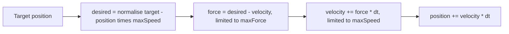

**Arrive** scales the desired speed by `distance / slowRadius` inside the slowing radius, so the force pulls the velocity down to zero exactly at the target. **Flee** is seek aimed at the point on the opposite side. **Combining:** `force = 1.0 * seek + 1.5 * avoidObstacles + 0.8 * separation`, then clamp. Priorities beat weights when behaviours conflict (avoidance first).

## 8.4 Types and Variants

| Variant | Note |
|---|---|
| **Individual (vehicle) steering** | Seek/flee/arrive/pursuit/evade/wander/avoid |
| **Group steering (flocking, boids)** | Separation + alignment + cohesion |
| **Context steering** | Score a ring of directions, pick the best (modern, robust) |
| **Navigation meshes + steering** | A* on a navmesh for the route, steering for local movement |
| **Crowd simulation** | RVO / ORCA collision avoidance for thousands of agents |
| **Physics-based vehicles** | Steering outputs throttle/steer inputs rather than forces |
| **Libraries** | **gdx-ai** steering behaviors (`Seek`, `Arrive`, `Wander`, `Flee`, `Pursue`, `CollisionAvoidance`, `PrioritySteering`, `BlendedSteering`) |

## 8.5 Complete Java Example - Seek vs Arrive and Flee With Vectors

**What it shows:** two agents (max speed 10 m/s, max force 8) travel to a target 100 m away. They are identical until they reach the 30 m slowing radius. The seeker overshoots; the arriver brakes and stops exactly on the target. A third agent flees from a hunter.

```java
public class SteeringDemo {

    record V(double x, double y) {
        V plus(V o) { return new V(x + o.x, y + o.y); }
        V minus(V o) { return new V(x - o.x, y - o.y); }
        V times(double k) { return new V(x * k, y * k); }
        double len() { return Math.sqrt(x * x + y * y); }
        V limit(double max) { double l = len(); return l > max ? times(max / l) : this; }
        V norm() { double l = len(); return l == 0 ? this : times(1 / l); }
    }

    static class Agent {
        V pos, vel = new V(0, 0); final double maxSpeed, maxForce;
        Agent(V pos, double maxSpeed, double maxForce) { this.pos = pos; this.maxSpeed = maxSpeed; this.maxForce = maxForce; }

        // steering force = desired velocity - current velocity (limited by maxForce so turns are gradual)
        V seek(V target) {
            V desired = target.minus(pos).norm().times(maxSpeed);
            return desired.minus(vel).limit(maxForce);
        }
        V flee(V threat) { return seek(pos.times(2).minus(threat)); }                      // seek the point opposite to the threat
        V arrive(V target, double slowRadius) {                                              // like seek, but slow down inside slowRadius
            V toTarget = target.minus(pos); double d = toTarget.len();
            double speed = d < slowRadius ? maxSpeed * d / slowRadius : maxSpeed;
            V desired = toTarget.norm().times(speed);
            return desired.minus(vel).limit(maxForce);
        }
        void step(V force, double dt) { vel = vel.plus(force.times(dt)).limit(maxSpeed); pos = pos.plus(vel.times(dt)); }
    }

    public static void main(String[] args) {
        V target = new V(100, 0);
        double dt = 0.1;

        Agent seeker = new Agent(new V(0, 0), 10, 8), arriver = new Agent(new V(0, 0), 10, 8);
        System.out.println("Both agents start at (0,0) and head for a target at (100,0). max speed 10, max force 8.");
        System.out.println("time   SEEK: x      speed     ARRIVE: x     speed");
        for (int i = 1; i <= 160; i++) {
            seeker.step(seeker.seek(target), dt);
            arriver.step(arriver.arrive(target, 30), dt);
            if (i % 20 == 0 || i == 160)
                System.out.printf("%4.1f s %9.2f %8.2f %12.2f %9.2f%n", i * dt, seeker.pos.x(), seeker.vel.len(), arriver.pos.x(), arriver.vel.len());
        }
        System.out.println("SEEK reaches the target at full speed, overshoots it (x passes 100) and has to swing back; ARRIVE brakes inside 30 m and stops at x = 100.");

        Agent prey = new Agent(new V(5, 0), 10, 8);
        V hunter = new V(0, 0);
        for (int i = 0; i < 40; i++) prey.step(prey.flee(hunter), dt);
        System.out.printf("FLEE: a prey at (5,0) running from a hunter at (0,0) is at (%.1f, %.1f) after 4 s, moving away along +x%n", prey.pos.x(), prey.pos.y());
    }
}
```

**Output** (identical on all 3 runs):

```text
Both agents start at (0,0) and head for a target at (100,0). max speed 10, max force 8.
time   SEEK: x      speed     ARRIVE: x     speed
 2.0 s     11.78     8.73        11.78      8.73
 4.0 s     30.78     9.85        30.78      9.85
 6.0 s     50.66     9.98        50.66      9.98
 8.0 s     70.64    10.00        70.64     10.00
10.0 s     90.64    10.00        87.61      6.45
12.0 s    106.24     2.00        96.17      2.63
14.0 s     97.78     4.29        99.22      0.79
16.0 s    102.44     2.23       100.00      0.15
SEEK reaches the target at full speed, overshoots it (x passes 100) and has to swing back; ARRIVE brakes inside 30 m and stops at x = 100.
FLEE: a prey at (5,0) running from a hunter at (0,0) is at (35.8, 0.0) after 4 s, moving away along +x
```

**What the output shows**
- **Up to 8 s** both columns are identical: far from the target, arrive behaves exactly like seek.
- **At 10 s** the arriver is already slowing (speed 6.45 vs 10.00) because it entered the 30 m radius.
- **12 s:** the seeker has **overshot** the target (x = 106.24) and has to turn around, since its force is limited. The arriver is at 96.17 m, moving at 2.63 m/s.
- **16 s:** the arriver sits at **100.00 m with speed 0.15**: it has arrived. The seeker is still circling around the target (102.44 m, speed 2.23).
- **Flee:** the prey runs away along +x; after 4 s it is at x = 35.8 (the speed limit 10 m/s minus the time spent turning/accelerating).

## 8.6 Steering in Java (gdx-ai)

```java
// gdx-ai: each behavior is an object; the character implements Steerable
Arrive<Vector2> arrive = new Arrive<>(npc, playerTarget)
        .setTimeToTarget(0.1f).setArrivalTolerance(0.5f).setDecelerationRadius(3f);
SteeringAcceleration<Vector2> out = new SteeringAcceleration<>(new Vector2());

void update(float dt) {
    arrive.calculateSteering(out);                         // fills 'out' with the linear acceleration
    npc.velocity.mulAdd(out.linear, dt).limit(npc.maxSpeed);
    npc.position.mulAdd(npc.velocity, dt);
}

// Combine behaviors with priorities: avoid obstacles first, otherwise arrive
PrioritySteering<Vector2> ps = new PrioritySteering<>(npc).add(avoidWalls).add(arrive);
```
A common stack: A* on a navigation mesh produces waypoints; the steering `FollowPath` or `Arrive` moves the agent between them; `Separation` stops crowds from overlapping.

## 8.7 Pros and Cons

| Pros | Cons |
|---|---|
| Natural, smooth movement from simple rules | Weights and priorities need tuning |
| Emergent group behaviour (flocks) | Local only: no global planning, can get stuck in dead ends (needs pathfinding) |
| Cheap: a few vector operations per agent | Combining many behaviors can produce jitter or cancel each other out |

## 8.8 Pitfalls, Interview Questions and Cheat Sheet

**Common pitfalls**
- No maximum force, so agents turn instantly and look robotic.
- Seek used for stopping at a target (oscillation); use Arrive.
- Normalising a zero-length vector (division by zero/NaN).
- Weighted blending of conflicting behaviours that cancel to zero; use priorities.
- Stuck behind concave obstacles (steering is local, add pathfinding).
- Frame-rate dependent forces (always multiply by `dt`).

**Interview questions**
1. *What is a steering behavior?* → A rule that turns a goal (go there, avoid that) into a force that changes the agent's velocity.
2. *Seek vs Arrive?* → Seek heads for the target at full speed and overshoots; Arrive slows down within a radius and stops.
3. *How does flocking emerge?* → Each boid follows separation, alignment and cohesion with nearby neighbours; the flock appears with no leader.
4. *Pathfinding vs steering?* → Pathfinding (A*) finds a route; steering moves along it smoothly and avoids local obstacles.
5. *How do you combine behaviours?* → Weighted blend, priority (first non-zero wins) or context maps.

**Cheat sheet**
```
desired = norm(target - pos) * maxSpeed ;  force = limit(desired - vel, maxForce) ; vel = limit(vel + force*dt, maxSpeed)
Arrive : desired speed scaled by dist / slowRadius inside the slow radius
Flee = seek the opposite point;  Pursuit = seek the predicted position
Flocking = separation + alignment + cohesion;  A* for the route, steering for the movement
```

### 📘 Terms Explained

| Term | Meaning |
|---|---|
| **Steering behavior** | A rule that produces a movement force from a goal |
| **Desired velocity** | The velocity the agent would like to have right now |
| **Steering force** | Desired velocity minus current velocity |
| **Boids** | Craig Reynolds' simulated birds, flocking from three simple rules |
| **Emergent behavior** | Complex group behaviour arising from simple individual rules |
| **Navigation mesh (navmesh)** | A map of walkable surfaces used for pathfinding |
| **A\*** | A popular shortest-path search algorithm |
| **Vector** | A pair (x, y) with direction and length |

---

# 9. Game Patterns and the Building Blocks They Reuse

| Game pattern | Reuses / is the same idea as | Detailed file |
|---|---|---|
| Game loop, Update Method | Scheduler, Template Method, Observer vs polling | [04_Behavioral_Pattern.md](../01_LLD/04_Behavioral_Pattern.md), [11_Concurrency_Pattern.md](../03_System_Design/11_Concurrency_Pattern.md) |
| Component pattern, ECS | Composition over inheritance, Decorator, Strategy, data-oriented design | [03_Structural_Pattern.md](../01_LLD/03_Structural_Pattern.md), [04_Behavioral_Pattern.md](../01_LLD/04_Behavioral_Pattern.md) |
| Double buffer | Copy-on-write, snapshot isolation (MVCC), producer/consumer hand-off | [05_Data_Management_Pattern.md](../03_System_Design/05_Data_Management_Pattern.md), [11_Concurrency_Pattern.md](../03_System_Design/11_Concurrency_Pattern.md) |
| Dirty flag | Cache invalidation, lazy loading, Hibernate dirty checking, UI re-render | [03_Performance_Pattern.md](../03_System_Design/03_Performance_Pattern.md), [02_Enterprise_Application_Pattern.md](../02_HLD/02_Enterprise_Application_Pattern.md) |
| Object pool | Connection/thread pools, Flyweight | [01_LLD_Design_Patterns.md](../01_LLD/01_LLD_Design_Patterns.md), [11_Concurrency_Pattern.md](../03_System_Design/11_Concurrency_Pattern.md) |
| Spatial partition | Geohash / quadtree / R-tree, sharding by region, consistent hashing | [11_Domain_Specific_Pattern.md](11_Domain_Specific_Pattern.md#9-geospatial-patterns), [07_Distributed_Systems_Pattern.md](../03_System_Design/07_Distributed_Systems_Pattern.md) |
| Service Locator | Dependency Injection, Registry, Null Object, Singleton | [02_Enterprise_Application_Pattern.md](../02_HLD/02_Enterprise_Application_Pattern.md), [02_Creational_Pattern.md](../01_LLD/02_Creational_Pattern.md) |
| FSM / State | State pattern, workflow engines, payment/booking state machines | [04_Behavioral_Pattern.md](../01_LLD/04_Behavioral_Pattern.md), [11_Domain_Specific_Pattern.md](11_Domain_Specific_Pattern.md) |
| Behavior tree | Chain of Responsibility, Composite, Strategy | [04_Behavioral_Pattern.md](../01_LLD/04_Behavioral_Pattern.md), [03_Structural_Pattern.md](../01_LLD/03_Structural_Pattern.md) |
| Steering behaviors | Vector maths; A* pathfinding; robotics control | |
| Game server tick, lock-step | Event sourcing (input log), deterministic replay | [05_Data_Management_Pattern.md](../03_System_Design/05_Data_Management_Pattern.md) |
| Client prediction, interpolation | Eventual consistency, optimistic UI | [07_Distributed_Systems_Pattern.md](../03_System_Design/07_Distributed_Systems_Pattern.md) |

**Coverage check (master list #436–448):** Game Loop (436) and Update Method (437) in Section 1; Component Pattern (438), ECS (439) and Data Locality (445) in Section 2; Double Buffer (440) and Dirty Flag (441) in Section 3; Object Pool (442) in Section 4; Spatial Partition (443) in Section 5; Service Locator (444) in Section 6; State Pattern for AI (446) and Behavior Tree (447) in Section 7; Steering Behaviors (448) in Section 8.

### 📘 Terms Explained

| Term | Meaning |
|---|---|
| **Building block** | A general pattern reused in a game solution |
| **Lock-step** | All machines simulate the same inputs in the same fixed steps |
| **Client-side prediction** | The client guesses the result of its own input before the server confirms |

---

# 10. How the Game Patterns Fit Together

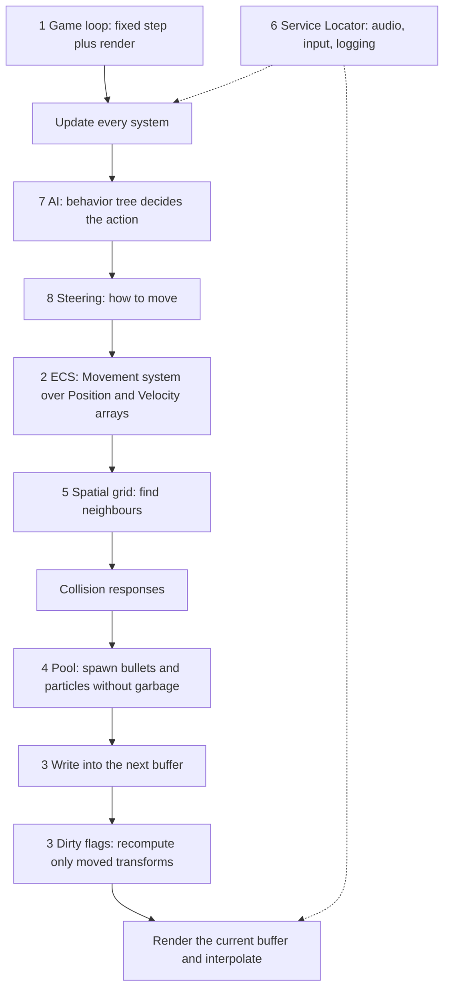

**One frame, step by step**
1. The **loop** gives the simulation exactly one fixed step.
2. **AI** (behavior tree / FSM) chooses what each character wants.
3. **Steering** converts the wish into a force and a velocity.
4. **ECS systems** move all entities by iterating tight arrays (data locality).
5. A **spatial grid** finds neighbours for collisions and for AI "sensing".
6. **Pools** supply new bullets and particles; finished ones return.
7. State is written to the **next buffer**; **dirty flags** limit transform updates.
8. The renderer draws the **current buffer** with **interpolation**; **services** (audio, input) are reached through the locator.

**Three rules shared by all game patterns**
- **Measure the frame budget** (16.7 ms at 60 FPS) and spend it carefully.
- **Avoid garbage and cache misses in hot loops** (pools, arrays, locality).
- **Keep simulation deterministic and separate from rendering.**

### 📘 Terms Explained

| Term | Meaning |
|---|---|
| **Frame budget** | The time available to do all the work of one frame |
| **Hot loop** | Code that runs every frame for many objects |
| **Deterministic** | Gives the same results from the same inputs every time |

---

# 11. Game Development Patterns Cheat Sheet

| Pattern | Core idea | Key rule | Java / library |
|---|---|---|---|
| **Game loop** | Input → update → render, forever | Fixed step + accumulator; cap updates | libGDX `render(delta)`, LWJGL |
| **Update Method** | Each object has `update(dt)` | Don't modify the list while iterating | Plain interfaces |
| **Component pattern** | Entity = parts | Composition over inheritance | Ashley, Artemis-odb |
| **ECS** | Entities ids, components data, systems logic | Contiguous arrays per component | Dominion, Ashley |
| **Data locality** | Lay out data for the CPU cache | SoA when a pass uses few fields; profile first | Primitive arrays, fastutil |
| **Double buffer** | Read current, write next, swap | Swap references, don't copy | `volatile`/`AtomicReference`, GL swap |
| **Dirty flag** | Recompute only when inputs changed | Propagate on change; clear on read | Scene graphs, Hibernate |
| **Object pool** **(Interview Imp - Java)** | Reuse objects | Reset fully; release in `finally` | libGDX `Pool`, Commons Pool, HikariCP |
| **Spatial partition** | Index space | Cell ≥ largest interaction; broad then narrow phase | JTS STRtree, Box2D, own grid |
| **Service Locator** **(Interview Imp - Java)** | Global registry of services | Interface + Null Object default; prefer DI | `ServiceLoader`, Spring `getBean` (avoid) |
| **State pattern (FSM)** | One state, explicit transitions | Hysteresis against flapping | gdx-ai `DefaultStateMachine` |
| **Behavior tree** | Priority tree ticked every frame | Selector = OR, Sequence = AND | gdx-ai behavior trees |
| **Steering behaviors** | Goal → force → velocity | Limit force; Arrive not Seek to stop | gdx-ai steering |

**Top interview one-liners**
```
Game loop: fixed update step with an accumulator, variable render with interpolation, cap updates to avoid the spiral of death
ECS: entities are ids, components are data, systems are logic; contiguous arrays (SoA) are cache-friendly
Double buffer: read the old state, write the new one, swap references; dirty flag: mark on change, recompute lazily on read
Object pool: create once, reset fully, release in finally; pool EXPENSIVE objects, measure first
Spatial partition: grid/quadtree for the broad phase, exact test for the narrow phase; a uniform grid fails on crowds
Service Locator hides dependencies and uses global state; Dependency Injection makes them explicit (prefer DI)
FSM = one state with transitions; behavior tree = priority tree re-evaluated each tick (Selector OR, Sequence AND)
Steering: force = desired velocity - velocity, limited; Arrive slows down, Seek overshoots
```

### 📘 Terms Explained

| Term | Meaning |
|---|---|
| **Interview one-liner** | A short, memorable answer you can expand on |
| **Cheat sheet** | A one-page summary for revision |
| **libGDX / jMonkeyEngine / LWJGL** | Popular Java game frameworks / 3D engine / low-level OpenGL bindings |
