---
mdx:
  format: md
---

# Domain-Specific Patterns (E-commerce, Payments, Booking, Trading, Social, Search, Recommendations, Money, Geo, Time Zones, i18n, Healthcare)

> **Note**: Patterns marked with **(Interview Imp - Java)** are frequently asked in Java interviews
>
> **How to read this file:** Every section ends with a **📘 Terms Explained** table. If you see a word you don't know, check the table right below that section. Each pattern goes from the basic idea to advanced usage (a plain-Java simulation, Spring Boot usage, pitfalls) and ends with interview questions and a mini cheat sheet.
>
> **What is this file about?** The master list's **Domain-Specific Patterns** (#449–461). These are the "design X" questions of system-design interviews: *design an online shop, a payment system, a hotel-booking site, a stock exchange, a news feed, a search engine, a recommender, a taxi app*. They also cover the small details that bite every real project: money, time zones, languages. Unlike the other files, these are not new low-level tricks. They are **recipes that combine the earlier patterns** (Saga, Outbox, Idempotency, Caching, Sharding, Queues) for one business area.
>
> **What lives elsewhere:** The building blocks are already explained in detail. Use these links instead of repeating them here: [Saga / Outbox / Event Sourcing](../03_System_Design/05_Data_Management_Pattern.md), [Idempotent Consumer / Dead Letter Queue](../03_System_Design/04_Messaging_Pattern.md), [Circuit Breaker / Retry / Timeout](../03_System_Design/02_Reliability_Pattern.md), [Caching / Sharding / Load Balancing](../03_System_Design/01_Scalability_Pattern.md), [Inverted index and BM25 inside a search engine](03_Data_Storage_Pattern.md#7-search-engines-interview-imp---java), [Multi-tenancy, Redis, graph databases](03_Data_Storage_Pattern.md). [Section 13](#13-domain-patterns-and-the-building-blocks-they-reuse) maps every domain to the patterns it reuses.
>
> **Verified code:** Every main "Complete Java Example" in this file is **plain Java 17 (no libraries)** and was compiled and run **three times** with identical output. The two examples that use threads (flash sale, double booking) print counts that are the same every run because they test a guarantee ("exactly 10 succeed"), not timing. To run one, save it as `<ClassName>.java` and run `javac <ClassName>.java && java <ClassName>`. Spring Boot, Redis, JPA, Kafka and other library snippets are configuration/usage examples and were **not** executed.

---

## Table of Contents
- [Big Picture: Which Patterns Does Each Domain Lean On?](#big-picture-which-patterns-does-each-domain-lean-on)
1. [E-Commerce Patterns: Cart, Inventory, Checkout](#1-e-commerce-patterns-cart-inventory-checkout-interview-imp---java) **(Interview Imp - Java)**
   - [1.1 What Are E-Commerce Patterns?](#11-what-are-e-commerce-patterns)
   - [1.2 Why Do We Need Them?](#12-why-do-we-need-them)
   - [1.3 How It Works](#13-how-it-works)
   - [1.4 Types and Variants](#14-types-and-variants)
   - [1.5 Complete Java Example - Flash Sale, Reservation Expiry and Price Re-Check](#15-complete-java-example---flash-sale-reservation-expiry-and-price-re-check)
   - [1.6 E-Commerce in Spring Boot](#16-e-commerce-in-spring-boot)
   - [1.7 Pros and Cons](#17-pros-and-cons)
   - [1.8 Pitfalls, Interview Questions and Cheat Sheet](#18-pitfalls-interview-questions-and-cheat-sheet)
2. [Payment Gateway Pattern](#2-payment-gateway-pattern-interview-imp---java) **(Interview Imp - Java)**
   - [2.1 What Is the Payment Gateway Pattern?](#21-what-is-the-payment-gateway-pattern)
   - [2.2 Why Do We Need It?](#22-why-do-we-need-it)
   - [2.3 How It Works](#23-how-it-works)
   - [2.4 Types and Variants](#24-types-and-variants)
   - [2.5 Complete Java Example - Idempotency Key, State Machine and Signed Webhooks](#25-complete-java-example---idempotency-key-state-machine-and-signed-webhooks)
   - [2.6 Payments in Spring Boot](#26-payments-in-spring-boot)
   - [2.7 Pros and Cons](#27-pros-and-cons)
   - [2.8 Pitfalls, Interview Questions and Cheat Sheet](#28-pitfalls-interview-questions-and-cheat-sheet)
3. [Booking and Reservation Systems](#3-booking-and-reservation-systems)
   - [3.1 What Is a Booking System?](#31-what-is-a-booking-system)
   - [3.2 Why Do We Need It?](#32-why-do-we-need-it)
   - [3.3 How It Works](#33-how-it-works)
   - [3.4 Types and Variants](#34-types-and-variants)
   - [3.5 Complete Java Example - Holds, Expiry, Back-to-Back Stays and 20 Simultaneous Requests](#35-complete-java-example---holds-expiry-back-to-back-stays-and-20-simultaneous-requests)
   - [3.6 Booking in Spring Boot](#36-booking-in-spring-boot)
   - [3.7 Pros and Cons](#37-pros-and-cons)
   - [3.8 Pitfalls, Interview Questions and Cheat Sheet](#38-pitfalls-interview-questions-and-cheat-sheet)
4. [Financial Trading Patterns: Order Matching and Settlement](#4-financial-trading-patterns-order-matching-and-settlement)
   - [4.1 What Are Trading Patterns?](#41-what-are-trading-patterns)
   - [4.2 Why Do We Need Them?](#42-why-do-we-need-them)
   - [4.3 How It Works](#43-how-it-works)
   - [4.4 Types and Variants](#44-types-and-variants)
   - [4.5 Complete Java Example - A Tiny Matching Engine with Price-Time Priority and Net Settlement](#45-complete-java-example---a-tiny-matching-engine-with-price-time-priority-and-net-settlement)
   - [4.6 Trading in Java and Spring](#46-trading-in-java-and-spring)
   - [4.7 Pros and Cons](#47-pros-and-cons)
   - [4.8 Pitfalls, Interview Questions and Cheat Sheet](#48-pitfalls-interview-questions-and-cheat-sheet)
5. [Social Network Patterns: Feed, Follow, Notifications](#5-social-network-patterns-feed-follow-notifications)
   - [5.1 What Are Social Network Patterns?](#51-what-are-social-network-patterns)
   - [5.2 Why Do We Need Them?](#52-why-do-we-need-them)
   - [5.3 How It Works](#53-how-it-works)
   - [5.4 Types and Variants](#54-types-and-variants)
   - [5.5 Complete Java Example - Push vs Pull vs Hybrid Cost](#55-complete-java-example---push-vs-pull-vs-hybrid-cost)
   - [5.6 Social Feed in Spring Boot](#56-social-feed-in-spring-boot)
   - [5.7 Pros and Cons](#57-pros-and-cons)
   - [5.8 Pitfalls, Interview Questions and Cheat Sheet](#58-pitfalls-interview-questions-and-cheat-sheet)
6. [Search Engine Patterns: Crawl, Index, Rank](#6-search-engine-patterns-crawl-index-rank)
   - [6.1 What Are Search Engine Patterns?](#61-what-are-search-engine-patterns)
   - [6.2 Why Do We Need It?](#62-why-do-we-need-it)
   - [6.3 How It Works](#63-how-it-works)
   - [6.4 Types and Variants](#64-types-and-variants)
   - [6.5 Complete Java Example - Crawler Frontier, URL Normalising and PageRank](#65-complete-java-example---crawler-frontier-url-normalising-and-pagerank)
   - [6.6 Search in Java and Spring](#66-search-in-java-and-spring)
   - [6.7 Pros and Cons](#67-pros-and-cons)
   - [6.8 Pitfalls, Interview Questions and Cheat Sheet](#68-pitfalls-interview-questions-and-cheat-sheet)
7. [Recommendation Systems](#7-recommendation-systems)
   - [7.1 What Is a Recommendation System?](#71-what-is-a-recommendation-system)
   - [7.2 Why Do We Need It?](#72-why-do-we-need-it)
   - [7.3 How It Works](#73-how-it-works)
   - [7.4 Types and Variants](#74-types-and-variants)
   - [7.5 Complete Java Example - User-Based CF, Content-Based Tags and Cold Start](#75-complete-java-example---user-based-cf-content-based-tags-and-cold-start)
   - [7.6 Recommendations in Java and Spring](#76-recommendations-in-java-and-spring)
   - [7.7 Pros and Cons](#77-pros-and-cons)
   - [7.8 Pitfalls, Interview Questions and Cheat Sheet](#78-pitfalls-interview-questions-and-cheat-sheet)
8. [Multi-Currency Pattern](#8-multi-currency-pattern-interview-imp---java) **(Interview Imp - Java)**
   - [8.1 What Is the Multi-Currency Pattern?](#81-what-is-the-multi-currency-pattern)
   - [8.2 Why Do We Need It?](#82-why-do-we-need-it)
   - [8.3 How It Works](#83-how-it-works)
   - [8.4 Types and Variants](#84-types-and-variants)
   - [8.5 Complete Java Example - Money Value Object, Allocation, Rounding and FX](#85-complete-java-example---money-value-object-allocation-rounding-and-fx)
   - [8.6 Multi-Currency in Spring Boot](#86-multi-currency-in-spring-boot)
   - [8.7 Pros and Cons](#87-pros-and-cons)
   - [8.8 Pitfalls, Interview Questions and Cheat Sheet](#88-pitfalls-interview-questions-and-cheat-sheet)
9. [Geospatial Patterns](#9-geospatial-patterns)
   - [9.1 What Are Geospatial Patterns?](#91-what-are-geospatial-patterns)
   - [9.2 Why Do We Need It?](#92-why-do-we-need-it)
   - [9.3 How It Works](#93-how-it-works)
   - [9.4 Types and Variants](#94-types-and-variants)
   - [9.5 Complete Java Example - Haversine, a Geohash Encoder and the Boundary Pitfall](#95-complete-java-example---haversine-a-geohash-encoder-and-the-boundary-pitfall)
   - [9.6 Geospatial in Java and Spring](#96-geospatial-in-java-and-spring)
   - [9.7 Pros and Cons](#97-pros-and-cons)
   - [9.8 Pitfalls, Interview Questions and Cheat Sheet](#98-pitfalls-interview-questions-and-cheat-sheet)
10. [Time-Zone Handling](#10-time-zone-handling-interview-imp---java) **(Interview Imp - Java)**
   - [10.1 What Is Time-Zone Handling?](#101-what-is-time-zone-handling)
   - [10.2 Why Do We Need It?](#102-why-do-we-need-it)
   - [10.3 How It Works](#103-how-it-works)
   - [10.4 Types and Variants](#104-types-and-variants)
   - [10.5 Complete Java Example - Offsets, DST Gaps and Overlaps, and the LocalDateTime Trap](#105-complete-java-example---offsets-dst-gaps-and-overlaps-and-the-localdatetime-trap)
   - [10.6 Time Zones in Spring Boot and the Database](#106-time-zones-in-spring-boot-and-the-database)
   - [10.7 Pros and Cons](#107-pros-and-cons)
   - [10.8 Pitfalls, Interview Questions and Cheat Sheet](#108-pitfalls-interview-questions-and-cheat-sheet)
11. [Internationalization (i18n) and Localization (l10n)](#11-internationalization-i18n-and-localization-l10n-interview-imp---java) **(Interview Imp - Java)**
   - [11.1 What Are i18n and l10n?](#111-what-are-i18n-and-l10n)
   - [11.2 Why Do We Need It?](#112-why-do-we-need-it)
   - [11.3 How It Works](#113-how-it-works)
   - [11.4 Types and Variants](#114-types-and-variants)
   - [11.5 Complete Java Example - Bundles, Plurals, Number/Currency/Date Formats and the Turkish-i Bug](#115-complete-java-example---bundles-plurals-numbercurrencydate-formats-and-the-turkish-i-bug)
   - [11.6 i18n in Spring Boot](#116-i18n-in-spring-boot)
   - [11.7 Pros and Cons](#117-pros-and-cons)
   - [11.8 Pitfalls, Interview Questions and Cheat Sheet](#118-pitfalls-interview-questions-and-cheat-sheet)
12. [Healthcare Data Exchange: HL7 and FHIR](#12-healthcare-data-exchange-hl7-and-fhir)
   - [12.1 What Is Healthcare Data Exchange?](#121-what-is-healthcare-data-exchange)
   - [12.2 Why Do We Need It?](#122-why-do-we-need-it)
   - [12.3 How It Works](#123-how-it-works)
   - [12.4 Types and Variants](#124-types-and-variants)
   - [12.5 Complete Java Example - Parse an HL7 v2 Message, Build an ACK and Map to FHIR](#125-complete-java-example---parse-an-hl7-v2-message-build-an-ack-and-map-to-fhir)
   - [12.6 Healthcare Integration in Java and Spring](#126-healthcare-integration-in-java-and-spring)
   - [12.7 Pros and Cons](#127-pros-and-cons)
   - [12.8 Pitfalls, Interview Questions and Cheat Sheet](#128-pitfalls-interview-questions-and-cheat-sheet)
13. [Domain Patterns and the Building Blocks They Reuse](#13-domain-patterns-and-the-building-blocks-they-reuse)
14. [How the Domain Patterns Fit Together](#14-how-the-domain-patterns-fit-together)
15. [Domain-Specific Patterns Cheat Sheet](#15-domain-specific-patterns-cheat-sheet)

---

## Big Picture: Which Patterns Does Each Domain Lean On?

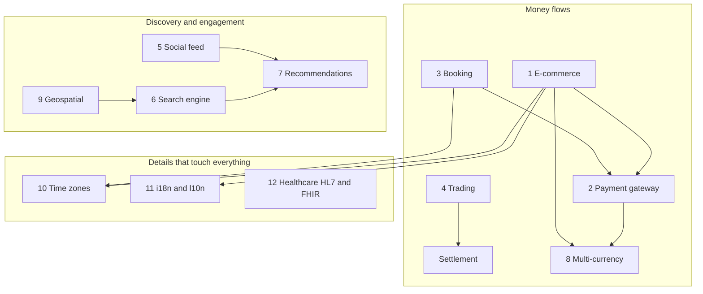

| Domain | The core difficulty | Pattern that solves it | Where it is explained |
|---|---|---|---|
| **E-commerce** | Selling the last item twice | Reserve stock with expiry | [Section 1](#1-e-commerce-patterns-cart-inventory-checkout-interview-imp---java) |
| **Payments** | Charging twice, lost callbacks | Idempotency key, state machine, signed webhooks | [Section 2](#2-payment-gateway-pattern-interview-imp---java) |
| **Booking** | Two people book the same slot | Atomic check-and-insert, holds with expiry | [Section 3](#3-booking-and-reservation-systems) |
| **Trading** | Fair, fast order matching | Order book with price-time priority | [Section 4](#4-financial-trading-patterns-order-matching-and-settlement) |
| **Social feed** | One post, millions of followers | Fan-out on write / read / hybrid | [Section 5](#5-social-network-patterns-feed-follow-notifications) |
| **Search engine** | Billions of pages | Crawl, inverted index, rank (PageRank + text) | [Section 6](#6-search-engine-patterns-crawl-index-rank) |
| **Recommendations** | "What will this user like?" | Collaborative + content-based filtering | [Section 7](#7-recommendation-systems) |
| **Multi-currency** | Rounding errors, JPY vs KWD | Money in minor units, `BigDecimal`, allocate | [Section 8](#8-multi-currency-pattern-interview-imp---java) |
| **Geospatial** | "Nearest driver" at scale | Geohash / quadtree index + exact distance | [Section 9](#9-geospatial-patterns) |
| **Time zones** | DST, "09:00 every day" | Store UTC `Instant`, zone for display | [Section 10](#10-time-zone-handling-interview-imp---java) |
| **i18n / l10n** | Many languages, formats | Locale + message bundles, never hard-code | [Section 11](#11-internationalization-i18n-and-localization-l10n-interview-imp---java) |
| **Healthcare** | Hospitals speak different formats | HL7 v2 messages, FHIR REST resources | [Section 12](#12-healthcare-data-exchange-hl7-and-fhir) |

### 📘 Terms Explained

| Term | Meaning |
|---|---|
| **Domain-specific pattern** | A reusable solution to a problem that appears in one business area (shops, banks, hospitals) |
| **System-design interview** | An interview where you design a whole product (components, data, scaling) on a whiteboard |
| **Source of truth** | The one store whose data wins when copies disagree |
| **Settlement** | The step after a trade or payment where money and ownership really change hands |
| **Minor unit** | The smallest piece of a currency: cent, paisa, yen |

---

# 1. E-Commerce Patterns: Cart, Inventory, Checkout (Interview Imp - Java)

## 1.1 What Are E-Commerce Patterns?

An online shop looks simple (browse, add to cart, pay), but four small problems hide inside it:

1. **Cart:** where do you keep "things I might buy" for a guest who isn't logged in?
2. **Inventory:** 10 phones are left and 50 people click *Buy*. Who gets them?
3. **Price:** the price changed between *add to cart* and *pay*. Which one is charged?
4. **Order:** the customer's phone dies during payment and they retry. Do they get two orders?

The standard answers are a **cart store**, **stock reservation with an expiry**, **price re-check at checkout** and an **idempotent order creation**.

## 1.2 Why Do We Need Them?

| Without the pattern | What goes wrong |
|---|---|
| Check stock, then decrement in two steps | Two buyers both see "1 left" and both succeed → **overselling** |
| Deduct stock only after payment | Customer pays for an item that is gone → refund + angry customer |
| Deduct stock when added to cart and never release it | Abandoned carts hide your stock from real buyers |
| Charge the price stored in the cart | Customer pays an old (or a wrong) price |
| No order idempotency | Retry creates a second order and a second charge |

## 1.3 How It Works

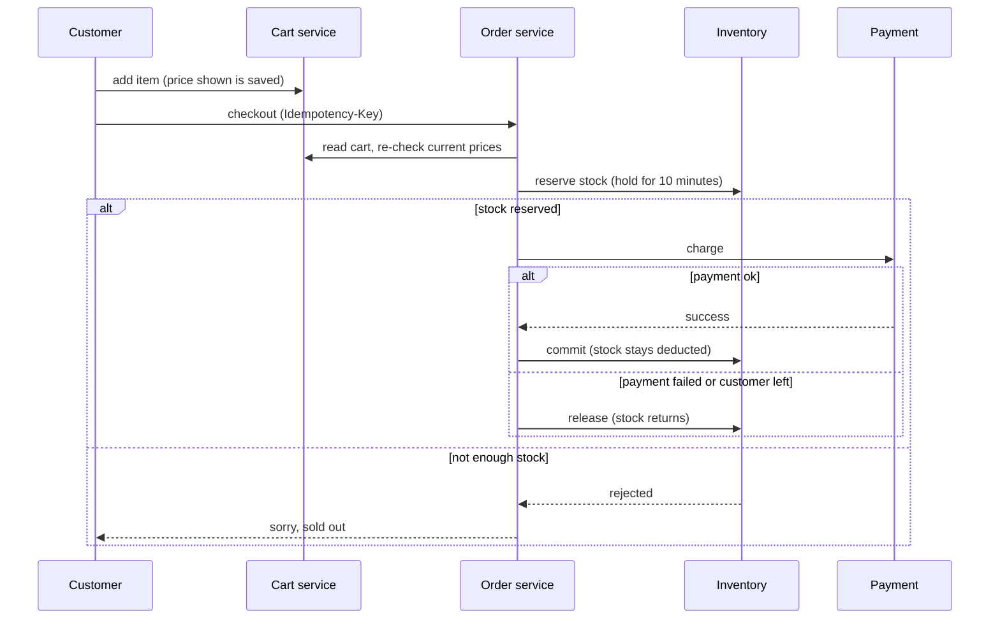

**Where each kind of data usually lives**

| Data | Store | Why |
|---|---|---|
| Product catalogue | Document DB + search index | Flexible attributes, full-text search ([03_Data_Storage_Pattern.md](03_Data_Storage_Pattern.md)) |
| Cart | Redis (hash per user) or a DB row | Fast, expires by itself, merged on login |
| Inventory | Relational DB (or Redis counters with a DB behind) | Needs atomic "decrement if enough" |
| Orders and payments | Relational DB | ACID, reporting, audit |

## 1.4 Types and Variants

| Stock model | When stock is deducted | Risk | Use when |
|---|---|---|---|
| **No reservation** | At payment | Overselling | Very large stock, apologising is cheap |
| **Soft reserve at cart** | When item is added | Abandoned carts block stock | Rare, limited drops with short cart TTL |
| **Hard reserve at checkout (recommended)** | When checkout starts, with a TTL | Needs an expiry job | Most shops |
| **Two-phase: reserve then commit** | Reserve at checkout, commit on payment | More states to manage | Payments with redirects (UPI, 3-D Secure) |

Other variants: **guest cart merge** (merge the anonymous cart into the user's cart after login), **flash-sale queue** (put buyers in a queue so the database sees a trickle, not a flood, see [Queue-Based Load Leveling](01_Cloud_Native_Pattern.md)), **order saga** (order → payment → shipping, each step undoable, see [Saga](../03_System_Design/05_Data_Management_Pattern.md)).

## 1.5 Complete Java Example - Flash Sale, Reservation Expiry and Price Re-Check

**What it shows:** 50 threads fight for 10 phones (exactly 10 win), unpaid reservations expire and return the stock, and the cart price is re-checked at checkout.

```java
import java.util.*;
import java.util.concurrent.*;
import java.util.concurrent.atomic.*;

public class EcommerceDemo {

    // ---------- Inventory with reservations (hold stock while the customer pays) ----------
    static class Inventory {
        record Reservation(String id, String sku, int qty, long expiresAt) {}
        private final Map<String, AtomicInteger> available = new ConcurrentHashMap<>();
        private final Map<String, Reservation> held = new ConcurrentHashMap<>();

        void add(String sku, int qty) { available.put(sku, new AtomicInteger(qty)); }

        boolean reserve(String id, String sku, int qty, long now, long ttl) {
            AtomicInteger stock = available.get(sku);
            while (true) {                                   // compare-and-set loop: never goes below 0
                int cur = stock.get();
                if (cur < qty) return false;
                if (stock.compareAndSet(cur, cur - qty)) {
                    held.put(id, new Reservation(id, sku, qty, now + ttl));
                    return true;
                }
            }
        }
        void commit(String id)  { held.remove(id); }         // sold: stock stays deducted
        void release(String id) {                            // cancelled/expired: give stock back
            Reservation r = held.remove(id);
            if (r != null) available.get(r.sku()).addAndGet(r.qty());
        }
        int expire(long now) {
            int n = 0;
            for (Reservation r : new ArrayList<>(held.values()))
                if (r.expiresAt() <= now) { release(r.id()); n++; }
            return n;
        }
        int available(String sku) { return available.get(sku).get(); }
    }

    // ---------- Cart: store the price you SHOWED, re-check the price at checkout ----------
    record Line(String sku, int qty, long priceShownCents) {}

    static long total(List<Line> cart) {
        long t = 0;
        for (Line l : cart) t += l.qty() * l.priceShownCents();
        return t;
    }
    static String money(long cents) { return String.format("%d.%02d", cents / 100, cents % 100); }

    public static void main(String[] args) throws Exception {
        // 1) Flash sale: 10 units, 50 buyers at the same moment
        Inventory inv = new Inventory();
        inv.add("PHONE", 10);
        ExecutorService pool = Executors.newFixedThreadPool(16);
        AtomicInteger ok = new AtomicInteger(), fail = new AtomicInteger();
        CountDownLatch go = new CountDownLatch(1), done = new CountDownLatch(50);
        for (int i = 0; i < 50; i++) {
            final int buyer = i;
            pool.submit(() -> {
                try { go.await(); } catch (InterruptedException e) { }
                if (inv.reserve("R" + buyer, "PHONE", 1, 0, 600)) ok.incrementAndGet(); else fail.incrementAndGet();
                done.countDown();
            });
        }
        go.countDown(); done.await(); pool.shutdown();
        System.out.println("1) flash sale  reserved=" + ok + "  rejected=" + fail + "  available=" + inv.available("PHONE"));

        // 2) Nobody paid: reservations expire after the 600-second hold
        System.out.println("2) at t=300s  expired=" + inv.expire(300) + "  available=" + inv.available("PHONE"));
        System.out.println("   at t=600s  expired=" + inv.expire(600) + "  available=" + inv.available("PHONE"));

        // 3) Pay successfully: reserve then commit
        inv.reserve("ORDER-1", "PHONE", 2, 1000, 600);
        inv.commit("ORDER-1");
        System.out.println("3) paid order commits  available=" + inv.available("PHONE"));

        // 4) Cart price snapshot vs current price
        List<Line> cart = List.of(new Line("PHONE", 1, 49_999), new Line("CASE", 2, 1_250));
        Map<String, Long> currentPrice = Map.of("PHONE", 47_999L, "CASE", 1_250L);
        System.out.println("4) cart total shown   = " + money(total(cart)));
        long repriced = 0;
        for (Line l : cart) {
            long now = currentPrice.get(l.sku());
            if (now != l.priceShownCents())
                System.out.println("   price changed for " + l.sku() + ": " + money(l.priceShownCents()) + " -> " + money(now));
            repriced += l.qty() * now;
        }
        System.out.println("   checkout total     = " + money(repriced) + "  (customer must confirm the new price)");
    }
}
```

**Output** (identical on all 3 runs):

```text
1) flash sale  reserved=10  rejected=40  available=0
2) at t=300s  expired=0  available=0
   at t=600s  expired=10  available=10
3) paid order commits  available=8
4) cart total shown   = 524.99
   price changed for PHONE: 499.99 -> 479.99
   checkout total     = 504.99  (customer must confirm the new price)
```

**What the output shows**
- **Line 1:** `compareAndSet` makes "check and decrement" one atomic step. 10 reserved, 40 rejected, never below 0.
- **Line 2:** at t=300 s the 600-second hold has not expired. At t=600 s all 10 return to stock. Without this job, abandoned checkouts would hide stock forever.
- **Line 3:** `commit` removes the hold without giving stock back (the item is really sold).
- **Line 4:** the cart showed 524.99, but the phone dropped to 479.99. The server recomputes and asks the customer to confirm. Never trust a price sent by the browser.

## 1.6 E-Commerce in Spring Boot

**Atomic stock reservation in SQL (no race, works with many app servers)**
```java
public interface InventoryRepository extends JpaRepository<InventoryItem, String> {

    // returns 1 if the row was updated, 0 if there was not enough stock
    @Modifying
    @Query("update InventoryItem i set i.available = i.available - :qty " +
           "where i.sku = :sku and i.available >= :qty")
    int reserve(@Param("sku") String sku, @Param("qty") int qty);
}

@Service
public class InventoryService {
    private final InventoryRepository repo;
    private final ReservationRepository reservations;

    @Transactional
    public boolean reserve(String orderId, String sku, int qty) {
        if (repo.reserve(sku, qty) == 0) return false;               // sold out
        reservations.save(new Reservation(orderId, sku, qty, Instant.now().plus(Duration.ofMinutes(10))));
        return true;
    }

    @Scheduled(fixedDelay = 30_000)                                   // expiry job
    @Transactional
    public void releaseExpired() {
        for (Reservation r : reservations.findByExpiresAtBeforeAndStatus(Instant.now(), "HELD")) {
            repo.addBack(r.getSku(), r.getQty());
            r.setStatus("EXPIRED");
        }
    }
}
```

**Idempotent order creation**
```java
@PostMapping("/orders")
public ResponseEntity<OrderDto> create(@RequestHeader("Idempotency-Key") String key,
                                       @RequestBody CheckoutRequest req) {
    return orderService.findByIdempotencyKey(key)                     // retry? return the same order
            .map(o -> ResponseEntity.ok(OrderDto.from(o)))
            .orElseGet(() -> ResponseEntity.status(201).body(OrderDto.from(orderService.place(key, req))));
}
// orders.idempotency_key has a UNIQUE constraint, so two parallel retries cannot both insert
```

**Cart in Redis**
```java
redisTemplate.opsForHash().put("cart:" + userId, sku, qty);           // one hash per user
redisTemplate.expire("cart:" + userId, Duration.ofDays(30));          // abandoned carts disappear
```

## 1.7 Pros and Cons

| Pros | Cons |
|---|---|
| No overselling | More states (HELD, COMMITTED, EXPIRED) to manage |
| Abandoned checkouts free their stock | A background job must run reliably |
| Customer always pays the current price | Customers may see "price changed" and drop off |
| Retries are safe | Idempotency keys must be stored and cleaned up |

## 1.8 Pitfalls, Interview Questions and Cheat Sheet

**Common pitfalls**
- `if (stock > 0) stock--` in application code. Two threads or two servers both pass the `if`.
- Using `double` for prices (see [Section 8](#8-multi-currency-pattern-interview-imp---java)).
- Trusting the price, discount or total sent by the client.
- Reservation TTL shorter than the payment flow (3-D Secure can take minutes).
- Forgetting to release the reservation when payment fails.

**Interview questions**
1. *How do you stop overselling?* → Make "check and decrement" one atomic operation: `UPDATE ... SET available = available - ? WHERE available >= ?`, a Redis Lua script/`DECRBY` check, or a CAS loop. Then reserve with an expiry.
2. *Why reserve instead of deducting at payment?* → So the customer isn't charged for an item that is already gone.
3. *How do you survive a flash sale?* → Cache the product page, queue the buy requests, keep stock counters in Redis, protect the DB with rate limiting, and reconcile with the DB afterwards.
4. *The browser retries the "Place order" request. What happens?* → The `Idempotency-Key` returns the same order.
5. *Which patterns make the checkout reliable across services?* → Saga for the steps, Transactional Outbox for events, Idempotent Consumer on the receiving side.

**Cheat sheet**
```
Cart      : Redis hash or DB row, TTL, merge guest cart on login
Stock     : atomic decrement (UPDATE .. WHERE available >= qty), reserve with TTL, commit or release
Price     : save what was shown, re-price at checkout, ask the customer if it changed
Order     : Idempotency-Key + UNIQUE constraint, then Saga: order -> payment -> shipping
Flash sale: cache + queue + Redis counters + rate limit
```

### 📘 Terms Explained

| Term | Meaning |
|---|---|
| **Overselling** | Selling more units than exist |
| **Reservation (hold)** | Stock set aside for one buyer for a limited time |
| **TTL (time to live)** | How long something stays valid before it expires |
| **Compare-and-set (CAS)** | "Change X to Y only if X is still what I read", done atomically |
| **Flash sale** | A short sale where a huge crowd wants a few items at the same moment |
| **Idempotency key** | A unique id sent with a request so retries are recognised |
| **Cart abandonment** | A customer adds items but never pays |
| **Saga** | A chain of local transactions with undo steps ([05_Data_Management_Pattern.md](../03_System_Design/05_Data_Management_Pattern.md)) |

---

# 2. Payment Gateway Pattern (Interview Imp - Java)

## 2.1 What Is the Payment Gateway Pattern?

A **payment gateway** is the service between your shop and the card networks/banks (Stripe, Razorpay, PayPal, Adyen). Your system never touches raw card numbers. It asks the gateway to **authorize** (hold the money), **capture** (take it), or **refund**, and the gateway **calls you back** (a *webhook*) when something changes.

Three ideas make it safe:
1. **Idempotency key:** a retry must never charge twice.
2. **Payment state machine:** only legal moves (CREATED → AUTHORIZED → CAPTURED → REFUNDED).
3. **Signed, de-duplicated webhooks:** trust a callback only if the signature is valid, and process each event once.

## 2.2 Why Do We Need It?

| Problem | Real example | Fix |
|---|---|---|
| Network timeout after the bank charged | App retries → customer charged twice | Idempotency key |
| Callback arrives twice (gateways retry) | Order shipped twice | Event id de-duplication |
| Attacker posts a fake "payment.success" | Free goods | HMAC signature check |
| Code tries to refund a payment that was never captured | Money lost | State machine |
| Payment is pending, user closes the tab | Order stuck | Webhook + reconciliation job |

## 2.3 How It Works

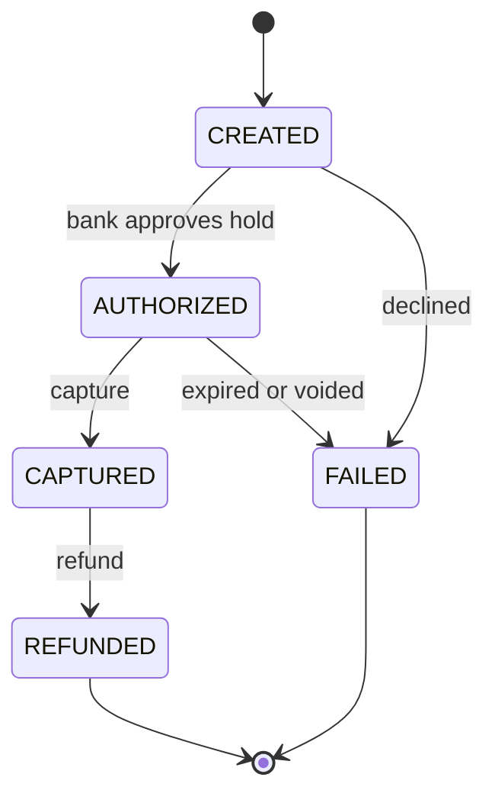

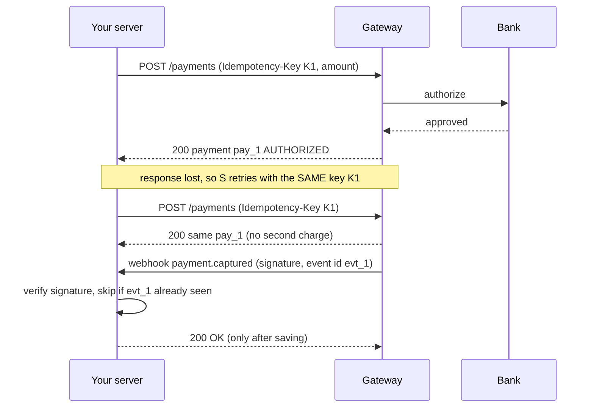

**Card data and PCI-DSS:** use the gateway's hosted fields or redirect so card numbers go straight to the gateway. Your servers only store a **token** ("tok_abc"). That keeps most PCI scope off your system.

## 2.4 Types and Variants

| Variant | Meaning | Use |
|---|---|---|
| **Authorize then capture** | Hold now, take later (hotels, shipping delay) | Charge only when the goods ship |
| **Auth + capture in one (sale)** | Charge immediately | Digital goods |
| **Redirect / hosted page** | Customer pays on the gateway's page | Smallest PCI scope |
| **Hosted fields / SDK** | Card inputs are the gateway's iframe on your page | Custom look, small PCI scope |
| **Async methods (UPI, bank transfer)** | Result arrives later by webhook | India UPI, SEPA |
| **Payment orchestration** | Route to several gateways, fail over | Large merchants (uses [Circuit Breaker](../03_System_Design/02_Reliability_Pattern.md)) |
| **Reconciliation** | Nightly compare your records with the gateway's settlement file | Catch missing webhooks |

## 2.5 Complete Java Example - Idempotency Key, State Machine and Signed Webhooks

**What it shows:** a retry with the same key does not charge twice, illegal state moves are blocked, and a webhook is accepted only once and only if the HMAC signature matches.

```java
import java.nio.charset.StandardCharsets;
import java.security.MessageDigest;
import java.util.*;
import javax.crypto.Mac;
import javax.crypto.spec.SecretKeySpec;

public class PaymentDemo {

    enum State { CREATED, AUTHORIZED, CAPTURED, REFUNDED, FAILED }

    // allowed moves only
    static final Map<State, Set<State>> ALLOWED = Map.of(
            State.CREATED, Set.of(State.AUTHORIZED, State.FAILED),
            State.AUTHORIZED, Set.of(State.CAPTURED, State.FAILED),
            State.CAPTURED, Set.of(State.REFUNDED),
            State.REFUNDED, Set.of(),
            State.FAILED, Set.of());

    static class Payment {
        final String id; final long amountCents; State state = State.CREATED;
        Payment(String id, long amountCents) { this.id = id; this.amountCents = amountCents; }
        void moveTo(State next) {
            if (!ALLOWED.get(state).contains(next))
                throw new IllegalStateException(state + " -> " + next + " is not allowed");
            state = next;
        }
    }

    // fake "bank": counts how many times we really charged
    static int bankCharges = 0;

    // Idempotency: same key => same result, charge only once
    static final Map<String, String> idempotencyStore = new HashMap<>();
    static final Map<String, Payment> payments = new HashMap<>();

    static String createPayment(String idempotencyKey, long amountCents) {
        String saved = idempotencyStore.get(idempotencyKey);
        if (saved != null) return saved + " (replayed, no new charge)";
        Payment p = new Payment("pay_" + (payments.size() + 1), amountCents);
        bankCharges++;                                  // the real side effect
        p.moveTo(State.AUTHORIZED);
        payments.put(p.id, p);
        idempotencyStore.put(idempotencyKey, p.id);
        return p.id;
    }

    // Webhook: verify signature + ignore duplicate event ids
    static String hmac(String secret, String body) throws Exception {
        Mac mac = Mac.getInstance("HmacSHA256");
        mac.init(new SecretKeySpec(secret.getBytes(StandardCharsets.UTF_8), "HmacSHA256"));
        StringBuilder sb = new StringBuilder();
        for (byte b : mac.doFinal(body.getBytes(StandardCharsets.UTF_8))) sb.append(String.format("%02x", b));
        return sb.toString();
    }
    static boolean constantTimeEquals(String a, String b) {
        return MessageDigest.isEqual(a.getBytes(StandardCharsets.UTF_8), b.getBytes(StandardCharsets.UTF_8));
    }
    static final Set<String> seenEvents = new HashSet<>();

    static String handleWebhook(String secret, String eventId, String body, String signature) throws Exception {
        if (!constantTimeEquals(hmac(secret, body), signature)) return "REJECT bad signature";
        if (!seenEvents.add(eventId)) return "IGNORE duplicate event " + eventId;
        return "PROCESS event " + eventId + " body=" + body;
    }

    public static void main(String[] args) throws Exception {
        // 1) Client retries after a timeout, using the same Idempotency-Key
        System.out.println("1) first call : " + createPayment("key-42", 49_900));
        System.out.println("   retry      : " + createPayment("key-42", 49_900));
        System.out.println("   new key    : " + createPayment("key-43", 12_000));
        System.out.println("   bank charged " + bankCharges + " times for 3 API calls");

        // 2) State machine
        Payment p = payments.get("pay_1");
        p.moveTo(State.CAPTURED);
        System.out.println("2) pay_1 is now " + p.state);
        try { p.moveTo(State.AUTHORIZED); } catch (IllegalStateException e) { System.out.println("   blocked: " + e.getMessage()); }
        p.moveTo(State.REFUNDED);
        try { p.moveTo(State.CAPTURED); } catch (IllegalStateException e) { System.out.println("   blocked: " + e.getMessage()); }

        // 3) Webhooks
        String secret = "whsec_demo";
        String body = "{\"type\":\"payment.captured\",\"id\":\"pay_2\"}";
        String sig = hmac(secret, body);
        System.out.println("3) signature  : " + sig.substring(0, 16) + "...");
        System.out.println("   valid      : " + handleWebhook(secret, "evt_1", body, sig));
        System.out.println("   redelivered: " + handleWebhook(secret, "evt_1", body, sig));
        System.out.println("   tampered   : " + handleWebhook(secret, "evt_2", body.replace("pay_2", "pay_9"), sig));
    }
}
```

**Output** (identical on all 3 runs):

```text
1) first call : pay_1
   retry      : pay_1 (replayed, no new charge)
   new key    : pay_2
   bank charged 2 times for 3 API calls
2) pay_1 is now CAPTURED
   blocked: CAPTURED -> AUTHORIZED is not allowed
   blocked: REFUNDED -> CAPTURED is not allowed
3) signature  : c1b055392b6f7997...
   valid      : PROCESS event evt_1 body={"type":"payment.captured","id":"pay_2"}
   redelivered: IGNORE duplicate event evt_1
   tampered   : REJECT bad signature
```

**What the output shows**
- **Step 1:** 3 API calls, only **2** real bank charges. The retry with `key-42` returned the saved result.
- **Step 2:** a `CAPTURED` payment cannot go back to `AUTHORIZED`, and a `REFUNDED` one cannot be captured again.
- **Step 3:** the tampered body fails the HMAC check. The redelivered event is ignored. `MessageDigest.isEqual` compares in **constant time**, so an attacker can't learn the signature byte by byte from response timing.

## 2.6 Payments in Spring Boot

**Idempotency with a database table**
```java
@Entity @Table(uniqueConstraints = @UniqueConstraint(columnNames = "idempotencyKey"))
class PaymentRequestLog {
    @Id @GeneratedValue Long id;
    String idempotencyKey;
    String requestHash;        // detect the same key used with a DIFFERENT body -> return 422
    String responseJson;
}
```
Insert the row first inside the transaction. If the insert fails on the unique constraint, load the saved response and return it.

**Webhook endpoint**
```java
@PostMapping("/webhooks/pay")
public ResponseEntity<Void> webhook(@RequestBody String rawBody,                    // raw text, not a parsed object
                                    @RequestHeader("X-Signature") String signature) {
    if (!verifier.isValid(rawBody, signature)) return ResponseEntity.status(401).build();
    PaymentEvent e = objectMapper.readValue(rawBody, PaymentEvent.class);
    if (!processedEvents.markIfNew(e.id())) return ResponseEntity.ok().build();      // duplicate: ack and skip
    events.publish(e);                                                               // hand off, answer fast
    return ResponseEntity.ok().build();                                              // gateway stops retrying
}
```
Verify the signature on the **raw bytes**. Re-serialising JSON changes spacing and breaks the HMAC.

**Calling the gateway safely:** `@Retry` + `@CircuitBreaker` + a short `@TimeLimiter` (Resilience4j, see [02_Reliability_Pattern.md](../03_System_Design/02_Reliability_Pattern.md)), always with the same idempotency key on every retry.

## 2.7 Pros and Cons

| Pros | Cons |
|---|---|
| No double charges | Extra storage for keys and processed events |
| Less PCI burden | Dependence on a third party (outages, fees) |
| Safe against forged callbacks | Webhooks are eventual: the UI must handle "pending" |
| Illegal operations are impossible | State machine must cover every real-world case |

## 2.8 Pitfalls, Interview Questions and Cheat Sheet

**Common pitfalls**
- Marking the order paid from the browser redirect (the user can fake it). Trust only the verified webhook or a server-side status fetch.
- Returning 200 to the webhook before saving it, then crashing (event lost).
- Generating a **new** idempotency key on every retry (defeats the purpose).
- Storing card numbers or CVV.
- Skipping reconciliation, so missed webhooks stay unnoticed.

**Interview questions**
1. *How do you avoid double charging?* → Idempotency key per business operation, saved with the response; unique constraint; return the saved response on retry.
2. *What if the payment succeeded but your server crashed before saving?* → The webhook and a reconciliation job repair it; the order stays `PENDING` until then.
3. *How do you secure webhooks?* → HMAC signature over the raw body with a shared secret, timestamp check against replay, de-duplicate by event id, HTTPS.
4. *Authorize vs capture?* → Authorize holds funds, capture takes them. Void or let the authorization expire if the goods can't ship.
5. *Why use a state machine?* → It makes impossible transitions impossible and gives a clean audit trail.
6. *Payment succeeded, shipping failed. What now?* → Saga compensation: refund (a new payment-side transaction, not a delete).

**Cheat sheet**
```
Idempotency-Key  : same key => same result, charge once, UNIQUE constraint
State machine    : CREATED -> AUTHORIZED -> CAPTURED -> REFUNDED  (+ FAILED), reject other moves
Webhook          : HMAC over RAW body, constant-time compare, event-id dedupe, ack fast
Trust            : webhook / server-side fetch, never the browser redirect
Repair           : nightly reconciliation with the gateway report
Cards            : tokens only, hosted fields/redirect (PCI scope stays small)
```

### 📘 Terms Explained

| Term | Meaning |
|---|---|
| **Payment gateway** | A service that connects merchants to card networks and banks |
| **Authorization** | A bank promise to hold money, not yet moved |
| **Capture** | Actually taking the authorized money |
| **Webhook** | An HTTP call that the gateway makes to your server when something happens |
| **HMAC** | A signature made from a message and a shared secret key; proves the sender knows the secret |
| **Constant-time comparison** | Comparing two values in the same time no matter where they differ (stops timing attacks) |
| **PCI-DSS** | The security standard for handling card data |
| **Tokenization** | Replacing a card number with a safe stand-in token |
| **Reconciliation** | Comparing your records with the gateway's to find differences |

---

# 3. Booking and Reservation Systems

## 3.1 What Is a Booking System?

A booking system sells **time-bound, unique things**: hotel rooms, flight seats, cinema seats, doctor slots, taxis. The special rule: *the same seat on the same night can be sold only once*, and the buyer needs a few minutes to pay.

So every booking has a short life: **AVAILABLE → HELD (for N minutes) → CONFIRMED** (or back to AVAILABLE if the hold expires).

## 3.2 Why Do We Need It?

| Problem | Fix |
|---|---|
| Two guests book the same room | Check-and-insert as one atomic step (lock, unique constraint, or conditional update) |
| Guest takes 8 minutes to pay and the room stays blocked forever | Hold with an expiry |
| Back-to-back stays (check-out 12th, next check-in 12th) wrongly rejected | Half-open intervals `[checkIn, checkOut)` |
| Everyone waits for one hot seat (a concert) | Queue, per-seat locking, virtual waiting room |

## 3.3 How It Works

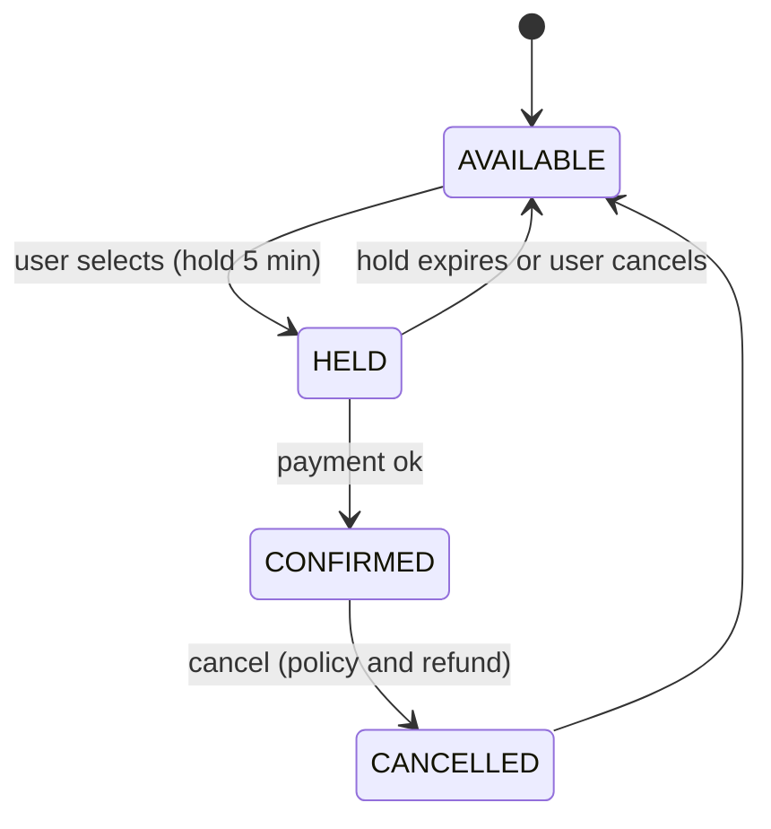

**Overlap test:** two stays `[a, b)` and `[c, d)` overlap if and only if `c < b && d > a`. With half-open intervals, a stay ending on the 12th and one starting on the 12th do **not** overlap.

**Three ways to stop double booking**

| Technique | How | Good for |
|---|---|---|
| **Pessimistic lock** | `SELECT ... FOR UPDATE` on the room/seat row, then insert | Few rooms, simple code |
| **Optimistic lock** | `@Version` column; second writer gets an exception and retries | Moderate contention |
| **Unique constraint per bookable unit** | One row per `(room, night)` with `UNIQUE(room, night)`; the database rejects the second insert | Strongest, simplest guarantee |

## 3.4 Types and Variants

| Variant | Example | Note |
|---|---|---|
| **Slot booking** | Doctor, salon: fixed 30-min slots | One row per slot |
| **Date-range booking** | Hotel, car rental | Half-open intervals, one row per night helps |
| **Seat booking** | Cinema, flights | Hold many seats together, all-or-nothing |
| **Overbooking** | Airlines sell 105 seats for 100 | Business choice with compensation rules |
| **Dynamic pricing** | Price follows demand | Separate pricing service |
| **Waiting list** | Notify when someone cancels | Event on cancellation |

## 3.5 Complete Java Example - Holds, Expiry, Back-to-Back Stays and 20 Simultaneous Requests

**What it shows:** overlap detection with half-open date ranges, holds that expire (and then stop blocking), and 20 threads racing for the same nights with exactly one winner.

```java
import java.time.LocalDate;
import java.util.*;
import java.util.concurrent.*;
import java.util.concurrent.atomic.*;

public class BookingDemo {

    // A stay occupies nights [checkIn, checkOut): checkOut day is free for the next guest
    record Stay(String id, LocalDate checkIn, LocalDate checkOut, long holdUntil, boolean confirmed) {
        boolean overlaps(LocalDate in, LocalDate out) { return in.isBefore(checkOut) && out.isAfter(checkIn); }
        boolean blocks(long now) { return confirmed || holdUntil > now; }   // expired holds don't block
    }

    static class Room {
        private final List<Stay> stays = new ArrayList<>();

        // synchronized = check and insert happen as ONE step (no double booking)
        synchronized boolean hold(String id, LocalDate in, LocalDate out, long now, long ttl) {
            for (Stay s : stays)
                if (s.blocks(now) && s.overlaps(in, out)) return false;
            stays.add(new Stay(id, in, out, now + ttl, false));
            return true;
        }
        synchronized boolean confirm(String id, long now) {
            for (int i = 0; i < stays.size(); i++) {
                Stay s = stays.get(i);
                if (s.id().equals(id) && s.holdUntil() > now) {
                    stays.set(i, new Stay(id, s.checkIn(), s.checkOut(), Long.MAX_VALUE, true));
                    return true;
                }
            }
            return false;                                    // hold expired or unknown
        }
    }

    public static void main(String[] args) throws Exception {
        LocalDate d10 = LocalDate.of(2025, 6, 10), d12 = d10.plusDays(2), d14 = d10.plusDays(4), d11 = d10.plusDays(1);

        Room room = new Room();
        System.out.println("1) book 10-12            : " + room.hold("A", d10, d12, 0, 300));
        System.out.println("   book 11-13 (overlap)  : " + room.hold("B", d11, d11.plusDays(2), 0, 300));
        System.out.println("   book 12-14 (back-to-back): " + room.hold("C", d12, d14, 0, 300));

        // hold expiry: A never confirmed
        System.out.println("2) t=100  confirm A      : " + room.confirm("A", 100));
        Room r2 = new Room();
        r2.hold("X", d10, d12, 0, 300);
        System.out.println("   t=400  X hold expired, confirm X : " + r2.confirm("X", 400));
        System.out.println("   t=400  someone else books same nights : " + r2.hold("Y", d10, d12, 400, 300));

        // 20 users click "book" on the same nights at the same moment
        Room hot = new Room();
        ExecutorService pool = Executors.newFixedThreadPool(8);
        AtomicInteger wins = new AtomicInteger();
        CountDownLatch go = new CountDownLatch(1), done = new CountDownLatch(20);
        for (int i = 0; i < 20; i++) {
            final String id = "U" + i;
            pool.submit(() -> {
                try { go.await(); } catch (InterruptedException e) { }
                if (hot.hold(id, d10, d12, 0, 300)) wins.incrementAndGet();
                done.countDown();
            });
        }
        go.countDown(); done.await(); pool.shutdown();
        System.out.println("3) 20 simultaneous requests, successful holds = " + wins);
    }
}
```

**Output** (identical on all 3 runs):

```text
1) book 10-12            : true
   book 11-13 (overlap)  : false
   book 12-14 (back-to-back): true
2) t=100  confirm A      : true
   t=400  X hold expired, confirm X : false
   t=400  someone else books same nights : true
3) 20 simultaneous requests, successful holds = 1
```

**What the output shows**
- **Step 1:** 11–13 overlaps 10–12, so it is rejected. 12–14 touches 10–12 at the 12th but does not overlap, so it is accepted.
- **Step 2:** a hold that was not confirmed in time cannot be confirmed (`false`), and the nights become bookable again (`Y` succeeds at t=400).
- **Step 3:** `synchronized` makes "check for overlap, then add" one step. 20 requests, **1** success. In a real multi-server system the same guarantee comes from the database (unique constraint or row lock), because a Java `synchronized` only protects one JVM.

## 3.6 Booking in Spring Boot

**One row per night with a unique constraint (strongest guarantee)**
```java
@Entity
@Table(uniqueConstraints = @UniqueConstraint(columnNames = {"roomId", "night"}))
class RoomNight {
    @Id @GeneratedValue Long id;
    Long roomId;
    LocalDate night;
    Long bookingId;
}

@Transactional
public Booking book(long roomId, LocalDate in, LocalDate out) {
    Booking b = bookings.save(new Booking(roomId, in, out, Status.HELD, Instant.now().plus(Duration.ofMinutes(10))));
    try {
        for (LocalDate d = in; d.isBefore(out); d = d.plusDays(1))
            nights.save(new RoomNight(roomId, d, b.getId()));
        nights.flush();                                               // force the INSERTs now
    } catch (DataIntegrityViolationException e) {
        throw new RoomNotAvailableException();                        // someone else got a night first
    }
    return b;
}
```

**Optimistic locking on a seat**
```java
@Entity class Seat { @Id Long id; String status; @Version Long version; }
// two users update the same seat: the second save throws ObjectOptimisticLockingFailureException -> tell the user "just taken"
```

**Expire holds:** a `@Scheduled` job deletes `RoomNight` rows whose booking is `HELD` and past its expiry. Or use Redis keys with a TTL (`SET hold:room42:2025-06-10 userId NX EX 600`) and confirm into the database on payment.

## 3.7 Pros and Cons

| Pros | Cons |
|---|---|
| Never double books (when the database enforces it) | Hold expiry job and states add complexity |
| Fair and predictable for users | Hot items (concert seats) still create contention |
| Back-to-back stays work | Time-zone and date-boundary bugs are easy ([Section 10](#10-time-zone-handling-interview-imp---java)) |

## 3.8 Pitfalls, Interview Questions and Cheat Sheet

**Common pitfalls**
- Check availability with `SELECT`, then `INSERT` in a separate step (race).
- Inclusive end dates (`<=`) that block same-day turnover.
- Holds that never expire.
- Protecting with `synchronized` and then running two app servers.
- Mixing time zones: a hotel night belongs to the **hotel's** local date.

**Interview questions**
1. *How do you prevent double booking?* → Let the database enforce uniqueness (one row per unit per night with a UNIQUE constraint, or a row lock / optimistic version), not application `if` checks.
2. *Why a hold with expiry?* → Payment takes time. Without it, stock is locked by people who leave.
3. *How do you book 4 seats together?* → One transaction, all-or-nothing; or hold all 4 and release all if any fails.
4. *Pessimistic vs optimistic locking here?* → Pessimistic when conflicts are common (everyone wants the same seat); optimistic when conflicts are rare.
5. *How would you handle a ticket sale with 1 million users?* → Virtual waiting room + queue, rate limit, pre-generated seat inventory, hold in Redis, confirm in the DB.

**Cheat sheet**
```
State     : AVAILABLE -> HELD(ttl) -> CONFIRMED | back to AVAILABLE
Overlap   : [a,b) and [c,d) overlap  <=>  c < b && d > a
Guarantee : UNIQUE(room, night) or row lock or @Version - not an if-statement
Hot items : waiting room + queue + short holds
```

### 📘 Terms Explained

| Term | Meaning |
|---|---|
| **Hold** | A temporary reservation that expires if unpaid |
| **Half-open interval** | A range that includes the start but not the end: `[start, end)` |
| **Pessimistic lock** | Lock the row first, then work (others wait) |
| **Optimistic lock** | Work first, detect a conflict at save time using a version number |
| **Unique constraint** | A database rule that rejects a second row with the same key |
| **Overbooking** | Intentionally selling more than capacity, expecting some cancellations |
| **Virtual waiting room** | A queue page that lets users into the site at a safe rate |

---

# 4. Financial Trading Patterns: Order Matching and Settlement

## 4.1 What Are Trading Patterns?

A stock exchange is a machine that **matches buyers with sellers**. Every participant sends *orders* ("buy 120 shares, at most 10.05"). The exchange keeps an **order book** (a list of waiting buy orders called *bids* and waiting sell orders called *asks*) and a **matching engine** that pairs orders by fixed, fair rules. After matching comes **clearing and settlement**: working out who owes whom, then moving shares and cash (often one business day later, "T+1").

## 4.2 Why Do We Need Them?

| Requirement | How the pattern meets it |
|---|---|
| **Fairness** | Price-time priority: best price first, and for equal prices the earliest order first |
| **Speed** | Order book in memory, one thread per instrument (no locks), journal for recovery |
| **Exactness** | Prices and quantities in integers (ticks), never `double` |
| **Auditability** | Every order and trade is an event in an append-only log |
| **Recovery** | Replay the log to rebuild the book ([Event Sourcing](../03_System_Design/05_Data_Management_Pattern.md#2-event-sourcing-pattern-interview-imp---java)) |

## 4.3 How It Works

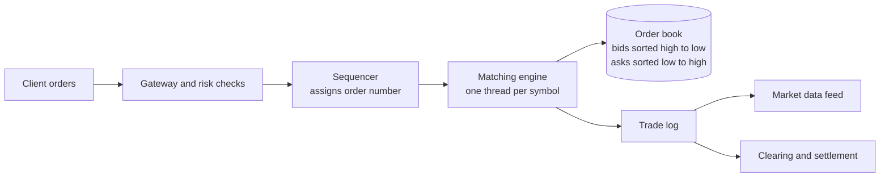

**Matching rule (price-time priority).** A new buy order matches the **lowest ask** if `buyPrice >= askPrice`. The trade happens at the **resting** (older) order's price. Among equal prices the order with the smaller sequence number goes first. Anything left unmatched rests in the book.

| Order type | Meaning |
|---|---|
| **Limit** | "Buy at this price or better" (rests in the book if not matched) |
| **Market** | "Buy now at the best available price" |
| **IOC / FOK** | Immediate-or-cancel / fill-or-kill: don't rest in the book |
| **Stop** | Becomes a market/limit order when a trigger price is hit |

## 4.4 Types and Variants

| Variant | Used for | Note |
|---|---|---|
| **Continuous matching** | Stocks during the day | Match as orders arrive |
| **Call auction** | Open and close of the day | Collect orders, pick one price that matches the most volume |
| **Pro-rata matching** | Some futures | Share fills in proportion to size at a price |
| **Dark pool** | Large block orders | Hidden book, no public bids/asks |
| **Netting** | Settlement | Add up all trades per participant: only the net moves |
| **Delivery vs payment (DvP)** | Settlement safety | Shares and cash change hands together or not at all |

## 4.5 Complete Java Example - A Tiny Matching Engine with Price-Time Priority and Net Settlement

**What it shows:** sells arrive at 10.00, 10.05, 10.00; a big buy sweeps the oldest 10.00 order first, then the next; a second buy at 10.02 cannot reach 10.05 and rests; at the end each participant's net shares and cash are computed.

```java
import java.util.*;

public class TradingDemo {
    enum Side { BUY, SELL }

    static class Order {
        final String who; final Side side; final long price; long qty; final long seq;
        Order(String who, Side side, long price, long qty, long seq) {
            this.who = who; this.side = side; this.price = price; this.qty = qty; this.seq = seq;
        }
        public String toString() { return who + " " + qty + "@" + String.format("%d.%02d", price / 100, price % 100); }
    }

    static long seq = 0;
    // price priority first, then time priority (lower seq = earlier)
    static PriorityQueue<Order> bids = new PriorityQueue<>(Comparator.comparingLong((Order o) -> -o.price).thenComparingLong(o -> o.seq));
    static PriorityQueue<Order> asks = new PriorityQueue<>(Comparator.comparingLong((Order o) -> o.price).thenComparingLong(o -> o.seq));
    static Map<String, long[]> net = new TreeMap<>();   // who -> {shares, cashCents}

    static void trade(Order buyer, Order seller, long price, long qty) {
        System.out.printf("   TRADE %d @ %d.%02d   buyer=%s seller=%s%n", qty, price / 100, price % 100, buyer.who, seller.who);
        net.computeIfAbsent(buyer.who, k -> new long[2]);
        net.computeIfAbsent(seller.who, k -> new long[2]);
        net.get(buyer.who)[0] += qty;  net.get(buyer.who)[1] -= qty * price;
        net.get(seller.who)[0] -= qty; net.get(seller.who)[1] += qty * price;
    }

    static void submit(String who, Side side, long price, long qty) {
        Order o = new Order(who, side, price, qty, ++seq);
        System.out.println("ORDER " + side + " " + o);
        PriorityQueue<Order> opposite = side == Side.BUY ? asks : bids;
        while (o.qty > 0 && !opposite.isEmpty()) {
            Order best = opposite.peek();
            boolean crosses = side == Side.BUY ? o.price >= best.price : o.price <= best.price;
            if (!crosses) break;
            long q = Math.min(o.qty, best.qty);
            // trade happens at the RESTING order's price
            if (side == Side.BUY) trade(o, best, best.price, q); else trade(best, o, best.price, q);
            o.qty -= q; best.qty -= q;
            if (best.qty == 0) opposite.poll();
        }
        if (o.qty > 0) (side == Side.BUY ? bids : asks).add(o);
    }

    static void printBook() {
        List<Order> a = new ArrayList<>(asks), b = new ArrayList<>(bids);
        a.sort(asks.comparator()); b.sort(bids.comparator());
        System.out.println("   BOOK asks=" + a + "  bids=" + b);
    }

    public static void main(String[] args) {
        submit("Asha", Side.SELL, 1000, 100);
        submit("Ben",  Side.SELL, 1005, 50);
        submit("Chen", Side.SELL, 1000, 100);
        printBook();
        submit("Dev",  Side.BUY,  1005, 120);   // sweeps Asha first (earlier), then part of Chen
        printBook();
        submit("Esha", Side.BUY,  1002, 200);   // takes rest of Chen @10.00, can't reach Ben @10.05
        printBook();
        System.out.println("SETTLEMENT (net per participant, shares and cash in rupees)");
        for (var e : net.entrySet())
            System.out.printf("   %-5s shares %+5d   cash %+10.2f%n", e.getKey(), e.getValue()[0], e.getValue()[1] / 100.0);
    }
}
```

**Output** (identical on all 3 runs):

```text
ORDER SELL Asha 100@10.00
ORDER SELL Ben 50@10.05
ORDER SELL Chen 100@10.00
   BOOK asks=[Asha 100@10.00, Chen 100@10.00, Ben 50@10.05]  bids=[]
ORDER BUY Dev 120@10.05
   TRADE 100 @ 10.00   buyer=Dev seller=Asha
   TRADE 20 @ 10.00   buyer=Dev seller=Chen
   BOOK asks=[Chen 80@10.00, Ben 50@10.05]  bids=[]
ORDER BUY Esha 200@10.02
   TRADE 80 @ 10.00   buyer=Esha seller=Chen
   BOOK asks=[Ben 50@10.05]  bids=[Esha 120@10.02]
SETTLEMENT (net per participant, shares and cash in rupees)
   Asha  shares  -100   cash   +1000.00
   Chen  shares  -100   cash   +1000.00
   Dev   shares  +120   cash   -1200.00
   Esha  shares   +80   cash    -800.00
```

**What the output shows**
- **Dev's buy of 120 @ 10.05** trades with Asha (100 @ 10.00, the earlier order) then with Chen (20 @ 10.00). The buyer is willing to pay up to 10.05 but gets the better 10.00 price. The trade price is the **resting** order's price.
- **Ben stays in the book** because Dev's order was filled before reaching 10.05.
- **Esha's buy @ 10.02** takes Chen's last 80 @ 10.00. The rest (120) rests as a bid, since Ben's ask (10.05) is higher than her limit.
- **Settlement:** total shares sum to 0 (`-100 -100 +120 +80`) and total cash sums to 0 (`+1000 +1000 -1200 -800`). Money and shares are conserved, which is the sanity check of any ledger.

## 4.6 Trading in Java and Spring

Real exchanges don't use general web frameworks for matching. They use a single-threaded, allocation-free event loop (for example the **LMAX Disruptor** ring buffer) and an append-only journal. Spring is used around it.

```java
// Matching core: no locks, one thread per symbol, input from a ring buffer
Disruptor<OrderEvent> d = new Disruptor<>(OrderEvent::new, 1 << 16, threadFactory,
                                          ProducerType.MULTI, new BusySpinWaitStrategy());
d.handleEventsWith(journal)          // 1. write to the journal first
 .then(matchingEngine)               // 2. match
 .then(publisher);                   // 3. publish trades
```

```java
// Around the core: Spring Boot REST/FIX gateway, risk checks, post-trade
@PostMapping("/orders")
public OrderAck submit(@RequestBody NewOrder o) {
    risk.check(o);                   // balance, position limits, price bands
    return sequencer.enqueue(o);     // returns immediately with an order id; fills come as events
}
@KafkaListener(topics = "trades")
public void onTrade(Trade t) { settlement.record(t); }       // T+1 netting job reads these
```

**Money type:** prices as `long` ticks (10.05 → 1005 with tick size 0.01) and quantities as `long`. See [Section 8](#8-multi-currency-pattern-interview-imp---java).

## 4.7 Pros and Cons

| Pros | Cons |
|---|---|
| Deterministic and fair | Single-threaded per symbol limits one symbol's throughput |
| Easy to replay and audit | In-memory book needs journaling and hot standby |
| Integer maths means no rounding bugs | Regulation (market surveillance, time sync) adds big extra scope |

## 4.8 Pitfalls, Interview Questions and Cheat Sheet

**Common pitfalls**
- Using `double`/`float` for prices.
- Trading at the incoming order's price instead of the resting order's price.
- Using the wall clock for time priority. Use a **sequence number** (clocks can tie or jump).
- Locking the book from many threads instead of one sequenced thread.
- Forgetting partial fills (the unmatched remainder must rest or be cancelled).

**Interview questions**
1. *Which data structure is the order book?* → Two sorted structures (bids high→low, asks low→high), each price level holding a FIFO queue. A `PriorityQueue` or a `TreeMap<price, Deque<Order>>` in Java. `TreeMap` also allows cancel and depth queries.
2. *How do you scale a matching engine?* → Shard by symbol; each symbol is single-threaded. Replicate the journal for failover.
3. *How do you recover after a crash?* → Replay the journal (events) into a fresh engine; a standby follows the same stream.
4. *What is the difference between clearing and settlement?* → Clearing works out obligations (netting, risk). Settlement moves the cash and securities.
5. *Why integers?* → Exact arithmetic and faster comparisons.

**Cheat sheet**
```
Order book  : bids (high->low) + asks (low->high), FIFO inside each price
Match       : buy.price >= bestAsk.price -> trade at the RESTING order's price
Priority    : price first, then arrival sequence
Core design : single thread per symbol + journal (+ Disruptor), shard by symbol
Settlement  : net per participant, delivery-versus-payment, T+1
Numbers     : long ticks, never double
```

### 📘 Terms Explained

| Term | Meaning |
|---|---|
| **Order book** | The list of waiting buy and sell orders for one instrument |
| **Bid / Ask** | The price a buyer is willing to pay / a seller wants |
| **Limit order** | An order with a worst acceptable price |
| **Matching engine** | The component that pairs buy and sell orders |
| **Price-time priority** | Best price first, then the oldest order |
| **Tick** | The smallest allowed price step |
| **Clearing** | Calculating who owes what after trades |
| **Settlement (T+1)** | Actual transfer of cash and securities, one business day after the trade |
| **LMAX Disruptor** | A very fast lock-free ring buffer used in low-latency Java systems |

---

# 5. Social Network Patterns: Feed, Follow, Notifications

## 5.1 What Are Social Network Patterns?

A social app has three recurring pieces:
1. **Follow graph:** who follows whom (a graph, see [graph databases](03_Data_Storage_Pattern.md#5-graph-databases-interview-imp---java)).
2. **Feed (timeline):** the list of recent posts from the people you follow.
3. **Notifications:** "Asha liked your post", pushed to the phone.

The famous design question is the feed: *when someone posts, how do their followers' feeds get updated?* There are two basic answers, and real systems mix them.

## 5.2 Why Do We Need Them?

A user with 5,000,000 followers posts once. Naive approaches:
- **Compute the feed when asked** by querying everyone you follow (200 people → 200 lookups per refresh, every refresh). Reads are slow.
- **Copy the post into every follower's feed** at post time. A 5-million-follower post causes 5 million writes (a *write storm*).

## 5.3 How It Works

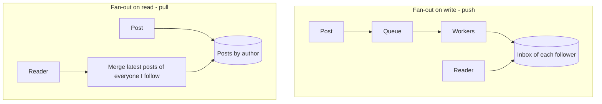

| | **Push (fan-out on write)** | **Pull (fan-out on read)** | **Hybrid** |
|---|---|---|---|
| Post cost | 1 write per follower | 1 write | 1 write + pushes for small accounts |
| Feed read cost | 1 read (own inbox) | 1 read per followed account | 1 inbox read + reads for celebrities |
| Good for | Normal users | Celebrities | Real systems |
| Weakness | Write storm for celebrities; wasted work for inactive followers | Slow reads for people who follow many | More code paths |

**Hybrid (what large social networks do):** push for normal accounts; for accounts above a follower threshold do **not** push. Merge their latest posts into the reader's inbox at read time. Also, push only to **active** users (people who opened the app recently).

**Feed storage:** per-user list in Redis (sorted set by time) holding post **ids**; post bodies come from a post store/cache. **Ranking:** newest-first or a score (relevance, engagement). **Pagination:** cursor (`before=<timestamp or id>`), not page numbers (the feed changes while you scroll).

## 5.4 Types and Variants

| Variant | Note |
|---|---|
| **Chronological feed** | Simple: sorted by time |
| **Ranked feed** | Machine-learned score; see [Section 7](#7-recommendation-systems) |
| **Fan-out via queue** | Post event → Kafka → fan-out workers (don't do it in the request thread) |
| **Notifications** | Event → notification service → push (FCM/APNs), email, in-app; with user preferences and rate limits |
| **Counters (likes)** | Counters in Redis, batched to the DB. Exact counts rarely need strong consistency |
| **Follow graph** | Adjacency lists in a DB, or a graph database for "friends of friends" |

## 5.5 Complete Java Example - Push vs Pull vs Hybrid Cost

**What it shows:** one celebrity (2,000 followers) posts 5 times, one friend (3 followers) posts 2 times, and every celebrity follower opens the app twice. The program counts the **writes** and **read lookups** each strategy needs.

```java
import java.util.*;

public class FeedDemo {
    record Post(int id, int author) {}

    static final int CELEB = 1;                       // user 1 has 2000 followers
    static final int FRIEND = 2;                      // user 2 has 3 followers
    static final int FOLLOWERS_OF_CELEB = 2000;
    static final int THRESHOLD = 1000;                // hybrid: above this, do not fan out

    static Map<Integer, List<Integer>> followers = new HashMap<>();     // author -> followers
    static Map<Integer, List<Integer>> following = new HashMap<>();     // reader -> authors followed

    static void follow(int reader, int author) {
        followers.computeIfAbsent(author, k -> new ArrayList<>()).add(reader);
        following.computeIfAbsent(reader, k -> new ArrayList<>()).add(author);
    }

    // one run of a strategy; returns {writes, readLookups, postsInFeedOfReader3000}
    static long[] run(String strategy) {
        Map<Integer, List<Post>> inbox = new HashMap<>();               // push: precomputed feeds
        Map<Integer, List<Post>> byAuthor = new HashMap<>();            // pull: posts by author
        long writes = 0, lookups = 0;
        int nextId = 1;

        // 5 posts by the celebrity, 2 by the friend
        int[] authors = {CELEB, CELEB, CELEB, CELEB, CELEB, FRIEND, FRIEND};
        for (int a : authors) {
            Post p = new Post(nextId++, a);
            byAuthor.computeIfAbsent(a, k -> new ArrayList<>()).add(p);  writes++;       // always store the post once
            boolean fanOut = strategy.equals("push") || (strategy.equals("hybrid") && followers.get(a).size() <= THRESHOLD);
            if (fanOut) for (int f : followers.get(a)) { inbox.computeIfAbsent(f, k -> new ArrayList<>()).add(p); writes++; }
        }

        // every follower of the celebrity opens the app 2 times
        List<Post> sample = null;
        for (int round = 0; round < 2; round++)
            for (int reader : followers.get(CELEB)) {
                List<Post> feed = new ArrayList<>();
                if (strategy.equals("push")) {
                    feed.addAll(inbox.getOrDefault(reader, List.of())); lookups++;           // 1 read of own inbox
                } else {
                    for (int a : following.getOrDefault(reader, List.of())) {                // 1 read per followed author
                        if (strategy.equals("hybrid") && followers.get(a).size() <= THRESHOLD) continue;   // those are in the inbox
                        feed.addAll(byAuthor.getOrDefault(a, List.of())); lookups++;
                    }
                    if (strategy.equals("hybrid")) { feed.addAll(inbox.getOrDefault(reader, List.of())); lookups++; }
                }
                sample = feed;
            }
        return new long[]{writes, lookups, sample.size()};
    }

    public static void main(String[] args) {
        // reader ids 1000.. follow the celebrity; the first 3 of them also follow the friend
        for (int i = 0; i < FOLLOWERS_OF_CELEB; i++) follow(1000 + i, CELEB);
        for (int i = 0; i < 3; i++) follow(1000 + i, FRIEND);

        System.out.println("strategy   writes   read-lookups   (7 posts, 2000 readers x 2 opens)");
        for (String s : new String[]{"push", "pull", "hybrid"}) {
            long[] r = run(s);
            System.out.printf("%-8s %8d %14d%n", s, r[0], r[1]);
        }
        System.out.println("\nWith THRESHOLD=" + THRESHOLD + ": the celebrity (2000 followers) is pulled; the friend (3 followers) is pushed.");
    }
}
```

**Output** (identical on all 3 runs):

```text
strategy   writes   read-lookups   (7 posts, 2000 readers x 2 opens)
push        10013           4000
pull            7           4006
hybrid         13           8000

With THRESHOLD=1000: the celebrity (2000 followers) is pulled; the friend (3 followers) is pushed.
```

**What the output shows**
- **Push:** 10,013 writes (5 posts × 2,000 followers + the friend's posts + the 7 stored posts), but each feed read is a single inbox lookup (4,000 reads).
- **Pull:** just 7 writes, but every feed read must go and fetch the authors' posts (4,006 lookups here, because most readers follow just one account. A reader who follows 500 accounts would need 500 lookups per refresh).
- **Hybrid:** 13 writes (no storm: the celebrity is not pushed) and about 2 lookups per read (own inbox + the celebrity's posts). It trades a slightly more expensive read for a huge write saving. In a real feed readers outnumber posters, so keeping per-read cost near-constant matters, which is why the push part stays for normal accounts.

## 5.6 Social Feed in Spring Boot

```java
// 1. Post service: save the post, then publish an event (Transactional Outbox in real systems)
@Transactional
public Post create(long authorId, String text) {
    Post p = posts.save(new Post(authorId, text));
    outbox.add(new PostCreated(p.getId(), authorId, p.getCreatedAt()));
    return p;
}

// 2. Fan-out worker
@KafkaListener(topics = "post-created", groupId = "fanout")
public void fanOut(PostCreated e) {
    if (followers.count(e.authorId()) > CELEBRITY_THRESHOLD) return;       // pulled at read time
    for (List<Long> batch : Lists.partition(followers.activeFollowerIds(e.authorId()), 500))
        redis.executePipelined((RedisCallback<Object>) c -> {
            for (long f : batch)
                c.zAdd(("feed:" + f).getBytes(), e.createdAt().toEpochMilli(), Long.toString(e.postId()).getBytes());
            return null;
        });
}

// 3. Read: inbox + celebrity posts, merged
public List<PostDto> feed(long userId, Instant before, int size) {
    Set<String> ids = redis.opsForZSet().reverseRangeByScore("feed:" + userId, 0, before.toEpochMilli(), 0, size);
    List<Post> celebrity = posts.latestByAuthors(followedCelebrities(userId), before, size);
    return merge(loadPosts(ids), celebrity, size);
}
```
Trim each feed (`ZREMRANGEBYRANK feed:42 0 -801`) to keep only the latest 800 ids.

## 5.7 Pros and Cons

| Pros | Cons |
|---|---|
| Fast reads for most users (push) | Write amplification for big accounts |
| No write storms (hybrid) | Two code paths to maintain |
| Easy to add ranking later | Feeds are eventually consistent (a new post may appear seconds later) |

## 5.8 Pitfalls, Interview Questions and Cheat Sheet

**Common pitfalls**
- Doing the fan-out inside the HTTP request.
- Pushing to millions of inactive users.
- Page-number pagination on a feed that keeps changing (duplicates and gaps). Use cursors.
- Deleting a post but leaving it in 5 million inboxes. Keep ids in inboxes and **filter at read time** (check the post still exists).
- Counting likes with `count(*)` on every read.

**Interview questions**
1. *Push vs pull for a news feed?* → Push makes reads cheap but writes expensive; pull is the opposite. Hybrid: push for normal accounts, pull for celebrities.
2. *How do you store a feed?* → Redis sorted set per user (post id, score = time), trimmed to the latest N; bodies from a cache.
3. *How do you paginate?* → Cursor-based (`before` id/timestamp).
4. *How do you send notifications reliably?* → Event → queue → notification service; idempotent consumers; retries with backoff; user preferences and rate limits ([04_Messaging_Pattern.md](../03_System_Design/04_Messaging_Pattern.md)).
5. *How do you find "people you may know"?* → Friends-of-friends on the follow graph (graph database or batch job).

**Cheat sheet**
```
Normal user posts  -> push ids into followers' inboxes (async, active followers only)
Celebrity posts    -> no push; merge their latest posts at read time
Feed storage       -> Redis ZSET feed:{user} (post ids by time), trimmed
Pagination         -> cursor, not page number
Deleted posts      -> filter on read
```

### 📘 Terms Explained

| Term | Meaning |
|---|---|
| **Feed / timeline** | The list of posts a user sees |
| **Fan-out** | Spreading one event to many receivers |
| **Fan-out on write (push)** | Copy the post to every follower's feed at post time |
| **Fan-out on read (pull)** | Build the feed from followed accounts at read time |
| **Write storm / write amplification** | One action causing a huge number of writes |
| **Inbox** | A precomputed list of items for one user |
| **Cursor pagination** | "Give me items older than this id", stable when new items arrive |
| **Sorted set (ZSET)** | A Redis structure that keeps members sorted by a score |

---

# 6. Search Engine Patterns: Crawl, Index, Rank

## 6.1 What Are Search Engine Patterns?

A web-scale search engine has three stages:
1. **Crawl:** discover and download pages by following links.
2. **Index:** turn the pages into an **inverted index** (word → list of pages).
3. **Rank:** order the matching pages: text relevance (TF-IDF/BM25) combined with authority (PageRank) and freshness.

This section is the *system view*. The inner workings of an inverted index, analyzers and BM25 are already covered with working code in [03_Data_Storage_Pattern.md, Section 7](03_Data_Storage_Pattern.md#7-search-engines-interview-imp---java). Here we add the **crawler** and **PageRank**.

## 6.2 Why Do We Need It?

| Problem | Solution |
|---|---|
| The web is billions of pages that change constantly | A distributed crawler with a prioritised frontier and re-crawl schedule |
| Scanning every page per query is impossible | Inverted index lookup |
| Thousands of pages match "java" | Rank by relevance and authority |
| Spammy pages | Link analysis, quality signals |

## 6.3 How It Works

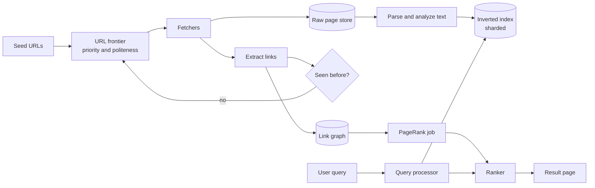

**Crawler essentials**
- **Frontier:** the queue of URLs to fetch, ordered by priority.
- **Duplicate detection:** normalise URLs (lowercase host, drop `#fragment`, sort query params) and check a visited set (a **Bloom filter** at scale, see [03_Data_Storage_Pattern.md](03_Data_Storage_Pattern.md#11-probabilistic-data-structures-bloom-filter-count-min-sketch-hyperloglog-interview-imp---java)). Also detect duplicate content with a hash.
- **Politeness:** obey `robots.txt`, limit requests per host (one queue per host with a delay).
- **Spider traps:** infinite calendars or session-id URLs; limit depth and URL patterns.

**PageRank idea:** a page is important if important pages link to it. Each page splits its rank equally among its outgoing links, and with probability 0.15 the "random surfer" jumps to any page (the damping factor 0.85 handles dead ends and loops). Repeat until the numbers stop changing.

`PR(p) = (1 - d) / N + d × Σ PR(q) / outlinks(q)` for every page `q` that links to `p`.

## 6.4 Types and Variants

| Variant | Note |
|---|---|
| **Focused crawler** | Crawls only pages about a topic |
| **Incremental crawler** | Re-crawls pages based on how often they change |
| **Distributed crawler** | URLs partitioned by host hash to workers (consistent hashing) |
| **Batch index** (MapReduce/Spark) vs **near-real-time index** (Lucene segments) | Freshness vs simplicity |
| **Index sharding** | By document (each shard has a slice of pages, all shards queried) or by term |
| **Ranking signals** | BM25 text score, PageRank, freshness, click data, learning-to-rank models |
| **Autocomplete** | Trie or prefix index + popular-query counts (Count-Min Sketch) |

## 6.5 Complete Java Example - Crawler Frontier, URL Normalising and PageRank

**What it shows:** a BFS crawl of a tiny fake web with URL de-duplication (`http://SITE.com/b#top` equals `http://site.com/b`), 30 iterations of PageRank, and a final score that mixes text relevance with link authority.

```java
import java.util.*;

public class CrawlRankDemo {

    // a tiny fake web: url -> links found on that page
    static final Map<String, List<String>> WEB = new LinkedHashMap<>();
    static {
        WEB.put("http://site.com/",        List.of("http://site.com/a", "http://SITE.com/b#top", "http://other.com/"));
        WEB.put("http://site.com/a",       List.of("http://site.com/b", "http://site.com/"));
        WEB.put("http://site.com/b",       List.of("http://site.com/a", "http://other.com/"));
        WEB.put("http://other.com/",       List.of("http://site.com/b"));
    }

    static String canonical(String url) {                 // dedupe: lower-case host, drop #fragment
        int hash = url.indexOf('#');
        if (hash >= 0) url = url.substring(0, hash);
        int slash = url.indexOf('/', 8);
        String host = slash < 0 ? url : url.substring(0, slash);
        String path = slash < 0 ? "/" : url.substring(slash);
        return host.toLowerCase() + path;
    }

    public static void main(String[] args) {
        // ---------- 1. Crawler: frontier + visited set ----------
        Deque<String> frontier = new ArrayDeque<>(List.of("http://site.com/"));
        Set<String> seen = new LinkedHashSet<>(frontier);
        Map<String, List<String>> graph = new LinkedHashMap<>();
        int duplicatesSkipped = 0;
        while (!frontier.isEmpty()) {
            String url = frontier.poll();
            List<String> out = new ArrayList<>();
            for (String raw : WEB.getOrDefault(url, List.of())) {
                String c = canonical(raw);
                out.add(c);
                if (seen.add(c)) frontier.add(c); else duplicatesSkipped++;
            }
            graph.put(url, out);
        }
        System.out.println("1) crawled pages  : " + graph.keySet());
        System.out.println("   duplicate links skipped: " + duplicatesSkipped);

        // ---------- 2. PageRank (damping 0.85) ----------
        List<String> pages = new ArrayList<>(graph.keySet());
        int n = pages.size();
        double d = 0.85;
        Map<String, Double> rank = new LinkedHashMap<>();
        for (String p : pages) rank.put(p, 1.0 / n);
        for (int it = 1; it <= 30; it++) {
            Map<String, Double> next = new LinkedHashMap<>();
            for (String p : pages) next.put(p, (1 - d) / n);
            for (String p : pages) {
                List<String> out = graph.get(p);
                for (String q : out) next.merge(q, d * rank.get(p) / out.size(), Double::sum);
            }
            rank = next;
        }
        System.out.println("2) PageRank after 30 iterations (sum = 1):");
        rank.entrySet().stream().sorted((x, y) -> Double.compare(y.getValue(), x.getValue()))
            .forEach(e -> System.out.printf("   %-20s %.4f%n", e.getKey(), e.getValue()));

        // ---------- 3. Rank = text relevance x authority ----------
        Map<String, Double> textScore = Map.of("http://site.com/a", 0.9, "http://site.com/b", 0.6, "http://other.com/", 0.8, "http://site.com/", 0.1);
        System.out.println("3) final score = 0.7*text + 0.3*(pagerank scaled to 0..1)");
        double max = Collections.max(rank.values());
        rank.entrySet().stream()
            .map(e -> Map.entry(e.getKey(), 0.7 * textScore.get(e.getKey()) + 0.3 * e.getValue() / max))
            .sorted((x, y) -> Double.compare(y.getValue(), x.getValue()))
            .forEach(e -> System.out.printf("   %-20s %.3f%n", e.getKey(), e.getValue()));
    }
}
```

**Output** (identical on all 3 runs):

```text
1) crawled pages  : [http://site.com/, http://site.com/a, http://site.com/b, http://other.com/]
   duplicate links skipped: 5
2) PageRank after 30 iterations (sum = 1):
   http://site.com/b    0.3821
   http://site.com/a    0.2394
   http://other.com/    0.2394
   http://site.com/     0.1392
3) final score = 0.7*text + 0.3*(pagerank scaled to 0..1)
   http://site.com/a    0.818
   http://other.com/    0.748
   http://site.com/b    0.720
   http://site.com/     0.179
```

**What the output shows**
- **Crawl:** only 4 distinct pages are fetched; 5 duplicate links (same page spelled differently, or already seen) are skipped.
- **PageRank:** `/b` is linked from three pages (`/`, `/a`, `other.com`) so it wins authority (0.382). The home page `/` has just one inbound link and gets the lowest rank. The ranks add up to 1.
- **Final score:** text relevance (70%) and authority (30%) are combined. `/b` has the highest PageRank but `/a` matches the query text better, so `/a` wins overall. This is why real engines blend signals.

## 6.6 Search in Java and Spring

You almost never build a crawler plus an index from scratch. The usual Java stack:

```java
// Crawl: jsoup to fetch and parse, a queue per host for politeness
Document doc = Jsoup.connect(url).userAgent("MyBot/1.0").timeout(5_000).get();
for (Element a : doc.select("a[href]")) frontier.offer(normalise(a.absUrl("href")));

// Index and search: Elasticsearch / OpenSearch (or Lucene / Solr)
@Document(indexName = "pages")
record PageDoc(@Id String url, @Field(type = FieldType.Text, analyzer = "english") String body, int pageRank) {}

// Rank = BM25 text score boosted by a stored PageRank field
Query q = NativeQuery.builder().withQuery(
    functionScoreQuery(matchQuery("body", userQuery))
        .addFunction(fieldValueFactorFunction("pageRank").modifier(LOG1P).factor(2f))).build();
```
Run PageRank as an offline job (Spark GraphX or a batch process), then write the score into the index as a field.

## 6.7 Pros and Cons

| Pros | Cons |
|---|---|
| Queries are fast (index lookup, not page scan) | Index is not instantly fresh; crawling is expensive |
| Link analysis resists simple keyword stuffing | Link spam and SEO games |
| Sharding scales horizontally | Every query hits all shards (fan-out latency) |

## 6.8 Pitfalls, Interview Questions and Cheat Sheet

**Common pitfalls**
- Ignoring `robots.txt` and hammering one host.
- Not normalising URLs → the same page is crawled many times.
- Spider traps (endless calendar pages).
- Treating the search index as the source of truth (it is rebuilt from the raw store).
- Computing PageRank per query instead of offline.

**Interview questions**
1. *Design a web crawler.* → Seed URLs → frontier (priority + per-host queues) → fetchers → parser → URL normaliser + visited set (Bloom filter) → content hash dedupe → raw store; respect robots.txt; distribute by host hash.
2. *What is an inverted index?* → Map from term to the documents (and positions) that contain it. See the Data_Storage guide.
3. *How does PageRank work?* → Iteratively, each page shares its rank across its outlinks; damping factor 0.85 models random jumps; repeat until stable.
4. *How do you shard the index?* → By document: each shard indexes a subset of pages; a query goes to all shards and the top results are merged.
5. *How would you build autocomplete?* → A prefix structure (trie) holding top completions by popularity, refreshed offline; cache hot prefixes.

**Cheat sheet**
```
Crawl   : frontier -> fetch -> extract links -> normalise -> dedupe (Bloom) -> frontier
Polite  : robots.txt + delay per host; avoid spider traps
Index   : term -> postings list; shard by document; near-real-time segments
Rank    : BM25 (text)  x  PageRank (authority)  x  freshness / clicks
PageRank: PR = (1-d)/N + d * sum(PR(in)/outlinks(in)), d = 0.85
```

### 📘 Terms Explained

| Term | Meaning |
|---|---|
| **Crawler (spider)** | A program that downloads pages by following links |
| **Frontier** | The queue of URLs waiting to be crawled |
| **robots.txt** | A file where sites say which parts crawlers may visit |
| **Inverted index** | A map from each word to the pages that contain it |
| **PageRank** | A score of page importance computed from the link structure |
| **Damping factor** | The chance (0.85) that the random surfer follows a link instead of jumping elsewhere |
| **Spider trap** | A set of pages that generates endless new URLs |
| **Politeness** | Limiting request rate per website |
| **Shard** | One slice of the index stored on one machine |

---

# 7. Recommendation Systems

## 7.1 What Is a Recommendation System?

A recommender answers *"what should this user see next?"* (products, videos, songs, people to follow). The two classic families:

- **Collaborative filtering:** "people similar to you liked X". It uses only behaviour (ratings, clicks, purchases), not the item's content.
- **Content-based filtering:** "X is similar to things you liked". It compares item attributes (genre, tags, text).

Modern systems **combine both** and use a machine-learned ranker, but these two ideas are what interviews ask about.

## 7.2 Why Do We Need It?

A shop with a million items can't show them all. Good recommendations raise sales and watch-time; bad ones are noise. The hard parts:

| Challenge | Meaning |
|---|---|
| **Cold start** | New user or new item with no history |
| **Sparsity** | Each user rated a tiny fraction of items |
| **Scale** | Millions of users × millions of items |
| **Freshness** | Taste changes; new items appear |
| **Feedback loops** | Showing only popular items makes them more popular |

## 7.3 How It Works

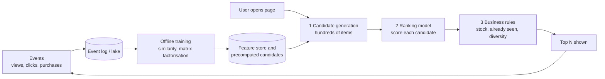

**Cosine similarity** compares two users by the angle between their rating vectors (1 = same taste, 0 = unrelated). A prediction is a **similarity-weighted average** of what similar users rated: `predicted = Σ(sim × rating) / Σ(sim)`.

**Jaccard similarity** for tags: `|A ∩ B| / |A ∪ B|`.

## 7.4 Types and Variants

| Variant | Idea | Note |
|---|---|---|
| **User-based CF** | Find similar users | Hard to scale: many users |
| **Item-based CF** | Find similar items (stable over time) | Amazon's classic: precompute item-item similarities |
| **Matrix factorisation (ALS, SVD)** | Learn hidden "taste factors" for users and items | Handles sparsity better |
| **Content-based** | Item attributes vs user profile | Works for new items, can over-specialise |
| **Hybrid** | Blend CF + content + popularity | Fixes cold start |
| **Two-tower / deep models** | Neural embeddings, nearest-neighbour search (ANN) | Large platforms |
| **Popularity / trending** | Most viewed recently | The cold-start fallback |
| **Explicit vs implicit feedback** | Star ratings vs clicks/watch time | Implicit data is far more plentiful |

## 7.5 Complete Java Example - User-Based CF, Content-Based Tags and Cold Start

**What it shows:** four users rate movies; for user *Dev* the program computes similarity to the others, predicts ratings for unseen movies, ranks unseen movies by tag overlap, and handles a user with no history.

```java
import java.util.*;

public class RecommendDemo {

    static final Map<String, Map<String, Double>> RATINGS = new LinkedHashMap<>();
    static void rate(String user, Object... pairs) {
        Map<String, Double> m = new LinkedHashMap<>();
        for (int i = 0; i < pairs.length; i += 2) m.put((String) pairs[i], ((Number) pairs[i + 1]).doubleValue());
        RATINGS.put(user, m);
    }

    // cosine similarity on the items both users rated
    static double similarity(Map<String, Double> a, Map<String, Double> b) {
        double dot = 0, na = 0, nb = 0;
        for (var e : a.entrySet()) {
            Double other = b.get(e.getKey());
            if (other == null) continue;
            dot += e.getValue() * other; na += e.getValue() * e.getValue(); nb += other * other;
        }
        return na == 0 || nb == 0 ? 0 : dot / (Math.sqrt(na) * Math.sqrt(nb));
    }

    public static void main(String[] args) {
        rate("Asha", "Matrix", 5, "Inception", 5, "Titanic", 1, "Avengers", 4);
        rate("Ben",  "Matrix", 5, "Inception", 4, "Avengers", 5, "Interstellar", 5);
        rate("Chen", "Matrix", 1, "Titanic", 5, "Notebook", 5);
        rate("Dev",  "Matrix", 5, "Inception", 5);

        // ---------- 1. User-based collaborative filtering ----------
        String target = "Dev";
        Map<String, Double> mine = RATINGS.get(target);
        System.out.println("1) similarity of Dev to other users");
        Map<String, Double> sim = new LinkedHashMap<>();
        for (var e : RATINGS.entrySet()) {
            if (e.getKey().equals(target)) continue;
            double s = similarity(mine, e.getValue());
            sim.put(e.getKey(), s);
            System.out.printf("   %-5s %.3f%n", e.getKey(), s);
        }
        Map<String, double[]> score = new TreeMap<>();            // item -> {weighted sum, weight sum}
        for (var u : RATINGS.entrySet()) {
            if (u.getKey().equals(target)) continue;
            double s = sim.get(u.getKey());
            for (var item : u.getValue().entrySet()) {
                if (mine.containsKey(item.getKey())) continue;     // already seen
                double[] acc = score.computeIfAbsent(item.getKey(), k -> new double[2]);
                acc[0] += s * item.getValue(); acc[1] += s;
            }
        }
        System.out.println("   predicted rating for items Dev has not seen:");
        score.entrySet().stream()
            .sorted((x, y) -> Double.compare(y.getValue()[0] / y.getValue()[1], x.getValue()[0] / x.getValue()[1]))
            .forEach(e -> System.out.printf("   %-13s %.2f%n", e.getKey(), e.getValue()[0] / e.getValue()[1]));

        // ---------- 2. Content-based: tag overlap (Jaccard) ----------
        Map<String, Set<String>> tags = Map.of(
            "Matrix", Set.of("scifi", "action", "dystopia"),
            "Inception", Set.of("scifi", "thriller", "dream"),
            "Interstellar", Set.of("scifi", "space", "drama"),
            "Titanic", Set.of("romance", "drama", "history"),
            "Notebook", Set.of("romance", "drama"),
            "Avengers", Set.of("action", "scifi", "superhero"));
        Set<String> liked = new TreeSet<>(tags.get("Matrix")); liked.addAll(tags.get("Inception"));
        System.out.println("2) content-based: Dev liked tags " + liked);
        tags.entrySet().stream().filter(e -> !mine.containsKey(e.getKey()))
            .map(e -> {
                Set<String> inter = new HashSet<>(liked); inter.retainAll(e.getValue());
                Set<String> union = new HashSet<>(liked); union.addAll(e.getValue());
                return Map.entry(e.getKey(), (double) inter.size() / union.size());
            })
            .sorted((x, y) -> y.getValue().compareTo(x.getValue()) != 0 ? y.getValue().compareTo(x.getValue()) : x.getKey().compareTo(y.getKey()))
            .forEach(e -> System.out.printf("   %-13s %.2f%n", e.getKey(), e.getValue()));

        // ---------- 3. Cold start ----------
        System.out.println("3) cold start: brand-new user has no ratings -> similarity = " + similarity(new HashMap<>(), RATINGS.get("Asha"))
                + " -> fall back to popular items");
    }
}
```

**Output** (identical on all 3 runs):

```text
1) similarity of Dev to other users
   Asha  1.000
   Ben   0.994
   Chen  1.000
   predicted rating for items Dev has not seen:
   Interstellar  5.00
   Notebook      5.00
   Avengers      4.50
   Titanic       3.00
2) content-based: Dev liked tags [action, dream, dystopia, scifi, thriller]
   Avengers      0.33
   Interstellar  0.14
   Notebook      0.00
   Titanic       0.00
3) cold start: brand-new user has no ratings -> similarity = 0.0 -> fall back to popular items
```

**What the output shows**
- **Similarity:** Dev rated only Matrix and Inception (both 5). Asha, Ben and Chen all show ≈1.0, **including Chen**, who gave Matrix a 1. Chen shares just *one* movie with Dev, and with a single shared item cosine similarity is always 1. This is the classic **few-common-items pitfall**: real systems require a minimum overlap, shrink similarity when overlap is small, or mean-centre ratings (adjusted cosine / Pearson).
- **Predictions:** `Interstellar` and `Notebook` each come from a single neighbour, so 5.00 is weak evidence. `Titanic` = 3.00 is the average of Asha's 1 and Chen's 5, a sign that the neighbour data is poor.
- **Content-based:** Dev's liked tags are sci-fi/thriller/action, so `Avengers` (0.33) leads, while the romance titles score 0.00. It needs no other users, so it works for a brand-new item.
- **Cold start:** with no ratings, similarity is 0, so you fall back to popular items, then personalise as events arrive.

## 7.6 Recommendations in Java and Spring

```java
// Online serving: candidates from precomputed lists, rank, filter - all in a few milliseconds
@GetMapping("/recommendations")
public List<ItemDto> recommend(@RequestParam long userId) {
    List<Long> candidates = redis.opsForList().range("rec:cand:" + userId, 0, 199);   // from offline job
    if (candidates == null || candidates.isEmpty())
        candidates = popular.topFor(country(userId));                                 // cold-start fallback
    return ranker.score(userId, candidates).stream()                                  // light model
            .filter(c -> !seen.contains(userId, c.itemId()) && stock.isAvailable(c.itemId()))
            .limit(20).map(this::toDto).toList();
}
```

- **Offline:** Spark MLlib `ALS` for matrix factorisation, or Python training with the model exported to a Java service (ONNX/gRPC). See [../ai-ml/AI_ML_Roadmap.md](../../ai-ml/AI_ML_Roadmap.md).
- **Nearest neighbours at scale:** approximate nearest neighbour indexes (HNSW in Elasticsearch/OpenSearch kNN, FAISS).
- **Feedback:** log "impression" and "click" events (to Kafka) so the next model sees what was shown.
- **Evaluate:** A/B tests on click-through and conversion; offline metrics (precision@k, recall@k, NDCG).

## 7.7 Pros and Cons

| Pros | Cons |
|---|---|
| Personalised experience, more engagement | Cold start for new users/items |
| CF finds surprising items | Popularity bias and filter bubbles |
| Content-based works for new items | Needs good item metadata |
| Can be precomputed offline | Needs an event pipeline and model monitoring |

## 7.8 Pitfalls, Interview Questions and Cheat Sheet

**Common pitfalls**
- Trusting similarity based on one or two shared items.
- Recommending what the user already bought or what is out of stock.
- Computing everything online per request (too slow). Precompute candidates.
- Training on data that includes your own recommendations without correcting for it (feedback loop).
- No diversity: ten near-identical items in a row.

**Interview questions**
1. *Collaborative vs content-based?* → CF uses other users' behaviour (no item knowledge needed, fails on new items). Content-based uses item attributes (works for new items, can't surprise).
2. *How do you handle cold start?* → Popular/trending items, ask for preferences at signup, use content features and context (location, device) until behaviour accumulates.
3. *How do you serve recommendations in 50 ms?* → Candidate generation precomputed offline and cached; a small online ranking step; business-rule filters.
4. *How do you evaluate a recommender?* → Offline (precision@k, NDCG) then online A/B tests on clicks and revenue.
5. *Why item-based CF at scale?* → Items change less than users, so the item-item table can be precomputed and cached.

**Cheat sheet**
```
CF          : similar users liked it     -> predicted = sum(sim*rating)/sum(sim)
Content     : similar attributes         -> Jaccard / cosine on tags or text
Hybrid      : both + popularity fallback (cold start)
Pipeline    : events -> offline training -> cached candidates -> online rank -> filters
Pitfalls    : few common items, cold start, filter bubble, feedback loop
```

### 📘 Terms Explained

| Term | Meaning |
|---|---|
| **Collaborative filtering** | Recommending using the behaviour of similar users |
| **Content-based filtering** | Recommending items similar in attributes to what the user liked |
| **Cosine similarity** | A 0–1 measure of how alike two vectors are by direction |
| **Jaccard similarity** | Size of the overlap divided by size of the union of two sets |
| **Cold start** | Having no data about a new user or item |
| **Matrix factorisation** | Learning a small number of hidden factors that explain the ratings matrix |
| **Implicit feedback** | Signals like clicks and watch time instead of explicit ratings |
| **ANN (approximate nearest neighbour)** | Fast search for the closest vectors without checking all of them |
| **NDCG / precision@k** | Standard scores for how good the top-k list is |

---

# 8. Multi-Currency Pattern (Interview Imp - Java)

## 8.1 What Is the Multi-Currency Pattern?

Handling money correctly means more than adding numbers. The pattern is a set of rules:

1. **Never use `float`/`double` for money.**
2. **Store money as an integer number of minor units** (cents, paise) plus a **currency code**, or as a `BigDecimal` with a fixed scale. Together they form a `Money` value object.
3. **Never mix currencies** in arithmetic. Convert explicitly, using a **dated exchange rate** that you also store.
4. **Choose a rounding mode and apply it in one place.**
5. **Split amounts without losing a cent** (allocation).

## 8.2 Why Do We Need It?

| Problem | Example |
|---|---|
| Binary floating point can't hold 0.1 | `0.1 + 0.2 = 0.30000000000000004` |
| Different currencies have different decimals | JPY 0, USD 2, KWD 3 |
| Splitting a bill | 100.00 ÷ 3 = 33.33 × 3 = 99.99. A cent vanished |
| Rounding bias | Always rounding .5 up slowly favours one side |
| Exchange rates change | The price you showed yesterday is not today's price |
| Auditors need exact totals | Every cent must be explainable |

## 8.3 How It Works

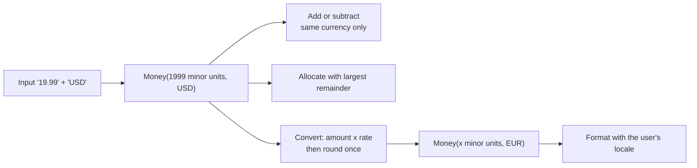

**Rounding modes (`java.math.RoundingMode`)**

| Mode | 2.345 → 2 places | Use |
|---|---|---|
| `HALF_UP` | 2.35 | "School rounding", common for invoices and tax |
| `HALF_EVEN` (banker's) | 2.34 | Unbiased over many operations; good for finance totals |
| `DOWN` / `FLOOR` | 2.34 | Truncation rules (some taxes) |
| `UNNECESSARY` | throws if rounding is needed | Safety check when no rounding is expected |

**Allocation (largest remainder).** Compute each share in whole minor units, then give the leftover units, one at a time, to the first shares. The parts always add up to the total.

## 8.4 Types and Variants

| Variant | Note |
|---|---|
| **`long` minor units + `Currency`** | Fast, simple, exact; watch overflow (`Math.addExact`) |
| **`BigDecimal` with scale** | Flexible, supports many decimals (crypto, FX rates) |
| **JSR 354 / Moneta `MonetaryAmount`** | Standard Money API for Java |
| **Joda-Money** | Library with `Money` and `BigMoney` |
| **Multi-currency ledger** | Store original currency, converted amount, and the rate used |
| **Price lists per currency** | Fixed local prices (9.99 USD, 799 INR) instead of converting live |

## 8.5 Complete Java Example - Money Value Object, Allocation, Rounding and FX

**What it shows:** the floating-point trap, `BigDecimal` pitfalls, currency decimal places, an allocation that never loses a cent, rounding modes, conversion with correct scale, a blocked USD + EUR addition, and the per-line vs per-invoice tax difference.

```java
import java.math.BigDecimal;
import java.math.RoundingMode;
import java.util.*;

public class MoneyDemo {

    // Money = whole minor units (cents/paise) + currency. No floating point anywhere.
    record Money(long minor, Currency currency) {
        static Money of(String amount, String code) {
            Currency c = Currency.getInstance(code);
            BigDecimal bd = new BigDecimal(amount).setScale(c.getDefaultFractionDigits(), RoundingMode.UNNECESSARY);
            return new Money(bd.movePointRight(c.getDefaultFractionDigits()).longValueExact(), c);
        }
        BigDecimal amount() { return BigDecimal.valueOf(minor, currency.getDefaultFractionDigits()); }
        Money plus(Money o) {
            if (!currency.equals(o.currency)) throw new IllegalArgumentException("currency mismatch " + currency + " vs " + o.currency);
            return new Money(Math.addExact(minor, o.minor), currency);
        }
        // split so that parts always add up to the original (largest-remainder)
        List<Money> allocate(int... ratios) {
            long total = 0; for (int r : ratios) total += r;
            long[] share = new long[ratios.length]; long used = 0;
            for (int i = 0; i < ratios.length; i++) { share[i] = minor * ratios[i] / total; used += share[i]; }
            for (int i = 0; used < minor; i++, used++) share[i % share.length]++;   // hand out leftover minor units
            List<Money> out = new ArrayList<>();
            for (long s : share) out.add(new Money(s, currency));
            return out;
        }
        Money convert(String rate, String toCode) {
            Currency to = Currency.getInstance(toCode);
            BigDecimal converted = amount().multiply(new BigDecimal(rate)).setScale(to.getDefaultFractionDigits(), RoundingMode.HALF_EVEN);
            return new Money(converted.movePointRight(to.getDefaultFractionDigits()).longValueExact(), to);
        }
        public String toString() { return amount().toPlainString() + " " + currency.getCurrencyCode(); }
    }

    public static void main(String[] args) {
        // 1) Why not double
        System.out.println("1) 0.1 + 0.2 as double      = " + (0.1 + 0.2));
        System.out.println("   new BigDecimal(0.1)      = " + new BigDecimal(0.1));
        System.out.println("   new BigDecimal(\"0.1\")    = " + new BigDecimal("0.1") + "   <- always build from a String");
        System.out.println("   2.0 equals 2.00 ?        = " + new BigDecimal("2.0").equals(new BigDecimal("2.00"))
                + "   compareTo == 0 ? " + (new BigDecimal("2.0").compareTo(new BigDecimal("2.00")) == 0));

        // 2) Currencies have different decimal places
        for (String code : List.of("USD", "INR", "JPY", "KWD"))
            System.out.println("2) " + code + " decimal places = " + Currency.getInstance(code).getDefaultFractionDigits());

        // 3) Splitting money without losing a cent
        Money bill = Money.of("100.00", "USD");
        System.out.println("3) 100.00 split 3 ways     = " + bill.allocate(1, 1, 1));
        System.out.println("   100.00 split 70/20/10   = " + bill.allocate(70, 20, 10));
        double naive = 100.00 / 3;
        System.out.println("   naive double: 3 x " + Math.round(naive * 100) / 100.0 + " = " + 3 * (Math.round(naive * 100) / 100.0) + "  (a cent vanished)");

        // 4) Rounding mode matters
        for (String v : List.of("2.345", "2.355", "2.365"))
            System.out.println("4) " + v + "  HALF_UP=" + new BigDecimal(v).setScale(2, RoundingMode.HALF_UP)
                    + "  HALF_EVEN=" + new BigDecimal(v).setScale(2, RoundingMode.HALF_EVEN));

        // 5) Currency conversion
        System.out.println("5) 100.00 USD -> INR @83.1234 = " + Money.of("100.00", "USD").convert("83.1234", "INR"));
        System.out.println("   100.00 USD -> JPY @151.6789 = " + Money.of("100.00", "USD").convert("151.6789", "JPY"));
        try { Money.of("5.00", "USD").plus(Money.of("5.00", "EUR")); }
        catch (IllegalArgumentException e) { System.out.println("   adding USD + EUR blocked: " + e.getMessage()); }

        // 6) Tax: round per line vs round the invoice (can differ by a cent)
        BigDecimal rate = new BigDecimal("0.18");
        List<BigDecimal> lines = List.of(new BigDecimal("0.99"), new BigDecimal("0.99"), new BigDecimal("0.99"));
        BigDecimal perLine = BigDecimal.ZERO, sum = BigDecimal.ZERO;
        for (BigDecimal l : lines) { perLine = perLine.add(l.multiply(rate).setScale(2, RoundingMode.HALF_UP)); sum = sum.add(l); }
        BigDecimal onTotal = sum.multiply(rate).setScale(2, RoundingMode.HALF_UP);
        System.out.println("6) 18% tax on 3 x 0.99: per line = " + perLine + ", on invoice total = " + onTotal + "  (pick one rule and document it)");
    }
}
```

**Output** (identical on all 3 runs):

```text
1) 0.1 + 0.2 as double      = 0.30000000000000004
   new BigDecimal(0.1)      = 0.1000000000000000055511151231257827021181583404541015625
   new BigDecimal("0.1")    = 0.1   <- always build from a String
   2.0 equals 2.00 ?        = false   compareTo == 0 ? true
2) USD decimal places = 2
2) INR decimal places = 2
2) JPY decimal places = 0
2) KWD decimal places = 3
3) 100.00 split 3 ways     = [33.34 USD, 33.33 USD, 33.33 USD]
   100.00 split 70/20/10   = [70.00 USD, 20.00 USD, 10.00 USD]
   naive double: 3 x 33.33 = 99.99  (a cent vanished)
4) 2.345  HALF_UP=2.35  HALF_EVEN=2.34
4) 2.355  HALF_UP=2.36  HALF_EVEN=2.36
4) 2.365  HALF_UP=2.37  HALF_EVEN=2.36
5) 100.00 USD -> INR @83.1234 = 8312.34 INR
   100.00 USD -> JPY @151.6789 = 15168 JPY
   adding USD + EUR blocked: currency mismatch USD vs EUR
6) 18% tax on 3 x 0.99: per line = 0.54, on invoice total = 0.53  (pick one rule and document it)
```

**What the output shows**
- **1:** `new BigDecimal(0.1)` captures the *double's* error. Use `new BigDecimal("0.1")` or `BigDecimal.valueOf(0.1)`. `equals` compares value **and scale** (`2.0 ≠ 2.00`); use `compareTo` for numeric equality.
- **2:** decimals differ by currency. Hard-coding "2 decimal places" breaks JPY and KWD.
- **3:** the allocation gives `33.34 + 33.33 + 33.33 = 100.00`. The `double` version loses a cent.
- **4:** `HALF_UP` and `HALF_EVEN` differ at exact halves (2.345, 2.365). Pick one rule and apply it everywhere.
- **5:** the FX result is rounded **once**, to the target currency's decimals (8312.34 INR, 15168 JPY with 0 decimals).
- **6:** rounding tax per line (0.54) differs from rounding on the total (0.53). Both can be legal; the law or your contract decides. Document it.

## 8.6 Multi-Currency in Spring Boot

**Persist money safely with JPA**
```java
@Embeddable
public class MoneyEmbeddable {
    @Column(name = "amount_minor", nullable = false) private long amountMinor;     // 1999 = 19.99
    @Column(name = "currency", length = 3, nullable = false) private String currency;   // ISO 4217: USD, INR
}
// SQL type for an amount column if you prefer decimals: NUMERIC(19, 4), never FLOAT/DOUBLE
```

**JSON: send amount as a string or as minor units**, not a JSON number (JavaScript turns it into a double).
```json
{ "amount": "19.99", "currency": "USD" }
```

**Exchange rates:** fetch from a provider on a schedule, cache with `@Cacheable`, and **store the rate used with each transaction** so past orders can be explained.
```java
@Cacheable(value = "fxRates", key = "#from + '-' + #to")
public BigDecimal rate(String from, String to) { return provider.latest(from, to); }
```

**With a library (JSR 354 Moneta):**
```java
MonetaryAmount price = Monetary.getDefaultAmountFactory().setCurrency("USD").setNumber(19.99).create();
CurrencyConversion toInr = MonetaryConversions.getConversion("INR");
MonetaryAmount inr = price.with(toInr);
```

## 8.7 Pros and Cons

| Pros | Cons |
|---|---|
| Exact, auditable totals | More code than `double price` |
| No lost or invented cents | Must carry the currency everywhere |
| Safe across currencies | FX rates and rounding policies need business decisions |

## 8.8 Pitfalls, Interview Questions and Cheat Sheet

**Common pitfalls**
- `new BigDecimal(double)`.
- Comparing `BigDecimal` with `equals` instead of `compareTo`.
- `BigDecimal.divide` without a scale/rounding mode (`ArithmeticException: Non-terminating decimal expansion`).
- Hard-coding 2 decimal places.
- Converting twice (round after each step) instead of once.
- Storing money as `FLOAT` in the database.
- Forgetting to store the exchange rate used.

**Interview questions**
1. *Why not `double` for money?* → Binary floating point can't represent most decimals exactly; errors accumulate.
2. *`BigDecimal(0.1)` vs `BigDecimal("0.1")`?* → The first holds the double's binary error; the second is exact.
3. *How do you split 100.00 into three parts?* → Work in minor units, divide, and distribute the remainder (largest remainder method).
4. *`HALF_UP` or `HALF_EVEN`?* → HALF_UP is the common invoice rule; HALF_EVEN avoids bias in large sums. Follow the regulation and be consistent.
5. *How would you store money in the database?* → Integer minor units + currency code, or `NUMERIC(19,4)` + code.
6. *How do you handle multiple currencies in one ledger?* → Keep the original amount and currency, the converted amount in a base currency, and the rate and timestamp.

**Cheat sheet**
```
Type     : Money(long minor units, ISO-4217 currency)  or  BigDecimal + currency
Never    : double/float, new BigDecimal(double), equals() on BigDecimal
Decimals : Currency.getDefaultFractionDigits()   (JPY 0, USD 2, KWD 3)
Split    : floor shares + hand out remainder       -> parts sum to total
Convert  : amount x rate, round ONCE, store rate + time
Rounding : pick HALF_UP or HALF_EVEN, one place, documented
```

### 📘 Terms Explained

| Term | Meaning |
|---|---|
| **Minor unit** | The smallest unit of a currency (cent, paisa) |
| **ISO 4217** | The standard 3-letter currency codes (USD, EUR, INR, JPY) |
| **Floating point** | A binary way of storing decimals that is approximate |
| **`BigDecimal`** | Java class for exact decimal numbers |
| **Scale** | Number of digits after the decimal point |
| **Banker's rounding** | `HALF_EVEN`: exact halves round to the nearest even digit |
| **Largest remainder** | A method for splitting a total into whole units so the parts sum exactly |
| **FX rate** | The price of one currency in another at a given time |
| **Value object** | A small immutable object defined by its values (like `Money`) |

---

# 9. Geospatial Patterns

## 9.1 What Are Geospatial Patterns?

Location-based services (maps, taxis, food delivery, "stores near me") need to answer: **"what is within 3 km of this point?"** and **"how far is A from B?"** The patterns are:

1. **Distance formula:** haversine (great-circle distance on a sphere).
2. **Spatial index:** a structure that finds nearby points without scanning all of them (geohash, quadtree, R-tree, S2/H3 grid).
3. **Filter then refine:** use the cheap index to get candidates, then compute exact distances.

## 9.2 Why Do We Need It?

A table of 10 million drivers. A naive query computes the distance to every driver for every rider request. That's 10 million trigonometric calculations per request. An index reduces it to the few hundred drivers in the neighbouring cells.

## 9.3 How It Works

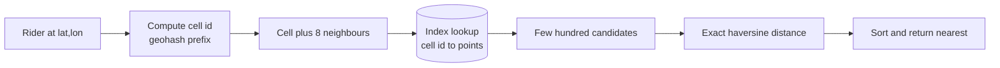

**Geohash.** Interleave the bits from repeatedly halving the longitude range and the latitude range, then write each 5 bits as a base-32 character. Longer hashes = smaller cells; points that share a prefix are in the same cell.

| Geohash length | Approx. cell size |
|---|---|
| 4 | 39 km × 20 km |
| 5 | 4.9 km × 4.9 km |
| 6 | 1.2 km × 0.6 km |
| 7 | 150 m × 150 m |

**Boundary problem.** Two points a few metres apart can sit on opposite sides of a cell edge and have completely different geohashes. So always query the **cell and its 8 neighbours**, then filter by real distance.

## 9.4 Types and Variants

| Index | Idea | Used by |
|---|---|---|
| **Geohash** | Base-32 string, prefix = area | Redis `GEO*`, Elasticsearch geo_point, DynamoDB patterns |
| **Quadtree** | Recursively split a square into 4 | Dense/sparse areas adapt |
| **R-tree** | Bounding rectangles in a tree | PostGIS (GiST), MySQL spatial |
| **S2 / H3 cells** | Hierarchical cells on a sphere / hexagons | Google S2, Uber H3 |
| **Redis GEO** | Sorted set keyed by geohash | `GEOADD`, `GEOSEARCH` |
| **Geofencing** | Is a point inside a polygon? | Delivery zones, alerts |
| **Routing** | Shortest path on a road graph (Dijkstra/A*, contraction hierarchies) | Maps. Distance ≠ road distance |

## 9.5 Complete Java Example - Haversine, a Geohash Encoder and the Boundary Pitfall

**What it shows:** real distances (Delhi–Mumbai), the geohash of several cities, a "within 3 km" search that uses a geohash cell as the filter, and how two points 14 m apart can have different geohashes.

```java
import java.util.*;

public class GeoDemo {
    static final String BASE32 = "0123456789bcdefghjkmnpqrstuvwxyz";

    // Haversine: great-circle distance in km
    static double haversineKm(double lat1, double lon1, double lat2, double lon2) {
        double R = 6371.0088;
        double dLat = Math.toRadians(lat2 - lat1), dLon = Math.toRadians(lon2 - lon1);
        double a = Math.sin(dLat / 2) * Math.sin(dLat / 2)
                 + Math.cos(Math.toRadians(lat1)) * Math.cos(Math.toRadians(lat2)) * Math.sin(dLon / 2) * Math.sin(dLon / 2);
        return 2 * R * Math.asin(Math.sqrt(a));
    }

    // Geohash: keep halving the lon range and the lat range, alternating bits, 5 bits per character
    static String geohash(double lat, double lon, int chars) {
        double[] latR = {-90, 90}, lonR = {-180, 180};
        StringBuilder sb = new StringBuilder();
        boolean evenBit = true; int bit = 0, ch = 0;
        while (sb.length() < chars) {
            double[] r = evenBit ? lonR : latR;
            double v = evenBit ? lon : lat, mid = (r[0] + r[1]) / 2;
            ch <<= 1;
            if (v >= mid) { ch |= 1; r[0] = mid; } else r[1] = mid;
            evenBit = !evenBit;
            if (++bit == 5) { sb.append(BASE32.charAt(ch)); bit = 0; ch = 0; }
        }
        return sb.toString();
    }

    record Place(String name, double lat, double lon) {}

    public static void main(String[] args) {
        // 1) distance
        System.out.printf("1) Delhi -> Mumbai  = %.0f km%n", haversineKm(28.6139, 77.2090, 19.0760, 72.8777));
        System.out.printf("   London -> Paris  = %.0f km%n", haversineKm(51.5074, -0.1278, 48.8566, 2.3522));

        // 2) geohash
        System.out.println("2) geohash(Delhi,6)  = " + geohash(28.6139, 77.2090, 6));
        System.out.println("   geohash(Noida,6)  = " + geohash(28.5355, 77.3910, 6) + "   (near Delhi: shares a prefix)");
        System.out.println("   geohash(London,6) = " + geohash(51.5074, -0.1278, 6));
        System.out.println("   longer hash = smaller cell: Delhi at 4/5/6/7 chars = "
                + geohash(28.6139, 77.2090, 4) + " / " + geohash(28.6139, 77.2090, 5) + " / "
                + geohash(28.6139, 77.2090, 6) + " / " + geohash(28.6139, 77.2090, 7));

        // 3) "restaurants within 3 km": index by geohash(5) cell, then exact distance filter
        List<Place> places = List.of(
            new Place("Cafe A", 28.6139, 77.2090), new Place("Cafe B", 28.6200, 77.2150), new Place("Cafe C", 28.6300, 77.2200),
            new Place("Cafe D", 28.5355, 77.3910), new Place("Cafe E", 28.7041, 77.1025));
        Map<String, List<Place>> index = new HashMap<>();
        for (Place p : places) index.computeIfAbsent(geohash(p.lat(), p.lon(), 5), k -> new ArrayList<>()).add(p);
        double qLat = 28.6139, qLon = 77.2090;
        String cell = geohash(qLat, qLon, 5);
        List<Place> candidates = index.getOrDefault(cell, List.of());
        System.out.println("3) query cell " + cell + " has " + candidates.size() + " candidates out of " + places.size() + " places");
        for (Place p : candidates) {
            double km = haversineKm(qLat, qLon, p.lat(), p.lon());
            System.out.printf("   %s  %.2f km  %s%n", p.name(), km, km <= 3 ? "INSIDE" : "outside");
        }

        // 4) Boundary pitfall: 22 m apart, but different cells
        double a = 51.5, lonA = -0.0001, lonB = 0.0001;
        System.out.printf("4) two points %.0f m apart:%n   %s vs %s  -> prefix match = %s%n",
                haversineKm(a, lonA, a, lonB) * 1000, geohash(a, lonA, 6), geohash(a, lonB, 6),
                geohash(a, lonA, 1).equals(geohash(a, lonB, 1)));
        System.out.println("   => always search the cell AND its 8 neighbours, then filter by real distance");
    }
}
```

**Output** (identical on all 3 runs):

```text
1) Delhi -> Mumbai  = 1148 km
   London -> Paris  = 344 km
2) geohash(Delhi,6)  = ttnfuc
   geohash(Noida,6)  = ttp434   (near Delhi: shares a prefix)
   geohash(London,6) = gcpvj0
   longer hash = smaller cell: Delhi at 4/5/6/7 chars = ttnf / ttnfu / ttnfuc / ttnfucj
3) query cell ttnfu has 1 candidates out of 5 places
   Cafe A  0.00 km  INSIDE
4) two points 14 m apart:
   gcpuzz vs u10hbp  -> prefix match = false
   => always search the cell AND its 8 neighbours, then filter by real distance
```

**What the output shows**
- **1:** Delhi to Mumbai is about 1,148 km in a straight line over the earth's surface.
- **2:** Delhi and Noida share the prefix `tt`, London is far away (`gcpvj0`). Each extra character shrinks the cell.
- **3:** the 5-character cell around the query holds only 1 of the 5 places. Cafe B (about 0.9 km away) and Cafe C (about 2.1 km away) are both within 3 km but sit in neighbouring cells, so **a single-cell lookup misses them**. This is the boundary problem in a real result, which is why you also search the 8 neighbours (or use a bigger cell).
- **4:** two points 14 m apart across longitude 0° have totally different hashes (`gcpuzz` vs `u10hbp`), so prefix matching alone fails.

## 9.6 Geospatial in Java and Spring

**Redis GEO (simplest for "nearby drivers")**
```java
redis.opsForGeo().add("drivers", new Point(77.2090, 28.6139), "driver-42");           // longitude first!
GeoResults<RedisGeoCommands.GeoLocation<String>> near = redis.opsForGeo().search("drivers",
        GeoReference.fromCoordinate(77.2090, 28.6139), new Distance(3, Metrics.KILOMETERS),
        RedisGeoCommands.GeoSearchCommandArgs.newGeoSearchArgs().includeDistance().sortAscending().limit(20));
```
Update a moving driver's position with another `add` (it overwrites). Expire stale drivers (store a heartbeat timestamp).

**PostGIS with Spring Data JPA**
```java
@Query(value = "SELECT * FROM stores WHERE ST_DWithin(location::geography, ST_MakePoint(:lon, :lat)::geography, :meters) " +
               "ORDER BY location <-> ST_MakePoint(:lon, :lat) LIMIT 20", nativeQuery = true)
List<Store> nearby(@Param("lat") double lat, @Param("lon") double lon, @Param("meters") double meters);
// create a GiST index: CREATE INDEX ON stores USING GIST (location);
```

**Elasticsearch:** `geo_point` field plus `geo_distance` filter and `_geo_distance` sort.

## 9.7 Pros and Cons

| Pros | Cons |
|---|---|
| Queries touch only nearby data | Cell boundaries need the neighbour trick |
| Simple prefix indexes work in any key-value store | Geohash cells are distorted near the poles |
| Haversine is accurate enough for most apps | Straight-line distance ≠ travel time |

## 9.8 Pitfalls, Interview Questions and Cheat Sheet

**Common pitfalls**
- Latitude/longitude order mix-ups (GeoJSON, Redis and Elasticsearch-array use **lon, lat**; many UIs use lat, lon).
- Using the Euclidean distance on degrees (wrong; 1° of longitude is shorter near the poles).
- Searching only one cell.
- Storing positions every second for every driver forever. Keep the latest position in memory/Redis and history in a time-series store.
- Ignoring the antimeridian (±180°) and the poles.

**Interview questions**
1. *Design "find nearby drivers".* → Drivers send location every few seconds to a service that updates a geo index (Redis GEO or a sharded grid by cell id); riders query cell + neighbours; filter by exact distance and availability; shard by region.
2. *What is a geohash and what is its weakness?* → A string that encodes a rectangle; prefix = bigger area. Weakness: nearby points can have different prefixes (edges), so query neighbours.
3. *Geohash vs quadtree vs R-tree?* → Geohash is a simple string key (easy to shard); quadtree adapts to density; R-tree is the database standard for rectangles and polygons.
4. *Haversine vs road distance?* → Haversine is straight-line over the sphere; for ETA use a routing engine.
5. *How would you handle millions of moving objects?* → Keep live positions in memory (Redis/geo grid), partition by cell, send updates through a queue, and batch history to a time-series store.

**Cheat sheet**
```
Distance : haversine (km) = 2R * asin(sqrt(...)), R = 6371 km
Index    : geohash prefix / quadtree / R-tree / S2 / H3
Query    : cell + 8 neighbours -> candidates -> exact distance -> sort
Order    : GeoJSON and Redis = (longitude, latitude)
Moving   : latest position in Redis GEO, history to a time-series DB
```

### 📘 Terms Explained

| Term | Meaning |
|---|---|
| **Latitude / Longitude** | Position north-south / east-west on the earth in degrees |
| **Haversine formula** | Distance between two points on a sphere |
| **Geohash** | A short string that identifies a rectangular cell on the map |
| **Quadtree** | A tree that splits space into four quarters repeatedly |
| **R-tree** | A tree of bounding boxes used by spatial databases |
| **Geofence** | A virtual boundary on a map that triggers actions |
| **PostGIS** | The spatial extension of PostgreSQL |
| **Antimeridian** | The ±180° longitude line where the numbers wrap |

---

# 10. Time-Zone Handling (Interview Imp - Java)

## 10.1 What Is Time-Zone Handling?

A **time zone** is a region's rule for its local clock, including its **UTC offset** (e.g. +05:30 for India) and **daylight saving time (DST)** changes. The pattern in one line:

> **Store and compute in UTC (an `Instant`). Convert to a zone only when showing it to a person or when applying a *local-time rule* ("every day at 09:00 in New York").**

## 10.2 Why Do We Need It?

| Problem | Example |
|---|---|
| Users in many countries | A meeting at 14:30 UTC is 09:30 in New York, 20:00 in Kolkata |
| Offsets change during the year | New York is -05:00 in winter and -04:00 in summer |
| A local time may not exist | 02:30 on the spring-forward day is skipped |
| A local time may happen twice | 01:30 on the fall-back day |
| "A day" is not always 24 hours | 23 or 25 hours on DST days |
| Servers in different zones | A server in Mumbai saves "09:00" and one in London reads it |

## 10.3 How It Works

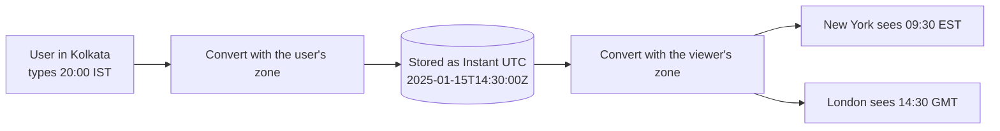

**Which `java.time` class for what**

| Class | Meaning | Use for |
|---|---|---|
| `Instant` | A point on the global timeline (UTC) | Timestamps: created_at, events, logs |
| `LocalDate` | Date without time or zone | Birthdays, hotel nights, holidays |
| `LocalDateTime` | Date + time **without** zone | Only as a step before attaching a zone |
| `ZonedDateTime` | Date + time + zone + offset | Display; local-time rules |
| `OffsetDateTime` | Date + time + fixed offset | Storing a value with its offset in a DB/JSON |
| `ZoneId` | A region such as `Asia/Kolkata` | Rules incl. DST. **Use region ids, not "+05:30" or "IST"** |
| `Duration` / `Period` | Exact time (hours, seconds) / calendar amount (days, months) | `plusHours(24)` vs `plusDays(1)` differ across DST |

## 10.4 Types and Variants

| Scenario | Store |
|---|---|
| Something that **happened** (order placed) | `Instant` / `TIMESTAMP WITH TIME ZONE` in UTC |
| A **future meeting** at a place | Local date-time + `ZoneId` (rules may change before the date!) and also the computed `Instant` |
| A **recurring** event "every day 09:00" | Local time + zone; compute each occurrence's `Instant` separately |
| A **date only** (birthday, hotel night) | `LocalDate` (+ the property's zone if needed) |
| A **deadline for "end of day"** | End of day in the **user's/business** zone, then convert to UTC |

## 10.5 Complete Java Example - Offsets, DST Gaps and Overlaps, and the LocalDateTime Trap

**What it shows:** the same instant in three zones, how "09:00 New York" maps to different UTC times across the March DST change, the missing hour, the repeated hour, `plusDays(1)` vs `plusHours(24)`, and why a zone-less `LocalDateTime` is ambiguous.

```java
import java.time.*;
import java.time.format.DateTimeFormatter;

public class TimeZoneDemo {
    static final DateTimeFormatter F = DateTimeFormatter.ofPattern("yyyy-MM-dd HH:mm z (xxx)");

    public static void main(String[] args) {
        ZoneId ny = ZoneId.of("America/New_York"), kolkata = ZoneId.of("Asia/Kolkata"), london = ZoneId.of("Europe/London");

        // 1) Store an Instant (UTC), show it in each user's zone
        Instant meeting = Instant.parse("2025-01-15T14:30:00Z");
        System.out.println("1) stored (UTC)   : " + meeting);
        for (ZoneId z : new ZoneId[]{ny, kolkata, london})
            System.out.println("   in " + String.format("%-17s", z) + ": " + meeting.atZone(z).format(F));

        // 2) "Every day at 09:00 New York time" -> the UTC instant changes with DST
        for (String day : new String[]{"2025-03-07", "2025-03-10"}) {
            ZonedDateTime nine = LocalDate.parse(day).atTime(9, 0).atZone(ny);
            System.out.println("2) 09:00 New York on " + day + " = " + nine.toInstant() + " UTC  (offset " + nine.getOffset() + ")");
        }

        // 3) The hour that does not exist (spring forward, 2025-03-09 02:30 in New York)
        LocalDateTime gap = LocalDateTime.of(2025, 3, 9, 2, 30);
        System.out.println("3) 02:30 on spring-forward day -> " + gap.atZone(ny).format(F) + "   (shifted forward)");

        // 4) The hour that happens twice (fall back, 2025-11-02 01:30 in New York)
        LocalDateTime overlap = LocalDateTime.of(2025, 11, 2, 1, 30);
        ZonedDateTime early = overlap.atZone(ny).withEarlierOffsetAtOverlap(), late = overlap.atZone(ny).withLaterOffsetAtOverlap();
        System.out.println("4) 01:30 on fall-back day happens twice:");
        System.out.println("   first : " + early.toInstant() + "  (" + early.getOffset() + ")");
        System.out.println("   second: " + late.toInstant() + "  (" + late.getOffset() + ")");

        // 5) Adding a "day" vs adding 24 hours across DST
        ZonedDateTime before = ZonedDateTime.of(2025, 3, 8, 12, 0, 0, 0, ny);
        System.out.println("5) 2025-03-08 12:00 + 1 day      = " + before.plusDays(1).format(F));
        System.out.println("   2025-03-08 12:00 + 24 hours   = " + before.plusHours(24).format(F));

        // 6) The classic bug: LocalDateTime has no zone
        LocalDateTime naive = LocalDateTime.of(2025, 1, 15, 9, 0);
        System.out.println("6) same LocalDateTime " + naive + " means "
                + naive.atZone(ny).toInstant() + " in New York but "
                + naive.atZone(kolkata).toInstant() + " in Kolkata");
        System.out.println("   India has no DST and is +05:30: " + Duration.between(naive.atZone(kolkata), naive.atZone(ny)).toHours() + " hours apart");
    }
}
```

**Output** (identical on all 3 runs):

```text
1) stored (UTC)   : 2025-01-15T14:30:00Z
   in America/New_York : 2025-01-15 09:30 EST (-05:00)
   in Asia/Kolkata     : 2025-01-15 20:00 IST (+05:30)
   in Europe/London    : 2025-01-15 14:30 GMT (+00:00)
2) 09:00 New York on 2025-03-07 = 2025-03-07T14:00:00Z UTC  (offset -05:00)
2) 09:00 New York on 2025-03-10 = 2025-03-10T13:00:00Z UTC  (offset -04:00)
3) 02:30 on spring-forward day -> 2025-03-09 03:30 EDT (-04:00)   (shifted forward)
4) 01:30 on fall-back day happens twice:
   first : 2025-11-02T05:30:00Z  (-04:00)
   second: 2025-11-02T06:30:00Z  (-05:00)
5) 2025-03-08 12:00 + 1 day      = 2025-03-09 12:00 EDT (-04:00)
   2025-03-08 12:00 + 24 hours   = 2025-03-09 13:00 EDT (-04:00)
6) same LocalDateTime 2025-01-15T09:00 means 2025-01-15T14:00:00Z in New York but 2025-01-15T03:30:00Z in Kolkata
   India has no DST and is +05:30: 10 hours apart
```

**What the output shows**
- **1:** one stored instant, three correct local views. India has a half-hour offset.
- **2:** "09:00 New York" is `14:00Z` on 7 March but `13:00Z` on 10 March (clocks changed on 9 March). A recurring local-time rule must be recomputed for each date. Storing a fixed UTC time would make the meeting shift by an hour for the New York users.
- **3:** 02:30 does not exist on spring-forward day. Java moves it forward to **03:30 EDT**.
- **4:** 01:30 on fall-back day happens at `05:30Z` (EDT) and again at `06:30Z` (EST). `ZonedDateTime` lets you choose the earlier or the later one.
- **5:** `plusDays(1)` keeps the wall-clock time (12:00 → 12:00 on the next day). `plusHours(24)` adds exactly 24 hours and lands on 13:00 because the day was only 23 hours long.
- **6:** `09:00` as a `LocalDateTime` is *either* 14:00Z or 03:30Z depending on the zone you attach, so storing it without a zone loses information.

## 10.6 Time Zones in Spring Boot and the Database

```java
// 1. Make the JVM and DB talk UTC
// application.yml
// spring.jpa.properties.hibernate.jdbc.time_zone: UTC
// Also start the JVM with -Duser.timezone=UTC

// 2. Entities use Instant
@Entity class Order {
    @Id Long id;
    Instant createdAt = Instant.now();                 // stored as UTC
}

// 3. API accepts ISO-8601 with offset, returns UTC; the client formats it
// spring.jackson.serialization.write-dates-as-timestamps: false  -> "2025-01-15T14:30:00Z"

// 4. Per-request zone for display (from user profile or header)
ZoneId zone = ZoneId.of(user.getTimeZone());           // "Asia/Kolkata", saved at signup
String shown = createdAt.atZone(zone).format(DateTimeFormatter.ofLocalizedDateTime(FormatStyle.MEDIUM).withLocale(locale));

// 5. Recurring local-time job
@Scheduled(cron = "0 0 9 * * *", zone = "America/New_York")     // 09:00 New York, DST-aware
public void dailyDigest() { ... }

// 6. Tests: inject a Clock instead of calling Instant.now()
Clock fixed = Clock.fixed(Instant.parse("2025-03-09T06:59:00Z"), ZoneOffset.UTC);
```
In the database use `TIMESTAMP WITH TIME ZONE` (PostgreSQL `timestamptz`) or a UTC `DATETIME`/`BIGINT` epoch. MySQL `TIMESTAMP` converts using the session zone, so set the session zone to UTC.

## 10.7 Pros and Cons

| Pros | Cons |
|---|---|
| One unambiguous timeline for ordering and comparing | Display needs the user's zone |
| DST is handled by the library, not by you | Future local times can change if governments change rules (keep `tzdata` updated) |
| Works across servers and regions | Recurring events need local-time + zone storage |

## 10.8 Pitfalls, Interview Questions and Cheat Sheet

**Common pitfalls**
- Using `java.util.Date`, `Calendar` or `SimpleDateFormat` (mutable and not thread-safe). Use `java.time`.
- Using the server's default zone (`ZoneId.systemDefault()`) in business logic.
- Storing `LocalDateTime` for events that happened at a point in time.
- Using fixed offsets (`+05:30`) or abbreviations (`IST` means India, Ireland and Israel) instead of region ids.
- Assuming a day has 24 hours.
- Scheduling "every day at 02:30" and hitting the DST gap.
- Date-only values shifted by a day when serialised as UTC midnight. Use `LocalDate` for dates.
- Not updating the JDK's time-zone data.

**Interview questions**
1. *How do you store timestamps?* → As UTC (`Instant`, `timestamptz`), and convert at the edges.
2. *`ZonedDateTime` vs `OffsetDateTime` vs `LocalDateTime`?* → Zoned has region rules (DST-aware); Offset has a fixed offset; Local has no zone at all.
3. *What happens at the DST gap and overlap in Java?* → Gap: the time is shifted forward by the gap length. Overlap: default is the earlier offset; use `withLaterOffsetAtOverlap()` for the second.
4. *`plusDays(1)` vs `plusHours(24)`?* → Calendar day (keeps local time) vs exactly 24 hours (can change local time).
5. *How do you schedule a daily 9 AM job for users in many zones?* → Store each user's zone, compute the next `Instant` per user, and run a scheduler that triggers due instants (or a per-zone cron).
6. *Why not `java.util.Date`?* → Mutable, confusing, no time-zone model; `java.time` is immutable and thread-safe.

**Cheat sheet**
```
Store     : Instant (UTC) / timestamptz        Display: instant.atZone(userZone)
Zone ids  : "Asia/Kolkata", never "IST" or "+05:30"
Local rule: LocalDate + LocalTime + ZoneId, recompute the Instant per occurrence
Gap       : non-existent local time -> shifted forward
Overlap   : repeated local time -> earlier offset by default
Add       : plusDays = calendar day, plusHours(24) = exactly 24 h
Tests     : inject java.time.Clock
```

### 📘 Terms Explained

| Term | Meaning |
|---|---|
| **UTC** | The global reference time, with no daylight saving |
| **Offset** | How far a local clock is from UTC (+05:30) |
| **Time zone (ZoneId)** | A region with its history of offsets and DST rules |
| **DST (daylight saving time)** | Moving clocks forward/back by an hour in some seasons |
| **Instant** | A point on the timeline, counted from 1970-01-01T00:00Z |
| **ISO-8601** | The standard text format for dates and times (`2025-01-15T14:30:00Z`) |
| **tzdata (IANA database)** | The list of all zones and their rules, shipped with the JDK |
| **Epoch** | The starting moment (1970-01-01T00:00:00Z) for timestamps in seconds/milliseconds |

---

# 11. Internationalization (i18n) and Localization (l10n) (Interview Imp - Java)

## 11.1 What Are i18n and l10n?

- **Internationalization (i18n)** (18 letters between "i" and "n"): designing the software so it *can* support many languages and regions **without code changes**. It is done once, by engineers.
- **Localization (l10n)**: actually adapting for one locale: translating text, formatting numbers/dates/currency, local rules. It is done per market, by translators and product teams.

A **locale** = language + region, for example `en_US`, `en_IN`, `hi_IN`, `de_DE`. Java's `java.util.Locale` is the key object.

## 11.2 Why Do We Need It?

| Difference | Example |
|---|---|
| Language | "Hello", "नमस्ते", "Hallo" |
| Plural rules | English: 1 item / 2 items. Arabic and Polish have more forms |
| Number format | `1,234,567.89` (US) vs `1.234.567,89` (Germany) vs `1 234 567,89` (France) |
| Currency | `$1,234.50` vs `1.234,50 €` |
| Date format | `3/7/25` (US) vs `07.03.25` (Germany). Is that March 7 or July 3? |
| Direction | Arabic and Hebrew are right-to-left |
| Text length | German is often 30% longer than English: layouts must flex |
| Case rules | Turkish `I` ↔ `ı` |
| Sorting | Swedish `ä` sorts after `z`; use `Collator` |

## 11.3 How It Works

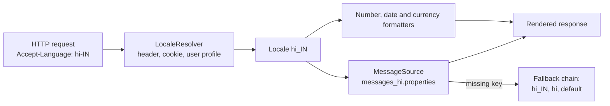

**Rules of thumb**
1. **Never concatenate** translated fragments: `"You have " + n + " items"` can't be translated. Use one message with placeholders: `You have {0} items`.
2. **Never hard-code** user-visible text, number formats or date patterns.
3. **Keep keys stable** (`cart.items`), translations in files per locale.
4. **Fallback chain:** `messages_hi_IN` → `messages_hi` → `messages` (default).
5. **Currency symbol is formatting only.** Converting the amount is a separate job ([Section 8](#8-multi-currency-pattern-interview-imp---java)).
6. Store text as **UTF-8**; keep the DB charset `utf8mb4`.
7. **Technical strings** (keys, enums, ids) must use `Locale.ROOT`, not the user's locale.

## 11.4 Types and Variants

| Variant | Note |
|---|---|
| **`ResourceBundle` / `.properties` files** | Core Java approach (`messages_hi.properties`) |
| **Spring `MessageSource`** | `ResourceBundleMessageSource` or `ReloadableResourceBundleMessageSource` |
| **ICU4J `MessageFormat`** | Proper plural/gender rules (`{count, plural, one {...} other {...}}`) |
| **Translation management systems** | Crowdin, Lokalise, Phrase; sync translations into files |
| **Database-stored translations** | For user-generated or CMS content (table `translation(key, locale, text)`) |
| **Locale resolution** | `Accept-Language` header, URL (`/hi/`), cookie, user profile |
| **Client-side i18n** | `Intl` API and i18next in the browser (see [React guide](../../react/React_Complete_Guide.md)) |
| **Pseudo-localization** | Replace text with accented, longer text in tests to spot hard-coded strings and layout breaks |

## 11.5 Complete Java Example - Bundles, Plurals, Number/Currency/Date Formats and the Turkish-i Bug

**What it shows:** the same greeting and cart message in English, Hindi, German and an unsupported locale (falls back to English), the plural forms of `ChoiceFormat`, how numbers/currency/dates differ, and the Turkish lowercase pitfall. (`NBSP`/narrow space characters are shown as `_`.)

```java
import java.io.PrintStream;
import java.text.MessageFormat;
import java.text.NumberFormat;
import java.time.LocalDate;
import java.time.format.DateTimeFormatter;
import java.time.format.FormatStyle;
import java.util.*;

public class I18nDemo {

    // Normally these are messages.properties / messages_hi.properties files; classes keep this demo in one file.
    public static class Msgs extends ListResourceBundle {
        protected Object[][] getContents() { return new Object[][]{
            {"greeting", "Hello, {0}!"},
            {"cart", "You have {0,choice,0#no items|1#one item|1<{0} items} in your cart."}}; }
    }
    public static class Msgs_hi extends ListResourceBundle {
        protected Object[][] getContents() { return new Object[][]{
            {"greeting", "नमस्ते, {0}!"},
            {"cart", "आपकी कार्ट में {0,choice,0#कोई सामान नहीं|1#एक सामान|1<{0} सामान} हैं।"}}; }
    }
    public static class Msgs_de extends ListResourceBundle {
        protected Object[][] getContents() { return new Object[][]{
            {"greeting", "Hallo, {0}!"},
            {"cart", "Sie haben {0,choice,0#keine Artikel|1#einen Artikel|1<{0} Artikel} im Warenkorb."}}; }
    }

    static String msg(Locale l, String key, Object arg) {
        ResourceBundle b = ResourceBundle.getBundle("I18nDemo$Msgs", l);
        return new MessageFormat(b.getString(key), l).format(new Object[]{arg});
    }

    public static void main(String[] args) {
        PrintStream out = new PrintStream(System.out, true, java.nio.charset.StandardCharsets.UTF_8);
        Locale en = Locale.US, hi = new Locale("hi", "IN"), de = Locale.GERMANY, fr = Locale.FRANCE, enIN = new Locale("en", "IN"), fallback = new Locale("ja", "JP");

        // 1) Messages come from a bundle chosen by locale (with fallback to the default bundle)
        out.println("1) message bundles");
        for (Locale l : new Locale[]{en, hi, de, fallback}) {
            out.println("   " + String.format("%-6s", l) + msg(l, "greeting", "Asha") + "  " + msg(l, "cart", 3));
        }
        out.println("   one/zero : " + msg(en, "cart", 1) + " | " + msg(en, "cart", 0));

        // 2) The same number prints differently
        double n = 1234567.891;
        out.println("2) number 1234567.891");
        for (Locale l : new Locale[]{en, de, fr, enIN})
            out.println("   " + String.format("%-6s", l) + NumberFormat.getNumberInstance(l).format(n).replace(' ', '_').replace(' ', '_'));

        // 3) Currency symbol and placement follow the locale, but the AMOUNT is not converted
        out.println("3) currency format (amount is only formatted, never converted)");
        out.println("   en_US USD: " + NumberFormat.getCurrencyInstance(en).format(1234.5));
        out.println("   de_DE EUR: " + NumberFormat.getCurrencyInstance(de).format(1234.5).replace(' ', '_'));
        out.println("   en_IN INR: " + NumberFormat.getCurrencyInstance(enIN).format(1234567.5));

        // 4) Dates
        LocalDate d = LocalDate.of(2025, 3, 7);
        out.println("4) date 2025-03-07");
        for (Locale l : new Locale[]{en, de, hi})
            out.println("   " + String.format("%-6s", l) + d.format(DateTimeFormatter.ofLocalizedDate(FormatStyle.LONG).withLocale(l)) + "   |   "
                    + d.format(DateTimeFormatter.ofLocalizedDate(FormatStyle.SHORT).withLocale(l)));

        // 5) Pitfall: case conversion depends on locale (Turkish dotless i)
        Locale tr = new Locale("tr", "TR");
        out.println("5) \"TITLE\".toLowerCase() default = " + "TITLE".toLowerCase(Locale.ROOT) + ", Turkish locale = " + "TITLE".toLowerCase(tr)
                + "  -> use Locale.ROOT for technical strings (keys, enums, ids)");
    }
}
```

**Output** (identical on all 3 runs):

```text
1) message bundles
   en_US Hello, Asha!  You have 3 items in your cart.
   hi_IN नमस्ते, Asha!  आपकी कार्ट में 3 सामान हैं।
   de_DE Hallo, Asha!  Sie haben 3 Artikel im Warenkorb.
   ja_JP Hello, Asha!  You have 3 items in your cart.
   one/zero : You have one item in your cart. | You have no items in your cart.
2) number 1234567.891
   en_US 1,234,567.891
   de_DE 1.234.567,891
   fr_FR 1_234_567,891
   en_IN 1,234,567.891
3) currency format (amount is only formatted, never converted)
   en_US USD: $1,234.50
   de_DE EUR: 1.234,50_€
   en_IN INR: ₹1,234,567.50
4) date 2025-03-07
   en_US March 7, 2025   |   3/7/25
   de_DE 7. März 2025   |   07.03.25
   hi_IN 7 मार्च 2025   |   7/3/25
5) "TITLE".toLowerCase() default = title, Turkish locale = tıtle  -> use Locale.ROOT for technical strings (keys, enums, ids)
```

**What the output shows**
- **1:** `ja_JP` has no bundle, so Java falls back to the default `Msgs` (English). Only the greeting is a template; the name is inserted at run time. The plural part picks "no items / one item / 3 items" from the number.
- **2:** the same number: `1,234,567.891` (US), `1.234.567,891` (Germany), `1 234 567,891` (France; the separator is a non-breaking space, shown as `_`).
- **2 (en_IN):** the JDK 17 output here is `1,234,567.891`, **not** the Indian lakh grouping `12,34,567.891`. Locale data differs between JDK versions and providers, so if lakh/crore grouping matters (it does for Indian finance apps), test on your target JDK or use a `DecimalFormat("#,##,##0.00")`-style custom pattern.
- **3:** currency symbol and position follow the locale. `NumberFormat` only formats, it never converts 1,234.50 USD to EUR.
- **4:** US prints month first (`3/7/25`), Germany day first (`07.03.25`). A raw `3/7/25` in an API is ambiguous, so use ISO-8601 in data (`2025-03-07`) and localized formats only for display.
- **5:** `"TITLE".toLowerCase()` in a Turkish locale gives `tıtle` (dotless ı), which breaks comparisons like `"TITLE".toLowerCase().equals("title")`. Always pass `Locale.ROOT` for keys, enum names and protocol strings.

## 11.6 i18n in Spring Boot

```java
// messages.properties (default), messages_hi.properties, messages_de.properties  -> src/main/resources
// cart.items=You have {0,choice,0#no items|1#one item|1<{0} items} in your cart.

// application.yml
// spring.messages.basename: messages
// spring.messages.encoding: UTF-8
// spring.messages.fallback-to-system-locale: false      # unknown locale -> default file, not the server's locale

@Configuration
class I18nConfig {
    @Bean LocaleResolver localeResolver() {
        AcceptHeaderLocaleResolver r = new AcceptHeaderLocaleResolver();      // from Accept-Language
        r.setDefaultLocale(Locale.ENGLISH);
        r.setSupportedLocales(List.of(Locale.ENGLISH, new Locale("hi"), Locale.GERMAN));
        return r;
    }
}

@RestController
class CartController {
    private final MessageSource messages;
    @GetMapping("/cart/summary")
    String summary(Locale locale) {                                           // Spring injects the resolved locale
        return messages.getMessage("cart.items", new Object[]{3}, locale);
    }
}

// Bean Validation messages are localized too: @NotBlank(message = "{user.name.required}")
```
For **plural/gender rules** beyond English, use ICU4J `com.ibm.icu.text.MessageFormat`. For **sorting** names use `Collator.getInstance(locale)`. For **dates** send ISO-8601 and let the client (or `DateTimeFormatter.ofLocalizedDate(...).withLocale(locale)`) format.

## 11.7 Pros and Cons

| Pros | Cons |
|---|---|
| New market = new files, not new code | Translation workflow and keeping files in sync |
| Correct formats build trust | Testing every locale (layout, RTL, long text) |
| Easier to add features later | Context is lost without good key names and comments for translators |

## 11.8 Pitfalls, Interview Questions and Cheat Sheet

**Common pitfalls**
- Hard-coded strings and string concatenation for sentences.
- Using the server's default locale (`Locale.getDefault()`) instead of the user's.
- `String.format("%.2f")` for money (decimal comma vs point depends on locale; use `NumberFormat`).
- Assuming one character = one letter (emoji, combining accents). Normalise with `Normalizer`.
- `toLowerCase()` / `toUpperCase()` without `Locale.ROOT` on technical strings.
- Latin-1/ISO-8859-1 `.properties` files (Java 9+ reads UTF-8 properties; older versions needed `\uXXXX` escapes).
- Fixed-width UI that breaks with longer German or Russian text.

**Interview questions**
1. *i18n vs l10n?* → i18n is making the code locale-ready; l10n is adapting for one locale.
2. *How does Spring pick the language?* → A `LocaleResolver` (Accept-Language header by default, or session/cookie); `MessageSource` looks up the key with that locale and falls back to the default file.
3. *How do you handle plurals?* → `ChoiceFormat` for simple cases, ICU4J `MessageFormat` for real plural rules (one/few/many/other).
4. *Why shouldn't you build sentences by concatenation?* → Word order differs between languages; translators need the whole sentence with placeholders.
5. *What is the Turkish-i problem?* → Locale-sensitive case conversion changes `I` to `ı`; use `Locale.ROOT` for technical strings.
6. *How do you format currency for a user?* → `NumberFormat.getCurrencyInstance(locale)` with the right `Currency`; formatting never converts.
7. *How would you store user-facing content in many languages?* → A translation table keyed by `(entity_id, locale)` with fallback to a default locale.

**Cheat sheet**
```
Locale      : language_REGION (hi_IN); resolve from Accept-Language / profile
Text        : keys in messages_{locale}.properties, placeholders {0}, never concatenate
Fallback    : messages_hi_IN -> messages_hi -> messages
Formats     : NumberFormat / DateTimeFormatter.ofLocalized... with the user's Locale
Data in APIs: ISO-8601 dates, minor-unit money, UTF-8 everywhere
Technical   : Locale.ROOT for keys, enums, protocol text
```

### 📘 Terms Explained

| Term | Meaning |
|---|---|
| **i18n** | Internationalization: preparing software for many locales |
| **l10n** | Localization: adapting software to one locale |
| **Locale** | Language + region (`en_IN`) controlling formats and text |
| **Resource bundle** | A set of translated messages for one locale |
| **`MessageSource`** | Spring's interface for looking up localized messages |
| **Placeholder** | A slot like `{0}` filled with a value at run time |
| **RTL** | Right-to-left writing (Arabic, Hebrew) |
| **Pseudo-localization** | A test trick: fake long accented text to reveal layout problems |
| **ICU** | International Components for Unicode: a library with advanced plural/gender rules |
| **UTF-8** | The standard text encoding that can represent all languages |

---

# 12. Healthcare Data Exchange: HL7 and FHIR

## 12.1 What Is Healthcare Data Exchange?

A hospital runs many separate systems: registration (ADT), lab (LIS), radiology (RIS/PACS), pharmacy, billing, doctors' records (EHR). They must tell each other things like *"patient admitted"*, *"lab result ready"*. The two standards:

- **HL7 v2** (since the 1980s): pipe-delimited text messages over TCP (MLLP). Still the most widely deployed.
- **FHIR** (Fast Healthcare Interoperability Resources, pronounced "fire"): modern REST + JSON resources (`Patient`, `Observation`, `Encounter`).

The integration patterns underneath are old friends: **Message Translator**, **Content-Based Router**, **Canonical Data Model**, **Dead Letter Queue**, **Idempotent Receiver**, all in [04_Integration_Pattern.md](04_Integration_Pattern.md) and [04_Messaging_Pattern.md](../03_System_Design/04_Messaging_Pattern.md). An **integration engine** (Mirth Connect, Rhapsody, Apache Camel) runs them.

## 12.2 Why Do We Need It?

| Problem | Fix |
|---|---|
| Each vendor uses its own format | A shared standard (HL7/FHIR) |
| Admission in one system must appear in the lab system | Event messages (ADT^A01) |
| Messages can be lost or duplicated | Acknowledgements (ACK/NACK) + idempotent processing |
| Patient data is highly sensitive | Strong authentication, encryption, audit logs, consent (HIPAA in the US, DPDP/ABDM in India, GDPR in Europe) |
| Old HL7 v2 systems and new FHIR apps must coexist | Translate between them |

## 12.3 How It Works

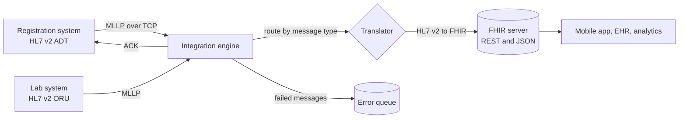

**HL7 v2 message anatomy**
```
MSH|^~\&|REG|CITYHOSP|LAB|CITYHOSP|20250115093000||ADT^A01|MSG0001|P|2.5
PID|1||12345^^^CITYHOSP^MR||Verma^Asha^K||19950412|F
PV1|1|I|WARD1^101^A
```
- Each line is a **segment** (`MSH` header, `PID` patient, `PV1` visit). Lines are separated by a carriage return `\r`.
- **Fields** are separated by `|`, **components** by `^`. `Verma^Asha^K` = family, given, middle.
- `ADT^A01` = "admit a patient". Others: `A03` discharge, `ORU^R01` lab result, `ORM` order.
- Receiver answers with an **ACK**: `MSA|AA|<control id>` (AA accepted, AE application error, AR rejected).

**FHIR in one picture:** `GET /Patient/12345` returns JSON for one `Patient`. `GET /Observation?patient=12345&code=718-7` searches lab results. Resources link to each other by reference (`"subject": {"reference": "Patient/12345"}`).

## 12.4 Types and Variants

| Standard / pattern | Meaning |
|---|---|
| **HL7 v2** | Event messages (ADT, ORU, ORM) in pipe-delimited text |
| **HL7 v3 / CDA** | XML documents (clinical summaries); heavier, less used today |
| **FHIR** | REST + JSON/XML resources; the modern default |
| **DICOM** | Medical images (X-ray, MRI) and their transfer |
| **SMART on FHIR** | OAuth2-based apps that plug into an EHR |
| **Terminologies** | ICD-10 (diagnoses), LOINC (lab tests), SNOMED CT (clinical terms) |
| **ABDM (India)** | Ayushman Bharat Digital Mission: FHIR-based health records, ABHA ids |
| **Integration patterns** | Router, Translator, Splitter, Aggregator, DLQ, Guaranteed Delivery |

## 12.5 Complete Java Example - Parse an HL7 v2 Message, Build an ACK and Map to FHIR

**What it shows:** parsing segments, fields and components from a (fictional) ADT^A01 message, producing an acknowledgement, and mapping the patient to a FHIR `Patient` JSON. (Real projects use a library such as **HAPI HL7v2 / HAPI FHIR** so escape sequences, repetitions and validation are handled.)

```java
import java.util.*;

public class Hl7Demo {

    // HL7 v2: segments separated by \r, fields by |, components by ^ (MSH defines the separators)
    record Segment(String name, String[] fields) {
        String field(int i) { return i < fields.length ? fields[i] : ""; }          // 1-based like the spec, except MSH
        String component(int f, int c) {
            String[] parts = field(f).split("\\^", -1);
            return c - 1 < parts.length ? parts[c - 1] : "";
        }
    }

    static List<Segment> parse(String message) {
        List<Segment> segs = new ArrayList<>();
        for (String line : message.split("\r")) {
            if (line.isBlank()) continue;
            String[] f = line.split("\\|", -1);
            segs.add(new Segment(f[0], f));
        }
        return segs;
    }

    static Segment find(List<Segment> segs, String name) {
        return segs.stream().filter(s -> s.name().equals(name)).findFirst().orElseThrow();
    }

    public static void main(String[] args) {
        String msg = "MSH|^~\\&|REG|CITYHOSP|LAB|CITYHOSP|20250115093000||ADT^A01|MSG0001|P|2.5\r"
                   + "PID|1||12345^^^CITYHOSP^MR||Verma^Asha^K||19950412|F\r"
                   + "PV1|1|I|WARD1^101^A\r";

        List<Segment> segs = parse(msg);
        System.out.println("1) segments: " + segs.stream().map(Segment::name).toList());

        Segment msh = find(segs, "MSH"), pid = find(segs, "PID"), pv1 = find(segs, "PV1");
        // MSH-1 is the "|" itself, so MSH fields are shifted by one in a split array
        String type = msh.fields()[8];
        String controlId = msh.fields()[9];
        System.out.println("2) message type = " + type.replace("^", " / ") + ", control id = " + controlId + ", HL7 version = " + msh.fields()[11]);
        System.out.println("   patient id   = " + pid.component(3, 1) + " (assigned by " + pid.component(3, 4) + ")");
        System.out.println("   patient name = " + pid.component(5, 2) + " " + pid.component(5, 1));
        System.out.println("   birth date   = " + pid.field(7) + ", sex = " + pid.field(8));
        System.out.println("   ward/room/bed= " + pv1.component(3, 1) + " / " + pv1.component(3, 2) + " / " + pv1.component(3, 3));

        // Acknowledgement: tell the sender we received it (AA = accepted, AE = error, AR = rejected)
        String ack = "MSH|^~\\&|LAB|CITYHOSP|REG|CITYHOSP|20250115093001||ACK^A01|ACK0001|P|2.5\r"
                   + "MSA|AA|" + controlId + "\r";
        System.out.println("3) ACK to send back:");
        for (String s : ack.split("\r")) System.out.println("   " + s);

        // Same patient as a FHIR resource (JSON, REST-friendly) - built by hand for the demo
        String fhir = "{\"resourceType\":\"Patient\",\"id\":\"12345\","
                    + "\"name\":[{\"family\":\"" + pid.component(5, 1) + "\",\"given\":[\"" + pid.component(5, 2) + "\"]}],"
                    + "\"gender\":\"female\",\"birthDate\":\"1995-04-12\"}";
        System.out.println("4) as FHIR: " + fhir);
    }
}
```

**Output** (identical on all 3 runs):

```text
1) segments: [MSH, PID, PV1]
2) message type = ADT / A01, control id = MSG0001, HL7 version = 2.5
   patient id   = 12345 (assigned by CITYHOSP)
   patient name = Asha Verma
   birth date   = 19950412, sex = F
   ward/room/bed= WARD1 / 101 / A
3) ACK to send back:
   MSH|^~\&|LAB|CITYHOSP|REG|CITYHOSP|20250115093001||ACK^A01|ACK0001|P|2.5
   MSA|AA|MSG0001
4) as FHIR: {"resourceType":"Patient","id":"12345","name":[{"family":"Verma","given":["Asha"]}],"gender":"female","birthDate":"1995-04-12"}
```

**What the output shows**
- **1–2:** three segments were parsed; the message is an admit event (`ADT / A01`) with control id `MSG0001`. The `MSH` segment is special: the field separator `|` is itself MSH-1, so splitting by `|` shifts the numbers by one. HAPI handles this for you.
- **Patient data:** id `12345` assigned by `CITYHOSP`, name `Asha Verma` (components 2 and 1 of PID-5), birth date `19950412`.
- **3:** the ACK echoes the **control id** so the sender can match it to the original message (a Correlation Identifier).
- **4:** the same patient as FHIR, the format modern apps consume. The conversion is a Message Translator.

## 12.6 Healthcare Integration in Java and Spring

```java
// HL7 v2 with HAPI: parse, validate, handle by type
HapiContext ctx = new DefaultHapiContext();
Parser parser = ctx.getPipeParser();
Message msg = parser.parse(raw);
if (msg instanceof ca.uhn.hl7v2.model.v25.message.ADT_A01 adt) {
    String family = adt.getPID().getPatientName(0).getFamilyName().getSurname().getValue();
    Message ack = msg.generateACK();                 // AA with the right control id
}

// FHIR with HAPI FHIR client
IGenericClient client = FhirContext.forR4().newRestfulGenericClient("https://fhir.example.org/fhir");
Patient p = client.read().resource(Patient.class).withId("12345").execute();
Bundle labs = client.search().forResource(Observation.class)
        .where(Observation.PATIENT.hasId("12345")).returnBundle(Bundle.class).execute();
```

```java
// Apache Camel route: HL7 in, route by type, translate, deliver, errors to a DLQ
from("netty:tcp://0.0.0.0:2575?sync=true&decoders=#hl7decoder&encoders=#hl7encoder")
    .unmarshal().hl7()
    .choice()
        .when(header("CamelHL7TriggerEvent").isEqualTo("A01")).to("direct:admit")
        .when(header("CamelHL7MessageType").isEqualTo("ORU")).to("direct:labResult")
        .otherwise().to("direct:unknown")
    .end();
// onException(Exception.class).handled(true).to("jms:queue:hl7.errors").transform(ack("AE"));
```

**Security checklist:** TLS on every hop, OAuth2/SMART scopes, role-based access, **audit log of who read which record**, minimum data in logs (never print patient names in application logs), encryption at rest, consent management, and data-residency rules for your country.

## 12.7 Pros and Cons

| Pros | Cons |
|---|---|
| Systems from different vendors can talk | HL7 v2 has many local "dialects" (every hospital uses fields differently) |
| FHIR is web-friendly and easy for developers | Mapping between v2 and FHIR needs clinical knowledge |
| Mature integration tooling | Very high privacy and regulatory demands |

## 12.8 Pitfalls, Interview Questions and Cheat Sheet

**Common pitfalls**
- Parsing HL7 v2 with plain `split` in production (escape characters `\F\`, repetitions `~`, MSH quirks). Use HAPI.
- Not sending ACKs, or sending AA before the message is safely stored.
- Processing duplicates (resent messages) twice. Use the message control id for idempotency.
- Logging protected health information (PHI).
- Treating date-times without time zones ([Section 10](#10-time-zone-handling-interview-imp---java)). HL7 dates often have no zone.
- Assuming every FHIR server supports every search parameter.

**Interview questions**
1. *HL7 v2 vs FHIR?* → v2 is pipe-delimited event messages over TCP (legacy, everywhere); FHIR is REST/JSON resources (modern, API-friendly).
2. *How do you make message processing reliable?* → ACK after durable storage, retries, idempotent receiver using the control id, dead-letter queue for poison messages.
3. *Which integration patterns appear?* → Message Translator, Content-Based Router, Canonical Data Model, Splitter, Guaranteed Delivery, Dead Letter Channel.
4. *How do you protect patient data?* → TLS, OAuth2/SMART scopes, RBAC, audit trail, encryption, masking in logs, consent, compliance (HIPAA/GDPR/DPDP).
5. *Design a lab-results notification system.* → Lab sends ORU → integration engine validates and stores → publishes a FHIR `Observation` event → notification service informs the doctor/patient; ACK, retry, DLQ, audit.

**Cheat sheet**
```
HL7 v2 : MSH|^~\&|... ; segment=line(\r) field=| component=^ ; ADT^A01=admit, ORU^R01=lab result
ACK    : MSA|AA|<control id>   (AA ok, AE app error, AR reject)
FHIR   : REST + JSON resources (Patient, Observation, Encounter), GET /Patient/{id}
Engine : router + translator + DLQ (Mirth, Camel, Rhapsody)
Safety : TLS, OAuth2/SMART, RBAC, audit trail, no PHI in logs, idempotent on control id
```

### 📘 Terms Explained

| Term | Meaning |
|---|---|
| **HL7** | Health Level Seven: standards for exchanging health data |
| **ADT** | Admit-Discharge-Transfer messages about patient movement |
| **ORU** | Observation result message (for example lab results) |
| **Segment / field / component** | HL7 v2 building blocks: line / `|`-separated value / `^`-separated part |
| **MLLP** | The simple framing protocol that carries HL7 v2 over TCP |
| **ACK** | Acknowledgement message confirming receipt |
| **FHIR** | A modern REST/JSON standard for health data |
| **EHR / EMR** | Electronic health/medical record system |
| **PHI** | Protected health information: data that identifies a patient's health |
| **HIPAA / GDPR / DPDP** | US / EU / India data-protection laws |
| **LOINC / SNOMED / ICD-10** | Standard code systems for lab tests / clinical terms / diagnoses |

---

# 13. Domain Patterns and the Building Blocks They Reuse

Each domain here is built from patterns that already have their own guide. Use this table to jump to the detailed explanation.

| Domain | Reuses these patterns | Detailed file |
|---|---|---|
| **E-commerce** | Saga for order → payment → shipping, Transactional Outbox, Cache-Aside for the catalogue, Rate Limiting for flash sales, Queue-Based Load Leveling | [05_Data_Management_Pattern.md](../03_System_Design/05_Data_Management_Pattern.md), [01_Scalability_Pattern.md](../03_System_Design/01_Scalability_Pattern.md), [01_Cloud_Native_Pattern.md](01_Cloud_Native_Pattern.md), [02_Reliability_Pattern.md](../03_System_Design/02_Reliability_Pattern.md) |
| **Payments** | Idempotent Consumer, Retry with backoff, Circuit Breaker, Timeout, Event Sourcing (ledger), Webhook (API design) | [04_Messaging_Pattern.md](../03_System_Design/04_Messaging_Pattern.md), [02_Reliability_Pattern.md](../03_System_Design/02_Reliability_Pattern.md), [08_API_Design_Pattern.md](../03_System_Design/08_API_Design_Pattern.md), [06_Security_Pattern.md](../03_System_Design/06_Security_Pattern.md) |
| **Booking** | Optimistic / Pessimistic Locking, Unit of Work, Unique constraints, Saga, Distributed locks | [02_Enterprise_Application_Pattern.md](../02_HLD/02_Enterprise_Application_Pattern.md), [07_Distributed_Systems_Pattern.md](../03_System_Design/07_Distributed_Systems_Pattern.md) |
| **Trading** | Event Sourcing, CQRS (order book vs reports), Single-writer concurrency, Disruptor | [05_Data_Management_Pattern.md](../03_System_Design/05_Data_Management_Pattern.md), [11_Concurrency_Pattern.md](../03_System_Design/11_Concurrency_Pattern.md) |
| **Social feed** | Fan-out via Pub-Sub, Cache (Redis ZSET), Sharding, Graph DB, CQRS read models | [04_Messaging_Pattern.md](../03_System_Design/04_Messaging_Pattern.md), [03_Data_Storage_Pattern.md](03_Data_Storage_Pattern.md) |
| **Search engine** | Inverted index, Sharding, Bloom filter, Consistent hashing, Batch jobs (PageRank) | [03_Data_Storage_Pattern.md](03_Data_Storage_Pattern.md), [07_Distributed_Systems_Pattern.md](../03_System_Design/07_Distributed_Systems_Pattern.md) |
| **Recommendations** | Event pipeline (Kafka), Feature store, Caching, A/B testing, Canary deployment of models | [04_Integration_Pattern.md](04_Integration_Pattern.md), [09_Deployment_Pattern.md](../03_System_Design/09_Deployment_Pattern.md), [../ai-ml/AI_ML_Roadmap.md](../../ai-ml/AI_ML_Roadmap.md) |
| **Multi-currency** | Value Object, Anti-Corruption Layer around FX providers, Cache for rates | [02_Enterprise_Application_Pattern.md](../02_HLD/02_Enterprise_Application_Pattern.md), [12_Legacy_Migration_Pattern.md](12_Legacy_Migration_Pattern.md) |
| **Geospatial** | Sharding by region, Redis GEO / PostGIS indexes, Time-series store for tracks | [03_Data_Storage_Pattern.md](03_Data_Storage_Pattern.md) |
| **Time zones / i18n** | Value Object, Strategy (formatters), Clock injection for tests | [01_LLD_Design_Patterns.md](../01_LLD/01_LLD_Design_Patterns.md), [05_Testing_Pattern.md](05_Testing_Pattern.md) |
| **Healthcare** | Message Translator, Content-Based Router, Dead Letter Channel, Canonical Data Model, Audit logging | [04_Integration_Pattern.md](04_Integration_Pattern.md), [10_Observability_Pattern.md](../03_System_Design/10_Observability_Pattern.md) |

**Coverage check:** all 13 items of the master list's Domain-Specific category (#449–461) are covered. E-commerce (Section 1), Payment Gateway (2), Booking Systems (3), Financial Trading (4), Social Network (5), Search Engine (6), Recommendation Systems (7), Multi-Currency (8), Geospatial (9), Time-Zone Handling (10), Internationalization and Localization (11, one section for both), Healthcare HL7 (12).

### 📘 Terms Explained

| Term | Meaning |
|---|---|
| **Building block** | A general pattern (queue, cache, saga) used inside a domain solution |
| **Read model** | A copy of data shaped for fast reading (CQRS) |
| **Single-writer principle** | Let exactly one thread change a piece of state, so no locks are needed |

---

# 14. How the Domain Patterns Fit Together

A single purchase touches almost every section of this file:

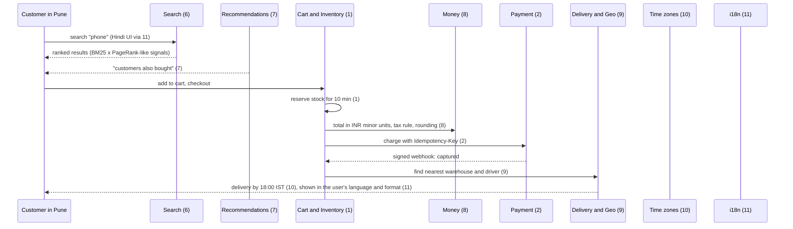

**A worked mental model**
1. **Discovery** = Search (6) + Recommendations (7) + Social signals (5).
2. **Commitment** = Cart/Inventory (1) or Booking (3), protected by atomic reservation.
3. **Money** = Money type (8), Payment state machine (2), Settlement (4).
4. **Fulfilment** = Geo (9) and Time zones (10).
5. **Presentation** = i18n (11), with Money and Time zones formatting.
6. **Domain specifics** = e.g. HL7/FHIR (12) when the "customer" is a patient.

**Three rules shared by every domain**
- **Make the dangerous step atomic** (decrement stock, insert booking, match order).
- **Make retries safe** (idempotency keys, event ids, control ids).
- **Keep the truth in one place** (database/ledger/log), and treat caches, search indexes and feeds as rebuildable copies.

### 📘 Terms Explained

| Term | Meaning |
|---|---|
| **Atomic** | Happens completely or not at all, with nothing visible in between |
| **Idempotent** | Doing it twice has the same effect as doing it once |
| **Ledger** | An append-only record of money or stock movements |

---

# 15. Domain-Specific Patterns Cheat Sheet

| Pattern | Core idea | Key rule | Java building block |
|---|---|---|---|
| **E-commerce** **(Interview Imp - Java)** | Reserve stock, re-price, idempotent order | `UPDATE ... WHERE available >= qty`; hold with TTL | JPA `@Modifying` query, `@Scheduled`, Redis |
| **Payment gateway** **(Interview Imp - Java)** | Idempotency + state machine + signed webhooks | Same key = same result; verify HMAC on raw body | `Mac("HmacSHA256")`, `MessageDigest.isEqual`, Resilience4j |
| **Booking** | Hold → confirm, no double booking | `[in, out)` ranges; UNIQUE(room, night) | `@Version`, `SELECT FOR UPDATE`, unique index |
| **Trading** | Order book, price-time priority | Trade at the resting price; integers only | `PriorityQueue` / `TreeMap`, Disruptor |
| **Social feed** | Hybrid fan-out | Push normal users, pull celebrities | Redis ZSET, Kafka, cursor paging |
| **Search engine** | Crawl, index, rank | Normalise URLs; blend BM25 and PageRank | jsoup, Elasticsearch/OpenSearch, Lucene |
| **Recommendations** | Collaborative + content-based | Minimum overlap; cold-start fallback | Spark ALS, Redis cache, A/B tests |
| **Multi-currency** **(Interview Imp - Java)** | Money = minor units + currency | No double; allocate; round once | `BigDecimal`, `Currency`, Moneta |
| **Geospatial** | Index to filter, formula to refine | Query cell + 8 neighbours | Redis GEO, PostGIS, Elasticsearch `geo_point` |
| **Time zones** **(Interview Imp - Java)** | UTC inside, zone at the edges | Region ids, `Instant`, never `LocalDateTime` for events | `java.time`, `Clock`, `@Scheduled(zone=)` |
| **i18n / l10n** **(Interview Imp - Java)** | Keys + locale files + locale formatters | No concatenation; `Locale.ROOT` for technical strings | `MessageSource`, `LocaleResolver`, `NumberFormat`, ICU4J |
| **Healthcare HL7 / FHIR** | Standard messages, ACKs, translators | ACK after durable save; idempotent on control id | HAPI HL7v2, HAPI FHIR, Camel |

**Top interview one-liners**
```
Stock: never "if (stock > 0) stock--"; make check-and-decrement one atomic statement, reserve with expiry
Payments: Idempotency-Key + state machine + HMAC-signed, de-duplicated webhooks; never trust the browser redirect
Booking: half-open ranges [in, out); the database enforces uniqueness, not an if
Trading: price first, then time; trade at the resting order's price; sequence numbers, not clocks
Feed: push for normal users, pull for celebrities, cursor pagination
Search: crawl -> normalise/dedupe -> inverted index -> BM25 x PageRank
Recommender: CF needs overlap, content-based fixes new items, popularity fixes new users
Money: minor units + currency, BigDecimal from String, allocate remainder, round once
Geo: cell + 8 neighbours, then exact haversine; GeoJSON/Redis use (lon, lat)
Time: Instant in storage, ZoneId at the edges; plusDays != plusHours(24)
i18n: whole sentences with placeholders, Locale.ROOT for technical strings
HL7: segments \r, fields |, components ^; ACK with the control id
```

### 📘 Terms Explained

| Term | Meaning |
|---|---|
| **Interview one-liner** | A short memorable answer you can expand if the interviewer asks |
| **Cheat sheet** | A one-page summary for last-minute revision |
| **Building block** | A library or pattern you assemble to build the solution |
