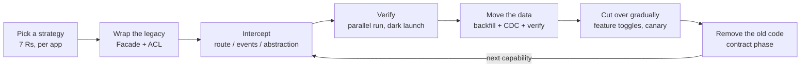
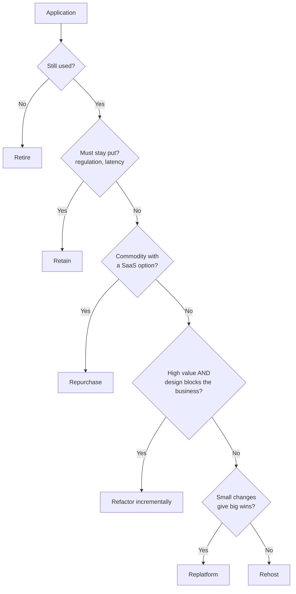
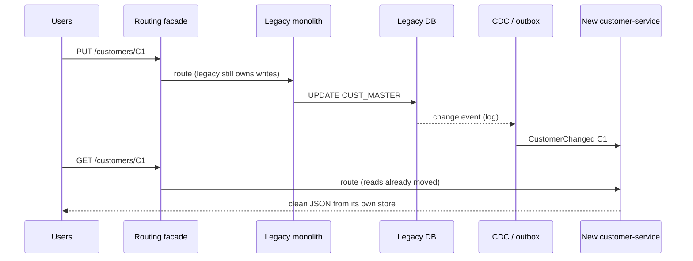
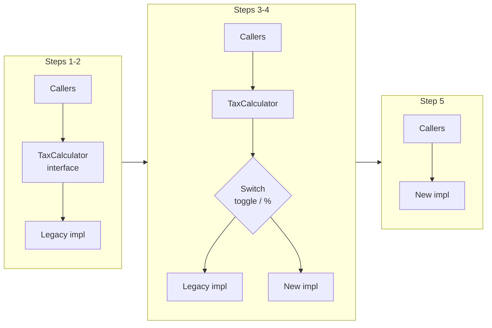
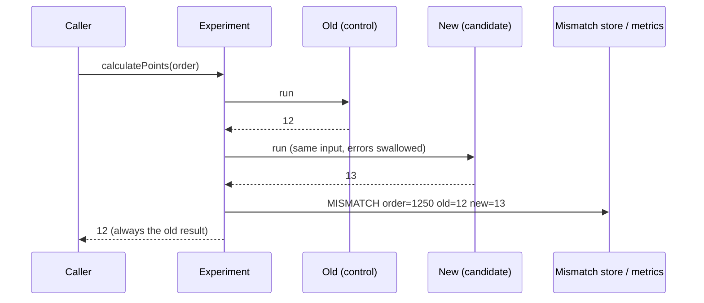
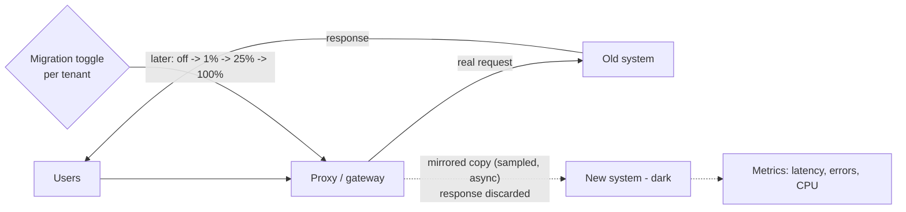
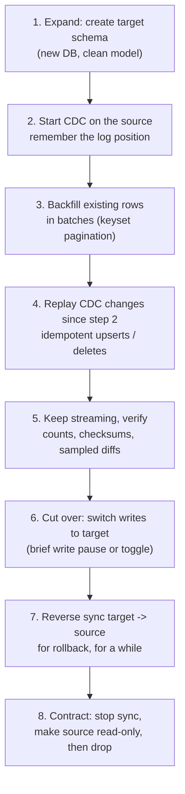
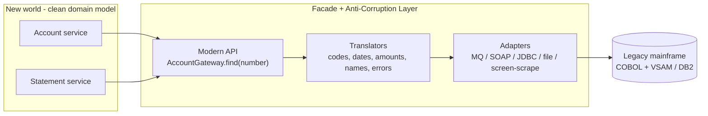
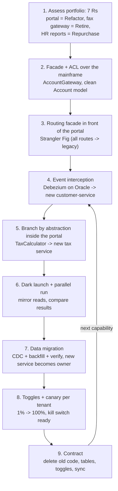

---
mdx:
  format: md
---

# Legacy & Migration Patterns

> **Note**: Patterns marked with **(Interview Imp - Java)** are frequently asked in Java interviews
>
> **How to read this file:** Every section ends with a **📘 Terms Explained** table. If you see a word you don't know, check the table right below that section. Each pattern goes from the basic idea to advanced usage (plain Java simulation, Spring Boot / tooling examples, pitfalls) and ends with interview questions and a mini cheat sheet.
>
> **What are legacy & migration patterns?** They answer one question: *"How do we replace or modernise a system that the business depends on every day, without stopping the business, losing data, or betting everything on one risky switch-over weekend?"* Senior interviews love this topic ("How would you break up this monolith?", "How do you move 2 TB of data with zero downtime?").
>
> **What lives elsewhere:** The basics of [Strangler Fig](02_Microservices_Pattern.md#13-strangler-fig-pattern-migrating-from-a-monolith-interview-imp---java) (routing facade with gradual rollout), [Feature Flags](../03_System_Design/09_Deployment_Pattern.md#5-feature-flags-pattern-interview-imp---java) and [Expand-and-Contract schema migrations](../03_System_Design/09_Deployment_Pattern.md#6-zero-downtime-database-migrations-expand-and-contract-interview-imp---java) already have detailed sections with code. This file links to them and goes deeper into the **migration-specific** parts: choosing a strategy, event interception, branch by abstraction, parallel runs, dark launches, moving data between databases, and wrapping legacy systems.
>
> **Builds on:** [05_Data_Management_Pattern.md - CDC](../03_System_Design/05_Data_Management_Pattern.md#9-change-data-capture-cdc-pattern), [04_Messaging_Pattern.md - Outbox](../03_System_Design/04_Messaging_Pattern.md#13-guaranteed-delivery-and-the-transactional-outbox-interview-imp---java), [03_Structural_Pattern.md - Facade](../01_LLD/03_Structural_Pattern.md#5-facade-pattern-interview-imp---java) and [Adapter](../01_LLD/03_Structural_Pattern.md#1-adapter-pattern-interview-imp---java), [05_Testing_Pattern.md - Golden Master](05_Testing_Pattern.md#8-snapshot-and-golden-master-testing), [01_Architectural_Pattern.md - DDD](../02_HLD/01_Architectural_Pattern.md#12-domain-driven-design-ddd-interview-imp---java) and [01_Cloud_Native_Pattern.md](01_Cloud_Native_Pattern.md).
>
> **Verified code:** Every main "Complete Java Example" in this file is **plain Java 17 (no libraries)** and was compiled and run **three times** with identical output (fixed data and seeds). To run one, save it as `<ClassName>.java` and run `javac <ClassName>.java && java <ClassName>`. (Running it directly with `java <ClassName>.java` won't work when the class with `main` is not the first class in the file.) Spring Boot, Flyway, Debezium and gateway snippets are configuration examples and were **not** executed.

---

## Table of Contents
- [Big Picture: Why Migrations Fail, and the Golden Rule](#big-picture-why-migrations-fail-and-the-golden-rule)
1. [Migration Strategies: Big Bang vs Incremental and the 7 Rs](#1-migration-strategies-big-bang-vs-incremental-and-the-7-rs-interview-imp---java) **(Interview Imp - Java)**
   - [1.1 What Are Migration Strategies?](#11-what-are-migration-strategies)
   - [1.2 Why Do We Need It?](#12-why-do-we-need-it)
   - [1.3 How It Works: Choosing per Application](#13-how-it-works-choosing-per-application)
   - [1.4 Complete Java Example - Classifying a Portfolio with the 7 Rs](#14-complete-java-example---classifying-a-portfolio-with-the-7-rs)
   - [1.5 Tools and Practice](#15-tools-and-practice)
   - [1.6 Pros and Cons](#16-pros-and-cons)
   - [1.7 Pitfalls, Interview Questions and Cheat Sheet](#17-pitfalls-interview-questions-and-cheat-sheet)
2. [Strangler Fig in Practice: Seams, Event Interception and Asset Capture](#2-strangler-fig-in-practice-seams-event-interception-and-asset-capture-interview-imp---java) **(Interview Imp - Java)**
   - [2.1 What is the Strangler Fig Pattern?](#21-what-is-the-strangler-fig-pattern)
   - [2.2 Why Do We Need It?](#22-why-do-we-need-it)
   - [2.3 How It Works: Three Interception Techniques](#23-how-it-works-three-interception-techniques)
   - [2.4 Complete Java Example - Event Interception, Reads First, Then Writes](#24-complete-java-example---event-interception-reads-first-then-writes)
   - [2.5 Event Interception with Debezium and Spring Boot](#25-event-interception-with-debezium-and-spring-boot)
   - [2.6 Pros and Cons](#26-pros-and-cons)
   - [2.7 Pitfalls, Interview Questions and Cheat Sheet](#27-pitfalls-interview-questions-and-cheat-sheet)
3. [Branch by Abstraction Pattern](#3-branch-by-abstraction-pattern)
   - [3.1 What is Branch by Abstraction?](#31-what-is-branch-by-abstraction)
   - [3.2 Why Do We Need It?](#32-why-do-we-need-it)
   - [3.3 How It Works](#33-how-it-works)
   - [3.4 Variants](#34-variants)
   - [3.5 Complete Java Example - Swapping a Tax Engine Behind an Interface](#35-complete-java-example---swapping-a-tax-engine-behind-an-interface)
   - [3.6 Branch by Abstraction in Spring Boot](#36-branch-by-abstraction-in-spring-boot)
   - [3.7 Pros and Cons](#37-pros-and-cons)
   - [3.8 Pitfalls, Interview Questions and Cheat Sheet](#38-pitfalls-interview-questions-and-cheat-sheet)
4. [Parallel Run Pattern](#4-parallel-run-pattern-interview-imp---java) **(Interview Imp - Java)**
   - [4.1 What is a Parallel Run?](#41-what-is-a-parallel-run)
   - [4.2 Why Do We Need It?](#42-why-do-we-need-it)
   - [4.3 How It Works](#43-how-it-works)
   - [4.4 Variants](#44-variants)
   - [4.5 Complete Java Example - A Scientist-Style Experiment](#45-complete-java-example---a-scientist-style-experiment)
   - [4.6 Parallel Run in Spring Boot](#46-parallel-run-in-spring-boot)
   - [4.7 Pros and Cons](#47-pros-and-cons)
   - [4.8 Pitfalls, Interview Questions and Cheat Sheet](#48-pitfalls-interview-questions-and-cheat-sheet)
5. [Dark Launch and Feature Toggles for Migration](#5-dark-launch-and-feature-toggles-for-migration-interview-imp---java) **(Interview Imp - Java)**
   - [5.1 What Are They?](#51-what-are-they)
   - [5.2 Why Do We Need Them?](#52-why-do-we-need-them)
   - [5.3 How It Works](#53-how-it-works)
   - [5.4 Variants](#54-variants)
   - [5.5 Complete Java Example - Mirroring a Sample to a Dark System](#55-complete-java-example---mirroring-a-sample-to-a-dark-system)
   - [5.6 Dark Launch and Toggles in Practice](#56-dark-launch-and-toggles-in-practice)
   - [5.7 Pros and Cons](#57-pros-and-cons)
   - [5.8 Pitfalls, Interview Questions and Cheat Sheet](#58-pitfalls-interview-questions-and-cheat-sheet)
6. [Database Migration and Expand-Contract](#6-database-migration-and-expand-contract-interview-imp---java) **(Interview Imp - Java)**
   - [6.1 What is a Database Migration?](#61-what-is-a-database-migration)
   - [6.2 Why Do We Need It?](#62-why-do-we-need-it)
   - [6.3 How It Works: Backfill + CDC + Verify + Cut-Over](#63-how-it-works-backfill--cdc--verify--cut-over)
   - [6.4 Variants](#64-variants)
   - [6.5 Complete Java Example - Backfill, CDC Replay and Verification](#65-complete-java-example---backfill-cdc-replay-and-verification)
   - [6.6 Data Migration Tooling in Java / Spring](#66-data-migration-tooling-in-java--spring)
   - [6.7 Pros and Cons](#67-pros-and-cons)
   - [6.8 Pitfalls, Interview Questions and Cheat Sheet](#68-pitfalls-interview-questions-and-cheat-sheet)
7. [Facade for Legacy and Anti-Corruption Layer](#7-facade-for-legacy-and-anti-corruption-layer-interview-imp---java) **(Interview Imp - Java)**
   - [7.1 What Are They?](#71-what-are-they)
   - [7.2 Why Do We Need Them?](#72-why-do-we-need-them)
   - [7.3 How It Works](#73-how-it-works)
   - [7.4 Variants](#74-variants)
   - [7.5 Complete Java Example - Wrapping a Fixed-Width Mainframe Record](#75-complete-java-example---wrapping-a-fixed-width-mainframe-record)
   - [7.6 Facade and ACL in Spring Boot](#76-facade-and-acl-in-spring-boot)
   - [7.7 Pros and Cons](#77-pros-and-cons)
   - [7.8 Pitfalls, Interview Questions and Cheat Sheet](#78-pitfalls-interview-questions-and-cheat-sheet)
8. [How the Legacy & Migration Patterns Fit Together](#8-how-the-legacy--migration-patterns-fit-together)
9. [Legacy & Migration Patterns Cheat Sheet](#9-legacy--migration-patterns-cheat-sheet)

---

## Big Picture: Why Migrations Fail, and the Golden Rule

Most failed migrations share the same story: a **big-bang rewrite**. A team spends 18 months building the "new system" next to the old one. Meanwhile the old system keeps changing, the new one never catches up, and the final switch-over weekend goes badly. Martin Fowler's well-known rule of thumb: *"the only thing a Big Bang rewrite guarantees is a Big Bang."*

**The golden rule of migration:** *move in small, reversible steps, and keep the system working and releasable after every step.*



| Big-bang rewrite | Incremental migration |
|---|---|
| Value delivered only at the end | Value delivered every few weeks |
| One huge, irreversible cut-over | Many small cut-overs, each one can be rolled back |
| Old and new drift apart (old keeps changing) | Old shrinks as new grows |
| Bugs found all at once, in production | Bugs found per step, with real traffic comparisons |
| Easy to plan on paper | Needs routing, sync and verification tooling |

### 📘 Terms Explained

| Term | Meaning |
|---|---|
| **Legacy system** | An older system still in use: often critical, poorly documented, hard to change, sometimes on old technology (mainframe, COBOL, old Java EE) |
| **Migration** | Moving functionality or data from one system/platform to another |
| **Big-bang rewrite** | Replacing a whole system in one go, with a single switch-over |
| **Incremental migration** | Replacing a system piece by piece while both keep running |
| **Cut-over** | The moment traffic or ownership switches from the old system to the new one |
| **Rollback** | Going back to the old system after a problem |
| **Monolith** | One large application deployed as a single unit |

---

# 1. Migration Strategies: Big Bang vs Incremental and the 7 Rs (Interview Imp - Java)

## 1.1 What Are Migration Strategies?

Before deciding *how* to migrate, decide *whether and how far* to migrate each application. Cloud providers (AWS first, based on Gartner's earlier "5 Rs") describe the options as the **7 Rs**:

| R | Strategy | What you do | Effort | Typical example |
|---|---|---|---|---|
| 1 | **Retire** | Switch it off | Lowest | Report nobody reads, duplicate tool |
| 2 | **Retain** | Leave it where it is (for now) | None | Regulated system, recently upgraded, or about to be replaced anyway |
| 3 | **Rehost** ("lift-and-shift") | Move the VM/app unchanged to the cloud | Low | Old Java EE app on a VM → cloud VM |
| 4 | **Relocate** | Move a whole platform without changing it (e.g. VMware → VMware Cloud) | Low | Data-centre exit with VMware |
| 5 | **Replatform** ("lift, tinker and shift") | Small changes to use managed services | Medium | Containerise, move Oracle → managed Postgres/RDS, keep the design |
| 6 | **Repurchase** ("drop and shop") | Replace with a SaaS product | Medium | Self-hosted CRM → Salesforce, wiki → Confluence |
| 7 | **Refactor / Re-architect** | Redesign (often into services, cloud-native) | Highest | Core order platform that must scale and change fast |

**Simple analogy:** Moving house. Some furniture you throw away (retire), some stays in storage (retain), most goes in the van as-is (rehost), some gets new legs to fit the new rooms (replatform), some you replace from a shop (repurchase), and the kitchen you rebuild properly (refactor), one cabinet at a time while still cooking dinner.

## 1.2 Why Do We Need It?

- A company may have **hundreds of applications**. Re-architecting all of them is impossible and pointless.
- Re-architecting is worth it only where **business value is high** and the current design **really hurts** (scaling, speed of change, cost).
- Everything else should be moved cheaply or switched off, so money and good engineers go where they matter.

## 1.3 How It Works: Choosing per Application



**Big bang vs incremental** is a second, separate choice, about **how** to execute a refactor or replatform:

| Choose big bang only when... | Choose incremental (default) when... |
|---|---|
| The system is small and well tested | The system is large or business-critical |
| It can be down for a planned window | It must stay up 24/7 |
| There's no way to route traffic per feature | You can put a facade/router in front |
| Data can be copied in one go in the window | Data is large or changes constantly |

## 1.4 Complete Java Example - Classifying a Portfolio with the 7 Rs

```java
import java.util.LinkedHashMap;
import java.util.List;
import java.util.Map;

// The "7 Rs": decide per application how (and whether) to migrate it, instead of one big plan for everything
public class MigrationPortfolioDemo {
    record App(String name, int businessValue, int techDebt, boolean usedAnyMore, boolean saasAlternative,
               boolean mustStayOnPrem, boolean needsElasticity, boolean containerReady) {}   // value/debt on a 1-5 scale

    static String decide(App a) {
        if (!a.usedAnyMore()) return "Retire      - nobody uses it: switch off, archive the data";
        if (a.mustStayOnPrem()) return "Retain      - regulation/latency keeps it where it is (for now)";
        if (a.saasAlternative() && a.businessValue() <= 2) return "Repurchase  - commodity function: move to a SaaS product";
        if (a.businessValue() >= 4 && (a.needsElasticity() || a.techDebt() >= 4)) return "Refactor    - core + painful: re-architect incrementally (strangler fig)";
        if (a.containerReady()) return "Replatform  - small changes: containerise, managed DB, keep the design";
        return "Rehost      - lift-and-shift the VM as-is, optimise later";
    }

    public static void main(String[] args) {
        List<App> portfolio = List.of(
                new App("order-management (monolith)", 5, 5, true, false, false, true, false),
                new App("internal-wiki", 1, 2, true, true, false, false, false),
                new App("fax-gateway", 1, 4, false, false, false, false, false),
                new App("payroll-batch", 3, 3, true, false, false, false, true),
                new App("trading-engine", 5, 2, true, false, true, false, false),
                new App("hr-reporting", 2, 3, true, false, false, false, false));
        Map<String, Integer> counts = new LinkedHashMap<>();
        for (App a : portfolio) {
            String d = decide(a);
            counts.merge(d.substring(0, d.indexOf(' ')), 1, Integer::sum);
            System.out.printf("%-28s -> %s%n", a.name(), d);
        }
        System.out.println("summary: " + counts);
        System.out.println("Only 1 of " + portfolio.size() + " apps justifies the expensive re-architecture; doing the same to all would waste most of the budget.");
    }
}
```

**Output:**
```
order-management (monolith)  -> Refactor    - core + painful: re-architect incrementally (strangler fig)
internal-wiki                -> Repurchase  - commodity function: move to a SaaS product
fax-gateway                  -> Retire      - nobody uses it: switch off, archive the data
payroll-batch                -> Replatform  - small changes: containerise, managed DB, keep the design
trading-engine               -> Retain      - regulation/latency keeps it where it is (for now)
hr-reporting                 -> Rehost      - lift-and-shift the VM as-is, optimise later
summary: {Refactor=1, Repurchase=1, Retire=1, Replatform=1, Retain=1, Rehost=1}
Only 1 of 6 apps justifies the expensive re-architecture; doing the same to all would waste most of the budget.
```

**What to notice:** the rules are crude, but the shape is real. Most portfolio assessments end with a small number of refactors and many cheap moves. Real assessments also use dependency mapping, licence costs, team skills and risk scores.

## 1.5 Tools and Practice

- **Discovery:** AWS Application Discovery Service, Azure Migrate, or simply CMDB exports plus interviews with app owners.
- **Rehost/replatform:** AWS Application Migration Service, Azure Migrate, container images built with Jib or Buildpacks (`./mvnw spring-boot:build-image`).
- **Java EE → Spring Boot / Jakarta EE upgrades:** OpenRewrite recipes automate many code changes (for example `javax.*` → `jakarta.*`, Spring Boot 2 → 3).

```xml
<!-- OpenRewrite: automated, repeatable refactoring for Java upgrades (run: mvn rewrite:run) -->
<plugin>
  <groupId>org.openrewrite.maven</groupId>
  <artifactId>rewrite-maven-plugin</artifactId>
  <configuration>
    <activeRecipes>
      <recipe>org.openrewrite.java.spring.boot3.UpgradeSpringBoot_3_0</recipe>
    </activeRecipes>
  </configuration>
  <dependencies>
    <dependency>
      <groupId>org.openrewrite.recipe</groupId>
      <artifactId>rewrite-spring</artifactId>
      <version><!-- current version --></version>
    </dependency>
  </dependencies>
</plugin>
```

## 1.6 Pros and Cons

| Strategy | Pros | Cons |
|---|---|---|
| Retire / Retain | Zero migration cost | Retained systems still need patching; "later" may never come |
| Rehost | Fast, cheap, low risk | Same design problems, often *higher* cloud bills (no elasticity) |
| Replatform | Good cost/benefit, managed services | Limited gains; some code changes and testing |
| Repurchase | No code to maintain | Data migration, vendor lock-in, process changes for users |
| Refactor | Biggest long-term gains | Slowest, riskiest, needs the patterns in the rest of this file |

## 1.7 Pitfalls, Interview Questions and Cheat Sheet

**Common pitfalls**
- **"Rewrite everything as microservices"** without a business reason. Start from pain points.
- **Rehosting and calling it done**: the app is now in the cloud but still can't scale and costs more.
- **No inventory of dependencies**: moving app A breaks batch job B that read A's database directly.
- **Forgetting data**: code moves easily, data (and its integrations) is usually the hardest part.

**Interview questions**
1. *What are the 7 Rs of migration?* → Retire, Retain, Rehost, Relocate, Replatform, Repurchase, Refactor; choose per application by value and pain.
2. *Big-bang rewrite or incremental, and why?* → Incremental by default: continuous value, reversible steps, no drifting rewrite; big bang only for small, well-tested systems that can tolerate downtime.
3. *What's the difference between rehost and replatform?* → Rehost moves unchanged; replatform makes small changes to use managed services (managed DB, containers) without redesigning.
4. *How would you start modernising a 15-year-old Java EE monolith?* → Inventory and pain points, tests around critical flows (golden master), upgrade/replatform first (Java version, containers), then strangle high-value capabilities behind a facade.

**Cheat sheet**
```
7 Rs     Retire, Retain, Rehost, Relocate, Replatform, Repurchase, Refactor
Decide   per app: still used? must stay? SaaS option? high value + painful design?
Execute  incremental by default; big bang only if small, tested, downtime OK
Tools    discovery tools, Jib/Buildpacks, OpenRewrite for Java upgrades
```

### 📘 Terms Explained

| Term | Meaning |
|---|---|
| **7 Rs** | The seven common migration strategies, from retire to refactor |
| **Lift-and-shift** | Another name for rehosting: moving without changes |
| **Replatform** | Moving with small changes to take advantage of the new platform |
| **Re-architect / refactor** | Changing the design of the application (e.g. monolith → services) |
| **Portfolio** | All the applications an organisation runs |
| **CMDB** | Configuration Management Database: an inventory of systems and their relationships |
| **OpenRewrite** | A tool that applies automated, large-scale refactorings ("recipes") to Java code |
| **Vendor lock-in** | Becoming so dependent on one provider that switching is very costly |

---

# 2. Strangler Fig in Practice: Seams, Event Interception and Asset Capture (Interview Imp - Java)

> The core Strangler Fig idea (a routing facade in front of the monolith that sends more and more routes to new services) is covered with a working example and Spring Cloud Gateway config in [02_Microservices_Pattern.md](02_Microservices_Pattern.md#13-strangler-fig-pattern-migrating-from-a-monolith-interview-imp---java). This section covers the parts that make or break a real strangler migration: **where to cut**, **how the new service gets its data**, and **the order of cut-over**.

## 2.1 What is the Strangler Fig Pattern?

Named by Martin Fowler after the strangler fig tree, which grows around a host tree until it can stand on its own and the host dies away. You build the new system **around the edges** of the old one, move capabilities over **one at a time**, and finally switch off what's left of the old system.

**Simple analogy:** Renovating a house you live in, one room at a time. You never have to move out, and each finished room is usable straight away.

## 2.2 Why Do We Need It?

- The legacy system **keeps running and earning money** during the whole migration.
- Each moved capability is a **small, reversible** step (route it back if something goes wrong).
- Business sees **value early**, which keeps the migration funded.

## 2.3 How It Works: Three Interception Techniques

To move a capability, you must **intercept** something the legacy system does. The three classic places (from Sam Newman's *Monolith to Microservices*):

| Technique | Intercept at | Use when |
|---|---|---|
| **Request interception** (HTTP routing facade) | The network: gateway/proxy routes `/customers/**` to the new service | The capability is exposed via HTTP/UI calls |
| **Event interception** **(Interview Imp - Java)** | The data: capture every change the legacy makes (CDC or outbox) and feed it to the new service | You can't (yet) move writes, but the new service needs current data |
| **Branch by abstraction** | Inside the code: interface in front of the old implementation | The capability is deep inside the monolith, no network boundary ([Section 3](#3-branch-by-abstraction-pattern)) |

**Finding seams.** A **seam** is a place where you can change behaviour without editing much code around it. Good first candidates:
- **Loosely coupled** (few calls in and out, own tables), e.g. notifications, product catalogue, reporting.
- **Changing often** or **hurting** (scaling, slow releases), so moving it pays off.
- A clear **bounded context** in DDD terms (see [01_Architectural_Pattern.md](../02_HLD/01_Architectural_Pattern.md#12-domain-driven-design-ddd-interview-imp---java)).
- **Avoid** the most tangled core (pricing engine that everything calls) as the very first step.

**Typical cut-over order for one capability:**
1. New service reads data **copied from legacy** (event interception), serves nothing yet.
2. **Reads** move to the new service (legacy still owns writes).
3. **Reconcile** both stores; fix differences.
4. **Writes** move: the new service becomes the **owner** (source of truth). If legacy still needs the data, sync it *back* (reverse feed) until legacy consumers are gone.
5. **Delete** the old code and tables (the "contract" step).

**Asset capture** is a related idea: move one *kind of thing* (e.g. new customers, a product line, one country) to the new system, while the old one keeps handling existing ones until they're migrated.



## 2.4 Complete Java Example - Event Interception, Reads First, Then Writes

```java
import java.util.ArrayList;
import java.util.LinkedHashMap;
import java.util.List;
import java.util.Map;
import java.util.TreeMap;

// Strangler fig with EVENT INTERCEPTION: the legacy system keeps writing; every change it makes is captured
// (outbox / CDC) and replayed into the new service's own store. Reads move first, then writes, per capability.
public class EventInterceptionDemo {
    record Change(long lsn, String table, String id, Map<String, String> row) {}

    static final Map<String, Map<String, String>> legacyDb = new TreeMap<>();
    static final List<Change> changeLog = new ArrayList<>();                  // stands in for the DB's transaction log
    static long lsn = 0;

    static void legacyWrite(String id, Map<String, String> row) {           // old code, untouched by the migration
        legacyDb.put(id, row);
        changeLog.add(new Change(++lsn, "CUST_MASTER", id, row));
    }

    // New customer-service with its own clean model, fed from the captured changes
    static final Map<String, String> newStore = new TreeMap<>();
    static long appliedUpTo = 0;
    static void consumeChanges() {
        for (Change c : changeLog) {
            if (c.lsn() <= appliedUpTo) continue;                             // idempotent: skip already applied
            newStore.put(c.id(), c.row().get("CUST_NM").trim() + " <" + c.row().get("EMAIL_ADDR").toLowerCase() + ">");
            appliedUpTo = c.lsn();
        }
    }

    public static void main(String[] args) {
        Map<String, String> routes = new LinkedHashMap<>();
        routes.put("GET /customers/{id}", "legacy");
        routes.put("PUT /customers/{id}", "legacy");

        legacyWrite("C1", Map.of("CUST_NM", "ASHA RAO   ", "EMAIL_ADDR", "ASHA@X.COM"));
        legacyWrite("C2", Map.of("CUST_NM", "RAVI K     ", "EMAIL_ADDR", "Ravi@X.com"));
        consumeChanges();
        System.out.println("phase 1  new store built from legacy changes: " + newStore + " (lag " + (lsn - appliedUpTo) + ")");

        routes.put("GET /customers/{id}", "customer-service");                // phase 2: move READS
        legacyWrite("C1", Map.of("CUST_NM", "ASHA RAO-MEHTA", "EMAIL_ADDR", "ASHA@X.COM"));   // legacy still owns writes
        System.out.println("phase 2  legacy updated C1; before sync new store says: " + newStore.get("C1") + "  <- eventual consistency");
        consumeChanges();
        System.out.println("         after sync: " + newStore.get("C1"));

        long mismatches = legacyDb.keySet().stream()                          // reconciliation before moving writes
                .filter(id -> !newStore.containsKey(id)).count();
        System.out.println("phase 3  reconciliation: " + legacyDb.size() + " legacy rows, " + newStore.size() + " new rows, missing=" + mismatches);
        routes.put("PUT /customers/{id}", "customer-service");                // phase 3: move WRITES (new service is now the owner)
        System.out.println("routes now: " + routes);
        System.out.println("phase 4  stop the change feed, delete customer code + CUST_MASTER from the monolith");
    }
}
```

**Output:**
```
phase 1  new store built from legacy changes: {C1=ASHA RAO <asha@x.com>, C2=RAVI K <ravi@x.com>} (lag 0)
phase 2  legacy updated C1; before sync new store says: ASHA RAO <asha@x.com>  <- eventual consistency
         after sync: ASHA RAO-MEHTA <asha@x.com>
phase 3  reconciliation: 2 legacy rows, 2 new rows, missing=0
routes now: {GET /customers/{id}=customer-service, PUT /customers/{id}=customer-service}
phase 4  stop the change feed, delete customer code + CUST_MASTER from the monolith
```

**What to notice:**
- The legacy code (`legacyWrite`) was **never changed**. The new service learns everything from the change log.
- During phase 2, reads can be **briefly stale**. Decide up front if that's acceptable for the capability (customer profile: fine; account balance: probably not).
- Writes move only after **reconciliation** shows both stores agree.

## 2.5 Event Interception with Debezium and Spring Boot

```yaml
# Debezium (Kafka Connect) reads the legacy Oracle/MySQL/Postgres log - no change to the legacy app
name: legacy-customers-cdc
config:
  connector.class: io.debezium.connector.mysql.MySqlConnector
  database.hostname: legacy-db
  database.include.list: legacy
  table.include.list: legacy.CUST_MASTER
  topic.prefix: legacy
  snapshot.mode: initial            # first copy existing rows, then stream changes
```

```java
@Component
class LegacyCustomerProjector {
    private final CustomerRepository repo;
    LegacyCustomerProjector(CustomerRepository repo) { this.repo = repo; }

    @KafkaListener(topics = "legacy.legacy.CUST_MASTER", groupId = "customer-service")
    void on(DebeziumChange<LegacyCustomerRow> change) {
        if (change.op() == Op.DELETE) { repo.deleteById(change.before().custId()); return; }
        LegacyCustomerRow row = change.after();
        // The anti-corruption layer lives here: legacy column names and codes stop at this line
        repo.save(new Customer(row.custId(), row.custNm().trim(), row.emailAddr().toLowerCase()));
    }
}
// DebeziumChange / LegacyCustomerRow are your own small records for the Debezium JSON envelope (before, after, op).
```

More on CDC types and Debezium: [05_Data_Management_Pattern.md](../03_System_Design/05_Data_Management_Pattern.md#9-change-data-capture-cdc-pattern). If you *can* change the legacy code a little, an **outbox table** gives cleaner, intentional events than raw table changes: [04_Messaging_Pattern.md](../03_System_Design/04_Messaging_Pattern.md#13-guaranteed-delivery-and-the-transactional-outbox-interview-imp---java).

## 2.6 Pros and Cons

| Pros | Cons |
|---|---|
| No big-bang risk; business keeps running | Old and new run together for a long time (double running cost) |
| Every step reversible | Data sync in both directions is the hardest part |
| Value delivered early | Facade/router and sync are extra infrastructure |
| Legacy code often needs no changes (event interception) | Raw CDC events expose legacy table design; need an ACL |

## 2.7 Pitfalls, Interview Questions and Cheat Sheet

**Common pitfalls**
- **Two writers for the same data** at the same time (legacy *and* new service) → conflicts. Exactly one owner per piece of data at any moment.
- **Never finishing**: the last 20% of the monolith stays forever, and you now run two systems. Plan and fund the decommission step.
- **Copying the legacy data model** into the new service. Translate it (anti-corruption layer) or you migrate the mess.
- **Shared database "temporarily"**: the new service reads legacy tables directly, and the coupling becomes permanent.

**Interview questions**
1. *How do you decide which part of a monolith to extract first?* → Loosely coupled, high-value or high-pain, clear bounded context, few synchronous dependencies; not the most tangled core.
2. *How does a new service get the data it needs while the monolith still owns it?* → Event interception: CDC (Debezium) or outbox from the monolith into the new service's own store, behind an ACL; move reads first, then ownership.
3. *Why move reads before writes?* → Reads are safe to switch back; writing in two places creates conflicts. Once reads match (reconciliation), make the new service the single writer.
4. *How do you know the strangler migration is finished?* → No traffic to the old routes, no consumers of the old tables, old code deleted, change feeds stopped.

**Cheat sheet**
```
Intercept   requests (facade) | events (CDC/outbox) | code (branch by abstraction)
Seams       loosely coupled, valuable, bounded context; not the tangled core first
Order       copy data -> move reads -> reconcile -> move writes (new owner) -> delete old
Rules       one writer per data item, ACL at the boundary, plan the decommission
```

### 📘 Terms Explained

| Term | Meaning |
|---|---|
| **Strangler Fig** | Replacing a system gradually by building the new one around it and moving capabilities one by one |
| **Seam** | A place where behaviour can be changed or redirected without editing much surrounding code |
| **Request interception** | Redirecting calls (HTTP) at a proxy/gateway to the new implementation |
| **Event interception** | Capturing the legacy system's data changes and feeding them to the new system |
| **Asset capture** | Migrating one category of business objects (e.g. new customers) at a time |
| **Source of truth / owner** | The single system whose copy of the data is the correct one and which accepts writes |
| **Reconciliation** | Comparing two copies of data to find and fix differences |
| **Bounded context** | DDD term: a part of the domain with its own consistent model and language |
| **Debezium** | Open-source CDC tool that streams database log changes to Kafka |
| **Decommission** | Permanently switching off and removing an old system |

---

# 3. Branch by Abstraction Pattern

## 3.1 What is Branch by Abstraction?

A way to replace a large component **inside one codebase**, step by step, **on the main branch**, while the software stays releasable at every commit. Instead of a long-lived Git branch, you create a "branch" in the code: an **abstraction** (interface) with the old and new implementations behind it.

The steps:
1. **Create an abstraction** over the component to replace (e.g. `TaxCalculator`).
2. **Change all callers** to use the abstraction (old implementation behind it). Behaviour unchanged.
3. **Build the new implementation** behind the same abstraction, piece by piece, released but switched off.
4. **Switch callers over** gradually (toggle, percentage, per tenant), verify, and keep the old one for rollback.
5. **Delete the old implementation**, and the abstraction too if it's no longer useful.

**Simple analogy:** Replacing a bridge while traffic keeps flowing. You build a temporary road junction (the abstraction) that can route cars onto the old bridge or the new one. When the new bridge is proven, you close the old one and remove the junction.

## 3.2 Why Do We Need It?

| Long-lived feature branch | Branch by abstraction |
|---|---|
| Weeks or months away from `main`, painful merge conflicts | Small commits merged daily |
| New code never runs in production until the big merge | New code is deployed early (switched off, or in a parallel run) |
| Rollback = revert a huge merge | Rollback = flip a toggle |
| Blocks other teams changing the same code | Everyone keeps working on `main` |

It's the in-code counterpart of the strangler fig, and a core technique of **trunk-based development**.

## 3.3 How It Works



## 3.4 Variants

| Variant | Description |
|---|---|
| **Toggle-based switch** | A feature flag picks the implementation (see [Feature Flags](../03_System_Design/09_Deployment_Pattern.md#5-feature-flags-pattern-interview-imp---java)) |
| **Percentage / tenant rollout** | Deterministic hash of a key decides, so the same user always gets the same implementation |
| **Verify branch by abstraction** | Run both, compare, return the old result: combines with [Parallel Run](#4-parallel-run-pattern-interview-imp---java) |
| **Remote implementation** | The "new implementation" is just a client for a new microservice: branch by abstraction becomes the first step of a strangler extraction |

## 3.5 Complete Java Example - Swapping a Tax Engine Behind an Interface

```java
import java.util.ArrayList;
import java.util.List;
import java.util.function.Supplier;

// Branch by Abstraction: replace a component INSIDE a codebase on the main branch, in small safe steps,
// with the old and new implementations living side by side behind one interface.
interface TaxCalculator { long taxPaise(long amountPaise, String state); }               // step 1: the abstraction

class LegacyTaxCalculator implements TaxCalculator {                                     // old, hard-coded rules
    public long taxPaise(long amount, String state) { return amount * 18 / 100; }
}

class RulesEngineTaxCalculator implements TaxCalculator {                                // step 2: new implementation
    public long taxPaise(long amount, String state) {
        int ratePercent = state.equals("EXPORT") ? 0 : 18;                               // new: zero-rated exports
        return Math.round(amount * ratePercent / 100.0);
    }
}

class SwitchingTaxCalculator implements TaxCalculator {                                  // step 3: switch per call
    private final TaxCalculator legacy, modern; private final Supplier<Integer> rolloutPercent;
    SwitchingTaxCalculator(TaxCalculator l, TaxCalculator m, Supplier<Integer> p) { legacy = l; modern = m; rolloutPercent = p; }
    public long taxPaise(long amount, String state) {
        int bucket = Math.floorMod(Long.hashCode(amount * 31 + state.hashCode()), 100);
        return (bucket < rolloutPercent.get() ? modern : legacy).taxPaise(amount, state);
    }
}

public class BranchByAbstractionDemo {
    public static void main(String[] args) {
        int[] percent = {0};
        TaxCalculator calc = new SwitchingTaxCalculator(new LegacyTaxCalculator(), new RulesEngineTaxCalculator(), () -> percent[0]);
        // Callers (checkout, invoices, refunds) were changed ONCE to use TaxCalculator; they never change again.
        long[][] orders = {{100_000, 0}, {250_050, 1}, {999_999, 0}, {40_000, 1}};
        String[] states = {"KA", "EXPORT"};
        for (int p : new int[]{0, 50, 100}) {
            percent[0] = p;
            List<String> results = new ArrayList<>();
            for (long[] o : orders) results.add(states[(int) o[1]] + ":" + calc.taxPaise(o[0], states[(int) o[1]]));
            System.out.println("rollout " + String.format("%3d", p) + "% -> " + results);
        }
        System.out.println("step 4: at 100% for 2 weeks with no issues -> delete LegacyTaxCalculator and the switch");
        System.out.println("every step was a small commit on main; the build was green and releasable the whole time");
    }
}
```

**Output:**
```
rollout   0% -> [KA:18000, EXPORT:45009, KA:179999, EXPORT:7200]
rollout  50% -> [KA:18000, EXPORT:0, KA:179999, EXPORT:7200]
rollout 100% -> [KA:18000, EXPORT:0, KA:180000, EXPORT:0]
step 4: at 100% for 2 weeks with no issues -> delete LegacyTaxCalculator and the switch
every step was a small commit on main; the build was green and releasable the whole time
```

**What to notice:**
- The intended change is visible: exports become zero-rated (`EXPORT:45009` → `0`).
- An **unintended** change also appears at 100%: `KA:179999` → `KA:180000`. The new engine *rounds* where the old one *truncated*. A one-paisa difference like this is exactly what a [parallel run](#4-parallel-run-pattern-interview-imp---java) catches before customers or auditors do.
- The rollout is **deterministic** (hash of the input), so the same order always gets the same engine during the rollout.

## 3.6 Branch by Abstraction in Spring Boot

```java
public interface TaxCalculator { BigDecimal tax(BigDecimal amount, String state); }

@Component("legacyTax") class LegacyTaxCalculator implements TaxCalculator { /* old code moved here unchanged */ }
@Component("rulesTax")  class RulesEngineTaxCalculator implements TaxCalculator { /* new code */ }

@Primary
@Component
class SwitchingTaxCalculator implements TaxCalculator {
    private final TaxCalculator legacy, modern;
    private final FeatureFlags flags;                      // Unleash / OpenFeature / Togglz client

    SwitchingTaxCalculator(@Qualifier("legacyTax") TaxCalculator legacy,
                           @Qualifier("rulesTax") TaxCalculator modern, FeatureFlags flags) {
        this.legacy = legacy; this.modern = modern; this.flags = flags;
    }

    public BigDecimal tax(BigDecimal amount, String state) {
        return (flags.isEnabled("new-tax-engine", TenantContext.current()) ? modern : legacy).tax(amount, state);
    }
}
// Callers simply inject TaxCalculator and get the @Primary switching bean.
```

Simpler alternative when no gradual rollout is needed: `@ConditionalOnProperty(name = "tax.engine", havingValue = "rules")` on each implementation, switched by config.

## 3.7 Pros and Cons

| Pros | Cons |
|---|---|
| Always releasable; no long-lived branches | Temporary extra code (interface, switch) to maintain |
| Instant rollback with a toggle | Needs a clean place to introduce the abstraction (hard in very tangled code) |
| New code tested in production early | Teams forget step 5: old code and toggles linger forever |
| Works for libraries, frameworks, DB access layers, external services | Both implementations must keep compatible side effects (DB writes, events) |

## 3.8 Pitfalls, Interview Questions and Cheat Sheet

**Common pitfalls**
- **Leaky abstraction** that mirrors the old implementation's quirks (e.g. `calculateUsingOracleProc()`), so the new one can't fit behind it.
- **Never removing the old path**: set an expiry date on the toggle and create the clean-up ticket on day one.
- **Shared state**: old and new implementation writing to the same tables in different formats.

**Interview questions**
1. *What is branch by abstraction and why not use a feature branch?* → Interface in front of the component, old and new side by side on `main`, switch gradually; avoids merge hell, keeps releasable, enables instant rollback.
2. *How would you replace Hibernate with jOOQ (or one HTTP client with another) in a big codebase?* → Introduce repository/client interfaces, move callers onto them, implement new versions behind them one by one, switch per repository with toggles, delete old ones.
3. *How does it relate to the strangler fig?* → Strangler intercepts at the edge (network); branch by abstraction intercepts inside the code. Often the new implementation is a client of the extracted service.

**Cheat sheet**
```
1 abstraction  2 callers use it  3 new impl behind it  4 switch gradually (toggle / % / tenant)  5 delete old
Benefits       trunk-based, releasable every commit, toggle = rollback
Combine with   parallel run (verify), feature flags, strangler fig (remote impl)
```

### 📘 Terms Explained

| Term | Meaning |
|---|---|
| **Branch by Abstraction** | Replacing a component via an interface with old and new implementations side by side, instead of a VCS branch |
| **Abstraction** | An interface or abstract class that hides which implementation is used |
| **Trunk-based development** | Everyone commits small changes to the main branch frequently, instead of long-lived branches |
| **Feature toggle / flag** | A runtime switch that turns code paths on or off |
| **Deterministic rollout** | Choosing who gets the new path with a stable hash, so the same user/key always gets the same path |
| **`@Primary` / `@Qualifier`** | Spring annotations choosing which bean is injected when several implement the same interface |
| **Leaky abstraction** | An interface that exposes details of one particular implementation |

---

# 4. Parallel Run Pattern (Interview Imp - Java)

## 4.1 What is a Parallel Run?

Run the **old and new implementations on the same real inputs at the same time**. Users always get the **old** (trusted) result. The new result is only **compared** with it and differences are recorded. You switch over when the new system has agreed with the old one for long enough.

GitHub made this popular with its **Scientist** library (Ruby, with ports to Java and other languages), using the vocabulary: **control** = old code, **candidate** = new code, **experiment** = running both and comparing.

**Simple analogy:** A new pilot flies with an experienced captain. Both make every decision, but only the captain's decisions actually fly the plane. Every time they disagree, someone looks into why.

## 4.2 Why Do We Need It?

- Legacy systems often have **undocumented behaviour** (rounding rules, special cases, bug-compatibility that customers rely on). Tests written from documentation miss it.
- Real production data has **edge cases** nobody thought of (negative amounts, very old records, odd encodings).
- For money, tax, pricing, payroll or legal calculations, "mostly right" isn't good enough: you need **evidence** before switching.

## 4.3 How It Works



Important rules:
1. **Return the old result. Always.** The candidate's result and exceptions never reach the caller.
2. **No double side effects.** Running the candidate must not send a second email, charge a card twice, or write to the real tables. Make the candidate pure, point it at a shadow store, or compare *intended* side effects (the commands it would send) instead of executing them.
3. **Protect latency.** Run the candidate asynchronously or on a sample of requests, with a timeout.
4. **Normalise before comparing:** ignore known, accepted differences (field order, timestamps, trailing spaces) so the report shows only real problems.
5. **Define an exit criterion**, e.g. "≥ 99.99% match over 2 weeks and 1M requests, all remaining mismatches explained".

## 4.4 Variants

| Variant | Description |
|---|---|
| **Inline experiment** (Scientist style) | Both run in the same process for one request |
| **Asynchronous comparison** | Old answers the user; input + old result go to a queue; a comparer calls the new system later |
| **Batch parallel run** | Run old and new nightly batches on the same input files, diff the outputs (payroll, billing, reports) |
| **Shadow traffic at the network level** | The proxy mirrors requests to the new system: see [Dark Launch](#5-dark-launch-and-feature-toggles-for-migration-interview-imp---java) |
| **Reverse parallel run** | After cut-over, the new system serves users and the old one still runs for comparison, as a safety net |

## 4.5 Complete Java Example - A Scientist-Style Experiment

```java
import java.util.ArrayList;
import java.util.LinkedHashMap;
import java.util.List;
import java.util.Map;
import java.util.function.BiPredicate;
import java.util.function.Function;

// Parallel Run (like GitHub's Scientist library): call BOTH old and new code, always RETURN the old result,
// compare the two, record mismatches. Users are never affected while you gain confidence in the new code.
public class ParallelRunDemo {
    static class Experiment<I, O> {
        final Function<I, O> control, candidate; final BiPredicate<O, O> same;
        int matches, mismatches, candidateErrors; final List<String> report = new ArrayList<>();
        Experiment(Function<I, O> control, Function<I, O> candidate, BiPredicate<O, O> same) { this.control = control; this.candidate = candidate; this.same = same; }

        O run(I input) {
            O expected = control.apply(input);                                     // old path: what the user gets
            try {
                O actual = candidate.apply(input);                                 // new path: result only compared
                if (same.test(expected, actual)) matches++;
                else { mismatches++; report.add("MISMATCH " + input + ": old=" + expected + " new=" + actual); }
            } catch (RuntimeException e) {
                candidateErrors++; report.add("NEW CODE THREW for " + input + ": " + e.getMessage());   // swallowed: never reaches the user
            }
            return expected;
        }
    }

    public static void main(String[] args) {
        Map<String, Integer> legacyPoints = new LinkedHashMap<>();
        // Legacy loyalty points: 1 point per 100 rupees, rounded down, double on festival days
        Function<String, Integer> legacy = in -> {
            String[] p = in.split("@"); int amount = Integer.parseInt(p[0]);
            return (amount / 100) * (p[1].equals("DIWALI") ? 2 : 1);
        };
        // Rewritten service: rounds instead of truncating, and rejects negative amounts (refunds) the legacy code accepted
        Function<String, Integer> rewrite = in -> {
            String[] p = in.split("@"); int amount = Integer.parseInt(p[0]);
            if (amount < 0) throw new IllegalArgumentException("negative amount");
            return Math.round(amount / 100f) * (p[1].equals("DIWALI") ? 2 : 1);
        };
        Experiment<String, Integer> exp = new Experiment<>(legacy, rewrite, Integer::equals);

        String[] purchases = {"1000@NORMAL", "1250@NORMAL", "1990@NORMAL", "5000@DIWALI", "740@NORMAL", "300@HOLI", "-200@NORMAL", "800@NORMAL"};
        for (String p : purchases) legacyPoints.put(p, exp.run(p));

        System.out.println("users got (always the legacy answer): " + legacyPoints);
        exp.report.forEach(r -> System.out.println("  " + r));
        System.out.printf("matches=%d mismatches=%d candidateErrors=%d -> %.0f%% agreement: NOT ready to switch%n",
                exp.matches, exp.mismatches, exp.candidateErrors, 100.0 * exp.matches / purchases.length);
    }
}
```

**Output:**
```
users got (always the legacy answer): {1000@NORMAL=10, 1250@NORMAL=12, 1990@NORMAL=19, 5000@DIWALI=100, 740@NORMAL=7, 300@HOLI=3, -200@NORMAL=-2, 800@NORMAL=8}
  MISMATCH 1250@NORMAL: old=12 new=13
  MISMATCH 1990@NORMAL: old=19 new=20
  NEW CODE THREW for -200@NORMAL: negative amount
matches=5 mismatches=2 candidateErrors=1 -> 63% agreement: NOT ready to switch
```

**What to notice:**
- Users received exactly the legacy answers, even for `-200`, where the new code **threw an exception**.
- Two mismatches show a **rounding difference** (truncate vs round). This is a business decision, not just a bug: ask the product owner which behaviour is correct before "fixing" either side.
- The negative amount reveals that the legacy system handles refunds by giving negative points. Nobody had written that down.

## 4.6 Parallel Run in Spring Boot

```java
@Service
class LoyaltyService {
    private final LegacyLoyalty legacy;
    private final NewLoyaltyClient candidate;              // e.g. HTTP client to the new loyalty-service
    private final MeterRegistry metrics;
    private static final Logger log = LoggerFactory.getLogger(LoyaltyService.class);
    private final Executor experiments = Executors.newFixedThreadPool(4);   // don't use the request thread

    LoyaltyService(LegacyLoyalty legacy, NewLoyaltyClient candidate, MeterRegistry metrics) {
        this.legacy = legacy; this.candidate = candidate; this.metrics = metrics;
    }

    int points(Purchase p) {
        int control = legacy.points(p);
        if (ThreadLocalRandom.current().nextInt(100) < 10) {                 // 10% sample
            CompletableFuture.supplyAsync(() -> candidate.points(p), experiments)
                    .orTimeout(500, TimeUnit.MILLISECONDS)
                    .whenComplete((result, error) -> {
                        String outcome = error != null ? "error" : (result == control ? "match" : "mismatch");
                        metrics.counter("experiment.loyalty", "outcome", outcome).increment();
                        if ("mismatch".equals(outcome)) log.warn("loyalty mismatch purchase={} old={} new={}", p.id(), control, result);
                    });
        }
        return control;                                                      // the user always gets the old answer
    }
}
```

Plot `experiment.loyalty{outcome=...}` on a dashboard (see [10_Observability_Pattern.md](../03_System_Design/10_Observability_Pattern.md)). If you prefer a library, Java ports of Scientist (for example Scientist4J) offer the same `Experiment` / `control` / `candidate` API.

## 4.7 Pros and Cons

| Pros | Cons |
|---|---|
| Finds real, undocumented behaviour with production data | Extra load: the new system handles traffic that earns nothing |
| Zero user impact while verifying | Side effects make it hard (emails, payments, writes) |
| Hard evidence for the switch decision | Comparing complex outputs needs careful normalisation |
| Builds trust with business and auditors | Takes calendar time to collect enough samples |

## 4.8 Pitfalls, Interview Questions and Cheat Sheet

**Common pitfalls**
- **Candidate performs real side effects** → duplicate emails or charges. Isolate or stub side effects.
- **Running the candidate on the request thread** without a timeout → the old path gets slower.
- **Comparing raw JSON** → thousands of "mismatches" from field order and timestamps; real ones get lost.
- **Fixing the new system to match a legacy bug** without asking the business. Some legacy bugs are features customers rely on; some must be fixed. Decide explicitly.

**Interview questions**
1. *How do you safely verify a rewritten pricing/billing engine?* → Parallel run on production traffic: return legacy results, compare candidate results (sampled, async, with timeouts), track match rate, investigate mismatches, switch when an agreed threshold is met.
2. *What if the new code has side effects?* → Run it in "dry-run" mode, against shadow storage, or compare the commands/events it *would* emit; never let both systems perform the side effect.
3. *Parallel run vs canary?* → Canary gives the new version's real results to a few users; a parallel run gives the new results to nobody, only compares. Parallel run first, canary next.
4. *What is Scientist?* → GitHub's library for experiments: control vs candidate, always returns control, publishes mismatches and timings.

**Cheat sheet**
```
Run old + new on the same input, RETURN OLD, compare, record mismatches
No double side effects | async + sampled + timeout | normalise before diff
Exit when match rate >= agreed threshold and every mismatch is explained
Then: canary -> full cut-over -> (optional) reverse parallel run -> delete old
```

### 📘 Terms Explained

| Term | Meaning |
|---|---|
| **Parallel Run** | Running old and new systems on the same inputs and comparing results while users get the old result |
| **Control / candidate** | Scientist terms: the trusted old code / the new code under test |
| **Experiment** | One parallel execution and comparison of control and candidate |
| **Side effect** | Anything an operation changes outside itself: DB writes, emails, payments, messages |
| **Dry run** | Executing logic without performing its real side effects |
| **Normalisation** | Cleaning outputs (sorting fields, removing timestamps) before comparing them |
| **Bug compatibility** | Deliberately keeping an old system's incorrect behaviour because others depend on it |
| **Sampling** | Running the experiment on only a fraction of requests to limit cost |

---

# 5. Dark Launch and Feature Toggles for Migration (Interview Imp - Java)

> Feature flag basics (types of flags, OpenFeature/Unleash/Togglz, flag lifecycle) are covered in [09_Deployment_Pattern.md - Feature Flags](../03_System_Design/09_Deployment_Pattern.md#5-feature-flags-pattern-interview-imp---java). This section is about using **dark launches** and **toggles** specifically to de-risk a migration.

## 5.1 What Are They?

- **Dark launch:** deploy the new system to production and send it **real traffic** (usually a mirrored copy), but **hide its results** from users. You learn how it performs under real load before anyone depends on it.
- **Migration toggle (release toggle):** a runtime switch that decides, per request/user/tenant, whether the **old or new system** serves the request. It controls the actual cut-over and is your instant rollback.

**Simple analogy:** A new restaurant kitchen cooks every order alongside the old kitchen for a week, but the waiters only serve the old kitchen's food (dark launch). Then, table by table, the manager lets the new kitchen serve real customers, ready to switch any table back (toggle).

## 5.2 Why Do We Need Them?

| Question before cut-over | Answered by |
|---|---|
| Can the new system handle production **volume**? | Dark launch (mirrored traffic) |
| Is its **latency** acceptable (p99, not just average)? | Dark launch |
| Does it give the **same answers**? | [Parallel run](#4-parallel-run-pattern-interview-imp---java) |
| Can we move **some** users first and **roll back** in seconds? | Migration toggle |

Dark launch vs parallel run: they overlap. A **dark launch** focuses on *operational* behaviour (load, latency, errors, capacity) and often mirrors at the network level. A **parallel run** focuses on *functional* correctness (comparing results). Many teams do both with the same mirrored traffic.

## 5.3 How It Works



Typical migration sequence:
1. **Dark launch**: mirror 1-25% of traffic. Fix capacity and latency problems.
2. **Parallel run** on the same traffic. Fix functional mismatches.
3. **Toggle on for internal users** (employees, test tenants).
4. **Canary**: 1% → 5% → 25% → 50% → 100% of users/tenants, watching SLOs (see [Canary](../03_System_Design/09_Deployment_Pattern.md#3-canary-deployment-pattern-interview-imp---java)).
5. **Remove the toggle** and the old path once 100% has been stable.

Things to watch when mirroring:
- **Writes:** mirrored POST/PUT requests must not change real data. Mirror only reads, or point the dark system at a separate database.
- **Downstream calls:** the dark system calling a real payment or email API = real effects. Stub them in dark mode.
- **Never slow down the real path:** mirroring must be fire-and-forget with a bounded buffer; drop mirror copies rather than block.

## 5.4 Variants

| Variant | Description |
|---|---|
| **Network mirroring** | Proxy duplicates requests: Istio `mirror`, Envoy `request_mirror_policies`, NGINX `mirror` directive |
| **Application-level dark launch** | The app calls the new path in the background and discards the result |
| **Feature-level dark launch** | The new feature's backend runs for everyone but the UI hides it |
| **Toggle by tenant / user / region** | Choose who is migrated; consistent per user |
| **Kill switch** | An operational toggle that turns the new path off instantly during an incident |

## 5.5 Complete Java Example - Mirroring a Sample to a Dark System

The old system answers all 2,000 requests. 25% are mirrored to the new system through a **bounded** queue. The dark environment is deliberately small, so it can't keep up.

```java
import java.util.ArrayList;
import java.util.List;
import java.util.concurrent.ArrayBlockingQueue;
import java.util.concurrent.BlockingQueue;

// Dark launch: the new system receives a COPY of real production traffic (mirroring), its responses are thrown away.
// Goal: learn how it behaves under real load (latency, errors, capacity) before any user depends on it.
public class DarkLaunchDemo {
    public static void main(String[] args) {
        int requests = 2_000;
        int mirrorPercent = 25;                                        // mirror only a sample, to limit cost
        BlockingQueue<Integer> mirrorQueue = new ArrayBlockingQueue<>(50);    // bounded: never slow down real traffic
        List<Integer> newLatencies = new ArrayList<>();
        int processed = 0;
        int mirrored = 0, droppedMirror = 0, newErrors = 0;
        long seed = 42;

        for (int i = 0; i < requests; i++) {
            // real request served by the old system as usual (not shown) ...
            if (Math.floorMod(i * 7919, 100) < mirrorPercent) {        // deterministic sampling by request id
                if (mirrorQueue.offer(i)) mirrored++; else droppedMirror++;   // offer() never blocks the user's request
            }
            // the shadow environment is small: it handles 1 mirrored request per 5 real ones (0.20/request < 0.25 arriving)
            if (i % 5 == 0 && !mirrorQueue.isEmpty()) {
                int id = mirrorQueue.poll();
                processed++;
                seed = seed * 6364136223846793005L + 1442695040888963407L;   // fixed-seed LCG: same "latencies" every run
                int latency = 40 + (int) ((seed >>> 33) % 60) + (id % 97 == 0 ? 900 : 0);   // some slow outliers
                if (id % 211 == 0) newErrors++; else newLatencies.add(latency);
            }
        }
        int[] sorted = newLatencies.stream().mapToInt(Integer::intValue).sorted().toArray();
        System.out.println("real requests            : " + requests + " (all answered by the OLD system)");
        System.out.println("sampled for mirroring    : " + (mirrored + droppedMirror) + " (" + mirrorPercent + "%); queued " + mirrored + ", dropped " + droppedMirror + " because the shadow was full");
        System.out.println("processed by new system  : " + processed + " (" + mirrorQueue.size() + " still queued at the end)");
        System.out.printf("new system p50=%d ms p99=%d ms max=%d ms, errors=%d (%.1f%%)%n",
                sorted[sorted.length / 2], sorted[(int) (sorted.length * 0.99)], sorted[sorted.length - 1],
                newErrors, 100.0 * newErrors / processed);
        System.out.println("users affected by the new system's errors or slowness: 0");
        System.out.println("findings -> fix the p99 outliers, and the new system needs more capacity than 0.2 req per real request");
    }
}
```

**Output:**
```
real requests            : 2000 (all answered by the OLD system)
sampled for mirroring    : 500 (25%); queued 450, dropped 50 because the shadow was full
processed by new system  : 400 (50 still queued at the end)
new system p50=70 ms p99=941 ms max=998 ms, errors=3 (0.8%)
users affected by the new system's errors or slowness: 0
findings -> fix the p99 outliers, and the new system needs more capacity than 0.2 req per real request
```

**What to notice:**
- The dark system had **two problems**: slow outliers (p99 near 1 s) and too little capacity (50 copies dropped). Both were found **with zero user impact**.
- `offer()` on a bounded queue **drops** instead of blocking. A mirror that can slow down the real path isn't a dark launch, it's an outage risk.
- Without the mirror, these problems would have shown up on the first day of real traffic.

## 5.6 Dark Launch and Toggles in Practice

```yaml
# Istio: send 100% of traffic to v1, mirror 20% of it to the new service (responses ignored)
apiVersion: networking.istio.io/v1
kind: VirtualService
metadata: { name: loyalty }
spec:
  hosts: [ loyalty ]
  http:
    - route:
        - destination: { host: loyalty-legacy }
      mirror: { host: loyalty-new }
      mirrorPercentage: { value: 20.0 }
```

```java
// Migration toggle with OpenFeature (vendor-neutral flag API; Unleash, LaunchDarkly, flagd... as providers)
@Service
class LoyaltyRouter {
    private final Client flags = OpenFeatureAPI.getInstance().getClient();
    private final LegacyLoyalty legacy; private final NewLoyaltyClient modern;

    LoyaltyRouter(LegacyLoyalty legacy, NewLoyaltyClient modern) { this.legacy = legacy; this.modern = modern; }

    int points(Purchase p) {
        EvaluationContext ctx = new ImmutableContext(p.tenantId());            // targeting key = tenant: stable per tenant
        boolean useNew = flags.getBooleanValue("loyalty-new-service", false, ctx);   // default false = safe
        return useNew ? modern.points(p) : legacy.points(p);
    }
}
```

**Default to the old path** when the flag service is unreachable (`false` above). A toggle system that fails "on" can move all users to the new system during an outage.

## 5.7 Pros and Cons

| Pros | Cons |
|---|---|
| Real production load and data before any user depends on it | Extra infrastructure cost while mirroring |
| Instant rollback with a toggle (no redeploy) | Mirrored writes and downstream calls need careful isolation |
| Gradual, controlled exposure | Toggles add code paths: test both, remove them afterwards |
| Decouples deploy (code in prod) from release (users see it) | Mirrored traffic misses some real-world effects (e.g. client retries) |

## 5.8 Pitfalls, Interview Questions and Cheat Sheet

**Common pitfalls**
- **Mirroring writes into shared production data** → duplicated orders. Read-only mirroring or a separate store.
- **Blocking mirror** that adds latency to every real request.
- **Toggle debt**: dozens of stale migration toggles years later. Give each toggle an owner and an expiry date.
- **Non-sticky toggles** (random per request) → a user sees data from the old system on one page and the new one on the next.

**Interview questions**
1. *What is a dark launch?* → Deploy to production and run on real (mirrored) traffic without exposing results; verify performance and errors with no user impact.
2. *How do you mirror traffic safely?* → Sampled, async, bounded buffer, drop on overload; read-only or isolated storage; stub external side effects; discard responses.
3. *Dark launch vs canary vs parallel run?* → Dark: nobody sees new results, focus on load. Parallel run: nobody sees new results, focus on correctness. Canary: a few users *do* see new results.
4. *How should a migration toggle behave if the flag service is down?* → Fall back to the safe default (old path), and cache the last known values locally.

**Cheat sheet**
```
Dark launch     mirror sampled traffic async, discard responses, isolate writes + side effects
Measure         p50/p99 latency, error rate, capacity, resource use
Toggle          per tenant/user (sticky), default = old path, kill switch, expiry date
Sequence        dark launch -> parallel run -> internal users -> canary 1..100 % -> remove toggle
Tools           Istio/Envoy/NGINX mirror; OpenFeature + Unleash/LaunchDarkly/flagd
```

### 📘 Terms Explained

| Term | Meaning |
|---|---|
| **Dark launch** | Running new code in production on real traffic while hiding its results from users |
| **Traffic mirroring / shadowing** | Sending a copy of each (or some) real request to another system |
| **Release toggle / migration toggle** | A flag that controls whether users get the old or new implementation |
| **Kill switch** | A toggle used to turn a feature off instantly in an emergency |
| **Sticky assignment** | The same user always gets the same variant (old or new) |
| **OpenFeature** | A vendor-neutral standard API for feature flags (CNCF project) |
| **Deploy vs release** | Deploy = code is running in production; release = users can actually use it |
| **Toggle debt** | Old flags left in the code after they're no longer needed, adding complexity |

---

# 6. Database Migration and Expand-Contract (Interview Imp - Java)

> **Schema evolution inside one database** with Flyway/Liquibase and expand-and-contract (add the column, write both, backfill, switch reads, drop the old one) is covered with a working example in [09_Deployment_Pattern.md](../03_System_Design/09_Deployment_Pattern.md#6-zero-downtime-database-migrations-expand-and-contract-interview-imp---java). This section covers the harder migration case: **moving data from one database or system to another** (legacy DB → new service's DB, Oracle → Postgres, on-prem → cloud) **with zero downtime**, plus expand-contract applied to APIs and data ownership.

## 6.1 What is a Database Migration?

There are two different things people call "database migration":

| Kind | Example | Covered in |
|---|---|---|
| **Schema migration** | Rename `cust_nm` → `customer_name`, add a table | [09_Deployment_Pattern.md](../03_System_Design/09_Deployment_Pattern.md#6-zero-downtime-database-migrations-expand-and-contract-interview-imp---java) (Flyway, expand-contract) |
| **Data migration** **(Interview Imp - Java)** | Move 2 TB of orders from the monolith's Oracle DB into the new order-service's Postgres while the app keeps running | This section |

**Expand-Contract** (also called **parallel change**) is the general shape behind both: **expand** (add the new thing next to the old), **migrate** (move data and consumers over), **contract** (remove the old thing). Nothing is ever changed "in place" in a breaking way.

**Simple analogy:** Moving to a new house without a moving day. You first set up the new house (expand), forward your mail there and move your things a box at a time while still living in the old one (migrate), and only hand back the old keys once everything is across and checked (contract).

## 6.2 Why Do We Need It?

- A dump-and-restore needs **downtime** proportional to the data size: hours for terabytes.
- The application keeps **writing during the copy**. A plain copy is out of date the moment it finishes.
- **Dual writes** from the application (write to both databases) look simple but silently drift apart when one write fails.
- A bad migration can **lose or corrupt data**. You need verification and a rollback path.

## 6.3 How It Works: Backfill + CDC + Verify + Cut-Over



Why this order works:
- **CDC starts before the backfill.** Anything changed while the backfill runs is captured, so nothing is missed. Some rows will be copied by the backfill *and* appear in CDC, so the replay must be **idempotent** (upsert by primary key, delete-if-exists).
- **Backfill in small batches with keyset pagination** (`WHERE id > :last ORDER BY id LIMIT 1000`), not `OFFSET` (gets slower and slower; see [03_Performance_Pattern.md](../03_System_Design/03_Performance_Pattern.md#5-pagination-at-scale-offset-vs-keyset-interview-imp---java)). Throttle it so the source DB isn't overloaded.
- **Verify before cut-over:** row counts, per-range checksums, and a sample of full-row comparisons. Many teams also run a [parallel run](#4-parallel-run-pattern-interview-imp---java) of reads against the new DB.
- **Cut-over:** stop writes for a few seconds (or route with a toggle), wait until CDC lag is zero, switch the write target, resume.
- **Rollback path:** after cut-over, sync changes back from the new DB to the old one for a while, so switching back doesn't lose data.

**Why not dual writes?** Writing to two databases from the application has no shared transaction:

| Failure | Result |
|---|---|
| Write A succeeds, write B times out | Drift; B is missing the change |
| Both succeed but in a different order for two concurrent requests | A and B end with different final values |
| App crashes between the writes | Drift |

If you must write to two places, use the [transactional outbox](../03_System_Design/04_Messaging_Pattern.md#13-guaranteed-delivery-and-the-transactional-outbox-interview-imp---java) or CDC, so one database is the source and the other is derived from it.

## 6.4 Variants

| Variant | Use |
|---|---|
| **Offline (dump/restore) in a maintenance window** | Small data, downtime acceptable |
| **Backfill + CDC (online)** **(Interview Imp - Java)** | Large data, zero downtime: the standard approach |
| **Managed migration services** | AWS DMS, Azure Database Migration Service, Google Database Migration Service: full load + ongoing replication, including across engines |
| **Lazy migration (migrate on read)** | Read from new; if missing, read from old, copy it, return. Good for huge, rarely-read data (old documents), with a background sweeper for the rest |
| **Expand-contract on an API** | Add `/v2` or new fields next to old ones, migrate clients, then remove `/v1` (see [08_API_Design_Pattern.md](../03_System_Design/08_API_Design_Pattern.md)) |
| **Expand-contract on ownership** | New service becomes the owner, legacy reads through a sync/API, then legacy tables are dropped |

## 6.5 Complete Java Example - Backfill, CDC Replay and Verification

The live app keeps updating, inserting and deleting while the backfill runs. The last part shows why naive dual writes drift.

```java
import java.util.ArrayList;
import java.util.List;
import java.util.Map;
import java.util.TreeMap;

// Moving a table from the legacy DB to a new DB with zero downtime:
//   1) start capturing changes (CDC)   2) backfill old rows in batches (keyset)   3) replay captured changes
//   4) verify (counts + checksums)     5) cut over writes                          6) keep the old DB read-only for rollback
public class DataMigrationDemo {
    static final TreeMap<Integer, String> oldDb = new TreeMap<>();
    static final TreeMap<Integer, String> newDb = new TreeMap<>();
    static final List<String> cdc = new ArrayList<>();               // "op:id:value"
    static boolean capturing = false;

    static void appWrite(int id, String value) {                     // the live app keeps writing to the old DB
        if (value == null) oldDb.remove(id); else oldDb.put(id, value);
        if (capturing) cdc.add((value == null ? "D" : "U") + ":" + id + ":" + value);
    }

    static long checksum(Map<Integer, String> db) {
        long h = 1;
        for (var e : db.entrySet()) h = h * 31 + (e.getKey() + "=" + e.getValue()).hashCode();
        return h;
    }

    public static void main(String[] args) {
        for (int id = 1; id <= 10; id++) oldDb.put(id, "v1");

        capturing = true;                                            // 1) CDC FIRST, so nothing written during backfill is lost
        int lastId = 0, batch = 4, batches = 0;
        while (true) {                                               // 2) backfill: WHERE id > :lastId ORDER BY id LIMIT 4
            List<Map.Entry<Integer, String>> page = oldDb.tailMap(lastId, false).entrySet().stream().limit(batch).toList();
            if (page.isEmpty()) break;
            page.forEach(e -> newDb.put(e.getKey(), e.getValue()));
            lastId = page.get(page.size() - 1).getKey();
            batches++;
            if (batches == 1) { appWrite(2, "v2"); appWrite(7, "v2"); appWrite(11, "v1"); }   // live traffic during backfill
            if (batches == 2) { appWrite(3, null); }                                         // a delete
        }
        System.out.println("backfill: " + batches + " batches; before replay old=" + oldDb.size() + " rows new=" + newDb.size()
                + " checksumsEqual=" + (checksum(oldDb) == checksum(newDb)));

        for (String c : cdc) {                                       // 3) replay captured changes in order (idempotent upserts/deletes)
            String[] p = c.split(":");
            int id = Integer.parseInt(p[1]);
            if (p[0].equals("D")) newDb.remove(id); else newDb.put(id, p[2]);
        }
        System.out.println("replayed " + cdc.size() + " changes " + cdc);
        System.out.println("verify: old=" + oldDb.size() + " new=" + newDb.size() + " checksumsEqual=" + (checksum(oldDb) == checksum(newDb)));

        // What goes wrong with naive DUAL WRITES (app writes to both DBs itself, no transaction spanning them)
        TreeMap<Integer, String> a = new TreeMap<>(oldDb), b = new TreeMap<>(newDb);
        a.put(5, "v3");                                              // write to old DB succeeds...
        boolean newDbTimedOut = true;                                // ...write to new DB times out
        if (!newDbTimedOut) b.put(5, "v3");
        System.out.println("naive dual write after a timeout: old[5]=" + a.get(5) + " new[5]=" + b.get(5) + " -> silent drift, found only by reconciliation");
    }
}
```

**Output:**
```
backfill: 3 batches; before replay old=10 rows new=11 checksumsEqual=false
replayed 4 changes [U:2:v2, U:7:v2, U:11:v1, D:3:null]
verify: old=10 new=10 checksumsEqual=true
naive dual write after a timeout: old[5]=v3 new[5]=v1 -> silent drift, found only by reconciliation
```

**What to notice:**
- Right after the backfill, the stores **differ**: the new store has 11 rows, still contains row 3 (deleted after its batch was copied), and row 2 is stale (updated after its batch was copied). Row 7 is already current, because it changed *before* its batch was read. That's expected: CDC replay fixes the rest.
- Row 11 was inserted during the backfill and copied **twice** (backfill page + CDC). The idempotent upsert makes that harmless.
- The **checksum** proves the stores match before cut-over. In real systems, compute checksums per id range so a mismatch points to a small range.
- The dual-write case leaves row 5 different, **with no error visible to anyone**. Only reconciliation would ever find it.

## 6.6 Data Migration Tooling in Java / Spring

```java
// Throttled keyset backfill job (e.g. a Spring Batch step or a simple @Scheduled runner)
@Component
class OrderBackfill {
    private final JdbcTemplate source, target;
    OrderBackfill(@Qualifier("legacyJdbc") JdbcTemplate source, @Qualifier("orderJdbc") JdbcTemplate target) {
        this.source = source; this.target = target;
    }

    void run() throws InterruptedException {
        long lastId = checkpointRepository.load("orders-backfill");          // resumable after a crash
        while (true) {
            List<Map<String, Object>> rows = source.queryForList(
                    "SELECT order_id, cust_id, amt, status FROM ORDERS WHERE order_id > ? ORDER BY order_id FETCH FIRST 1000 ROWS ONLY", lastId);
            if (rows.isEmpty()) break;
            target.batchUpdate("""
                    INSERT INTO orders (id, customer_id, amount, status) VALUES (?, ?, ?, ?)
                    ON CONFLICT (id) DO NOTHING""",                       // idempotent: CDC may have written it already
                    rows.stream().map(OrderBackfill::translate).toList());
            lastId = ((Number) rows.get(rows.size() - 1).get("ORDER_ID")).longValue();
            checkpointRepository.save("orders-backfill", lastId);
            Thread.sleep(50);                                                 // throttle: protect the legacy DB
        }
    }
}
// checkpointRepository and translate() (legacy row -> new column values) are your own code.
```

**`DO NOTHING` vs `DO UPDATE`:** if the CDC replay runs at the same time as the backfill, a backfill row read earlier must not overwrite a newer row that CDC already wrote. Inserting only when absent (or comparing a version/updated-at column) avoids that.

```sql
-- Verification: compare counts and a checksum per id range in both databases
SELECT FLOOR(id / 100000) AS bucket, COUNT(*) AS cnt,
       SUM(CRC32(CONCAT_WS('|', id, customer_id, amount, status))) AS checksum   -- MySQL; use md5()/hashtext() on Postgres
FROM orders GROUP BY bucket ORDER BY bucket;
```

## 6.7 Pros and Cons

| Pros | Cons |
|---|---|
| Zero or near-zero downtime | More moving parts: CDC, backfill job, verification, reverse sync |
| Verifiable before cut-over | CDC needs log access (binlog, WAL, Oracle LogMiner) and permissions on the legacy DB |
| Rollback possible with reverse sync | Type and encoding differences between engines (dates, NUMBER precision, charsets) |
| Resumable, throttled, safe for the source | Long-running: weeks for very large datasets |

## 6.8 Pitfalls, Interview Questions and Cheat Sheet

**Common pitfalls**
- **Starting the backfill before CDC** → changes made during the backfill are lost.
- **Non-idempotent replay** (plain INSERT) → duplicate-key failures or double rows.
- **OFFSET pagination** for the backfill → every batch slower than the last.
- **Forgetting sequences/auto-increment**: after cut-over the new DB issues IDs that already exist. Set sequences above the old max first.
- **Character set and time zone conversions** (Latin-1 → UTF-8, `DATE` without zone) silently changing data. Include them in verification.
- **No rollback plan**: once writes go to the new DB, the old one is stale unless you reverse-sync.

**Interview questions**
1. *How do you migrate a large, live table to a new database with zero downtime?* → Start CDC, backfill in throttled keyset batches, replay CDC idempotently, verify with counts/checksums, brief write pause and cut-over when lag is zero, reverse sync for rollback, then contract.
2. *Why are dual writes dangerous?* → No atomicity across two stores; partial failures and ordering create silent drift. Use outbox/CDC so there's one source of truth.
3. *What is expand-contract?* → Add the new structure alongside the old, migrate data and consumers, then remove the old; every step is backward compatible.
4. *How do you verify a migration?* → Row counts, checksums per key range, sampled full-row diffs, application-level parallel reads, and business totals (sum of balances) that must match.
5. *What is lazy migration?* → Migrate a record the first time it's read (read-through from old to new), plus a background job for records never read.

**Cheat sheet**
```
Order    expand -> CDC on -> keyset backfill (throttled, resumable) -> idempotent replay -> verify -> cut-over -> reverse sync -> contract
Verify   counts + checksums per range + sampled diffs + business totals
Avoid    dual writes, OFFSET backfills, forgetting sequences/charsets/time zones
Tools    Debezium, AWS DMS / Azure DMS / Google DMS, Spring Batch, Flyway/Liquibase for the target schema
```

### 📘 Terms Explained

| Term | Meaning |
|---|---|
| **Data migration** | Moving data from one database/system to another |
| **Schema migration** | Changing a database's structure (tables, columns, indexes) |
| **Expand-Contract / parallel change** | Add new alongside old, migrate, then remove old, so nothing breaks in between |
| **Backfill** | Copying existing historical data into a new store |
| **Keyset pagination** | Paging by "id greater than the last one seen" instead of OFFSET |
| **Idempotent upsert** | Insert-or-update by key that gives the same result no matter how many times it runs |
| **CDC lag** | How far behind the change stream is compared to the source database |
| **Checksum** | A number computed from data; if two copies have different checksums, they differ |
| **Reverse sync** | Copying changes from the new store back to the old one after cut-over, to allow rollback |
| **Dual write** | The application writing the same change to two stores itself, without a shared transaction |
| **Lazy migration** | Migrating data on first access instead of all at once |
| **Binlog / WAL** | MySQL binary log / Postgres write-ahead log: the transaction logs CDC tools read |

---

# 7. Facade for Legacy and Anti-Corruption Layer (Interview Imp - Java)

> The object-level [Facade](../01_LLD/03_Structural_Pattern.md#5-facade-pattern-interview-imp---java) and [Adapter](../01_LLD/03_Structural_Pattern.md#1-adapter-pattern-interview-imp---java) patterns, and a short system-level overview of the ACL in [07_Distributed_Systems_Pattern.md](../03_System_Design/07_Distributed_Systems_Pattern.md#9-sidecar-ambassador-service-mesh-and-anti-corruption-layer), are the building blocks here. This section applies them to **legacy integration**.

## 7.1 What Are They?

- **Facade for Legacy (legacy wrapper):** put a **modern interface** (a REST/gRPC API or a Java interface) in front of a legacy system (mainframe transactions, stored procedures, SOAP services, screen-scraping, flat files). New code calls the facade, never the legacy system directly.
- **Anti-Corruption Layer (ACL):** a translation layer (from Eric Evans' *Domain-Driven Design*) that converts between the legacy system's model and your clean domain model, **in both directions**, so legacy concepts, codes and quirks can't "corrupt" the new design.

A facade answers *"how do I call it?"* (protocol, transport, simplification). An ACL answers *"what does it mean?"* (model translation). In practice they're usually built together: one component that hides the protocol *and* translates the model.

**Simple analogy:** An interpreter at a business meeting. The facade is the phone line that connects you to the other office. The ACL is the interpreter, who also knows that "reconciled" there means what you call "settled", and doesn't let their jargon slip into your contracts.

## 7.2 Why Do We Need Them?

Legacy models are full of things you don't want spreading into new code:

| Legacy quirk | Example | ACL translates to |
|---|---|---|
| Fixed-width records | `0000012345VERMA NEHA          210315...` | `Account` record |
| Cryptic codes | `STATUS = '0F'` | `Status.FROZEN` |
| Two-digit years | `981102` | `1998-11-02` |
| Amounts as padded integers + trailing sign | `000001234550+` | `12345.50` (paise as `long`, or `BigDecimal`) |
| Name order and case | `SURNAME GIVEN`, uppercase | `"Neha Verma"` |
| Error conventions | `ERR04 RECORD NOT FOUND` in the payload | `AccountNotFound` exception / 404 |
| Different concepts | Legacy "customer" = billing account | Your `Customer` and `BillingAccount` are separate |

Without an ACL, every new service ends up parsing `'0F'` and two-digit years. When the legacy system is finally replaced, all of them must change.

## 7.3 How It Works



Inside an ACL you usually find:
- **Facade / gateway interface** expressed in the *new* domain's language.
- **Translators (mappers):** legacy DTO ⇄ domain object, codes ⇄ enums, error codes ⇄ exceptions.
- **Adapters:** the technical connection (IBM MQ, CICS transaction gateway, SOAP client, JDBC to DB2, SFTP file drops).
- Often also **caching** (legacy calls are slow and expensive per call), **rate limiting** (mainframe capacity is limited), and **circuit breakers** (see [02_Reliability_Pattern.md](../03_System_Design/02_Reliability_Pattern.md#1-circuit-breaker-pattern-interview-imp---java)).

## 7.4 Variants

| Variant | Description |
|---|---|
| **In-process ACL** | A package/module in the new service (`...acl.legacybank`) |
| **ACL as a separate service** | A small "legacy-gateway" microservice shared by several consumers |
| **Event-translating ACL** | Translates legacy CDC events into clean domain events ([Section 2.5](#25-event-interception-with-debezium-and-spring-boot)) |
| **Two-way ACL** | The legacy system also calls the new world through a translator (during strangler migrations) |
| **API-led facade / experience API** | An integration platform (MuleSoft, Apache Camel) exposing system APIs over legacy back ends |

## 7.5 Complete Java Example - Wrapping a Fixed-Width Mainframe Record

```java
import java.time.LocalDate;
import java.time.format.DateTimeFormatter;
import java.util.Map;

// Facade for Legacy + Anti-Corruption Layer: new code talks to a clean, modern interface; one translator
// knows the legacy system's fixed-width records, cryptic codes and odd formats, so nothing else has to.
public class LegacyFacadeDemo {
    // ---- legacy side (imagine a mainframe/COBOL program reached via MQ or a screen-scraper) ----
    static String legacyInquire(String acctNo) {
        // cols: 0-9 account | 10-29 name | 30-35 open date YYMMDD | 36-37 status | 38-49 balance in paise, zero padded, sign last
        return switch (acctNo) {
            case "0000012345" -> "0000012345VERMA NEHA          2103150A000001234550+";
            case "0000099999" -> "0000099999MEHTA ASHA          9811020C000000000000+";
            default -> "ERR04 RECORD NOT FOUND";
        };
    }

    // ---- clean domain model used by all new code ----
    enum Status { ACTIVE, FROZEN, CLOSED }
    record Account(String number, String holderName, LocalDate openedOn, Status status, long balancePaise) {}
    static class AccountNotFound extends RuntimeException { private static final long serialVersionUID = 1L; AccountNotFound(String n) { super("account " + n + " not found"); } }

    // ---- the anti-corruption layer: the ONLY place that knows legacy quirks ----
    static class AccountGateway {
        private static final Map<String, Status> STATUS = Map.of("0A", Status.ACTIVE, "0F", Status.FROZEN, "0C", Status.CLOSED);

        Account find(String number) {
            String raw = legacyInquire(String.format("%10s", number).replace(' ', '0'));
            if (raw.startsWith("ERR04")) throw new AccountNotFound(number);
            String yymmdd = raw.substring(30, 36);
            int yy = Integer.parseInt(yymmdd.substring(0, 2));
            LocalDate opened = LocalDate.parse((yy > 50 ? "19" : "20") + yymmdd, DateTimeFormatter.BASIC_ISO_DATE);   // 2-digit years!
            String[] name = raw.substring(10, 30).trim().split(" ");                       // "SURNAME GIVEN"
            String holder = cap(name[1]) + " " + cap(name[0]);
            long balance = Long.parseLong(raw.substring(38, 50)) * (raw.charAt(50) == '-' ? -1 : 1);
            return new Account(number.replaceFirst("^0+", ""), holder, opened, STATUS.get(raw.substring(36, 38)), balance);
        }
        private static String cap(String s) { return s.charAt(0) + s.substring(1).toLowerCase(); }
    }

    public static void main(String[] args) {
        AccountGateway gateway = new AccountGateway();
        System.out.println("legacy record : " + legacyInquire("0000012345"));
        for (String n : new String[]{"12345", "99999", "777"}) {
            try {
                Account a = gateway.find(n);
                System.out.println("domain object : " + a + "  (Rs " + a.balancePaise() / 100 + "." + String.format("%02d", a.balancePaise() % 100) + ")");
            } catch (AccountNotFound e) {
                System.out.println("domain error  : " + e.getMessage());
            }
        }
        System.out.println("when the mainframe is replaced, only AccountGateway changes; callers keep using Account");
    }
}
```

**Output:**
```
legacy record : 0000012345VERMA NEHA          2103150A000001234550+
domain object : Account[number=12345, holderName=Neha Verma, openedOn=2021-03-15, status=ACTIVE, balancePaise=1234550]  (Rs 12345.50)
domain object : Account[number=99999, holderName=Asha Mehta, openedOn=1998-11-02, status=CLOSED, balancePaise=0]  (Rs 0.00)
domain error  : account 777 not found
when the mainframe is replaced, only AccountGateway changes; callers keep using Account
```

**What to notice:**
- `AccountGateway` is the **only** class that knows column positions, status codes, two-digit years and the trailing sign. Everything else sees `Account`.
- The **two-digit year pivot** (`> 50` → 19xx) is a business rule hidden in many legacy systems. Writing it once, in one tested place, matters.
- The legacy "error inside a successful response" becomes a proper exception.

## 7.6 Facade and ACL in Spring Boot

```java
// Domain port: written in the new domain's language, no legacy types
public interface AccountGateway {
    Optional<Account> find(AccountNumber number);
}

// ACL adapter: the only place that knows the legacy SOAP service and its codes
@Component
class LegacyCoreBankingAccountGateway implements AccountGateway {
    private final CoreBankingSoapClient soap;                         // generated from the legacy WSDL
    private final LegacyAccountMapper mapper;

    LegacyCoreBankingAccountGateway(CoreBankingSoapClient soap, LegacyAccountMapper mapper) { this.soap = soap; this.mapper = mapper; }

    @Override
    @Cacheable("accounts")                                             // legacy calls are slow and metered
    @CircuitBreaker(name = "core-banking")                             // Resilience4j: don't pile up on a struggling mainframe
    public Optional<Account> find(AccountNumber number) {
        AcctInqResponse r = soap.acctInq(new AcctInqRequest(number.zeroPadded(10)));
        if ("ERR04".equals(r.getRetCd())) return Optional.empty();
        return Optional.of(mapper.toDomain(r));
    }
}

// MapStruct mapper: declarative translations, unit-tested with real legacy samples
@Mapper(componentModel = "spring")
interface LegacyAccountMapper {
    @Mapping(target = "status", source = "acctStatCd", qualifiedByName = "status")
    @Mapping(target = "openedOn", source = "opnDt", qualifiedByName = "yymmdd")
    Account toDomain(AcctInqResponse r);

    @Named("status") default Status status(String code) {
        return switch (code) { case "0A" -> Status.ACTIVE; case "0F" -> Status.FROZEN; case "0C" -> Status.CLOSED;
                               default -> throw new IllegalArgumentException("unknown legacy status " + code); };
    }
    @Named("yymmdd") default LocalDate yymmdd(String s) { /* century pivot, as in the demo */ return LegacyDates.parse(s); }
}
```

Use the domain port in the rest of the application. When the mainframe is replaced, write a new `AccountGateway` implementation (perhaps for the new core-banking service) and switch with [branch by abstraction](#3-branch-by-abstraction-pattern). Test the translators with **real recorded legacy responses** (golden master style, see [05_Testing_Pattern.md](05_Testing_Pattern.md#8-snapshot-and-golden-master-testing)).

## 7.7 Pros and Cons

| Pros | Cons |
|---|---|
| New code stays clean; legacy knowledge lives in one place | Another layer to build, test and run |
| Replacing the legacy system later touches only the ACL | Translation can lose information if the models differ a lot |
| Central place for caching, throttling, resilience around fragile systems | A shared ACL service can become a bottleneck or a "god gateway" |
| Makes legacy usable by teams that don't know it | Latency of an extra hop (separate-service variant) |

## 7.8 Pitfalls, Interview Questions and Cheat Sheet

**Common pitfalls**
- **"Thin" facade that passes legacy DTOs straight through** → it's just a proxy; the corruption spreads anyway.
- **Silently mapping unknown codes to a default** (`else ACTIVE`) → wrong data with no error. Fail loudly and alert.
- **Putting business logic in the ACL** → it becomes a second legacy system. Translate only.
- **Overloading the mainframe** with chatty calls from many new services. Cache, batch, and rate-limit in the ACL.

**Interview questions**
1. *What is an anti-corruption layer and when do you use it?* → A translation layer between your domain model and a legacy/external model, so foreign concepts don't leak into your code; use it when integrating legacy systems, third-party APIs or during strangler migrations.
2. *Facade vs adapter vs ACL?* → Facade simplifies an interface; adapter converts one interface to another; an ACL is a system-level combination of facades, adapters and translators that protects a domain model.
3. *How would you expose a mainframe function to a new mobile app?* → A REST facade + ACL (translation, caching, throttling, circuit breaker) over the mainframe connector, and a BFF for the mobile app; never let the app talk to the mainframe protocol.
4. *Where does the ACL live: in the consumer or as its own service?* → In the consumer when only one consumer needs it (simplest); a shared gateway service when many do, with care not to make it a bottleneck.

**Cheat sheet**
```
Facade  modern API over legacy protocol (MQ, SOAP, CICS, files, JDBC)
ACL     translate both ways: codes <-> enums, formats <-> types, errors <-> exceptions, concepts <-> domain
Add     cache, rate limit, circuit breaker, recorded-response tests
Rules   no legacy types past the ACL, fail loudly on unknown codes, no business logic inside
```

### 📘 Terms Explained

| Term | Meaning |
|---|---|
| **Facade for legacy / legacy wrapper** | A modern interface placed in front of an old system |
| **Anti-Corruption Layer (ACL)** | A translation layer that keeps a foreign or legacy model from leaking into your domain |
| **Domain port** | An interface defined in your domain's terms, implemented by an adapter (hexagonal architecture) |
| **Mainframe / COBOL / CICS** | Large IBM-style computers / the classic business programming language / their transaction server |
| **Fixed-width record** | A text record where each field sits at fixed character positions |
| **Century pivot** | Rule deciding whether a two-digit year means 19xx or 20xx |
| **MapStruct** | A Java code generator for type-safe bean mappings |
| **WSDL / SOAP** | XML-based web-service description / protocol common in older enterprise systems |
| **Chatty interface** | An API needing many small calls to do one job, costly over slow links |

---

# 8. How the Legacy & Migration Patterns Fit Together

**Worked scenario:** a bank's 15-year-old Java EE "core portal" (one WAR, one Oracle DB, plus a mainframe for accounts) must become cloud-native services without downtime.



| Step | Pattern | Risk it removes |
|---|---|---|
| Decide what to migrate | [7 Rs](#1-migration-strategies-big-bang-vs-incremental-and-the-7-rs-interview-imp---java) | Spending the budget on systems that didn't need it |
| Isolate the legacy model | [Facade + ACL](#7-facade-for-legacy-and-anti-corruption-layer-interview-imp---java) | Legacy quirks spreading into every new service |
| Intercept at the edge | [Strangler Fig](#2-strangler-fig-in-practice-seams-event-interception-and-asset-capture-interview-imp---java) | Big-bang cut-over |
| Intercept data | [Event interception](#2-strangler-fig-in-practice-seams-event-interception-and-asset-capture-interview-imp---java) | New service has no current data |
| Intercept inside the code | [Branch by Abstraction](#3-branch-by-abstraction-pattern) | Long-lived branches, merge hell |
| Prove it performs | [Dark Launch](#5-dark-launch-and-feature-toggles-for-migration-interview-imp---java) | Capacity/latency surprises on day one |
| Prove it's correct | [Parallel Run](#4-parallel-run-pattern-interview-imp---java) | Undocumented behaviour lost |
| Move the data | [Database Migration + Expand-Contract](#6-database-migration-and-expand-contract-interview-imp---java) | Downtime, data loss, silent drift |
| Switch users gradually | [Toggles](#5-dark-launch-and-feature-toggles-for-migration-interview-imp---java), [Canary](../03_System_Design/09_Deployment_Pattern.md#3-canary-deployment-pattern-interview-imp---java) | All users hit by a bug at once |
| Finish | Contract step | Running two systems forever |

**Look-alike patterns**

| Pair | Difference |
|---|---|
| Strangler Fig vs Branch by Abstraction | Edge/network interception vs in-code interception |
| Parallel Run vs Dark Launch | Correctness comparison vs operational load test; both hide new results |
| Dark Launch vs Canary | Nobody sees new results vs a few real users do |
| Facade vs ACL | Simplify *how* to call vs translate *what it means* |
| Expand-Contract vs Branch by Abstraction | The same "add new beside old, migrate, remove old" idea, applied to data/APIs vs code |
| Dual writes vs CDC/outbox | Two independent writes (drift risk) vs one source of truth with derived copies |

### 📘 Terms Explained

| Term | Meaning |
|---|---|
| **WAR** | Web ARchive: the packaging format of classic Java EE web applications deployed to an app server |
| **Look-alike patterns** | Patterns with similar shapes that solve different problems, often confused in interviews |
| **Contract step** | The final clean-up phase that removes the old code, data and temporary migration tooling |

---

# 9. Legacy & Migration Patterns Cheat Sheet

| Pattern | Problem | Solution | Key tools | Watch out for |
|---|---|---|---|---|
| **7 Rs** **(Interview Imp - Java)** | One plan doesn't fit hundreds of apps | Retire / Retain / Rehost / Relocate / Replatform / Repurchase / Refactor per app | Discovery tools, OpenRewrite | Rehost-and-forget, ignoring data dependencies |
| **Strangler Fig** **(Interview Imp - Java)** | Big-bang rewrite risk | Facade routes capabilities to new services one by one | Spring Cloud Gateway, NGINX, Istio | Two writers, never finishing, shared DB |
| **Event interception** | New service needs legacy data | CDC/outbox feed into the new store | Debezium, Kafka Connect | Raw table events without an ACL |
| **Branch by Abstraction** | Replace a component inside a codebase | Interface + old/new impl + switch, on main | Spring `@Primary`/`@Qualifier`, flags | Never deleting the old path |
| **Parallel Run** **(Interview Imp - Java)** | Unknown legacy behaviour | Run both, return old, compare | Scientist ports, Micrometer counters | Double side effects, raw diffs, blocking |
| **Dark Launch** | Will it survive real load? | Mirror sampled traffic, discard responses | Istio/Envoy/NGINX mirror | Mirrored writes, blocking mirror |
| **Feature Toggle** **(Interview Imp - Java)** | Gradual cut-over and rollback | Per tenant/user switch, safe default | OpenFeature, Unleash, LaunchDarkly | Toggle debt, non-sticky assignment |
| **Database Migration** **(Interview Imp - Java)** | Move live data without downtime | CDC + keyset backfill + idempotent replay + verify + reverse sync | Debezium, AWS/Azure/Google DMS, Spring Batch | Backfill before CDC, dual writes, sequences |
| **Expand-Contract** | Breaking changes to schema/API/ownership | Add new, migrate, remove old | Flyway, Liquibase, API versioning | Skipping the contract step |
| **Facade for Legacy** | Legacy protocols are hard to use | Modern API over legacy connectors | REST/gRPC over MQ, SOAP, CICS | Pass-through facades |
| **Anti-Corruption Layer** **(Interview Imp - Java)** | Legacy model leaks into new code | Translate both ways at the boundary | MapStruct, domain ports, Resilience4j | Business logic in the ACL, silent defaults |

**Top interview one-liners**
```
Golden rule      small, reversible steps; releasable after every step; no big bang
7 Rs             decide per app; refactor only where value AND pain are high
Strangler        facade -> copy data -> move reads -> reconcile -> move writes -> delete old
Branch by abs.   interface + both impls on main + toggle; delete the old impl at the end
Parallel run     return OLD, compare NEW, explain every mismatch, then canary
Dark launch      mirrored, sampled, async, bounded; nobody sees the result
Data migration   CDC first, keyset backfill, idempotent replay, checksums, reverse sync
Dual writes      avoid: no atomicity across stores -> silent drift; use outbox/CDC
ACL              legacy codes/formats/errors stop at the boundary; fail loudly on unknowns
```

### 📘 Terms Explained

| Term | Meaning |
|---|---|
| **One-liner** | A short, memorable answer you can give in an interview and then expand on |
| **Golden rule** | The single most important principle to remember for a topic |
