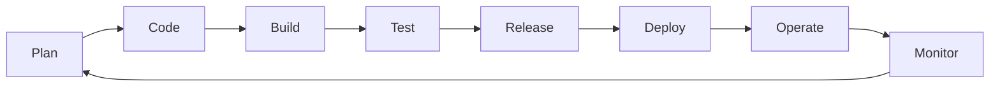
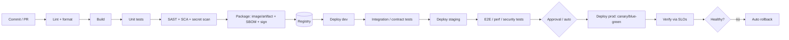
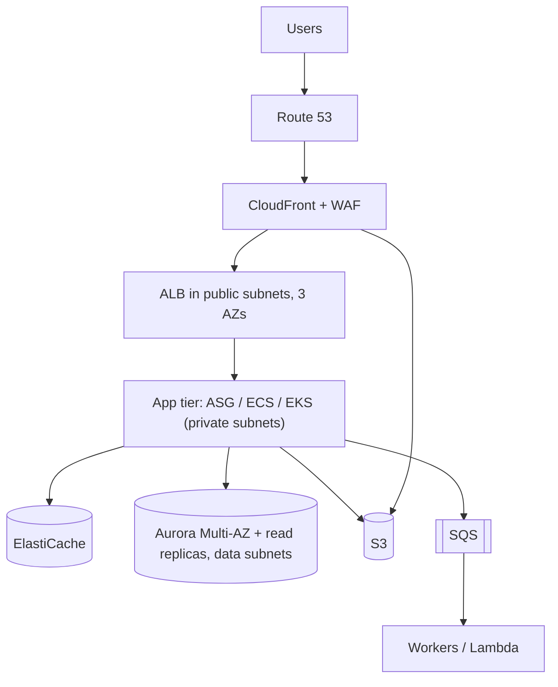

---
mdx:
  format: md
---

# DevOps Complete Guide - Basic to Advanced

> **Note**: Sections marked **(Interview Imp)** are frequently asked in interviews.
>
> **How to read this file:** Every chapter has **📘 Terms Explained** tables. If you see a word you don't know, check the table right below that section.
>
> **Scope:** DevOps culture and DORA metrics, Linux and shell, networking (DNS, TLS, load balancers), Git workflows, CI/CD and deployment strategies, Infrastructure as Code (Terraform, Ansible), cloud fundamentals (AWS with GCP/Azure mapping, IAM, VPC, DR, FinOps), observability and SRE (Prometheus, OpenTelemetry, SLOs, incident management), DevSecOps, GitOps and platform engineering, automation scripting, interview questions, projects, a learning path and certifications.
>
> **Related files:** [00_Docker_Index.md](../docker/00_Docker_Index.md) · [00_Kubernetes_Index.md](../kubernetes/00_Kubernetes_Index.md) · [01_Scalability_Pattern.md](../design-patterns/03_System_Design/01_Scalability_Pattern.md) · [Python_Complete_Guide.md](../ai-ml/Python_Complete_Guide.md)

| Level | Chapters |
|---|---|
| **Beginner** | 1-4 (DevOps basics, Linux/shell, networking, Git) |
| **Intermediate** | 5-7 (CI/CD, Infrastructure as Code, cloud) |
| **Advanced** | 8-10 (observability/SRE, DevSecOps, GitOps/platform engineering) |
| **Mastery** | 11-15 (automation, interview questions, projects, learning path, cheat sheet) |

---

## Table of Contents
1. [DevOps Fundamentals](#1-devops-fundamentals)
   - [1.1 What is DevOps?](#11-what-is-devops)
   - [1.2 DORA Metrics (Interview Imp)](#12-dora-metrics-interview-imp)
   - [1.3 DevOps, SRE, Platform Engineering](#13-devops-sre-platform-engineering)
   - [1.4 Core Principles](#14-core-principles)
2. [Linux and Shell Essentials (Interview Imp)](#2-linux-and-shell-essentials-interview-imp)
   - [2.1 Files, Permissions, Users](#21-files-permissions-users)
   - [2.2 Processes, Services, Resources](#22-processes-services-resources)
   - [2.3 Text Processing and Pipes](#23-text-processing-and-pipes)
   - [2.4 Shell Scripting (Bash)](#24-shell-scripting-bash)
   - [2.5 Package Managers and Filesystem Layout](#25-package-managers-and-filesystem-layout)
3. [Networking Fundamentals for DevOps (Interview Imp)](#3-networking-fundamentals-for-devops-interview-imp)
   - [3.1 Models](#31-models)
   - [3.2 IP Addressing and CIDR](#32-ip-addressing-and-cidr)
   - [3.3 DNS (Interview Imp)](#33-dns-interview-imp)
   - [3.4 HTTP, TLS, Proxies, Load Balancers](#34-http-tls-proxies-load-balancers)
   - [3.5 Firewalls, VPN, Zero Trust](#35-firewalls-vpn-zero-trust)
   - [3.6 Network Troubleshooting Toolbox](#36-network-troubleshooting-toolbox)
4. [Git and Collaboration (Interview Imp)](#4-git-and-collaboration-interview-imp)
   - [4.1 Git Model](#41-git-model)
   - [4.2 Branching Strategies](#42-branching-strategies)
   - [4.3 Pull Requests, Reviews, Conventions](#43-pull-requests-reviews-conventions)
5. [CI/CD Pipelines (Interview Imp)](#5-cicd-pipelines-interview-imp)
   - [5.1 Concepts](#51-concepts)
   - [5.2 Pipeline Stages and Quality Gates](#52-pipeline-stages-and-quality-gates)
   - [5.3 GitHub Actions (Example)](#53-github-actions-example)
   - [5.4 Jenkins, GitLab CI and Others](#54-jenkins-gitlab-ci-and-others)
   - [5.5 Deployment Strategies (Interview Imp)](#55-deployment-strategies-interview-imp)
   - [5.6 Artifact and Dependency Management](#56-artifact-and-dependency-management)
6. [Infrastructure as Code (IaC) (Interview Imp)](#6-infrastructure-as-code-iac-interview-imp)
   - [6.1 Why IaC?](#61-why-iac)
   - [6.2 Terraform in Depth](#62-terraform-in-depth)
   - [6.3 Ansible (Configuration Management)](#63-ansible-configuration-management)
   - [6.4 Other IaC Tools](#64-other-iac-tools)
7. [Cloud Fundamentals (AWS-centred, with GCP/Azure mapping) (Interview Imp)](#7-cloud-fundamentals-aws-centred-with-gcpazure-mapping-interview-imp)
   - [7.1 Cloud Concepts](#71-cloud-concepts)
   - [7.2 Service Map](#72-service-map)
   - [7.3 AWS Core Building Blocks](#73-aws-core-building-blocks)
   - [7.4 Reference Architecture (3-tier, highly available)](#74-reference-architecture-3-tier-highly-available)
   - [7.5 Reliability Numbers: Availability, RTO, RPO](#75-reliability-numbers-availability-rto-rpo)
   - [7.6 Cost Management (FinOps) (Interview Imp)](#76-cost-management-finops-interview-imp)
8. [Observability, Monitoring and Reliability (SRE) (Interview Imp)](#8-observability-monitoring-and-reliability-sre-interview-imp)
   - [8.1 Monitoring vs Observability](#81-monitoring-vs-observability)
   - [8.2 What to Measure](#82-what-to-measure)
   - [8.3 Prometheus and Grafana](#83-prometheus-and-grafana)
   - [8.4 Logging Best Practices](#84-logging-best-practices)
   - [8.5 SLI, SLO, SLA, Error Budgets (Interview Imp)](#85-sli-slo-sla-error-budgets-interview-imp)
   - [8.6 Alerting Philosophy](#86-alerting-philosophy)
   - [8.7 Incident Management and Postmortems (Interview Imp)](#87-incident-management-and-postmortems-interview-imp)
   - [8.8 Reliability Engineering Practices](#88-reliability-engineering-practices)
9. [DevSecOps: Security in the Pipeline (Interview Imp)](#9-devsecops-security-in-the-pipeline-interview-imp)
   - [9.1 Shift-Left Security Map](#91-shift-left-security-map)
   - [9.2 Secrets Management](#92-secrets-management)
   - [9.3 Common Vulnerabilities (OWASP Top 10 theme)](#93-common-vulnerabilities-owasp-top-10-theme)
   - [9.4 Supply-Chain Security](#94-supply-chain-security)
   - [9.5 Compliance and Governance](#95-compliance-and-governance)
   - [9.6 Zero Trust and Identity](#96-zero-trust-and-identity)
10. [GitOps, Platform Engineering and Release Management](#10-gitops-platform-engineering-and-release-management)
   - [10.1 GitOps](#101-gitops)
   - [10.2 Platform Engineering and Internal Developer Platforms](#102-platform-engineering-and-internal-developer-platforms)
   - [10.3 Release Management](#103-release-management)
11. [Automation Scripting and APIs](#11-automation-scripting-and-apis)
   - [11.1 Python for DevOps](#111-python-for-devops)
   - [11.2 Go and Other Languages](#112-go-and-other-languages)
   - [11.3 Automation Principles](#113-automation-principles)
   - [11.4 APIs and Webhooks](#114-apis-and-webhooks)
12. [DevOps Interview Questions (Basic to Advanced)](#12-devops-interview-questions-basic-to-advanced)
   - [12.1 Concepts](#121-concepts)
   - [12.2 Tools and Practices](#122-tools-and-practices)
   - [12.3 Scenario-Based](#123-scenario-based)
13. [Practice Projects by Level](#13-practice-projects-by-level)
14. [Learning Path and Certifications](#14-learning-path-and-certifications)
15. [DevOps Cheat Sheet](#15-devops-cheat-sheet)

---

# 1. DevOps Fundamentals

## 1.1 What is DevOps?

**DevOps** is a culture, a set of practices and a toolchain that unites **Development** and **Operations** so software is built, tested, released and run **faster, more reliably and more securely**. Instead of developers "throwing code over the wall" to an ops team, a team owns a service **from commit to production to monitoring** ("you build it, you run it").


The infinity loop: feedback from monitoring flows back into planning.

| Pillar (CALMS) | Meaning |
|---|---|
| **C**ulture | Shared ownership, blameless collaboration, learning from failure |
| **A**utomation | Automate build, test, deploy, infrastructure, compliance |
| **L**ean | Small batches, reduce waste and waiting, limit work in progress |
| **M**easurement | Metrics and data drive decisions (DORA, SLOs) |
| **S**haring | Knowledge, tools and responsibilities shared across teams |

### Why DevOps? (Before vs After)

| Traditional | DevOps |
|---|---|
| Releases every few months, big-bang | Many small releases per day/week |
| Manual deployments and hand-built servers | Automated pipelines and Infrastructure as Code |
| Dev vs Ops conflict ("it works on my machine") | Shared goals, same tooling, containers |
| Long feedback cycles | Fast feedback (tests, monitoring, canaries) |
| Fear of change | Safe, reversible, observable change |

## 1.2 DORA Metrics (Interview Imp)

Research (DORA / *Accelerate*) shows four metrics predict software delivery and organisational performance:

| Metric | Measures | Elite target |
|---|---|---|
| **Deployment frequency** | How often you ship to production | On demand (multiple per day) |
| **Lead time for changes** | Commit → running in production | Under a day (often < 1 hour) |
| **Change failure rate** | % of deployments causing incidents/rollbacks | 0-15% |
| **Time to restore service (MTTR)** | Time to recover from failure | Under 1 hour |
(Newer DORA reports also track **reliability** and use clusters instead of fixed "elite" labels.) Speed and stability are **not** a trade-off: high performers excel at both.

## 1.3 DevOps, SRE, Platform Engineering

| | Focus |
|---|---|
| **DevOps** | Culture + practices for collaboration and delivery speed |
| **SRE (Site Reliability Engineering)** | Google's implementation: apply software engineering to operations; SLOs, error budgets, toil reduction, on-call, postmortems |
| **Platform Engineering** | Build an **internal developer platform (IDP)**: self-service paved roads (templates, pipelines, environments) so product teams ship without being infra experts |
| **DevSecOps** | Security integrated into every stage ("shift left") |
| **GitOps** | Operate infrastructure/apps through Git as the source of truth |
| **FinOps** | Cloud cost accountability and optimisation |
| **MLOps / DataOps** | Same ideas for ML models and data pipelines |

**Typical DevOps/SRE/Platform engineer responsibilities:** CI/CD pipelines, IaC, cloud architecture, Kubernetes, monitoring/alerting, incident response, security automation, cost control, developer experience, reliability and capacity.

## 1.4 Core Principles
1. **Automate everything repeatable** (build, test, deploy, provisioning, security checks).
2. **Everything as code**: infrastructure, pipelines, policies, dashboards, docs.
3. **Small, frequent, reversible changes** over large risky releases.
4. **Shift left**: test, scan and review early.
5. **Immutable infrastructure**: replace, don't patch.
6. **Observability and fast feedback** in production.
7. **Blameless culture**: fix systems, not people.
8. **Build once, deploy many**: the same artifact moves through environments.
9. **You build it, you run it**: ownership including on-call.
10. **Measure and improve continuously** (DORA, SLOs, toil).

#### 📘 Terms Explained

| Term | Simple meaning |
|---|---|
| **CI/CD** | Continuous Integration / Continuous Delivery (or Deployment): automated build-test-release. |
| **IaC** | Infrastructure as Code: managing servers/networks with versioned code. |
| **Shift left** | Doing quality/security checks earlier in the lifecycle. |
| **MTTR** | Mean Time To Restore/Recover. |
| **SLO / SLI / SLA** | Reliability target / measured indicator / contractual promise. |
| **Toil** | Repetitive manual operational work that scales with service size. |
| **Immutable infrastructure** | Servers are never modified after deploy; replaced by new versions. |
| **Internal developer platform** | Self-service tooling that lets developers deploy and operate easily. |

---

# 2. Linux and Shell Essentials (Interview Imp)

## 2.1 Files, Permissions, Users

```bash
pwd; ls -lah; cd /var/log; tree -L 2
cp -r src dst; mv a b; rm -rf dir          # careful with rm -rf
mkdir -p a/b/c; touch f; ln -s target link  # symlink
cat f; less f; head -n 20 f; tail -f /var/log/syslog; wc -l f
find / -name "*.conf" -mtime -1 -size +1M 2>/dev/null
grep -rniE "error|fail" /var/log --include=*.log
du -sh * | sort -h; df -h; lsblk; mount
tar czf a.tgz dir/ ; tar xzf a.tgz ; zip/unzip ; gzip
```

### Permissions
```
-rwxr-xr--  1 alice dev 1234 Oct 24 10:00 script.sh
 │└┬┘└┬┘└┬┘     owner group
 │ │  │  └ others: r--
 │ │  └ group:  r-x
 │ └ owner:  rwx
 └ type (- file, d dir, l link)
```
```bash
chmod 755 script.sh ; chmod u+x,g-w file ; chmod -R go-rwx ~/.ssh   # r=4 w=2 x=1
chown alice:dev file ; chgrp dev file
umask 022                                       # default permission mask
# special bits: setuid (4xxx), setgid (2xxx), sticky (1xxx, e.g. /tmp)
sudo -l ; su - user ; id ; whoami ; groups ; useradd/usermod/passwd ; /etc/passwd /etc/shadow /etc/sudoers (visudo)
```

## 2.2 Processes, Services, Resources

```bash
ps aux | grep nginx ; top ; htop ; pgrep -a nginx
kill PID ; kill -9 PID ; killall nginx ; pkill -f pattern     # SIGTERM(15) vs SIGKILL(9)
nice/renice ; nohup cmd & ; jobs ; fg ; bg ; screen/tmux
free -h ; vmstat 1 ; iostat -x 1 ; sar ; uptime (load average) ; dmesg -T
lsof -i :8080 ; lsof -p PID ; strace -p PID ; ltrace ; perf top
systemctl status|start|stop|restart|enable|disable nginx
journalctl -u nginx -f --since "10 min ago" ; journalctl -p err -b
crontab -e   # m h dom mon dow command ; systemd timers
```

**Systemd unit file**
```ini
# /etc/systemd/system/myapp.service
[Unit]
Description=My App
After=network-online.target
[Service]
User=app
WorkingDirectory=/opt/myapp
ExecStart=/usr/bin/java -jar app.jar
Restart=on-failure
RestartSec=5
Environment=SPRING_PROFILES_ACTIVE=prod
LimitNOFILE=65535
[Install]
WantedBy=multi-user.target
```
`systemctl daemon-reload && systemctl enable --now myapp`.

**Load average** = average runnable+uninterruptible tasks; compare with CPU cores. High load with low CPU → I/O wait. **OOM killer** kills processes when memory is exhausted (`dmesg | grep -i oom`).

## 2.3 Text Processing and Pipes

```bash
cmd1 | cmd2 ; cmd > out ; cmd >> out ; cmd 2> err ; cmd &> all ; cmd < in ; cmd <<EOF ... EOF
awk '{print $1, $9}' access.log | sort | uniq -c | sort -rn | head       # top requested IP/status
sed -i 's/old/new/g' file ; sed -n '10,20p' file
cut -d, -f1,3 data.csv ; sort -t, -k2 -n ; tr 'a-z' 'A-Z' ; xargs -n1 ; tee file ; column -t
jq '.items[] | {name: .metadata.name}' file.json ; yq '.spec.replicas' file.yaml
curl -sS -X POST -H 'Content-Type: application/json' -d '{"a":1}' https://api/x -w '%{http_code}\n'
wget ; scp/rsync -avz src host:dst ; ssh -J jump host ; ssh-keygen -t ed25519 ; ssh-agent/ssh-add
```

## 2.4 Shell Scripting (Bash)

```bash
#!/usr/bin/env bash
set -euo pipefail                 # exit on error, unset var error, fail on pipe errors
IFS=$'\n\t'
trap 'echo "failed at line $LINENO" >&2' ERR
trap cleanup EXIT

readonly ENV="${1:-dev}"          # positional arg with default
LOG() { printf '%s %s\n' "$(date -u +%FT%TZ)" "$*" >&2; }

usage() { echo "Usage: $0 <env>" >&2; exit 64; }
[[ $# -ge 1 ]] || usage

if [[ "$ENV" == "prod" && -z "${CONFIRM:-}" ]]; then LOG "set CONFIRM=1"; exit 1; fi

for host in $(cat hosts.txt); do
  if ssh -o ConnectTimeout=5 "$host" 'systemctl is-active myapp' >/dev/null; then LOG "$host ok"
  else LOG "$host DOWN"; fi
done

retry() { local n=0 max=5; until "$@"; do ((++n>=max)) && return 1; sleep $((2**n)); done; }
retry curl -fsS https://service/health

while IFS=, read -r name age; do echo "$name is $age"; done < people.csv
arr=(a b c); echo "${arr[@]}" "${#arr[@]}"; declare -A map=([k]=v); echo "${map[k]}"
$(( 5 + 3 )) ; ${var:-default} ; ${var%.txt} ; ${#var} ; "$@" vs "$*" ; [[ -f file ]] ; [[ -n "$s" ]]
```
Best practices: quote variables (`"$var"`), use `shellcheck`, `set -euo pipefail`, avoid parsing `ls`, use functions, idempotent scripts, exit codes (0 ok), prefer Python/Go for complex logic.

## 2.5 Package Managers and Filesystem Layout
- Debian/Ubuntu: `apt update && apt install nginx`, `dpkg -i`; RHEL/Fedora/Alma: `dnf install`, `rpm`; Alpine: `apk add`; Arch: `pacman`.
- Layout: `/etc` config · `/var/log` logs · `/var/lib` state · `/opt` add-on software · `/usr/bin` binaries · `/home` users · `/tmp` temp · `/proc` & `/sys` kernel interfaces · `/dev` devices.
- Containers/VMs: cloud-init for first-boot setup.

#### 📘 Terms Explained

| Term | Simple meaning |
|---|---|
| **Shell** | Program (bash, zsh) interpreting your commands. |
| **Pipe `|`** | Sends one command's output as input to another. |
| **Signal** | Message to a process (SIGTERM = please stop, SIGKILL = force). |
| **systemd** | Linux service/init system managing daemons. |
| **Load average** | Average number of tasks wanting CPU/IO over 1, 5, 15 minutes. |
| **setuid** | Permission bit making a program run with the file owner's identity. |
| **cloud-init** | Tool configuring cloud VMs on first boot. |
| **Idempotent script** | Safe to run many times with the same result. |

---

# 3. Networking Fundamentals for DevOps (Interview Imp)

## 3.1 Models

| OSI layer | TCP/IP | Examples |
|---|---|---|
| 7 Application | Application | HTTP, DNS, SSH, SMTP, gRPC |
| 6 Presentation | | TLS, encoding |
| 5 Session | | |
| 4 Transport | Transport | TCP, UDP, ports |
| 3 Network | Internet | IP, ICMP, routing |
| 2 Data link | Link | Ethernet, MAC, ARP, VLAN |
| 1 Physical | | Cables, Wi-Fi |

**TCP** is reliable and ordered (3-way handshake SYN → SYN-ACK → ACK; retransmission; flow/congestion control; 4-way close; `TIME_WAIT`). **UDP** is connectionless and fast (DNS, video, QUIC/HTTP3).

## 3.2 IP Addressing and CIDR

```
10.0.1.0/24  → network 10.0.1.0, 256 addresses (254 usable), mask 255.255.255.0
/16 = 65,536 · /20 = 4,096 · /24 = 256 · /28 = 16 · /32 = single host
```
Private ranges (RFC 1918): `10.0.0.0/8`, `172.16.0.0/12`, `192.168.0.0/16`. **NAT** lets private hosts reach the Internet via a public IP. **Subnets** split a network (public vs private). **Routing tables**, **gateways**, default route `0.0.0.0/0`. IPv6 uses 128-bit addresses (`2001:db8::/32`).

## 3.3 DNS (Interview Imp)

Resolves names to IPs. Flow: app → local cache → **recursive resolver** → root → TLD (`.com`) → authoritative server → answer (cached for **TTL**).

| Record | Purpose |
|---|---|
| **A / AAAA** | Name → IPv4 / IPv6 |
| **CNAME** | Alias to another name (not at the zone apex) |
| **MX** | Mail servers |
| **TXT** | Verification, SPF/DKIM |
| **NS** | Delegates a zone to nameservers |
| **SRV** | Service host+port |
| **PTR** | Reverse lookup |
| **ALIAS/ANAME** | Apex alias (provider-specific, e.g. Route 53 alias) |
```bash
dig example.com A +short ; dig @8.8.8.8 example.com ; dig +trace example.com ; nslookup ; host
```
Gotchas: low TTL before migrations, negative caching, split-horizon DNS, "it's always DNS".

## 3.4 HTTP, TLS, Proxies, Load Balancers

- **HTTP:** methods, status codes (1xx-5xx), headers (`Host`, `Cache-Control`, `Authorization`), keep-alive, HTTP/2 (multiplexing), HTTP/3 (QUIC over UDP), cookies, CORS.
- **TLS:** handshake (certificate, key exchange, symmetric session key). **Certificates** signed by a CA chain; SNI selects the cert by hostname; **mTLS** authenticates both ends; **Let's Encrypt/ACME** for free automated certs; rotate before expiry (expired certs are a classic outage).
```bash
openssl s_client -connect example.com:443 -servername example.com </dev/null | openssl x509 -noout -dates -subject
curl -vI https://example.com
```
- **Proxy:** forward proxy (clients → Internet) vs **reverse proxy** (Internet → servers: NGINX, HAProxy, Envoy, Traefik, Caddy) for TLS termination, routing, caching, compression, auth.
- **Load balancers:** **L4** (TCP/UDP, fast) vs **L7** (HTTP-aware routing). Algorithms: round robin, least connections, IP hash, weighted, consistent hashing. Health checks, sticky sessions, connection draining. Cloud: ALB/NLB (AWS), Cloud Load Balancing (GCP), App Gateway (Azure). See `../design-patterns/08_Scalability_Pattern.md` section 1 for deep coverage.
- **CDN** caches content near users (CloudFront, Cloudflare, Fastly).
- **API gateway:** auth, rate limiting, routing, transformation (Kong, AWS API Gateway, Apigee).

## 3.5 Firewalls, VPN, Zero Trust
- **Security groups** (stateful, instance-level) and **NACLs** (stateless, subnet-level) in AWS; `iptables`/`nftables`/`ufw`/`firewalld` on hosts.
- **VPN** (WireGuard, OpenVPN, IPsec) / **bastion hosts** / **SSM Session Manager** for admin access; **Zero trust**: authenticate and authorise every request regardless of network location (identity-aware proxies, Tailscale, BeyondCorp).

## 3.6 Network Troubleshooting Toolbox

```bash
ping host ; traceroute/mtr host ; ip addr ; ip route ; ip -s link ; ss -tulpn ; netstat -an
curl -v http://host:port/path ; nc -zv host 443 ; telnet host port ; nmap -p- host (authorised hosts only)
tcpdump -i eth0 port 53 -nn ; wireshark ; dig/nslookup ; arp -a ; iptables -L -n -v ; resolvectl status
```
Method: **layered**: link/IP (ping, route) → DNS (dig) → TCP port (nc) → TLS (openssl) → HTTP (curl -v) → app logs. Check security groups/firewalls, MTU, proxies, NAT, DNS cache and TTL.

#### 📘 Terms Explained

| Term | Simple meaning |
|---|---|
| **CIDR** | Notation `address/prefix` describing a block of IPs. |
| **NAT** | Translating private addresses to a public one. |
| **TTL (DNS)** | How long an answer may be cached. |
| **TLS termination** | Decrypting HTTPS at a proxy/load balancer. |
| **SNI** | TLS extension that tells the server which hostname the client wants. |
| **Reverse proxy** | Server in front of backends receiving client requests on their behalf. |
| **Bastion host** | Hardened entry server for administering private networks. |
| **MTU** | Maximum packet size on a link. |

---

# 4. Git and Collaboration (Interview Imp)

## 4.1 Git Model

Git is a **distributed version control** system storing snapshots (commits) in a graph; branches and tags are movable pointers to commits. Areas: **working tree → staging area (index) → local repository → remote**.

```bash
git init ; git clone url ; git status ; git add -p ; git commit -m "feat: add login" ; git log --oneline --graph --decorate --all
git diff ; git diff --staged ; git show <sha> ; git blame file ; git bisect start/good/bad   # find the commit that broke things
git branch feature/x ; git switch -c feature/x ; git switch main ; git merge feature/x ; git branch -d feature/x
git fetch ; git pull --rebase ; git push -u origin feature/x ; git push --force-with-lease     # safer than --force
git rebase main ; git rebase -i HEAD~5 (squash/reword/fixup) ; git cherry-pick <sha>
git stash ; git stash pop ; git restore file ; git restore --staged file ; git reset --soft|--mixed|--hard <sha> ; git revert <sha>
git reflog          # recover "lost" commits ; git tag -a v1.0.0 -m "msg" ; git push --tags
git remote -v ; git submodule ; git worktree add ../hotfix hotfix/1 ; git clean -fd ; git gc
git config --global user.name "…" ; core.autocrlf ; pull.rebase true ; .gitignore ; .gitattributes
```

### Merge vs Rebase
| | Merge | Rebase |
|---|---|---|
| History | Preserves branch topology, adds merge commit | Linear history, rewrites commits |
| Safe on shared branches | Yes | **No**: never rebase published/shared commits |
| Use | Integrating finished work (squash/merge commits in PRs) | Updating your local feature branch onto latest main |

`reset` moves a branch pointer (rewrites history; local only) vs `revert` adds an opposing commit (safe for shared history). Resolve conflicts by editing markers `<<<<<<< ======= >>>>>>>` then `git add` + continue.

## 4.2 Branching Strategies

| Strategy | Description | Fits |
|---|---|---|
| **Trunk-based development** | Everyone commits to `main` in small changes (or very short-lived branches < 1-2 days), feature flags hide unfinished work | High-performing CI/CD teams (recommended) |
| **GitHub Flow** | `main` is deployable; feature branch → PR → review → merge → deploy | Web services, continuous delivery |
| **GitFlow** | `main`, `develop`, `feature/*`, `release/*`, `hotfix/*` | Versioned/packaged software with scheduled releases; heavy for CD |
| **Release branches** | Cut `release/1.8` for stabilisation and patching | Mobile apps, on-prem products |

## 4.3 Pull Requests, Reviews, Conventions
- Small PRs (< 400 lines), clear description, linked ticket, passing CI required before merge, at least one reviewer, **CODEOWNERS**, protected branches (no direct pushes, required checks, signed commits).
- **Conventional Commits** (`feat:`, `fix:`, `chore:`, `docs:`, `refactor:`, `BREAKING CHANGE:`) enable automated changelogs and semantic versioning (semantic-release).
- **Semantic versioning:** MAJOR.MINOR.PATCH.
- **Git hooks / pre-commit:** lint, format, secret scan, tests on commit/push; **commit signing** (GPG/SSH) for provenance.
- **Monorepo vs polyrepo:** monorepo needs build tooling (Bazel, Nx, Turborepo) and path-based CI; polyrepo needs dependency/version management.
- Secrets leaked in Git history: **rotate** the secret first; then clean history (`git filter-repo`/BFG); scanning with gitleaks/trufflehog.

#### 📘 Terms Explained

| Term | Simple meaning |
|---|---|
| **Commit** | Saved snapshot with message and parent link(s). |
| **Branch** | Movable label pointing to a commit. |
| **HEAD** | Pointer to your current commit/branch. |
| **Staging area** | Place where changes are prepared for the next commit. |
| **Rebase** | Replaying commits on top of another base. |
| **Fast-forward** | Merge that just moves the pointer (no new commit). |
| **Trunk-based development** | Short-lived branches merged to main continuously. |
| **Feature flag** | Runtime switch to enable/disable a feature without deploying. |
| **CODEOWNERS** | File assigning required reviewers to paths. |

---

# 5. CI/CD Pipelines (Interview Imp)

## 5.1 Concepts

| Term | Meaning |
|---|---|
| **Continuous Integration (CI)** | Developers merge small changes frequently; each triggers an automated build + tests so integration problems surface within minutes |
| **Continuous Delivery** | Every change that passes the pipeline is *releasable*; deployment to production is a one-click/approved step |
| **Continuous Deployment** | Every passing change is deployed to production automatically |
| **Pipeline** | Ordered stages of automated jobs |
| **Artifact** | Output of a build (JAR, container image, package, binary) stored in a registry |
| **Runner / agent** | Machine that executes jobs |



## 5.2 Pipeline Stages and Quality Gates

| Stage | Purpose | Tools |
|---|---|---|
| **Checkout & cache** | Get code; restore dependency caches | |
| **Static checks** | Lint, format, type check | ESLint, Checkstyle, ruff, clang-tidy, hadolint |
| **Build** | Compile, package | Maven/Gradle, npm, CMake, Docker/BuildKit |
| **Unit tests + coverage** | Fast feedback | JUnit, pytest, Jest, gtest + JaCoCo/coverage |
| **SAST** (static application security testing) | Find code vulnerabilities | SonarQube, CodeQL, Semgrep, SpotBugs |
| **SCA / dependency scan** | Vulnerable libraries and licences | Dependabot, Snyk, OWASP Dependency-Check, Trivy |
| **Secrets scan** | Leaked credentials | gitleaks, trufflehog |
| **Container scan, SBOM, signing** | Image security & provenance | Trivy, Syft, cosign |
| **Integration / contract tests** | Service interactions | Testcontainers, Pact |
| **Deploy to environments** | Automated release | Helm, Argo CD, Terraform, Ansible |
| **E2E / UI tests** | User journeys | Playwright, Cypress, Selenium |
| **Performance / load tests** | Capacity regressions | k6, Gatling, JMeter, Locust |
| **DAST** (dynamic testing) | Runtime web vulnerabilities | OWASP ZAP |
| **Approval gates** | Compliance/manual sign-off | Environment protection rules |
| **Post-deploy verification** | Smoke tests, SLO checks, auto-rollback | Argo Rollouts, Flagger |

Rules: **fast** pipelines (< 10 min for PR checks; parallelise, cache, run slow tests later); **deterministic** (no flaky tests: quarantine & fix); **fail fast**; **build once** and promote the same artifact; keep pipeline config in the repo (**pipeline as code**); main branch always green; short-lived credentials via OIDC (no long-lived cloud keys in CI).

## 5.3 GitHub Actions (Example)

```yaml
# .github/workflows/ci.yml
name: ci
on:
  push: { branches: [main] }
  pull_request:
permissions: { contents: read }
concurrency: { group: "ci-${{ github.ref }}", cancel-in-progress: true }

jobs:
  test:
    runs-on: ubuntu-latest
    strategy:
      matrix: { java: [17, 21] }
    steps:
      - uses: actions/checkout@v4
      - uses: actions/setup-java@v4
        with: { distribution: temurin, java-version: "${{ matrix.java }}", cache: maven }
      - run: ./mvnw -B verify
      - uses: actions/upload-artifact@v4
        if: always()
        with: { name: reports-${{ matrix.java }}, path: target/surefire-reports }

  image:
    needs: test
    if: github.ref == 'refs/heads/main'
    runs-on: ubuntu-latest
    permissions: { contents: read, packages: write, id-token: write }
    steps:
      - uses: actions/checkout@v4
      - uses: docker/login-action@v3
        with: { registry: ghcr.io, username: "${{ github.actor }}", password: "${{ secrets.GITHUB_TOKEN }}" }
      - uses: docker/build-push-action@v6
        with: { context: ., push: true, tags: "ghcr.io/${{ github.repository }}:${{ github.sha }}", cache-from: type=gha, cache-to: "type=gha,mode=max" }

  deploy:
    needs: image
    environment: production           # required reviewers / protection rules
    runs-on: ubuntu-latest
    steps:
      - uses: aws-actions/configure-aws-credentials@v4
        with: { role-to-assume: arn:aws:iam::123456789012:role/gh-deploy, aws-region: ap-south-1 }   # OIDC, no stored keys
      - run: aws eks update-kubeconfig --name prod && kubectl set image deploy/web app=ghcr.io/${{ github.repository }}:${{ github.sha }}
```
Concepts: workflows, jobs (parallel by default; `needs` orders), steps, runners (hosted/self-hosted), `secrets`, `vars`, matrix builds, caching, artifacts, reusable workflows (`workflow_call`), environments, OIDC to cloud, `concurrency`. Pin third-party actions to commit SHAs.

## 5.4 Jenkins, GitLab CI and Others

```groovy
// Jenkinsfile (declarative)
pipeline {
  agent { docker { image 'maven:3.9-eclipse-temurin-21' } }
  options { timeout(time: 30, unit: 'MINUTES'); buildDiscarder(logRotator(numToKeepStr: '20')) }
  environment { REGISTRY = 'registry.example.com' }
  stages {
    stage('Build')  { steps { sh 'mvn -B -DskipTests package' } }
    stage('Test')   { steps { sh 'mvn -B test' } post { always { junit 'target/surefire-reports/*.xml' } } }
    stage('Scan')   { parallel { stage('SAST') { steps { sh 'semgrep ci' } } stage('SCA') { steps { sh 'trivy fs .' } } } }
    stage('Deploy') { when { branch 'main' } steps { withCredentials([string(credentialsId: 'kube', variable: 'T')]) { sh './deploy.sh' } } }
  }
  post { failure { slackSend message: "Build failed ${env.BUILD_URL}" } }
}
```
```yaml
# .gitlab-ci.yml
stages: [build, test, deploy]
build: { stage: build, image: node:22, script: [npm ci, npm run build], artifacts: { paths: [dist/] }, cache: { paths: [node_modules/] } }
test:  { stage: test,  image: node:22, script: [npm test], coverage: '/All files.*?(\d+\.\d+)/' }
deploy: { stage: deploy, script: [./deploy.sh], environment: production, when: manual, only: [main] }
```

| Tool | Notes |
|---|---|
| **GitHub Actions** | Tight GitHub integration, huge marketplace, YAML |
| **GitLab CI/CD** | Built into GitLab, auto DevOps, strong built-in security scans |
| **Jenkins** | Most flexible, plugins, self-hosted; needs maintenance; Jenkinsfile (Groovy) |
| **CircleCI, Travis, Buildkite, TeamCity, Azure DevOps Pipelines, AWS CodePipeline/CodeBuild, Google Cloud Build, Bitbucket Pipelines** | Alternatives |
| **Tekton, Argo Workflows, Dagger** | Kubernetes-native / portable pipelines as code |
| **Argo CD / Flux** | CD via GitOps |

## 5.5 Deployment Strategies (Interview Imp)

| Strategy | How | Pros | Cons |
|---|---|---|---|
| **Recreate** | Stop old, start new | Simple | Downtime |
| **Rolling** | Replace instances gradually | No downtime, low extra cost | Mixed versions during rollout; slower rollback |
| **Blue/Green** | Two identical environments; switch traffic at once | Instant rollback, easy testing | Double capacity; DB compatibility |
| **Canary** | Send 1% → 5% → 25% → 100% of traffic to new version while watching metrics | Limits blast radius | Needs traffic shaping + observability |
| **Shadow (dark launch)** | Mirror production traffic to the new version without returning its response | Safe testing with real load | Extra cost; side-effect care |
| **A/B testing** | Route by user segment for experiments | Product insight | Needs analytics |
| **Feature flags** | Decouple deploy from release; toggle features at runtime (LaunchDarkly, Unleash, OpenFeature) | Trunk-based dev, kill switch | Flag debt: remove old flags |

**Database changes:** use **expand/contract** (add nullable column → deploy code writing both → backfill → switch reads → remove old). Tools: Flyway, Liquibase, Alembic, gh-ost. Keep migrations backward compatible so rollbacks work.

**Rollback vs roll-forward:** rollback quickly with immutable artifacts; but data migrations may require roll-forward. Always test the rollback path.

## 5.6 Artifact and Dependency Management
Artifact repositories (Nexus, Artifactory, GitHub Packages, ECR/GAR/ACR) store images, JARs, npm/PyPI packages; use proxies/caches for upstream registries, retention rules, immutable versions, provenance (SLSA), SBOMs, signed artifacts, and vulnerability gates.

#### 📘 Terms Explained

| Term | Simple meaning |
|---|---|
| **Pipeline as code** | Pipeline definition stored in the repository. |
| **Runner / agent** | Worker machine executing pipeline jobs. |
| **Quality gate** | Condition (tests, coverage, scan results) that must pass to continue. |
| **Flaky test** | Test that passes and fails randomly without code changes. |
| **SAST / DAST / SCA** | Scan source code / scan a running app / scan dependencies. |
| **OIDC (in CI)** | Short-lived identity token for cloud access instead of stored keys. |
| **Canary release** | Releasing to a small share of users first. |
| **Blast radius** | How much is affected when something fails. |
| **Expand/contract** | Safe pattern for evolving database schemas. |

---

# 6. Infrastructure as Code (IaC) (Interview Imp)

## 6.1 Why IaC?
Manually clicking in consoles ("ClickOps") is slow, error-prone and unrepeatable. IaC treats infrastructure like software: **versioned, reviewed, tested, reproducible, auditable**, enabling disaster recovery and consistent environments.

| Type | Examples | Notes |
|---|---|---|
| **Provisioning** (create cloud resources) | **Terraform / OpenTofu**, Pulumi, AWS CloudFormation / CDK, Azure Bicep, GCP Deployment Manager, Crossplane | Declarative, state-based |
| **Configuration management** (configure servers) | **Ansible**, Chef, Puppet, Salt | Install packages, files, services |
| **Image building** | **Packer**, EC2 Image Builder | Golden AMIs/VM images |
| **Container/Cluster** | Dockerfile, Helm, Kustomize, Cluster API | |

**Declarative vs imperative:** declarative (desired end state; tool computes the diff) vs imperative (step-by-step commands). **Mutable vs immutable:** patch servers in place vs replace with new images (immutable preferred).

## 6.2 Terraform in Depth

```hcl
terraform {
  required_version = ">= 1.9"
  required_providers { aws = { source = "hashicorp/aws", version = "~> 5.60" } }
  backend "s3" {                                  # remote state + locking
    bucket         = "acme-tfstate"
    key            = "prod/network/terraform.tfstate"
    region         = "ap-south-1"
    dynamodb_table = "tf-locks"                   # (or use_lockfile with S3 native locking in newer versions)
    encrypt        = true
  }
}

provider "aws" { region = var.region }

variable "region" {
  type    = string
  default = "ap-south-1"
}
variable "environment" {
  type = string
}
variable "cidr" {
  type = string
  validation {
    condition     = can(cidrnetmask(var.cidr))
    error_message = "Invalid CIDR"
  }
}
variable "db_password" {
  type      = string
  sensitive = true
}

locals {
  name = "shop-${var.environment}"
  tags = { Env = var.environment, Owner = "platform" }
}

data "aws_availability_zones" "az" {}

resource "aws_vpc" "main" {
  cidr_block           = var.cidr
  enable_dns_hostnames = true
  tags                 = merge(local.tags, { Name = local.name })
}

resource "aws_subnet" "private" {
  for_each          = toset(slice(data.aws_availability_zones.az.names, 0, 3))
  vpc_id            = aws_vpc.main.id
  availability_zone = each.key
  cidr_block        = cidrsubnet(var.cidr, 4, index(data.aws_availability_zones.az.names, each.key))
}

module "eks" {                                     # reuse community/internal modules
  source  = "terraform-aws-modules/eks/aws"
  version = "~> 20.0"
  cluster_name = local.name
  vpc_id       = aws_vpc.main.id
  subnet_ids   = [for s in aws_subnet.private : s.id]
}

output "vpc_id" { value = aws_vpc.main.id }
```

### Workflow and Concepts
```bash
terraform init                 # download providers/modules, configure backend
terraform fmt -recursive ; terraform validate
terraform plan -out=tfplan     # preview the diff (review in PR!)
terraform apply tfplan         # execute exactly the reviewed plan
terraform destroy
terraform state list|show|mv|rm ; terraform import aws_s3_bucket.b my-bucket   # adopt existing resources
terraform workspace new staging ; terraform output ; terraform console ; terraform graph
tflint ; tfsec / trivy config / checkov (policy & security scanning) ; terraform-docs ; infracost (cost estimate)
```
| Concept | Meaning |
|---|---|
| **Provider** | Plugin for an API (AWS, GCP, Azure, Kubernetes, GitHub, Datadog...) |
| **Resource / data source** | Thing to manage / read-only lookup |
| **State** | JSON mapping config → real resources; **single source of truth Terraform compares against**. Store remotely (S3+locking, GCS, Terraform Cloud), encrypt, restrict access (contains secrets!), never edit by hand |
| **Plan / apply** | Diff computed from config vs state vs real world |
| **Modules** | Reusable packages of resources with inputs/outputs; version them |
| **Variables / outputs / locals** | Inputs, exports, computed values |
| **`count` / `for_each`** | Create multiple resources (prefer `for_each` with stable keys) |
| **`depends_on`, lifecycle** | Explicit ordering; `prevent_destroy`, `create_before_destroy`, `ignore_changes` |
| **Workspaces vs directories** | Many teams prefer separate state per environment/component (directories/stacks, Terragrunt) over workspaces |
| **Drift** | Real infrastructure changed outside Terraform; detect with `plan`, fix by apply/import |
| **Provisioners** | Last resort; prefer cloud-init/Ansible/images |
| **OpenTofu** | Open-source fork of Terraform (BSL licence change in 2023) |

Best practices: remote state with locking; small blast-radius states (network, data, app separated); pin provider/module versions; review `plan` in PRs; run in CI with OIDC; policy-as-code (OPA/Sentinel/Checkov); no secrets in code (use secret managers / `sensitive`); tag everything; automate drift detection; test with Terratest/`terraform test`.

## 6.3 Ansible (Configuration Management)

**Agentless** (SSH), declarative YAML playbooks, idempotent modules.

```yaml
# inventory.ini
[web]
web1 ansible_host=10.0.1.10
web2 ansible_host=10.0.1.11
[db]
db1 ansible_host=10.0.2.10

# site.yml
- name: Configure web servers
  hosts: web
  become: true
  vars: { app_port: 8080 }
  tasks:
    - name: Install nginx
      ansible.builtin.apt: { name: nginx, state: present, update_cache: true }
    - name: Render config
      ansible.builtin.template: { src: nginx.conf.j2, dest: /etc/nginx/conf.d/app.conf, mode: "0644" }
      notify: Reload nginx
    - name: Ensure running
      ansible.builtin.service: { name: nginx, state: started, enabled: true }
  handlers:
    - name: Reload nginx
      ansible.builtin.service: { name: nginx, state: reloaded }
```
```bash
ansible-playbook -i inventory.ini site.yml --check --diff        # dry run
ansible-playbook site.yml --limit web1 --tags nginx -e env=prod
ansible all -m ping ; ansible-vault encrypt secrets.yml ; ansible-galaxy install role ; ansible-lint
```
Concepts: inventory (static/dynamic cloud), modules, tasks, roles, handlers, templates (Jinja2), facts, variables precedence, vault, collections. Terraform **provisions** infrastructure; Ansible **configures** it (or use images/containers and skip config management).

## 6.4 Other IaC Tools
- **Pulumi / AWS CDK / CDKTF:** write infrastructure in real languages (TypeScript, Python, Go, Java).
- **CloudFormation / SAM:** AWS-native templates with stacks, change sets, drift detection.
- **Crossplane:** manage cloud resources through Kubernetes APIs (CRDs).
- **Packer:** `packer build` creates machine images (AMIs) with provisioners.
- **Terragrunt:** DRY wrapper for Terraform configs and remote state.
- **Atlantis / Spacelift / env0 / Terraform Cloud:** PR-based Terraform automation.

#### 📘 Terms Explained

| Term | Simple meaning |
|---|---|
| **State file** | Terraform's record of what it manages. |
| **Plan** | Preview of changes before applying. |
| **Module** | Reusable bundle of Terraform code. |
| **Provider** | Plugin that talks to a platform's API. |
| **Drift** | Difference between code/state and reality. |
| **Idempotent** | Re-running makes no change if already correct. |
| **Playbook / Role** | Ansible task list / reusable package of tasks. |
| **Golden image** | Pre-baked machine image with software installed. |
| **ClickOps** | Managing infrastructure by hand in a web console. |

---

# 7. Cloud Fundamentals (AWS-centred, with GCP/Azure mapping) (Interview Imp)

## 7.1 Cloud Concepts

| Concept | Meaning |
|---|---|
| **IaaS / PaaS / SaaS** | You manage OS and up (VMs) / you manage only app & data (Elastic Beanstalk, App Service, Cloud Run) / you just use it (Gmail, Salesforce) |
| **Serverless / FaaS** | Run code without managing servers; pay per execution (Lambda) |
| **Regions & Availability Zones** | Region = geographic area; AZ = isolated data centre(s) within it. Spread across ≥ 2-3 AZs for HA; multi-region for DR/latency |
| **Shared responsibility** | Provider secures *of* the cloud (hardware, facilities); you secure *in* the cloud (IAM, data, config, OS patches on IaaS) |
| **Elasticity** | Scale out/in automatically with demand |
| **Pay-as-you-go** | OpEx instead of CapEx; watch costs |
| **Public / private / hybrid / multi-cloud** | Deployment models |
| **Well-Architected pillars** | Operational excellence, Security, Reliability, Performance efficiency, Cost optimisation, Sustainability |

## 7.2 Service Map

| Category | AWS | GCP | Azure |
|---|---|---|---|
| Virtual machines | **EC2** | Compute Engine | Virtual Machines |
| Auto scaling | Auto Scaling Groups | Managed Instance Groups | VM Scale Sets |
| Containers (managed K8s) | **EKS** | GKE | AKS |
| Containers (simple) | **ECS / Fargate** | Cloud Run | Container Apps / ACI |
| Serverless functions | **Lambda** | Cloud Functions | Functions |
| Object storage | **S3** | Cloud Storage | Blob Storage |
| Block storage | EBS | Persistent Disk | Managed Disks |
| File storage | EFS / FSx | Filestore | Azure Files |
| Relational DB | **RDS / Aurora** | Cloud SQL / AlloyDB / Spanner | Azure SQL / PostgreSQL Flexible |
| NoSQL | **DynamoDB** | Firestore / Bigtable | Cosmos DB |
| Cache | ElastiCache (Redis/Memcached) | Memorystore | Azure Cache for Redis |
| Messaging | **SQS, SNS, EventBridge, Kinesis, MSK** | Pub/Sub | Service Bus, Event Grid, Event Hubs |
| Networking | **VPC**, Route 53, CloudFront, ELB (ALB/NLB), API Gateway, Transit Gateway, Direct Connect | VPC, Cloud DNS, Cloud CDN, Cloud LB, Interconnect | VNet, Azure DNS, Front Door, App Gateway, ExpressRoute |
| Identity | **IAM**, IAM Identity Center, Cognito | Cloud IAM, Identity Platform | Entra ID (Azure AD), RBAC |
| Secrets & keys | Secrets Manager, Parameter Store, **KMS** | Secret Manager, Cloud KMS | Key Vault |
| Monitoring | **CloudWatch**, X-Ray, CloudTrail | Cloud Monitoring/Logging/Trace | Azure Monitor, App Insights |
| IaC | CloudFormation, CDK | Deployment Manager | ARM / Bicep |
| CI/CD | CodePipeline, CodeBuild | Cloud Build, Deploy | Azure DevOps |
| Data & analytics | Redshift, Athena, Glue, EMR | BigQuery, Dataflow, Dataproc | Synapse, Data Factory |
| AI/ML | SageMaker, Bedrock | Vertex AI | Azure ML, OpenAI Service |

## 7.3 AWS Core Building Blocks

### IAM (Identity and Access Management) (Interview Imp)
- **Principals:** users, groups, **roles** (assumed temporarily by services, apps, people, other accounts), federated identities.
- **Policies** (JSON): effect, actions, resources, conditions. Evaluation: explicit **Deny** > Allow > implicit deny. Identity-based vs resource-based policies; permission boundaries; SCPs (Organizations).
- Best practice: **least privilege**, roles instead of long-lived keys, MFA, no root usage, SSO (Identity Center), separate accounts per environment (AWS Organizations), rotate/avoid access keys, use IAM Access Analyzer.

```json
{ "Version": "2012-10-17",
  "Statement": [{ "Effect": "Allow",
    "Action": ["s3:GetObject", "s3:PutObject"],
    "Resource": "arn:aws:s3:::acme-uploads/*",
    "Condition": { "StringEquals": { "aws:PrincipalTag/team": "shop" } } }] }
```

### VPC Networking
```
VPC 10.0.0.0/16
 ├─ Public subnets  (route 0.0.0.0/0 → Internet Gateway)    : ALB, NAT gateway, bastion
 ├─ Private subnets (route 0.0.0.0/0 → NAT Gateway)         : app servers, EKS nodes
 └─ Isolated/data subnets (no Internet route)               : RDS, ElastiCache
Across ≥ 2-3 AZs.  Security groups = stateful instance firewalls; NACLs = stateless subnet filters.
VPC endpoints (Gateway/Interface, PrivateLink) reach S3/DynamoDB/AWS APIs without the Internet.
Peering / Transit Gateway connect VPCs; Site-to-Site VPN / Direct Connect link on-prem.
```

### Compute
- **EC2** instance families (general `m`, compute `c`, memory `r`, GPU `p/g`, storage `i`, Arm Graviton `*g`), purchase options: On-Demand, Reserved/Savings Plans, **Spot** (up to ~90% off, can be interrupted), Dedicated. User data / launch templates, AMIs, ASG with ELB health checks, instance metadata (use IMDSv2).
- **Lambda:** event-driven functions (limits: 15 min, memory up to 10 GB); cold starts, concurrency limits, layers, provisioned concurrency; triggers: API Gateway, S3, SQS, EventBridge, DynamoDB streams.
- **ECS/Fargate** (simple container orchestration), **EKS** (Kubernetes), **App Runner**, **Batch**, **Elastic Beanstalk**.

### Storage and Databases
- **S3:** object storage (11 nines durability); classes (Standard, IA, Glacier tiers, Intelligent-Tiering), versioning, lifecycle rules, encryption (SSE-S3/KMS), bucket policies, **block public access**, presigned URLs, replication, event notifications, strong read-after-write consistency.
- **EBS** (gp3/io2 block volumes, snapshots, AZ-bound), **EFS** (shared NFS).
- **RDS/Aurora:** managed SQL with Multi-AZ failover (HA), read replicas (scale reads), automated backups + PITR, parameter groups, encryption, IAM auth; Aurora Serverless v2.
- **DynamoDB:** serverless key-value/document DB; partition/sort keys, on-demand vs provisioned, GSIs, TTL, streams.
- **ElastiCache** for caching; **OpenSearch**, **Redshift**, **Athena** for analytics.

### Integration and Edge
SQS (queue; standard vs FIFO, DLQ, visibility timeout), SNS (pub/sub fan-out), EventBridge (event bus/rules/scheduler), Kinesis/MSK (streams), Step Functions (workflow orchestration), API Gateway, CloudFront (CDN), Route 53 (DNS: routing policies simple/weighted/latency/failover/geo, health checks), WAF/Shield.

## 7.4 Reference Architecture (3-tier, highly available)


Scaling and HA patterns are explained in `../design-patterns/08_Scalability_Pattern.md` (load balancing, replication, sharding, caching, CDN).

## 7.5 Reliability Numbers: Availability, RTO, RPO

| Availability | Downtime / year | Downtime / month |
|---|---|---|
| 99% | 3.65 days | 7.2 h |
| 99.9% ("three nines") | 8.76 h | 43.8 min |
| 99.99% | 52.6 min | 4.4 min |
| 99.999% | 5.26 min | 26 s |

Serial dependencies **multiply** availability (99.9% × 99.9% = 99.8%); redundancy in parallel improves it. **RTO** (Recovery Time Objective): how long you can be down. **RPO** (Recovery Point Objective): how much data loss is tolerable.

| DR strategy | RTO / RPO | Cost |
|---|---|---|
| **Backup & restore** | Hours / hours | $ |
| **Pilot light** (minimal core always on) | Tens of minutes / minutes | $$ |
| **Warm standby** (scaled-down copy) | Minutes / seconds-minutes | $$$ |
| **Multi-site active-active** | Near zero / near zero | $$$$ |

## 7.6 Cost Management (FinOps) (Interview Imp)
- Visibility: tagging standards, cost allocation, budgets + alerts, Cost Explorer, CUR, Kubecost/OpenCost, Infracost in PRs.
- Savings: right-size instances, delete unused (idle EBS, old snapshots, unattached IPs), Savings Plans/Reserved for steady load, **Spot** for fault-tolerant work, Graviton, autoscaling, scheduled shutdown of dev/test, S3 lifecycle/Intelligent-Tiering, reduce cross-AZ/cross-region/NAT egress traffic (VPC endpoints), compress/CDN, serverless for spiky workloads.
- Culture: engineers see cost of their services; unit economics (cost per request/customer).

#### 📘 Terms Explained

| Term | Simple meaning |
|---|---|
| **Region / AZ** | Geographic area / isolated data centre inside it. |
| **IAM role** | Temporary identity with permissions that something can assume. |
| **VPC** | Your private virtual network in the cloud. |
| **Security group** | Stateful firewall attached to resources. |
| **NAT gateway** | Lets private subnets reach the Internet outbound only. |
| **Spot instance** | Spare capacity at a discount that may be reclaimed. |
| **Multi-AZ** | Standby copy in another availability zone for failover. |
| **RTO / RPO** | Max tolerable downtime / max tolerable data loss. |
| **Presigned URL** | Temporary link granting access to a private object. |
| **FinOps** | Practice of managing cloud spending collaboratively. |

---

# 8. Observability, Monitoring and Reliability (SRE) (Interview Imp)

## 8.1 Monitoring vs Observability
- **Monitoring:** watching known indicators and alerting on thresholds ("is it up? is CPU > 90%?").
- **Observability:** being able to ask **new questions** about a system's behaviour from its outputs: **metrics, logs, traces** (plus events/profiles).

| Pillar | What | Tools |
|---|---|---|
| **Metrics** | Numeric time series (cheap, aggregated) | **Prometheus**, Grafana, CloudWatch, Datadog, InfluxDB, VictoriaMetrics, Mimir/Thanos |
| **Logs** | Discrete event records (rich, expensive) | **ELK/EFK** (Elasticsearch/OpenSearch, Logstash/Fluentd/Fluent Bit, Kibana), **Loki**, Splunk, CloudWatch Logs |
| **Traces** | Request path across services with timing | **OpenTelemetry**, Jaeger, Tempo, Zipkin, X-Ray |
| **Profiles** | Where CPU/memory goes in code | Pyroscope, Parca, async-profiler |
| **Synthetic checks / RUM** | External probes & real-user monitoring | Blackbox exporter, Pingdom, Datadog Synthetics |

**OpenTelemetry (OTel):** vendor-neutral standard (APIs, SDKs, Collector) for emitting metrics/logs/traces; instrument once, export anywhere. Use **correlation/trace IDs** in logs.

## 8.2 What to Measure

| Method | Signals |
|---|---|
| **Golden signals (Google SRE)** | **Latency** (p50/p95/p99, successful vs failed), **Traffic** (RPS), **Errors** (rate), **Saturation** (how full: CPU, memory, queue depth, connections) |
| **RED** (request-driven services) | Rate, Errors, Duration |
| **USE** (resources) | Utilisation, Saturation, Errors |
| **Business KPIs** | Orders/min, sign-ups, payment success rate |
Use **percentiles, not averages** (averages hide tail latency); histograms for latency.

## 8.3 Prometheus and Grafana

```yaml
# prometheus.yml
global: { scrape_interval: 15s }
scrape_configs:
  - job_name: app
    metrics_path: /actuator/prometheus
    kubernetes_sd_configs: [{ role: pod }]
rule_files: [alerts.yml]
alerting: { alertmanagers: [{ static_configs: [{ targets: ["alertmanager:9093"] }] }] }
```
```
# PromQL examples
rate(http_server_requests_seconds_count{status=~"5.."}[5m])                          # error rate
sum(rate(http_server_requests_seconds_count[5m])) by (service)                         # RPS
histogram_quantile(0.99, sum(rate(http_server_requests_seconds_bucket[5m])) by (le))   # p99 latency
100 * (1 - avg(rate(node_cpu_seconds_total{mode="idle"}[5m])))                        # CPU %
predict_linear(node_filesystem_avail_bytes[6h], 24*3600) < 0                           # disk full in 24h?
```
Pull-based model, metric types (**counter**, **gauge**, **histogram**, **summary**), labels (beware high cardinality: user IDs as labels explode storage), exporters (node, blackbox, postgres), Alertmanager (routing, grouping, silencing, inhibition), recording rules, long-term storage (Thanos/Mimir). Grafana: dashboards as code (JSON/Jsonnet/Terraform), variables, annotations (deploy markers).

```yaml
# alerts.yml
groups:
  - name: app
    rules:
      - alert: HighErrorRate
        expr: sum(rate(http_requests_total{status=~"5.."}[5m])) / sum(rate(http_requests_total[5m])) > 0.05
        for: 10m
        labels: { severity: page }
        annotations: { summary: "5xx > 5% for 10m", runbook_url: "https://wiki/runbooks/high-5xx" }
```

## 8.4 Logging Best Practices
Structured JSON logs; levels; correlation IDs; no secrets/PII; log to stdout in containers; central aggregation; retention + cost control (sampling, tiering); parse at the edge (Fluent Bit); index only what you query; alert on log patterns sparingly (prefer metrics).

## 8.5 SLI, SLO, SLA, Error Budgets (Interview Imp)

| Term | Definition | Example |
|---|---|---|
| **SLI** (indicator) | Measured quality metric | % of requests < 300 ms and non-5xx |
| **SLO** (objective) | Internal target for an SLI over a window | 99.9% over 30 days |
| **SLA** (agreement) | Contractual commitment with penalties | 99.5% else service credits (looser than the SLO) |
| **Error budget** | 100% − SLO: allowed unreliability | 0.1% of 30 days ≈ 43 min |

**Use:** If budget remains → ship features faster; if exhausted → freeze risky launches and invest in reliability. This resolves the dev (speed) vs ops (stability) tension with data. Alert on **burn rate** (multi-window, multi-burn-rate alerts) rather than raw thresholds.

## 8.6 Alerting Philosophy
- Alert on **symptoms users feel** (error rate, latency, SLO burn), not every cause (CPU 80%).
- Every page must be **actionable**, urgent, and have a **runbook**; everything else is a ticket/dashboard.
- Reduce noise: grouping, `for:` durations, dedupe, escalation policies (PagerDuty, Opsgenie, Grafana OnCall), on-call rotations, follow-the-sun.
- Track alert quality: pages per shift, false-positive rate, time to acknowledge.

## 8.7 Incident Management and Postmortems (Interview Imp)

**Incident lifecycle:** Detect → Triage (severity SEV1-4) → Mitigate first (rollback, failover, feature flag off, scale up) → Communicate (status page, stakeholders) → Resolve → Review.
Roles: **Incident Commander**, communications lead, operations/subject-matter experts, scribe.
**Blameless postmortem:** timeline, impact, root causes (contributing factors, "5 Whys"), what went well/poorly, **action items with owners and due dates**; share widely. Metrics: MTTD, MTTA, MTTR.
**Runbooks/playbooks** for known failures; **game days** to practise.

## 8.8 Reliability Engineering Practices
- **Toil reduction:** automate repetitive operational work (keep < 50% of SRE time).
- **Capacity planning & load testing**, headroom, autoscaling.
- **Redundancy, graceful degradation, timeouts/retries with backoff + jitter, circuit breakers, bulkheads, rate limiting, load shedding, idempotency, backpressure** (see Java guide chapter 19 and Scalability patterns).
- **Chaos engineering:** inject failure deliberately (Chaos Monkey, Litmus, Gremlin, AWS FIS) with hypothesis, small blast radius, observability.
- **Backups:** 3-2-1 rule (3 copies, 2 media, 1 offsite), immutable backups, **tested restores**.
- **Change management:** progressive rollouts, change freeze windows during peaks, feature flags, automated rollback.
- **Dependency management:** know your critical dependencies and their SLOs; fallbacks.
- **Production readiness reviews**, launch checklists, architecture reviews.

#### 📘 Terms Explained

| Term | Simple meaning |
|---|---|
| **Observability** | Ability to understand internal state from outputs. |
| **Golden signals** | Latency, traffic, errors, saturation. |
| **Percentile (p99)** | Value under which 99% of observations fall. |
| **Cardinality** | Number of unique label combinations in metrics. |
| **Error budget** | Amount of allowed failure derived from the SLO. |
| **Burn rate** | How fast the error budget is being consumed. |
| **MTTD / MTTA / MTTR** | Mean time to detect / acknowledge / restore. |
| **Runbook** | Step-by-step guide for handling a known alert. |
| **Chaos engineering** | Experimenting with failures to find weaknesses. |
| **Postmortem** | Written review of an incident focused on learning. |

---

# 9. DevSecOps: Security in the Pipeline (Interview Imp)

## 9.1 Shift-Left Security Map

| Phase | Control |
|---|---|
| **Plan/Design** | Threat modelling (STRIDE), security requirements, abuse cases |
| **Code** | IDE linting, pre-commit secret scanning, secure coding standards, code review, signed commits |
| **Build** | SAST (CodeQL/Semgrep/SonarQube), SCA + licence checks, SBOM, dependency pinning, reproducible builds |
| **Package** | Container/image scanning (Trivy), minimal base images, image signing (cosign), provenance (SLSA) |
| **Deploy** | IaC scanning (Checkov/tfsec/Trivy config), admission policies (Kyverno/OPA), secrets from vault, least-privilege roles |
| **Test** | DAST (OWASP ZAP), fuzzing, pen tests, API security tests |
| **Run** | WAF, runtime protection (Falco), network policies/mTLS, patching, vulnerability management, CSPM (cloud posture), audit logging (CloudTrail), SIEM |
| **Respond** | Incident response plan, forensics, key rotation, breach communication |

## 9.2 Secrets Management
- **Never** in code, images, CI logs, or plain env files in Git. 
- Use a secret manager: **HashiCorp Vault** (dynamic short-lived DB creds, PKI, transit encryption), AWS Secrets Manager / SSM Parameter Store, GCP Secret Manager, Azure Key Vault; Kubernetes via External Secrets/CSI driver.
- Prefer **workload identity** (IAM roles for service accounts, OIDC federation) over static keys; rotate regularly; scan history; limit scope and TTL; audit access.

## 9.3 Common Vulnerabilities (OWASP Top 10 theme)
Broken access control; cryptographic failures; injection (SQL, command, template); insecure design; security misconfiguration; vulnerable/outdated components; auth failures; software/data integrity failures (supply chain); logging/monitoring failures; SSRF. Mitigate with validated input, parameterised queries, least privilege, secure defaults, patching, TLS everywhere, strong password hashing (argon2/bcrypt), MFA, rate limits, CSP/headers.

## 9.4 Supply-Chain Security
Pin dependencies and base images (digests); private proxies/mirrors; verify signatures; generate SBOM (SPDX/CycloneDX); SLSA provenance; protect the CI itself (least-privilege tokens, pinned actions, isolated ephemeral runners, branch protection, required reviews); watch for dependency confusion and typosquatting; Dependabot/Renovate with review.

## 9.5 Compliance and Governance
Policy as code (OPA/Rego, Sentinel, Kyverno, AWS Config rules, Checkov), continuous compliance (SOC 2, ISO 27001, PCI-DSS, HIPAA, GDPR), audit trails, separation of duties through pipeline approvals, CIS benchmarks (kube-bench, Lynis), cloud security posture management (Prowler, ScoutSuite, Wiz/Prisma).

## 9.6 Zero Trust and Identity
Authenticate/authorise every request (mTLS, short-lived tokens), least privilege, micro-segmentation, device posture, SSO + MFA, just-in-time access (break-glass with audit), no standing admin.

#### 📘 Terms Explained

| Term | Simple meaning |
|---|---|
| **Threat modelling** | Systematically listing how a design could be attacked. |
| **SAST / DAST / SCA / IAST** | Analyse source / running app / dependencies / instrumented runtime. |
| **SBOM** | Inventory of software components. |
| **SLSA** | Framework for supply-chain integrity levels. |
| **Policy as code** | Security/compliance rules written and enforced as code. |
| **CSPM** | Cloud Security Posture Management. |
| **SIEM** | Central security log analysis system. |
| **Workload identity** | Giving applications cloud identities without static secrets. |

---

# 10. GitOps, Platform Engineering and Release Management

## 10.1 GitOps

**Principles:** (1) the entire system is described **declaratively**, (2) desired state is **versioned in Git** (immutable history), (3) approved changes are **automatically applied** by agents, (4) agents **continuously reconcile** and correct drift.

| | Push-based CD (CI deploys) | Pull-based GitOps |
|---|---|---|
| Cluster credentials | Stored in CI | Stay inside the cluster |
| Drift | Not detected | Detected and self-healed |
| Rollback | Re-run pipeline | `git revert` |
| Audit | CI logs | Git history |
| Tools | Jenkins/GitHub Actions + kubectl/helm | **Argo CD**, **Flux** |

Typical repo layout:
```
app-repo/        source + Dockerfile + CI (build, test, scan, push image)
config-repo/     environments/
                   dev/    kustomization.yaml  (image tag)
                   staging/
                   prod/
                 apps/ base manifests or Helm charts
```
Flow: CI builds and pushes `app:sha` → CI opens PR (or image-updater bot) changing the tag in `config-repo` → merge → Argo CD syncs the cluster → health analysis → promote through environments by PR. Secrets: SOPS/Sealed Secrets/External Secrets. Progressive delivery: Argo Rollouts/Flagger. Details in [10_Helm_GitOps_and_Operators.md](../kubernetes/10_Helm_GitOps_and_Operators.md#103-gitops-interview-imp) section 10.3.

## 10.2 Platform Engineering and Internal Developer Platforms

**Goal:** reduce cognitive load; give developers **self-service, paved paths** ("golden paths") with guardrails, treating the platform as a **product** with users (developers).

| Component | Examples |
|---|---|
| Developer portal / catalog | **Backstage**, Port, Cortex (service catalog, docs, scorecards) |
| Scaffolding templates | Cookiecutter, Backstage software templates (repo + pipeline + manifests + monitoring in one click) |
| Standard CI/CD & deployment | Reusable workflows, shared pipelines, Argo CD ApplicationSets |
| Environments on demand | Ephemeral preview environments per PR (namespaces/vcluster), Terraform modules |
| Runtime platform | Kubernetes + ingress + mesh + secrets + observability bundled |
| Policy & guardrails | Kyverno/OPA, cost limits, security baselines |
| Observability by default | Auto-dashboards, standard alerts, SLO templates |
| Measure | DORA, developer satisfaction, time to first deploy ("hello world in production") |

Anti-patterns: ticket-ops platform team, forcing adoption, over-abstracting so teams can't escape, no product mindset.

## 10.3 Release Management
- **Versioning:** SemVer; changelogs generated from Conventional Commits; git tags trigger releases.
- **Environments:** dev → test/QA → staging (production-like) → production; promote the same artifact; keep configuration separate.
- **Release trains vs continuous:** scheduled releases for regulated or packaged software; continuous deployment for services.
- **Feature flags & dark launches:** decouple deployment from release; progressive exposure; kill switch; clean up flags.
- **Change management:** automate approvals via pipeline gates and policy rather than manual CAB where possible; maintain audit evidence.
- **Hotfix process:** branch from the release tag, fast-track pipeline, forward-port to main.
- **Rollback plan** for every release; tested.
- **Communication:** release notes, status pages, deployment markers on dashboards.

---

# 11. Automation Scripting and APIs

## 11.1 Python for DevOps

```python
#!/usr/bin/env python3
"""Stop non-prod EC2 instances outside business hours."""
import logging, boto3, sys
from botocore.exceptions import ClientError

log = logging.getLogger(__name__)
ec2 = boto3.client("ec2", region_name="ap-south-1")

def running_non_prod():
    paginator = ec2.get_paginator("describe_instances")
    for page in paginator.paginate(Filters=[
        {"Name": "instance-state-name", "Values": ["running"]},
        {"Name": "tag:Env", "Values": ["dev", "test"]},
    ]):
        for res in page["Reservations"]:
            for inst in res["Instances"]:
                yield inst["InstanceId"]

def main(dry_run: bool = True) -> int:
    ids = list(running_non_prod())
    log.info("found %d instances", len(ids))
    if not ids:
        return 0
    try:
        ec2.stop_instances(InstanceIds=ids, DryRun=dry_run)
    except ClientError as e:
        if e.response["Error"]["Code"] == "DryRunOperation":
            log.info("dry run ok"); return 0
        log.exception("failed"); return 1
    return 0

if __name__ == "__main__":
    logging.basicConfig(level=logging.INFO)
    sys.exit(main(dry_run="--apply" not in sys.argv))
```
Useful libraries: `boto3`/`google-cloud`/`azure-sdk`, `requests`/`httpx`, `paramiko`/`fabric` (SSH), `kubernetes` client, `PyYAML`, `jinja2`, `click`/`typer`, `rich`, `pytest`. See the Python guide for details (`../ai-ml/Python_Complete_Guide.md`).

## 11.2 Go and Other Languages
Go is the language of cloud-native tooling (Docker, Kubernetes, Terraform, Prometheus): single static binaries, fast startup, strong concurrency. Use Go/Rust for CLIs and controllers, Python/Bash for glue, TypeScript/Python/Java for CDK/Pulumi.

## 11.3 Automation Principles
Idempotent and re-runnable; dry-run mode; clear logs and exit codes; retries with backoff; timeouts; least-privilege credentials; configuration via env/flags; tests (pytest, bats, shellcheck); version control and code review; document usage; avoid snowflake scripts on one laptop; schedule via cron/systemd timers/Kubernetes CronJobs/EventBridge/CI scheduled workflows.

## 11.4 APIs and Webhooks
REST/JSON (curl, `jq`), authentication (tokens, OAuth2, signed requests), pagination, rate limits (handle 429 with backoff), idempotency keys, webhooks (verify HMAC signature, respond fast, process async), ChatOps (Slack bots, deployment commands, alerts with actions).

---

# 12. DevOps Interview Questions (Basic to Advanced)

## 12.1 Concepts
**Q1. What is DevOps?** Culture and practices combining development and operations, using automation, CI/CD, IaC and monitoring to deliver software quickly and reliably with shared ownership.

**Q2. DevOps vs SRE vs Platform Engineering?** DevOps is a philosophy; SRE applies software engineering and SLOs to reliability; platform engineering builds self-service internal platforms.

**Q3. What are the DORA metrics?** Deployment frequency, lead time for changes, change failure rate, time to restore service.

**Q4. CI vs Continuous Delivery vs Continuous Deployment?** Frequent automated integration and testing / always releasable with manual release / automatic release to production.

**Q5. What is Infrastructure as Code and its benefits?** Managing infrastructure via versioned code: repeatability, review, auditability, DR, speed, consistency.

**Q6. What is shift-left?** Moving testing, security and quality checks earlier.

**Q7. What is immutable infrastructure?** Replace servers/containers with new versions instead of modifying them; avoids drift.

**Q8. What is a blameless postmortem?** Review focusing on systemic causes and learning, not individuals.

## 12.2 Tools and Practices
**Q9. Describe your ideal CI/CD pipeline.** Commit → lint/build/unit tests → SAST/SCA/secrets → package + scan + sign → deploy to dev → integration tests → staging → E2E/perf → approval or automated gates → canary to prod → SLO verification → auto-rollback.

**Q10. Blue/green vs canary vs rolling?** See 5.5.

**Q11. How do you handle database migrations in CD?** Backward-compatible expand/contract migrations, versioned tools (Flyway/Liquibase), run as separate step/job, test rollback path, avoid long locks.

**Q12. Terraform state: what, where, why remote?** Mapping of config to real resources; remote backend with locking for team collaboration and safety; encrypted since it holds secrets.

**Q13. `terraform plan` vs `apply`; what is drift; how to import?** Preview vs execute; drift = reality diverged from code/state; `terraform import` or `import` blocks adopt existing resources.

**Q14. Terraform vs Ansible vs CloudFormation?** Terraform: multi-cloud provisioning with state; Ansible: agentless configuration/orchestration; CloudFormation: AWS-native provisioning.

**Q15. How do you manage secrets in CI/CD?** Secret manager/Vault, OIDC short-lived credentials, masked variables, no secrets in code/logs, rotation, scanning.

**Q16. Git: merge vs rebase; how to undo a pushed commit?** Merge keeps history; rebase rewrites; undo with `git revert` (safe) rather than force-pushing.

**Q17. What is GitOps and why?** Git as source of truth with pull-based reconciliation (Argo CD/Flux): auditability, rollback, drift correction, security.

**Q18. How do you monitor a microservices system?** Metrics (RED/golden signals) + centralised structured logs + distributed tracing (OTel), SLO dashboards, alerts on symptoms, synthetic checks.

**Q19. SLI/SLO/SLA/error budget?** See 8.5.

**Q20. How do you reduce MTTR?** Good alerts and runbooks, fast rollbacks, feature flags, observability, practised incident response, automation.

## 12.3 Scenario-Based
**Q21. Production latency suddenly increased; what do you do?** Check recent deploys/changes, dashboards (golden signals, saturation), dependencies, logs/traces for slow spans, DB/queue metrics; mitigate (rollback, scale, disable feature) then root-cause.

**Q22. Deployment failed halfway. What now?** Assess health; use automated rollback or roll forward; ensure idempotent deployment and DB compatibility; add gates (health checks, canary).

**Q23. A server is at 100% CPU / disk full / out of memory: how do you triage?** `top`/`ps` (per-process), `iostat`/`vmstat`, `df -h`/`du`, `lsof` deleted-but-open files, logs growth, OOM killer in `dmesg`; fix cause (leak, runaway job, log rotation) and add alerts.

**Q24. How would you design a multi-region, highly available architecture?** Multi-AZ per region, global DNS/load balancing, replicated data stores (RPO/RTO driven), stateless services, IaC for consistent regions, regular failover drills.

**Q25. How do you secure a CI/CD pipeline?** Least-privilege and short-lived credentials, protected branches and reviews, pinned actions/images, isolated ephemeral runners, signed artifacts, scanning gates, audit logs.

**Q26. Reduce cloud costs by 30%: your plan?** Visibility/tagging, right-size, remove idle, commitment discounts, Spot, autoscaling, storage tiering, data transfer optimisation, cost guardrails in PRs.

**Q27. How do you onboard a new service to the platform?** Template repo (Dockerfile, CI, Helm/Kustomize, dashboards, alerts, SLOs), registered in catalog, GitOps application, policies applied automatically.

**Q28. DNS change doesn't take effect; why?** TTL/cache, resolver caching, wrong record type, propagation, split-horizon, client DNS caching.

**Q29. "Works in staging, fails in prod": causes?** Config/secrets/IAM differences, data volume, traffic patterns, network policies, versions/feature flags; fix with environment parity via IaC and config as code.

**Q30. How do you perform zero-downtime deployments?** Rolling/canary with readiness probes, connection draining, backward-compatible DB changes, graceful shutdown, multiple replicas across AZs, automated rollback.

---

# 13. Practice Projects by Level

| Level | Project | Skills |
|---|---|---|
| **Beginner** | Bash scripts: backup, log rotation, health check, user management | Linux, shell |
| | Set up an Nginx server on a VM with systemd, TLS (Let's Encrypt), firewall | Linux, networking |
| | Git workflow practice: branches, PRs, rebase, resolve conflicts | Git |
| | Dockerise a web app; push to a registry | Docker |
| **Intermediate** | CI pipeline (GitHub Actions) for build/test/lint/scan → push image | CI |
| | Terraform: VPC + EC2/ASG + ALB + RDS with remote state | IaC, cloud |
| | Ansible playbook configuring web + DB servers; role structure | Config mgmt |
| | Prometheus + Grafana + Alertmanager monitoring a sample app; SLO dashboard | Observability |
| | Deploy to Kubernetes with Helm; ingress + TLS | K8s |
| **Advanced** | End-to-end: Git → CI → image scan/sign → Argo CD → EKS/GKE with canary (Argo Rollouts) and automated rollback | Full CD |
| | Terraform modules + Terragrunt/Atlantis, policy as code (Checkov/OPA), cost estimate with Infracost | IaC at scale |
| | Centralised logging (Loki/ELK) + tracing (OTel/Tempo) for microservices | Observability |
| | Vault/External Secrets + workload identity (no static secrets) | Security |
| | Chaos experiments (pod/node kill, latency) and a game day with runbooks and postmortem | SRE |
| | Internal developer platform with Backstage templates creating repo + pipeline + deployment | Platform |
| | Multi-region active-passive DR with automated failover and restore drills | DR |
| | Build a CLI/operator in Go or Python that automates an ops task | Engineering |

---

# 14. Learning Path and Certifications

| Stage | Weeks | Topics | Output |
|---|---|---|---|
| 1. Foundations | 1-4 | Linux, shell, networking, Git | Scripts; self-hosted web server |
| 2. Containers | 5-7 | Docker guide | Containerised apps; Compose stack |
| 3. CI/CD | 8-10 | Ch 5 | Pipeline to registry and environments |
| 4. Cloud | 11-14 | Ch 7 (AWS/GCP/Azure) | Deployed 3-tier app in a VPC |
| 5. IaC | 15-17 | Ch 6 | Terraform + Ansible for whole stack |
| 6. Kubernetes | 18-22 | Kubernetes guide | App on K8s with Helm and GitOps |
| 7. Observability & SRE | 23-25 | Ch 8 | Dashboards, SLOs, alerts, postmortem |
| 8. Security & platform | 26-30 | Ch 9-10 | DevSecOps pipeline; platform templates |
| 9. Specialise | ongoing | FinOps, SRE, platform, MLOps, cloud security | Portfolio and certification |

**Certifications (optional but helpful):** AWS Cloud Practitioner → Solutions Architect Associate → DevOps Engineer Professional; Azure AZ-104/AZ-400; Google Associate Cloud Engineer / Professional Cloud DevOps Engineer; **HashiCorp Terraform Associate**; **CKA / CKAD / CKS**; Linux (LFCS, RHCSA); GitHub Actions; Prometheus Certified Associate.

**Resources:** *The Phoenix Project*, *The DevOps Handbook*, *Accelerate*, *Site Reliability Engineering* and *The SRE Workbook* (free at sre.google), *Terraform: Up & Running*, *Kubernetes in Action*, *Release It!*, *Continuous Delivery*; roadmap.sh/devops; KodeKloud, A Cloud Guru, killercoda labs; AWS Well-Architected, Google Cloud Architecture Framework; CNCF landscape.

---

# 15. DevOps Cheat Sheet

```
CULTURE    CALMS, you build it you run it, blameless postmortems, small batches, shift left, measure (DORA).
LINUX      permissions (rwx 755), ps/top/ss/lsof/journalctl/systemctl, grep/awk/sed/jq, ssh keys, set -euo pipefail.
NETWORK    OSI/TCP-IP, CIDR, DNS records+TTL, TLS/certs, L4 vs L7 LB, reverse proxy, SG vs NACL, debug: ping->dig->nc->openssl->curl.
GIT        merge vs rebase (never rebase shared), revert vs reset, trunk-based + feature flags, conventional commits, protected branches.
CI/CD      lint -> build -> test -> SAST/SCA/secrets -> package+scan+sign -> deploy -> verify -> promote. Build once. Fast, deterministic.
DEPLOY     rolling | blue/green | canary | shadow | feature flags | expand-contract DB changes | auto rollback.
IaC        Terraform: init/plan/apply, remote state+lock, modules, for_each, drift, import. Ansible: agentless playbooks, idempotent.
CLOUD      Regions/AZs, IAM roles least privilege, VPC public/private/data subnets, ASG+ALB, S3, RDS Multi-AZ, SQS/SNS, CloudFront.
           RTO/RPO, DR tiers, nines, FinOps (tags, right-size, Spot, savings plans).
OBSERVE    metrics (Prometheus) + logs (Loki/ELK) + traces (OTel). Golden signals, RED/USE, percentiles, SLI/SLO/error budget, burn-rate alerts.
SRE        toil reduction, runbooks, incident roles, MTTR, chaos engineering, capacity planning, tested backups (3-2-1).
SECURITY   shift left, secrets in vault/OIDC, SBOM+signing, least privilege, policy as code, zero trust, patching.
GITOPS     Git = desired state; Argo CD/Flux pull + self-heal; rollback = git revert; secrets via SOPS/External Secrets.
PLATFORM   golden paths, Backstage catalog+templates, self-service, measure developer experience.
```

### Top Interview Traps
1. Treating DevOps as a tool list instead of culture + automation + feedback.
2. Different artifacts per environment (rebuilding for prod) instead of build once, promote.
3. Terraform state in Git or local files; no locking; secrets in state without protection.
4. Alerting on causes (CPU 80%) rather than user-facing symptoms and SLO burn.
5. Rollbacks that ignore database migrations.
6. Long-lived cloud keys in CI instead of OIDC/workload identity.
7. Averages instead of percentiles for latency.
8. Backups never restore-tested.
9. Using `latest` tags or unpinned dependencies and actions.
10. Skipping blameless postmortem action items, so the same incident repeats.
