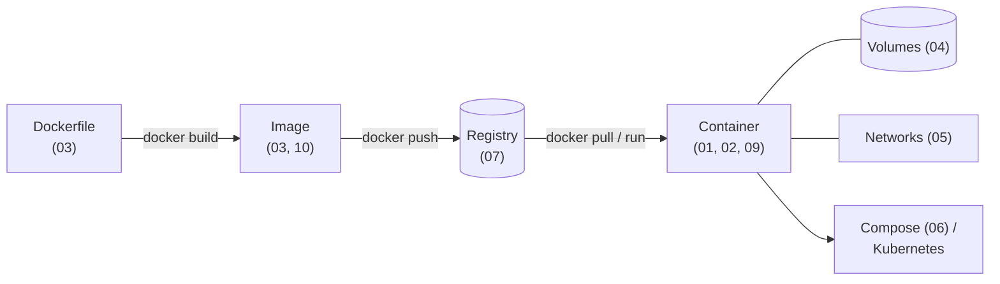

# Docker Complete Guide - Index (Basic to Advanced)

> **Note**: Sections marked **(Interview Imp)** are frequently asked in interviews.
>
> **How to read this wiki:** Read the files in number order. Every file has its own table of contents, Previous/Next links and a **📘 Terms Explained** table for any word you don't know.
>
> **Scope:** Containers vs VMs, Docker architecture, CLI, Dockerfile and image optimisation (multi-stage, BuildKit), volumes, networking, Docker Compose, registries and supply-chain security, hardening, runtime behaviour (limits, logging, health, signals), Linux internals (namespaces, cgroups, overlayfs, OCI), troubleshooting, CI/CD, production patterns, interview questions, projects and a learning path.
>
> **Related files:** [00_Kubernetes_Index.md](../kubernetes/00_Kubernetes_Index.md) · [DevOps_Complete_Guide.md](../devops/DevOps_Complete_Guide.md) · [Java_Complete_Guide.md](../java/Java_Complete_Guide.md) (Spring Boot apps) · [09_Deployment_Pattern.md](../design-patterns/03_System_Design/09_Deployment_Pattern.md) (rollout patterns) · [01_Scalability_Pattern.md](../design-patterns/03_System_Design/01_Scalability_Pattern.md)

## Table of Contents
1. [Study Levels](#1-study-levels)
2. [Files in Study Order](#2-files-in-study-order)
3. [Big Picture in One Diagram](#3-big-picture-in-one-diagram)
4. [Verification Status](#4-verification-status)

---

## 1. Study Levels

| Level | Files |
|---|---|
| **Beginner** | 01-02 (concepts, architecture, install, run/manage containers and images) |
| **Intermediate** | 03-06 (Dockerfile, volumes, networking, Compose) |
| **Advanced** | 07-12 (registries/supply chain, security, runtime, internals, debugging, CI/CD) |
| **Mastery** | 13-15 (interview questions, projects and learning path, big picture and cheat sheet) |

## 2. Files in Study Order

| # | File | What you learn | Key sections |
|---|---|---|---|
| 01 | [01_Docker_Fundamentals.md](01_Docker_Fundamentals.md) | What containers are, how Docker is built | [Containers vs VMs (Interview Imp)](01_Docker_Fundamentals.md#containers-vs-virtual-machines-interview-imp), [Architecture (Interview Imp)](01_Docker_Fundamentals.md#12-docker-architecture-interview-imp) |
| 02 | [02_Containers_and_Images_CLI.md](02_Containers_and_Images_CLI.md) | Running, managing and cleaning up containers and images | [`docker run` essentials (Interview Imp)](02_Containers_and_Images_CLI.md#22-docker-run-essentials-interview-imp) |
| 03 | [03_Dockerfile_and_Image_Building.md](03_Dockerfile_and_Image_Building.md) | Writing small, fast, safe images | [Layers](03_Dockerfile_and_Image_Building.md#31-image-layers-and-caching), [CMD vs ENTRYPOINT (Interview Imp)](03_Dockerfile_and_Image_Building.md#cmd-vs-entrypoint-interview-imp), [Multi-stage (Interview Imp)](03_Dockerfile_and_Image_Building.md#34-multi-stage-builds-interview-imp), [Checklist (Interview Imp)](03_Dockerfile_and_Image_Building.md#37-dockerfile-best-practices-checklist-interview-imp) |
| 04 | [04_Volumes_and_Storage.md](04_Volumes_and_Storage.md) | Keeping data beyond the container's life | [Volumes vs bind mounts vs tmpfs](04_Volumes_and_Storage.md#41-three-ways-to-persist-or-share-data) |
| 05 | [05_Docker_Networking.md](05_Docker_Networking.md) | How containers talk to each other and the outside | [Network drivers](05_Docker_Networking.md#51-network-drivers), [How it works](05_Docker_Networking.md#52-how-it-works) |
| 06 | [06_Docker_Compose.md](06_Docker_Compose.md) | Multi-container apps from one YAML file | [Complete example](06_Docker_Compose.md#62-a-complete-example), [Key concepts](06_Docker_Compose.md#64-key-concepts) |
| 07 | [07_Registries_and_Supply_Chain.md](07_Registries_and_Supply_Chain.md) | Storing, tagging, scanning and signing images | [Tagging strategy](07_Registries_and_Supply_Chain.md#72-tagging-strategy), [Supply chain](07_Registries_and_Supply_Chain.md#73-supply-chain-security) |
| 08 | [08_Docker_Security.md](08_Docker_Security.md) | Hardening containers and hosts | [Hardening checklist](08_Docker_Security.md#82-hardening-checklist) |
| 09 | [09_Runtime_Limits_Logging_Health.md](09_Runtime_Limits_Logging_Health.md) | Limits, logs, health checks, graceful shutdown | [PID 1 and signals (Interview Imp)](09_Runtime_Limits_Logging_Health.md#94-pid-1-signals-and-graceful-shutdown-interview-imp) |
| 10 | [10_Docker_Internals.md](10_Docker_Internals.md) | Namespaces, cgroups, overlayfs, OCI | [Linux primitives](10_Docker_Internals.md#101-linux-primitives-behind-containers), [What happens on `docker run`](10_Docker_Internals.md#102-what-happens-on-docker-run-nginx) |
| 11 | [11_Troubleshooting_and_Debugging.md](11_Troubleshooting_and_Debugging.md) | Fixing broken containers | [Symptom → fix table](11_Troubleshooting_and_Debugging.md#111-symptom--diagnosis--fix) |
| 12 | [12_CICD_and_Production.md](12_CICD_and_Production.md) | Building in CI, running in production | [GitHub Actions pipeline](12_CICD_and_Production.md#121-ci-pipeline-example-github-actions) |
| 13 | [13_Interview_Questions.md](13_Interview_Questions.md) | 35 questions, basic to advanced | [Basics](13_Interview_Questions.md#131-basics), [Advanced](13_Interview_Questions.md#133-advanced) |
| 14 | [14_Practice_Projects_and_Learning_Path.md](14_Practice_Projects_and_Learning_Path.md) | Hands-on projects and a 6-week plan | [Projects](14_Practice_Projects_and_Learning_Path.md#14-practice-projects-by-level), [Learning path](14_Practice_Projects_and_Learning_Path.md#15-learning-path) |
| 15 | [15_Big_Picture_and_Cheat_Sheet.md](15_Big_Picture_and_Cheat_Sheet.md) | How it all fits together + one-page cheat sheet | [How it all fits together](15_Big_Picture_and_Cheat_Sheet.md#15-how-it-all-fits-together-interview-imp), [Cheat sheet](15_Big_Picture_and_Cheat_Sheet.md#16-docker-cheat-sheet) |

## 3. Big Picture in One Diagram

The full walkthrough of this diagram is in [15_Big_Picture_and_Cheat_Sheet.md](15_Big_Picture_and_Cheat_Sheet.md#15-how-it-all-fits-together-interview-imp).

## 4. Verification Status

| Item | Status |
|---|---|
| Dockerfiles, `docker` commands and Compose files in 01-12 | **Not yet executed.** They were written before the "run everything" rule. They will be run for real, with output pasted under each example, as each file is revisited. |
| Mermaid diagrams | Checked with the mermaid parser (see each file) |
| Links and anchors | Checked across the whole wiki |
| GitHub Actions workflow (12.1), cloud registries (ECR/GCR/ACR), cosign signing | Cannot be run locally (needs GitHub runners / cloud accounts / signing keys) |

#### 📘 Terms Explained

| Term | Simple meaning |
|---|---|
| **Image** | Read-only package (app + dependencies) that containers start from. |
| **Container** | A running instance of an image: an isolated Linux process. |
| **Registry** | Server that stores and distributes images. |
| **Compose** | Tool that starts several containers together from one YAML file. |
| **Kubernetes** | System that runs containers across many machines and keeps them healthy. |

---

> **Navigation:** [Next: 01_Docker_Fundamentals ➡](01_Docker_Fundamentals.md)
