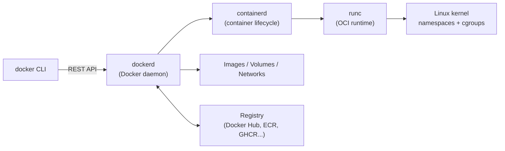

# 1. Docker Fundamentals

> **Note**: Sections marked **(Interview Imp)** are frequently asked in interviews. Every chapter ends with a **📘 Terms Explained** table for the jargon it uses.
>
> **Navigation:** [⬅ Previous: 00_Docker_Index](00_Docker_Index.md) · [Index](00_Docker_Index.md) · [Next: 02_Containers_and_Images_CLI ➡](02_Containers_and_Images_CLI.md)

## Table of Contents
- [1.1 What is Docker and Why Containers?](#11-what-is-docker-and-why-containers)
- [1.2 Docker Architecture (Interview Imp)](#12-docker-architecture-interview-imp)
- [1.3 Installation and First Run](#13-installation-and-first-run)
- [1.4 Core Concepts in One Picture](#14-core-concepts-in-one-picture)

---

## 1.1 What is Docker and Why Containers?

**Docker** is a platform for building, shipping and running applications in **containers**: lightweight, isolated processes that bundle an app with its dependencies (libraries, runtime, config) but **share the host's OS kernel**.

**The problem it solves:** "It works on my machine." Different OS versions, library versions and configs between dev, test and production cause bugs. A container image is an immutable, portable package, so the same artifact runs everywhere.

| Benefit | Explanation |
|---|---|
| **Consistency** | Same image in dev, CI, staging, prod |
| **Isolation** | Each app has its own filesystem, network, process tree, dependencies |
| **Speed** | Starts in milliseconds-seconds (no OS boot) |
| **Density** | Many containers per host; small footprint (MBs) |
| **Portability** | Runs on laptop, VM, bare metal, any cloud |
| **Immutable infrastructure** | Replace containers instead of patching servers |
| **Ecosystem** | Docker Hub, Compose, Kubernetes, CI/CD integration |
| **Microservices fit** | One process per container, independently deployed/scaled |

### Containers vs Virtual Machines (Interview Imp)

```
Virtual Machines                         Containers
┌─────┐ ┌─────┐ ┌─────┐                  ┌─────┐ ┌─────┐ ┌─────┐
│App A│ │App B│ │App C│                  │App A│ │App B│ │App C│
│Bins │ │Bins │ │Bins │                  │Bins │ │Bins │ │Bins │
│GuestOS│GuestOS│GuestOS│                 └──┬──┘ └──┬──┘ └──┬──┘
└──┬──┘ └──┬──┘ └──┬──┘                  ┌──┴───────┴───────┴──┐
┌──┴───────┴───────┴──┐                  │   Container runtime │
│     Hypervisor      │                  │   (Docker Engine)   │
├─────────────────────┤                  ├─────────────────────┤
│      Host OS        │                  │   Host OS (kernel)  │
└─────────────────────┘                  └─────────────────────┘
```

| | Virtual Machine | Container |
|---|---|---|
| Isolation level | Hardware (own kernel) | Process-level (shared kernel) |
| Size | GBs | MBs |
| Startup | Minutes | Seconds/milliseconds |
| Overhead | High (full OS per VM) | Low |
| Security isolation | Stronger | Weaker (kernel shared) → harden |
| OS flexibility | Any guest OS | Same kernel family (Linux containers need a Linux kernel) |
| Use for | Strong isolation, different OSes, legacy | Microservices, CI, scalable apps |

On macOS/Windows, Docker Desktop runs a lightweight Linux VM and containers inside it.

#### 📘 Terms Explained

| Term | Simple meaning |
|---|---|
| **Container** | An isolated running process (or group) with its own filesystem, network and process space. |
| **Image** | Read-only template (layers) used to create containers. |
| **Kernel** | The core of the OS; containers share the host's kernel. |
| **Hypervisor** | Software that runs virtual machines. |
| **Immutable infrastructure** | Never modify running servers; deploy new versions instead. |
| **Microservices** | Application split into small independently deployable services. |

---

## 1.2 Docker Architecture (Interview Imp)



| Component | Role |
|---|---|
| **Docker CLI** (`docker`) | Command-line client; talks to the daemon over a socket (`/var/run/docker.sock`) |
| **dockerd** | Daemon: builds images, manages containers, networks, volumes, API |
| **containerd** | Industry-standard container runtime: pulls images, manages snapshots, supervises containers |
| **runc** | Low-level OCI runtime that actually creates the container (sets namespaces/cgroups, execs process) |
| **BuildKit** | Modern build engine (parallel, cached builds, secrets, multi-platform) |
| **Registry** | Server storing/distributing images (Docker Hub, GHCR, ECR, GCR/Artifact Registry, ACR, Harbor, Quay) |
| **OCI** | Open Container Initiative: standard image and runtime specs, so images work across tools |

**Security note:** access to the Docker socket = root on the host. Never mount `/var/run/docker.sock` into untrusted containers.

## 1.3 Installation and First Run

```bash
# Linux (Docker Engine) - follow docs.docker.com/engine/install for your distro
curl -fsSL https://get.docker.com | sh                  # convenience script (review before running)
sudo usermod -aG docker $USER                           # run docker without sudo (re-login); equals root-level access!
sudo systemctl enable --now docker

docker version            # client + server versions
docker info               # storage driver, cgroup version, runtimes, plugins
docker run hello-world    # pull + run a tiny test image
```
Alternatives: **Docker Desktop** (macOS/Windows/Linux GUI + Kubernetes), **Rancher Desktop**, **Podman** (daemonless, rootless), **Colima**, **OrbStack**, **nerdctl** (containerd).

```bash
docker run -d --name web -p 8080:80 nginx          # run nginx in background, map host 8080 -> container 80
curl localhost:8080
docker logs web
docker exec -it web sh                              # open a shell inside
docker stop web && docker rm web
```

## 1.4 Core Concepts in One Picture

```
Dockerfile  --docker build-->  Image  --docker run-->  Container
                                 │                         │
                       docker push/pull             writable layer + volumes + network
                                 ▼
                             Registry
```

#### 📘 Terms Explained

| Term | Simple meaning |
|---|---|
| **Daemon** | Background service (`dockerd`) doing the real work. |
| **OCI** | Open standard for image format and container runtime. |
| **runc** | Reference implementation that spawns containers. |
| **Registry / Repository** | Image server / a named collection of image versions (`nginx`). |
| **Docker socket** | Unix socket the CLI uses to control the daemon. |
| **Rootless** | Running the daemon/containers without root privileges. |

---

> **Navigation:** [⬅ Previous: 00_Docker_Index](00_Docker_Index.md) · [Index](00_Docker_Index.md) · [Next: 02_Containers_and_Images_CLI ➡](02_Containers_and_Images_CLI.md)
