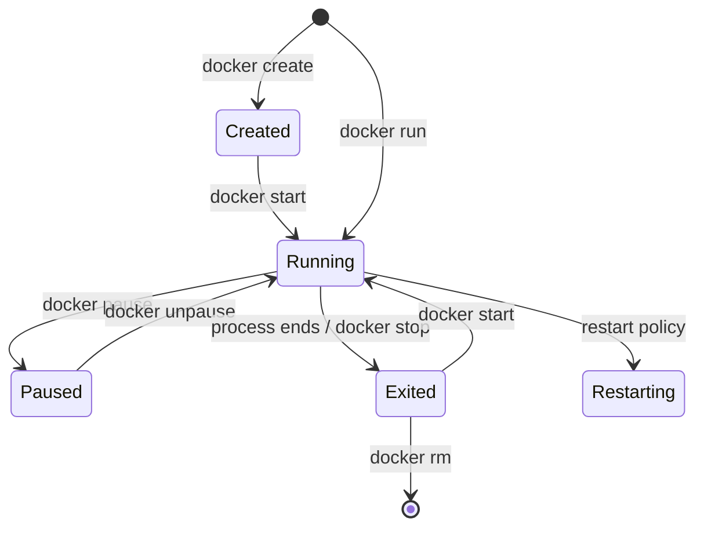

# 2. Working with Containers and Images (CLI)

> **Note**: Sections marked **(Interview Imp)** are frequently asked in interviews. Every chapter ends with a **📘 Terms Explained** table for the jargon it uses.
>
> **Navigation:** [⬅ Previous: 01_Docker_Fundamentals](01_Docker_Fundamentals.md) · [Index](00_Docker_Index.md) · [Next: 03_Dockerfile_and_Image_Building ➡](03_Dockerfile_and_Image_Building.md)

## Table of Contents
- [2.1 Container Lifecycle](#21-container-lifecycle)
- [2.2 `docker run` Essentials (Interview Imp)](#22-docker-run-essentials-interview-imp)
- [2.3 Managing Containers](#23-managing-containers)
- [2.4 Working with Images](#24-working-with-images)
- [2.5 Cleaning Up](#25-cleaning-up)

---

## 2.1 Container Lifecycle



A container lives while its **main process (PID 1)** runs. When that process exits, the container stops. Containers are **ephemeral**: anything written inside the container's writable layer is lost when it is removed, so persist data in **volumes**.

## 2.2 `docker run` Essentials (Interview Imp)

```bash
docker run [OPTIONS] IMAGE[:TAG] [COMMAND] [ARGS...]

docker run -d --name api \                       # -d detached, --name
  -p 8080:8080 \                                 # host:container port publish (-P publishes all EXPOSEd)
  -e SPRING_PROFILES_ACTIVE=prod \               # environment variable (--env-file .env for many)
  -v pgdata:/var/lib/postgresql/data \           # named volume
  -v $(pwd)/config:/app/config:ro \              # bind mount, read-only
  --network backend \                            # attach to a user-defined network
  --restart unless-stopped \                     # restart policy
  --memory 512m --cpus 1.5 \                     # resource limits
  --user 1000:1000 \                             # run as non-root
  --read-only --tmpfs /tmp \                     # read-only root filesystem
  --cap-drop ALL \                               # drop Linux capabilities
  --health-cmd "curl -f http://localhost:8080/health || exit 1" --health-interval 30s \
  myorg/api:1.4.2

docker run -it --rm ubuntu:24.04 bash            # interactive terminal, auto-remove on exit
docker run --rm -v "$PWD":/work -w /work python:3.12 python script.py   # throwaway tool container
```

| Flag | Meaning |
|---|---|
| `-d` | Detached (background) |
| `-it` | Interactive + pseudo-TTY (for shells) |
| `--rm` | Delete container when it exits |
| `-p H:C` / `-p 127.0.0.1:H:C` | Publish port (bind to localhost only for safety) |
| `-e`, `--env-file` | Environment variables |
| `-v`, `--mount` | Volumes / bind mounts |
| `-w` | Working directory |
| `--name` | Container name |
| `--network` | Network to join |
| `--restart` | `no`, `on-failure[:n]`, `always`, `unless-stopped` |
| `--entrypoint` | Override ENTRYPOINT |
| `--init` | Run a tiny init (tini) as PID 1 to reap zombies / forward signals |
| `--platform linux/amd64` | Choose architecture |
| `--add-host`, `--dns`, `--hostname` | Networking tweaks |
| `--privileged` | ALL capabilities and devices: avoid |

## 2.3 Managing Containers

```bash
docker ps                      # running containers      (-a all, -q ids only, --filter status=exited)
docker ps -a --format 'table {{.Names}}\t{{.Status}}\t{{.Ports}}'
docker start|stop|restart|kill|pause|unpause <name>
docker stop -t 30 <name>       # SIGTERM, wait 30s, then SIGKILL
docker rm <name>               # remove stopped (-f force, -v remove anonymous volumes)
docker logs -f --tail 100 --since 10m <name>
docker exec -it <name> sh      # run a command in a running container
docker exec <name> env
docker attach <name>           # attach to PID 1's stdio (Ctrl-p Ctrl-q to detach)
docker inspect <name>          # full JSON config; --format '{{.State.Health.Status}}'
docker top <name>              # processes inside
docker stats                   # live CPU/mem/net/io
docker events                  # daemon event stream
docker port <name>
docker cp <name>:/app/log.txt ./log.txt     # copy files in/out
docker diff <name>             # filesystem changes vs the image
docker rename old new
docker wait <name>
docker update --memory 1g --restart=always <name>
docker commit <name> img:tag   # snapshot a container as an image (avoid: not reproducible; use Dockerfile)
```

## 2.4 Working with Images

```bash
docker pull nginx:1.27                     # download image
docker images                              # list local images   (docker image ls)
docker image inspect nginx:1.27
docker history nginx:1.27                  # layers and sizes
docker tag myapp:latest registry.example.com/team/myapp:1.0.0
docker push registry.example.com/team/myapp:1.0.0
docker login registry.example.com
docker rmi <image>                         # remove
docker save -o app.tar myapp:1.0.0         # export image to tar (offline transfer)
docker load -i app.tar
docker search redis
docker build -t myapp:1.0.0 .              # see 03_Dockerfile_and_Image_Building.md
```

### Image naming
```
registry.example.com : 5000 / team / myapp : 1.0.0  @sha256:abcd...
└── registry host       └ port  └ namespace └ repo  └ tag    └ immutable content digest
```
- No registry → Docker Hub (`docker.io/library/nginx`).
- **Tag** is a movable label (`latest` is just a default tag, not "newest"!). **Digest** identifies exact content: pin by digest for reproducibility (`FROM node:22@sha256:...`).
- Use meaningful tags: semantic version (`1.4.2`), git SHA (`abc1234`), never rely on `latest` in production.

## 2.5 Cleaning Up

```bash
docker system df                  # disk usage
docker container prune            # remove all stopped containers
docker image prune                # remove dangling images (-a: all unused)
docker volume prune               # remove unused volumes (DATA LOSS risk!)
docker network prune
docker builder prune              # build cache
docker system prune -a --volumes  # nuke everything unused: use carefully
```
**Dangling image** = untagged layer left after a rebuild (`<none>:<none>`).

#### 📘 Terms Explained

| Term | Simple meaning |
|---|---|
| **PID 1** | The first process in a container; when it exits, the container stops. |
| **Ephemeral** | Temporary: data disappears when the container is removed. |
| **Port publishing** | Forwarding a host port to a container port. |
| **Tag / Digest** | Human label for an image version / exact content hash. |
| **Dangling image** | Image layer without a tag. |
| **Restart policy** | Rule telling Docker when to restart a container automatically. |
| **TTY** | Terminal interface for interactive sessions. |
| **Capability** | A fine-grained slice of root's powers (e.g. `NET_ADMIN`). |

---

> **Navigation:** [⬅ Previous: 01_Docker_Fundamentals](01_Docker_Fundamentals.md) · [Index](00_Docker_Index.md) · [Next: 03_Dockerfile_and_Image_Building ➡](03_Dockerfile_and_Image_Building.md)
