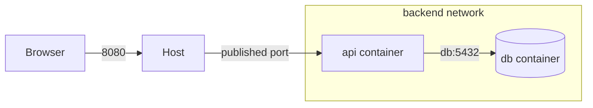

---
mdx:
  format: md
---

# 5. Docker Networking (Interview Imp)

> **Note**: Sections marked **(Interview Imp)** are frequently asked in interviews. Every chapter ends with a **📘 Terms Explained** table for the jargon it uses.
>
> **Navigation:** [⬅ Previous: 04_Volumes_and_Storage](04_Volumes_and_Storage.md) · [Index](00_Docker_Index.md) · [Next: 06_Docker_Compose ➡](06_Docker_Compose.md)

## Table of Contents
- [5.1 Network Drivers](#51-network-drivers)
- [5.2 How It Works](#52-how-it-works)
- [5.3 Troubleshooting Network Problems](#53-troubleshooting-network-problems)

---

## 5.1 Network Drivers

| Driver | Behaviour | Use |
|---|---|---|
| **bridge** (default) | Private virtual switch (`docker0`) on the host; containers get internal IPs; NAT for outbound; ports published for inbound | Single-host apps |
| **user-defined bridge** | Same, plus **automatic DNS by container name** and better isolation | **Recommended** instead of default bridge |
| **host** | Container shares host network stack (no isolation, no port mapping) | Max performance, network tools (Linux) |
| **none** | No networking (loopback only) | Isolated batch jobs |
| **overlay** | Multi-host virtual network (Swarm / VXLAN) | Multi-node clusters |
| **macvlan / ipvlan** | Container gets its own MAC/IP on the physical LAN | Legacy apps needing real LAN addresses |

```bash
docker network create backend
docker run -d --name db --network backend postgres:16
docker run -d --name api --network backend -e DB_HOST=db -p 8080:8080 myapi     # "db" resolves by DNS
docker network ls
docker network inspect backend
docker network connect frontend api                                              # attach to a second network
docker network disconnect frontend api
```



## 5.2 How It Works
- Each container has its own **network namespace** with a virtual ethernet pair (`veth`) connected to a Linux bridge. Outbound traffic is NAT'd (iptables/nftables masquerade); inbound traffic to published ports uses DNAT rules.
- Containers on the **same user-defined network** reach each other by name and internal port: `postgres://db:5432` (no need to publish `5432` on the host!). Publish only what must be reached from outside.
- Embedded DNS server at `127.0.0.11`.
- `localhost` inside a container means the container itself, not the host. To reach the host: `host.docker.internal` (Desktop; on Linux add `--add-host=host.docker.internal:host-gateway`).
- Publishing `-p 8080:80` binds `0.0.0.0` (all interfaces) and **bypasses typical host firewalls (ufw)** by editing iptables directly; bind to `127.0.0.1:8080:80` when only local access is needed.

## 5.3 Troubleshooting Network Problems

```bash
docker exec api ping db
docker exec api nslookup db                       # DNS (install tools or use nicolaka/netshoot)
docker run --rm -it --network container:api nicolaka/netshoot     # debug in the same network namespace
docker port api
docker logs api
ss -tlnp | grep 8080                              # who owns the host port?
```
Common causes: app listening on `127.0.0.1` instead of `0.0.0.0` inside the container; containers on different networks; wrong port (container vs host); firewall; DNS caching; using `localhost` for another service.

#### 📘 Terms Explained

| Term | Simple meaning |
|---|---|
| **Network namespace** | Kernel feature giving a process its own network stack. |
| **veth pair** | Virtual cable connecting a container to the bridge. |
| **Bridge** | Virtual switch connecting containers on one host. |
| **NAT / DNAT** | Rewriting addresses so internal containers can talk outside / be reached via published ports. |
| **Overlay network** | Virtual network spanning multiple hosts. |
| **Service discovery** | Finding other services by name. |

---

> **Navigation:** [⬅ Previous: 04_Volumes_and_Storage](04_Volumes_and_Storage.md) · [Index](00_Docker_Index.md) · [Next: 06_Docker_Compose ➡](06_Docker_Compose.md)
