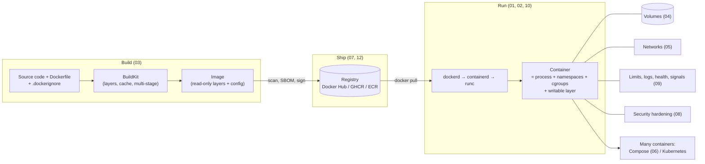

# 15. Big Picture and Cheat Sheet

> **Note**: Sections marked **(Interview Imp)** are frequently asked in interviews. Every chapter ends with a **📘 Terms Explained** table for the jargon it uses.
>
> **Navigation:** [⬅ Previous: 14_Practice_Projects_and_Learning_Path](14_Practice_Projects_and_Learning_Path.md) · [Index](00_Docker_Index.md)

## Table of Contents
- [15. How it all fits together (Interview Imp)](#15-how-it-all-fits-together-interview-imp)
   - [15.1 The Life of a Container, End to End](#151-the-life-of-a-container-end-to-end)
   - [15.2 Which File Answers Which Question](#152-which-file-answers-which-question)
- [16. Docker Cheat Sheet](#16-docker-cheat-sheet)
   - [16.1 Commands and Rules on One Page](#161-commands-and-rules-on-one-page)
   - [16.2 Top Interview Traps](#162-top-interview-traps)

---

## 15. How it all fits together (Interview Imp)

Every chapter in this wiki is one stage of the same journey: **source code → image → registry → running container → production**. If you can draw the diagram below and talk through each arrow, you can answer most "explain Docker end to end" interview questions.

### 15.1 The Life of a Container, End to End



Walking through it in plain words:

1. **Build.** You write a **Dockerfile** (a recipe). BuildKit runs each instruction and saves the result as a **layer**. Unchanged layers come from the cache, which is why dependency files are copied before source code. A **multi-stage build** compiles in one stage and copies only the result into a small runtime stage. Output: an **image**. → [03_Dockerfile_and_Image_Building.md](03_Dockerfile_and_Image_Building.md)
2. **Ship.** The image gets an immutable **tag** (version + git SHA), is **scanned** for known vulnerabilities, gets an **SBOM** and a **signature**, and is **pushed** to a registry. CI does this on every commit. → [07_Registries_and_Supply_Chain.md](07_Registries_and_Supply_Chain.md), [12_CICD_and_Production.md](12_CICD_and_Production.md)
3. **Run.** `docker run` asks the daemon (`dockerd`). The image is pulled if it is missing, `containerd` prepares it, and `runc` starts your process inside new **namespaces** (its own view of processes, network and files) and **cgroups** (resource limits). That process *is* the container. → [01_Docker_Fundamentals.md](01_Docker_Fundamentals.md), [02_Containers_and_Images_CLI.md](02_Containers_and_Images_CLI.md), [10_Docker_Internals.md](10_Docker_Internals.md)
4. **Give it data and a network.** The container's own layer is thrown away on `docker rm`, so real data goes into **volumes**. Containers on the same **user-defined network** find each other by name. Only the ports outsiders need are **published**. → [04_Volumes_and_Storage.md](04_Volumes_and_Storage.md), [05_Docker_Networking.md](05_Docker_Networking.md)
5. **Make it production-safe.** Run as **non-root**, drop capabilities, use a read-only filesystem, set memory/CPU **limits**, log to stdout, add a **health check**, and handle **SIGTERM** so shutdowns are graceful. → [08_Docker_Security.md](08_Docker_Security.md), [09_Runtime_Limits_Logging_Health.md](09_Runtime_Limits_Logging_Health.md)
6. **Run many together.** **Compose** starts a whole stack (API + DB + cache) on one machine from one YAML file. **Kubernetes** does the same across many machines, adding scaling, self-healing and rolling updates. → [06_Docker_Compose.md](06_Docker_Compose.md), [00_Kubernetes_Index.md](../kubernetes/00_Kubernetes_Index.md), [09_Deployment_Pattern.md](../design-patterns/03_System_Design/09_Deployment_Pattern.md)
7. **When it breaks.** Read logs, inspect the exit code, and check whether it was OOM-killed, which network it is on, and how ports are mapped. → [11_Troubleshooting_and_Debugging.md](11_Troubleshooting_and_Debugging.md)

### 15.2 Which File Answers Which Question

| Question | Go to |
|---|---|
| What is a container and how is it different from a VM? | [01 §1.1](01_Docker_Fundamentals.md#11-what-is-docker-and-why-containers) |
| Which `docker run` flag does what? | [02 §2.2](02_Containers_and_Images_CLI.md#22-docker-run-essentials-interview-imp) |
| Why is my build slow / my image huge? | [03 §3.1](03_Dockerfile_and_Image_Building.md#31-image-layers-and-caching), [03 §3.4](03_Dockerfile_and_Image_Building.md#34-multi-stage-builds-interview-imp) |
| CMD vs ENTRYPOINT? | [03 §3.2](03_Dockerfile_and_Image_Building.md#cmd-vs-entrypoint-interview-imp) |
| Where does my database data live? | [04 §4.1](04_Volumes_and_Storage.md#41-three-ways-to-persist-or-share-data) |
| Why can't my API reach the database? | [05 §5.2](05_Docker_Networking.md#52-how-it-works), [05 §5.3](05_Docker_Networking.md#53-troubleshooting-network-problems) |
| How do I start API + DB + cache together? | [06 §6.2](06_Docker_Compose.md#62-a-complete-example) |
| How do I tag, scan and sign images? | [07](07_Registries_and_Supply_Chain.md) |
| How do I harden a container? | [08 §8.2](08_Docker_Security.md#82-hardening-checklist) |
| What does exit code 137 mean? Why doesn't my app shut down cleanly? | [09 §9.1](09_Runtime_Limits_Logging_Health.md#91-resource-limits-cgroups), [09 §9.4](09_Runtime_Limits_Logging_Health.md#94-pid-1-signals-and-graceful-shutdown-interview-imp) |
| What really happens on `docker run`? | [10 §10.2](10_Docker_Internals.md#102-what-happens-on-docker-run-nginx) |

---

## 16. Docker Cheat Sheet

### 16.1 Commands and Rules on One Page

```
RUN       docker run -d --name n -p H:C -e K=V -v vol:/path --network net --restart unless-stopped img
          -it --rm for throwaway shells; --user, --read-only, --cap-drop ALL, --memory, --cpus for hardening
MANAGE    ps -a | logs -f | exec -it n sh | inspect | stats | stop/start/rm | cp | top | events
IMAGES    build -t name:tag . | pull | push | tag | images | history | rmi | save/load | buildx build --platform
CLEAN     system df | container/image/volume/network/builder prune | system prune -a
DOCKERFILE FROM, WORKDIR, COPY deps first, RUN, COPY src, USER non-root, EXPOSE, HEALTHCHECK, ENTRYPOINT [exec] + CMD [args]
          multi-stage, .dockerignore, pin versions, no secrets, BuildKit cache/secret mounts
DATA      named volume (persist) | bind mount (dev) | tmpfs (memory)
NETWORK   user-defined bridge = DNS by name; publish only needed ports; bind 127.0.0.1; host/none/overlay/macvlan
COMPOSE   docker compose up -d --build | ps | logs -f | exec | down (-v!) | config | watch | profiles | override files
SECURITY  non-root, drop caps, no-new-privileges, read-only FS, no --privileged, no docker.sock, limits, scan (Trivy), sign (cosign)
SIGNALS   exec form + handle SIGTERM; --init for zombies; docker stop -t N
EXIT CODES 0 ok | 1 app error | 125-127 docker/cmd | 137 SIGKILL/OOM | 143 SIGTERM
INTERNALS namespaces + cgroups + overlayfs + capabilities/seccomp; dockerd -> containerd -> runc; OCI images
```

### 16.2 Top Interview Traps
1. `EXPOSE` doesn't publish ports.
2. Shell-form `CMD` breaks signal handling.
3. Layer order: copy dependency manifests before source for cache hits.
4. Deleting a secret in a later layer doesn't remove it from the image.
5. `localhost` in a container is the container itself.
6. `depends_on` doesn't wait for readiness without a healthcheck condition (and apps must retry anyway).
7. `latest` is just a tag, not "newest".
8. Alpine's musl libc can break software built for glibc.
9. `docker system prune --volumes` can delete data.
10. Membership of the `docker` group equals root on the host.

#### 📘 Terms Explained

| Term | Simple meaning |
|---|---|
| **End to end** | The whole path from writing code to the app running in production. |
| **Pipeline** | Automated sequence of steps (build → test → scan → push → deploy). |
| **Self-healing** | An orchestrator automatically replacing containers that crash or fail health checks. |
| **Rolling update** | Replacing old containers with new ones a few at a time so the service stays up. |
| **Immutable tag** | A tag (`1.4.2`, `git-abc1234`) that is never re-pointed to a different image. |

---

> **Navigation:** [⬅ Previous: 14_Practice_Projects_and_Learning_Path](14_Practice_Projects_and_Learning_Path.md) · [Index](00_Docker_Index.md)
