---
mdx:
  format: md
---

# Java Collections Framework - Basic to Advanced (with Internals and Competitive Programming)

> **Note**: Sections marked **(Interview Imp)** are frequently asked in interviews; **(CP)** marks competitive-programming essentials.
>
> **Worked examples:** every chapter now includes numbered **Worked Examples**: complete programs, each followed by its exact **Output** and an **Explanation** (or a step-by-step trace). All were compiled and run on OpenJDK 17, and the printed output was compared with the text shown. Examples that peek at real JDK internals (the backing array of `ArrayList`, the bucket table of `HashMap`, the ring buffer of `ArrayDeque`) use reflection and must be run with the JVM flag shown in their `// jvmflags:` comment, e.g. `java --add-opens java.base/java.util=ALL-UNNAMED Main.java`.
>
> **How to read this file:** Every chapter has **📘 Terms Explained** tables. If you see a word you don't know, check the table right below that section.
>
> **Scope:** The whole `java.util` collections framework: the interface hierarchy, every major implementation and how it is built inside (arrays, linked nodes, hash tables, red-black trees, heaps, skip lists), concurrent collections, utility classes (`Collections`, `Arrays`), sorting and comparators, immutability, Big-O of everything, and a full competitive-programming toolkit (fast I/O, patterns, templates, TLE traps).
>
> **Related files:** [Java_Complete_Guide.md](Java_Complete_Guide.md) · [java-stream-api.md](java-stream-api.md) · [Exception handling](Java_Complete_Guide.md#7-exception-handling-interview-imp) · [02_Creational_Pattern.md](../design-patterns/01_LLD/02_Creational_Pattern.md) · [01_Scalability_Pattern.md](../design-patterns/03_System_Design/01_Scalability_Pattern.md)

| Level | Chapters |
|---|---|
| **Beginner** | 1-4 (big picture, Iterator, List family, Set family) |
| **Intermediate** | 5-6 (Map family, Comparable/Comparator) |
| **Advanced** | 7-10 (HashMap internals, TreeMap/heap internals, Queue/Deque, concurrent collections) |
| **Professional** | 11-13 (utilities, immutability and streams, choosing and memory) |
| **Competitive** | 14-16 (CP toolkit, patterns with solutions, traps) |
| **Mastery** | 17-20 (interview Qs, projects, learning path, cheat sheet) |

---

## Table of Contents
1. [The Big Picture](#1-the-big-picture)
   - [1.1 What is the Collections Framework? **(Interview Imp)**](#11-what-is-the-collections-framework-interview-imp)
   - [1.2 The Hierarchy (memorise this) **(Interview Imp)**](#12-the-hierarchy-memorise-this-interview-imp)
   - [1.3 The Core `Collection` Methods](#13-the-core-collection-methods)
   - [1.4 Generics, Autoboxing and the Boxing Cost **(Interview Imp)**](#14-generics-autoboxing-and-the-boxing-cost-interview-imp)
   - [1.5 Fail-Fast vs Fail-Safe Iterators **(Interview Imp)**](#15-fail-fast-vs-fail-safe-iterators-interview-imp)
   - [1.6 Big-O Cheat Table of All Major Collections **(Interview Imp) (CP)**](#16-big-o-cheat-table-of-all-major-collections-interview-imp-cp)
2. [Iterator, ListIterator, Iterable and Spliterator](#2-iterator-listiterator-iterable-and-spliterator)
   - [2.1 `Iterator` **(Interview Imp)**](#21-iterator-interview-imp)
   - [2.2 `ListIterator` (only for Lists)](#22-listiterator-only-for-lists)
   - [2.3 Making your own class iterable](#23-making-your-own-class-iterable)
   - [2.4 `Spliterator` (advanced)](#24-spliterator-advanced)
3. [The List Family](#3-the-list-family)
   - [3.1 `ArrayList` - internal structure **(Interview Imp) (CP)**](#31-arraylist---internal-structure-interview-imp-cp)
   - [3.2 `LinkedList` - internal structure **(Interview Imp)**](#32-linkedlist---internal-structure-interview-imp)
   - [3.3 `ArrayList` vs `LinkedList` **(Interview Imp)**](#33-arraylist-vs-linkedlist-interview-imp)
   - [3.4 `Vector` and `Stack` (legacy)](#34-vector-and-stack-legacy)
   - [3.5 `CopyOnWriteArrayList`](#35-copyonwritearraylist)
   - [3.6 Immutable and fixed-size lists **(Interview Imp)**](#36-immutable-and-fixed-size-lists-interview-imp)
   - [3.7 `subList`, `List.sort`, `replaceAll`](#37-sublist-listsort-replaceall)
4. [The Set Family](#4-the-set-family)
   - [4.1 `HashSet` - internal structure **(Interview Imp) (CP)**](#41-hashset---internal-structure-interview-imp-cp)
   - [4.2 `LinkedHashSet`](#42-linkedhashset)
   - [4.3 `TreeSet` **(Interview Imp)**](#43-treeset-interview-imp)
   - [4.4 `EnumSet`](#44-enumset)
   - [4.5 Other sets](#45-other-sets)
   - [4.6 Set operations and the equals/hashCode contract **(Interview Imp)**](#46-set-operations-and-the-equalshashcode-contract-interview-imp)
5. [The Map Family](#5-the-map-family)
   - [5.1 Core `Map` API **(Interview Imp) (CP)**](#51-core-map-api-interview-imp-cp)
   - [5.2 `LinkedHashMap` and the LRU cache **(Interview Imp)**](#52-linkedhashmap-and-the-lru-cache-interview-imp)
   - [5.3 `TreeMap` overview **(CP)**](#53-treemap-overview-cp)
   - [5.4 Special-purpose maps](#54-special-purpose-maps)
6. [Ordering: `Comparable` and `Comparator`](#6-ordering-comparable-and-comparator)
   - [6.1 Natural order with `Comparable` **(Interview Imp)**](#61-natural-order-with-comparable-interview-imp)
   - [6.2 Custom order with `Comparator` **(Interview Imp) (CP)**](#62-custom-order-with-comparator-interview-imp-cp)
   - [6.3 Stable sorting and the algorithms underneath](#63-stable-sorting-and-the-algorithms-underneath)
7. [HashMap Internals (the most asked topic) **(Interview Imp) (CP)**](#7-hashmap-internals-the-most-asked-topic-interview-imp-cp)
   - [7.1 Structure](#71-structure)
   - [7.2 `put(key, value)` step by step](#72-putkey-value-step-by-step)
   - [7.3 Resize (rehash)](#73-resize-rehash)
   - [7.4 Why 0.75 load factor, why power of 2, why treeify at 8?](#74-why-075-load-factor-why-power-of-2-why-treeify-at-8)
   - [7.5 Worked example of a collision](#75-worked-example-of-a-collision)
   - [7.6 Mutable key disaster](#76-mutable-key-disaster)
   - [7.7 Thread safety problems of HashMap](#77-thread-safety-problems-of-hashmap)
   - [7.8 `HashMap` vs `Hashtable` vs `ConcurrentHashMap` vs `SynchronizedMap`](#78-hashmap-vs-hashtable-vs-concurrenthashmap-vs-synchronizedmap)
8. [Tree and Heap Internals: TreeMap, PriorityQueue](#8-tree-and-heap-internals-treemap-priorityqueue)
   - [8.1 `TreeMap` = Red-Black Tree **(Interview Imp)**](#81-treemap--red-black-tree-interview-imp)
   - [8.2 `PriorityQueue` = Binary Min-Heap in an array **(Interview Imp) (CP)**](#82-priorityqueue--binary-min-heap-in-an-array-interview-imp-cp)
   - [8.3 Skip list (`ConcurrentSkipListMap`)](#83-skip-list-concurrentskiplistmap)
9. [Queue and Deque](#9-queue-and-deque)
   - [9.1 `Queue` interface: two flavours of every method **(Interview Imp)**](#91-queue-interface-two-flavours-of-every-method-interview-imp)
   - [9.2 `Deque` - double ended queue](#92-deque---double-ended-queue)
   - [9.3 `ArrayDeque` internals **(Interview Imp) (CP)**](#93-arraydeque-internals-interview-imp-cp)
   - [9.4 Blocking queues (producer-consumer) **(Interview Imp)**](#94-blocking-queues-producer-consumer-interview-imp)
   - [9.5 `Queue` implementation summary](#95-queue-implementation-summary)
10. [Concurrent Collections **(Interview Imp)**](#10-concurrent-collections-interview-imp)
   - [10.1 Why normal collections break under threads](#101-why-normal-collections-break-under-threads)
   - [10.2 `ConcurrentHashMap` internals **(Interview Imp)**](#102-concurrenthashmap-internals-interview-imp)
   - [10.3 Overview of all concurrent collections](#103-overview-of-all-concurrent-collections)
   - [10.4 Compound-action safety and iteration](#104-compound-action-safety-and-iteration)
   - [10.5 Immutability as the best concurrency strategy](#105-immutability-as-the-best-concurrency-strategy)
11. [Utility Classes: `Collections`, `Arrays`, `Objects`, `BitSet`](#11-utility-classes-collections-arrays-objects-bitset)
   - [11.1 `Collections` **(Interview Imp)**](#111-collections-interview-imp)
   - [11.2 `Arrays` **(CP)**](#112-arrays-cp)
   - [11.3 `Objects`](#113-objects)
   - [11.4 `BitSet` **(CP)**](#114-bitset-cp)
12. [Immutability, Streams with Collectors, and Copying](#12-immutability-streams-with-collectors-and-copying)
   - [12.1 Shallow vs deep copy **(Interview Imp)**](#121-shallow-vs-deep-copy-interview-imp)
   - [12.2 Defensive copies and unmodifiable views](#122-defensive-copies-and-unmodifiable-views)
   - [12.3 Collections and Streams **(Interview Imp)**](#123-collections-and-streams-interview-imp)
   - [12.4 Java 21: `SequencedCollection`](#124-java-21-sequencedcollection)
13. [Choosing the Right Collection, Memory and Performance](#13-choosing-the-right-collection-memory-and-performance)
   - [13.1 Decision guide **(Interview Imp)**](#131-decision-guide-interview-imp)
   - [13.2 Memory of common structures (64-bit, compressed oops, rough)](#132-memory-of-common-structures-64-bit-compressed-oops-rough)
   - [13.3 Performance tips](#133-performance-tips)
   - [13.4 Common bugs checklist](#134-common-bugs-checklist)
14. [Competitive Programming Toolkit **(CP)**](#14-competitive-programming-toolkit-cp)
   - [14.1 Judge limits and picking an algorithm from `n`](#141-judge-limits-and-picking-an-algorithm-from-n)
   - [14.2 Fast input and output **(CP)**](#142-fast-input-and-output-cp)
   - [14.3 Primitive arrays beat collections](#143-primitive-arrays-beat-collections)
   - [14.4 Useful constants and tricks](#144-useful-constants-and-tricks)
   - [14.5 Collections cheat sheet for CP](#145-collections-cheat-sheet-for-cp)
   - [14.6 Binary search templates **(CP)**](#146-binary-search-templates-cp)
15. [Patterns with Collections and Worked Solutions **(CP)**](#15-patterns-with-collections-and-worked-solutions-cp)
   - [15.1 Two Sum / complement lookup (HashMap)](#151-two-sum--complement-lookup-hashmap)
   - [15.2 Subarray sum equals K (prefix sum + HashMap)](#152-subarray-sum-equals-k-prefix-sum--hashmap)
   - [15.3 Valid parentheses / next greater element (Stack)](#153-valid-parentheses--next-greater-element-stack)
   - [15.4 Sliding window maximum (monotonic Deque) **(Interview Imp)**](#154-sliding-window-maximum-monotonic-deque-interview-imp)
   - [15.5 BFS shortest path on a grid](#155-bfs-shortest-path-on-a-grid)
   - [15.6 Union-Find (Disjoint Set Union) **(CP)**](#156-union-find-disjoint-set-union-cp)
   - [15.7 Dijkstra with `PriorityQueue` (lazy deletion) **(CP) (Interview Imp)**](#157-dijkstra-with-priorityqueue-lazy-deletion-cp-interview-imp)
   - [15.8 Top-K frequent elements (heap) and K-th largest](#158-top-k-frequent-elements-heap-and-k-th-largest)
   - [15.9 Multiset and ordered queries (TreeMap / TreeSet) **(CP)**](#159-multiset-and-ordered-queries-treemap--treeset-cp)
   - [15.10 Longest Increasing Subsequence in O(n log n)](#1510-longest-increasing-subsequence-in-on-log-n)
   - [15.11 Coordinate compression](#1511-coordinate-compression)
   - [15.12 Fenwick tree (BIT): prefix sums with updates](#1512-fenwick-tree-bit-prefix-sums-with-updates)
   - [15.13 Prefix sums, difference arrays, two pointers](#1513-prefix-sums-difference-arrays-two-pointers)
   - [15.14 Pair/state keys and a reusable `Pair`](#1514-pairstate-keys-and-a-reusable-pair)
   - [15.15 Subsets with bitmasks and permutations](#1515-subsets-with-bitmasks-and-permutations)
16. [Competitive Programming Traps in Java **(CP) (Interview Imp)**](#16-competitive-programming-traps-in-java-cp-interview-imp)
   - [16.1 The trap list](#161-the-trap-list)
   - [16.2 Anti-quicksort and anti-hash tests](#162-anti-quicksort-and-anti-hash-tests)
   - [16.3 Deep recursion](#163-deep-recursion)
   - [16.4 Template for contests](#164-template-for-contests)
   - [16.5 Complexity of Java operations to keep in mind](#165-complexity-of-java-operations-to-keep-in-mind)
17. [Interview Questions **(Interview Imp)**](#17-interview-questions-interview-imp)
   - [17.1 Conceptual](#171-conceptual)
   - [17.2 HashMap deep dive](#172-hashmap-deep-dive)
   - [17.3 Advanced and design](#173-advanced-and-design)
   - [17.4 Output-prediction quickies](#174-output-prediction-quickies)
18. [Practice Projects by Level](#18-practice-projects-by-level)
19. [Learning Path](#19-learning-path)
20. [Cheat Sheet and Top Interview Traps](#20-cheat-sheet-and-top-interview-traps)
   - [20.1 One-page cheat sheet](#201-one-page-cheat-sheet)
   - [20.2 Top interview and CP traps (read before every interview or contest)](#202-top-interview-and-cp-traps-read-before-every-interview-or-contest)

---

# 1. The Big Picture

## 1.1 What is the Collections Framework? **(Interview Imp)**

A **collection** is an object that holds a group of other objects. The **Java Collections Framework (JCF)** is the standard set of **interfaces** (what you can do), **implementations** (ready-made data structures) and **algorithms** (sorting, searching, shuffling) in `java.util`.

Before Java 2 (1998) you had only arrays, `Vector` and `Hashtable`. Arrays have fixed size and no helper methods. The JCF gave one consistent API so that you can swap `ArrayList` for `LinkedList` by changing a single word.

**Three pillars:**

1. **Interfaces**: `List`, `Set`, `Queue`, `Deque`, `Map` (abstract data types).
2. **Implementations**: `ArrayList`, `HashMap`, `TreeSet`, `PriorityQueue` (concrete data structures).
3. **Algorithms**: static methods in `Collections` and `Arrays` (`sort`, `binarySearch`, `shuffle`, `reverse`).

```java
// Program to the interface, choose the implementation once
List<String> names = new ArrayList<>();   // later: new LinkedList<>() - nothing else changes
Map<String, Integer> age = new HashMap<>();
```

### 📘 Terms Explained

| Term | Meaning |
|---|---|
| Collection | An object that groups elements |
| Interface | A contract: a list of methods without the body |
| Implementation | A class that provides the real data structure |
| Algorithm | A reusable operation such as sort or search |
| ADT | Abstract Data Type: behaviour only (a "List" says order matters, not how it is stored) |

---

## 1.2 The Hierarchy (memorise this) **(Interview Imp)**

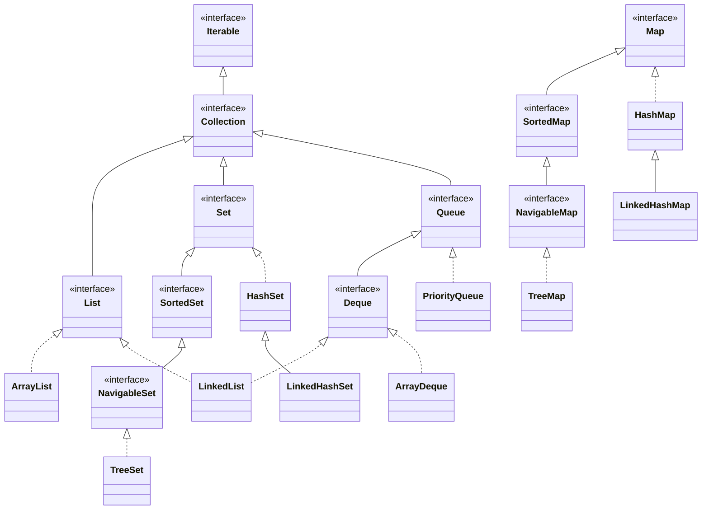

**Key facts that confuse people:**

- **`Map` does NOT extend `Collection`.** A map stores key-value pairs, not single elements.
- `Collection` (interface) vs `Collections` (utility class with static methods). Different things.
- `Iterable` is the root: anything `Iterable` works in a for-each loop.
- `LinkedList` implements **both** `List` and `Deque`.
- `Stack` and `Vector` are legacy. Use `ArrayDeque` and `ArrayList`.

| Interface | Order | Duplicates | Null | Main idea |
|---|---|---|---|---|
| `List` | Insertion, indexed | Yes | Yes | Ordered sequence, access by index |
| `Set` | Depends on impl | No | Depends | Uniqueness |
| `Queue` | FIFO (or priority) | Yes | Mostly no | Process in arrival order |
| `Deque` | Both ends | Yes | No | Stack + Queue together |
| `Map` | Depends on impl | Keys unique | Depends | Key to value lookup |

### 📘 Terms Explained

| Term | Meaning |
|---|---|
| Root interface | The top of an inheritance tree |
| FIFO | First In, First Out (a queue at a ticket counter) |
| LIFO | Last In, First Out (a stack of plates) |
| Legacy class | Old class kept for compatibility, avoid in new code |
| Navigable | Supports "closest match" queries: floor, ceiling, lower, higher |

---

## 1.3 The Core `Collection` Methods

```java
public interface Collection<E> extends Iterable<E> {
    int size();
    boolean isEmpty();
    boolean contains(Object o);
    boolean add(E e);                       // optional
    boolean remove(Object o);               // optional
    boolean containsAll(Collection<?> c);
    boolean addAll(Collection<? extends E> c);
    boolean removeAll(Collection<?> c);     // set difference
    boolean retainAll(Collection<?> c);     // set intersection
    boolean removeIf(Predicate<? super E> p); // Java 8
    void clear();
    Object[] toArray();
    <T> T[] toArray(T[] a);
    Stream<E> stream();                     // Java 8
}
```

"Optional" operations may throw `UnsupportedOperationException` (for example on `List.of(...)` or `Arrays.asList(...).add(...)`).

```java
List<Integer> a = new ArrayList<>(List.of(1, 2, 3, 4));
List<Integer> b = List.of(3, 4, 5);

List<Integer> union = new ArrayList<>(a);   union.addAll(b);      // [1,2,3,4,3,4,5]
List<Integer> inter = new ArrayList<>(a);   inter.retainAll(b);   // [3,4]
List<Integer> diff  = new ArrayList<>(a);   diff.removeAll(b);    // [1,2]
a.removeIf(x -> x % 2 == 0);                                      // [1,3]
```

#### Worked Example 1: the bulk `Collection` operations on lists and sets

```java
import java.util.*;

public class Main {
    public static void main(String[] args) {
        List<Integer> a = new ArrayList<>(List.of(1, 2, 3, 4));
        List<Integer> b = List.of(3, 4, 5);

        List<Integer> union = new ArrayList<>(a); union.addAll(b);
        List<Integer> inter = new ArrayList<>(a); inter.retainAll(b);
        List<Integer> diff  = new ArrayList<>(a); diff.removeAll(b);
        System.out.println("list union " + union + ", intersection " + inter + ", difference " + diff);

        Set<Integer> setUnion = new TreeSet<>(a); setUnion.addAll(b);
        System.out.println("set union (no duplicates) " + setUnion);
        System.out.println("containsAll([1,2]) " + a.containsAll(List.of(1, 2)) + ", containsAll([1,9]) " + a.containsAll(List.of(1, 9)));

        boolean changed = a.removeIf(x -> x % 2 == 0);
        System.out.println("removeIf evens -> " + a + " (changed: " + changed + ")");
        System.out.println("addAll returned " + a.addAll(List.of()) + " for an empty argument");

        Integer[] arr = a.toArray(new Integer[0]);
        Object[] objs = a.toArray();
        System.out.println("toArray(new Integer[0]) -> " + arr.getClass().getSimpleName() + " " + Arrays.toString(arr)
                + ", toArray() -> " + objs.getClass().getSimpleName());
        try {
            List.of(1, 2).removeIf(x -> x > 1);
        } catch (UnsupportedOperationException e) {
            System.out.println("optional operation refused by List.of: UnsupportedOperationException");
        }
    }
}
```

**Output:**
```text
list union [1, 2, 3, 4, 3, 4, 5], intersection [3, 4], difference [1, 2]
set union (no duplicates) [1, 2, 3, 4, 5]
containsAll([1,2]) true, containsAll([1,9]) false
removeIf evens -> [1, 3] (changed: true)
addAll returned false for an empty argument
toArray(new Integer[0]) -> Integer[] [1, 3], toArray() -> Object[]
optional operation refused by List.of: UnsupportedOperationException
```

**Explanation:**
- On **lists**, `addAll` keeps duplicates (3 and 4 appear twice); on **sets** the same call gives a true mathematical union. `retainAll` = intersection, `removeAll` = difference.
- `addAll`, `removeIf`, `retainAll` return `true` only if the collection actually changed, which is handy for "did anything happen?" checks.
- `toArray(new Integer[0])` returns a correctly typed `Integer[]`; the no-argument `toArray()` always returns `Object[]`, which cannot be cast to `Integer[]`.
- Mutating methods are *optional operations*: immutable lists from `List.of` refuse them with `UnsupportedOperationException`.

### 📘 Terms Explained

| Term | Meaning |
|---|---|
| Optional operation | A method an implementation may refuse by throwing `UnsupportedOperationException` |
| Wildcard `? extends E` | "Any type that is E or a subtype" (read-only friendly) |
| `toArray(new T[0])` | Converts a collection to a typed array |

---

## 1.4 Generics, Autoboxing and the Boxing Cost **(Interview Imp)**

Collections hold **objects only**, never primitives. `List<int>` is illegal; use `List<Integer>`. Java converts automatically (**autoboxing**) between `int` and `Integer`.

```java
List<Integer> list = new ArrayList<>();
list.add(5);              // autobox int -> Integer.valueOf(5)
int x = list.get(0);      // unbox Integer -> int  (NullPointerException if null!)
```

**Three real consequences:**

1. **Memory**: an `int` is 4 bytes; an `Integer` object is about 16 bytes plus a 4-8 byte reference. A `List<Integer>` of one million numbers is roughly 20 MB; an `int[]` is 4 MB.
2. **Speed**: boxing allocates objects, which means GC pressure. This matters a lot in competitive programming (Chapter 14).
3. **`==` trap**: `Integer` caches -128 to 127.

```java
Integer a = 127, b = 127;
System.out.println(a == b);       // true  (same cached object)
Integer c = 128, d = 128;
System.out.println(c == d);       // false (two different objects)
System.out.println(c.equals(d));  // true  -> always use equals for objects
```

**The `remove` trap on `List<Integer>`:**

```java
List<Integer> l = new ArrayList<>(List.of(10, 20, 30));
l.remove(1);                       // removes INDEX 1 -> [10, 30]
l.remove(Integer.valueOf(10));     // removes VALUE 10 -> [30]
```

**Generics are erased at runtime** (type erasure). `List<String>` and `List<Integer>` are the same class at runtime, so you cannot do `new T[]` or `instanceof List<String>`.
#### Worked Example 2: boxing traps you can reproduce

```java
// NONDETERMINISTIC: the timing comparison line depends on the machine (it is "true" on any normal JVM).
import java.util.*;

public class Main {
    public static void main(String[] args) {
        List<Integer> l = new ArrayList<>(List.of(10, 20, 30));
        l.remove(1);                                   // INDEX 1
        System.out.println("after remove(1)               : " + l);
        l.remove(Integer.valueOf(10));                 // VALUE 10
        System.out.println("after remove(Integer.valueOf(10)): " + l);

        Set<Short> shorts = new HashSet<>();
        for (short i = 0; i < 5; i++) { shorts.add(i); shorts.remove(i - 1); }   // i - 1 is an int → Integer
        System.out.println("Set<Short> size after 'removes': " + shorts.size());

        Map<String, Integer> stock = new HashMap<>(Map.of("pen", 5));
        try {
            int pencils = stock.get("pencil");         // null unboxed
        } catch (NullPointerException e) {
            System.out.println("unboxing a missing map value -> NullPointerException");
        }
        System.out.println("getOrDefault avoids it: " + stock.getOrDefault("pencil", 0));

        int n = 5_000_000;
        int[] prim = new int[n];
        List<Integer> boxed = new ArrayList<>(n);
        for (int i = 0; i < n; i++) { prim[i] = i; boxed.add(i); }
        long t1 = System.nanoTime(); long s1 = 0; for (int v : prim) s1 += v;
        long t2 = System.nanoTime(); long s2 = 0; for (Integer v : boxed) s2 += v;
        long t3 = System.nanoTime();
        System.out.println("same sum: " + (s1 == s2) + ", int[] loop faster than List<Integer>: " + ((t2 - t1) < (t3 - t2)));
    }
}
```

**Output:**
```text
after remove(1)               : [10, 30]
after remove(Integer.valueOf(10)): [30]
Set<Short> size after 'removes': 5
unboxing a missing map value -> NullPointerException
getOrDefault avoids it: 0
same sum: true, int[] loop faster than List<Integer>: true
```

**Explanation:**
- `List<Integer>` has two `remove` overloads: `remove(int index)` and `remove(Object o)`. A plain `int` argument picks the **index** version; wrap the value to remove by value.
- In the `Set<Short>` loop, `i - 1` is an `int` expression, so it is boxed to an `Integer`. An `Integer` never equals a `Short`, so every `remove` silently does nothing and all five shorts stay.
- `int pencils = stock.get("pencil")` auto-unboxes `null` and throws. `getOrDefault` (or `merge`) avoids the problem.
- Summing an `int[]` reads raw numbers from contiguous memory; summing a `List<Integer>` follows a reference to a separate `Integer` object for every element, which is slower and uses about five times the memory.

### 📘 Terms Explained

| Term | Meaning |
|---|---|
| Autoboxing | Automatic `int` to `Integer` conversion |
| Unboxing | Automatic `Integer` to `int` conversion (can throw NPE) |
| Integer cache | JVM keeps `Integer` objects for -128..127 and reuses them |
| Type erasure | Generic type info is removed by the compiler; runtime sees raw types |
| GC pressure | Many short-lived objects force the garbage collector to run often |

---

## 1.5 Fail-Fast vs Fail-Safe Iterators **(Interview Imp)**

Most `java.util` collections keep a counter `modCount` that increases on every structural change (add/remove). An iterator remembers the value at creation; if it differs on `next()`, it throws **`ConcurrentModificationException` (CME)**. This is **fail-fast**: it is a best-effort bug detector, not a thread-safety guarantee.

```java
List<Integer> list = new ArrayList<>(List.of(1, 2, 3, 4));
for (Integer x : list) {
    if (x == 2) list.remove(x);        // CME on the next iteration (usually)
}
```

**Correct ways to remove while iterating:**

```java
// 1. Iterator.remove()
Iterator<Integer> it = list.iterator();
while (it.hasNext()) if (it.next() % 2 == 0) it.remove();

// 2. removeIf (Java 8, best)
list.removeIf(x -> x % 2 == 0);

// 3. Collect then remove
list.removeAll(toRemove);
```

**Fail-safe / weakly consistent** iterators (`ConcurrentHashMap`, `CopyOnWriteArrayList`) never throw CME. They iterate over a snapshot or tolerate concurrent changes, but may not show the latest data.

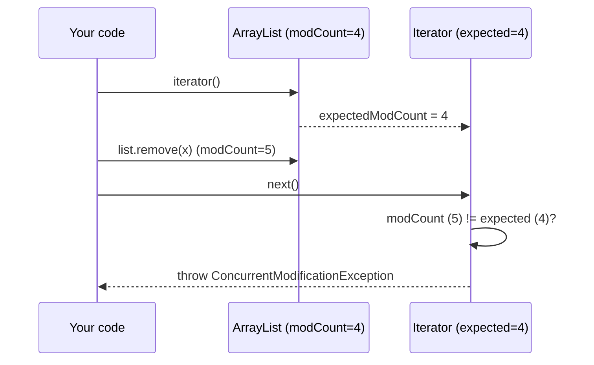

**Quirk (interview favourite):** removing the **second-last** element inside a for-each does NOT throw, because `hasNext()` returns false (cursor == size) before `next()` can check `modCount`.
#### Worked Example 3: when for-each removal throws, and when it surprisingly does not

```java
import java.util.*;

public class Main {
    static void tryRemove(int target) {
        List<Integer> list = new ArrayList<>(List.of(1, 2, 3, 4));
        try {
            for (Integer x : list) if (x == target) list.remove(x);
            System.out.println("remove " + target + ": no exception, list = " + list);
        } catch (ConcurrentModificationException e) {
            System.out.println("remove " + target + ": ConcurrentModificationException");
        }
    }

    public static void main(String[] args) {
        for (int t = 1; t <= 4; t++) tryRemove(t);

        List<Integer> list = new ArrayList<>(List.of(1, 2, 3, 4));
        for (Integer x : list) if (x == 2) list.set(0, 99);        // set() is NOT structural
        System.out.println("set() during for-each is fine: " + list);

        List<Integer> nums = new ArrayList<>(List.of(1, 2, 3, 4, 5, 6));
        Iterator<Integer> it = nums.iterator();
        while (it.hasNext()) if (it.next() % 2 == 0) it.remove();
        System.out.println("Iterator.remove: " + nums);
        try {
            Iterator<Integer> it2 = nums.iterator();
            it2.remove();                                           // before next()
        } catch (IllegalStateException e) {
            System.out.println("remove() before next() -> IllegalStateException");
        }
    }
}
```

**Output:**
```text
remove 1: ConcurrentModificationException
remove 2: ConcurrentModificationException
remove 3: no exception, list = [1, 2, 4]
remove 4: ConcurrentModificationException
set() during for-each is fine: [99, 2, 3, 4]
Iterator.remove: [1, 3, 5]
remove() before next() -> IllegalStateException
```

**Explanation:**

| Target | What happens after `remove` | Result |
|---|---|---|
| 1, 2 | size becomes 3; the cursor (1 or 2) is still < 3, so `hasNext()` is true and `next()` checks `modCount` | CME |
| **3** (second-last) | size becomes 3 and the cursor is 3, so `hasNext()` returns **false**; the loop ends before any check | no exception, element 4 is never visited |
| 4 (last) | size becomes 3, cursor is 4; `hasNext()` is `cursor != size` → true, then `next()` checks | CME |

- This quirk shows that fail-fast checking is **best effort**: never rely on CME to catch bugs, just never modify a list structurally inside a for-each.
- `set()` replaces an element without changing the size, so it is not a structural modification and is allowed.
- `Iterator.remove()` must follow a `next()` call, once per `next()`.

### 📘 Terms Explained

| Term | Meaning |
|---|---|
| modCount | Internal counter of structural modifications |
| Structural modification | Add or remove (changes size). `set(i, v)` is not structural |
| CME | `ConcurrentModificationException`, a bug signal, not only a threading error |
| Weakly consistent | Iterator reflects the state at some point, maybe not the latest |
| Snapshot | A frozen copy taken when iteration starts |

---

## 1.6 Big-O Cheat Table of All Major Collections **(Interview Imp) (CP)**

| Structure | get / contains | add | remove | Ordered? | Notes |
|---|---|---|---|---|---|
| `ArrayList` | O(1) by index; O(n) search | O(1) amortised at end; O(n) middle | O(n) | Insertion | Best default List |
| `LinkedList` | O(n) | O(1) at ends | O(1) at known node; O(n) to find | Insertion | Rarely the right choice |
| `ArrayDeque` | O(1) ends | O(1) | O(1) ends | Insertion | Best Stack/Queue |
| `HashSet` / `HashMap` | O(1) avg, O(log n) worst | O(1) avg | O(1) avg | None | Default Set/Map |
| `LinkedHashSet/Map` | O(1) | O(1) | O(1) | Insertion/Access | Predictable order |
| `TreeSet` / `TreeMap` | O(log n) | O(log n) | O(log n) | Sorted | floor/ceiling/range |
| `PriorityQueue` | peek O(1) | offer O(log n) | poll O(log n); remove(Object) O(n) | Heap order | Min-heap |
| `EnumMap/EnumSet` | O(1) | O(1) | O(1) | Enum order | Array/bitmask inside |
| `ConcurrentHashMap` | O(1) | O(1) | O(1) | None | Thread safe |
| `CopyOnWriteArrayList` | O(1) | O(n) | O(n) | Insertion | Read-heavy only |

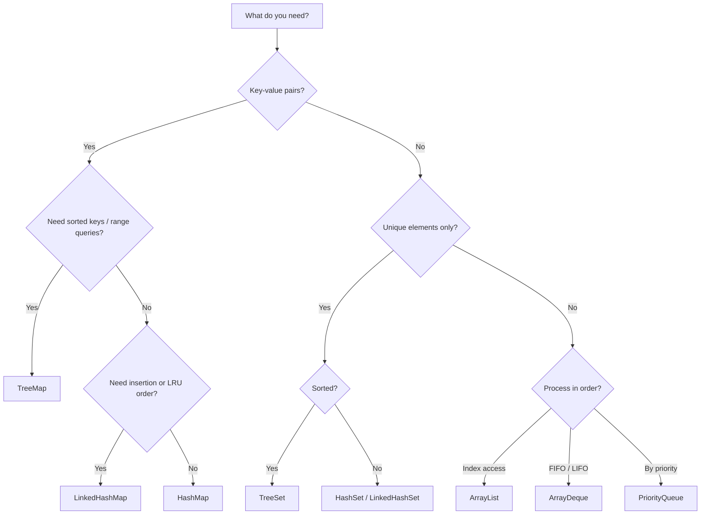

### 📘 Terms Explained

| Term | Meaning |
|---|---|
| Amortised O(1) | Occasionally slow (resize) but O(1) on average over many operations |
| Avg vs worst | Typical vs unlucky case (hash collisions) |
| Min-heap | A tree where the smallest element is always at the top |
| Range query | Find all elements between two values |

---

# 2. Iterator, ListIterator, Iterable and Spliterator

## 2.1 `Iterator` **(Interview Imp)**

```java
public interface Iterator<E> {
    boolean hasNext();
    E next();
    default void remove() { throw new UnsupportedOperationException(); }
    default void forEachRemaining(Consumer<? super E> action) { ... }
}
```

The for-each loop is just syntax sugar:

```java
for (String s : list) { ... }
// compiles to
for (Iterator<String> it = list.iterator(); it.hasNext(); ) {
    String s = it.next();
    ...
}
```

`remove()` deletes the **last element returned by `next()`**, and can be called once per `next()`. Calling it twice or before `next()` throws `IllegalStateException`.

## 2.2 `ListIterator` (only for Lists)

Bidirectional, can add/set/remove, knows the index.

```java
List<String> l = new ArrayList<>(List.of("a", "b", "c"));
ListIterator<String> it = l.listIterator();
while (it.hasNext()) {
    int idx = it.nextIndex();
    String s = it.next();
    if (s.equals("b")) { it.set("B"); it.add("b2"); }   // replace and insert
}
while (it.hasPrevious()) System.out.print(it.previous()); // walk backwards
```

## 2.3 Making your own class iterable

```java
class Range implements Iterable<Integer> {
    private final int lo, hi;
    Range(int lo, int hi) { this.lo = lo; this.hi = hi; }

    @Override public Iterator<Integer> iterator() {
        return new Iterator<>() {
            int cur = lo;
            public boolean hasNext() { return cur < hi; }
            public Integer next()    { return cur++; }
        };
    }
}
for (int i : new Range(0, 5)) System.out.print(i);   // 01234
```

## 2.4 `Spliterator` (advanced)

A `Spliterator` is an iterator that can **split itself** into two halves so that parallel streams can process halves on different threads. Every collection has `spliterator()`. `ArrayList` splits perfectly (it is an array); `LinkedList` splits poorly, which is one reason parallel streams over a linked list are slow.
#### Worked Example 4: `ListIterator`, a custom `Iterable`, and splitting a `Spliterator`

```java
import java.util.*;

public class Main {
    static class Range implements Iterable<Integer> {
        private final int lo, hi, step;
        Range(int lo, int hi, int step) { this.lo = lo; this.hi = hi; this.step = step; }
        @Override public Iterator<Integer> iterator() {
            return new Iterator<>() {
                int cur = lo;
                public boolean hasNext() { return cur < hi; }
                public Integer next() {
                    if (!hasNext()) throw new NoSuchElementException();
                    int v = cur; cur += step; return v;
                }
            };
        }
    }

    public static void main(String[] args) {
        List<String> l = new ArrayList<>(List.of("a", "b", "c"));
        ListIterator<String> it = l.listIterator();
        while (it.hasNext()) {
            int idx = it.nextIndex();
            String s = it.next();
            System.out.print(idx + ":" + s + " ");
            if (s.equals("b")) { it.set("B"); it.add("b2"); }
        }
        System.out.println("-> " + l);
        System.out.print("backwards: ");
        while (it.hasPrevious()) System.out.print(it.previous() + " ");
        System.out.println();

        System.out.print("Range(0, 10, 3): ");
        for (int v : new Range(0, 10, 3)) System.out.print(v + " ");
        System.out.println();

        List<Integer> nums = new ArrayList<>();
        for (int i = 0; i < 10; i++) nums.add(i);
        Spliterator<Integer> right = nums.spliterator();
        Spliterator<Integer> left = right.trySplit();
        System.out.println("split sizes: left " + left.estimateSize() + ", right " + right.estimateSize());
        System.out.print("left half: ");
        left.forEachRemaining(x -> System.out.print(x + " "));
        System.out.println();
        LinkedList<Integer> big = new LinkedList<>();
        for (int i = 0; i < 5000; i++) big.add(i);
        Spliterator<Integer> lr = big.spliterator();
        Spliterator<Integer> ll = lr.trySplit();
        System.out.println("LinkedList of 5000 split: first part " + ll.estimateSize() + ", rest " + lr.estimateSize());
    }
}
```

**Output:**
```text
0:a 1:b 3:c -> [a, B, b2, c]
backwards: c b2 B a 
Range(0, 10, 3): 0 3 6 9 
split sizes: left 5, right 5
left half: 0 1 2 3 4 
LinkedList of 5000 split: first part 1024, rest 3976
```

**Explanation:**
- `ListIterator` knows its position (`nextIndex`), can **replace** the element just returned (`set`) and **insert** at the cursor (`add`). Inserting `b2` puts it after `B`, and the iterator continues with `c`, so the newly added element is not visited on the forward pass.
- Walking backwards with `hasPrevious`/`previous` from the end visits everything, including the inserted element.
- Implementing `Iterable` (one method returning an `Iterator`) is all a class needs to work in a for-each loop. A correct `next()` throws `NoSuchElementException` when exhausted.
- `nextIndex()` printed `3` for `c` because `b2` was inserted at index 2 before the cursor moved on.
- `trySplit` hands the **first half** to a new spliterator and keeps the second half. `ArrayList` splits exactly in two because it knows the size and can index straight into its array; this is what lets a parallel stream divide work evenly.
- A `LinkedList` cannot jump to its middle, so its spliterator instead **copies a batch** of nodes into an array (1024 elements for the first split) and hands that off. The halves are uneven and the copying costs time, one reason parallel streams over linked lists perform poorly.

### 📘 Terms Explained

| Term | Meaning |
|---|---|
| Syntactic sugar | Shorter syntax the compiler rewrites into the longer form |
| Cursor | The iterator's current position |
| Anonymous class | A class defined inline without a name |
| Spliterator | "Splittable iterator" used by parallel streams |

---
# 3. The List Family

A `List` is an **ordered** collection with **index access** and **duplicates allowed**.

## 3.1 `ArrayList` - internal structure **(Interview Imp) (CP)**

Inside, `ArrayList` is a plain Java array that grows.

```java
// Simplified from the JDK source
public class ArrayList<E> {
    transient Object[] elementData;   // the backing array
    private int size;                 // number of real elements (<= elementData.length)
    private static final int DEFAULT_CAPACITY = 10;
}
```

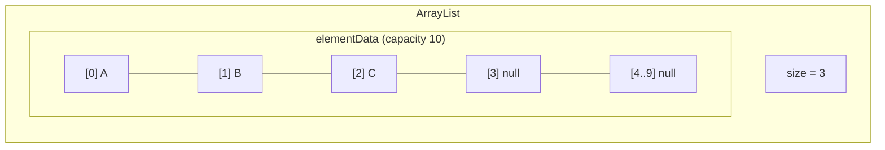

**How it works:**

- `new ArrayList<>()` starts with an **empty shared array**; the first `add` allocates capacity **10**.
- `get(i)` is `elementData[i]`, so **O(1)**.
- `add(e)` writes at `elementData[size++]`. If the array is full, **grow**: new capacity = `old + (old >> 1)` = **1.5x**, copy with `Arrays.copyOf` (a fast native `System.arraycopy`).
- `add(index, e)` and `remove(index)` shift all elements after the index: **O(n)**.
- `remove` nulls out the freed slot so the GC can collect it (avoids a memory leak).

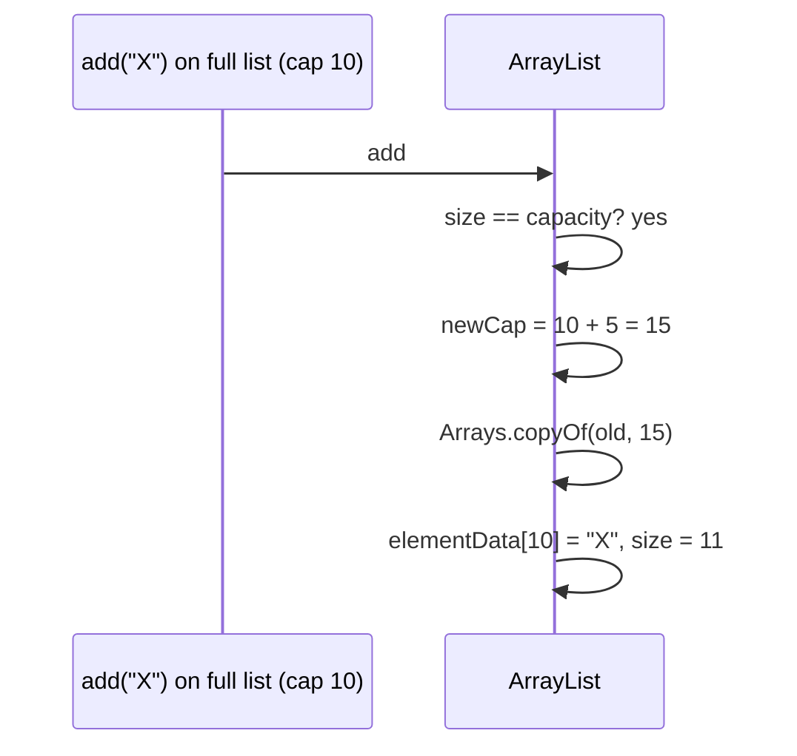

**Why is `add` amortised O(1)?** Growing by a factor (1.5) means that copies happen at sizes 10, 15, 22, 33... The total copy work over n adds is a geometric series, about 3n. So the average cost per add is a constant.
#### Worked Example 5: watching `ArrayList` grow (real internals via reflection)

```java
// jvmflags: --add-opens java.base/java.util=ALL-UNNAMED
import java.lang.reflect.Field;
import java.util.*;

public class Main {
    static int capacity(ArrayList<?> list) throws Exception {
        Field f = ArrayList.class.getDeclaredField("elementData");
        f.setAccessible(true);
        return ((Object[]) f.get(list)).length;
    }

    public static void main(String[] args) throws Exception {
        ArrayList<Integer> list = new ArrayList<>();
        System.out.println("new ArrayList<>(): size 0, capacity " + capacity(list));
        int last = capacity(list);
        StringBuilder growth = new StringBuilder();
        for (int i = 1; i <= 100; i++) {
            list.add(i);
            int cap = capacity(list);
            if (cap != last) { growth.append("size ").append(i).append(" -> cap ").append(cap).append("; "); last = cap; }
        }
        System.out.println(growth);

        ArrayList<Integer> presized = new ArrayList<>(100);
        for (int i = 0; i < 100; i++) presized.add(i);
        System.out.println("new ArrayList<>(100) after 100 adds: capacity " + capacity(presized) + " (no resizes)");

        list.subList(10, 100).clear();
        System.out.println("after removing 90 elements: size " + list.size() + ", capacity still " + capacity(list));
        list.trimToSize();
        System.out.println("after trimToSize(): capacity " + capacity(list));
    }
}
```

**Output:**
```text
new ArrayList<>(): size 0, capacity 0
size 1 -> cap 10; size 11 -> cap 15; size 16 -> cap 22; size 23 -> cap 33; size 34 -> cap 49; size 50 -> cap 73; size 74 -> cap 109; 
new ArrayList<>(100) after 100 adds: capacity 100 (no resizes)
after removing 90 elements: size 10, capacity still 109
after trimToSize(): capacity 10
```

**Explanation:**
- A new `ArrayList` starts with a shared **empty** array (capacity 0) and allocates 10 slots only on the first `add`, so empty lists cost almost nothing.
- Each time the array is full, the new capacity is `old + old/2` (1.5×): 10 → 15 → 22 → 33 → 49 → 73 → 109. Adding 100 elements therefore caused only 7 allocations and copies.
- Pre-sizing with `new ArrayList<>(100)` avoids every resize.
- Removing elements never shrinks the backing array; `trimToSize()` releases the unused slots when a list will stay small for a long time.
- (The `--add-opens` flag is needed because Java 17 blocks reflective access to JDK internals by default. Never rely on such hacks in application code; they are used here only to make the data structure visible.)

**Tuning:**

```java
List<Integer> big = new ArrayList<>(1_000_000);   // pre-size: avoids ~30 resizes
big.ensureCapacity(2_000_000);
big.trimToSize();                                  // shrink array to size
```

**Gotchas:**

- `contains`, `indexOf`: O(n) using `equals`.
- `remove(Object)`: O(n) search + O(n) shift.
- Removing from the **front** repeatedly is O(n^2) total. Use `ArrayDeque`, or iterate and `removeIf`.
- Not thread-safe.

```java
List<String> list = new ArrayList<>();
list.add("A"); list.add("B"); list.add(1, "X");     // [A, X, B]
list.set(0, "Z");                                    // [Z, X, B]
list.get(2);                                         // B
list.indexOf("X");                                   // 1
list.sort(Comparator.naturalOrder());                // [B, X, Z]
list.subList(0, 2);                                  // view [B, X] (not a copy!)
```

### 📘 Terms Explained

| Term | Meaning |
|---|---|
| Backing array | The real array hidden inside the collection |
| Capacity vs size | Capacity = array length; size = elements actually stored |
| Amortised | Cost averaged over many operations |
| `System.arraycopy` | Very fast native memory copy |
| Memory leak (here) | Keeping a reference to an unused object so GC can't free it |
| `transient` | Field skipped by default Java serialization (ArrayList writes its own) |

---

## 3.2 `LinkedList` - internal structure **(Interview Imp)**

A **doubly linked list**: each element lives in a `Node` object with pointers to the previous and next node.

```java
private static class Node<E> {
    E item;
    Node<E> next;
    Node<E> prev;
}
// LinkedList keeps: Node<E> first, last; int size;
```

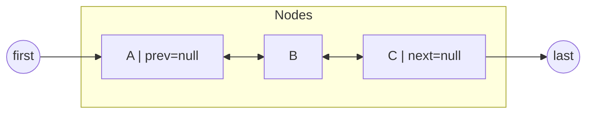

| Operation | Cost | Why |
|---|---|---|
| `addFirst / addLast / removeFirst / removeLast` | O(1) | Pointers to both ends |
| `get(i)` | O(n) | Walks from the nearer end (so n/2 steps) |
| `add(i, e)` | O(n) | Must **find** index i, then O(1) relink |
| `remove` via `Iterator` | O(1) | Already at the node |

**Why `LinkedList` is almost always the wrong choice:**

- Each element costs a 24 to 32 byte Node plus the element: heavy memory.
- Nodes are scattered in memory, so the CPU cache works poorly. In benchmarks `ArrayList` beats `LinkedList` even for middle insertions on lists of moderate size, because `arraycopy` is so fast.
- For a queue/stack use `ArrayDeque`.

Use it only when you really need O(1) insertion through an iterator while walking, or when you need `null` elements in a Deque.

### 📘 Terms Explained

| Term | Meaning |
|---|---|
| Doubly linked | Each node knows its previous and next node |
| Node | A small object holding the data plus pointers |
| CPU cache locality | Data stored side by side loads faster; arrays have it, linked nodes don't |
| Relink | Changing a few pointers to insert/remove a node |

---

## 3.3 `ArrayList` vs `LinkedList` **(Interview Imp)**

| Aspect | ArrayList | LinkedList |
|---|---|---|
| Structure | Resizable array | Doubly linked nodes |
| Random access | O(1) | O(n) |
| Add at end | O(1) amortised | O(1) |
| Insert/remove middle | O(n) shift (fast native copy) | O(n) find + O(1) link |
| Memory per element | ~4-8 bytes (reference) | ~24-32 bytes (node) + ref |
| Implements | `List`, `RandomAccess` | `List`, `Deque` |
| Typical verdict | Default | Almost never |

`RandomAccess` is a **marker interface**: algorithms such as `Collections.binarySearch` check it to choose between index-based and iterator-based strategies.
#### Worked Example 6: `ArrayList` vs `LinkedList` measured

```java
// NONDETERMINISTIC: timing results vary by machine; the comparisons shown hold on any normal JVM.
import java.util.*;

public class Main {
    static long time(Runnable r) { long t = System.nanoTime(); r.run(); return (System.nanoTime() - t) / 1_000_000; }

    public static void main(String[] args) {
        int n = 50_000;
        List<Integer> array = new ArrayList<>(), linked = new LinkedList<>();
        for (int i = 0; i < n; i++) { array.add(i); linked.add(i); }

        long arrayGet = time(() -> { long s = 0; for (int i = 0; i < n; i++) s += array.get(i); });
        long linkedGet = time(() -> { long s = 0; for (int i = 0; i < n; i++) s += linked.get(i); });
        System.out.println("get(i) loop: ArrayList faster? " + (arrayGet < linkedGet));

        long linkedIter = time(() -> { long s = 0; for (int v : linked) s += v; });
        System.out.println("for-each over LinkedList is fine (O(n)): " + (linkedIter < linkedGet));

        System.out.println("ArrayList instanceof RandomAccess: " + (array instanceof RandomAccess)
                + ", LinkedList: " + (linked instanceof RandomAccess));
        System.out.println("LinkedList is also a Deque: " + (linked instanceof Deque));
    }
}
```

**Output:**
```text
get(i) loop: ArrayList faster? true
for-each over LinkedList is fine (O(n)): true
ArrayList instanceof RandomAccess: true, LinkedList: false
LinkedList is also a Deque: true
```

**Explanation:**
- `linked.get(i)` walks node by node from the nearer end, so a loop of `get(i)` is **O(n²)**: for 50,000 elements that is over half a billion pointer hops, typically seconds versus about a millisecond for `ArrayList`.
- Iterating a `LinkedList` with an iterator (for-each) is O(n) and fine; it is only index access that is slow. Generic code can test `instanceof RandomAccess` to choose the right loop style, which is exactly what `Collections.binarySearch`, `shuffle` and `reverse` do.

---

## 3.4 `Vector` and `Stack` (legacy)

- `Vector`: like `ArrayList` but every method is `synchronized` (slow, and still not safe for compound actions like check-then-add). Grows by **2x**.
- `Stack extends Vector`: `push/pop/peek`. A bad design (a Stack **is-a** Vector, so you can `get(3)`). Replace with `Deque<Integer> st = new ArrayDeque<>();`.

```java
Deque<Integer> stack = new ArrayDeque<>();
stack.push(1); stack.push(2);
stack.peek();   // 2
stack.pop();    // 2
```

---

## 3.5 `CopyOnWriteArrayList`

Every **write** copies the whole array, then swaps the reference. **Readers never lock** and iterators work on a snapshot (never CME).

Use when reads are far more common than writes (listener lists, config). Never for write-heavy workloads: each `add` is O(n).

```java
List<Runnable> listeners = new CopyOnWriteArrayList<>();
listeners.add(() -> System.out.println("event"));
for (Runnable r : listeners) r.run();      // safe even if another thread adds a listener
```

---

## 3.6 Immutable and fixed-size lists **(Interview Imp)**

| Factory | Add/remove | `set` | Null allowed | Notes |
|---|---|---|---|---|
| `Arrays.asList(a, b)` | No (`UnsupportedOperationException`) | Yes | Yes | **View over the array**; writes go through |
| `List.of(a, b)` (Java 9) | No | No | **No** | Truly immutable, compact |
| `List.copyOf(coll)` (Java 10) | No | No | No | Immutable copy (returns same if already immutable) |
| `Collections.unmodifiableList(l)` | No | No | Yes | **View**: changes to the original show through |
| `Stream.toList()` (Java 16) | No | No | Yes | Unmodifiable |
| `stream.collect(toList())` | Yes (currently ArrayList) | Yes | Yes | No guarantee |

```java
Integer[] arr = {3, 1, 2};
List<Integer> view = Arrays.asList(arr);
view.set(0, 99);          // arr[0] is now 99 too
// view.add(4);           // UnsupportedOperationException

List<Integer> copy = new ArrayList<>(Arrays.asList(arr));   // real, growable copy

int[] prim = {1, 2, 3};
Arrays.asList(prim).size();   // 1 !  (a List<int[]> with ONE element)
```

#### Worked Example 7: the five "unmodifiable" lists compared side by side

```java
import java.util.*;
import java.util.function.*;
import java.util.stream.*;

public class Main {
    static String test(String label, Supplier<List<Integer>> make, List<Integer> source) {
        List<Integer> l = make.get();
        String add, set;
        try { l.add(9); add = "add ok"; } catch (UnsupportedOperationException e) { add = "add NO"; }
        try { l.set(0, 7); set = "set ok"; } catch (UnsupportedOperationException e) { set = "set NO"; }
        source.set(1, 42);                                  // change the original afterwards
        return String.format("%-28s %-7s %-7s sees source change: %s", label, add, set, l.contains(42));
    }

    public static void main(String[] args) {
        Integer[] arr = {3, 1, 2};
        List<Integer> s1 = new ArrayList<>(List.of(3, 1, 2));
        List<Integer> s2 = new ArrayList<>(List.of(3, 1, 2));
        List<Integer> s3 = new ArrayList<>(List.of(3, 1, 2));
        List<Integer> s4 = new ArrayList<>(List.of(3, 1, 2));
        System.out.println(test("Arrays.asList(array)", () -> Arrays.asList(arr), Arrays.asList(arr)));
        System.out.println(test("List.of(...)", () -> List.of(3, 1, 2), s1));
        System.out.println(test("List.copyOf(list)", () -> List.copyOf(s2), s2));
        System.out.println(test("Collections.unmodifiableList", () -> Collections.unmodifiableList(s3), s3));
        System.out.println(test("stream().toList()", () -> s4.stream().toList(), s4));
        System.out.println("array after Arrays.asList set(): " + Arrays.toString(arr));
        try {
            List.of(1, null);
        } catch (NullPointerException e) {
            System.out.println("List.of rejects null elements");
        }
        System.out.println("Arrays.asList allows null: " + Arrays.asList(1, null));
    }
}
```

**Output:**
```text
Arrays.asList(array)         add NO  set ok  sees source change: true
List.of(...)                 add NO  set NO  sees source change: false
List.copyOf(list)            add NO  set NO  sees source change: false
Collections.unmodifiableList add NO  set NO  sees source change: true
stream().toList()            add NO  set NO  sees source change: false
array after Arrays.asList set(): [7, 42, 2]
List.of rejects null elements
Arrays.asList allows null: [1, null]
```

**Explanation:**
- `Arrays.asList` is a fixed-size **view** of the array: `set` works and writes straight into the array, `add`/`remove` are refused, and later array changes show through.
- `List.of` and `List.copyOf` are truly **immutable** snapshots: nothing can change them and they never see later changes to a source list.
- `Collections.unmodifiableList` is a **read-only view**: callers cannot modify it, but it reflects changes made to the underlying list by its owner. That is perfect for exposing internal state read-only, but it is not a snapshot.
- `stream().toList()` (Java 16+) returns an unmodifiable copy.

### 📘 Terms Explained

| Term | Meaning |
|---|---|
| View | A window onto other data; no copy is made |
| Immutable | Cannot change after creation |
| Marker interface | An interface with no methods used only to tag a class |
| Snapshot iterator | Iterates over a frozen copy of the data |

---

## 3.7 `subList`, `List.sort`, `replaceAll`

```java
List<Integer> nums = new ArrayList<>(List.of(5, 3, 8, 1, 9, 2));
nums.subList(1, 4).clear();          // removes indexes 1..3 from nums itself -> [5, 9, 2]
nums.replaceAll(x -> x * 2);         // [10, 18, 4]
nums.sort(null);                     // natural order; null means "natural"
nums.sort(Comparator.reverseOrder());// [18, 10, 4]
Collections.swap(nums, 0, 2);
Collections.reverse(nums);
Collections.shuffle(nums, new Random(42));
Collections.rotate(nums, 1);
Collections.max(nums); Collections.min(nums);
Collections.frequency(nums, 4);
```

`subList(from, to)` is a **view**. If you structurally modify the parent list afterwards, using the sublist throws CME.
#### Worked Example 8: `Collections` reordering helpers with a fixed random seed

```java
import java.util.*;

public class Main {
    public static void main(String[] args) {
        List<Integer> nums = new ArrayList<>(List.of(5, 3, 8, 1, 9, 2));
        nums.subList(1, 4).clear();
        System.out.println("subList(1,4).clear() -> " + nums);
        nums.replaceAll(x -> x * 2);
        System.out.println("replaceAll(x*2)      -> " + nums);
        nums.sort(null);
        System.out.println("sort(null)           -> " + nums);
        nums.sort(Comparator.reverseOrder());
        System.out.println("reverseOrder         -> " + nums);

        List<Integer> l = new ArrayList<>(List.of(1, 2, 3, 4, 5));
        Collections.swap(l, 0, 4);       System.out.println("swap(0,4)            -> " + l);
        Collections.reverse(l);          System.out.println("reverse              -> " + l);
        Collections.rotate(l, 2);        System.out.println("rotate(2)            -> " + l);
        Collections.shuffle(l, new Random(42)); System.out.println("shuffle(seed 42)     -> " + l);
        System.out.println("max " + Collections.max(l) + ", min " + Collections.min(l)
                + ", frequency of 3 in [3,1,3] = " + Collections.frequency(List.of(3, 1, 3), 3));

        List<Integer> parent = new ArrayList<>(List.of(1, 2, 3, 4));
        List<Integer> view = parent.subList(0, 2);
        parent.add(5);                                      // structural change of the parent
        try {
            System.out.println(view.size());
        } catch (ConcurrentModificationException e) {
            System.out.println("using a subList after changing its parent -> ConcurrentModificationException");
        }
    }
}
```

**Output:**
```text
subList(1,4).clear() -> [5, 9, 2]
replaceAll(x*2)      -> [10, 18, 4]
sort(null)           -> [4, 10, 18]
reverseOrder         -> [18, 10, 4]
swap(0,4)            -> [5, 2, 3, 4, 1]
reverse              -> [1, 4, 3, 2, 5]
rotate(2)            -> [2, 5, 1, 4, 3]
shuffle(seed 42)     -> [5, 1, 4, 3, 2]
max 5, min 1, frequency of 3 in [3,1,3] = 2
using a subList after changing its parent -> ConcurrentModificationException
```

**Explanation:**
- `subList(1, 4).clear()` removes indexes 1-3 from the **parent** list in one call (the classic idiom for "remove a range").
- `rotate(l, 2)` moves every element two places to the right, wrapping the last two to the front.
- `shuffle` with a seeded `Random` gives the same permutation on every run, which is how tests and simulations make "random" behaviour repeatable.
- After the parent changes size, the old sub-list view is invalid; any use of it fails fast.

---

# 4. The Set Family

A `Set` stores **unique** elements. Uniqueness is decided by `equals()` and `hashCode()` (hash sets) or by `compareTo/compare` (tree sets).

## 4.1 `HashSet` - internal structure **(Interview Imp) (CP)**

`HashSet` is a **thin wrapper over a `HashMap`**. Elements are stored as keys; the value is one shared dummy object.

```java
public class HashSet<E> {
    private transient HashMap<E,Object> map;
    private static final Object PRESENT = new Object();
    public boolean add(E e) { return map.put(e, PRESENT) == null; }
}
```

So everything you learn about `HashMap` internals (Chapter 7) applies. `add` returns `false` when the element already existed (and does not replace it).

```java
Set<String> s = new HashSet<>();
s.add("a");   // true
s.add("a");   // false
s.contains("a");
```

Order is **not guaranteed** and may change after a resize. Never rely on it.

## 4.2 `LinkedHashSet`

A `HashSet` that also keeps a doubly linked list through its entries, so **iteration is in insertion order**. Slightly more memory, still O(1).

```java
Set<Integer> s = new LinkedHashSet<>(List.of(3, 1, 3, 2));
System.out.println(s);   // [3, 1, 2]    <- cheap way to remove duplicates keeping order
```

## 4.3 `TreeSet` **(Interview Imp)**

A `NavigableSet` backed by a `TreeMap` (a red-black tree, Chapter 8). Always sorted; operations are O(log n); needs `Comparable` elements or a `Comparator`. **`null` is not allowed** (natural ordering would throw NPE).

```java
TreeSet<Integer> t = new TreeSet<>(List.of(10, 20, 30, 40));
t.first();            // 10
t.last();             // 40
t.floor(25);          // 20   greatest element <= 25
t.ceiling(25);        // 30   smallest element >= 25
t.lower(20);          // 10   strictly <
t.higher(20);         // 30   strictly >
t.headSet(30);        // [10, 20]       (< 30)  view
t.tailSet(30);        // [30, 40]       (>= 30) view
t.subSet(15, 35);     // [20, 30]
t.descendingSet();    // [40, 30, 20, 10]
t.pollFirst();        // removes and returns 10
```

**Trap:** `TreeSet` uses the comparator to decide equality, not `equals()`.

```java
TreeSet<String> ci = new TreeSet<>(String.CASE_INSENSITIVE_ORDER);
ci.add("Java"); ci.add("JAVA");
System.out.println(ci.size());   // 1  (the comparator says they are equal)
```

#### Worked Example 9: `TreeSet` navigation, views, and the comparator-equality trap

```java
import java.util.*;

public class Main {
    enum Day { MON, TUE, WED, THU, FRI, SAT, SUN }

    public static void main(String[] args) {
        TreeSet<Integer> t = new TreeSet<>(List.of(40, 10, 30, 20));
        System.out.println(t + " first " + t.first() + " last " + t.last());
        System.out.println("floor(25) " + t.floor(25) + ", ceiling(25) " + t.ceiling(25)
                + ", lower(20) " + t.lower(20) + ", higher(20) " + t.higher(20) + ", floor(5) " + t.floor(5));
        SortedSet<Integer> head = t.headSet(30);
        System.out.println("headSet(30) " + head + ", tailSet(30) " + t.tailSet(30) + ", subSet(15,35) " + t.subSet(15, 35));
        t.add(15);
        System.out.println("after add(15), the headSet VIEW is " + head);
        System.out.println("descendingSet " + t.descendingSet() + ", pollFirst " + t.pollFirst() + " -> " + t);

        TreeSet<String> ci = new TreeSet<>(String.CASE_INSENSITIVE_ORDER);
        ci.add("Java"); ci.add("JAVA"); ci.add("python");
        System.out.println("case-insensitive TreeSet " + ci + " size " + ci.size() + ", contains(\"jAvA\") " + ci.contains("jAvA"));

        record Emp(String name, int salary) { }
        TreeSet<Emp> bySalary = new TreeSet<>(Comparator.comparingInt(Emp::salary));
        bySalary.add(new Emp("Asha", 50_000));
        bySalary.add(new Emp("Ravi", 50_000));                                  // compare() == 0 → treated as duplicate!
        System.out.println("salary-only comparator keeps " + bySalary.size() + " of 2 employees");
        TreeSet<Emp> fixed = new TreeSet<>(Comparator.comparingInt(Emp::salary).thenComparing(Emp::name));
        fixed.add(new Emp("Asha", 50_000)); fixed.add(new Emp("Ravi", 50_000));
        System.out.println("with a tie-breaker: " + fixed.size() + " employees");

        try {
            new TreeSet<Integer>().add(null);
        } catch (NullPointerException e) {
            System.out.println("TreeSet.add(null) -> NullPointerException");
        }

        EnumSet<Day> weekend = EnumSet.of(Day.SAT, Day.SUN);
        System.out.println("weekdays " + EnumSet.complementOf(weekend) + ", TUE..THU " + EnumSet.range(Day.TUE, Day.THU));
    }
}
```

**Output:**
```text
[10, 20, 30, 40] first 10 last 40
floor(25) 20, ceiling(25) 30, lower(20) 10, higher(20) 30, floor(5) null
headSet(30) [10, 20], tailSet(30) [30, 40], subSet(15,35) [20, 30]
after add(15), the headSet VIEW is [10, 15, 20]
descendingSet [40, 30, 20, 15, 10], pollFirst 10 -> [15, 20, 30, 40]
case-insensitive TreeSet [Java, python] size 2, contains("jAvA") true
salary-only comparator keeps 1 of 2 employees
with a tie-breaker: 2 employees
TreeSet.add(null) -> NullPointerException
weekdays [MON, TUE, WED, THU, FRI], TUE..THU [TUE, WED, THU]
```

**Explanation:**
- `floor`/`ceiling` include the value itself; `lower`/`higher` are strict. When no such element exists (`floor(5)`), they return `null`, so use `Integer` (not `int`) for the result.
- `headSet`, `tailSet` and `subSet` are **live views**: adding 15 to the set makes it appear in the earlier `headSet(30)`.
- A `TreeSet` decides equality **only** with its comparator. With `CASE_INSENSITIVE_ORDER`, "JAVA" is a duplicate of "Java"; with a salary-only comparator, two different employees with the same salary collapse into one. Always add tie-breakers (`thenComparing`) unless you really mean "equal by this key".
- `EnumSet` methods produce sets in declaration order, backed by a single `long` bitmask.

## 4.4 `EnumSet`

A set for enum values stored as a **bitmask** (one `long` for up to 64 constants). Extremely fast and tiny.

```java
enum Day { MON, TUE, WED, THU, FRI, SAT, SUN }
EnumSet<Day> weekend = EnumSet.of(Day.SAT, Day.SUN);
EnumSet<Day> weekdays = EnumSet.complementOf(weekend);
EnumSet<Day> range = EnumSet.range(Day.TUE, Day.THU);
```

## 4.5 Other sets

| Set | Use |
|---|---|
| `ConcurrentSkipListSet` | Thread-safe sorted set |
| `CopyOnWriteArraySet` | Thread-safe, read-heavy, tiny sets |
| `Set.of(...)` (Java 9) | Immutable; throws on duplicates; iteration order is randomised per JVM run |
| `Collections.newSetFromMap(new ConcurrentHashMap<>())` | Concurrent hash set |
| `ConcurrentHashMap.newKeySet()` | Concurrent hash set (preferred) |

## 4.6 Set operations and the equals/hashCode contract **(Interview Imp)**

```java
Set<Integer> a = new HashSet<>(Set.of(1, 2, 3, 4));
Set<Integer> b = new HashSet<>(Set.of(3, 4, 5));
Set<Integer> union = new HashSet<>(a);        union.addAll(b);       // 1,2,3,4,5
Set<Integer> inter = new HashSet<>(a);        inter.retainAll(b);    // 3,4
Set<Integer> diff  = new HashSet<>(a);        diff.removeAll(b);     // 1,2
boolean subset = a.containsAll(Set.of(1, 2));                        // true
```

For your own class to work as a hash key:

1. Equal objects **must** have equal `hashCode()`.
2. Unequal objects *may* share a hash code (collisions are allowed, just slow).
3. Fields used in `hashCode` must **not change** while the object is in a hash collection, otherwise it becomes unreachable.

```java
final class Point {
    final int x, y;
    Point(int x, int y) { this.x = x; this.y = y; }
    @Override public boolean equals(Object o) {
        if (this == o) return true;
        if (!(o instanceof Point p)) return false;
        return x == p.x && y == p.y;
    }
    @Override public int hashCode() { return Objects.hash(x, y); }   // or 31*x + y
}
// Java 16+: record Point(int x, int y) {}   <- equals/hashCode generated
```

Forgetting `hashCode()` when overriding `equals()` is the number-one HashMap bug: two "equal" points land in different buckets and both stay in the set.
#### Worked Example 10: what goes wrong without `hashCode`, and the record fix

```java
import java.util.*;

public class Main {
    static final class BadPoint {                       // equals WITHOUT hashCode
        final int x, y;
        BadPoint(int x, int y) { this.x = x; this.y = y; }
        @Override public boolean equals(Object o) {
            return o instanceof BadPoint p && p.x == x && p.y == y;
        }
    }

    static final class GoodPoint {
        final int x, y;
        GoodPoint(int x, int y) { this.x = x; this.y = y; }
        @Override public boolean equals(Object o) { return o instanceof GoodPoint p && p.x == x && p.y == y; }
        @Override public int hashCode() { return 31 * x + y; }
    }

    record Point(int x, int y) { }

    public static void main(String[] args) {
        Set<BadPoint> bad = new HashSet<>();
        bad.add(new BadPoint(1, 2));
        bad.add(new BadPoint(1, 2));
        System.out.println("BadPoint : equals says equal? " + new BadPoint(1, 2).equals(new BadPoint(1, 2))
                + ", set size " + bad.size() + ", contains? " + bad.contains(new BadPoint(1, 2)));

        Set<GoodPoint> good = new HashSet<>(List.of(new GoodPoint(1, 2)));
        System.out.println("GoodPoint: add duplicate -> " + good.add(new GoodPoint(1, 2)) + ", size " + good.size());

        Set<Point> rec = new HashSet<>(List.of(new Point(1, 2), new Point(3, 4)));
        System.out.println("record   : contains(new Point(3,4)) " + rec.contains(new Point(3, 4)));

        Set<Integer> a = new TreeSet<>(Set.of(1, 2, 3, 4)), b = Set.of(3, 4, 5);
        Set<Integer> union = new TreeSet<>(a); union.addAll(b);
        Set<Integer> inter = new TreeSet<>(a); inter.retainAll(b);
        Set<Integer> diff = new TreeSet<>(a); diff.removeAll(b);
        Set<Integer> sym = new TreeSet<>(union); sym.removeAll(inter);
        System.out.println("union " + union + ", intersection " + inter + ", difference " + diff + ", symmetric difference " + sym);
    }
}
```

**Output:**
```text
BadPoint : equals says equal? true, set size 2, contains? false
GoodPoint: add duplicate -> false, size 1
record   : contains(new Point(3,4)) true
union [1, 2, 3, 4, 5], intersection [3, 4], difference [1, 2], symmetric difference [1, 2, 5]
```

**Explanation:**
- `BadPoint` inherits `Object.hashCode()`, which differs for every object. Two "equal" points almost certainly land in different buckets, `HashSet` never even calls `equals` on them, and you get duplicates and failed lookups.
- `GoodPoint` derives its hash code from the same fields `equals` uses, so equal points share a bucket and the duplicate `add` returns `false`.
- A `record` generates a consistent `equals`/`hashCode` pair automatically, the simplest correct choice for key classes.
- The symmetric difference (elements in exactly one set) is `union − intersection`.

### 📘 Terms Explained

| Term | Meaning |
|---|---|
| Bitmask | Using the bits of one number as many on/off flags |
| `NavigableSet` | A sorted set with floor/ceiling/lower/higher |
| Contract | Rules a method must obey for the framework to work |
| Collision | Two different keys with the same bucket/hash |
| Record | Java 16+ concise immutable data class; auto `equals/hashCode/toString` |
| View (headSet etc.) | Live window onto part of the original set |

---
# 5. The Map Family

A `Map<K,V>` stores **key to value** pairs. Keys are unique; values may repeat. It is not a `Collection`, but it exposes three collection **views**: `keySet()`, `values()`, `entrySet()`.

## 5.1 Core `Map` API **(Interview Imp) (CP)**

```java
Map<String, Integer> m = new HashMap<>();
m.put("a", 1);                       // returns previous value or null
m.get("a");                          // 1, or null if absent
m.getOrDefault("z", 0);              // 0
m.containsKey("a"); m.containsValue(1);
m.remove("a");
m.putIfAbsent("b", 10);              // only if absent (or mapped to null)

// Java 8 "compute" family - the idiomatic counters/groupers
m.merge("x", 1, Integer::sum);                       // counter: x += 1 (insert 1 if absent)
m.computeIfAbsent("list", k -> new ArrayList<>());  // multimap building (see below)
m.computeIfPresent("x", (k, v) -> v + 1);
m.compute("x", (k, v) -> v == null ? 1 : v + 1);     // return null removes the entry
m.replaceAll((k, v) -> v * 2);
```

**Iterating (pick one):**

```java
for (Map.Entry<String, Integer> e : m.entrySet()) {      // best: one lookup per pair
    System.out.println(e.getKey() + "=" + e.getValue());
}
m.forEach((k, v) -> System.out.println(k + "=" + v));
for (String k : m.keySet()) { /* m.get(k) = extra lookup, slower */ }
for (int v : m.values()) { }
m.entrySet().removeIf(e -> e.getValue() < 0);            // remove while iterating - safe
```

**Word frequency (the classic):**

```java
Map<String, Integer> freq = new HashMap<>();
for (String w : words) freq.merge(w, 1, Integer::sum);
```

**Multimap (key to list):**

```java
Map<String, List<Integer>> graph = new HashMap<>();
graph.computeIfAbsent("A", k -> new ArrayList<>()).add(1);
```

**Null rules:**

| Map | null key | null value |
|---|---|---|
| `HashMap`, `LinkedHashMap` | One allowed | Allowed |
| `TreeMap` | Not with natural order | Allowed |
| `Hashtable`, `ConcurrentHashMap` | Not allowed | Not allowed |
| `Map.of(...)` | Not allowed | Not allowed |

`ConcurrentHashMap` forbids null because `get()` returning null would be ambiguous in a concurrent world ("absent", or "present but null"?).
#### Worked Example 11: map views, safe removal while iterating, and the null rules

```java
import java.util.*;
import java.util.concurrent.ConcurrentHashMap;

public class Main {
    public static void main(String[] args) {
        Map<String, Integer> m = new TreeMap<>(Map.of("a", 1, "b", -2, "c", 3, "d", -4));
        System.out.println("keySet " + m.keySet() + ", values " + m.values() + ", entries " + m.entrySet());
        System.out.println("put returns previous: " + m.put("a", 10) + ", put of new key returns: " + m.put("e", 5));

        m.entrySet().removeIf(e -> e.getValue() < 0);               // remove through the view
        System.out.println("after entrySet().removeIf(negative): " + m);
        m.keySet().remove("e");
        System.out.println("after keySet().remove(\"e\"): " + m);
        for (Map.Entry<String, Integer> e : m.entrySet()) e.setValue(e.getValue() * 100);   // write-through
        System.out.println("after entry.setValue(x100): " + m);

        m.computeIfPresent("a", (k, v) -> v + 1);
        m.computeIfPresent("zzz", (k, v) -> 999);                    // absent → nothing happens
        m.replaceAll((k, v) -> v / 100);
        System.out.println("computeIfPresent + replaceAll: " + m);

        Map<String, Integer> hm = new HashMap<>();
        hm.put(null, 1); hm.put("k", null);
        System.out.println("HashMap null key/value: " + hm.get(null) + ", containsKey(k) " + hm.containsKey("k") + ", get(k) " + hm.get("k"));
        System.out.println("putIfAbsent replaces a null value: " + hm.putIfAbsent("k", 7) + " -> " + hm.get("k"));
        try {
            new ConcurrentHashMap<String, Integer>().put("x", null);
        } catch (NullPointerException e) {
            System.out.println("ConcurrentHashMap.put(k, null) -> NullPointerException");
        }
        try {
            new TreeMap<String, Integer>().put(null, 1);
        } catch (NullPointerException e) {
            System.out.println("TreeMap.put(null, v) -> NullPointerException");
        }
    }
}
```

**Output:**
```text
keySet [a, b, c, d], values [1, -2, 3, -4], entries [a=1, b=-2, c=3, d=-4]
put returns previous: 1, put of new key returns: null
after entrySet().removeIf(negative): {a=10, c=3, e=5}
after keySet().remove("e"): {a=10, c=3}
after entry.setValue(x100): {a=1000, c=300}
computeIfPresent + replaceAll: {a=10, c=3}
HashMap null key/value: 1, containsKey(k) true, get(k) null
putIfAbsent replaces a null value: null -> 7
ConcurrentHashMap.put(k, null) -> NullPointerException
TreeMap.put(null, v) -> NullPointerException
```

**Explanation:**
- `put` returns the **previous** value (or `null` for a new key), which lets you detect overwrites in one call.
- `keySet()`, `values()` and `entrySet()` are live **views**: removing through them removes from the map, and `Map.Entry.setValue` writes straight into the map. `entrySet().removeIf(...)` is the clean way to delete while iterating.
- `computeIfPresent` does nothing for missing keys; `replaceAll` rewrites every value.
- With `HashMap`, `get(k)` returning `null` is ambiguous: absent key, or key mapped to `null`? `containsKey` disambiguates, and `putIfAbsent` treats a `null` value as absent. `ConcurrentHashMap` bans nulls precisely to remove this ambiguity, and `TreeMap` cannot compare a `null` key.

### 📘 Terms Explained

| Term | Meaning |
|---|---|
| Entry | One key-value pair (`Map.Entry`) |
| View | `keySet()` etc. reflect the map live; removing from the view removes from the map |
| `merge` | Insert value if absent, otherwise combine old and new with a function |
| Multimap | A map where one key holds many values (usually `Map<K, List<V>>`) |

---

## 5.2 `LinkedHashMap` and the LRU cache **(Interview Imp)**

A `HashMap` whose entries are also chained in a doubly linked list. Iteration follows **insertion order** (default) or **access order** (constructor flag).

```java
LinkedHashMap<K,V>(int initialCapacity, float loadFactor, boolean accessOrder)
```

With `accessOrder = true`, every `get`/`put` moves the entry to the **end** (most recently used). Override `removeEldestEntry` to evict the head (least recently used):

```java
class LRUCache<K, V> extends LinkedHashMap<K, V> {
    private final int capacity;
    LRUCache(int capacity) {
        super(16, 0.75f, true);            // true = access order
        this.capacity = capacity;
    }
    @Override protected boolean removeEldestEntry(Map.Entry<K, V> eldest) {
        return size() > capacity;          // called after every put
    }
}

LRUCache<Integer, String> c = new LRUCache<>(2);
c.put(1, "a"); c.put(2, "b");
c.get(1);            // 1 is now most recent
c.put(3, "c");       // evicts 2
System.out.println(c.keySet());   // [1, 3]
```

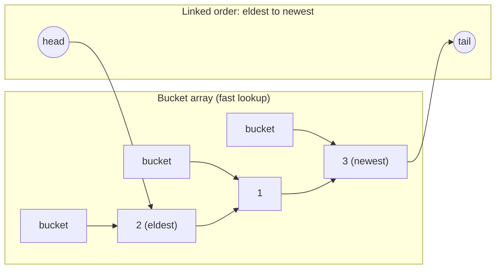

This is LeetCode 146 (LRU Cache) in about ten lines.
#### Worked Example 12: insertion order vs access order, and an LRU trace

```java
import java.util.*;

public class Main {
    static class LRUCache<K, V> extends LinkedHashMap<K, V> {
        private final int capacity;
        LRUCache(int capacity) { super(16, 0.75f, true); this.capacity = capacity; }
        @Override protected boolean removeEldestEntry(Map.Entry<K, V> eldest) {
            boolean evict = size() > capacity;
            if (evict) System.out.println("    evict " + eldest.getKey());
            return evict;
        }
    }

    public static void main(String[] args) {
        Map<String, Integer> insertion = new LinkedHashMap<>();
        Map<String, Integer> access = new LinkedHashMap<>(16, 0.75f, true);
        for (String k : List.of("x", "y", "z")) { insertion.put(k, 0); access.put(k, 0); }
        insertion.get("x"); access.get("x");
        insertion.put("y", 1); access.put("y", 1);
        System.out.println("insertion order: " + insertion.keySet() + ", access order: " + access.keySet());

        LRUCache<Integer, String> c = new LRUCache<>(3);
        String[] ops = {"put 1", "put 2", "put 3", "get 1", "put 4", "get 2", "put 5", "get 3"};
        for (String op : ops) {
            String[] p = op.split(" ");
            int key = Integer.parseInt(p[1]);
            if (p[0].equals("put")) c.put(key, "v" + key);
            String result = p[0].equals("get") ? " -> " + c.get(key) : "";
            System.out.println(op + result + "   order (eldest..newest) " + c.keySet());
        }
    }
}
```

**Output:**
```text
insertion order: [x, y, z], access order: [z, x, y]
put 1   order (eldest..newest) [1]
put 2   order (eldest..newest) [1, 2]
put 3   order (eldest..newest) [1, 2, 3]
get 1 -> v1   order (eldest..newest) [2, 3, 1]
    evict 2
put 4   order (eldest..newest) [3, 1, 4]
get 2 -> null   order (eldest..newest) [3, 1, 4]
    evict 3
put 5   order (eldest..newest) [1, 4, 5]
get 3 -> null   order (eldest..newest) [1, 4, 5]
```

**Explanation:**
- In the default **insertion-order** map, reading `x` or re-putting `y` does not move them. In **access-order** mode, every `get` or `put` of an existing key moves it to the end (most recently used).
- `removeEldestEntry` is called after every `put`; returning `true` removes the head, which in access order is the **least recently used** entry.
- Trace: after `get 1`, the order is `2, 3, 1`, so `put 4` evicts `2`; `get 2` then misses (`null`); `put 5` evicts the next eldest, `3`; `get 3` misses. All operations are O(1).

## 5.3 `TreeMap` overview **(CP)**

A sorted map (red-black tree), O(log n). Details in Chapter 8. Navigation API:

```java
TreeMap<Integer, String> tm = new TreeMap<>();
tm.put(10, "a"); tm.put(20, "b"); tm.put(30, "c");
tm.firstKey(); tm.lastKey();                  // 10, 30
tm.floorKey(25); tm.ceilingKey(25);           // 20, 30
tm.lowerKey(20); tm.higherKey(20);            // 10, 30
tm.floorEntry(25).getValue();                 // "b"
tm.headMap(20);                               // {10=a}            keys < 20
tm.tailMap(20, true);                         // {20=b, 30=c}      keys >= 20
tm.subMap(10, true, 20, true);                // {10=a, 20=b}
tm.firstEntry(); tm.pollFirstEntry(); tm.pollLastEntry();
tm.descendingMap();
```

## 5.4 Special-purpose maps

| Map | Idea | Use case |
|---|---|---|
| `EnumMap` | Array indexed by `ordinal()` | Keys are enums; fastest, tiny |
| `IdentityHashMap` | Compares keys with `==`, not `equals` | Object graph copying, serialisation |
| `WeakHashMap` | Keys held by weak references; entry vanishes when the key is otherwise unreachable | Canonicalising caches (careful: not a reliable cache) |
| `Hashtable` | Legacy synchronized HashMap | Don't use |
| `ConcurrentHashMap` | Lock-striped, CAS | Thread-safe default |
| `ConcurrentSkipListMap` | Sorted + concurrent | Thread-safe TreeMap |
| `Properties` | `Hashtable<Object,Object>` of strings | Config files |
| `Map.of(...)`, `Map.ofEntries(...)`, `Map.copyOf` | Immutable | Constants |

```java
EnumMap<Day, String> plan = new EnumMap<>(Day.class);
plan.put(Day.MON, "gym");

Map<String, Integer> consts = Map.of("a", 1, "b", 2);              // up to 10 pairs
Map<String, Integer> big = Map.ofEntries(Map.entry("a", 1), Map.entry("b", 2));
```

#### Worked Example 13: `EnumMap`, `IdentityHashMap`, `Map.of` rules and `Properties`

```java
import java.io.StringReader;
import java.util.*;

public class Main {
    enum Day { MON, TUE, WED, THU, FRI, SAT, SUN }

    public static void main(String[] args) throws Exception {
        EnumMap<Day, String> plan = new EnumMap<>(Day.class);
        plan.put(Day.FRI, "movie"); plan.put(Day.MON, "gym"); plan.put(Day.WED, "swim");
        System.out.println("EnumMap keeps declaration order: " + plan);

        String k1 = new String("key"), k2 = new String("key");
        Map<String, Integer> hash = new HashMap<>(), identity = new IdentityHashMap<>();
        hash.put(k1, 1); hash.put(k2, 2);
        identity.put(k1, 1); identity.put(k2, 2);
        System.out.println("HashMap size " + hash.size() + " (equals), IdentityHashMap size " + identity.size() + " (==)");

        Map<String, Integer> consts = Map.of("a", 1, "b", 2);
        try {
            Map.of("a", 1, "a", 2);
        } catch (IllegalArgumentException e) {
            System.out.println("Map.of with a duplicate key -> IllegalArgumentException: " + e.getMessage());
        }
        try {
            consts.put("c", 3);
        } catch (UnsupportedOperationException e) {
            System.out.println("Map.of is immutable -> UnsupportedOperationException");
        }

        Properties props = new Properties();
        props.load(new StringReader("db.url=jdbc:mysql://localhost/shop\ndb.pool=10\n# comment line\n"));
        int pool = Integer.parseInt(props.getProperty("db.pool"));
        System.out.println("Properties: url=" + props.getProperty("db.url") + ", pool=" + pool + ", timeout=" + props.getProperty("db.timeout", "30"));
    }
}
```

**Output:**
```text
EnumMap keeps declaration order: {MON=gym, WED=swim, FRI=movie}
HashMap size 1 (equals), IdentityHashMap size 2 (==)
Map.of with a duplicate key -> IllegalArgumentException: duplicate key: a
Map.of is immutable -> UnsupportedOperationException
Properties: url=jdbc:mysql://localhost/shop, pool=10, timeout=30
```

**Explanation:**
- `EnumMap` stores values in an array indexed by `ordinal()`, so iteration always follows enum declaration order regardless of insertion order.
- `k1` and `k2` are equal strings but different objects. `HashMap` (using `equals`) treats them as one key; `IdentityHashMap` (using `==`) keeps two entries. That identity behaviour is what serialization frameworks need when tracking already-visited objects.
- `Map.of` rejects duplicate keys at creation time and refuses all modifications.
- `Properties` parses `key=value` configuration text, skips `#` comments, and supports defaults in `getProperty(key, default)`.

### 📘 Terms Explained

| Term | Meaning |
|---|---|
| Access order | Order of most recent use (LRU logic) |
| Eviction | Removing an item to make space |
| Weak reference | A reference that does not stop the GC from collecting the object |
| `ordinal()` | An enum constant's position (0, 1, 2...) |
| Canonicalising | Keeping one shared instance per distinct value |

---

# 6. Ordering: `Comparable` and `Comparator`

## 6.1 Natural order with `Comparable` **(Interview Imp)**

A class says "this is my default order" by implementing `Comparable<T>`.

```java
public interface Comparable<T> { int compareTo(T other); }
// negative: this < other   zero: equal   positive: this > other
```

```java
class Student implements Comparable<Student> {
    String name; int marks;
    Student(String name, int marks) { this.name = name; this.marks = marks; }

    @Override public int compareTo(Student o) {
        return Integer.compare(this.marks, o.marks);     // ascending by marks
    }
    @Override public String toString() { return name + ":" + marks; }
}
List<Student> l = new ArrayList<>(List.of(new Student("A", 70), new Student("B", 50)));
Collections.sort(l);   // [B:50, A:70]
```

**Never** write `return a - b;` for ints. It overflows: `Integer.MIN_VALUE - 1` wraps to a large positive number. Use `Integer.compare(a, b)`.

## 6.2 Custom order with `Comparator` **(Interview Imp) (CP)**

A `Comparator<T>` is an **external** ordering you plug in. You can have many.

```java
Comparator<Student> byName  = (a, b) -> a.name.compareTo(b.name);
Comparator<Student> byMarksDesc = Comparator.comparingInt((Student s) -> s.marks).reversed();

// Chaining (Java 8): marks descending, then name ascending
Comparator<Student> cmp = Comparator
        .comparingInt((Student s) -> s.marks).reversed()
        .thenComparing(s -> s.name);
l.sort(cmp);

// Null-safe
Comparator.nullsFirst(Comparator.naturalOrder());
Comparator.nullsLast(String.CASE_INSENSITIVE_ORDER);
```

| Comparable | Comparator |
|---|---|
| `java.lang`, one method `compareTo` | `java.util`, `compare(a, b)` |
| Inside the class (one natural order) | Outside (many orders) |
| Modify the class | Works on classes you can't modify |

**Sorting arrays:**

```java
int[] a = {5, 2, 9};
Arrays.sort(a);                                  // primitives: dual-pivot quicksort (not stable)
Integer[] b = {5, 2, 9};
Arrays.sort(b, Collections.reverseOrder());      // objects: TimSort (stable); needs Integer[], not int[]
int[][] pairs = {{1, 5}, {2, 3}, {1, 2}};
Arrays.sort(pairs, (x, y) -> x[0] != y[0] ? Integer.compare(x[0], y[0]) : Integer.compare(x[1], y[1]));
Arrays.sort(pairs, Comparator.comparingInt((int[] p) -> p[0]).thenComparingInt(p -> p[1]));
```

**Consistency with equals:** `compare(a,b)==0` should imply `a.equals(b)`. If not, `TreeSet/TreeMap` will treat "different" objects as duplicates and drop them (see 4.3).

## 6.3 Stable sorting and the algorithms underneath

| Sort | Used for | Algorithm | Complexity | Stable? |
|---|---|---|---|---|
| `Arrays.sort(int[])` etc. | primitives | Dual-Pivot Quicksort | O(n log n) avg, O(n^2) worst (attackable) | No |
| `Arrays.sort(Object[])`, `Collections.sort`, `List.sort` | objects | **TimSort** (merge + insertion on runs) | O(n log n) worst, O(n) on nearly sorted | **Yes** |
| `Arrays.parallelSort` | big arrays | Fork/join merge/quick | O(n log n) | Objects: yes |

**Stable** means equal elements keep their original relative order, which is what makes "sort by name, then sort by age" work as a two-pass trick.
#### Worked Example 14: stable sorting, and sorting arrays of pairs

```java
import java.util.*;

public class Main {
    record Student(String name, int grade) { }

    public static void main(String[] args) {
        List<Student> list = new ArrayList<>(List.of(
                new Student("Ravi", 2), new Student("Asha", 1), new Student("Om", 2),
                new Student("Meena", 1), new Student("Zoya", 2)));
        list.sort(Comparator.comparing(Student::name));          // pass 1: by name
        list.sort(Comparator.comparingInt(Student::grade));      // pass 2: by grade (stable)
        System.out.println("grade, then name (two stable passes): " + list.stream().map(s -> s.grade() + s.name()).toList());

        int[][] pairs = {{1, 5}, {2, 3}, {1, 2}, {0, 9}};
        Arrays.sort(pairs, Comparator.comparingInt((int[] p) -> p[0]).thenComparingInt(p -> p[1]));
        System.out.println("pairs sorted: " + Arrays.deepToString(pairs));

        Integer[] boxed = {5, 2, 9, 1};
        Arrays.sort(boxed, Collections.reverseOrder());
        System.out.println("Integer[] descending: " + Arrays.toString(boxed));
        int[] prim = {5, 2, 9, 1};
        Arrays.sort(prim);
        for (int i = 0, j = prim.length - 1; i < j; i++, j--) { int t = prim[i]; prim[i] = prim[j]; prim[j] = t; }
        System.out.println("int[] descending (sort, then reverse): " + Arrays.toString(prim));
        String[] words = {"banana", "Cherry", "apple", "Apple"};
        Arrays.sort(words);
        System.out.println("natural String order: " + Arrays.toString(words));
        Arrays.sort(words, String.CASE_INSENSITIVE_ORDER.thenComparing(Comparator.naturalOrder()));
        System.out.println("case-insensitive    : " + Arrays.toString(words));
    }
}
```

**Output:**
```text
grade, then name (two stable passes): [1Asha, 1Meena, 2Om, 2Ravi, 2Zoya]
pairs sorted: [[0, 9], [1, 2], [1, 5], [2, 3]]
Integer[] descending: [9, 5, 2, 1]
int[] descending (sort, then reverse): [9, 5, 2, 1]
natural String order: [Apple, Cherry, apple, banana]
case-insensitive    : [Apple, apple, banana, Cherry]
```

**Explanation:**
- Because `List.sort` (TimSort) is **stable**, sorting by name first and then by grade leaves students with equal grades in name order: a two-pass alternative to a chained comparator.
- Arrays of `int[]` pairs need an explicit comparator; `comparingInt(...).thenComparingInt(...)` sorts by the first value, then the second.
- `Arrays.sort(int[], comparator)` does not exist (comparators need objects), so a descending primitive sort is "sort ascending, then reverse".
- Natural `String` order is by character code, so **every** capitalised word (`Apple`, `Cherry`) sorts before every lowercase one. `CASE_INSENSITIVE_ORDER` gives dictionary order, and the natural-order tie-breaker keeps `Apple` before `apple` deterministically.

### 📘 Terms Explained

| Term | Meaning |
|---|---|
| Natural ordering | The default order defined by `compareTo` |
| Comparator | A pluggable comparison rule |
| Stable sort | Equal elements keep their input order |
| TimSort | A hybrid merge/insertion sort optimised for partly sorted real-world data |
| Overflow | A number wrapping past its maximum (`Integer.MAX_VALUE + 1` becomes negative) |
| Method reference | `String::length`, a short lambda form |

---

# 7. HashMap Internals (the most asked topic) **(Interview Imp) (CP)**

## 7.1 Structure

```java
// Simplified
public class HashMap<K,V> {
    transient Node<K,V>[] table;     // the bucket array (length is always a power of 2)
    transient int size;
    int threshold;                   // resize when size > threshold
    final float loadFactor;          // default 0.75

    static class Node<K,V> {
        final int hash;
        final K key;
        V value;
        Node<K,V> next;              // linked list within the bucket
    }
}
```

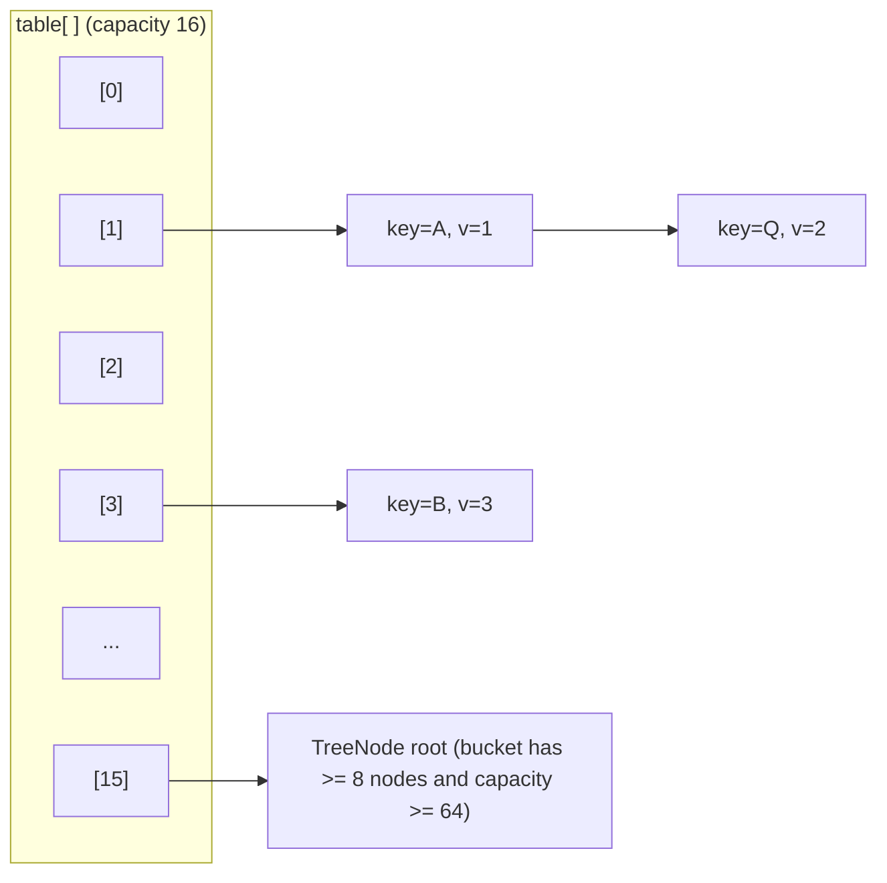

## 7.2 `put(key, value)` step by step

1. **Hash**: `h = key.hashCode()`, then **spread**: `hash = h ^ (h >>> 16)`. This mixes the high bits into the low bits, because only the low bits are used for the index when the table is small.
2. **Index**: `index = (table.length - 1) & hash`. Since the length is a power of 2 this equals `hash % length` but is much faster.
3. If the bucket is **empty**, put the new node there.
4. Otherwise walk the bucket: if a node has the same hash **and** (`==` key or `equals`) then **replace the value**. Else append to the chain (since Java 8 at the **tail**).
5. If the chain length reaches **8** (`TREEIFY_THRESHOLD`) and the table length is at least **64** (`MIN_TREEIFY_CAPACITY`), convert the bucket to a **red-black tree**. If the table is smaller than 64, resize instead.
6. If `++size > threshold` (capacity x loadFactor), **resize**.

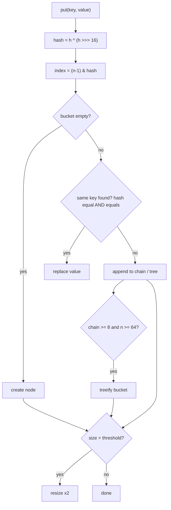

`get(key)` does the same hash and index, then compares: first node by hash+`equals`, then the chain (O(chain length)) or tree (O(log chain length)).

## 7.3 Resize (rehash)

When `size > capacity * 0.75` the table **doubles** (16, 32, 64...). Because the capacity is a power of two, each node either stays at its index or moves to `index + oldCapacity`. Java 8 decides this by looking at **one bit** of the hash (`hash & oldCap`), so no new hash computation is needed and chain order is preserved.

```
oldCap = 16 (binary 10000), hash bit 4:
   0 -> node stays at index i
   1 -> node moves to index i + 16
```

Resize is O(n). Pre-size the map when you know the count:

```java
int expected = 1000;
Map<Integer,Integer> m = new HashMap<>((int) (expected / 0.75f) + 1);
// Java 19+: HashMap.newHashMap(expected)
```

**Constructor capacity** is rounded up to the next power of two (`tableSizeFor`): `new HashMap<>(10)` gives 16 buckets (threshold 12).
#### Worked Example 15: watching a real `HashMap` resize (reflection)

```java
// jvmflags: --add-opens java.base/java.util=ALL-UNNAMED
import java.lang.reflect.Field;
import java.util.*;

public class Main {
    static int tableLength(HashMap<?, ?> m) throws Exception {
        Field f = HashMap.class.getDeclaredField("table");
        f.setAccessible(true);
        Object[] t = (Object[]) f.get(m);
        return t == null ? 0 : t.length;
    }
    static int threshold(HashMap<?, ?> m) throws Exception {
        Field f = HashMap.class.getDeclaredField("threshold");
        f.setAccessible(true);
        return f.getInt(m);
    }

    public static void main(String[] args) throws Exception {
        HashMap<Integer, Integer> m = new HashMap<>();
        System.out.println("new HashMap(): table " + tableLength(m) + " (allocated lazily)");
        int last = -1;
        for (int i = 1; i <= 100; i++) {
            m.put(i, i);
            int len = tableLength(m);
            if (len != last) {
                System.out.println("after " + i + " entries: table " + len + ", threshold " + threshold(m));
                last = len;
            }
        }
        for (int requested : new int[]{10, 16, 17, 100}) {
            HashMap<Integer, Integer> sized = new HashMap<>(requested);
            sized.put(0, 0);
            System.out.println("new HashMap(" + requested + ") -> table " + tableLength(sized));
        }
        HashMap<Integer, Integer> presized = new HashMap<>((int) (100 / 0.75f) + 1);
        for (int i = 0; i < 100; i++) presized.put(i, i);
        System.out.println("pre-sized for 100 entries: table " + tableLength(presized) + ", no resize during the 100 puts");
    }
}
```

**Output:**
```text
new HashMap(): table 0 (allocated lazily)
after 1 entries: table 16, threshold 12
after 13 entries: table 32, threshold 24
after 25 entries: table 64, threshold 48
after 49 entries: table 128, threshold 96
after 97 entries: table 256, threshold 192
new HashMap(10) -> table 16
new HashMap(16) -> table 16
new HashMap(17) -> table 32
new HashMap(100) -> table 128
pre-sized for 100 entries: table 256, no resize during the 100 puts
```

**Explanation:**
- The bucket array is created on the **first** `put` (16 buckets, threshold `16 × 0.75 = 12`).
- The 13th entry pushes the size over the threshold, so the table doubles to 32 (threshold 24); the 25th entry doubles it to 64, and so on. Every resize re-distributes all entries, which is why resizes are O(n) and worth avoiding.
- A requested capacity is rounded **up** to a power of two: 10 → 16, 16 → 16, 17 → 32, 100 → 128.
- To hold 100 entries without any resize, the table needs `100 / 0.75 ≈ 134` slots, rounded up to 256. (Java 19+ offers `HashMap.newHashMap(100)` to do this calculation for you.)

## 7.4 Why 0.75 load factor, why power of 2, why treeify at 8?

- **0.75** is a trade-off. A lower factor means fewer collisions but more wasted memory; a higher one saves memory but chains get longer. With a good hash, chain lengths follow a Poisson distribution, so a chain of 8 has probability about 0.00000006.
- **Power of 2**: `& (n-1)` is faster than modulo and makes the resize split trivial.
- **Treeify at 8, untreeify at 6** (`UNTREEIFY_THRESHOLD`): the gap avoids flipping back and forth. A tree node costs about twice the memory of a list node, so it is only used when really needed. It protects against hash-flooding attacks (worst case O(n) becomes O(log n)).
- Treeified bins order nodes by hash, then by `compareTo` if the key is `Comparable`, then by `System.identityHashCode` as the last tie-break. So making keys `Comparable` helps under heavy collisions.
#### Worked Example 16: forcing collisions until a bucket becomes a red-black tree

```java
// jvmflags: --add-opens java.base/java.util=ALL-UNNAMED
import java.lang.reflect.Field;
import java.util.*;

public class Main {
    static final class BadKey implements Comparable<BadKey> {      // every key has the SAME hash code
        final int id;
        BadKey(int id) { this.id = id; }
        @Override public int hashCode() { return 42; }
        @Override public boolean equals(Object o) { return o instanceof BadKey k && k.id == id; }
        @Override public int compareTo(BadKey o) { return Integer.compare(id, o.id); }
    }

    static String describe(HashMap<?, ?> m) throws Exception {
        Field f = HashMap.class.getDeclaredField("table");
        f.setAccessible(true);
        Object[] table = (Object[]) f.get(m);
        Object bin = table[42 & (table.length - 1)];
        return "table " + table.length + ", bucket node type " + bin.getClass().getSimpleName();
    }

    public static void main(String[] args) throws Exception {
        HashMap<BadKey, Integer> m = new HashMap<>();
        for (int i = 1; i <= 12; i++) {
            m.put(new BadKey(i), i);
            if (i == 1 || i >= 8) System.out.println("after " + i + " colliding keys: " + describe(m));
        }
        System.out.println("lookups still work: get(new BadKey(7)) = " + m.get(new BadKey(7)));
    }
}
```

**Output:**
```text
after 1 colliding keys: table 16, bucket node type Node
after 8 colliding keys: table 16, bucket node type Node
after 9 colliding keys: table 32, bucket node type Node
after 10 colliding keys: table 64, bucket node type Node
after 11 colliding keys: table 64, bucket node type TreeNode
after 12 colliding keys: table 64, bucket node type TreeNode
lookups still work: get(new BadKey(7)) = 7
```

**Explanation:**
- All keys land in the **same** bucket (index `42 & (length − 1)`), so the bucket starts as a linked chain of plain `Node`s.
- Up to 8 keys the bucket stays a chain. The 9th key makes the chain exceed the treeify threshold, but the table (16) is smaller than 64, so `HashMap` **resizes instead** (to 32), hoping to spread the keys; the 10th key triggers another resize (to 64). Every key still collides, so with the 11th key the table is finally large enough and the bucket is converted to `TreeNode`s: a red-black tree.
- From then on, lookups in that bucket take O(log n) instead of O(n). Because `BadKey` implements `Comparable`, the tree can order the keys efficiently; this is why making key classes `Comparable` protects against hash-flooding.

## 7.5 Worked example of a collision

```java
Map<String,Integer> m = new HashMap<>();
// "Aa" and "BB" have the same hashCode (2112)!
m.put("Aa", 1);
m.put("BB", 2);      // same bucket, hash equal, equals false -> chained
m.get("BB");         // walks the chain: Aa (equals? no) -> BB (equals? yes)
```

## 7.6 Mutable key disaster

```java
class Key { int id; /* equals+hashCode use id */ }
Key k = new Key(); k.id = 1;
map.put(k, "v");
k.id = 2;                 // hash changes
map.get(k);               // null - looks in the wrong bucket; the entry is now unreachable (a leak)
```

Use immutable keys (`String`, `Integer`, records).
#### Worked Example 17: the mutable-key leak, step by step

```java
import java.util.*;

public class Main {
    static final class Key {
        int id;
        Key(int id) { this.id = id; }
        @Override public boolean equals(Object o) { return o instanceof Key k && k.id == id; }
        @Override public int hashCode() { return Integer.hashCode(id); }
        @Override public String toString() { return "Key(" + id + ")"; }
    }

    public static void main(String[] args) {
        Map<Key, String> map = new HashMap<>();
        Key k = new Key(1);
        map.put(k, "v");
        k.id = 2;                                               // hashCode changes while inside the map
        System.out.println("get(k)            = " + map.get(k));
        System.out.println("get(new Key(1))   = " + map.get(new Key(1)));
        System.out.println("get(new Key(2))   = " + map.get(new Key(2)));
        System.out.println("containsValue(v)  = " + map.containsValue("v") + ", size " + map.size());
        System.out.println("iteration shows   : " + map);
        map.put(new Key(2), "w");
        System.out.println("put(Key(2)) again : size " + map.size() + " -> " + map);

        record SafeKey(int id) { }
        Map<SafeKey, String> safe = new HashMap<>(Map.of(new SafeKey(1), "v"));
        System.out.println("record key lookup : " + safe.get(new SafeKey(1)));
    }
}
```

**Output:**
```text
get(k)            = null
get(new Key(1))   = null
get(new Key(2))   = null
containsValue(v)  = true, size 1
iteration shows   : {Key(2)=v}
put(Key(2)) again : size 2 -> {Key(2)=v, Key(2)=w}
record key lookup : v
```

**Explanation:**
- The entry was stored in the bucket for hash 1. After `k.id = 2`, a lookup with `k` hashes to the bucket for 2 and finds nothing.
- `new Key(1)` hashes to the **right** bucket, but `equals` compares it with the stored key, whose `id` is now 2, and fails.
- The value is still in the map (`containsValue` and iteration find it) but can never be looked up again: a memory leak. Worse, putting `Key(2)` creates a second entry that prints the same as the first.
- Records (and other immutable types) cannot change after creation, so this bug is impossible with them.

## 7.7 Thread safety problems of HashMap

- Concurrent `put` can **lose data** or corrupt the structure.
- In Java 7, concurrent resize could create a cycle in a bucket and cause an **infinite loop** in `get`. Java 8 fixed the cycle, but the map is still unsafe.
- Use `ConcurrentHashMap` (Chapter 10).

## 7.8 `HashMap` vs `Hashtable` vs `ConcurrentHashMap` vs `SynchronizedMap`

| | HashMap | Hashtable | synchronizedMap | ConcurrentHashMap |
|---|---|---|---|---|
| Thread safe | No | Yes (whole-method lock) | Yes (one lock) | Yes (fine-grained) |
| Null key/value | 1 key, many values | None | As the wrapped map | None |
| Iterator | Fail-fast | Fail-fast | Fail-fast | Weakly consistent |
| Throughput | Highest single thread | Poor | Poor | Best concurrent |
| Status | Default | Legacy | Wrapper | Concurrent default |

### 📘 Terms Explained

| Term | Meaning |
|---|---|
| Bucket | One slot of the table; holds a chain or tree of entries |
| Hash spreading | `h ^ (h >>> 16)`: mixes high bits into low bits for a better distribution |
| Load factor | How full the table may get before it grows (0.75 = 75%) |
| Threshold | `capacity x loadFactor`; crossing it triggers a resize |
| Treeify | Convert a long chain into a red-black tree |
| Poisson distribution | The statistics of how many keys land in one bucket |
| Hash flooding | An attack that sends many keys with equal hashes to force O(n) lookups |
| Rehash | Redistribute entries into the new bigger table |

---
# 8. Tree and Heap Internals: TreeMap, PriorityQueue

## 8.1 `TreeMap` = Red-Black Tree **(Interview Imp)**

A **red-black tree** is a self-balancing binary search tree (BST). Each node has a colour and the rules below keep the tree's height at most **2 log2(n+1)**, so every operation is O(log n) even for sorted input (a plain BST would degrade into a linked list).

```java
static final class Entry<K,V> {
    K key; V value;
    Entry<K,V> left, right, parent;
    boolean color = BLACK;
}
```

**Red-black rules:**

1. Every node is red or black.
2. The root is black.
3. A red node cannot have a red child (no two reds in a row).
4. Every path from a node to its descendant null leaves has the **same number of black nodes**.

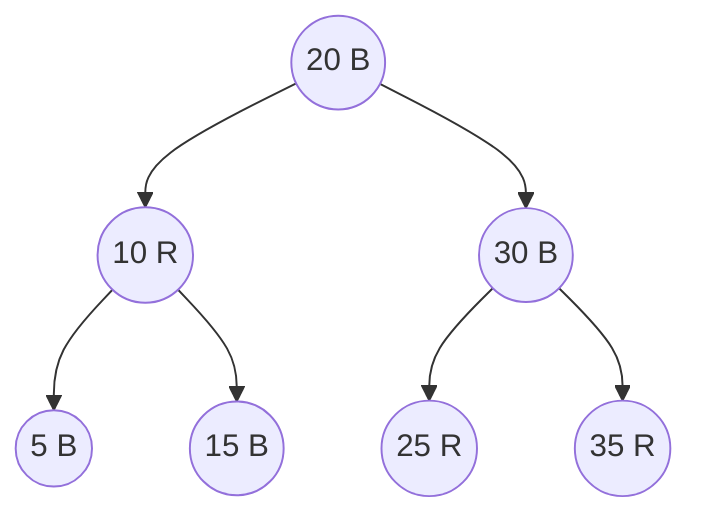

**Insert:** put as in a BST, colour it red, then fix violations with **recolouring** and **rotations** (a local pointer rearrangement that keeps BST order).

```
Left rotation around x:          x                 y
                                / \               / \
                               a   y     ==>     x   c
                                  / \           / \
                                 b   c         a   b
```

Insert and delete need at most 2 to 3 rotations, so they stay cheap. Compared with AVL trees (stricter balance, faster lookups, slower updates), red-black trees do less rebalancing work.

**What it gives you:**

- Sorted iteration (in-order traversal) in O(n).
- `floor/ceiling/lower/higher`, `headMap/tailMap/subMap` in O(log n).
- Every comparison uses `compareTo`/`Comparator`, never `hashCode`.

```java
// Interval-style problem: find the meeting that starts at or before time t
TreeMap<Integer,String> starts = new TreeMap<>();
starts.put(9, "standup"); starts.put(13, "lunch"); starts.put(15, "review");
Map.Entry<Integer,String> e = starts.floorEntry(14);   // 13=lunch
```

#### Worked Example 18: a meeting-room calendar with `TreeMap` (overlap detection)

```java
import java.util.*;

public class Main {
    static final TreeMap<Integer, Integer> bookings = new TreeMap<>();   // start -> end (minutes since midnight)

    static boolean book(int start, int end) {
        Map.Entry<Integer, Integer> before = bookings.floorEntry(start);   // latest meeting starting at or before start
        Map.Entry<Integer, Integer> after = bookings.ceilingEntry(start);  // earliest meeting starting at or after start
        if (before != null && before.getValue() > start) return false;    // previous meeting still running
        if (after != null && after.getKey() < end) return false;          // next meeting starts too soon
        bookings.put(start, end);
        return true;
    }

    static String t(int m) { return String.format("%02d:%02d", m / 60, m % 60); }

    public static void main(String[] args) {
        int[][] requests = {{540, 600}, {630, 690}, {590, 620}, {600, 630}, {660, 720}, {480, 540}};
        for (int[] r : requests)
            System.out.println("book " + t(r[0]) + "-" + t(r[1]) + " -> " + (book(r[0], r[1]) ? "OK" : "conflict"));
        StringBuilder sb = new StringBuilder();
        bookings.forEach((s, e) -> sb.append(t(s)).append("-").append(t(e)).append(" "));
        System.out.println("calendar: " + sb.toString().trim());
        System.out.println("meeting in progress at 10:15: " + t(bookings.floorKey(615)) + " start");
        System.out.println("meetings starting 09:00-11:00: " + bookings.subMap(540, true, 660, true).size());
        System.out.println("first " + t(bookings.firstKey()) + ", last ends " + t(bookings.lastEntry().getValue()));
    }
}
```

**Output:**
```text
book 09:00-10:00 -> OK
book 10:30-11:30 -> OK
book 09:50-10:20 -> conflict
book 10:00-10:30 -> OK
book 11:00-12:00 -> conflict
book 08:00-09:00 -> OK
calendar: 08:00-09:00 09:00-10:00 10:00-10:30 10:30-11:30
meeting in progress at 10:15: 10:00 start
meetings starting 09:00-11:00: 3
first 08:00, last ends 11:30
```

**Explanation:**
- Overlap only needs the **two neighbours** of the new start time: `floorEntry` (the meeting just before) and `ceilingEntry` (the meeting just after). Each lookup is O(log n), so checking against thousands of bookings stays fast. A `HashMap` cannot answer "nearest key" questions at all.
- Back-to-back meetings are allowed: a meeting ending at 10:00 does not conflict with one starting at 10:00 (`>` and `<`, not `>=`/`<=`).
- `subMap` gives a range view, and the map always iterates in time order.

### 📘 Terms Explained

| Term | Meaning |
|---|---|
| BST | Binary Search Tree: left subtree smaller, right subtree larger |
| Balanced | Height is about log n, not n |
| Rotation | Local re-wiring of 2-3 nodes that preserves order |
| In-order traversal | Visit left, node, right: yields sorted order |
| AVL tree | Another self-balancing BST, stricter than red-black |

---

## 8.2 `PriorityQueue` = Binary Min-Heap in an array **(Interview Imp) (CP)**

A `PriorityQueue` always gives you the **smallest** element first (by natural order or a `Comparator`). Internally it is a **binary heap** stored in a plain array `Object[] queue`.

**Heap rules:** it is a *complete* binary tree (all levels full except possibly the last, filled left to right), and every parent is less than or equal to its children. That is why an array works with no pointers:

```
index i:  parent = (i - 1) / 2     left child = 2i + 1     right child = 2i + 2
```

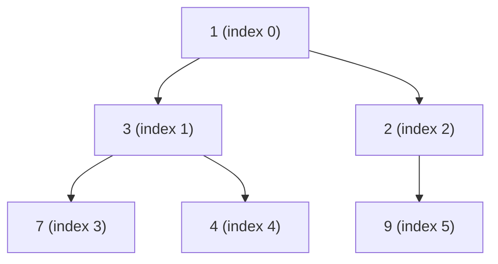

Array form: `[1, 3, 2, 7, 4, 9]`.

| Operation | How | Cost |
|---|---|---|
| `peek()` | `queue[0]` | O(1) |
| `offer(x)` | put at the end, **sift up** while smaller than the parent | O(log n) |
| `poll()` | take root, move the last element to the root, **sift down** with the smaller child | O(log n) |
| `remove(Object)` | linear search + sift | **O(n)** |
| `contains` | linear scan | O(n) |
| `new PriorityQueue<>(collection)` | **heapify** (bottom-up) | **O(n)** |

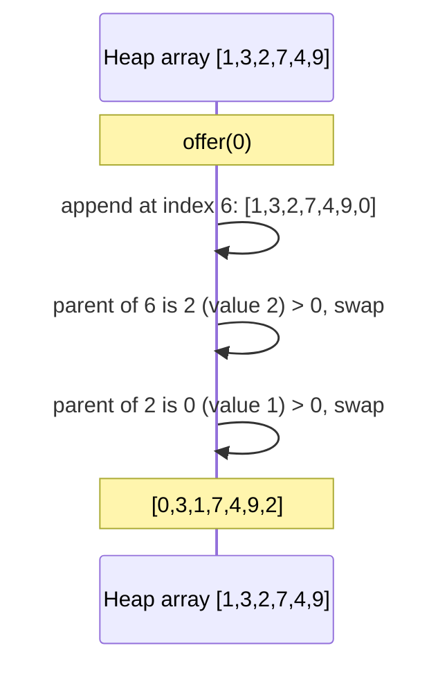

**Growth:** doubles when small (below 64), then grows by 50%.
#### Worked Example 19: inside a `PriorityQueue`: array order vs poll order

```java
import java.util.*;

public class Main {
    record Task(String name, int priority, long seq) { }

    public static void main(String[] args) {
        PriorityQueue<Integer> pq = new PriorityQueue<>();
        for (int x : new int[]{7, 3, 9, 1, 4, 2}) pq.offer(x);
        System.out.println("toString (array order, NOT sorted): " + pq);
        System.out.println("peek = " + pq.peek());
        pq.offer(0);
        System.out.println("after offer(0), array: " + pq);
        StringBuilder polled = new StringBuilder();
        while (!pq.isEmpty()) polled.append(pq.poll()).append(' ');
        System.out.println("poll order: " + polled.toString().trim());

        PriorityQueue<Integer> heapified = new PriorityQueue<>(List.of(5, 8, 1, 9, 2));
        System.out.println("heapified from a list: " + heapified);

        int[] data = {15, 3, 42, 8, 23, 4, 16};
        PriorityQueue<Integer> topK = new PriorityQueue<>();
        for (int x : data) { topK.offer(x); if (topK.size() > 3) topK.poll(); }
        List<Integer> top3 = new ArrayList<>(topK);
        top3.sort(Comparator.reverseOrder());
        System.out.println("top 3 of " + Arrays.toString(data) + " = " + top3);

        long seq = 0;
        PriorityQueue<Task> tasks = new PriorityQueue<>(Comparator.comparingInt(Task::priority).thenComparingLong(Task::seq));
        tasks.offer(new Task("email", 2, seq++));
        tasks.offer(new Task("deploy", 1, seq++));
        tasks.offer(new Task("report", 2, seq++));
        tasks.offer(new Task("hotfix", 1, seq++));
        StringBuilder order = new StringBuilder();
        while (!tasks.isEmpty()) order.append(tasks.poll().name()).append(' ');
        System.out.println("tasks by priority, FIFO within a priority: " + order.toString().trim());
    }
}
```

**Output:**
```text
toString (array order, NOT sorted): [1, 3, 2, 7, 4, 9]
peek = 1
after offer(0), array: [0, 3, 1, 7, 4, 9, 2]
poll order: 0 1 2 3 4 7 9
heapified from a list: [1, 2, 5, 9, 8]
top 3 of [15, 3, 42, 8, 23, 4, 16] = [42, 23, 16]
tasks by priority, FIFO within a priority: deploy hotfix email report
```

**Explanation:**
- `toString()` shows the internal **heap array**, which only guarantees that every parent is ≤ its children; it is not sorted. Only repeated `poll()` produces sorted order (this is heap sort).
- `offer(0)` appends 0 at the end and sifts it up, swapping with parents until it reaches the root.
- Building a queue from an existing collection uses bottom-up **heapify** in O(n).
- **Top-K**: a min-heap capped at K elements keeps the K largest seen so far; the smallest of them is evicted whenever a bigger one arrives. O(n log K) time and O(K) memory, even for a huge stream.
- `PriorityQueue` is not stable. Adding a sequence number as a tie-breaker makes equal priorities come out in arrival order (`deploy` before `hotfix`, `email` before `report`).

**Gotchas:**

- Iterating or `toString()` shows **array order, not sorted order**. The only guarantee is that the head is the minimum.
- Not thread-safe (use `PriorityBlockingQueue`).
- No `null` elements.
- Elements must be comparable, otherwise `ClassCastException`.
- No decrease-key. For Dijkstra, push duplicates and skip stale ones (Chapter 15).
- Not stable: equal-priority elements are not guaranteed FIFO.

```java
PriorityQueue<Integer> minHeap = new PriorityQueue<>();
PriorityQueue<Integer> maxHeap = new PriorityQueue<>(Collections.reverseOrder());
PriorityQueue<int[]> byDist = new PriorityQueue<>((a, b) -> Integer.compare(a[1], b[1]));
PriorityQueue<Task> tq = new PriorityQueue<>(Comparator.comparingInt(Task::priority)
                                                       .thenComparingLong(Task::seq)); // FIFO tie-break

// Top-K largest: keep a min-heap of size K  -> O(n log k)
PriorityQueue<Integer> pq = new PriorityQueue<>();
for (int x : data) { pq.offer(x); if (pq.size() > k) pq.poll(); }
```

### 📘 Terms Explained

| Term | Meaning |
|---|---|
| Complete binary tree | Filled level by level, left to right, no gaps |
| Sift up / down | Swap an element along its path until the heap rule holds |
| Heapify | Build a heap from n items in O(n) |
| Decrease-key | Lowering an element's priority in place (not supported) |
| Top-K | The K largest/smallest elements of a stream |

---

## 8.3 Skip list (`ConcurrentSkipListMap`)

A **skip list** is layered sorted linked lists. The bottom layer holds all keys; each higher layer holds a random subset (each element is promoted with probability 1/2). Search starts at the top and "skips" ahead, dropping a level when it would overshoot: expected O(log n).

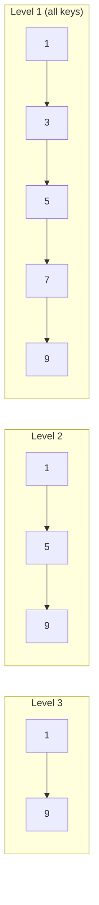

Why it matters: balancing a tree concurrently with locks is very hard, while inserting into a linked list can be done with a single CAS. So `ConcurrentSkipListMap/Set` give a **lock-free sorted map**.

---

# 9. Queue and Deque

## 9.1 `Queue` interface: two flavours of every method **(Interview Imp)**

| Operation | Throws exception | Returns special value |
|---|---|---|
| Insert | `add(e)` | `offer(e)` (false if full) |
| Remove head | `remove()` | `poll()` (null if empty) |
| Examine head | `element()` | `peek()` (null if empty) |

Prefer `offer / poll / peek` in algorithms.

```java
Queue<Integer> q = new LinkedList<>();     // or ArrayDeque (faster)
q.offer(1); q.offer(2);
q.peek();    // 1
q.poll();    // 1
```

## 9.2 `Deque` - double ended queue

Insert/remove at **both ends**. Use it as a Queue, a Stack or a sliding window.

| | First (head) | Last (tail) |
|---|---|---|
| Insert | `addFirst / offerFirst / push` | `addLast / offerLast / add` |
| Remove | `removeFirst / pollFirst / pop` | `removeLast / pollLast` |
| Examine | `getFirst / peekFirst / peek` | `getLast / peekLast` |

As a stack: `push = addFirst`, `pop = removeFirst`, `peek = peekFirst`. As a queue: `offer = addLast`, `poll = pollFirst`.

## 9.3 `ArrayDeque` internals **(Interview Imp) (CP)**

A **circular (ring) buffer** in an array with two indices `head` and `tail`. Adding at either end moves an index with wrap-around, so nothing is ever shifted and no node objects are created. (JDK 8 kept the length a power of 2 and wrapped with `& (length-1)`; JDK 9+ allows any length and wraps with a comparison. Worked Example 20 shows the real values.)

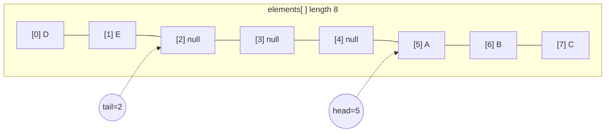

Logical order: A B C D E (the tail wrapped around to the front). When full, the array grows (roughly doubling while small, then by 50%).

- All end operations O(1) (amortised).
- **No nulls** (null is the "empty" signal of `poll`).
- Faster than `Stack` (no sync) and `LinkedList` (no nodes, cache friendly).
- No random access by index.

```java
Deque<Integer> dq = new ArrayDeque<>();
dq.offerFirst(1); dq.offerLast(2); dq.pollFirst(); dq.peekLast();
```

#### Worked Example 20: `ArrayDeque` as stack, queue and ring buffer (internals via reflection)

```java
// jvmflags: --add-opens java.base/java.util=ALL-UNNAMED
import java.lang.reflect.Field;
import java.util.*;

public class Main {
    static String state(ArrayDeque<?> dq) throws Exception {
        Field e = ArrayDeque.class.getDeclaredField("elements"), h = ArrayDeque.class.getDeclaredField("head"), t = ArrayDeque.class.getDeclaredField("tail");
        e.setAccessible(true); h.setAccessible(true); t.setAccessible(true);
        return "array length " + ((Object[]) e.get(dq)).length + ", head " + h.getInt(dq) + ", tail " + t.getInt(dq);
    }

    public static void main(String[] args) throws Exception {
        Deque<Integer> stack = new ArrayDeque<>();
        stack.push(1); stack.push(2); stack.push(3);
        System.out.println("stack " + stack + " peek " + stack.peek() + " pop " + stack.pop() + " -> " + stack);

        Queue<Integer> queue = new ArrayDeque<>();
        queue.offer(1); queue.offer(2); queue.offer(3);
        System.out.println("queue " + queue + " peek " + queue.peek() + " poll " + queue.poll() + " -> " + queue);

        ArrayDeque<String> ring = new ArrayDeque<>();
        System.out.println("new ArrayDeque: " + state(ring));
        ring.addLast("A"); ring.addLast("B"); ring.addLast("C");
        System.out.println("addLast A,B,C : " + state(ring) + "  " + ring);
        ring.addFirst("Z");
        System.out.println("addFirst Z    : " + state(ring) + "  " + ring + "   (head wrapped to the END of the array)");
        for (int i = 0; i < 14; i++) ring.addLast("x" + i);
        System.out.println("after 18 items: " + state(ring) + "  size " + ring.size());
        try {
            ring.addLast(null);
        } catch (NullPointerException ex) {
            System.out.println("ArrayDeque rejects null elements");
        }
        System.out.println("poll on empty queue = " + new ArrayDeque<Integer>().poll() + ", pop on empty stack throws: " + throwsOnPop());
    }

    static String throwsOnPop() {
        try { new ArrayDeque<Integer>().pop(); return "no"; } catch (NoSuchElementException e) { return "NoSuchElementException"; }
    }
}
```

**Output:**
```text
stack [3, 2, 1] peek 3 pop 3 -> [2, 1]
queue [1, 2, 3] peek 1 poll 1 -> [2, 3]
new ArrayDeque: array length 17, head 0, tail 0
addLast A,B,C : array length 17, head 0, tail 3  [A, B, C]
addFirst Z    : array length 17, head 16, tail 3  [Z, A, B, C]   (head wrapped to the END of the array)
after 18 items: array length 36, head 35, tail 17  size 18
ArrayDeque rejects null elements
poll on empty queue = null, pop on empty stack throws: NoSuchElementException
```

**Explanation:**
- As a **stack**, `push`/`pop`/`peek` work at the head (LIFO); as a **queue**, `offer` adds at the tail and `poll` removes at the head (FIFO). Printing always shows head-to-tail order.
- Internally the deque is a **ring buffer**: `addFirst` on a deque whose head is at index 0 moves the head to the **last** slot of the array instead of shifting anything, so both ends are O(1).
- On JDK 17 the array starts at length 17 (16 + 1 spare slot so that `head == tail` can only mean "empty"). When full it grows by `old + 2` while small (17 → 36) and by 50% once it has 64+ slots. JDK 8 and earlier used power-of-two lengths and wrapped indexes with a bit mask, which is the version most textbooks still describe; JDK 9+ wraps with a simple comparison instead.
- `null` is forbidden because `poll()` and `peek()` use `null` to mean "empty". `poll` returns `null` on an empty deque, while `pop`/`remove` throw.

## 9.4 Blocking queues (producer-consumer) **(Interview Imp)**

`BlockingQueue` adds `put` (waits if full) and `take` (waits if empty).

| Class | Structure | Bounded? | Notes |
|---|---|---|---|
| `ArrayBlockingQueue` | Array, one lock | Yes | Fair option |
| `LinkedBlockingQueue` | Linked, two locks | Optional (default MAX) | Higher throughput |
| `PriorityBlockingQueue` | Heap | No | Priority order |
| `DelayQueue` | Heap of `Delayed` | No | Element available after a delay (schedulers) |
| `SynchronousQueue` | No storage | n/a | Direct hand-off (used in `newCachedThreadPool`) |
| `LinkedTransferQueue` | Linked | No | `transfer()` waits for a consumer |
| `LinkedBlockingDeque` | Linked deque | Optional | Work stealing |

```java
BlockingQueue<Integer> q = new ArrayBlockingQueue<>(10);

Thread producer = new Thread(() -> {
    try { for (int i = 0; i < 100; i++) q.put(i); q.put(-1); /* poison pill */ }
    catch (InterruptedException e) { Thread.currentThread().interrupt(); }
});
Thread consumer = new Thread(() -> {
    try { int v; while ((v = q.take()) != -1) System.out.println(v); }
    catch (InterruptedException e) { Thread.currentThread().interrupt(); }
});
producer.start(); consumer.start();
```

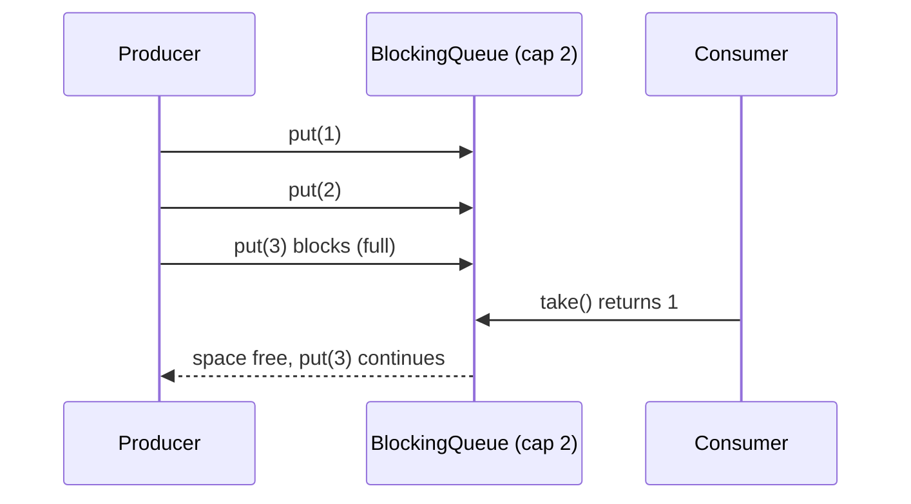

## 9.5 `Queue` implementation summary

| Class | Order | Thread-safe | Null | Internals |
|---|---|---|---|---|
| `ArrayDeque` | FIFO/LIFO | No | No | Ring buffer |
| `LinkedList` | FIFO/LIFO | No | Yes | Doubly linked |
| `PriorityQueue` | Priority | No | No | Binary heap |
| `ConcurrentLinkedQueue` | FIFO | Yes, lock-free | No | Michael-Scott CAS list |
| `ConcurrentLinkedDeque` | Both ends | Yes, lock-free | No | CAS linked deque |

### 📘 Terms Explained

| Term | Meaning |
|---|---|
| Ring buffer | Array treated as a circle: after the last slot comes the first |
| Producer-consumer | One side creates work, the other processes it, with a queue between |
| Poison pill | A special marker item that tells the consumer to stop |
| Back-pressure | Bounded queues slow the producer when the consumer can't keep up |
| CAS | Compare-And-Swap: a hardware instruction for lock-free updates |
| Work stealing | Idle threads take tasks from busy threads' queues |

---

# 10. Concurrent Collections **(Interview Imp)**

## 10.1 Why normal collections break under threads

```java
Map<String,Integer> m = new HashMap<>();
// 10 threads each do: m.put(key, m.getOrDefault(key, 0) + 1)
// -> lost updates (read-modify-write race), possibly a corrupted structure
```

Wrapping with `Collections.synchronizedMap(m)` makes each single call atomic, but **compound actions** (check-then-act, iteration) still need external locking, and all threads queue on one lock.

## 10.2 `ConcurrentHashMap` internals **(Interview Imp)**

| | Java 7 | Java 8+ |
|---|---|---|
| Locking | 16 `Segment`s (each a ReentrantLock over a mini hash table) | **Per bucket**: lock only the first node of a bin with `synchronized` |
| Empty bin insert | Under a segment lock | **Lock-free CAS** |
| Bin structure | Chain | Chain, treeified at 8 (`TreeBin`) |
| Reads (`get`) | Mostly lock-free | **Never lock** (`volatile` reads) |
| `size()` | Sum segments | `LongAdder`-style striped counters (`baseCount` + `CounterCell[]`) |
| Resize | Per segment | Many threads cooperatively **transfer** bins |

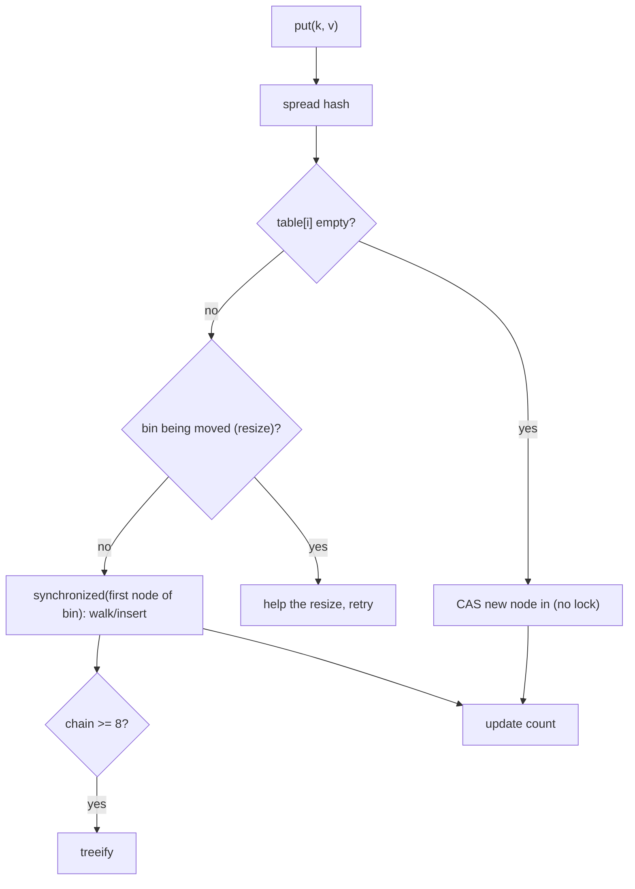

Rules and tools:

```java
ConcurrentHashMap<String,Integer> chm = new ConcurrentHashMap<>();

// WRONG - not atomic as a pair
if (!chm.containsKey("a")) chm.put("a", 1);

// RIGHT - atomic single operations
chm.putIfAbsent("a", 1);
chm.merge("a", 1, Integer::sum);                     // atomic counter
chm.computeIfAbsent("k", k -> expensiveCreate(k));   // function runs at most once per key, under the bin lock
chm.compute("a", (k, v) -> v == null ? 1 : v + 1);

// Bulk parallel operations (parallelism threshold first)
long total = chm.reduceValuesToLong(1, Integer::longValue, 0, Long::sum);
chm.forEach(1, (k, v) -> System.out.println(k + v));

// Concurrent set
Set<String> set = ConcurrentHashMap.newKeySet();

// Atomic counter map: LongAdder is faster under contention than AtomicLong
ConcurrentHashMap<String, LongAdder> hits = new ConcurrentHashMap<>();
hits.computeIfAbsent("page", k -> new LongAdder()).increment();
```

**Never** call other updates on the same map inside a `compute*` lambda (it can deadlock or throw `IllegalStateException: Recursive update`), and keep the lambda short.

`size()` is an estimate while updates happen; use `mappingCount()` for a `long`.
#### Worked Example 21: atomic map updates vs check-then-act races

```java
import java.util.*;
import java.util.concurrent.*;
import java.util.concurrent.atomic.LongAdder;

public class Main {
    public static void main(String[] args) throws Exception {
        int threads = 8, perThread = 50_000;
        ConcurrentHashMap<String, Integer> racy = new ConcurrentHashMap<>();
        ConcurrentHashMap<String, Integer> atomic = new ConcurrentHashMap<>();
        ConcurrentHashMap<String, LongAdder> adders = new ConcurrentHashMap<>();
        Set<String> uniqueVisitors = ConcurrentHashMap.newKeySet();

        ExecutorService pool = Executors.newFixedThreadPool(threads);
        List<Future<?>> fs = new ArrayList<>();
        for (int t = 0; t < threads; t++) {
            int id = t;
            fs.add(pool.submit(() -> {
                for (int i = 0; i < perThread; i++) {
                    racy.put("hits", racy.getOrDefault("hits", 0) + 1);       // read, then write: NOT atomic
                    atomic.merge("hits", 1, Integer::sum);                      // one atomic operation
                    adders.computeIfAbsent("hits", k -> new LongAdder()).increment();
                    uniqueVisitors.add("user" + (i % 1000));
                }
            }));
        }
        for (Future<?> f : fs) f.get();
        pool.shutdown();

        int expected = threads * perThread;
        System.out.println("expected            : " + expected);
        System.out.println("merge (atomic)      : " + atomic.get("hits"));
        System.out.println("LongAdder           : " + adders.get("hits").sum());
        System.out.println("get + put lost hits : " + (racy.get("hits") < expected ? "yes" : "not this run"));
        System.out.println("unique visitors     : " + uniqueVisitors.size());
        System.out.println("reduceValues total  : " + atomic.reduceValuesToLong(1, Integer::longValue, 0L, Long::sum));
    }
}
```

**Output** (`NONDETERMINISTIC`: the "lost hits" line can in rare runs say "not this run"):
```text
expected            : 400000
merge (atomic)      : 400000
LongAdder           : 400000
get + put lost hits : yes
unique visitors     : 1000
reduceValues total  : 400000
```

**Explanation:**
- Every single `ConcurrentHashMap` method is thread-safe, but `put(k, getOrDefault(k) + 1)` is **two** calls: two threads can read the same old value and both write `old + 1`, losing an increment. Thread-safe pieces do not make a thread-safe sequence.
- `merge`, `compute` and `computeIfAbsent` perform the whole read-modify-write **atomically** for that key, so the count is exact.
- `LongAdder` spreads increments across internal cells to avoid contention on one hot key, and is the fastest option for counters.
- `ConcurrentHashMap.newKeySet()` is the standard concurrent `Set`.

## 10.3 Overview of all concurrent collections

| Class | Replaces | Strategy | Best for |
|---|---|---|---|
| `ConcurrentHashMap` | `HashMap` | CAS + per-bin lock | General shared map |
| `ConcurrentSkipListMap/Set` | `TreeMap/Set` | Lock-free skip list | Sorted concurrent |
| `CopyOnWriteArrayList/Set` | `ArrayList/Set` | Copy on write | Read-mostly, tiny |
| `ConcurrentLinkedQueue/Deque` | `LinkedList` | Lock-free CAS | Unbounded non-blocking queue |
| `BlockingQueue` family | `Queue` | Locks + conditions | Producer-consumer |
| `Collections.synchronizedX` | any | One mutex | Quick wrapper, low contention |

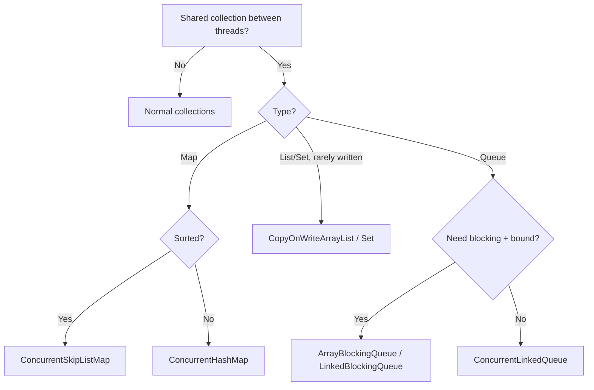

## 10.4 Compound-action safety and iteration

```java
List<String> sync = Collections.synchronizedList(new ArrayList<>());
synchronized (sync) {                    // MUST lock manually while iterating
    for (String s : sync) { ... }
}
```

`ConcurrentHashMap` iterators are **weakly consistent**: never throw CME, may or may not show concurrent changes.

## 10.5 Immutability as the best concurrency strategy

A collection that never changes needs no locks. Build it privately, then publish it as `List.copyOf(...)` / `Map.copyOf(...)`, and share it freely.

### 📘 Terms Explained

| Term | Meaning |
|---|---|
| Race condition | The result depends on unlucky timing between threads |
| Compound action | Several steps that must happen as one (check-then-act) |
| Lock striping | Using many small locks instead of one big one |
| CAS | Atomic "set to new only if still old" |
| `LongAdder` | A counter that spreads updates over several cells to reduce contention |
| Lock-free | Threads never block each other; progress is guaranteed by CAS retries |
| Weakly consistent | May reflect some, none or all of the changes made during iteration |

---
# 11. Utility Classes: `Collections`, `Arrays`, `Objects`, `BitSet`

## 11.1 `Collections` **(Interview Imp)**

| Group | Methods |
|---|---|
| Sorting/searching | `sort`, `binarySearch`, `max`, `min`, `frequency`, `disjoint` |
| Reordering | `reverse`, `shuffle`, `swap`, `rotate`, `fill` |
| Factories | `emptyList()`, `singletonList(x)`, `nCopies(n, x)` |
| Wrappers | `unmodifiableX`, `synchronizedX`, `checkedX` |
| Misc | `reverseOrder()`, `addAll(c, ...)`, `newSetFromMap` |

```java
List<Integer> l = new ArrayList<>(List.of(5, 1, 4));
Collections.sort(l);
int idx = Collections.binarySearch(l, 4);      // list must be sorted; if absent returns -(insertionPoint) - 1
List<String> zeros = Collections.nCopies(3, "0");   // [0, 0, 0] immutable
```

`binarySearch` returning a negative number `-(ip) - 1` tells you where to insert. This is the same contract as `Arrays.binarySearch`.

## 11.2 `Arrays` **(CP)**

```java
int[] a = {5, 3, 1, 4};
Arrays.sort(a);                              // whole array
Arrays.sort(a, 1, 3);                        // range [1, 3)
Arrays.fill(a, -1);
int[] b = Arrays.copyOf(a, 6);               // pads with zeros
int[] c = Arrays.copyOfRange(a, 1, 3);
Arrays.equals(a, b); Arrays.hashCode(a);
Arrays.toString(a);                          // [1, 3, 4, 5]
Arrays.deepToString(new int[][]{{1,2},{3}});// [[1, 2], [3]]
Arrays.stream(a).sum();
Arrays.binarySearch(a, 4);
Arrays.asList(1, 2, 3);
Arrays.setAll(a, i -> i * i);                // a[i] = i*i
Arrays.mismatch(a, b);                       // first differing index (Java 9)
Arrays.compare(a, b);                        // lexicographic (Java 9)
```

**2D arrays and `fill`:**

```java
int[][] dp = new int[n][m];
for (int[] row : dp) Arrays.fill(row, Integer.MAX_VALUE);   // Arrays.fill(dp, x) does NOT work for 2D
```

`==` on arrays compares references. Use `Arrays.equals` (1D) or `Arrays.deepEquals` (nD).

## 11.3 `Objects`

```java
Objects.equals(a, b);               // null-safe
Objects.hash(x, y, z);              // varargs hash (allocates; fine for normal code)
Objects.requireNonNull(x, "msg");
Objects.toString(o, "default");
Objects.requireNonNullElse(x, def);
Objects.checkIndex(i, size);
```

## 11.4 `BitSet` **(CP)**

A compact boolean array packed into `long[]` (1 bit per flag).

```java
BitSet sieve = new BitSet(n + 1);
sieve.set(2, n + 1);                            // set range to true
for (int i = 2; (long) i * i <= n; i++)
    if (sieve.get(i))
        for (int j = i * i; j <= n; j += i) sieve.clear(j);
int primes = sieve.cardinality();               // count of set bits
int next = sieve.nextSetBit(10);                // next prime >= 10
```

Operations `and / or / xor / andNot` work on whole sets at 64 flags per CPU instruction.
#### Worked Example 22: `Collections`, `Arrays`, `Objects` and `BitSet` utilities

```java
import java.util.*;

public class Main {
    public static void main(String[] args) {
        List<Integer> l = new ArrayList<>(List.of(5, 1, 4, 1, 9));
        Collections.sort(l);
        System.out.println("sorted " + l + ", binarySearch(4) " + Collections.binarySearch(l, 4) + ", binarySearch(3) " + Collections.binarySearch(l, 3));
        System.out.println("nCopies " + Collections.nCopies(3, "0") + ", disjoint([1,2],[3]) " + Collections.disjoint(List.of(1, 2), List.of(3))
                + ", emptyList " + Collections.emptyList() + ", singleton " + Collections.singletonList("x"));
        List<String> names = new ArrayList<>();
        Collections.addAll(names, "c", "a", "b");
        names.sort(Collections.reverseOrder());
        System.out.println("addAll + reverseOrder " + names);

        int[] a = {5, 3, 1, 4};
        Arrays.sort(a, 1, 3);
        System.out.println("sort range [1,3) " + Arrays.toString(a));
        int[] sq = new int[6];
        Arrays.setAll(sq, i -> i * i);
        System.out.println("setAll i*i " + Arrays.toString(sq) + ", mismatch with [0,1,4,9,0] at " + Arrays.mismatch(sq, new int[]{0, 1, 4, 9, 0}));
        int[][] dp = new int[2][3];
        for (int[] row : dp) Arrays.fill(row, -1);
        System.out.println("2-D fill " + Arrays.deepToString(dp) + ", deepEquals " + Arrays.deepEquals(dp, new int[][]{{-1, -1, -1}, {-1, -1, -1}}));

        String maybe = null;
        System.out.println("Objects.equals(null, null) " + Objects.equals(null, maybe) + ", toString(null, \"n/a\") " + Objects.toString(maybe, "n/a")
                + ", requireNonNullElse " + Objects.requireNonNullElse(maybe, "default") + ", hash(1,2) " + Objects.hash(1, 2));
        try {
            Objects.requireNonNull(maybe, "name must not be null");
        } catch (NullPointerException e) {
            System.out.println("requireNonNull: " + e.getMessage());
        }

        int n = 50;
        BitSet sieve = new BitSet(n + 1);
        sieve.set(2, n + 1);
        for (int i = 2; i * i <= n; i++) if (sieve.get(i)) for (int j = i * i; j <= n; j += i) sieve.clear(j);
        System.out.println("primes <= 50: " + sieve + " count " + sieve.cardinality() + ", next prime >= 20: " + sieve.nextSetBit(20));
        BitSet odd = new BitSet();
        for (int i = 1; i <= n; i += 2) odd.set(i);
        BitSet evenPrimes = (BitSet) sieve.clone();
        evenPrimes.andNot(odd);
        System.out.println("primes that are not odd: " + evenPrimes);
    }
}
```

**Output:**
```text
sorted [1, 1, 4, 5, 9], binarySearch(4) 2, binarySearch(3) -3
nCopies [0, 0, 0], disjoint([1,2],[3]) true, emptyList [], singleton [x]
addAll + reverseOrder [c, b, a]
sort range [1,3) [5, 1, 3, 4]
setAll i*i [0, 1, 4, 9, 16, 25], mismatch with [0,1,4,9,0] at 4
2-D fill [[-1, -1, -1], [-1, -1, -1]], deepEquals true
Objects.equals(null, null) true, toString(null, "n/a") n/a, requireNonNullElse default, hash(1,2) 994
requireNonNull: name must not be null
primes <= 50: {2, 3, 5, 7, 11, 13, 17, 19, 23, 29, 31, 37, 41, 43, 47} count 15, next prime >= 20: 23
primes that are not odd: {2}
```

**Explanation:**
- `Collections.binarySearch` on a missing value returns `−(insertionPoint) − 1`: 3 would go at index 2, so the result is `−3`. With duplicates (two 1s), it returns *some* matching index, not necessarily the first.
- `Arrays.sort(a, 1, 3)` sorts only indexes 1 and 2. `Arrays.mismatch` returns the first differing index (here 4, where `16 ≠ 0`), or −1 if equal.
- `Arrays.fill` works on one dimension only; for a 2-D array, fill each row.
- `Objects` helpers are null-safe: `equals(null, null)` is `true`, and `requireNonNull` fails fast with your own message.
- A `BitSet` sieve marks composites by clearing bits; `cardinality()` counts the 15 primes up to 50. `andNot` performs set difference 64 bits at a time, leaving only 2, the one even prime.

### 📘 Terms Explained

| Term | Meaning |
|---|---|
| Wrapper (unmodifiable) | A read-only view over a list; the source can still change |
| Insertion point | Where a missing key would be inserted to keep the order |
| Lexicographic | Dictionary order |
| Sieve | Algorithm to find primes |
| Cardinality | Number of true bits |

---

# 12. Immutability, Streams with Collectors, and Copying

## 12.1 Shallow vs deep copy **(Interview Imp)**

```java
List<int[]> orig = new ArrayList<>();
orig.add(new int[]{1, 2});
List<int[]> copy = new ArrayList<>(orig);     // SHALLOW: both lists share the same int[] object
copy.get(0)[0] = 99;                          // orig.get(0)[0] is also 99
```

Copy constructors, `clone()`, `addAll` and `List.copyOf` are all **shallow**. For a deep copy, copy each element yourself (or serialise).

For `int[][]`: `int[][] c = new int[n][]; for (...) c[i] = a[i].clone();`
#### Worked Example 23: shallow vs deep copies of nested data

```java
import java.util.*;

public class Main {
    public static void main(String[] args) {
        List<int[]> orig = new ArrayList<>();
        orig.add(new int[]{1, 2});
        List<int[]> shallow = new ArrayList<>(orig);
        List<int[]> deep = new ArrayList<>();
        for (int[] row : orig) deep.add(row.clone());
        shallow.get(0)[0] = 99;
        System.out.println("orig " + Arrays.toString(orig.get(0)) + ", shallow " + Arrays.toString(shallow.get(0)) + ", deep " + Arrays.toString(deep.get(0)));

        int[][] grid = {{1, 2}, {3, 4}};
        int[][] cloned = grid.clone();                     // clones only the OUTER array
        int[][] deepGrid = new int[grid.length][];
        for (int i = 0; i < grid.length; i++) deepGrid[i] = grid[i].clone();
        grid[0][0] = -1;
        System.out.println("grid.clone() sees change: " + (cloned[0][0] == -1) + ", deep copy sees change: " + (deepGrid[0][0] == -1));

        Map<String, List<String>> teams = new HashMap<>();
        teams.put("dev", new ArrayList<>(List.of("Asha")));
        Map<String, List<String>> copy = Map.copyOf(teams);   // immutable map, but the lists inside are shared!
        teams.get("dev").add("Ravi");
        System.out.println("Map.copyOf shares inner lists: " + copy.get("dev"));
    }
}
```

**Output:**
```text
orig [99, 2], shallow [99, 2], deep [1, 2]
grid.clone() sees change: true, deep copy sees change: false
Map.copyOf shares inner lists: [Asha, Ravi]
```

**Explanation:**
- A **shallow** copy creates a new container holding the **same** element objects, so changing an element's contents is visible through both containers. A **deep** copy also copies the elements.
- `grid.clone()` copies only the array of row references; both 2-D arrays share the row arrays.
- Even an immutable `Map.copyOf` is only as immutable as its values: the map cannot change, but the mutable lists inside it can. For true immutability, copy the inner collections too (`List.copyOf` for each value).

## 12.2 Defensive copies and unmodifiable views

```java
class Team {
    private final List<String> members = new ArrayList<>();
    public List<String> getMembers() { return Collections.unmodifiableList(members); } // view
    public List<String> snapshot()   { return List.copyOf(members); }                  // copy
}
```

## 12.3 Collections and Streams **(Interview Imp)**

See [java-stream-api.md](java-stream-api.md) for streams. The `Collectors` you meet daily:

```java
record Emp(String name, String dept, double salary) {}
List<Emp> emps = List.of(new Emp("A", "IT", 100), new Emp("B", "IT", 200), new Emp("C", "HR", 150));

Map<String, List<Emp>> byDept = emps.stream().collect(Collectors.groupingBy(Emp::dept));
Map<String, Long> count = emps.stream().collect(Collectors.groupingBy(Emp::dept, Collectors.counting()));
Map<String, Double> avg = emps.stream().collect(Collectors.groupingBy(Emp::dept, Collectors.averagingDouble(Emp::salary)));
Map<Boolean, List<Emp>> parts = emps.stream().collect(Collectors.partitioningBy(e -> e.salary() > 120));
Map<String, Double> toMap = emps.stream().collect(Collectors.toMap(Emp::name, Emp::salary));       // duplicate keys -> IllegalStateException
Map<String, Double> merged = emps.stream().collect(Collectors.toMap(Emp::dept, Emp::salary, Double::sum, TreeMap::new));
String joined = emps.stream().map(Emp::name).collect(Collectors.joining(", ", "[", "]"));
TreeSet<String> sorted = emps.stream().map(Emp::name).collect(Collectors.toCollection(TreeSet::new));
List<String> unmod = emps.stream().map(Emp::name).toList();
```

Sorting maps by value:

```java
Map<String,Integer> m = Map.of("a", 3, "b", 1, "c", 2);
List<Map.Entry<String,Integer>> es = new ArrayList<>(m.entrySet());
es.sort(Map.Entry.comparingByValue(Comparator.reverseOrder()));
// Keep the sorted order in a LinkedHashMap
Map<String,Integer> sortedMap = m.entrySet().stream()
    .sorted(Map.Entry.<String,Integer>comparingByValue().reversed())
    .collect(Collectors.toMap(Map.Entry::getKey, Map.Entry::getValue, (a, b) -> a, LinkedHashMap::new));
```

#### Worked Example 24: collectors and sorting a map by value

```java
import java.util.*;
import java.util.stream.*;

public class Main {
    record Emp(String name, String dept, double salary) { }

    public static void main(String[] args) {
        List<Emp> emps = List.of(new Emp("A", "IT", 100), new Emp("B", "IT", 200), new Emp("C", "HR", 150), new Emp("D", "HR", 90));
        System.out.println("byDept   " + emps.stream().collect(Collectors.groupingBy(Emp::dept, TreeMap::new, Collectors.mapping(Emp::name, Collectors.toList()))));
        System.out.println("count    " + emps.stream().collect(Collectors.groupingBy(Emp::dept, TreeMap::new, Collectors.counting())));
        System.out.println("avg      " + emps.stream().collect(Collectors.groupingBy(Emp::dept, TreeMap::new, Collectors.averagingDouble(Emp::salary))));
        System.out.println("partition" + emps.stream().collect(Collectors.partitioningBy(e -> e.salary() > 120, Collectors.mapping(Emp::name, Collectors.joining("")))));
        System.out.println("sum/dept " + emps.stream().collect(Collectors.toMap(Emp::dept, Emp::salary, Double::sum, TreeMap::new)));
        System.out.println("joined   " + emps.stream().map(Emp::name).collect(Collectors.joining(", ", "[", "]")));
        System.out.println("TreeSet  " + emps.stream().map(Emp::dept).collect(Collectors.toCollection(TreeSet::new)));

        Map<String, Integer> scores = Map.of("asha", 82, "ravi", 95, "om", 67, "zoya", 95);
        Map<String, Integer> byValueDesc = scores.entrySet().stream()
                .sorted(Map.Entry.<String, Integer>comparingByValue().reversed().thenComparing(Map.Entry.comparingByKey()))
                .collect(Collectors.toMap(Map.Entry::getKey, Map.Entry::getValue, (x, y) -> x, LinkedHashMap::new));
        System.out.println("scores by value desc, then name: " + byValueDesc);
        System.out.println("first non-repeated char of \"swiss\": " + firstUnique("swiss"));
    }

    static Character firstUnique(String s) {
        Map<Character, Integer> counts = new LinkedHashMap<>();
        for (char c : s.toCharArray()) counts.merge(c, 1, Integer::sum);
        return counts.entrySet().stream().filter(e -> e.getValue() == 1).map(Map.Entry::getKey).findFirst().orElse(null);
    }
}
```

**Output:**
```text
byDept   {HR=[C, D], IT=[A, B]}
count    {HR=2, IT=2}
avg      {HR=120.0, IT=150.0}
partition{false=AD, true=BC}
sum/dept {HR=240.0, IT=300.0}
joined   [A, B, C, D]
TreeSet  [HR, IT]
scores by value desc, then name: {ravi=95, zoya=95, asha=82, om=67}
first non-repeated char of "swiss": w
```

**Explanation:**
- `groupingBy(classifier, mapFactory, downstream)` is the most flexible form: the downstream collector (`mapping`, `counting`, `averagingDouble`) decides what each group becomes, and `TreeMap::new` gives sorted, stable output.
- `toMap` with a merge function (`Double::sum`) handles duplicate keys by combining values, here totalling salaries per department.
- Sorting a map by value means sorting its **entries** and collecting into a `LinkedHashMap`, which preserves that order (a `HashMap` would scramble it). `thenComparing(comparingByKey())` breaks the 95-95 tie alphabetically.
- `LinkedHashMap` counts plus "first entry with count 1" answer the classic first-unique-character question in O(n).

## 12.4 Java 21: `SequencedCollection`

Java 21 added `SequencedCollection`, `SequencedSet`, `SequencedMap` to unify "has a defined encounter order" types (`List`, `Deque`, `LinkedHashSet`, `LinkedHashMap`, `TreeSet/Map`) with the new methods `getFirst()`, `getLast()`, `addFirst()`, `addLast()`, `removeFirst()`, `removeLast()` and `reversed()` (a live reverse view).

```java
List<Integer> l = new ArrayList<>(List.of(1, 2, 3));
l.getFirst();      // 1   (before 21: l.get(0))
l.getLast();       // 3   (before 21: l.get(l.size()-1))
l.reversed();      // [3, 2, 1] view

LinkedHashMap<String,Integer> lhm = new LinkedHashMap<>();
lhm.putFirst("x", 1);       // new in 21
lhm.firstEntry();
```

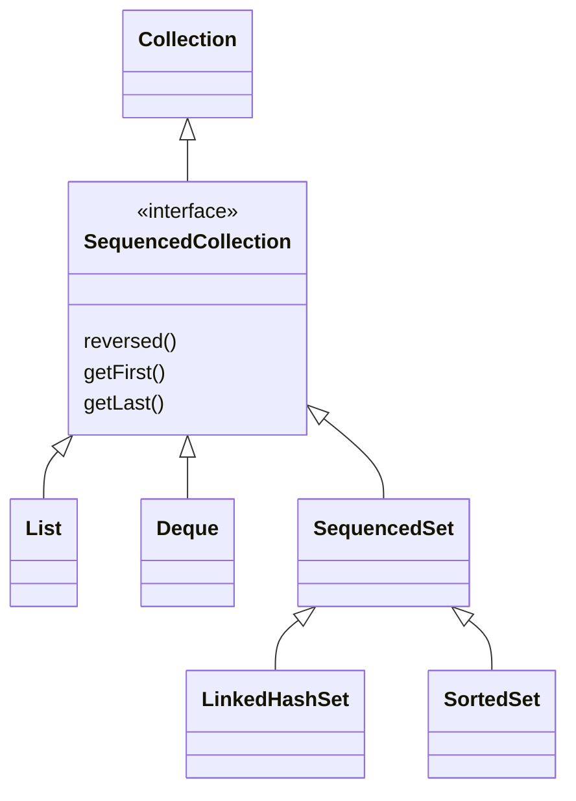

### 📘 Terms Explained

| Term | Meaning |
|---|---|
| Shallow copy | New container, same element objects |
| Deep copy | New container and new copies of the elements |
| Defensive copy | Copying data on the way in/out so outside code can't break your invariants |
| Collector | A recipe for a stream's terminal `collect` (group, join, count) |
| Encounter order | The defined order in which elements are visited |

---

# 13. Choosing the Right Collection, Memory and Performance

## 13.1 Decision guide **(Interview Imp)**

| Need | Pick |
|---|---|
| Ordered list with index access | `ArrayList` |
| Stack or queue | `ArrayDeque` |
| Unique items, no order | `HashSet` |
| Unique items, keep insertion order | `LinkedHashSet` |
| Unique items, sorted / range queries | `TreeSet` |
| Key to value lookup | `HashMap` |
| LRU cache | `LinkedHashMap` (access order) |
| Sorted keys / nearest key | `TreeMap` |
| Enum keys | `EnumMap`; enum sets `EnumSet` |
| Priority / top-K / scheduler | `PriorityQueue` |
| Counting small int range | plain `int[]` |
| Many booleans | `boolean[]` or `BitSet` |
| Thread-safe map | `ConcurrentHashMap` |
| Read-mostly list | `CopyOnWriteArrayList` |
| Producer-consumer | `BlockingQueue` |
| Constant data | `List.of / Set.of / Map.of` |

## 13.2 Memory of common structures (64-bit, compressed oops, rough)

| Structure of n Integers | Approx. bytes |
|---|---|
| `int[]` | 4n |
| `ArrayList<Integer>` | ~20n (4 ref + 16 Integer, less for cached) |
| `LinkedList<Integer>` | ~44n (Node 24 + Integer 16 + ...) |
| `HashSet<Integer>` | ~50-60n (Node 32 + Integer 16 + table slot) |
| `HashMap<Integer,Integer>` | ~70-80n |
| `TreeMap<Integer,Integer>` | ~80n (Entry 40 + 2 Integers) |

Practical rules:

- 10^7 `Integer` objects can already use 200 MB. In memory-limited judges use primitive arrays.
- Pre-size collections when the size is known.
- Prefer primitive-specialised libraries (fastutil, Eclipse Collections, HPPC) in production when memory/boxing is a bottleneck.

## 13.3 Performance tips

1. Initial capacity for `ArrayList` / `HashMap` when size is known.
2. `entrySet()` over `keySet()` + `get`.
3. `ArrayDeque` over `Stack` / `LinkedList`.
4. `EnumMap` / `EnumSet` for enums.
5. `removeIf` instead of manual loops.
6. `contains` on a `List` is O(n); convert to a `HashSet` first if you call it often.
7. Don't `remove(0)` on an `ArrayList` in a loop.
8. `TreeMap` only when you truly need ordering; it is 5-10x slower than `HashMap`.
9. Use `String.valueOf`-style keys with care: building string keys for 2D coordinates is slow; use `x * W + y` as a `long`/`int` key.
10. Avoid streams in the hottest loops; plain loops win in CP.

## 13.4 Common bugs checklist

| Bug | Cause | Fix |
|---|---|---|
| `ConcurrentModificationException` | Modified during for-each | `Iterator.remove` / `removeIf` |
| `UnsupportedOperationException` | `List.of`, `Arrays.asList.add` | Copy into `new ArrayList<>(...)` |
| Lost map entry | Mutable key or missing `hashCode` | Immutable keys, `hashCode` with `equals` |
| `NullPointerException` on unboxing | `int x = map.get(k)` with absent k | `getOrDefault` |
| Duplicate lost in `TreeSet` | Comparator returned 0 for different objects | Add tiebreaker |
| `IndexOutOfBounds` after `remove` in loop | Indexes shift | Iterate backwards or `removeIf` |
| `Arrays.asList(int[])` size 1 | Primitive array is a single object | Use `Integer[]` or `IntStream.boxed()` |

### 📘 Terms Explained

| Term | Meaning |
|---|---|
| Compressed oops | JVM trick: 32-bit references on a 64-bit JVM (heap under ~32 GB) |
| Object header | 12-16 bytes of bookkeeping on every object |
| fastutil / HPPC | Third-party libraries with primitive collections (`IntArrayList`, `Int2IntOpenHashMap`) |
| Hot loop | Code executed millions of times |

---
# 14. Competitive Programming Toolkit **(CP)**

## 14.1 Judge limits and picking an algorithm from `n`

A judge runs roughly **10^8 simple operations per second** in Java (less with boxing/collections). Use the input size to guess the intended complexity:

| n | Complexity that passes |
|---|---|
| n <= 10 | O(n!) brute force |
| n <= 20 | O(2^n) bitmask / subsets |
| n <= 500 | O(n^3) |
| n <= 5,000 | O(n^2) |
| n <= 10^5 to 2x10^5 | O(n log n) (sort, heap, TreeMap, segment tree) |
| n <= 10^6 to 10^7 | O(n) or O(n log log n) (sieve), fast I/O mandatory |
| n up to 10^18 | O(log n) or O(1) (math, binary search, fast power) |

## 14.2 Fast input and output **(CP)**

`Scanner` is very slow (regex based) and causes TLE at about 10^5 numbers. Use `BufferedReader` + `StringTokenizer`, or a custom byte reader.

```java
import java.io.*;
import java.util.*;

public class Main {
    static BufferedReader br = new BufferedReader(new InputStreamReader(System.in), 1 << 16);
    static StringTokenizer st;

    static String next() throws IOException {
        while (st == null || !st.hasMoreTokens()) st = new StringTokenizer(br.readLine());
        return st.nextToken();
    }
    static int  nextInt()  throws IOException { return Integer.parseInt(next()); }
    static long nextLong() throws IOException { return Long.parseLong(next()); }

    public static void main(String[] args) throws IOException {
        int n = nextInt();
        int[] a = new int[n];
        for (int i = 0; i < n; i++) a[i] = nextInt();

        StringBuilder sb = new StringBuilder();          // never println in a loop
        for (int x : a) sb.append(x).append('\n');
        PrintWriter out = new PrintWriter(new BufferedWriter(new OutputStreamWriter(System.out)));
        out.print(sb);
        out.flush();                                     // forgetting flush = no output!
    }
}
```

**Fastest option: raw byte reader (for 10^6+ numbers):**

```java
static final DataInputStream in = new DataInputStream(new BufferedInputStream(System.in, 1 << 16));
static int readInt() throws IOException {
    int ret = 0, b = in.read();
    while (b <= ' ') b = in.read();                 // skip whitespace
    boolean neg = b == '-';
    if (neg) b = in.read();
    while (b >= '0' && b <= '9') { ret = ret * 10 + (b - '0'); b = in.read(); }
    return neg ? -ret : ret;
}
```

| Method | 10^6 ints (rough) |
|---|---|
| `Scanner` | 1-2+ s (TLE) |
| `BufferedReader` + `StringTokenizer` | ~150-250 ms |
| Custom byte reader | ~50-80 ms |

## 14.3 Primitive arrays beat collections

```java
// SLOW: boxing, ~20 bytes per number
List<Integer> list = new ArrayList<>();
// FAST: 4 bytes per number, no GC
int[] arr = new int[n];
```

Replace `HashMap<Integer,Integer>` with an array when keys are in a small range:

```java
int[] freq = new int[1_000_001];   // instead of HashMap<Integer,Integer>
for (int x : a) freq[x]++;
```

For a graph, use **adjacency arrays** (forward-star) instead of `List<List<Integer>>`:

```java
int[] head = new int[n + 1], nxt = new int[2 * m], to = new int[2 * m];
Arrays.fill(head, -1);
int cnt = 0;
void addEdge(int u, int v) { to[cnt] = v; nxt[cnt] = head[u]; head[u] = cnt++; }
// iterate: for (int e = head[u]; e != -1; e = nxt[e]) { int v = to[e]; ... }
```

## 14.4 Useful constants and tricks

```java
final int MOD = 1_000_000_007;
final long INF = Long.MAX_VALUE / 4;       // /4 so INF + INF + INF cannot overflow
final int  IINF = Integer.MAX_VALUE / 2;

// Modular arithmetic
long add = (a + b) % MOD;
long mul = (a * b) % MOD;                  // a,b < MOD < 2^30 so a*b < 2^60 fits in long
long sub = ((a - b) % MOD + MOD) % MOD;    // keep it non-negative

static long power(long b, long e, long m) {
    long r = 1; b %= m;
    while (e > 0) { if ((e & 1) == 1) r = r * b % m; b = b * b % m; e >>= 1; }
    return r;
}
// Modular inverse for prime MOD: power(a, MOD - 2, MOD)

// Bit tricks
(x & (x - 1)) == 0      // power of two (x > 0)
x & -x                  // lowest set bit
Integer.bitCount(x); Long.numberOfTrailingZeros(x); 31 - Integer.numberOfLeadingZeros(x) // floor(log2 x)
1 << k                  // int! use 1L << k for k >= 31

Math.floorMod(-7, 3);   // 2    (the % operator gives -1)
Math.abs(Integer.MIN_VALUE); // still negative!
Integer.MAX_VALUE + 1;       // overflow -> MIN_VALUE
Math.addExact(a, b);         // throws on overflow (debug aid)
```

## 14.5 Collections cheat sheet for CP

| Task | Tool | Snippet |
|---|---|---|
| Frequency count | `HashMap` / `int[]` | `m.merge(x, 1, Integer::sum)` |
| Stack | `ArrayDeque` | `push / pop / peek` |
| Queue (BFS) | `ArrayDeque` | `offer / poll` |
| Deque / sliding window | `ArrayDeque<Integer>` of indices | `pollFirst / pollLast` |
| Min-heap | `PriorityQueue` | `new PriorityQueue<>()` |
| Max-heap | `PriorityQueue` | `Collections.reverseOrder()` |
| Heap of pairs | `PriorityQueue<long[]>` | comparator `Long.compare(a[0], b[0])` |
| Sorted set / nearest | `TreeSet` | `floor / ceiling` |
| Multiset | `TreeMap<Integer,Integer>` | count per key |
| Ordered map / intervals | `TreeMap` | `floorEntry / headMap` |
| Dedup | `HashSet` / sort + unique | |
| Pair as key | `long` encode or `record` | `(long) x << 32 | y` |
| Sort pairs | `Arrays.sort(int[][], cmp)` | comparator |
| Sort primitives safely | shuffle first or boxed | see 16.2 |
| Binary search | `Arrays.binarySearch`, custom lower bound | see 14.6 |
| Visited | `boolean[]` / `BitSet` | |
| Union-Find | arrays | see 15.6 |

## 14.6 Binary search templates **(CP)**

Write the lower bound by hand; `Arrays.binarySearch` returns *any* match when duplicates exist.

```java
// First index i with a[i] >= x (lower_bound). Returns n if none.
static int lowerBound(int[] a, int x) {
    int lo = 0, hi = a.length;              // answer in [lo, hi]
    while (lo < hi) {
        int mid = lo + (hi - lo) / 2;       // never (lo+hi)/2: can overflow
        if (a[mid] >= x) hi = mid; else lo = mid + 1;
    }
    return lo;
}
// First index with a[i] > x (upper_bound): change >= to >

// Binary search on the ANSWER: smallest value for which ok(v) is true (ok is monotone false..false true..true)
long lo = 0, hi = 1_000_000_000_000L;
while (lo < hi) {
    long mid = lo + (hi - lo) / 2;
    if (ok(mid)) hi = mid; else lo = mid + 1;
}
// answer = lo
```

#### Worked Example 25: lower bound, upper bound, counting duplicates, and binary search on the answer

```java
import java.util.*;

public class Main {
    static int lowerBound(int[] a, int x) {
        int lo = 0, hi = a.length;
        while (lo < hi) { int mid = lo + (hi - lo) / 2; if (a[mid] >= x) hi = mid; else lo = mid + 1; }
        return lo;
    }
    static int upperBound(int[] a, int x) {
        int lo = 0, hi = a.length;
        while (lo < hi) { int mid = lo + (hi - lo) / 2; if (a[mid] > x) hi = mid; else lo = mid + 1; }
        return lo;
    }
    static long isqrt(long n) {                      // largest r with r*r <= n
        long lo = 0, hi = Math.min(n, 3_037_000_499L);
        while (lo < hi) {
            long mid = lo + (hi - lo + 1) / 2;       // upper mid, because we move lo = mid
            if (mid * mid <= n) lo = mid; else hi = mid - 1;
        }
        return lo;
    }
    static int minDays(int[] weights, int capacity) {   // days needed to ship with a given daily capacity
        int days = 1, load = 0;
        for (int w : weights) { if (load + w > capacity) { days++; load = 0; } load += w; }
        return days;
    }

    public static void main(String[] args) {
        int[] a = {1, 3, 3, 3, 5, 8, 8, 10};
        for (int x : new int[]{3, 4, 8, 11})
            System.out.println("x=" + x + ": lowerBound " + lowerBound(a, x) + ", upperBound " + upperBound(a, x) + ", count " + (upperBound(a, x) - lowerBound(a, x)));
        System.out.println("Arrays.binarySearch(a, 3) = " + Arrays.binarySearch(a, 3) + "  (any matching index, not necessarily the first)");

        System.out.println("isqrt(10^18) = " + isqrt(1_000_000_000_000_000_000L) + ", isqrt(99) = " + isqrt(99));

        int[] weights = {3, 2, 2, 4, 1, 4};
        int D = 3, lo = Arrays.stream(weights).max().getAsInt(), hi = Arrays.stream(weights).sum();
        while (lo < hi) {
            int mid = lo + (hi - lo) / 2;
            if (minDays(weights, mid) <= D) hi = mid; else lo = mid + 1;
        }
        System.out.println("smallest ship capacity to deliver " + Arrays.toString(weights) + " in " + D + " days = " + lo);
    }
}
```

**Output:**
```text
x=3: lowerBound 1, upperBound 4, count 3
x=4: lowerBound 4, upperBound 4, count 0
x=8: lowerBound 5, upperBound 7, count 2
x=11: lowerBound 8, upperBound 8, count 0
Arrays.binarySearch(a, 3) = 3  (any matching index, not necessarily the first)
isqrt(10^18) = 1000000000, isqrt(99) = 9
smallest ship capacity to deliver [3, 2, 2, 4, 1, 4] in 3 days = 6
```

**Explanation:**
- `lowerBound` finds the first index with `a[i] >= x`; `upperBound` the first with `a[i] > x`. Their difference is the number of copies of `x` (three 3s, zero 4s, two 8s). For a value larger than everything (11), both return `a.length`.
- `Arrays.binarySearch` returns *a* matching index, which with duplicates may be any of them, so use hand-written bounds for "first/last occurrence" problems.
- **Binary search on the answer**: when "is capacity `c` enough?" is false for small `c` and true for large `c`, binary search finds the smallest working value in O(n log(sum)). The same pattern solves "minimum time", "maximum minimum distance" and similar problems.
- In `isqrt`, `hi` is capped at ⌊√(2⁶³)⌋ so `mid * mid` never overflows a `long`, and the **upper** midpoint avoids an infinite loop when the update is `lo = mid`.

### 📘 Terms Explained

| Term | Meaning |
|---|---|
| TLE / MLE / WA | Time Limit / Memory Limit Exceeded, Wrong Answer |
| Fast I/O | Buffered reading and a single batched write |
| Forward-star | Array-based adjacency list: head/next/to arrays |
| INF | A sentinel "infinitely large" value; keep it small enough that sums don't overflow |
| Modular inverse | The number x with `a*x = 1 (mod p)` |
| lower_bound | First position whose value is not less than x |
| Monotone predicate | A yes/no test that flips only once along the search range |

---

# 15. Patterns with Collections and Worked Solutions **(CP)**

## 15.1 Two Sum / complement lookup (HashMap)

```java
static int[] twoSum(int[] a, int target) {
    Map<Integer,Integer> seen = new HashMap<>();          // value -> index
    for (int i = 0; i < a.length; i++) {
        Integer j = seen.get(target - a[i]);
        if (j != null) return new int[]{j, i};
        seen.put(a[i], i);
    }
    return new int[0];
}
```

## 15.2 Subarray sum equals K (prefix sum + HashMap)

```java
static int subarraySum(int[] a, int k) {
    Map<Integer,Integer> cnt = new HashMap<>();
    cnt.put(0, 1);                                        // empty prefix
    int sum = 0, ans = 0;
    for (int x : a) {
        sum += x;
        ans += cnt.getOrDefault(sum - k, 0);              // earlier prefix = sum - k
        cnt.merge(sum, 1, Integer::sum);
    }
    return ans;
}
```

## 15.3 Valid parentheses / next greater element (Stack)

```java
static int[] nextGreater(int[] a) {                       // monotonic decreasing stack of indices
    int n = a.length; int[] res = new int[n];
    Arrays.fill(res, -1);
    Deque<Integer> st = new ArrayDeque<>();
    for (int i = 0; i < n; i++) {
        while (!st.isEmpty() && a[st.peek()] < a[i]) res[st.pop()] = a[i];
        st.push(i);
    }
    return res;
}
```

## 15.4 Sliding window maximum (monotonic Deque) **(Interview Imp)**

```java
static int[] maxWindow(int[] a, int k) {
    int n = a.length; int[] res = new int[n - k + 1];
    Deque<Integer> dq = new ArrayDeque<>();               // indices; values decreasing
    for (int i = 0; i < n; i++) {
        if (!dq.isEmpty() && dq.peekFirst() <= i - k) dq.pollFirst();      // out of window
        while (!dq.isEmpty() && a[dq.peekLast()] <= a[i]) dq.pollLast();   // smaller can never be max
        dq.offerLast(i);
        if (i >= k - 1) res[i - k + 1] = a[dq.peekFirst()];
    }
    return res;
}
```

O(n) because each index enters and leaves the deque once.

## 15.5 BFS shortest path on a grid

```java
static int bfs(char[][] g, int sr, int sc, int tr, int tc) {
    int R = g.length, C = g[0].length;
    int[][] dist = new int[R][C];
    for (int[] row : dist) Arrays.fill(row, -1);
    int[] dr = {1, -1, 0, 0}, dc = {0, 0, 1, -1};
    Deque<int[]> q = new ArrayDeque<>();
    q.offer(new int[]{sr, sc}); dist[sr][sc] = 0;
    while (!q.isEmpty()) {
        int[] cur = q.poll();
        if (cur[0] == tr && cur[1] == tc) return dist[tr][tc];
        for (int d = 0; d < 4; d++) {
            int nr = cur[0] + dr[d], nc = cur[1] + dc[d];
            if (nr < 0 || nc < 0 || nr >= R || nc >= C || g[nr][nc] == '#' || dist[nr][nc] != -1) continue;
            dist[nr][nc] = dist[cur[0]][cur[1]] + 1;
            q.offer(new int[]{nr, nc});
        }
    }
    return -1;
}
```

## 15.6 Union-Find (Disjoint Set Union) **(CP)**

```java
static int[] parent, size;
static void init(int n) { parent = new int[n]; size = new int[n]; for (int i = 0; i < n; i++) { parent[i] = i; size[i] = 1; } }
static int find(int x) {                                   // iterative, path compression
    while (parent[x] != x) { parent[x] = parent[parent[x]]; x = parent[x]; }
    return x;
}
static boolean union(int a, int b) {
    a = find(a); b = find(b);
    if (a == b) return false;
    if (size[a] < size[b]) { int t = a; a = b; b = t; }    // union by size
    parent[b] = a; size[a] += size[b];
    return true;
}
```

Near O(1) per operation (inverse Ackermann). Used for Kruskal MST, connected components, cycle detection.

## 15.7 Dijkstra with `PriorityQueue` (lazy deletion) **(CP) (Interview Imp)**

```java
static long[] dijkstra(List<int[]>[] adj, int src) {       // adj[u] = list of {v, w}
    int n = adj.length;
    long[] dist = new long[n];
    Arrays.fill(dist, Long.MAX_VALUE);
    dist[src] = 0;
    PriorityQueue<long[]> pq = new PriorityQueue<>((x, y) -> Long.compare(x[0], y[0]));  // {dist, node}
    pq.offer(new long[]{0, src});
    while (!pq.isEmpty()) {
        long[] top = pq.poll();
        long d = top[0]; int u = (int) top[1];
        if (d > dist[u]) continue;                          // stale entry: a better path was already found
        for (int[] e : adj[u]) {
            long nd = d + e[1];
            if (nd < dist[e[0]]) { dist[e[0]] = nd; pq.offer(new long[]{nd, e[0]}); }
        }
    }
    return dist;
}
```

`PriorityQueue` has no decrease-key, so we push a new pair and ignore outdated ones. Complexity O((V + E) log V). It does not work with negative edges (use Bellman-Ford).

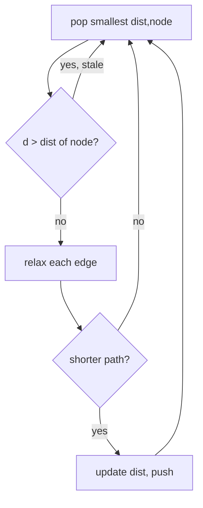

## 15.8 Top-K frequent elements (heap) and K-th largest

```java
static List<Integer> topK(int[] a, int k) {
    Map<Integer,Integer> f = new HashMap<>();
    for (int x : a) f.merge(x, 1, Integer::sum);
    PriorityQueue<Map.Entry<Integer,Integer>> pq = new PriorityQueue<>(Map.Entry.comparingByValue()); // min-heap size k
    for (var e : f.entrySet()) { pq.offer(e); if (pq.size() > k) pq.poll(); }
    List<Integer> res = new ArrayList<>();
    while (!pq.isEmpty()) res.add(pq.poll().getKey());
    return res;
}
```

**Running median (two heaps):** a max-heap for the lower half and a min-heap for the upper half; keep sizes within 1.

```java
PriorityQueue<Integer> lo = new PriorityQueue<>(Collections.reverseOrder()), hi = new PriorityQueue<>();
void add(int x) {
    lo.offer(x); hi.offer(lo.poll());
    if (hi.size() > lo.size()) lo.offer(hi.poll());
}
double median() { return lo.size() > hi.size() ? lo.peek() : (lo.peek() + hi.peek()) / 2.0; }
```

## 15.9 Multiset and ordered queries (TreeMap / TreeSet) **(CP)**

Java has no `multiset`. Use `TreeMap<K,Integer>` with counts.

```java
TreeMap<Integer,Integer> ms = new TreeMap<>();
void addM(int x)    { ms.merge(x, 1, Integer::sum); }
void removeM(int x) { ms.computeIfPresent(x, (k, c) -> c == 1 ? null : c - 1); }   // null removes entry
int minM() { return ms.firstKey(); }
int maxM() { return ms.lastKey(); }
```

Other typical uses:

- **Closest element to x**: compare `floor(x)` and `ceiling(x)`.
- **Count of elements < x** is NOT O(log n) with `headSet(x).size()` (that is O(n)). For order statistics use a Fenwick tree or a segment tree.
- **Interval scheduling / calendar**: `TreeMap<start,end>`, check `floorEntry(s)` and `ceilingEntry(s)` for overlap.
- **Sweep line events**: sort events or put them in a `TreeMap`.

## 15.10 Longest Increasing Subsequence in O(n log n)

```java
static int lis(int[] a) {
    int[] tails = new int[a.length]; int len = 0;           // tails[i] = smallest tail of an increasing subsequence of length i+1
    for (int x : a) {
        int pos = Arrays.binarySearch(tails, 0, len, x);
        if (pos < 0) pos = -(pos + 1);                      // insertion point
        tails[pos] = x;
        if (pos == len) len++;
    }
    return len;                                             // strictly increasing
}
```

## 15.11 Coordinate compression

When values go up to 10^9 but there are only n distinct ones:

```java
int[] sorted = Arrays.stream(a).distinct().sorted().toArray();
int[] comp = new int[a.length];
for (int i = 0; i < a.length; i++) comp[i] = Arrays.binarySearch(sorted, a[i]);   // 0..m-1
```

## 15.12 Fenwick tree (BIT): prefix sums with updates

```java
static long[] bit;
static void update(int i, long delta) { for (i++; i < bit.length; i += i & -i) bit[i] += delta; }
static long query(int i) { long s = 0; for (i++; i > 0; i -= i & -i) s += bit[i]; return s; }  // sum of [0..i]
// bit = new long[n + 1];   range sum [l,r] = query(r) - query(l - 1)
```

Both operations O(log n); combine with coordinate compression to count "how many earlier values are smaller" (inversions).

## 15.13 Prefix sums, difference arrays, two pointers

```java
long[] pre = new long[n + 1];
for (int i = 0; i < n; i++) pre[i + 1] = pre[i] + a[i];     // sum [l,r] = pre[r+1] - pre[l]

int[] diff = new int[n + 1];                                  // add v to [l,r] in O(1)
diff[l] += v; diff[r + 1] -= v;                               // later prefix-sum diff to materialise

// Two pointers: longest subarray with sum <= S (all positive)
int best = 0; long sum = 0;
for (int l = 0, r = 0; r < n; r++) {
    sum += a[r];
    while (sum > S) sum -= a[l++];
    best = Math.max(best, r - l + 1);
}
```

## 15.14 Pair/state keys and a reusable `Pair`

```java
record Pair(int a, int b) {}                                 // equals/hashCode for free (Java 16+)
Set<Pair> seen = new HashSet<>();

// Much faster: pack two ints into one long
long key = ((long) x << 32) | (y & 0xffffffffL);
int x2 = (int) (key >> 32), y2 = (int) key;
```

## 15.15 Subsets with bitmasks and permutations

```java
for (int mask = 0; mask < (1 << n); mask++) {
    long sum = 0;
    for (int i = 0; i < n; i++) if ((mask >> i & 1) == 1) sum += a[i];
}
// Iterate all submasks of m: for (int s = m; s > 0; s = (s - 1) & m)
```

#### Worked Example 26: the chapter's patterns, run on small inputs

```java
import java.util.*;

public class Main {
    static int subarraySum(int[] a, int k) {
        Map<Integer, Integer> cnt = new HashMap<>(Map.of(0, 1));
        int sum = 0, ans = 0;
        for (int x : a) { sum += x; ans += cnt.getOrDefault(sum - k, 0); cnt.merge(sum, 1, Integer::sum); }
        return ans;
    }
    static int[] maxWindow(int[] a, int k) {
        int[] res = new int[a.length - k + 1];
        Deque<Integer> dq = new ArrayDeque<>();
        for (int i = 0; i < a.length; i++) {
            if (!dq.isEmpty() && dq.peekFirst() <= i - k) dq.pollFirst();
            while (!dq.isEmpty() && a[dq.peekLast()] <= a[i]) dq.pollLast();
            dq.offerLast(i);
            if (i >= k - 1) res[i - k + 1] = a[dq.peekFirst()];
        }
        return res;
    }
    static int gridBfs(String[] g) {
        int R = g.length, C = g[0].length();
        int[][] dist = new int[R][C];
        for (int[] row : dist) Arrays.fill(row, -1);
        Deque<int[]> q = new ArrayDeque<>();
        q.offer(new int[]{0, 0}); dist[0][0] = 0;
        int[] dr = {1, -1, 0, 0}, dc = {0, 0, 1, -1};
        while (!q.isEmpty()) {
            int[] cur = q.poll();
            for (int d = 0; d < 4; d++) {
                int nr = cur[0] + dr[d], nc = cur[1] + dc[d];
                if (nr < 0 || nc < 0 || nr >= R || nc >= C || g[nr].charAt(nc) == '#' || dist[nr][nc] != -1) continue;
                dist[nr][nc] = dist[cur[0]][cur[1]] + 1;
                q.offer(new int[]{nr, nc});
            }
        }
        return dist[R - 1][C - 1];
    }
    static int lis(int[] a) {
        int[] tails = new int[a.length]; int len = 0;
        for (int x : a) { int pos = Arrays.binarySearch(tails, 0, len, x); if (pos < 0) pos = -(pos + 1); tails[pos] = x; if (pos == len) len++; }
        return len;
    }
    static long[] bit;
    static void update(int i, long d) { for (i++; i < bit.length; i += i & -i) bit[i] += d; }
    static long query(int i) { long s = 0; for (i++; i > 0; i -= i & -i) s += bit[i]; return s; }

    public static void main(String[] args) {
        System.out.println("subarrays of [1,2,3,-2,2] summing to 3: " + subarraySum(new int[]{1, 2, 3, -2, 2}, 3));
        System.out.println("sliding max k=3 of [1,3,-1,-3,5,3,6,7]: " + Arrays.toString(maxWindow(new int[]{1, 3, -1, -3, 5, 3, 6, 7}, 3)));
        System.out.println("grid BFS shortest path: " + gridBfs(new String[]{"..#.", ".##.", "...."}));
        System.out.println("LIS of [10,9,2,5,3,7,101,18]: " + lis(new int[]{10, 9, 2, 5, 3, 7, 101, 18}));

        PriorityQueue<Integer> lo = new PriorityQueue<>(Collections.reverseOrder()), hi = new PriorityQueue<>();
        StringBuilder medians = new StringBuilder();
        for (int x : new int[]{5, 15, 1, 3, 8}) {
            lo.offer(x); hi.offer(lo.poll());
            if (hi.size() > lo.size()) lo.offer(hi.poll());
            medians.append(lo.size() > hi.size() ? lo.peek() : (lo.peek() + hi.peek()) / 2.0).append(' ');
        }
        System.out.println("running medians of 5,15,1,3,8: " + medians.toString().trim());

        int[] vals = {100, 5, 9000, 5, 42};
        int[] sorted = Arrays.stream(vals).distinct().sorted().toArray();
        int[] comp = new int[vals.length];
        for (int i = 0; i < vals.length; i++) comp[i] = Arrays.binarySearch(sorted, vals[i]);
        System.out.println("coordinate compression of " + Arrays.toString(vals) + " -> " + Arrays.toString(comp));

        int[] arr = {3, 1, 2, 5, 4};
        bit = new long[arr.length + 2];
        long inversions = 0;
        for (int i = arr.length - 1; i >= 0; i--) { inversions += query(arr[i] - 1); update(arr[i], 1); }
        System.out.println("inversions in [3,1,2,5,4] (Fenwick): " + inversions);

        TreeMap<Integer, Integer> ms = new TreeMap<>();
        for (int x : new int[]{4, 1, 4, 7}) ms.merge(x, 1, Integer::sum);
        ms.computeIfPresent(4, (k, c) -> c == 1 ? null : c - 1);
        System.out.println("multiset after removing one 4: " + ms + ", min " + ms.firstKey() + ", max " + ms.lastKey());

        long key = ((long) 7 << 32) | (3 & 0xffffffffL);
        System.out.println("pack (7,3) into a long and back: (" + (int) (key >> 32) + "," + (int) key + ")");
    }
}
```

**Output:**
```text
subarrays of [1,2,3,-2,2] summing to 3: 4
sliding max k=3 of [1,3,-1,-3,5,3,6,7]: [3, 3, 5, 5, 6, 7]
grid BFS shortest path: 5
LIS of [10,9,2,5,3,7,101,18]: 4
running medians of 5,15,1,3,8: 5.0 10.0 5.0 4.0 5.0
coordinate compression of [100, 5, 9000, 5, 42] -> [2, 0, 3, 0, 1]
inversions in [3,1,2,5,4] (Fenwick): 3
multiset after removing one 4: {1=1, 4=1, 7=1}, min 1, max 7
pack (7,3) into a long and back: (7,3)
```

**Explanation:**
- **Subarray sum = k:** a subarray `(i, j]` sums to `k` exactly when `prefix[j] − prefix[i] = k`, so for each prefix we count earlier prefixes equal to `sum − k`. Here the four matches are `[1,2]`, `[2,3,−2]`, `[3]` and `[3,−2,2]`; negative numbers are why a sliding window would not work and the prefix-count map is needed.
- **Sliding window maximum:** the deque holds indexes whose values are decreasing; smaller values behind a bigger, newer one can never be a maximum again and are discarded. Each index enters and leaves once: O(n).
- **Grid BFS** visits cells in rings of equal distance, so the first distance recorded for the bottom-right cell is the shortest path around the walls.
- **LIS:** `tails[i]` is the smallest possible tail of an increasing subsequence of length `i + 1`; binary search finds where each value fits.
- **Running median:** the max-heap holds the lower half and the min-heap the upper half; the median is the top of the larger heap or the average of the two tops.
- **Fenwick tree inversion count:** scanning from the right, `query(v − 1)` counts smaller values already seen to the right, i.e. pairs out of order.

### 📘 Terms Explained

| Term | Meaning |
|---|---|
| Monotonic stack/deque | Keeps elements in sorted order by popping those that can't matter anymore |
| Lazy deletion | Leave outdated entries in a heap and skip them when popped |
| Relax (an edge) | Update a distance if a shorter path is found |
| DSU | Disjoint Set Union: tracks which items are in the same group |
| Path compression | Make nodes point closer to the root during `find` |
| Fenwick tree (BIT) | Compact structure for prefix sums with point updates |
| Prefix sum | `pre[i]` = sum of the first i items; range sums in O(1) |
| Sweep line | Process events in sorted order |
| Submask | A mask whose set bits are a subset of another mask's bits |

---

# 16. Competitive Programming Traps in Java **(CP) (Interview Imp)**

## 16.1 The trap list

| # | Trap | Why it hurts | Fix |
|---|---|---|---|
| 1 | `Scanner` / `System.out.println` in loops | Slow I/O, TLE | `BufferedReader` + `StringBuilder` + one flush |
| 2 | Forgetting `out.flush()` | Empty output | Always flush/close |
| 3 | `int` overflow in sums/products | Wrong answer | Use `long`; cast **before** multiplying: `(long) a * b` |
| 4 | `1 << 40` | `int` shift wraps | `1L << 40` |
| 5 | `(lo + hi) / 2` | Overflow | `lo + (hi - lo) / 2` |
| 6 | `Integer` compared with `==` | Cache only for -128..127 | `.equals()` or unbox |
| 7 | `List<Integer>.remove(int)` vs `remove(Object)` | Wrong overload | `remove(Integer.valueOf(x))` |
| 8 | `a - b` in comparator | Overflow | `Integer.compare(a, b)` |
| 9 | `Arrays.sort(int[])` on adversarial input | Quicksort O(n^2) | Shuffle first or sort `Integer[]`/objects |
| 10 | Recursion depth about 10^4-10^5 | `StackOverflowError` | Run in a bigger-stack thread or iterate |
| 11 | `HashMap<Integer,...>` for 10^6 keys | Memory + boxing | Arrays, or sort + compress |
| 12 | `list.contains` in a loop | O(n^2) | `HashSet` |
| 13 | `String +=` in a loop | O(n^2) | `StringBuilder` |
| 14 | `headSet(x).size()` | O(n) | Fenwick tree |
| 15 | `PriorityQueue.remove(obj)` | O(n) | Lazy deletion |
| 16 | `Math.abs(Integer.MIN_VALUE)` | Still negative | Use `long` |
| 17 | `%` on negatives | Negative result | `Math.floorMod` |
| 18 | `int INF = Integer.MAX_VALUE` then `INF + w` | Overflows to negative | `INF = Integer.MAX_VALUE / 2` or `Long.MAX_VALUE / 4` |
| 19 | Double precision | `0.1 + 0.2 != 0.3` | Use integers or epsilon |
| 20 | Creating `new int[n]` per test case | MLE/TLE with many tests | Reuse and clear only used range |

## 16.2 Anti-quicksort and anti-hash tests

Hackers on Codeforces craft inputs that push `Arrays.sort(int[])` (dual-pivot quicksort) into O(n^2). Defence:

```java
static void sort(int[] a) {
    Random rnd = new Random();
    for (int i = a.length - 1; i > 0; i--) {               // Fisher-Yates shuffle
        int j = rnd.nextInt(i + 1);
        int t = a[i]; a[i] = a[j]; a[j] = t;
    }
    Arrays.sort(a);
}
// or: sort an Integer[] / List<Integer> (TimSort, guaranteed O(n log n))
```

`HashMap` is safer since Java 8: treeified buckets give O(log n) when keys are `Comparable`, so the usual `Integer` anti-hash attack only slows you by a log factor. For extra safety, XOR keys with a random value or use a custom hash.

## 16.3 Deep recursion

Default thread stack is about 512 KB to 1 MB (a few thousand to ~10^4+ frames). For DFS on 10^5+ nodes:

```java
public static void main(String[] args) throws Exception {
    Thread t = new Thread(null, () -> {
        try { solve(); } catch (Exception e) { throw new RuntimeException(e); }
    }, "main", 1L << 28);                                   // 256 MB stack
    t.start(); t.join();
}
```

Or convert DFS to an explicit `ArrayDeque` stack.
#### Worked Example 27: deep recursion: default stack vs a big-stack thread vs an explicit stack

```java
public class Main {
    static int depth(int n) { return n == 0 ? 0 : 1 + depth(n - 1); }

    static int iterativeDepth(int n) {
        java.util.ArrayDeque<Integer> stack = new java.util.ArrayDeque<>();
        stack.push(n);
        int levels = 0;
        while (!stack.isEmpty()) { int cur = stack.pop(); if (cur > 0) { levels++; stack.push(cur - 1); } }
        return levels;
    }

    public static void main(String[] args) throws Exception {
        int n = 1_000_000;
        try {
            System.out.println("default stack: " + depth(n));
        } catch (StackOverflowError e) {
            System.out.println("default stack: StackOverflowError at depth " + n);
        }
        int[] result = new int[1];
        Thread big = new Thread(null, () -> result[0] = depth(n), "big-stack", 1L << 29);   // 512 MB stack
        big.start();
        big.join();
        System.out.println("512 MB stack thread: depth " + result[0]);
        System.out.println("explicit ArrayDeque stack: depth " + iterativeDepth(n));
    }
}
```

**Output:**
```text
default stack: StackOverflowError at depth 1000000
512 MB stack thread: depth 1000000
explicit ArrayDeque stack: depth 1000000
```

**Explanation:**
- The default thread stack (typically 512 KB-1 MB) holds tens of thousands of small frames, far fewer than the one million recursive calls needed here.
- The `Thread` constructor's fourth argument requests a much larger stack for that thread only; the JVM reserves it lazily, so it costs real memory only as frames are used. Judges and contest templates use this trick for deep DFS.
- The most robust solution is to replace recursion with an explicit stack on the heap, which is limited only by heap size.

## 16.4 Template for contests

```java
import java.io.*;
import java.util.*;

public class Main {
    static final int MOD = 1_000_000_007;
    static BufferedReader br = new BufferedReader(new InputStreamReader(System.in), 1 << 16);
    static StringTokenizer st;
    static PrintWriter out = new PrintWriter(new BufferedWriter(new OutputStreamWriter(System.out)));

    static String next() throws IOException {
        while (st == null || !st.hasMoreTokens()) st = new StringTokenizer(br.readLine());
        return st.nextToken();
    }
    static int ni() throws IOException { return Integer.parseInt(next()); }
    static long nl() throws IOException { return Long.parseLong(next()); }

    public static void main(String[] args) throws IOException {
        int t = ni();                       // number of test cases
        while (t-- > 0) solve();
        out.flush();
    }

    static void solve() throws IOException {
        int n = ni();
        int[] a = new int[n];
        for (int i = 0; i < n; i++) a[i] = ni();
        // ... logic ...
        out.println(n);
    }
}
```

## 16.5 Complexity of Java operations to keep in mind

| Operation | Cost | Gotcha |
|---|---|---|
| `String.substring` | O(k) copy (since Java 7u6) | Not O(1) |
| `String.charAt` | O(1) | `s.toCharArray()` once for heavy use |
| `String.equals / hashCode` | O(len) (hash cached after first call) | |
| `StringBuilder.insert(0, c)` / `deleteCharAt(0)` | O(n) | Use reverse at the end |
| `ArrayList.remove(0)` | O(n) | |
| `list.indexOf` | O(n) | |
| `Collections.sort` | O(n log n) | n compare calls, each via lambda |
| `TreeMap.size()` | O(1) | `subMap().size()` is O(k) |
| `LinkedList.get(i)` | O(n) | A loop of `get(i)` is O(n^2) |
| `Arrays.asList(int[])` | wrong type | |
| `String.format` | slow | Avoid in loops |

### 📘 Terms Explained

| Term | Meaning |
|---|---|
| Anti-hash / anti-quicksort test | Input designed to trigger the worst case of a standard library |
| Fisher-Yates shuffle | Unbiased in-place random permutation |
| Stack overflow | Recursion too deep for the thread's stack |
| Epsilon | A tiny tolerance when comparing floating-point numbers |
| Test case | One input instance; many may be packed into one file |

---
# 17. Interview Questions **(Interview Imp)**

## 17.1 Conceptual

| # | Question | Short answer |
|---|---|---|
| 1 | `Collection` vs `Collections`? | Interface at the root of List/Set/Queue vs utility class with static helpers |
| 2 | Why doesn't `Map` extend `Collection`? | It holds pairs, not single elements; `add(E)` has no sensible meaning |
| 3 | `ArrayList` vs `LinkedList`? | Array vs doubly linked nodes; ArrayList wins nearly always (3.3) |
| 4 | `ArrayList` vs `Vector`? | Vector is synchronized, grows 2x, legacy; ArrayList grows 1.5x |
| 5 | `HashSet` internals? | A `HashMap` where elements are keys and the value is a dummy `PRESENT` |
| 6 | `HashSet` vs `TreeSet` vs `LinkedHashSet`? | Hash O(1) unordered; Tree O(log n) sorted; Linked O(1) insertion order |
| 7 | `Comparable` vs `Comparator`? | Natural order inside the class vs external pluggable order |
| 8 | Fail-fast vs fail-safe? | modCount-based CME vs snapshot/weakly consistent iterators |
| 9 | `Iterator` vs `ListIterator`? | Forward only vs bidirectional with add/set/index |
| 10 | `Array` vs `ArrayList`? | Fixed size, primitives allowed vs resizable, objects only |
| 11 | `poll()` vs `remove()` on a Queue? | `poll` returns null when empty; `remove` throws |
| 12 | `Stack` vs `Deque` for stacks? | Use `ArrayDeque`; Stack is a synchronized Vector subclass |
| 13 | `List.of` vs `Arrays.asList` vs `unmodifiableList`? | Immutable no-nulls vs fixed-size view vs read-only view (3.6) |
| 14 | Why is `String` a popular HashMap key? | Immutable, hash cached, good `equals/hashCode` |
| 15 | Can a HashMap key be null? | One null key (bucket 0); `Hashtable`/`ConcurrentHashMap` can't |
| 16 | What are `EnumSet` and `EnumMap`? | Bitmask/array based; fastest for enum data |
| 17 | `IdentityHashMap` vs `HashMap`? | `==` vs `equals` |
| 18 | `WeakHashMap`? | Keys are weakly referenced; entries disappear after GC |
| 19 | How do you sort a map by value? | Sort `entrySet()` with `comparingByValue` and keep it in a `LinkedHashMap` |
| 20 | `Collections.sort` algorithm? | TimSort, stable, O(n log n), adaptive |

## 17.2 HashMap deep dive

| # | Question | Answer |
|---|---|---|
| 21 | How does `put` work? | Hash spread `h ^ h>>>16`, index `(n-1)&hash`, chain/tree, resize when size > 0.75n |
| 22 | Why is the capacity a power of 2? | Cheap bit-mask index; resize splits a bucket into two by one hash bit |
| 23 | What happens on a collision? | Same bucket: chain of nodes, then red-black tree at 8 (if capacity >= 64) |
| 24 | When does it treeify / untreeify? | >= 8 nodes in a bucket and table >= 64 / back at <= 6 |
| 25 | What is the load factor and why 0.75? | Fullness before resize; the balance between space and time |
| 26 | Initial capacity and how it is rounded? | Default 16; any given capacity is rounded up to a power of 2 |
| 27 | What if `hashCode` is constant? | Everything in one bucket: O(n), or O(log n) if keys are `Comparable` and treeified |
| 28 | What if keys are mutable and change? | Entry becomes unreachable (7.6) |
| 29 | Is `HashMap` thread safe? What breaks? | No: lost updates, corrupted state, Java 7 infinite loop on resize |
| 30 | How does `ConcurrentHashMap` stay safe? | CAS for empty bins, `synchronized` on the first node of a bin, volatile reads, cooperative resize |
| 31 | `HashMap` vs `Hashtable`? | Unsynchronized, nulls allowed, newer vs all-synchronized legacy |
| 32 | How does `get` work if two keys share a hash? | Compare hash, then `==`/`equals` along the chain |
| 33 | Order of `HashMap` iteration? | Bucket index order then chain order; unspecified and may change on resize |
| 34 | `LinkedHashMap` as LRU? | `accessOrder=true` + override `removeEldestEntry` |
| 35 | How is `HashSet.add` duplicate detection done? | `map.put(e, PRESENT)` returns the previous value (non-null) if present |

## 17.3 Advanced and design

| # | Question | Answer |
|---|---|---|
| 36 | Why red-black tree and not AVL for TreeMap? | Fewer rotations on update, good enough balance, O(log n) |
| 37 | How is `PriorityQueue` stored? | Binary heap in an array; parent `(i-1)/2`, children `2i+1`, `2i+2` |
| 38 | Time to build a heap from n items? | O(n) by heapify, not O(n log n) |
| 39 | Is `PriorityQueue` iteration sorted? | No: only the head is guaranteed |
| 40 | `ArrayDeque` internals? | Circular array with head/tail indices (power-of-two length up to JDK 8; any length since JDK 9), no nulls |
| 41 | `CopyOnWriteArrayList` trade-off? | Lock-free reads and snapshot iterators vs O(n) writes |
| 42 | `ConcurrentHashMap.size()` accuracy? | An estimate under concurrent updates (striped counters) |
| 43 | `computeIfAbsent` inside `ConcurrentHashMap`? | Atomic per key; never modify the same map inside the function |
| 44 | `BlockingQueue` use? | Producer-consumer with back-pressure |
| 45 | How to make a collection immutable? | `List.of/copyOf`, `unmodifiableX` over a private copy, or records |
| 46 | `subList` pitfalls? | It's a view; structural change of the parent invalidates it |
| 47 | `equals`/`hashCode` contract? | Equal objects must have equal hash codes (4.6) |
| 48 | Remove duplicates from a list preserving order? | `new ArrayList<>(new LinkedHashSet<>(list))` |
| 49 | Find the first non-repeated character? | `LinkedHashMap<Character,Integer>` counts, first entry with 1 |
| 50 | Implement an LRU cache without `LinkedHashMap` | `HashMap` + doubly linked list: O(1) get/put |
| 51 | `Spliterator` and parallel streams? | Splits the source for fork/join; ArrayList splits well, LinkedList poorly |
| 52 | What is `SequencedCollection` (Java 21)? | Common interface with `getFirst/getLast/reversed` for ordered collections |

## 17.4 Output-prediction quickies

```java
// Q1
Set<Short> s = new HashSet<>();
for (short i = 0; i < 5; i++) { s.add(i); s.remove(i - 1); }
System.out.println(s.size());
```
Answer: **5**. `i - 1` is an `int`, so it is boxed to `Integer`, which is never equal to a `Short`. `remove` finds nothing and silently does nothing. Always check the element type.

```java
// Q2
List<Integer> l = new ArrayList<>(List.of(1, 2, 3));
for (Integer x : l) if (x == 2) l.remove(x);
System.out.println(l);
```
Answer: **[1, 3]**, no exception, because removing the second-last element makes `hasNext()` return false (1.5).

```java
// Q3
Map<String,Integer> m = new HashMap<>();
m.put(null, 1); m.put(null, 2);
System.out.println(m.size() + " " + m.get(null));
```
Answer: **1 2**.

```java
// Q4
TreeSet<StringBuilder> t = new TreeSet<>();
t.add(new StringBuilder("a"));
```
Answer: `ClassCastException` (before Java 11, `StringBuilder` was not `Comparable`) and from Java 11 it works. A `TreeSet` of a non-Comparable type without a comparator fails at the first `add`.
#### Worked Example 28: the output-prediction quickies, run

```java
import java.util.*;

public class Main {
    public static void main(String[] args) {
        Set<Short> s = new HashSet<>();
        for (short i = 0; i < 5; i++) { s.add(i); s.remove(i - 1); }
        System.out.println("Q1: " + s.size());

        List<Integer> l = new ArrayList<>(List.of(1, 2, 3));
        for (Integer x : l) if (x == 2) l.remove(x);
        System.out.println("Q2: " + l);

        Map<String, Integer> m = new HashMap<>();
        m.put(null, 1); m.put(null, 2);
        System.out.println("Q3: " + m.size() + " " + m.get(null));

        TreeSet<StringBuilder> t = new TreeSet<>();
        t.add(new StringBuilder("b")); t.add(new StringBuilder("a"));
        System.out.println("Q4 (Java 11+): " + t);

        TreeSet<Object> mixed = new TreeSet<>();
        try {
            mixed.add(new Object());
        } catch (ClassCastException e) {
            System.out.println("Q4 variant: TreeSet<Object>.add(new Object()) -> ClassCastException");
        }
    }
}
```

**Output:**
```text
Q1: 5
Q2: [1, 3]
Q3: 1 2
Q4 (Java 11+): [a, b]
Q4 variant: TreeSet<Object>.add(new Object()) -> ClassCastException
```

**Explanation:** each answer matches the reasoning above. The last line shows the general rule behind Q4: a `TreeSet` without a comparator needs elements that implement `Comparable`, and the check happens on the very first `add`, even with a single element.

---

# 18. Practice Projects by Level

| Level | Project | Collections practised |
|---|---|---|
| **Beginner** | Contact book (add/search/delete) | `ArrayList`, `HashMap` |
| **Beginner** | Word frequency counter from a file | `HashMap.merge`, sorting entries |
| **Beginner** | Browser back/forward history | Two `ArrayDeque` stacks |
| **Intermediate** | LRU cache | `LinkedHashMap`, then hand-made `HashMap` + doubly linked list |
| **Intermediate** | Task scheduler with priorities | `PriorityQueue` + `Comparator` chain |
| **Intermediate** | Inverted index / mini search engine | `Map<String, Set<Integer>>`, `TreeMap` for prefix search |
| **Intermediate** | Library system with sorted views | `TreeMap`, `Comparator.comparing` |
| **Advanced** | Implement your own `ArrayList`, `HashMap` (with resize + treeify-lite), `PriorityQueue` | Internals understanding |
| **Advanced** | Thread-pool job queue | `BlockingQueue`, producer-consumer |
| **Advanced** | Rate limiter (sliding window) | `ArrayDeque` timestamps / `ConcurrentHashMap` |
| **Advanced** | In-memory key-value store with TTL | `HashMap` + `PriorityQueue` of expiries (lazy deletion) |
| **Competitive** | Solve 100 problems: arrays, hashing, heaps, graphs | Everything in Ch. 14-16 |
| **Competitive** | Build a personal CP template (fast I/O, DSU, Fenwick, Dijkstra) | Chapter 15 |

**Suggested problem sets** (by topic): HashMap (Two Sum, Group Anagrams, Longest Consecutive Sequence), Stack/Deque (Valid Parentheses, Daily Temperatures, Sliding Window Maximum), Heap (Kth Largest, Merge K Sorted Lists, Task Scheduler, Median from Data Stream), TreeMap/TreeSet (My Calendar, Contains Duplicate III, Count of Smaller Numbers After Self), Graph + PQ (Network Delay Time, Cheapest Flights), LRU Cache, DSU (Number of Provinces, Redundant Connection).

---

# 19. Learning Path

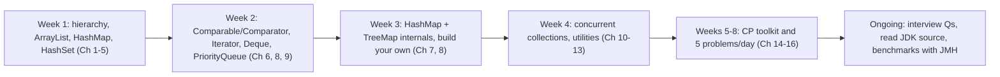

1. **Read the source** of `ArrayList`, `HashMap`, `PriorityQueue`, `ArrayDeque` in your IDE (Ctrl+click). They are readable.
2. **Re-implement** each in a small project (Chapter 18) and compare with the JDK on benchmarks.
3. **Practise by pattern**, not by random problems (hash lookup, monotonic stack, heap, two pointers, binary search on answer, DSU, BFS/Dijkstra).
4. **Measure**: write a JMH benchmark comparing `ArrayList` vs `LinkedList` vs `ArrayDeque` for your own workload.
5. **Next**: [java-stream-api.md](java-stream-api.md), concurrency chapters in [Java_Complete_Guide.md](Java_Complete_Guide.md), then data-structure theory (trees, graphs, DP).

---

# 20. Cheat Sheet and Top Interview Traps

## 20.1 One-page cheat sheet

```
LIST      ArrayList (default) | LinkedList (rare) | CopyOnWriteArrayList (read-mostly)
SET       HashSet O(1) | LinkedHashSet (insertion order) | TreeSet O(log n) sorted
MAP       HashMap | LinkedHashMap (LRU) | TreeMap (sorted, floor/ceiling) | ConcurrentHashMap
QUEUE     ArrayDeque (FIFO/LIFO) | PriorityQueue (heap) | BlockingQueue (threads)
IMMUTABLE List.of | Set.of | Map.of | List.copyOf

INTERNALS
 ArrayList   Object[] , grows x1.5 , default cap 10 (lazy)
 LinkedList  doubly linked Node(prev,item,next)
 HashMap     Node[] table (power of 2) , index=(n-1)&(h^h>>>16) , load 0.75 ,
             chain -> tree at 8 (table>=64) -> chain at 6 , resize x2
 HashSet     HashMap with dummy value
 TreeMap     red-black tree , O(log n) , Comparable/Comparator
 PriorityQ   binary min-heap in array , parent (i-1)/2 , children 2i+1,2i+2
 ArrayDeque  ring buffer , no nulls
 ConcurrentHashMap  CAS for empty bin + synchronized(first node) , lock-free get

COMPLEXITY (avg)
 ArrayList get O(1) add-end O(1)* add-mid O(n) contains O(n)
 HashMap/Set  get/put/remove O(1)
 TreeMap/Set  all O(log n)
 PriorityQueue offer/poll O(log n) , peek O(1) , remove(obj) O(n)
 ArrayDeque   O(1) both ends
```

## 20.2 Top interview and CP traps (read before every interview or contest)

1. **`remove(int)` vs `remove(Object)`** on `List<Integer>`.
2. **Modifying a collection in a for-each** causes CME (use `Iterator.remove` or `removeIf`).
3. **`equals` without `hashCode`** breaks hash collections.
4. **Mutable keys** in a `HashMap` or elements in a `HashSet`.
5. **`Integer ==`** only works for -128..127.
6. **`Arrays.asList(int[])`** gives a list with one element; `Arrays.asList(...)` is fixed-size.
7. **`List.of` / `Map.of`** are immutable, reject nulls, and `Set.of` / `Map.of` throw on duplicates.
8. **`TreeSet` equality is the comparator's**, not `equals`.
9. **`PriorityQueue` iteration is not sorted.**
10. **`a - b` in a comparator** overflows. Use `Integer.compare`.
11. **`ArrayDeque` and `ConcurrentHashMap` reject `null`**.
12. **`containsKey` then `put` on `ConcurrentHashMap`** is not atomic. Use `putIfAbsent` / `merge`.
13. **`subList` and `keySet/values/entrySet`** are views, not copies.
14. **`Collections.unmodifiableList`** is a read-only view; the source can still change.
15. **Shallow copies**: `new ArrayList<>(other)` shares the elements.
16. **`HashMap` order** is not stable; use `LinkedHashMap` or `TreeMap` when order matters.
17. **Scanner + println** are TLE sources in contests; use fast I/O.
18. **`int` overflow**: cast to `long` before multiplying, and use `1L << k`.
19. **`Arrays.sort(int[])`** can be attacked; shuffle or use boxed sorting.
20. **`headSet(x).size()`, `LinkedList.get(i)`, `ArrayList.remove(0)`** are hidden O(n).

### 📘 Terms Explained

| Term | Meaning |
|---|---|
| JMH | Java Microbenchmark Harness, the right tool to benchmark Java code |
| Heapify | Bottom-up construction of a heap in O(n) |
| Cheat sheet | A one-page summary to revise before an interview or contest |
| Pattern-based practice | Learning a few techniques and applying them to many problems |

---
