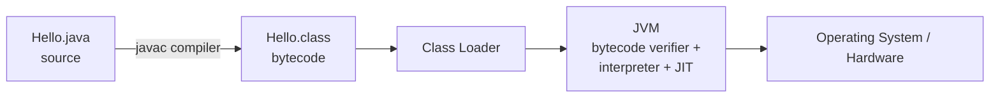
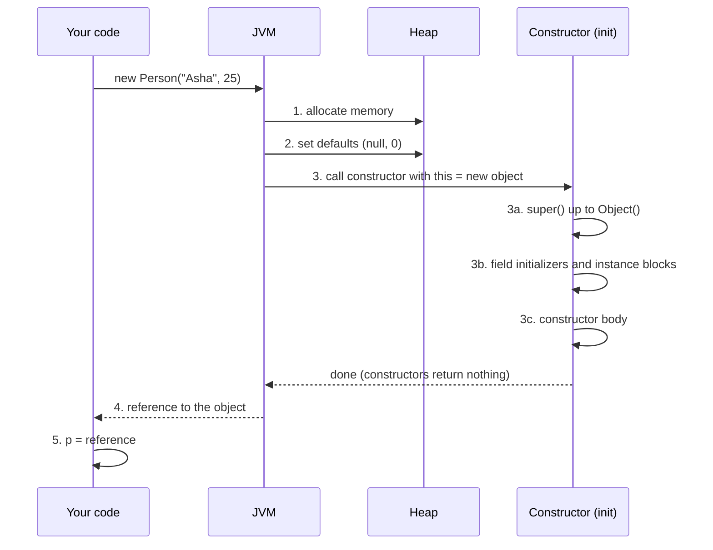
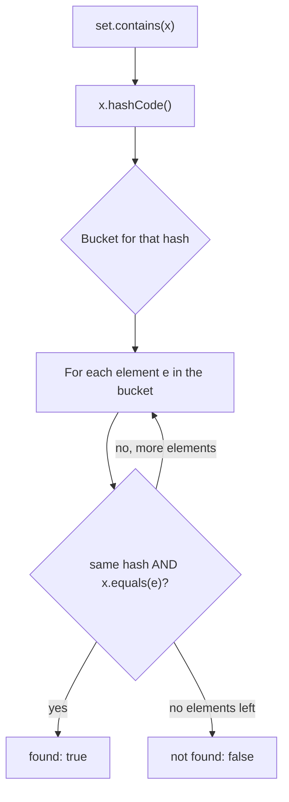
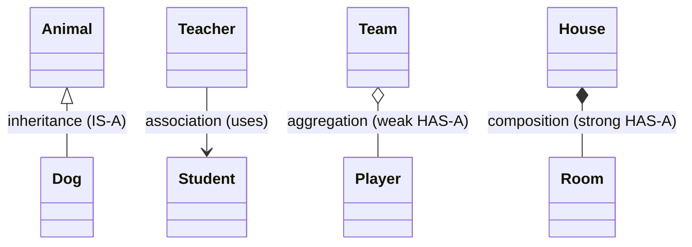
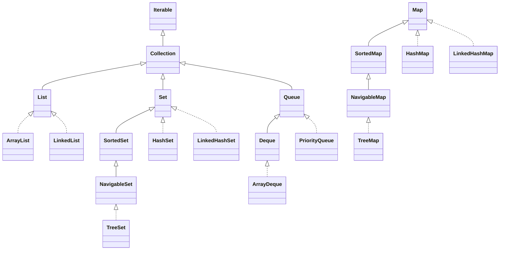
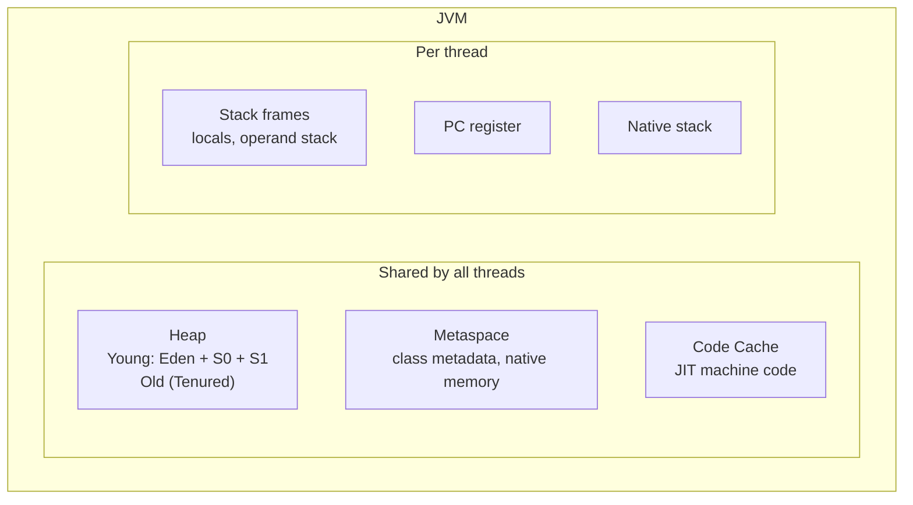

---
mdx:
  format: md
---

# Java Complete Guide - Basic to Advanced

> **Note**: Sections marked **(Interview Imp)** are frequently asked in interviews.
>
> **How to read this file:** Every chapter has **📘 Terms Explained** tables. If you see a word you don't know, check the table right below that section.
>
> **Worked examples:** from chapter 2 onward, the reference material is followed by numbered **Worked Examples**: complete programs, each with its exact **Output** and an **Explanation** of the result. All of them were compiled and run on OpenJDK 17, and their printed output was compared with the text shown. Features that need a newer JDK (Java 21 virtual threads, pattern-matching `switch`) are shown with their expected output and clearly marked **(not compiled here: needs Java 21)**. For the very basics in greater depth, see [Java_Fundamentals_Deep_Dive.md](Java_Fundamentals_Deep_Dive.md) and [Java_Practice_Curriculum_Guide.md](Java_Practice_Curriculum_Guide.md).
>
> **Scope:** The whole language (Java 8 through 25 LTS), core APIs, collections, streams, concurrency (incl. virtual threads), JVM internals and tuning, build and test tooling, Spring Boot essentials, production concerns (resilience, observability, security), DSA, interview questions, projects and a learning path.
>
> **Related files:** [java-stream-api.md](java-stream-api.md) · [Exception handling](Java_Complete_Guide.md#7-exception-handling-interview-imp) · [02_Creational_Pattern.md](../design-patterns/01_LLD/02_Creational_Pattern.md) · [01_LLD_Design_Patterns.md](../design-patterns/01_LLD/01_LLD_Design_Patterns.md) · [01_Scalability_Pattern.md](../design-patterns/03_System_Design/01_Scalability_Pattern.md) · [AI_ML_Roadmap.md](../ai-ml/AI_ML_Roadmap.md)

| Level | Chapters |
|---|---|
| **Beginner** | 1-5 (setup, types, control flow, arrays, methods) |
| **Intermediate** | 6-11 (OOP, exceptions, collections, generics, lambdas/streams, I/O) |
| **Advanced** | 12-14 (concurrency, JVM internals, modern Java) |
| **Professional** | 15-19 (build/test, Spring Boot, JDBC/reflection, performance, production) |
| **Mastery** | 20-24 (DSA, interview questions, projects, learning path, cheat sheet) |

---

## Table of Contents
1. [Getting Started with Java](#1-getting-started-with-java)
   - [1.1 What is Java?](#11-what-is-java)
   - [1.2 JDK, JRE, JVM and How Java Runs (Interview Imp)](#12-jdk-jre-jvm-and-how-java-runs-interview-imp)
   - [1.3 Installing and Running](#13-installing-and-running)
   - [1.4 Project Layout and Packages](#14-project-layout-and-packages)
2. [Java Basics: Types, Variables, Operators](#2-java-basics-types-variables-operators)
   - [2.1 Primitive Types (Interview Imp)](#21-primitive-types-interview-imp)
   - [2.2 Wrapper Classes, Autoboxing and the Integer Cache (Interview Imp)](#22-wrapper-classes-autoboxing-and-the-integer-cache-interview-imp)
   - [2.3 Strings (Interview Imp)](#23-strings-interview-imp)
   - [2.4 Operators](#24-operators)
3. [Control Flow](#3-control-flow)
   - [3.1 Conditionals](#31-conditionals)
   - [3.2 Loops](#32-loops)
   - [3.3 Input / Output Basics](#33-input--output-basics)
4. [Arrays](#4-arrays)
5. [Methods](#5-methods)
6. [Object-Oriented Programming (Interview Imp)](#6-object-oriented-programming-interview-imp)
   - [6.1 Classes, Objects, Constructors](#61-classes-objects-constructors)
     - [Object Creation: Is the Constructor Called First or the Object Created First? (Interview Imp)](#object-creation-is-the-constructor-called-first-or-the-object-created-first-interview-imp)
   - [6.2 Inheritance and Polymorphism](#62-inheritance-and-polymorphism)
     - [How to Override `equals` and `hashCode` Correctly, Line by Line (Interview Imp)](#how-to-override-equals-and-hashcode-correctly-line-by-line-interview-imp)
   - [6.3 Abstract Classes vs Interfaces (Interview Imp)](#63-abstract-classes-vs-interfaces-interview-imp)
   - [6.4 Static, Inner and Nested Classes](#64-static-inner-and-nested-classes)
   - [6.5 Enums](#65-enums)
   - [6.6 Records, Sealed Classes (Modern Java)](#66-records-sealed-classes-modern-java)
   - [6.7 Immutability and Defensive Copies](#67-immutability-and-defensive-copies)
   - [6.8 SOLID Principles and Composition (Interview Imp)](#68-solid-principles-and-composition-interview-imp)
     - [Association, Aggregation and Composition (Interview Imp)](#association-aggregation-and-composition-interview-imp)
7. [Exception Handling (Interview Imp)](#7-exception-handling-interview-imp)
   - [7.1 Hierarchy](#71-hierarchy)
   - [7.2 try / catch / finally / try-with-resources](#72-try--catch--finally--try-with-resources)
   - [7.3 throw, throws, custom exceptions](#73-throw-throws-custom-exceptions)
   - [7.4 Best Practices](#74-best-practices)
   - [7.5 Assertions](#75-assertions)
8. [Collections Framework (Interview Imp)](#8-collections-framework-interview-imp)
   - [8.1 Hierarchy](#81-hierarchy)
   - [8.2 Using the Collections](#82-using-the-collections)
   - [8.3 Iteration and Fail-Fast](#83-iteration-and-fail-fast)
   - [8.4 Comparable vs Comparator](#84-comparable-vs-comparator)
   - [8.5 How HashMap Works (Interview Imp)](#85-how-hashmap-works-interview-imp)
   - [8.6 Choosing a Collection](#86-choosing-a-collection)
9. [Generics](#9-generics)
10. [Lambdas, Functional Interfaces, Streams, Optional (Interview Imp)](#10-lambdas-functional-interfaces-streams-optional-interview-imp)
   - [10.1 Lambdas and Method References](#101-lambdas-and-method-references)
   - [10.2 Streams](#102-streams)
   - [10.3 Optional](#103-optional)
   - [10.4 Date and Time API (`java.time`) (Interview Imp)](#104-date-and-time-api-javatime-interview-imp)
11. [File I/O, Serialization, Networking](#11-file-io-serialization-networking)
   - [11.1 NIO.2 Files and Paths (Preferred)](#111-nio2-files-and-paths-preferred)
   - [11.2 Classic `java.io`](#112-classic-javaio)
   - [11.3 Serialization](#113-serialization)
   - [11.4 HTTP Client (Java 11+)](#114-http-client-java-11)
12. [Multithreading and Concurrency (Interview Imp)](#12-multithreading-and-concurrency-interview-imp)
   - [12.1 Thread Basics](#121-thread-basics)
   - [12.2 The Problems: Race, Visibility, Ordering](#122-the-problems-race-visibility-ordering)
   - [12.3 Java Memory Model and `happens-before` (Interview Imp)](#123-java-memory-model-and-happens-before-interview-imp)
   - [12.4 synchronized, Locks, Atomics](#124-synchronized-locks-atomics)
   - [12.5 Executors and Thread Pools (Interview Imp)](#125-executors-and-thread-pools-interview-imp)
   - [12.6 CompletableFuture (Async Composition)](#126-completablefuture-async-composition)
   - [12.7 Concurrent Utilities](#127-concurrent-utilities)
   - [12.8 Virtual Threads and Structured Concurrency (Java 21+) (Interview Imp)](#128-virtual-threads-and-structured-concurrency-java-21-interview-imp)
   - [12.9 Concurrency Best Practices](#129-concurrency-best-practices)
13. [JVM Internals (Interview Imp)](#13-jvm-internals-interview-imp)
   - [13.1 Memory Areas](#131-memory-areas)
   - [13.2 Class Loading](#132-class-loading)
   - [13.3 Garbage Collection (Interview Imp)](#133-garbage-collection-interview-imp)
   - [13.4 JIT Compilation](#134-jit-compilation)
   - [13.5 Tuning and Diagnostics](#135-tuning-and-diagnostics)
14. [Modern Java: Version-by-Version](#14-modern-java-version-by-version)
15. [Build Tools, Dependencies, Testing, Logging](#15-build-tools-dependencies-testing-logging)
   - [15.1 Maven (Interview Imp)](#151-maven-interview-imp)
   - [15.2 Gradle](#152-gradle)
   - [15.3 Testing with JUnit 5, Mockito, AssertJ (Interview Imp)](#153-testing-with-junit-5-mockito-assertj-interview-imp)
   - [15.4 Logging](#154-logging)
16. [Spring Boot Essentials (Interview Imp)](#16-spring-boot-essentials-interview-imp)
   - [16.1 Core Concepts](#161-core-concepts)
   - [16.2 Key Annotations](#162-key-annotations)
   - [16.3 Important Mechanics](#163-important-mechanics)
   - [16.4 Spring Data JPA](#164-spring-data-jpa)
17. [JDBC, Reflection, Annotations, Modules](#17-jdbc-reflection-annotations-modules)
   - [17.1 JDBC (Foundation of all DB access)](#171-jdbc-foundation-of-all-db-access)
   - [17.2 Reflection and Annotations](#172-reflection-and-annotations)
   - [17.3 Lombok, MapStruct, Jackson](#173-lombok-mapstruct-jackson)
   - [17.4 Modules (JPMS)](#174-modules-jpms)
18. [Performance and Coding Best Practices](#18-performance-and-coding-best-practices)
   - [18.1 Performance Guidelines](#181-performance-guidelines)
   - [18.2 Clean Code Checklist](#182-clean-code-checklist)
   - [18.3 Common Java Gotchas (Interview Imp)](#183-common-java-gotchas-interview-imp)
19. [Java in Production: Services, Messaging, Resilience, Security](#19-java-in-production-services-messaging-resilience-security)
   - [19.1 REST API Design](#191-rest-api-design)
   - [19.2 Messaging and Events](#192-messaging-and-events)
   - [19.3 Resilience Patterns (Resilience4j)](#193-resilience-patterns-resilience4j)
   - [19.4 Observability](#194-observability)
   - [19.5 Security Essentials (Interview Imp)](#195-security-essentials-interview-imp)
   - [19.6 Deploying Java](#196-deploying-java)
20. [Data Structures and Algorithms in Java](#20-data-structures-and-algorithms-in-java)
21. [Java Interview Questions (Basic to Advanced)](#21-java-interview-questions-basic-to-advanced)
   - [21.1 Core Java](#211-core-java)
   - [21.2 Collections and Generics](#212-collections-and-generics)
   - [21.3 Java 8+ Features](#213-java-8-features)
   - [21.4 Concurrency and JVM](#214-concurrency-and-jvm)
   - [21.5 Spring and Design](#215-spring-and-design)
   - [21.6 Tricky Output Questions](#216-tricky-output-questions)
22. [Practice Projects by Level](#22-practice-projects-by-level)
23. [Learning Path](#23-learning-path)
24. [Java Cheat Sheet](#24-java-cheat-sheet)

---

# 1. Getting Started with Java

## 1.1 What is Java?

**Java** is a general-purpose, object-oriented, statically typed language created at Sun Microsystems (James Gosling, 1995; now Oracle). Its promise: **"Write Once, Run Anywhere"**: compiled code runs on any machine that has a **JVM**.

| Strength | Why it matters |
|---|---|
| **Platform independent** | Same bytecode runs on Linux, Windows, macOS |
| **Strong static typing** | Many errors caught at compile time |
| **Mature ecosystem** | Spring, Hibernate, Kafka, Maven Central (hundreds of thousands of libraries) |
| **Performance** | JIT-compiled; close to C++ for many server workloads |
| **Concurrency** | First-class threads, rich `java.util.concurrent`, virtual threads |
| **Backward compatibility, LTS releases** | Old code keeps working; 8, 11, 17, 21, 25 are LTS |
| **Tooling** | IntelliJ, VS Code, profilers, debuggers |

**Where used:** enterprise backends and microservices (banks, e-commerce, telecom), Android (with Kotlin), big data (Hadoop, Spark, Kafka, Elasticsearch are JVM), trading systems, game servers.

| Weakness | Mitigation |
|---|---|
| Verbose compared with Python/Kotlin | Records, `var`, switch expressions, Lombok |
| Slower startup, higher memory | GraalVM native image, CDS, Project Leyden |
| GC pauses | Modern collectors (G1, ZGC, Shenandoah) |

#### 📘 Terms Explained

| Term | Simple meaning |
|---|---|
| **JVM (Java Virtual Machine)** | Program that runs Java bytecode and manages memory. |
| **JRE (Java Runtime Environment)** | JVM + standard class libraries (needed to *run* Java). |
| **JDK (Java Development Kit)** | JRE + compiler `javac` + tools (needed to *develop*). |
| **Bytecode** | Platform-neutral instructions in `.class` files. |
| **JIT (Just-In-Time) compiler** | Compiles hot bytecode to machine code while the program runs. |
| **LTS** | Long-Term Support release with years of updates. |
| **Statically typed** | Types of variables are known and checked at compile time. |
| **Maven Central** | The main public repository of Java libraries. |

---

## 1.2 JDK, JRE, JVM and How Java Runs (Interview Imp)



```
JDK
 ├── JRE
 │    ├── JVM  (class loader, memory areas, execution engine, GC)
 │    └── Class libraries (java.lang, java.util, java.io ...)
 └── Dev tools: javac, jar, jshell, javadoc, jlink, jdeps, jcmd, jfr ...
```

1. `javac` compiles `.java` → `.class` (bytecode).
2. The **class loader** loads classes on demand.
3. The **verifier** checks bytecode safety.
4. The **interpreter** runs it; the **JIT** compiles frequently-run ("hot") methods to native code.
5. The **garbage collector** frees unused objects.

## 1.3 Installing and Running

```bash
java -version
javac -version
# install (examples)
sudo apt install openjdk-21-jdk          # Debian/Ubuntu
sdk install java 21-tem                  # SDKMAN (recommended: many versions side by side)
```

```java
// Hello.java
public class Hello {
    public static void main(String[] args) {
        System.out.println("Hello, World!");
    }
}
```

```bash
javac Hello.java          # produces Hello.class
java Hello                # runs it
java Hello.java           # Java 11+: compile and run a single file directly
jshell                    # interactive REPL
```

**Anatomy:**
- File name must match the `public` class name.
- `main` is the entry point: `public static void main(String[] args)` (Java 21+ preview / 25 final: **instance main and unnamed classes** let beginners write `void main() { ... }`).
- `System.out.println` prints a line.

## 1.4 Project Layout and Packages

```
myapp/
├── pom.xml (or build.gradle)
└── src/
    ├── main/java/com/example/app/Main.java
    ├── main/resources/application.properties
    └── test/java/com/example/app/MainTest.java
```

```java
package com.example.app;          // matches the folder structure

import java.util.List;            // import a class
import java.util.*;               // import all (avoid in real code)
import static java.lang.Math.max; // import a static member
```

Naming: packages `lowercase.dotted`, classes `PascalCase`, methods/variables `camelCase`, constants `UPPER_SNAKE_CASE`.

#### 📘 Terms Explained

| Term | Simple meaning |
|---|---|
| **Package** | Namespace grouping related classes; mirrors folders. |
| **Classpath** | List of folders/JARs where the JVM looks for classes. |
| **JAR** | Zip file of classes and resources (`.jar`). |
| **Entry point** | The method where the program starts (`main`). |
| **SDKMAN** | Tool to install and switch JDK versions. |
| **REPL / jshell** | Interactive shell to try Java snippets. |

---

# 2. Java Basics: Types, Variables, Operators

## 2.1 Primitive Types (Interview Imp)

| Type | Size | Range / values | Default |
|---|---|---|---|
| `byte` | 8 bit | -128 to 127 | 0 |
| `short` | 16 bit | -32,768 to 32,767 | 0 |
| `int` | 32 bit | about ±2.1 billion | 0 |
| `long` | 64 bit | about ±9.2 × 10¹⁸ (`10L`) | 0L |
| `float` | 32 bit | ~7 digits (`1.5f`) | 0.0f |
| `double` | 64 bit | ~15 digits | 0.0 |
| `char` | 16 bit | one UTF-16 unit `'A'` | `'\u0000'` |
| `boolean` | JVM-defined | `true` / `false` | false |

```java
int age = 28;
long big = 10_000_000_000L;
double price = 19.99;
float f = 3.5f;
char c = 'J';
boolean ok = true;
var name = "Asha";                // local type inference (Java 10+), still static typing
final double PI = 3.14159;        // constant: cannot be reassigned
int hex = 0xFF, bin = 0b1010, oct = 017;
```

- **Overflow wraps silently:** `Integer.MAX_VALUE + 1` becomes `Integer.MIN_VALUE`. Use `Math.addExact(a, b)` to throw instead.
- **Floating point is inexact:** `0.1 + 0.2 != 0.3`. Money → `BigDecimal` (or long cents).
- **Integer division:** `7 / 2 == 3`, `7 % 2 == 1`, `7 / 2.0 == 3.5`.

### Casting
```java
int i = 10;
double d = i;              // widening: automatic
int j = (int) 3.99;        // narrowing: explicit, truncates -> 3
byte b = (byte) 200;       // -56 (wraps)
long l = i;                // fine
char ch = (char) 66;       // 'B'
int code = 'A' + 1;        // 66 (char promotes to int)
```

## 2.2 Wrapper Classes, Autoboxing and the Integer Cache (Interview Imp)

Each primitive has an object wrapper: `Integer`, `Long`, `Double`, `Boolean`, `Character`, `Byte`, `Short`, `Float`. Needed for collections (`List<Integer>`), generics, and `null`.

```java
Integer a = 127, b = 127;
a == b;                     // true  (cached -128..127)
Integer c = 128, d = 128;
c == d;                     // false (different objects!) -> always use .equals()
c.equals(d);                // true

List<Integer> list = new ArrayList<>();
list.add(5);                // autoboxing int -> Integer
int x = list.get(0);        // unboxing Integer -> int  (NullPointerException if null!)

Integer.parseInt("42"); Integer.valueOf("42"); Integer.toString(42);
Integer.MAX_VALUE; Integer.compare(a, b); Double.parseDouble("3.5");
```
Performance: boxing creates objects; avoid in hot loops (use `int`, `IntStream`, primitive collections).

## 2.3 Strings (Interview Imp)

`String` is **immutable** and stored in the **String pool** when created via literals.

```java
String s1 = "hello";
String s2 = "hello";
String s3 = new String("hello");
s1 == s2;                  // true  (same pooled object)
s1 == s3;                  // false (new object on heap)
s1.equals(s3);             // true  <- always compare content with equals
s3.intern() == s1;         // true

s.length(); s.charAt(0); s.substring(1, 4); s.indexOf("l"); s.contains("ell");
s.toUpperCase(); s.trim(); s.strip(); s.isBlank(); s.isEmpty();
s.replace("l", "L"); s.split(","); String.join("-", "a", "b");
s.startsWith("he"); s.endsWith("lo"); s.equalsIgnoreCase("HELLO");
s.compareTo("abc");        // <0, 0, >0 lexicographic
"ab".repeat(3);            // Java 11+
s.chars();                 // IntStream of chars
String.valueOf(42);
String.format("%s is %d years, %.2f%%", "Asha", 28, 12.345);
"%s".formatted("x");       // Java 15+
```

#### Worked Example 1: a tour of the `String` API with real results

```java
import java.util.Arrays;

public class Main {
    public static void main(String[] args) {
        String s = "  Hello, Java World  ";
        String t = s.strip();
        System.out.println("[" + t + "] length " + t.length() + " (original " + s.length() + ")");
        System.out.println(t.charAt(7) + " " + t.indexOf("o") + " " + t.lastIndexOf("o") + " " + t.indexOf("o", 5) + " " + t.indexOf("xyz"));
        System.out.println(t.substring(7) + "|" + t.substring(7, 11) + "|" + t.toUpperCase() + "|" + t.toLowerCase());
        System.out.println(t.replace('o', '0') + "|" + t.replaceAll("[aeiou]", "*") + "|" + t.replaceFirst("l", "L"));
        System.out.println(t.startsWith("Hell") + " " + t.endsWith("World") + " " + t.contains("Java") + " " + t.matches(".*\\d.*"));
        System.out.println(Arrays.toString("a,b,,c,".split(",")) + " " + Arrays.toString("a,b,,c,".split(",", -1)) + " " + Arrays.toString("1.2.3".split("\\.")));
        System.out.println(String.join("-", "2026", "10", "25") + " " + "ab".repeat(3) + " " + "   ".isBlank() + " " + "".isEmpty());
        System.out.println("apple".compareTo("banana") + " " + "b".compareTo("a") + " " + "Apple".compareToIgnoreCase("apple") + " " + "JAVA".equalsIgnoreCase("java"));
        System.out.println(String.format("|%-8s|%8s|%05d|%.3f|%,d|", "left", "right", 42, Math.PI, 1234567));
        System.out.println("%s has %d chars".formatted("Java", 4) + " " + "line1\nline2\nline3".lines().count() + " lines");
        long vowels = t.toLowerCase().chars().filter(c -> "aeiou".indexOf(c) >= 0).count();
        System.out.println("vowels: " + vowels + ", chars as ints: " + "AB".chars().boxed().toList());
    }
}
```

**Output:**
```text
[Hello, Java World] length 17 (original 21)
J 4 13 13 -1
Java World|Java|HELLO, JAVA WORLD|hello, java world
Hell0, Java W0rld|H*ll*, J*v* W*rld|HeLlo, Java World
true true true false
[a, b, , c] [a, b, , c, ] [1, 2, 3]
2026-10-25 ababab true true
-1 1 0 true
|left    |   right|00042|3.142|1,234,567|
Java has 4 chars 3 lines
vowels: 5, chars as ints: [65, 66]
```

**Explanation:**
- `strip()` removes the 2 leading and 2 trailing spaces (21 → 17 characters). Like every `String` method, it returns a **new** string.
- `indexOf("o", 5)` starts searching at index 5, so it skips the `o` at index 4 and finds the one in `World`.
- `substring(7, 11)` covers indexes 7-10 (end exclusive) → `Java`.
- `replace` works on literal characters; `replaceAll`/`replaceFirst`/`matches`/`split` take **regular expressions**, which is why splitting on a dot needs `"\\."` (a plain `"."` means "any character" and would split everything away).
- `split(",")` drops **trailing** empty strings; pass a negative limit (`-1`) to keep them. Empty strings in the middle are always kept.
- `compareTo` returns the difference of the first differing characters (`'a' − 'b' = −1`), or a length difference; only its **sign** is guaranteed.
- `%,d` adds grouping separators, `%05d` pads with zeros, `%.3f` rounds.

### Text blocks (Java 15+)
```java
String json = """
        {
          "name": "Asha",
          "age": 28
        }
        """;
```

### StringBuilder vs StringBuffer vs String
| | Mutable | Thread-safe | Use |
|---|---|---|---|
| `String` | No | Yes (immutable) | Constants, small text |
| `StringBuilder` | Yes | No | Building strings in loops (default choice) |
| `StringBuffer` | Yes | Yes (synchronized, slower) | Legacy |

```java
StringBuilder sb = new StringBuilder();
for (int i = 0; i < 5; i++) sb.append(i).append(',');
sb.setLength(sb.length() - 1);
sb.reverse().toString();
```
`s += x` in a loop creates a new String every time: O(n²).

### Why is String immutable?
Security (class names, file paths), thread safety, String-pool sharing, cached `hashCode` (safe as HashMap key).

## 2.4 Operators

| Group | Operators |
|---|---|
| Arithmetic | `+ - * / % ++ --` |
| Comparison | `== != < > <= >=` |
| Logical (short-circuit) | `&& \|\| !` |
| Bitwise | `& \| ^ ~ << >> >>>` |
| Assignment | `= += -= *= /= %= &= \|= ^= <<= >>= >>>=` |
| Ternary | `cond ? a : b` |
| Type check | `instanceof` |

```java
int x = 5;
int a = x++;   // a=5, x=6  (post-increment)
int b = ++x;   // x=7, b=7  (pre-increment)
boolean r = (x > 3) && (x < 10);
int flags = READ | WRITE;               // bit flags
5 >> 1;  -8 >>> 28;                     // arithmetic vs logical shift
if (obj instanceof String s && s.length() > 3) { ... }   // pattern matching (16+)
```
`==` on primitives compares values; on objects compares **references**.

#### 📘 Terms Explained

| Term | Simple meaning |
|---|---|
| **Primitive** | Basic value type stored directly (no object). |
| **Wrapper class** | Object version of a primitive (`Integer`). |
| **Autoboxing / unboxing** | Automatic conversion primitive ↔ wrapper. |
| **String pool** | Special memory area sharing identical string literals. |
| **Immutable** | Cannot change after creation. |
| **Widening / narrowing** | Converting to a larger / smaller type. |
| **Overflow** | Value exceeds the type's range and wraps around. |
| **Short-circuit** | `&&`/`||` skip the right side when the result is already known. |
| **Text block** | Multi-line string literal using `"""`. |
| **`var`** | Compiler infers the local variable's type. |

---

# 3. Control Flow

## 3.1 Conditionals

```java
if (score >= 90) { grade = 'A'; }
else if (score >= 80) { grade = 'B'; }
else { grade = 'C'; }

String label = score >= 50 ? "pass" : "fail";
```

### Switch expressions and pattern matching (modern) (Interview Imp)

```java
// old style: fall-through bugs
switch (day) {
    case 1: name = "Mon"; break;
    default: name = "?";
}

// Java 14+: arrow form, no fall-through, can return a value
String type = switch (day) {
    case 1, 7 -> "weekend";
    case 2, 3, 4, 5, 6 -> "weekday";
    default -> throw new IllegalArgumentException("bad day " + day);
};

// with yield for multi-statement branches
int len = switch (word) {
    case "a" -> 1;
    default -> { int n = word.length(); yield n * 2; }
};

// Java 21: pattern matching for switch, record patterns, guards
static String describe(Object o) {
    return switch (o) {
        case null -> "null!";
        case Integer i when i > 100 -> "big int " + i;
        case Integer i -> "int " + i;
        case String s -> "string of " + s.length();
        case Point(int x, int y) -> "point " + x + "," + y;     // record deconstruction
        case int[] arr -> "int array";
        default -> "other";
    };
}
```
With **sealed types** the compiler checks the switch is exhaustive (no `default` needed).
#### Worked Example 2: switch expressions, `yield`, and type patterns on Java 17

The `describe` method above uses **pattern matching for `switch`**, which became final in Java 21. On Java 17 the same logic is written with `instanceof` patterns; both versions are shown, and the Java 17 one is run here.

```java
public class Main {
    record Point(int x, int y) { }

    static String dayType(int day) {
        return switch (day) {
            case 1, 7 -> "weekend";
            case 2, 3, 4, 5, 6 -> "weekday";
            default -> throw new IllegalArgumentException("bad day " + day);
        };
    }

    static int score(String word) {
        return switch (word) {
            case "a", "e", "i", "o", "u" -> 1;
            default -> {
                int n = word.length();
                yield n * 2;
            }
        };
    }

    static String describe(Object o) {                     // Java 17: instanceof patterns
        if (o == null) return "null!";
        if (o instanceof Integer i && i > 100) return "big int " + i;
        if (o instanceof Integer i) return "int " + i;
        if (o instanceof String s) return "string of " + s.length();
        if (o instanceof Point p) return "point " + p.x() + "," + p.y();
        if (o instanceof int[] arr) return "int array of " + arr.length;
        return "other: " + o.getClass().getSimpleName();
    }

    public static void main(String[] args) {
        System.out.println(dayType(1) + " " + dayType(3));
        System.out.println(score("e") + " " + score("java"));
        Object[] things = {null, 500, 42, "hello", new Point(3, 4), new int[]{1, 2}, 2.5};
        for (Object o : things) System.out.println(describe(o));
        try {
            dayType(9);
        } catch (IllegalArgumentException e) {
            System.out.println("error: " + e.getMessage());
        }
    }
}
```

**Output:**
```text
weekend weekday
1 8
null!
big int 500
int 42
string of 5
point 3,4
int array of 2
other: Double
error: bad day 9
```

**Explanation:**
- An arrow `case` never falls through, and the switch **expression** returns a value directly; the `default` branch may `throw` instead of producing a value.
- `yield` returns the value from a block branch (`"java".length() × 2 = 8`).
- `o instanceof Integer i && i > 100` tests the type, casts and binds `i` in one step, and the `&&` guard plays the role of Java 21's `when` clause. The order of checks matters: the guarded case must come first, exactly as in the `switch` version.
- On Java 21+, the `switch` version above also supports **record deconstruction** (`case Point(int x, int y)`), and with a sealed hierarchy the compiler proves every case is handled.

## 3.2 Loops

```java
for (int i = 0; i < 5; i++) { ... }
for (String s : names) { ... }                  // for-each over arrays/Iterables
while (cond) { ... }
do { ... } while (cond);                        // runs at least once

outer:
for (int i = 0; i < 3; i++) {
    for (int j = 0; j < 3; j++) {
        if (j == 2) continue outer;             // labeled continue
        if (i == 2) break outer;                // labeled break
    }
}
```
`break` exits, `continue` skips to next iteration. Don't modify a collection while iterating it with for-each (`ConcurrentModificationException`): use `Iterator.remove()` or `removeIf`.
#### Worked Example 3: labeled loops and safe removal during iteration

```java
import java.util.*;

public class Main {
    public static void main(String[] args) {
        int[][] grid = {{1, 2, 3}, {4, -5, 6}, {7, 8, 9}};
        outer:
        for (int r = 0; r < grid.length; r++) {
            for (int c = 0; c < grid[r].length; c++) {
                if (grid[r][c] < 0) {
                    System.out.println("first negative " + grid[r][c] + " at (" + r + "," + c + ")");
                    break outer;                                 // leaves BOTH loops
                }
            }
        }

        List<String> names = new ArrayList<>(List.of("Asha", "", "Ravi", " ", "Meena"));
        try {
            for (String n : names) if (n.isBlank()) names.remove(n);
        } catch (ConcurrentModificationException e) {
            System.out.println("for-each + remove -> ConcurrentModificationException");
        }

        names = new ArrayList<>(List.of("Asha", "", "Ravi", " ", "Meena"));
        Iterator<String> it = names.iterator();
        while (it.hasNext()) if (it.next().isBlank()) it.remove();
        System.out.println("Iterator.remove -> " + names);

        List<Integer> nums = new ArrayList<>(List.of(1, 2, 3, 4, 5, 6));
        nums.removeIf(n -> n % 2 == 0);
        System.out.println("removeIf evens  -> " + nums);
    }
}
```

**Output:**
```text
first negative -5 at (1,1)
for-each + remove -> ConcurrentModificationException
Iterator.remove -> [Asha, Ravi, Meena]
removeIf evens  -> [1, 3, 5]
```

**Explanation:**
- `break outer` ends the search as soon as the target is found; a plain `break` would only stop the inner loop and the outer loop would keep scanning.
- A for-each loop uses a hidden iterator. Removing through the **list** changes its `modCount`, and the iterator detects this on its next step and throws `ConcurrentModificationException` (*fail-fast*).
- `Iterator.remove()` removes the element the iterator just returned and keeps the iterator consistent. `removeIf` does the same in one line and is the preferred form.

## 3.3 Input / Output Basics

```java
Scanner sc = new Scanner(System.in);
int n = sc.nextInt();
String line = sc.nextLine();
System.out.printf("%5.2f %s%n", 3.14159, "pi");
System.err.println("error");
```

---

# 4. Arrays

```java
int[] a = new int[5];                 // default zeros
int[] b = {1, 2, 3};
int[][] grid = new int[3][4];
int[][] jagged = {{1}, {2, 3}, {4, 5, 6}};
b.length;                              // field, not method
b[0]; b[b.length - 1];                 // ArrayIndexOutOfBoundsException if invalid

import java.util.Arrays;
Arrays.toString(b); Arrays.deepToString(grid);
Arrays.sort(b); Arrays.binarySearch(b, 2);
Arrays.fill(a, 7); Arrays.copyOf(b, 5); Arrays.copyOfRange(b, 1, 3);
Arrays.equals(x, y); Arrays.asList(1, 2, 3); Arrays.stream(b).sum();
List<Integer> list = List.of(1, 2, 3);           // immutable list (9+)
int[] copy = b.clone();                           // shallow copy
System.arraycopy(src, 0, dst, 0, n);
```
Arrays are objects, fixed-size, covariant (`Object[] o = new String[1]; o[0] = 1;` fails at run time with `ArrayStoreException`). Prefer `ArrayList` for resizable data.
#### Worked Example 4: array utilities, copying and the covariance trap

```java
import java.util.*;

public class Main {
    public static void main(String[] args) {
        int[] b = {5, 3, 9, 1, 7};
        int[] sorted = b.clone();
        Arrays.sort(sorted);
        System.out.println(Arrays.toString(b) + " -> sorted " + Arrays.toString(sorted));
        System.out.println("binarySearch(7) = " + Arrays.binarySearch(sorted, 7) + ", binarySearch(4) = " + Arrays.binarySearch(sorted, 4));
        System.out.println("copyOf(…, 7) = " + Arrays.toString(Arrays.copyOf(b, 7)) + ", copyOfRange(1, 3) = " + Arrays.toString(Arrays.copyOfRange(b, 1, 3)));
        int[] dst = new int[6];
        System.arraycopy(b, 1, dst, 2, 3);                   // src, srcPos, dest, destPos, length
        System.out.println("arraycopy  = " + Arrays.toString(dst));
        System.out.println("sum = " + Arrays.stream(b).sum() + ", max = " + Arrays.stream(b).max().getAsInt());

        int[][] grid = new int[2][3];
        grid[1][2] = 8;
        System.out.println("deepToString = " + Arrays.deepToString(grid));

        List<int[]> wrong = Arrays.asList(b);                // ONE element: the int[] itself
        List<Integer> right = Arrays.asList(5, 3, 9);
        System.out.println("asList(int[]) size " + wrong.size() + ", asList(5,3,9) size " + right.size());
        try {
            right.add(1);
        } catch (UnsupportedOperationException e) {
            System.out.println("Arrays.asList is fixed-size -> UnsupportedOperationException on add");
        }

        Object[] objs = new String[2];                       // compiles: arrays are covariant
        try {
            objs[0] = 42;
        } catch (ArrayStoreException e) {
            System.out.println("ArrayStoreException: " + e.getMessage());
        }
    }
}
```

**Output:**
```text
[5, 3, 9, 1, 7] -> sorted [1, 3, 5, 7, 9]
binarySearch(7) = 3, binarySearch(4) = -3
copyOf(…, 7) = [5, 3, 9, 1, 7, 0, 0], copyOfRange(1, 3) = [3, 9]
arraycopy  = [0, 0, 3, 9, 1, 0]
sum = 25, max = 9
deepToString = [[0, 0, 0], [0, 0, 8]]
asList(int[]) size 1, asList(5,3,9) size 3
Arrays.asList is fixed-size -> UnsupportedOperationException on add
ArrayStoreException: java.lang.Integer
```

**Explanation:**
- `binarySearch` on a missing key returns `−(insertionPoint) − 1`: 4 would be inserted at index 2, so the result is `−3`. A negative result always means "not found".
- `System.arraycopy(b, 1, dst, 2, 3)` copies `b[1..3]` (`3, 9, 1`) into `dst[2..4]`.
- `Arrays.asList(int[])` cannot box a primitive array; it produces a `List<int[]>` with one element. Use `Arrays.stream(b).boxed().toList()` for a `List<Integer>`.
- Because `String[]` **is an** `Object[]`, storing an `Integer` compiles; the JVM checks the real array type at run time and throws `ArrayStoreException`. Generics (`List<String>`) catch this at compile time instead, one reason collections are preferred.

---

# 5. Methods

```java
public static int add(int a, int b) { return a + b; }

static double avg(int... nums) {                 // varargs (array inside)
    return Arrays.stream(nums).average().orElse(0);
}

// overloading: same name, different parameter lists (compile-time polymorphism)
static int max(int a, int b) { ... }
static double max(double a, double b) { ... }
```

- Java is **always pass-by-value**. For objects, the *reference* is copied: the method can mutate the object, but cannot make the caller's variable point elsewhere.

```java
static void change(StringBuilder sb, int n) { sb.append("!"); n = 99; }   // caller sees "!" but n unchanged
static void swap(int a, int b) { int t = a; a = b; b = t; }              // does nothing to caller
```
- Overload resolution happens at compile time (exact → widening → boxing → varargs).
- Recursion works but each call uses stack space (`StackOverflowError`); Java has no tail-call optimization.
- Return one value; return a record/array/object for several.
#### Worked Example 5: returning several values with a record, and pass-by-value with objects

```java
import java.util.Arrays;

public class Main {
    record Stats(int min, int max, double average) { }

    static Stats stats(int... nums) {
        int min = Integer.MAX_VALUE, max = Integer.MIN_VALUE, sum = 0;
        for (int n : nums) { min = Math.min(min, n); max = Math.max(max, n); sum += n; }
        return new Stats(min, max, (double) sum / nums.length);
    }

    static void change(StringBuilder sb, int n, int[] arr) {
        sb.append("!");          // mutates the shared object  → visible to the caller
        n = 99;                  // changes the local copy     → invisible
        arr = new int[]{0};      // re-points the local copy   → invisible
    }

    public static void main(String[] args) {
        Stats s = stats(4, 8, 15, 16, 23, 42);
        System.out.println(s);
        System.out.println("range = " + (s.max() - s.min()));

        StringBuilder sb = new StringBuilder("hi");
        int n = 1;
        int[] arr = {1, 2};
        change(sb, n, arr);
        System.out.println(sb + " " + n + " " + Arrays.toString(arr));
    }
}
```

**Output:**
```text
Stats[min=4, max=42, average=18.0]
range = 38
hi! 1 [1, 2]
```

**Explanation:** a `record` is the idiomatic way to return several related values: it is a named, immutable, self-describing type with a useful `toString`. In `change`, every parameter is a **copy**: the copy of the `StringBuilder` reference still points at the caller's object (so `append` is visible), while assigning new values to `n` and `arr` only changes the method's own copies.

#### 📘 Terms Explained

| Term | Simple meaning |
|---|---|
| **Switch expression** | `switch` that yields a value (`->`). |
| **Pattern matching** | Testing an object's type and extracting parts in one step. |
| **Sealed type** | Type that restricts which classes may extend it. |
| **Varargs** | `T...` parameter accepting any number of arguments. |
| **Overloading** | Several methods with the same name but different parameters. |
| **Pass-by-value** | The method receives a copy of the argument (for objects: a copy of the reference). |
| **Label** | Name for a loop used by `break`/`continue`. |
| **Stack overflow** | Too-deep recursion exhausting thread stack memory. |

---

# 6. Object-Oriented Programming (Interview Imp)

## 6.1 Classes, Objects, Constructors

```java
public class Account {
    // fields (state)
    private final String id;
    private double balance;
    private static int count = 0;              // class-level (shared by all objects)

    // constructor: same name as class, no return type
    public Account(String id, double balance) {
        this.id = id;
        this.balance = balance;
        count++;
    }
    public Account(String id) { this(id, 0); }  // constructor chaining with this(...)

    // instance initializer / static block
    { /* runs before each constructor body */ }
    static { /* runs once when class loads */ }

    // methods (behavior)
    public void deposit(double amt) {
        if (amt <= 0) throw new IllegalArgumentException("amount must be positive");
        balance += amt;
    }
    public double getBalance() { return balance; }
    public static int getCount() { return count; }

    @Override public String toString() { return "Account[" + id + ", " + balance + "]"; }
}

Account a = new Account("A1", 100);
a.deposit(50);
```

- If you write no constructor, the compiler adds a **default no-arg constructor**; once you write any, it disappears.
- `this` = current object. `super` = parent part.
- **Object creation order:** static init (once) → parent constructor → instance fields/initializers → child constructor body.
#### Worked Example 6: a complete class: constructors, chaining, statics and validation

```java
public class Main {
    static class Account {
        private static int count = 0;
        private static final String BANK;
        static {                                         // runs once, when the class is initialised
            BANK = "JavaBank";
            System.out.println("[static block] bank = " + BANK);
        }

        private final String id;
        private double balance;
        private final java.util.List<String> log = new java.util.ArrayList<>();

        {                                                // instance initializer: before every constructor body
            log.add("created");
        }

        Account(String id, double balance) {
            if (balance < 0) throw new IllegalArgumentException("opening balance cannot be negative");
            this.id = id;
            this.balance = balance;
            count++;
        }

        Account(String id) { this(id, 0); }             // chaining: must be the first statement

        void deposit(double amt) {
            if (amt <= 0) throw new IllegalArgumentException("amount must be positive");
            balance += amt;
            log.add("deposit " + amt);
        }

        static int getCount() { return count; }

        @Override public String toString() { return "Account[" + id + ", " + balance + ", " + log + "]"; }
    }

    public static void main(String[] args) {
        System.out.println("main starts; accounts so far: (class not used yet)");
        Account a = new Account("A1", 100);
        Account b = new Account("B2");
        a.deposit(50);
        System.out.println(a);
        System.out.println(b);
        System.out.println("accounts created: " + Account.getCount());
        try {
            new Account("C3", -5);
        } catch (IllegalArgumentException e) {
            System.out.println("rejected: " + e.getMessage() + "; count still " + Account.getCount());
        }
    }
}
```

**Output:**
```text
main starts; accounts so far: (class not used yet)
[static block] bank = JavaBank
Account[A1, 150.0, [created, deposit 50.0]]
Account[B2, 0.0, [created]]
accounts created: 2
rejected: opening balance cannot be negative; count still 2
```

**Explanation:**
- The static block runs lazily, on the **first use** of `Account`, after `main` has started. It can initialise a `static final` field that needs more than one expression.
- The instance initializer adds `"created"` to every object's log before the constructor body runs, whichever constructor is used. `new Account("B2")` goes through `this(id, 0)`, so validation lives in one place.
- Throwing from the constructor means the half-built object is never returned, and `count++` is never reached, so the counter stays correct.
- Overriding `toString` makes objects readable in logs; without it you would see `Main$Account@1b6d3586`.

### Object Creation: Is the Constructor Called First or the Object Created First? (Interview Imp)

**Short answer:** the **object is created first**, then the **constructor runs on it**. A constructor does **not** create the object. It **initializes** (sets up) an object that already exists. The name "constructor" is misleading, which is why this is a favourite interview question.

> **Analogy:** `new` is the **builder** who puts up an empty house (memory). The constructor is the **interior decorator** who comes in afterwards and furnishes it (sets the field values). A decorator can only work in a house that already exists.

**Why does it matter?** It explains three things that otherwise look like magic: why you can use `this` on the first line of a constructor, why fields have default values (`0`, `null`) before you assign them, and why calling an overridable method from a constructor is a bug.

#### What happens in `Person p = new Person("Asha", 25);`

| Step | Who does it | What happens | Object state |
|---|---|---|---|
| **0. Initialise class** | JVM | First use only: load `Person.class` and run `static` blocks, parent class first | — |
| **1. Allocate** | the **`new`** instruction | Reserve heap memory big enough for all fields (own + inherited) | Object **exists now** |
| **2. Default values** | JVM | Every field is set to `0` / `0.0` / `false` / `'\u0000'` / `null` | `name=null, age=0` |
| **3. Call constructor** | JVM | Run the constructor (bytecode name **`<init>`**) on that object, passing it as `this` | — |
| 3a. `super(...)` | constructor | Parent constructor runs first, all the way up to `Object()` | parent part set up |
| 3b. Field initializers + `{ }` blocks | constructor | Run top to bottom, in source order (javac copies them into every constructor that calls `super(...)`, right after that call; constructors that call `this(...)` get them via the constructor they chain to) | e.g. `x = 10` |
| 3c. Constructor body | constructor | Your code: `this.name = name; ...` | fully initialized |
| **4. Return reference** | `new` expression | The object's address is the value of `new Person(...)` | — |
| **5. Assign** | your code | `p` (on the stack) now holds that address | `p ──► Person` |

```
  new Person("Asha", 25)

  ① new allocates        ② defaults           ③ constructor fills it    ④⑤ p points to it
  ┌──────────────┐     ┌──────────────┐     ┌───────────────┐
  │   (memory)   │  →  │ name = null  │  →  │ name = "Asha" │  ◄──── p
  │              │     │ age  = 0     │     │ age  = 25     │
  └──────────────┘     └──────────────┘     └───────────────┘
   object EXISTS         still exists         now INITIALIZED
```



#### Worked Example 7: proving the object exists before the constructor runs

**Part A, the simple case: defaults are visible on the constructor's first line.**

```java
public class NewDemo {
    static class Person {
        String name;
        int age;
        Person(String name, int age) {
            System.out.println("constructor starts: name = " + this.name + ", age = " + this.age);
            this.name = name;
            this.age = age;
        }
    }

    public static void main(String[] args) {
        Person p = new Person("Asha", 25);
        System.out.println("after new:          name = " + p.name + ", age = " + p.age);
    }
}
```

**Output (identical on all 3 runs, `javac NewDemo.java && java NewDemo`, JDK 17):**
```text
constructor starts: name = null, age = 0
after new:          name = Asha, age = 25
```

`this.name` and `this.age` can be read **before** the constructor assigns anything, and they hold the defaults `null` and `0`. The object was already created and zero-filled by `new`.

**The bytecode proof.** `javap -c NewDemo`, the `main` method, identical on all 3 runs:

```text
  public static void main(java.lang.String[]);
    Code:
       0: new           #7                  // class NewDemo$Person
       3: dup
       4: ldc           #9                  // String Asha
       6: bipush        25
       8: invokespecial #11                 // Method NewDemo$Person."<init>":(Ljava/lang/String;I)V
      11: astore_1
      12: getstatic     #14                 // Field java/lang/System.out:Ljava/io/PrintStream;
      15: aload_1
      16: getfield      #20                 // Field NewDemo$Person.name:Ljava/lang/String;
      19: aload_1
      20: getfield      #24                 // Field NewDemo$Person.age:I
      23: invokedynamic #28,  0             // InvokeDynamic #0:makeConcatWithConstants:(Ljava/lang/String;I)Ljava/lang/String;
      28: invokevirtual #32                 // Method java/io/PrintStream.println:(Ljava/lang/String;)V
      31: return
```

How to read the first five lines (this is exactly steps 1–5):

| Bytecode | Meaning | Step |
|---|---|---|
| `0: new #7 // class NewDemo$Person` | **Create the object**: allocate memory, set defaults, push its reference | 1, 2 |
| `3: dup` | Copy the reference: one copy for the constructor, one to keep | — |
| `4: ldc "Asha"`, `6: bipush 25` | Push the constructor arguments | — |
| `8: invokespecial … "<init>"` | **Now** call the constructor on the existing object | 3 |
| `11: astore_1` | Store the remaining reference in local variable 1, which is `p` | 4, 5 |

`new` comes at offset **0**, and the constructor (`<init>`) at offset **8**. In bytecode, creating and initializing are two separate instructions, and creation comes first.

**Part B, the full order with a parent class, plus the classic trap.**

```java
public class Main {
    static void log(String s) { System.out.println(s); }

    static class Parent {
        static { log("  [Parent static block]   class initialised (once)"); }

        int p = initP();                                   // field initializer
        { log("  [Parent instance block]"); }              // instance initializer

        Parent() {
            log("  [Parent constructor]    'this' already exists and is a " + getClass().getSimpleName());
            show();                                        // TRAP: calls the Child override
        }
        int initP() { log("  [Parent field init]     p = 1"); return 1; }
        void show() { }
    }

    static class Child extends Parent {
        static { log("  [Child static block]    class initialised (once)"); }

        int x = initX();                                   // field initializer
        String name;                                       // no initializer: stays at default until assigned
        { log("  [Child instance block]"); }

        Child(String name) {
            super();                                       // written by the compiler if you leave it out
            log("  [Child constructor]     first line: x = " + x + ", name = " + this.name);
            this.name = name;
            log("  [Child constructor]     last line:  x = " + x + ", name = " + this.name);
        }
        int initX() { log("  [Child field init]      x = 10"); return 10; }

        @Override void show() {
            log("  [Child.show()]          called from Parent constructor: x = " + x + ", name = " + name + "  <- half-built!");
        }
    }

    public static void main(String[] args) {
        log("1) new Child(\"Asha\")  (first use of the classes)");
        Child c = new Child("Asha");
        log("   finished object: x = " + c.x + ", name = " + c.name);

        log("2) new Child(\"Ravi\")  (classes already initialised: no static blocks)");
        new Child("Ravi");
    }
}
```

**Output (identical on all 3 runs, `javac Main.java && java Main`, JDK 17):**
```text
1) new Child("Asha")  (first use of the classes)
  [Parent static block]   class initialised (once)
  [Child static block]    class initialised (once)
  [Parent field init]     p = 1
  [Parent instance block]
  [Parent constructor]    'this' already exists and is a Child
  [Child.show()]          called from Parent constructor: x = 0, name = null  <- half-built!
  [Child field init]      x = 10
  [Child instance block]
  [Child constructor]     first line: x = 10, name = null
  [Child constructor]     last line:  x = 10, name = Asha
   finished object: x = 10, name = Asha
2) new Child("Ravi")  (classes already initialised: no static blocks)
  [Parent field init]     p = 1
  [Parent instance block]
  [Parent constructor]    'this' already exists and is a Child
  [Child.show()]          called from Parent constructor: x = 0, name = null  <- half-built!
  [Child field init]      x = 10
  [Child instance block]
  [Child constructor]     first line: x = 10, name = null
  [Child constructor]     last line:  x = 10, name = Ravi
```

**Explanation:**
1. **Static blocks run once, parent first** (step 0), on the first use of the classes. The second `new Child("Ravi")` skips them.
2. **The whole object exists before any constructor runs.** Inside the **Parent** constructor, `getClass()` already says `Child`. There's one object, created as a `Child` by `new`, and the Parent constructor is just initializing *its parent part*.
3. **The trap:** `Parent()` calls `show()`, which is overridden, so `Child.show()` runs, on a `Child` whose own initializers haven't run yet. It sees `x = 0` and `name = null`, the **default values from step 2**. This is the "half-built object" problem. **Never call overridable methods from a constructor** (make them `private` or `final`, or don't call them).
4. **Child field initializers and instance block run after `super()` and before the Child constructor body.** So the body's first line already sees `x = 10`, but `name` is still `null` because it has no initializer.
5. After the last line of the constructor, the object is fully initialized and its reference is stored in `c`.

**Bytecode proof of steps 3a and 3b.** `javap -c 'Main$Child'`, the `Child(String)` constructor, identical on all 3 runs:

```text
  Main$Child(java.lang.String);
    Code:
       0: aload_0
       1: invokespecial #1                  // Method Main$Parent."<init>":()V
       4: aload_0
       5: aload_0
       6: invokevirtual #7                  // Method initX:()I
       9: putfield      #13                 // Field x:I
      12: ldc           #17                 // String   [Child instance block]
      14: invokestatic  #19                 // Method Main.log:(Ljava/lang/String;)V
      17: aload_0
      18: getfield      #13                 // Field x:I
      21: aload_0
      22: getfield      #25                 // Field name:Ljava/lang/String;
      25: invokedynamic #29,  0             // InvokeDynamic #0:makeConcatWithConstants:(ILjava/lang/String;)Ljava/lang/String;
      30: invokestatic  #19                 // Method Main.log:(Ljava/lang/String;)V
      33: aload_0
      34: aload_1
      35: putfield      #25                 // Field name:Ljava/lang/String;
      38: aload_0
      39: getfield      #13                 // Field x:I
      42: aload_0
      43: getfield      #25                 // Field name:Ljava/lang/String;
      46: invokedynamic #33,  0             // InvokeDynamic #1:makeConcatWithConstants:(ILjava/lang/String;)Ljava/lang/String;
      51: invokestatic  #19                 // Method Main.log:(Ljava/lang/String;)V
      54: return
```

- `aload_0` = load `this`. It's available at offset **0**, before anything else, because the object already exists.
- Offset 1: `super()` → `Parent."<init>"` comes **first**.
- Offsets 4–14: javac **copied** the field initializer `x = initX()` and the instance block **into the constructor**, right after `super()`. That's why they run before your body.
- Offsets 17–51: your constructor body.
- No `new` appears anywhere in the constructor. **Constructors never create objects; they only initialize `this`.**

**Pros & Cons of Java's "allocate, then initialize" design:**

| ✅ Pros | ❌ Cons |
|---|---|
| Fields always start at safe defaults, never random garbage memory | The object can be seen **half-built** (the overridable-call trap above) |
| Parent part is always initialized before the child part | Leaking `this` from a constructor (registering a listener, starting a thread) can expose an unfinished object to other code |
| Initializers + constructors give one predictable order | The order (static → parent → child fields → child body) has to be memorised |

**Common pitfalls:**
- **Saying "the constructor creates the object."** In interviews, say "`new` creates it, the constructor initializes it".
- **Calling overridable methods in a constructor:** the subclass override runs on a half-built object (`x = 0`, `name = null` above).
- **Leaking `this`:** `EventBus.register(this)` or `new Thread(this).start()` inside a constructor lets other code use the object before initialization finishes.
- **Expecting a field initializer to run before `super()`:** child field initializers always run **after** the parent constructor.
- **Thinking a constructor returns the object:** constructors have no return type. The `new` expression produces the reference.
- **Exception in a constructor:** the object was allocated, but no reference is ever returned to you, so it becomes garbage (see Worked Example 6, `count still 2`).

**Interview Questions:**
1. *Is the constructor called first, or is the object created first?* The object is created first: `new` allocates memory and sets defaults. Then the constructor initializes it.
2. *Does a constructor return anything?* No return type. The `new` expression evaluates to the reference.
3. *What is the full object creation order?* Static init (once, parent → child) → allocate + defaults → parent constructor (with parent field initializers) → child field initializers and instance blocks → child constructor body.
4. *What is `<init>`?* The bytecode name of a constructor. `<clinit>` is the static initializer.
5. *Why does a parent constructor calling an overridden method see `0`/`null`?* The child object exists, but its field initializers haven't run yet. They run only after `super()` returns.
6. *Why must `this(...)` or `super(...)` be the first statement?* So the parent part is always initialized before the child uses it. (Java 25 relaxes this a little with **flexible constructor bodies**, a preview feature in Java 22–24: statements that don't use `this`, such as argument validation, may come before `super(...)`. *Not compiled here: needs Java 25; this machine has JDK 17.*)
7. *Can you create an object without calling a constructor?* Not with normal Java code. Deserialization and some low-level tools (`Unsafe.allocateInstance`) can, which is one reason those are risky.

**Cheat sheet:**
```text
new Person(..)  =  ① allocate  ② defaults (0/null/false)  ③ <init> on 'this'  ④ return ref  ⑤ assign
Constructor     =  INITIALIZES an existing object, never creates one, returns nothing
<init> order    =  super(..)  →  field initializers + { } blocks (copied in by javac)  →  your body
First use only  =  static blocks, parent → child
Bytecode        =  new  →  dup  →  args  →  invokespecial <init>  →  astore
Trap            =  overridable call in a constructor sees a half-built child (0 / null)
```

### The four pillars

| Pillar | Idea | Java tools |
|---|---|---|
| **Encapsulation** | Hide data, expose behaviour | `private` fields + getters/setters, immutability |
| **Inheritance** | Reuse and specialise ("is-a") | `extends`, `super` |
| **Polymorphism** | One interface, many behaviours | Overriding, overloading, interfaces |
| **Abstraction** | Expose *what*, hide *how* | `abstract` classes, `interface` |

### Access modifiers

| Modifier | Same class | Same package | Subclass | Anywhere |
|---|---|---|---|---|
| `private` | ✔ | | | |
| (default / package-private) | ✔ | ✔ | | |
| `protected` | ✔ | ✔ | ✔ | |
| `public` | ✔ | ✔ | ✔ | ✔ |

## 6.2 Inheritance and Polymorphism

```java
public abstract class Shape {
    protected final String name;
    protected Shape(String name) { this.name = name; }
    public abstract double area();                          // must be implemented
    public void describe() { System.out.println(name + " area=" + area()); }
}

public class Circle extends Shape {
    private final double r;
    public Circle(double r) { super("Circle"); this.r = r; }       // call parent constructor first
    @Override public double area() { return Math.PI * r * r; }
}
public class Rect extends Shape {
    private final double w, h;
    public Rect(double w, double h) { super("Rect"); this.w = w; this.h = h; }
    @Override public double area() { return w * h; }
}

Shape s = new Circle(2);          // upcasting: parent reference, child object
s.describe();                     // runtime polymorphism: Circle.area() is called
if (s instanceof Circle c) { ... }  // downcast safely with pattern matching
```

**Overriding rules:** same signature; return type same or *covariant* (subtype); access not more restrictive; cannot throw broader checked exceptions; `static`, `private`, `final` methods are not overridden (static ones are *hidden*). Always add `@Override`.

**Overloading vs overriding**

| | Overloading | Overriding |
|---|---|---|
| Where | Same class (or subclasses) | Parent → child |
| Signature | Different parameters | Same |
| Resolved | Compile time | Run time (dynamic dispatch) |

Fields are **not** polymorphic: `parent.field` uses the reference type.
Java has single class inheritance (no diamond of state) but a class may implement many interfaces.

### `final`
`final` variable = assign once; `final` method = cannot override; `final` class = cannot extend (`String`, `Integer`).

### `Object` class: methods every object has
`equals`, `hashCode`, `toString`, `getClass`, `clone`, `finalize` (deprecated), `wait/notify/notifyAll`.

### `equals` and `hashCode` contract (Interview Imp)
1. If `a.equals(b)` then `a.hashCode() == b.hashCode()`.
2. `equals` must be reflexive, symmetric, transitive, consistent and `x.equals(null) == false`.

```java
@Override public boolean equals(Object o) {
    if (this == o) return true;
    if (!(o instanceof Point p)) return false;
    return x == p.x && y == p.y;
}
@Override public int hashCode() { return Objects.hash(x, y); }
```
Breaking the contract makes `HashMap`/`HashSet` lose objects. Mutating fields used in `hashCode` after inserting into a hash collection is a classic bug.
#### Worked Example 8: runtime polymorphism, and the `equals`/`hashCode` contract in action

```java
import java.util.*;

public class Main {
    static abstract class Shape {
        protected final String name;
        protected Shape(String name) { this.name = name; }
        public abstract double area();
        public String describe() { return String.format("%s area=%.2f", name, area()); }
    }
    static class Circle extends Shape {
        private final double r;
        Circle(double r) { super("Circle"); this.r = r; }
        @Override public double area() { return Math.PI * r * r; }
    }
    static class Rect extends Shape {
        private final double w, h;
        Rect(double w, double h) { super("Rect"); this.w = w; this.h = h; }
        @Override public double area() { return w * h; }
    }

    static class Point {
        int x, y;
        Point(int x, int y) { this.x = x; this.y = y; }
        @Override public boolean equals(Object o) {
            if (this == o) return true;
            if (!(o instanceof Point p)) return false;
            return x == p.x && y == p.y;
        }
        @Override public int hashCode() { return Objects.hash(x, y); }
    }

    public static void main(String[] args) {
        List<Shape> shapes = List.of(new Circle(1), new Rect(2, 3), new Circle(2));
        double total = 0;
        for (Shape s : shapes) { System.out.println(s.describe()); total += s.area(); }
        System.out.printf("total area = %.2f%n", total);

        Set<Point> set = new HashSet<>();
        Point p = new Point(1, 2);
        set.add(p);
        System.out.println("contains equal point? " + set.contains(new Point(1, 2)));
        p.x = 99;                                            // mutate a field used in hashCode!
        System.out.println("after mutation, contains p itself? " + set.contains(p) + ", size " + set.size());
        System.out.println("iterating still finds it: " + set.iterator().next().x);
    }
}
```

**Output:**
```text
Circle area=3.14
Rect area=6.00
Circle area=12.57
total area = 21.71
contains equal point? true
after mutation, contains p itself? false, size 1
iterating still finds it: 99
```

**Explanation:**
- `describe()` is written once in the abstract parent, but its call to `area()` runs the **subclass** version for each object: that is dynamic dispatch.
- With matching `equals` and `hashCode`, a *different* `Point(1, 2)` object is found in the set.
- After `p.x = 99`, the object still sits in the bucket chosen by its **old** hash code. `contains(p)` computes the **new** hash, looks in the wrong bucket and reports `false`, yet the object is still in the set (size 1). Such entries are effectively lost. Lesson: fields used in `hashCode` must not change while the object is a key; immutable keys (records, `String`) avoid the problem entirely.

### How to Override `equals` and `hashCode` Correctly, Line by Line (Interview Imp)

**What is it?** Every class inherits `equals` from `Object`, and there it's just `==`, meaning "the same object in memory":

```java
// inside java.lang.Object
public boolean equals(Object obj) {
    return (this == obj);
}
```

So two separate `new Person("Asha", 25)` objects are **not** equal by default, even with identical data. **Overriding** `equals` replaces this with "same important data = equal". **Overriding** `hashCode` alongside it keeps `HashSet` and `HashMap` working.

#### The standard recipe

```java
import java.util.Objects;

class Person {
    String name;
    int age;

    @Override
    public boolean equals(Object o) {                 // ① exact signature: public boolean equals(Object)
        if (this == o) return true;                   // ② same object? then equal (fast path)
        if (o == null || getClass() != o.getClass())  // ③ null or a different class? then not equal
            return false;
        Person other = (Person) o;                    // ④ cast: now safe
        return age == other.age                       // ⑤ compare the important fields
            && Objects.equals(name, other.name);      //    (Objects.equals handles null safely)
    }

    @Override
    public int hashCode() {                           // ⑥ ALWAYS override hashCode too
        return Objects.hash(name, age);               //    using the SAME fields as equals
    }
}
```

#### Lines ① to ③: the guards

| Step | Code | Why |
|---|---|---|
| ① | `public boolean equals(Object o)` | Must match `Object`'s method **exactly** (parameter type `Object`), or you're overloading, not overriding. See trap B below |
| ② | `if (this == o) return true;` | An object always equals itself (reflexive), and this skips the field checks |
| ③ | `o == null \|\| getClass() != o.getClass()` | `x.equals(null)` must be `false`. A `Person` must not equal a `String`. And it makes step ④ safe |

#### Line ④: `Person other = (Person) o;` (the cast)

The parameter is declared as `Object`, so the compiler only knows "`o` is *some* object". A plain `Object` has no `name` or `age`, so `o.age` is a **compile error**. The **cast** `(Person) o` says "treat this object as a `Person`", and we keep the result in a variable of the right type:

```java
o.age                        // ❌ compile error: cannot find symbol
Person other = (Person) o;   // same object, now seen through a "Person" label
other.age                    // ✅ allowed
```

Nothing is copied: `other` and `o` point to the **same object**. Only the "label" the compiler reads changes (the parcel idea from [Java_Fundamentals_Deep_Dive.md §14.5.2](Java_Fundamentals_Deep_Dive.md#1452-compile-time-polymorphism-via-overloading-interview-imp---java)).

**Why "now safe"?** Step ③ already returned `false` for anything that isn't exactly a `Person`. Without that check, `equals("hello")` would crash with a `ClassCastException` (trap E below).

#### Line ⑤: `return age == other.age && Objects.equals(name, other.name);`

Inside `a.equals(b)`, `this` is `a` and `other` is `b`. So `age`/`name` are **a's** fields, and `other.age`/`other.name` are **b's**:

```
     a (this)                 b (other)
 ┌───────────────┐       ┌───────────────┐
 │ name = "Asha" │  ==?  │ name = "Asha" │   ← object field: Objects.equals(...)
 │ age  = 25     │  ==?  │ age  = 25     │   ← primitive field: ==
 └───────────────┘       └───────────────┘
```

- **`age == other.age`**: `age` is an `int` (primitive), so `==` compares the numbers.
- **`Objects.equals(name, other.name)`**: `name` is a `String` (object). `==` would ask "same object?", which is the wrong question, so we need `equals`. But `name.equals(...)` **crashes** if `name` is `null`. `Objects.equals` is a null-safe helper from `java.util.Objects`:

```java
// what Objects.equals does internally
public static boolean equals(Object a, Object b) {
    return (a == b) || (a != null && a.equals(b));
}
```

| `name` | `other.name` | `Objects.equals` | `name.equals(other.name)` |
|---|---|---|---|
| `"Asha"` | `"Asha"` | `true` | `true` |
| `"Asha"` | `"Ravi"` | `false` | `false` |
| `null` | `null` | `true` | 💥 `NullPointerException` |
| `null` | `"Asha"` | `false` | 💥 `NullPointerException` |
| `"Asha"` | `null` | `false` | `false` |

- **`&&`**: **all** fields must match. If the ages differ, `&&` stops early (short-circuit) and never checks the names.

> **Rule of thumb:** `==` for primitives (`int`, `long`, `boolean`, `char`…). `Objects.equals(..)` for objects (`String`, `List`, your own classes). For `double`/`float`, use `Double.compare(a, b) == 0`, which handles `NaN` and `-0.0` correctly.

#### Line ⑥: `return Objects.hash(name, age);`

**What is a hash code?** An `int` that summarises an object, like a **locker number**. `HashSet`/`HashMap` use it to jump straight to one **bucket** instead of checking every element ([Java_Collections_Framework_Guide.md](Java_Collections_Framework_Guide.md) covers the internals).

**What does `Objects.hash(name, age)` compute?** It combines the fields' own hash codes with the formula `31 * (31 * 1 + name.hashCode()) + age`. The same field values always give the same number (`63558767` for `"Asha", 25` in the demo below, which matches the hand calculation).

**How a `HashSet` searches:**

```
set.contains(new Person("Asha", 25))
  step 1: hashCode()  → which locker?
  step 2: ONLY inside that locker, call equals() on each element
```

**Without our `hashCode`**, the default one from `Object` is based on the object's **identity**, so two equal people get different numbers:

```
 stored Asha   → default hashCode → locker #3
 searched Asha → default hashCode → locker #9   ← wrong locker: equals() never runs → "not found" ❌
```

**With our `hashCode`** (same fields → same number):

```
 stored Asha   → Objects.hash("Asha", 25) = 63558767 → locker #7
 searched Asha → Objects.hash("Asha", 25) = 63558767 → locker #7  ← equals() → true → "found" ✅
```

**Why the SAME fields as `equals`?** The rule is: *if `a.equals(b)`, then `a.hashCode() == b.hashCode()`*. If `hashCode` used a field that `equals` ignores (say `email`), two "equal" people could get different numbers and the set would break again. The reverse isn't required: unequal objects *may* share a hash code. That's a **collision**, which is legal, just slower.



#### The `equals` contract (from the `Object` documentation)

| Rule | Meaning | Broken by |
|---|---|---|
| **Reflexive** | `a.equals(a)` is `true` | — (step ② guarantees it) |
| **Symmetric** | `a.equals(b)` ⇔ `b.equals(a)` | `instanceof` + subclass that adds a field (trap F) |
| **Transitive** | `a.equals(b)` and `b.equals(c)` ⇒ `a.equals(c)` | Mixing types in comparisons |
| **Consistent** | Same answer every time, while the fields don't change | Comparing random or time-based values |
| **Non-null** | `a.equals(null)` is `false`, never an exception | Missing the `null` check |
| **+ hashCode** | `a.equals(b)` ⇒ same `hashCode()` | Forgetting `hashCode` (trap C) |

#### Worked Example 9: every `equals`/`hashCode` trap, demonstrated

```java
import java.util.HashSet;
import java.util.List;
import java.util.Objects;
import java.util.Set;

public class Main {

    // A) No override at all: Object.equals is just ==
    static class PersonA {
        String name; int age;
        PersonA(String name, int age) { this.name = name; this.age = age; }
    }

    // B) The trap: parameter is Person, not Object, so this is an OVERLOAD
    static class PersonB {
        String name; int age;
        PersonB(String name, int age) { this.name = name; this.age = age; }
        public boolean equals(PersonB o) { return age == o.age && Objects.equals(name, o.name); }
    }

    // C) equals overridden correctly, but hashCode forgotten
    static class PersonC {
        String name; int age;
        PersonC(String name, int age) { this.name = name; this.age = age; }
        @Override public boolean equals(Object o) {
            if (this == o) return true;
            if (o == null || getClass() != o.getClass()) return false;
            PersonC other = (PersonC) o;
            return age == other.age && Objects.equals(name, other.name);
        }
    }

    // D) The correct version: equals + hashCode on the same fields
    static class Person {
        String name; int age;
        Person(String name, int age) { this.name = name; this.age = age; }
        @Override public boolean equals(Object o) {
            if (this == o) return true;                              // (2) same object
            if (o == null || getClass() != o.getClass()) return false; // (3) null / other class
            Person other = (Person) o;                               // (4) cast: now safe
            return age == other.age                                  // (5) primitive: ==
                && Objects.equals(name, other.name);                 //     object: null-safe
        }
        @Override public int hashCode() { return Objects.hash(name, age); } // (6) same fields
    }

    // E) Skipping the class check before the cast
    static class Unsafe {
        int age;
        Unsafe(int age) { this.age = age; }
        @Override public boolean equals(Object o) { return age == ((Unsafe) o).age; }
        @Override public int hashCode() { return age; }
    }

    // F) instanceof-based equals in a class that a subclass extends with a new field
    static class Point {
        final int x;
        Point(int x) { this.x = x; }
        @Override public boolean equals(Object o) { return o instanceof Point p && x == p.x; }
        @Override public int hashCode() { return x; }
    }
    static class ColorPoint extends Point {
        final String color;
        ColorPoint(int x, String color) { super(x); this.color = color; }
        @Override public boolean equals(Object o) {
            return o instanceof ColorPoint cp && x == cp.x && color.equals(cp.color);
        }
    }

    // G) A record writes equals/hashCode for you
    record PersonR(String name, int age) { }

    public static void main(String[] args) {
        System.out.println("A) no override");
        PersonA a1 = new PersonA("Asha", 25), a2 = new PersonA("Asha", 25);
        System.out.println("   a1.equals(a2) = " + a1.equals(a2) + "   (Object.equals is ==)");

        System.out.println("B) equals(PersonB) overload instead of override");
        PersonB b1 = new PersonB("Asha", 25), b2 = new PersonB("Asha", 25);
        Object b2AsObject = b2;
        System.out.println("   b1.equals(b2)          = " + b1.equals(b2) + "    (compiler picks equals(PersonB))");
        System.out.println("   b1.equals(b2AsObject)  = " + b1.equals(b2AsObject) + "   (compiler picks Object.equals)");
        System.out.println("   List.contains          = " + List.of(b1).contains(b2) + "   (collections call equals(Object))");

        System.out.println("C) equals without hashCode");
        PersonC c1 = new PersonC("Asha", 25), c2 = new PersonC("Asha", 25);
        Set<PersonC> setC = new HashSet<>();
        setC.add(c1);
        System.out.println("   c1.equals(c2)          = " + c1.equals(c2));
        System.out.println("   same hashCode?         = " + (c1.hashCode() == c2.hashCode()));
        System.out.println("   setC.contains(c2)      = " + setC.contains(c2));
        setC.add(c2);
        System.out.println("   setC.size() after add  = " + setC.size() + "   (a 'duplicate' got in)");

        System.out.println("D) correct equals + hashCode");
        Person d1 = new Person("Asha", 25), d2 = new Person("Asha", 25), d3 = new Person("Ravi", 30);
        System.out.println("   d1.equals(d2)          = " + d1.equals(d2));
        System.out.println("   d1.hashCode()          = " + d1.hashCode());
        System.out.println("   d2.hashCode()          = " + d2.hashCode());
        System.out.println("   d3.hashCode()          = " + d3.hashCode() + "   (different data, different number)");
        System.out.println("   by hand 31*(31*1 + \"Asha\".hashCode()) + 25 = " + (31 * (31 * 1 + "Asha".hashCode()) + 25));
        Set<Person> setD = new HashSet<>();
        setD.add(d1);
        System.out.println("   setD.contains(d2)      = " + setD.contains(d2));
        setD.add(d2);
        System.out.println("   setD.size() after add  = " + setD.size());
        System.out.println("   d1.equals(null)        = " + d1.equals(null));
        System.out.println("   d1.equals(\"Asha\")      = " + d1.equals("Asha") + "   (different class, no crash)");

        System.out.println("   null names:");
        Person n1 = new Person(null, 25), n2 = new Person(null, 25);
        System.out.println("   Objects.equals(null, null)   = " + Objects.equals(null, null));
        System.out.println("   Objects.equals(null, \"Asha\") = " + Objects.equals(null, "Asha"));
        System.out.println("   n1.equals(n2)                = " + n1.equals(n2));
        try {
            System.out.println(n1.name.equals(n2.name));
        } catch (NullPointerException e) {
            System.out.println("   n1.name.equals(n2.name)      -> NullPointerException");
        }

        System.out.println("E) cast without the class check");
        try {
            System.out.println(new Unsafe(25).equals("hello"));
        } catch (ClassCastException e) {
            System.out.println("   new Unsafe(25).equals(\"hello\") -> ClassCastException");
        }

        System.out.println("F) instanceof + subclass with extra field breaks symmetry");
        Point p = new Point(1);
        ColorPoint cp = new ColorPoint(1, "red");
        System.out.println("   p.equals(cp)  = " + p.equals(cp));
        System.out.println("   cp.equals(p)  = " + cp.equals(p) + "   (not symmetric!)");

        System.out.println("G) record");
        System.out.println("   equals = " + new PersonR("Asha", 25).equals(new PersonR("Asha", 25))
                + ", hashCodes equal = " + (new PersonR("Asha", 25).hashCode() == new PersonR("Asha", 25).hashCode()));
    }
}
```

**Output (identical on all 3 runs, `javac Main.java && java Main`, JDK 17):**
```text
A) no override
   a1.equals(a2) = false   (Object.equals is ==)
B) equals(PersonB) overload instead of override
   b1.equals(b2)          = true    (compiler picks equals(PersonB))
   b1.equals(b2AsObject)  = false   (compiler picks Object.equals)
   List.contains          = false   (collections call equals(Object))
C) equals without hashCode
   c1.equals(c2)          = true
   same hashCode?         = false
   setC.contains(c2)      = false
   setC.size() after add  = 2   (a 'duplicate' got in)
D) correct equals + hashCode
   d1.equals(d2)          = true
   d1.hashCode()          = 63558767
   d2.hashCode()          = 63558767
   d3.hashCode()          = 78736093   (different data, different number)
   by hand 31*(31*1 + "Asha".hashCode()) + 25 = 63558767
   setD.contains(d2)      = true
   setD.size() after add  = 1
   d1.equals(null)        = false
   d1.equals("Asha")      = false   (different class, no crash)
   null names:
   Objects.equals(null, null)   = true
   Objects.equals(null, "Asha") = false
   n1.equals(n2)                = true
   n1.name.equals(n2.name)      -> NullPointerException
E) cast without the class check
   new Unsafe(25).equals("hello") -> ClassCastException
F) instanceof + subclass with extra field breaks symmetry
   p.equals(cp)  = true
   cp.equals(p)  = false   (not symmetric!)
G) record
   equals = true, hashCodes equal = true
```

**Explanation:**
- **A:** with no override, `equals` is `Object`'s `==`. Two objects with the same data are still two different objects, so the result is `false`.
- **B, the #1 trap.** `equals(PersonB o)` doesn't override; it adds an **overload**, so the class now has *two* `equals` methods. `b1.equals(b2)` happens to be `true` because the compiler sees a `PersonB` argument and picks the overload. Pass the same object through an `Object` variable and the compiler picks the inherited `Object.equals` (`==`), giving `false`. That's compile-time overload resolution, the parcel test from [§14.5.2](Java_Fundamentals_Deep_Dive.md#1452-compile-time-polymorphism-via-overloading-interview-imp---java). `List.contains` always calls `equals(Object)`, so it says `false` too. Fix: parameter type `Object`, plus `@Override` (see the compiler check below).
- **C:** `equals` is right, but the default identity-based `hashCode` gives the two equal objects different numbers. `contains` looks in the wrong bucket and says `false`, and the "duplicate" gets added, so `size() == 2`. (Identity hash codes are effectively unique per object. In theory two could coincide, but the result was `false` on all 3 runs.)
- **D:** equal data gives equal hash codes (`63558767` both times, matching the formula by hand), so `contains` finds it and the second `add` is ignored (`size() == 1`). `equals(null)` and `equals("Asha")` return `false` without crashing, thanks to step ③. Two `null` names count as equal via `Objects.equals`, while calling `name.equals` on a `null` name throws.
- **E:** skipping step ③ means the cast `(Unsafe) o` meets a `String` and throws `ClassCastException`. `equals` must return `false` for "other type", never throw.
- **F:** `instanceof` lets a `ColorPoint` count as a `Point`, so `p.equals(cp)` is `true`. But `ColorPoint.equals` requires a `ColorPoint`, so `cp.equals(p)` is `false`. That breaks **symmetry**. Use `getClass()` (as in D) when subclasses may add fields, or make the class `final`.
- **G:** a `record` generates a correct `equals` and `hashCode` from its components.

**`@Override` catches trap B at compile time:**

```java
public class OverrideCheck {
    String name;

    @Override
    public boolean equals(OverrideCheck o) {      // wrong parameter type
        return name.equals(o.name);
    }
}
```

**Compiler output (identical on all 3 runs, `javac OverrideCheck.java`, JDK 17):**
```text
OverrideCheck.java:4: error: method does not override or implement a method from a supertype
    @Override
    ^
1 error
```

#### `getClass()` vs `instanceof` in step ③

| | `getClass() != o.getClass()` | `!(o instanceof Person other)` |
|---|---|---|
| Subclass object can equal a parent object? | Never | Yes |
| Safe for symmetry when subclasses add fields? | ✅ Yes | ❌ No (trap F) |
| Best for | Classes that may be extended | `final` classes, or subclasses that add no state |

The Java 16+ pattern-matching one-liner is fine for a `final` class:

```java
@Override
public boolean equals(Object o) {
    return o instanceof Person p && age == p.age && Objects.equals(name, p.name);
}
```

**Easier alternatives:** a `record` (G), IDE generation (IntelliJ: *Code → Generate → equals() and hashCode()*), or Lombok's `@EqualsAndHashCode`. All of them follow the same recipe.

**Pros & Cons of overriding `equals`/`hashCode`:**

| ✅ Pros | ❌ Cons |
|---|---|
| Objects compare by **meaning** (data), not memory address | Easy to get subtly wrong (traps B, C, E, F) |
| Required for correct `HashSet`, `HashMap` keys, `List.contains`, `remove`, `indexOf` | Must be kept in sync when fields are added |
| Records and IDEs can generate it | Mutable fields in `hashCode` cause "lost" entries ([Worked Example 8](#worked-example-8-runtime-polymorphism-and-the-equalshashcode-contract-in-action)) |

**Common pitfalls:**
- `equals(Person o)` instead of `equals(Object o)`: overloading, not overriding (B). Always use `@Override`.
- Overriding `equals` but not `hashCode` breaks hash collections (C).
- Using `==` on `String` or other object fields: compares addresses, not content.
- `name.equals(other.name)` when `name` can be `null` throws an NPE. Use `Objects.equals`.
- A cast without a type check throws `ClassCastException` (E).
- `instanceof` with subclasses that add fields breaks symmetry (F).
- Using mutable fields in `hashCode` and then changing them while the object is in a set or map ([Worked Example 8](#worked-example-8-runtime-polymorphism-and-the-equalshashcode-contract-in-action)).

**Interview Questions:**
1. *What does `Object.equals` do by default?* `this == obj`, which checks reference identity.
2. *Difference between `==` and `equals()`?* `==` asks whether it's the same object (or the same primitive value). `equals()` asks whether objects are logically equal, as defined by the class.
3. *Why must you override `hashCode` when you override `equals`?* Hash collections pick the bucket by `hashCode` first. Equal objects with different hash codes go to different buckets and are never compared.
4. *Can two unequal objects have the same hash code?* Yes. That's a collision, which is allowed but slows lookups.
5. *What happens if you write `equals(Person p)`?* It overloads instead of overriding, collections ignore it, and `@Override` turns this into a compile error.
6. *Why `Objects.equals(a, b)` instead of `a.equals(b)`?* It's null-safe: it returns `true` for two `null`s and `false` for one, never throws.
7. *`getClass()` or `instanceof` in `equals`?* `getClass()` when subclasses may add fields (keeps symmetry). `instanceof` for `final` classes.
8. *What is `Objects.hash` doing?* It combines field hash codes as `31 * result + fieldHash` for each field, starting from 1.
9. *How do records help?* They generate `equals`, `hashCode` and `toString` from all components automatically.

**Cheat sheet:**
```text
@Override public boolean equals(Object o) {           ← parameter MUST be Object
    if (this == o) return true;                         ← same object
    if (o == null || getClass() != o.getClass()) return false;  ← null / other class
    Person other = (Person) o;                          ← cast (safe now)
    return age == other.age                             ← primitives: ==
        && Objects.equals(name, other.name);            ← objects: Objects.equals (null-safe)
}
@Override public int hashCode() { return Objects.hash(name, age); }  ← SAME fields
Rule: a.equals(b) ⇒ a.hashCode() == b.hashCode()      (reverse not required)
Shortcut: record Person(String name, int age) {}
```

## 6.3 Abstract Classes vs Interfaces (Interview Imp)

```java
public interface Payment {
    void pay(double amount);                                  // abstract (implicitly public)
    default void receipt() { System.out.println("Paid"); }    // default method (8+)
    static Payment of(String t) { ... }                       // static method
    private void helper() { }                                  // private method (9+)
    int MAX = 10_000;                                          // constants (public static final)
}

public class UpiPayment implements Payment, Auditable {       // many interfaces allowed
    public void pay(double amount) { ... }
}
```

| | Abstract class | Interface |
|---|---|---|
| Instance state (fields) | Yes | No (only constants) |
| Constructors | Yes | No |
| Methods | Abstract + concrete | Abstract + default + static + private |
| Multiple inheritance | No (one parent) | Yes (many) |
| Use for | Shared base state/code ("is-a" with common implementation) | Capability/contract ("can-do") |

**Functional interface:** exactly one abstract method (`Runnable`, `Comparator`), usable with lambdas, annotate with `@FunctionalInterface`.
**Diamond problem with defaults:** if two interfaces provide the same default method, the class must override and may call `A.super.method()`.
#### Worked Example 10: resolving a default-method conflict

```java
public class Main {
    interface Camera { default String capture() { return "photo"; } }
    interface Scanner { default String capture() { return "scan"; } }

    static class Phone implements Camera, Scanner {
        @Override public String capture() {                  // REQUIRED: otherwise a compile error
            return Camera.super.capture() + " + " + Scanner.super.capture();
        }
    }

    interface Greeter { default String greet() { return "hello from interface"; } }
    static class Base { public String greet() { return "hello from class"; } }
    static class Child extends Base implements Greeter { }     // class wins over interface

    public static void main(String[] args) {
        System.out.println(new Phone().capture());
        System.out.println(new Child().greet());
    }
}
```

**Output:**
```text
photo + scan
hello from class
```

**Explanation:**
- When two interfaces supply the same default method, Java refuses to guess (`class Phone inherits unrelated defaults for capture()`); the class must override it. `Camera.super.capture()` calls a specific interface's version.
- Rule 1 of method resolution: **a class method always wins over an interface default**, so `Child` uses `Base.greet()`. Rule 2: a more specific interface (a sub-interface) wins over a less specific one. Only when neither rule decides must you override.

## 6.4 Static, Inner and Nested Classes

```java
public class Outer {
    private int x = 10;

    static class StaticNested { }                         // no outer instance; most common nested type
    class Inner { int get() { return x; } }               // has hidden reference to Outer.this
    void m() {
        class Local { }                                    // local class
        Runnable r = new Runnable() {                      // anonymous class (prefer lambda)
            public void run() { }
        };
    }
}
Outer.Inner in = new Outer().new Inner();
```
Static members belong to the class, are loaded once, and cannot access instance members directly. Inner classes can leak the outer instance (memory leaks): prefer static nested classes.

## 6.5 Enums

```java
public enum Status {
    PENDING("P"), ACTIVE("A"), CLOSED("C");

    private final String code;
    Status(String code) { this.code = code; }
    public String code() { return code; }
    public boolean isOpen() { return this != CLOSED; }
}
Status s = Status.valueOf("ACTIVE");
Status.values(); s.name(); s.ordinal(); s.compareTo(Status.CLOSED);

switch (s) { case ACTIVE -> ...; }
EnumMap<Status, Integer> counts = new EnumMap<>(Status.class);   // fast, compact
EnumSet<Status> open = EnumSet.of(Status.PENDING, Status.ACTIVE);
```
Enums can have fields, constructors, methods, implement interfaces, and have per-constant bodies. They are singletons by design (also the safest way to write a Singleton).
#### Worked Example 11: enums with fields, behaviour, `EnumMap` and `EnumSet`

```java
import java.util.*;

public class Main {
    enum Status {
        PENDING("P"), ACTIVE("A"), CLOSED("C");
        private final String code;
        Status(String code) { this.code = code; }
        String code() { return code; }
        boolean isOpen() { return this != CLOSED; }
        static Status fromCode(String c) {
            for (Status s : values()) if (s.code.equals(c)) return s;
            throw new IllegalArgumentException("unknown code " + c);
        }
    }

    enum Op {                                                  // per-constant behaviour
        PLUS("+") { int apply(int a, int b) { return a + b; } },
        TIMES("*") { int apply(int a, int b) { return a * b; } },
        POWER("^") { int apply(int a, int b) { return (int) Math.pow(a, b); } };
        final String symbol;
        Op(String symbol) { this.symbol = symbol; }
        abstract int apply(int a, int b);
    }

    public static void main(String[] args) {
        System.out.println(Arrays.toString(Status.values()));
        Status s = Status.valueOf("ACTIVE");
        System.out.println(s.name() + " ordinal " + s.ordinal() + ", code " + s.code() + ", open? " + s.isOpen());
        System.out.println("fromCode(C) = " + Status.fromCode("C") + ", compareTo = " + Status.PENDING.compareTo(Status.CLOSED));
        for (Op op : Op.values()) System.out.println("3 " + op.symbol + " 4 = " + op.apply(3, 4));

        List<Status> tickets = List.of(Status.ACTIVE, Status.CLOSED, Status.ACTIVE, Status.PENDING, Status.ACTIVE);
        EnumMap<Status, Integer> counts = new EnumMap<>(Status.class);
        for (Status t : tickets) counts.merge(t, 1, Integer::sum);
        System.out.println("counts = " + counts);
        EnumSet<Status> open = EnumSet.complementOf(EnumSet.of(Status.CLOSED));
        System.out.println("open statuses = " + open);
        try {
            Status.valueOf("active");
        } catch (IllegalArgumentException e) {
            System.out.println("valueOf is case-sensitive: " + e.getMessage());
        }
    }
}
```

**Output:**
```text
[PENDING, ACTIVE, CLOSED]
ACTIVE ordinal 1, code A, open? true
fromCode(C) = CLOSED, compareTo = -2
3 + 4 = 7
3 * 4 = 12
3 ^ 4 = 81
counts = {PENDING=1, ACTIVE=3, CLOSED=1}
open statuses = [PENDING, ACTIVE]
valueOf is case-sensitive: No enum constant Main.Status.active
```

**Explanation:**
- Each enum constant is a single object created when the enum class loads; constructor arguments (`"P"`, `"A"`, `"C"`) become per-constant fields.
- `ordinal()` is the declaration position (0-based) and `compareTo` subtracts ordinals (`0 − 2 = −2`). Never persist ordinals in a database: reordering the constants would silently change the data. Store `name()` or your own `code`.
- `Op` gives each constant its own `apply` body, replacing a `switch` on the operation (the *strategy* pattern built into the language).
- `EnumMap` iterates in declaration order and is backed by an array; `EnumSet` is a bit vector. Both are faster and more compact than `HashMap`/`HashSet` for enum keys.

## 6.6 Records, Sealed Classes (Modern Java)

```java
public record Point(int x, int y) {                       // immutable data carrier (Java 16)
    public Point {                                         // compact constructor for validation
        if (x < 0) throw new IllegalArgumentException();
    }
    public double dist() { return Math.sqrt(x * x + y * y); }
    static Point origin() { return new Point(0, 0); }
}
// auto-generates: constructor, x(), y(), equals, hashCode, toString
Point p = new Point(1, 2); p.x();

public sealed interface Shape permits Circle, Square, Rectangle { }
public record Circle(double r) implements Shape { }
public record Square(double side) implements Shape { }
public record Rectangle(double w, double h) implements Shape { }

double area(Shape s) {
    return switch (s) {                                    // exhaustive: compiler verifies all cases
        case Circle c -> Math.PI * c.r() * c.r();
        case Square sq -> sq.side() * sq.side();
        case Rectangle(double w, double h) -> w * h;
    };
}
```
Records: use for DTOs, value objects, map keys. Sealed hierarchies + records + pattern matching give algebraic data types in Java.
#### Worked Example 12: records with validation, a sealed hierarchy, and exhaustive handling (Java 17)

```java
import java.util.*;

public class Main {
    record Point(int x, int y) {
        Point {                                                 // compact constructor: validate / normalise
            if (x < 0 || y < 0) throw new IllegalArgumentException("negative coordinate: " + x + "," + y);
        }
        double dist() { return Math.sqrt(x * x + y * y); }
        static Point origin() { return new Point(0, 0); }
        Point withX(int newX) { return new Point(newX, y); }   // "wither": records are immutable
    }

    sealed interface Shape permits Circle, Square, Rectangle { }
    record Circle(double r) implements Shape { }
    record Square(double side) implements Shape { }
    record Rectangle(double w, double h) implements Shape { }

    static double area(Shape s) {                               // Java 17 form (Java 21: exhaustive switch)
        if (s instanceof Circle c) return Math.PI * c.r() * c.r();
        if (s instanceof Square sq) return sq.side() * sq.side();
        if (s instanceof Rectangle r) return r.w() * r.h();
        throw new AssertionError("unreachable: sealed hierarchy");
    }

    public static void main(String[] args) {
        Point p = new Point(3, 4);
        System.out.println(p + " dist " + p.dist() + ", origin " + Point.origin() + ", withX(9) " + p.withX(9));
        System.out.println("equals: " + p.equals(new Point(3, 4)) + ", same hash: " + (p.hashCode() == new Point(3, 4).hashCode()));

        Map<Point, String> labels = new HashMap<>();
        labels.put(new Point(1, 1), "A");
        System.out.println("record as map key: " + labels.get(new Point(1, 1)));

        try {
            new Point(-1, 5);
        } catch (IllegalArgumentException e) {
            System.out.println("rejected: " + e.getMessage());
        }

        List<Shape> shapes = List.of(new Circle(1), new Square(2), new Rectangle(2, 5));
        for (Shape s : shapes) System.out.printf("%-30s area %.2f%n", s, area(s));
        System.out.println("permitted subclasses: " + Arrays.stream(Shape.class.getPermittedSubclasses()).map(Class::getSimpleName).toList());
    }
}
```

**Output:**
```text
Point[x=3, y=4] dist 5.0, origin Point[x=0, y=0], withX(9) Point[x=9, y=4]
equals: true, same hash: true
record as map key: A
rejected: negative coordinate: -1,5
Circle[r=1.0]                  area 3.14
Square[side=2.0]               area 4.00
Rectangle[w=2.0, h=5.0]        area 10.00
permitted subclasses: [Circle, Square, Rectangle]
```

**Explanation:**
- The record header `(int x, int y)` generates private final fields, a constructor, accessors `x()`/`y()`, and value-based `equals`, `hashCode` and `toString`, which is why two separately created `Point(3, 4)` objects are equal and work as map keys.
- The **compact constructor** runs before the fields are assigned, so it is the natural place for validation.
- Records are immutable; "changing" one means creating a modified copy (`withX`).
- `sealed ... permits` fixes the complete list of implementations, and the compiler rejects any other class that tries to implement `Shape`. On Java 21, `switch (s) { case Circle c -> …; case Square sq -> …; case Rectangle(double w, double h) -> …; }` needs no `default`, and adding a fourth shape turns every non-updated switch into a compile error.

## 6.7 Immutability and Defensive Copies

```java
public final class Person {
    private final String name;
    private final List<String> tags;
    public Person(String name, List<String> tags) {
        this.name = name;
        this.tags = List.copyOf(tags);                    // defensive copy
    }
    public List<String> tags() { return tags; }            // already unmodifiable
}
```
Rules: `final` class, `final` fields, no setters, copy mutable inputs/outputs. Immutable objects are thread-safe and safe as map keys.
#### Worked Example 13: why defensive copies matter

```java
import java.util.*;

public class Main {
    static final class LeakyTeam {                               // looks immutable, isn't
        private final List<String> members;
        LeakyTeam(List<String> members) { this.members = members; }
        List<String> members() { return members; }
    }

    static final class SafeTeam {
        private final List<String> members;
        SafeTeam(List<String> members) { this.members = List.copyOf(members); }   // copy IN
        List<String> members() { return members; }                                  // already unmodifiable
    }

    public static void main(String[] args) {
        List<String> source = new ArrayList<>(List.of("Asha", "Ravi"));
        LeakyTeam leaky = new LeakyTeam(source);
        SafeTeam safe = new SafeTeam(source);

        source.add("Intruder");                                    // caller changes its own list later
        System.out.println("leaky sees: " + leaky.members());
        System.out.println("safe sees : " + safe.members());

        leaky.members().clear();                                   // anyone can empty it through the getter
        System.out.println("leaky after clear(): " + leaky.members() + ", source: " + source);
        try {
            safe.members().add("Hacker");
        } catch (UnsupportedOperationException e) {
            System.out.println("safe team rejects modification: UnsupportedOperationException");
        }
    }
}
```

**Output:**
```text
leaky sees: [Asha, Ravi, Intruder]
safe sees : [Asha, Ravi]
leaky after clear(): [], source: []
safe team rejects modification: UnsupportedOperationException
```

**Explanation:** `final` on a field only stops the *reference* from changing; the `ArrayList` it points to can still be modified by anyone who shares it. `LeakyTeam` shares the caller's list, so changes flow in both directions. `SafeTeam` copies the input with `List.copyOf`, which produces an **unmodifiable** snapshot, so neither the original caller nor users of the getter can change its state. This is exactly what records with collection components need too.

## 6.8 SOLID Principles and Composition (Interview Imp)

| Principle | Meaning | Violation smell |
|---|---|---|
| **S**ingle Responsibility | A class has one reason to change | `UserService` sends emails, saves DB, formats PDF |
| **O**pen/Closed | Extend behaviour without editing existing code | Growing `if/else` on type |
| **L**iskov Substitution | Subclasses must be usable wherever the parent is | `Square extends Rectangle` breaking setWidth |
| **I**nterface Segregation | Small focused interfaces | Interface with 20 methods, many unused |
| **D**ependency Inversion | Depend on abstractions, inject dependencies | `new MySqlRepo()` inside a service |

**Prefer composition over inheritance:** "has-a" is more flexible than "is-a".
#### Worked Example 14: Dependency Inversion and Open/Closed with a small interface

```java
import java.util.*;

public class Main {
    interface Notifier { String send(String to, String msg); }          // the abstraction

    static class EmailNotifier implements Notifier {
        public String send(String to, String msg) { return "EMAIL to " + to + ": " + msg; }
    }
    static class SmsNotifier implements Notifier {
        public String send(String to, String msg) { return "SMS to " + to + ": " + msg; }
    }
    static class FakeNotifier implements Notifier {                     // for tests
        final List<String> sent = new ArrayList<>();
        public String send(String to, String msg) { sent.add(to); return "FAKE"; }
    }

    static class OrderService {                                          // depends on the interface only
        private final Notifier notifier;
        OrderService(Notifier notifier) { this.notifier = notifier; }   // injected, not created inside
        String placeOrder(String customer, int amount) {
            return notifier.send(customer, "order of Rs " + amount + " confirmed");
        }
    }

    public static void main(String[] args) {
        System.out.println(new OrderService(new EmailNotifier()).placeOrder("asha@mail.com", 499));
        System.out.println(new OrderService(new SmsNotifier()).placeOrder("+91-98xxxxxx10", 1299));
        FakeNotifier fake = new FakeNotifier();
        new OrderService(fake).placeOrder("test-user", 1);
        System.out.println("test double recorded: " + fake.sent);
    }
}
```

**Output:**
```text
EMAIL to asha@mail.com: order of Rs 499 confirmed
SMS to +91-98xxxxxx10: order of Rs 1299 confirmed
test double recorded: [test-user]
```

**Explanation:** `OrderService` never writes `new EmailNotifier()`, so it does not depend on any concrete channel (**D**ependency Inversion). Adding WhatsApp means writing one new class, with no edits to `OrderService` (**O**pen/Closed). The same seam lets a test pass a fake and check what would have been sent, with no real email. Spring's dependency injection automates exactly this wiring.

### Association, Aggregation and Composition (Interview Imp)

**What is it?** Classes relate to each other in two basic ways:
- **IS-A** = **inheritance** (`Dog extends Animal`): "a dog *is an* animal".
- **HAS-A / USES-A** = **association**: one object holds or uses another. Association has two stronger, more specific forms: **aggregation** (weak has-a) and **composition** (strong has-a).

```
                    Relationships between classes
                   /                              \
          IS-A (Inheritance)                 HAS-A / USES-A (Association)
          Dog extends Animal                /            |              \
                                    Association      Aggregation      Composition
                                    (uses briefly)   (weak has-a)     (strong has-a)
                                    Teacher → Student Team ◇── Player  House ◆── Room
```

**Why do we need these words?** They answer the design questions that matter in code: **who creates the object, who owns it, can it be shared, and does it die when its owner dies?** In interviews and in class diagrams (UML), these three words are the standard vocabulary.

#### 1. Association: "uses" (the general case)

Two classes know about or use each other, **with no ownership**. Often it's just a method parameter or a short-lived reference.

```java
class Teacher {
    String teach(Student s, String topic) { ... }   // uses a Student, doesn't keep it
}
```

The Teacher and the Student live completely independently. The teacher just *uses* a student during `teach(...)`.

#### 2. Aggregation: weak "HAS-A" (has a reference, can be shared)

The whole **keeps a reference** to the part, but the part **lives independently**. It's created **outside**, passed **in**, can be **shared**, and **survives** when the whole is gone.

**Example:** a `Team` has `Player`s. Disband the team and the players still exist. One player can be in a national team and a club at the same time.

```java
class Team {
    private final List<Player> players = new ArrayList<>();
    void add(Player p) { players.add(p); }    // part created OUTSIDE, passed IN
}
```

#### 3. Composition: strong "HAS-A" (owns it, part-of)

The whole **owns** the part. The part is **created inside**, **never shared**, and **can't exist without the whole**: when the whole goes, its parts go with it.

**Example:** a `House` has `Room`s. A room belongs to exactly one house, and demolishing the house destroys its rooms.

```java
class House {
    private final List<Room> rooms = new ArrayList<>();
    House(String... names) {
        for (String n : names) rooms.add(new Room(n));   // House CREATES its parts
    }
    // never hand out the Room objects themselves: return copies or plain data
}
```

**How to spot each one in code:**

| Ask | Association | Aggregation | Composition |
|---|---|---|---|
| Stored in a field? | Usually not (method parameter) | Yes | Yes |
| Who creates the part? | Someone else | **Outside code**, passed in | **The whole itself** (`new` inside) |
| Can the part be shared? | Yes | **Yes** | **No** (one owner) |
| Part outlives the whole? | Yes | **Yes** | **No** |
| Whole exposes the part? | — | Often | **No** (copies / data only) |

#### Composition vs aggregation (Interview Imp)

| | Composition | Aggregation |
|---|---|---|
| Strength | **Strong** HAS-A | **Weak** HAS-A |
| Meaning | "**part-of**": owns it | "**has-a**": references it |
| Part exists alone? | ❌ No | ✅ Yes |
| Lifetime | Part dies with the whole | Part outlives the whole |
| Shared? | No | Yes |
| UML symbol | Filled diamond ◆ on the whole's side | Empty diamond ◇ on the whole's side |
| Examples | House–Room, Human–Heart, Order–OrderLine, Invoice–LineItem | Team–Player, Department–Teacher, Library–Book, Playlist–Song |

Some pairs depend on your design. `Car–Engine` is **composition** if the engine is built into that car and never reused, and **aggregation** if engines are separate inventory items that can be moved between cars.



How to read the UML arrows: hollow triangle `◁` = inheritance, plain arrow `→` = association, hollow diamond `◇` = aggregation, filled diamond `◆` = composition. The diamond is always on the **whole** (owner) side.

#### Favour composition over inheritance (Interview Imp)

| | Inheritance (IS-A) | Composition (HAS-A) |
|---|---|---|
| Keyword | `extends` | A field holding another object |
| Coupling | **Tight**: you depend on the parent's internal behaviour | **Loose**: you depend only on the part's public methods |
| Changeable at run time? | No, fixed when you compile | Yes, swap the part (`car.replaceEngine(...)`) |
| Exposes | Every public method of the parent, wanted or not | Only the methods you choose to write |
| Use when | A true, permanent IS-A, and the parent was designed for extension | Almost everything else |

"Favor composition over inheritance" comes from the *Design Patterns* (GoF) book and *Effective Java* (Item 18). The demo below reproduces Effective Java's famous counter example. Several structural patterns are built on composition (Decorator, Adapter, Bridge): see [Composition Over Inheritance in 03_Structural_Pattern.md](../design-patterns/01_LLD/03_Structural_Pattern.md#before-you-start-composition-over-inheritance).

#### Worked Example 15: association, aggregation, composition, and why composition beats inheritance

```java
import java.util.ArrayList;
import java.util.Collection;
import java.util.HashSet;
import java.util.List;
import java.util.Set;

public class Main {

    // ---------- 1) COMPOSITION: House OWNS its rooms (strong has-a, part-of) ----------
    static final class Room {
        private final String name;
        Room(String name) { this.name = name; }
        String name() { return name; }
    }
    static final class House {
        private final List<Room> rooms = new ArrayList<>();
        House(String... roomNames) {
            for (String n : roomNames) rooms.add(new Room(n));   // House CREATES its parts
        }
        List<String> roomNames() {                               // expose names, never the Room list itself
            List<String> names = new ArrayList<>();
            for (Room r : rooms) names.add(r.name());
            return names;
        }
    }

    // ---------- 2) AGGREGATION: Team USES players (weak has-a, shared) ----------
    static final class Player {
        private final String name;
        private int runs;
        Player(String name) { this.name = name; }
        void score(int r) { runs += r; }
        public String toString() { return name + "(" + runs + ")"; }
    }
    static final class Team {
        private final String name;
        private final List<Player> players = new ArrayList<>();
        Team(String name) { this.name = name; }
        void add(Player p) { players.add(p); }                   // part is created OUTSIDE, passed IN
        void disband() { players.clear(); }
        public String toString() { return name + players; }
    }

    // ---------- 3) ASSOCIATION: Teacher just USES a Student for a moment (no field) ----------
    static final class Student {
        final String name;
        Student(String name) { this.name = name; }
    }
    static final class Teacher {
        String teach(Student s, String topic) { return "teaches " + topic + " to " + s.name; }
    }

    // ---------- 4) Composition over inheritance: the fragile-base-class trap ----------
    // Inheritance version: count every element ever added
    static class CountingSetByInheritance<E> extends HashSet<E> {
        int addCount = 0;
        @Override public boolean add(E e) { addCount++; return super.add(e); }
        @Override public boolean addAll(Collection<? extends E> c) {
            addCount += c.size();
            return super.addAll(c);          // HashSet.addAll internally calls add() again!
        }
    }
    // Composition version: wrap a Set instead of extending it
    static final class CountingSetByComposition<E> {
        private final Set<E> inner = new HashSet<>();            // HAS-A Set
        int addCount = 0;
        boolean add(E e) { addCount++; return inner.add(e); }
        boolean addAll(Collection<? extends E> c) {
            addCount += c.size();
            return inner.addAll(c);          // inner's add() is not ours, so no double count
        }
        int size() { return inner.size(); }
    }

    // ---------- 5) Composition lets you swap behaviour at run time ----------
    interface Engine { String start(); }
    static final class PetrolEngine implements Engine { public String start() { return "vroom (petrol)"; } }
    static final class ElectricEngine implements Engine { public String start() { return "hum (electric)"; } }
    static final class Car {
        private Engine engine;                                   // HAS-A Engine
        Car(Engine engine) { this.engine = engine; }
        void replaceEngine(Engine e) { this.engine = e; }
        String drive() { return "car: " + engine.start(); }
    }

    public static void main(String[] args) {
        System.out.println("1) Composition");
        House house = new House("Kitchen", "Bedroom");
        System.out.println("   house rooms: " + house.roomNames());
        house.roomNames().add("Garage");                         // only changes a copy
        System.out.println("   after outside code adds 'Garage' to the copy: " + house.roomNames());

        System.out.println("2) Aggregation");
        Player virat = new Player("Virat");
        Team india = new Team("India");
        Team rcb = new Team("RCB");
        india.add(virat);
        rcb.add(virat);                                          // SAME player shared by two teams
        virat.score(50);
        System.out.println("   " + india + "  " + rcb + "   (one object, seen by both)");
        india.disband();
        System.out.println("   after India disbands: " + india + "  " + rcb + ", virat = " + virat);

        System.out.println("3) Association");
        System.out.println("   teacher " + new Teacher().teach(new Student("Asha"), "Java"));

        System.out.println("4) Composition over inheritance");
        CountingSetByInheritance<String> s1 = new CountingSetByInheritance<>();
        s1.addAll(List.of("a", "b", "c"));
        System.out.println("   inheritance: size = " + s1.size() + ", addCount = " + s1.addCount + "   <- wrong!");
        CountingSetByComposition<String> s2 = new CountingSetByComposition<>();
        s2.addAll(List.of("a", "b", "c"));
        System.out.println("   composition: size = " + s2.size() + ", addCount = " + s2.addCount);

        System.out.println("5) Swap a part at run time");
        Car car = new Car(new PetrolEngine());
        System.out.println("   " + car.drive());
        car.replaceEngine(new ElectricEngine());
        System.out.println("   " + car.drive());
    }
}
```

**Output (identical on all 3 runs, `javac Main.java && java Main`, JDK 17):**
```text
1) Composition
   house rooms: [Kitchen, Bedroom]
   after outside code adds 'Garage' to the copy: [Kitchen, Bedroom]
2) Aggregation
   India[Virat(50)]  RCB[Virat(50)]   (one object, seen by both)
   after India disbands: India[]  RCB[Virat(50)], virat = Virat(50)
3) Association
   teacher teaches Java to Asha
4) Composition over inheritance
   inheritance: size = 3, addCount = 6   <- wrong!
   composition: size = 3, addCount = 3
5) Swap a part at run time
   car: vroom (petrol)
   car: hum (electric)
```

**Explanation:**
1. **Composition:** `House` creates its `Room`s in its own constructor and never hands them out. `roomNames()` returns a fresh copy, so adding `"Garage"` to it doesn't change the house. No outside code holds a reference to a `Room`, so when the `House` becomes unreachable, its rooms become garbage with it. The parts live and die with the whole.
2. **Aggregation:** `virat` is created **outside** and added to **two** teams. It's one object, so the 50 runs show up in both. `india.disband()` empties India's list, but the player survives: RCB still has him and `virat` still works. The part outlived (one of) its wholes.
3. **Association:** `Teacher` keeps no field. It uses the `Student` only during the call.
4. **😮 Why composition wins:** we added 3 elements, yet the inheritance version reports `addCount = 6`. `HashSet.addAll` (inherited from `AbstractCollection`) is implemented by **calling `add()` for each element**, and `add()` is now *our* override. So each element is counted once in `addAll` and again in `add`. We depended on an **undocumented internal detail** of the parent class. This is the **fragile base class** problem: the subclass breaks, or silently changes behaviour, when the parent's internals change. The composition version wraps a `Set`, and the inner set's internal `add()` calls go to `HashSet`'s own `add`, not to ours, so the count is correct.
5. **Run-time flexibility:** with composition, the `Car` can switch from a petrol to an electric engine while running. With `class Car extends PetrolEngine`, that would be impossible.

**Note:** with `javac -Xlint:all`, the inheritance version also prints `warning: [serial] serializable class CountingSetByInheritance has no definition of serialVersionUID`. Extending `HashSet` silently made our class `Serializable`, which is another unwanted thing inherited along with the behaviour. Plain `javac Main.java` prints no warnings.

**Pros & Cons:**

| | ✅ Pros | ❌ Cons |
|---|---|---|
| **Composition** | Loose coupling; hides internals; parts swappable at run time; easy to test with fakes ([Worked Example 14](#worked-example-14-dependency-inversion-and-openclosed-with-a-small-interface)) | Need **forwarding methods** (`size()`, `add()`…) by hand; more small classes |
| **Aggregation** | Reuse and share objects; parts have independent lives | Shared mutable parts can be changed by any owner (Virat's runs) |
| **Inheritance** | Less code for a true IS-A; enables polymorphism | Tight coupling; fragile base class; inherits everything, including unwanted methods and `Serializable` |

**Common pitfalls:**
- **Using inheritance for code reuse only.** `class Stack extends Vector` (a real JDK class!) lets you call `insertElementAt` in the middle of a "stack". A stack *has a* list; it isn't one.
- **Leaking the parts of a composition:** a getter that returns the internal `List<Room>` lets outsiders change the house. Return copies or unmodifiable views ([§6.7](#67-immutability-and-defensive-copies)).
- **Calling it composition when the part is passed in and shared:** that's aggregation.
- **Overriding self-calling methods** of a class you don't control (trap 4). If you must extend, check the parent's documentation for which methods call which ("self-use"), or prefer a wrapper.
- **Deep inheritance hierarchies** (`Car extends Vehicle extends Machine extends …`) are hard to change. Prefer small interfaces plus composition.

**Interview Questions:**
1. *What's the difference between association, aggregation and composition?* Association is a general "uses" relationship. Aggregation is a weak has-a: the part is shared and outlives the whole (Team–Player). Composition is a strong has-a: the part is owned and dies with the whole (House–Room).
2. *How do you implement composition vs aggregation in Java?* Composition: the whole creates the part inside (`new` in its constructor) and never exposes it. Aggregation: the part is created outside and passed in through a constructor or setter.
3. *Composition vs inheritance?* HAS-A vs IS-A. Composition is loosely coupled and can change at run time. Inheritance is tightly coupled and fixed at compile time.
4. *Why "favor composition over inheritance"?* It avoids the fragile base class problem (the double count above), exposes only what you choose, allows swapping behaviour at run time, and is easier to test.
5. *When is inheritance the right choice?* For a true, permanent IS-A, when the parent was designed and documented for extension (abstract classes, template method), or when you need polymorphism through a common supertype.
6. *What are the UML symbols?* Filled diamond = composition, hollow diamond = aggregation, plain line or arrow = association, hollow triangle = inheritance.
7. *Which design patterns rely on composition?* Strategy, Decorator, Adapter, Bridge, Composite and Proxy (see [03_Structural_Pattern.md](../design-patterns/01_LLD/03_Structural_Pattern.md) and [04_Behavioral_Pattern.md](../design-patterns/01_LLD/04_Behavioral_Pattern.md)).

**Cheat sheet:**
```text
IS-A         → inheritance   → extends                 → Dog extends Animal
USES         → association   → method param / brief ref → Teacher.teach(Student)
HAS-A weak   → aggregation   → created OUTSIDE, passed IN, shareable, outlives whole   ◇  Team–Player
HAS-A strong → composition   → created INSIDE, not shared, dies with whole            ◆  House–Room
Favor composition: loose coupling · swap at run time · no fragile base class (addAll counted 6, not 3)
```

Related design reading: [Composition Over Inheritance](../design-patterns/01_LLD/03_Structural_Pattern.md#before-you-start-composition-over-inheritance), [Design Principles and Anti-Patterns](../design-patterns/01_LLD/05_Design_Principles_and_Anti_Patterns.md) (SOLID, coupling and cohesion), [LLD Interview Problems](../design-patterns/01_LLD/06_LLD_Interview_Problems.md) (drawing class diagrams with these relationships). Design patterns themselves (Singleton, Factory, Builder…) are in [02_Creational_Pattern.md](../design-patterns/01_LLD/02_Creational_Pattern.md), [01_LLD_Design_Patterns.md](../design-patterns/01_LLD/01_LLD_Design_Patterns.md) and [01_Scalability_Pattern.md](../design-patterns/03_System_Design/01_Scalability_Pattern.md).

#### 📘 Terms Explained

| Term | Simple meaning |
|---|---|
| **Class / Object** | Blueprint / instance created from it. |
| **Constructor** | Special method that initialises a new object. |
| **`new` operator** | Allocates heap memory for an object, sets default values, calls the constructor, and evaluates to the object's reference. |
| **Default value** | The value a field has before anything assigns it: `0`, `0.0`, `false`, `'\u0000'` or `null`. |
| **Field initializer** | A value given where a field is declared (`int x = 10;`); runs after `super()`, before the constructor body. |
| **Instance initializer block** | A bare `{ ... }` block in a class; runs for every object, in the same phase as field initializers. |
| **`<init>` / `<clinit>`** | Bytecode names for a constructor / the static initializer of a class. |
| **Half-built object** | An object seen before its constructor has finished, e.g. by an overridden method called from a parent constructor. |
| **Leaking `this`** | Handing `this` to other code from inside a constructor, before initialization is complete. |
| **Logical equality** | "Same important data", what an overridden `equals` checks (vs `==`, "same object"). |
| **Hash code** | An `int` summary of an object; hash collections use it like a locker number to pick a bucket. |
| **Bucket** | One slot in a hash table's internal array; only elements in the same bucket are compared with `equals`. |
| **Collision** | Two different objects with the same hash code (or bucket); allowed, but slower to search. |
| **`Objects.equals(a, b)`** | Null-safe comparison: `true` if both are `null` or `a.equals(b)`; never throws. |
| **`Objects.hash(...)`** | Combines field hash codes (`31 * result + fieldHash`, starting at 1) into one `int`. |
| **Cast** | `(Person) o`: tells the compiler to treat a value as a more specific type; fails at run time with `ClassCastException` if it isn't one. |
| **Symmetry (equals)** | `a.equals(b)` must give the same answer as `b.equals(a)`. |
| **IS-A** | Inheritance relationship: `Dog extends Animal` ("a dog is an animal"). |
| **HAS-A** | One object holds another as a field (aggregation or composition). |
| **Association** | The general "uses / knows about" relationship between two classes, with no ownership. |
| **Aggregation** | Weak has-a: the part is created outside, can be shared, and outlives the whole (Team–Player). UML: hollow diamond ◇. |
| **Composition** | Strong has-a: the whole creates and owns the part, which dies with it (House–Room). UML: filled diamond ◆. |
| **Fragile base class** | A subclass that breaks when the parent's internal implementation changes, because it depended on hidden details. |
| **Forwarding method** | A method in a wrapper class that just calls the same method on the wrapped object (`size() { return inner.size(); }`). |
| **UML class diagram** | Standard drawing of classes and their relationships (inheritance, association, aggregation, composition). |
| **Encapsulation** | Keeping fields private and controlling access via methods. |
| **Polymorphism** | Same call, different behaviour depending on actual object type. |
| **Dynamic dispatch** | JVM choosing the overridden method at run time. |
| **Upcasting / downcasting** | Treating child as parent / parent as child (checked). |
| **Abstract** | Declared but not fully implemented; must be completed by subclasses. |
| **Default method** | Interface method with a body. |
| **Covariant return** | Overriding method returns a subtype. |
| **Record** | Compact immutable data class. |
| **Sealed** | Restricts the allowed subclasses. |
| **Defensive copy** | Copying mutable data so outsiders can't change internal state. |
| **Dependency injection** | Passing in needed objects instead of creating them inside. |

---

# 7. Exception Handling (Interview Imp)

(See also the detailed notes in `exception_handling/` in this folder.)

## 7.1 Hierarchy

```
Throwable
├── Error                      (JVM problems: OutOfMemoryError, StackOverflowError) - don't catch
└── Exception
    ├── RuntimeException       UNCHECKED: NullPointerException, IllegalArgumentException,
    │                          IndexOutOfBoundsException, ClassCastException, ArithmeticException,
    │                          IllegalStateException, ConcurrentModificationException
    └── (others)               CHECKED: IOException, SQLException, InterruptedException,
                               TimeoutException, user-defined business exceptions
```

| | Checked | Unchecked |
|---|---|---|
| Compiler forces handle/declare | Yes (`try/catch` or `throws`) | No |
| Meant for | Recoverable external failures | Programming errors / bugs |
| Modern trend | Used sparingly | Preferred in most frameworks (Spring wraps checked into unchecked) |

## 7.2 try / catch / finally / try-with-resources

```java
try {
    int n = Integer.parseInt(text);
    return 10 / n;
} catch (NumberFormatException | ArithmeticException e) {     // multi-catch
    log.warn("bad input {}", text, e);
    return -1;
} finally {
    cleanup();                                                  // always runs (except System.exit/crash)
}

// try-with-resources: AutoCloseable closed automatically in reverse order
try (var in = Files.newBufferedReader(path); var out = Files.newBufferedWriter(dest)) {
    in.transferTo(out);
}
```
- Order catches from specific to general; a parent catch before a child is a compile error.
- `return` in `finally` overrides the try's return and hides exceptions: never do it.
- Suppressed exceptions: if closing also fails, it is attached via `getSuppressed()`.
#### Worked Example 16: try-with-resources with a failing `close()`, and suppressed exceptions

```java
public class Main {
    static class Resource implements AutoCloseable {
        private final String name;
        private final boolean failOnClose;
        Resource(String name, boolean failOnClose) {
            this.name = name; this.failOnClose = failOnClose;
            System.out.println("open " + name);
        }
        @Override public void close() {
            System.out.println("close " + name);
            if (failOnClose) throw new IllegalStateException("close failed: " + name);
        }
    }

    static int parse(String text) {
        try {
            int n = Integer.parseInt(text);
            return 100 / n;
        } catch (NumberFormatException | ArithmeticException e) {      // multi-catch
            System.out.println("  bad input '" + text + "': " + e.getClass().getSimpleName());
            return -1;
        } finally {
            System.out.println("  finally for '" + text + "'");
        }
    }

    public static void main(String[] args) {
        System.out.println("result " + parse("4"));
        System.out.println("result " + parse("x"));
        System.out.println("result " + parse("0"));

        try (Resource a = new Resource("A", true); Resource b = new Resource("B", true)) {
            throw new RuntimeException("body failed");
        } catch (RuntimeException e) {
            System.out.println("caught: " + e.getMessage());
            for (Throwable s : e.getSuppressed()) System.out.println("  suppressed: " + s.getMessage());
        }
    }
}
```

**Output:**
```text
  finally for '4'
result 25
  bad input 'x': NumberFormatException
  finally for 'x'
result -1
  bad input '0': ArithmeticException
  finally for '0'
result -1
open A
open B
close B
close A
caught: body failed
  suppressed: close failed: B
  suppressed: close failed: A
```

**Explanation:**
- `finally` runs on every path: after a normal `return`, and after a `catch`. Its output appears **before** "result" because `finally` completes before the method actually returns.
- Multi-catch (`A | B`) handles unrelated exceptions with one block; the variable `e` is implicitly final.
- When the body throws **and** each `close()` also throws, try-with-resources keeps the **original** exception (the real cause) and attaches the close failures as **suppressed** exceptions, in closing order (B, then A). The old manual `finally { close(); }` pattern would have thrown away "body failed" and reported only the close failure.

## 7.3 throw, throws, custom exceptions

```java
public class InsufficientFundsException extends RuntimeException {
    private final double shortBy;
    public InsufficientFundsException(double shortBy) {
        super("Short by " + shortBy);
        this.shortBy = shortBy;
    }
    public double getShortBy() { return shortBy; }
}

void withdraw(double amt) throws IOException {              // declares checked exception
    if (amt > balance) throw new InsufficientFundsException(amt - balance);
}

try { ... }
catch (SQLException e) { throw new DataAccessException("query failed", e); }   // wrap, keep cause
```

#### Worked Example 17: exception translation between layers, with the full cause chain

```java
public class Main {
    static class DataAccessException extends RuntimeException {
        DataAccessException(String msg, Throwable cause) { super(msg, cause); }
    }
    static class InsufficientFundsException extends RuntimeException {
        private final double shortBy;
        InsufficientFundsException(double shortBy) { super("Short by " + shortBy); this.shortBy = shortBy; }
        double getShortBy() { return shortBy; }
    }

    static String repositoryLoad(int id) throws java.io.IOException {        // lowest layer: checked exception
        throw new java.io.IOException("disk read error for id " + id);
    }

    static String serviceLoad(int id) {                                       // translate to an unchecked one
        try {
            return repositoryLoad(id);
        } catch (java.io.IOException e) {
            throw new DataAccessException("could not load account " + id, e);
        }
    }

    static double balance = 300;
    static void withdraw(double amt) {
        if (amt > balance) throw new InsufficientFundsException(amt - balance);
        balance -= amt;
    }

    public static void main(String[] args) {
        try {
            serviceLoad(7);
        } catch (DataAccessException e) {
            System.out.println("top-level message: " + e.getMessage());
            Throwable t = e;
            int level = 0;
            while (t != null) {
                System.out.println("  cause[" + level++ + "] " + t.getClass().getSimpleName() + ": " + t.getMessage());
                t = t.getCause();
            }
        }
        try {
            withdraw(500);
        } catch (InsufficientFundsException e) {
            System.out.println(e.getMessage() + " -> ask the user to deposit " + e.getShortBy());
        }
    }
}
```

**Output:**
```text
top-level message: could not load account 7
  cause[0] DataAccessException: could not load account 7
  cause[1] IOException: disk read error for id 7
Short by 200.0 -> ask the user to deposit 200.0
```

**Explanation:**
- The service layer catches a low-level, checked `IOException` and rethrows a meaningful, unchecked `DataAccessException` **with the original as its cause**. Callers deal with one exception type that fits their level, while logs still show the root cause (a stack trace prints it as `Caused by: java.io.IOException: …`).
- `throw new X(e.getMessage())` would lose the original type and stack trace; always pass the cause.
- A custom exception can carry structured data (`shortBy`) so the caller can react precisely instead of parsing a message string.

## 7.4 Best Practices

| Do | Don't |
|---|---|
| Catch specific exceptions | `catch (Exception e) {}` empty or `catch (Throwable)` |
| Wrap with a cause (`new X("msg", e)`) | Lose the stack trace by `throw new X(e.getMessage())` |
| Log **or** rethrow, not both | Log and throw (duplicates logs) |
| Use try-with-resources | Manual `close()` in `finally` |
| Fail fast with `Objects.requireNonNull`, `IllegalArgumentException` | Return `null` to mean error |
| Throw exceptions for exceptional cases | Use exceptions for normal control flow (slow) |
| Restore interrupt flag: `Thread.currentThread().interrupt()` | Swallow `InterruptedException` |

`NullPointerException` helpful messages (JEP 358) show exactly which expression was null. Use `Optional`, `Objects.requireNonNullElse`, and nullness annotations to reduce NPEs.

## 7.5 Assertions
```java
assert x > 0 : "x must be positive";     // enabled with java -ea; off by default; not for input validation
```

#### 📘 Terms Explained

| Term | Simple meaning |
|---|---|
| **Throwable** | Root class of everything that can be thrown. |
| **Checked exception** | Must be declared or handled; compiler enforces it. |
| **Unchecked exception** | `RuntimeException` subclasses; no forced handling. |
| **Stack trace** | The chain of method calls leading to the error. |
| **AutoCloseable** | Interface for resources usable in try-with-resources. |
| **Exception chaining** | Passing the original exception as the cause of a new one. |
| **Suppressed exception** | An exception hidden because another was already thrown. |

---

# 8. Collections Framework (Interview Imp)

## 8.1 Hierarchy


`Map` is not a `Collection`.

| Interface | Implementation | Ordering | Duplicates | Null | Complexity (get/add/contains) | Notes |
|---|---|---|---|---|---|---|
| `List` | `ArrayList` | insertion | yes | yes | O(1) / O(1)* / O(n) | Default list; dynamic array |
| | `LinkedList` | insertion | yes | yes | O(n) / O(1) ends / O(n) | Rarely better than ArrayList/ArrayDeque |
| | `CopyOnWriteArrayList` | insertion | yes | yes | reads fast, writes copy | Thread-safe, read-heavy |
| `Set` | `HashSet` | none | no | one | O(1) | Hash table |
| | `LinkedHashSet` | insertion | no | one | O(1) | Predictable iteration |
| | `TreeSet` | sorted | no | no | O(log n) | Red-black tree |
| | `EnumSet` | enum order | no | no | O(1) | Bit vector |
| `Queue/Deque` | `ArrayDeque` | FIFO/LIFO | yes | no | O(1) ends | **Use for stack and queue** |
| | `PriorityQueue` | by priority | yes | no | O(log n) add/poll, O(1) peek | Binary heap |
| | `LinkedBlockingQueue`, `ArrayBlockingQueue` | FIFO | yes | no | | Producer/consumer |
| `Map` | `HashMap` | none | unique keys | 1 null key | O(1) | Default map |
| | `LinkedHashMap` | insertion/access | | | O(1) | LRU cache with `removeEldestEntry` |
| | `TreeMap` | sorted by key | | no null key | O(log n) | `floorKey`, `ceilingKey`, `subMap` |
| | `ConcurrentHashMap` | none | | no null | O(1) | Thread-safe high concurrency |
| | `EnumMap`, `IdentityHashMap`, `WeakHashMap` | | | | | Special purpose |

\* amortized

## 8.2 Using the Collections

```java
List<String> list = new ArrayList<>();
list.add("a"); list.add(0, "b"); list.get(1); list.set(0, "z"); list.remove("a"); list.remove(0);
list.size(); list.isEmpty(); list.contains("a"); list.indexOf("a");
list.sort(Comparator.naturalOrder()); list.forEach(System.out::println);
list.removeIf(s -> s.isEmpty()); list.replaceAll(String::toUpperCase);
list.subList(0, 2);                                   // a VIEW, not a copy

List<Integer> immutable = List.of(1, 2, 3);           // Java 9+, immutable, no nulls
Set<String> s = Set.of("a", "b");
Map<String, Integer> m0 = Map.of("a", 1, "b", 2);
List<Integer> copy = List.copyOf(other);
Collections.unmodifiableList(list);                    // read-only VIEW (underlying can still change)

Map<String, Integer> map = new HashMap<>();
map.put("a", 1); map.get("a"); map.getOrDefault("x", 0); map.containsKey("a");
map.putIfAbsent("b", 2); map.remove("a");
map.merge("a", 1, Integer::sum);                       // word counting
map.computeIfAbsent("k", k -> new ArrayList<>()).add(5);   // group-by
map.compute("a", (k, v) -> v == null ? 1 : v + 1);
for (Map.Entry<String, Integer> e : map.entrySet()) { e.getKey(); e.getValue(); }
map.forEach((k, v) -> System.out.println(k + "=" + v));

Deque<Integer> stack = new ArrayDeque<>();             // stack
stack.push(1); stack.pop(); stack.peek();
Queue<Integer> q = new ArrayDeque<>();                 // queue
q.offer(1); q.poll(); q.peek();
PriorityQueue<Integer> maxHeap = new PriorityQueue<>(Comparator.reverseOrder());

// Java 21 SequencedCollection: getFirst(), getLast(), reversed(), addFirst()
list.getFirst(); list.reversed();
```
Don't use legacy `Vector`, `Stack`, `Hashtable`.
#### Worked Example 18: the `Map` power methods: `merge`, `computeIfAbsent`, `compute`, `getOrDefault`

```java
import java.util.*;

public class Main {
    public static void main(String[] args) {
        String text = "the quick brown fox jumps over the lazy dog the end";
        Map<String, Integer> freq = new TreeMap<>();
        for (String w : text.split(" ")) freq.merge(w, 1, Integer::sum);
        System.out.println("word counts : " + freq);

        Map<Integer, List<String>> byLength = new TreeMap<>();
        for (String w : text.split(" ")) byLength.computeIfAbsent(w.length(), k -> new ArrayList<>()).add(w);
        System.out.println("by length   : " + byLength);

        Map<String, Integer> stock = new HashMap<>(Map.of("pen", 10, "book", 2));
        stock.compute("pen", (k, v) -> v == null ? 1 : v - 3);           // sell 3 pens
        stock.compute("book", (k, v) -> v - 2 == 0 ? null : v - 2);     // returning null REMOVES the entry
        stock.putIfAbsent("bag", 5);
        stock.putIfAbsent("pen", 999);                                   // ignored: key exists
        System.out.println("stock       : " + new TreeMap<>(stock));
        System.out.println("getOrDefault: book=" + stock.getOrDefault("book", 0) + ", pen=" + stock.getOrDefault("pen", 0));

        List<String> list = new ArrayList<>(List.of("b", "a", "c"));
        list.replaceAll(String::toUpperCase);
        list.sort(Comparator.naturalOrder());
        List<String> view = list.subList(0, 2);
        view.set(0, "Z");                                                 // writes through to list
        System.out.println("list " + list + ", view " + view);
    }
}
```

**Output:**
```text
word counts : {brown=1, dog=1, end=1, fox=1, jumps=1, lazy=1, over=1, quick=1, the=3}
by length   : {3=[the, fox, the, dog, the, end], 4=[over, lazy], 5=[quick, brown, jumps]}
stock       : {bag=5, pen=7}
getOrDefault: book=0, pen=7
list [Z, B, C], view [Z, B]
```

**Explanation:**
- `merge(key, 1, Integer::sum)` inserts 1 for a new key or combines the old value with 1: word counting in one line.
- `computeIfAbsent(key, k -> new ArrayList<>())` creates the list only the first time a key appears and returns the existing list afterwards, so `.add(w)` always works. This is the standard **group-by** idiom.
- In `compute`, returning `null` **removes** the entry, which is why `book` disappears when its stock reaches zero.
- `subList` is a **view**, not a copy: setting through it changes the original list. Structural changes to the original afterwards make the view invalid.

## 8.3 Iteration and Fail-Fast

```java
Iterator<String> it = list.iterator();
while (it.hasNext()) { if (it.next().isEmpty()) it.remove(); }   // the safe way to remove
for (String x : list) { list.remove(x); }                        // ConcurrentModificationException
```
Fail-fast iterators detect structural modification (`modCount`) and throw. Concurrent collections have weakly-consistent iterators.
#### Worked Example 19: fail-fast vs weakly consistent iteration

```java
import java.util.*;
import java.util.concurrent.*;

public class Main {
    public static void main(String[] args) {
        List<Integer> plain = new ArrayList<>(List.of(1, 2, 3));
        try {
            for (Integer n : plain) if (n == 1) plain.add(99);
        } catch (ConcurrentModificationException e) {
            System.out.println("ArrayList iterator: ConcurrentModificationException");
        }

        List<Integer> cow = new CopyOnWriteArrayList<>(List.of(1, 2, 3));
        for (Integer n : cow) if (n == 1) cow.add(99);
        System.out.println("CopyOnWriteArrayList: iterated a snapshot, list now " + cow);

        Map<String, Integer> chm = new ConcurrentHashMap<>(Map.of("a", 1, "b", 2));
        for (String k : chm.keySet()) chm.put(k + "!", 0);                   // no exception
        System.out.println("ConcurrentHashMap: no exception, size now >= 4: " + (chm.size() >= 4));

        List<Integer> nums = new ArrayList<>(List.of(5, 6, 7));
        for (int i = nums.size() - 1; i >= 0; i--) if (nums.get(i) % 2 == 0) nums.remove(i);   // index loop backwards
        System.out.println("backwards index removal: " + nums);
    }
}
```

**Output:**
```text
ArrayList iterator: ConcurrentModificationException
CopyOnWriteArrayList: iterated a snapshot, list now [1, 2, 3, 99]
ConcurrentHashMap: no exception, size now >= 4: true
backwards index removal: [5, 7]
```

**Explanation:**
- `ArrayList`'s iterator remembers the list's modification count; any structural change it did not make itself triggers `ConcurrentModificationException` on the next `next()`. It is a bug detector, not a thread-safety feature.
- `CopyOnWriteArrayList` copies its array on every write, and iterators walk the snapshot taken when they started, so adding during iteration is safe (but writes are expensive).
- `ConcurrentHashMap` iterators are **weakly consistent**: they never throw and may or may not show changes made during iteration, which is why only `>= 4` is asserted.
- Removing by index while walking **backwards** avoids skipping elements, because removals only shift elements you have already visited.

## 8.4 Comparable vs Comparator

```java
class Employee implements Comparable<Employee> {
    String name; int salary;
    public int compareTo(Employee o) { return Integer.compare(salary, o.salary); }   // natural order
}
Collections.sort(emps);

emps.sort(Comparator.comparing(Employee::getDept)
                    .thenComparing(Employee::getSalary, Comparator.reverseOrder())
                    .thenComparing(Employee::getName));
emps.sort(Comparator.comparing(Employee::getName, Comparator.nullsFirst(String::compareTo)));
```
`Comparable` = the class's one natural order (inside). `Comparator` = external, many orders. Never subtract ints in `compare` (overflow); use `Integer.compare`.
#### Worked Example 20: building comparators step by step

```java
import java.util.*;

public class Main {
    record Employee(String name, String dept, int salary) { }

    public static void main(String[] args) {
        List<Employee> emps = new ArrayList<>(List.of(
                new Employee("Ravi", "IT", 70000),
                new Employee("Asha", "HR", 50000),
                new Employee("Meena", "IT", 90000),
                new Employee("Om", "HR", 50000),
                new Employee("Zoya", "IT", 70000)));

        emps.sort(Comparator.comparingInt(Employee::salary));
        System.out.println("by salary          : " + emps.stream().map(Employee::name).toList());

        emps.sort(Comparator.comparing(Employee::dept)
                .thenComparing(Employee::salary, Comparator.reverseOrder())
                .thenComparing(Employee::name));
        for (Employee e : emps) System.out.println("  " + e.dept() + " " + e.salary() + " " + e.name());

        List<String> withNulls = new ArrayList<>(Arrays.asList("pear", null, "apple", null, "fig"));
        withNulls.sort(Comparator.nullsFirst(Comparator.naturalOrder()));
        System.out.println("nullsFirst         : " + withNulls);
        withNulls.sort(Comparator.nullsLast(Comparator.comparing(String::length)));
        System.out.println("nullsLast by length: " + withNulls);

        int a = Integer.MIN_VALUE, b = 1;
        System.out.println("a - b says a > b?  " + ((a - b) > 0) + "   (overflow!)");
        System.out.println("Integer.compare    " + Integer.compare(a, b));
    }
}
```

**Output:**
```text
by salary          : [Asha, Om, Ravi, Zoya, Meena]
  HR 50000 Asha
  HR 50000 Om
  IT 90000 Meena
  IT 70000 Ravi
  IT 70000 Zoya
nullsFirst         : [null, null, apple, fig, pear]
nullsLast by length: [fig, pear, apple, null, null]
a - b says a > b?  true   (overflow!)
Integer.compare    -1
```

**Explanation:**
- `comparingInt(Employee::salary)` extracts a key and compares it; ties (Asha/Om at 50000, Ravi/Zoya at 70000) keep their previous relative order because `List.sort` is **stable**.
- Chained comparators apply left to right: first by department (HR before IT), then by salary **descending** within a department, then by name to break the remaining tie (Ravi before Zoya).
- `nullsFirst`/`nullsLast` wrap another comparator so `null` elements do not cause a `NullPointerException`.
- `a - b` with `a = Integer.MIN_VALUE` overflows to a large positive number, claiming `MIN_VALUE > 1`. A comparator written as `(x, y) -> x - y` is therefore broken for large values; `Integer.compare` (or `comparingInt`) is always correct.

## 8.5 How HashMap Works (Interview Imp)

```
key --hashCode()--> spread bits (h ^ h>>>16) --> index = hash & (capacity-1)  --> bucket
bucket = linked list; becomes red-black tree when length >= 8 and table >= 64 (Java 8+)
```
1. `put`: compute hash → find bucket → if empty, store node; else compare keys with `equals` → replace or append.
2. `get`: hash → bucket → walk nodes with `hashCode` + `equals`.
3. **Load factor 0.75:** when size > capacity × 0.75, the table **doubles** and entries are redistributed (rehash).
4. Default capacity 16; capacity is always a power of two. Pre-size with `new HashMap<>(expected / 0.75 + 1)` or `HashMap.newHashMap(n)` (Java 19+).
5. Worst case O(n) with many collisions; treeified buckets give O(log n).
6. Not thread-safe: concurrent writes can lose data. Use `ConcurrentHashMap`.
7. Keys must have stable `hashCode`/`equals` (immutable keys are best).

**HashSet** is a `HashMap` with dummy values. **LinkedHashMap** adds a doubly linked list for order. **TreeMap** uses a red-black tree.

**ConcurrentHashMap** (Java 8+): CAS plus fine-grained locking on bin heads (no segment locks), lock-free reads, atomic `compute/merge`, no null keys/values. `size()` is approximate under concurrency.

**ArrayList internals:** `Object[]` that grows by ~50% (`newCap = old + old>>1`); `add` amortized O(1); `add(0, x)` O(n).
#### Worked Example 21: watching `HashMap` choose buckets

```java
import java.util.*;

public class Main {
    static int spread(Object key) {                       // same formula as java.util.HashMap.hash()
        int h = key.hashCode();
        return h ^ (h >>> 16);
    }

    public static void main(String[] args) {
        int capacity = 16;
        String[] keys = {"apple", "banana", "cherry", "Aa", "BB", "java"};
        for (String k : keys) {
            int index = spread(k) & (capacity - 1);
            System.out.printf("%-7s hashCode=%11d  bucket=%2d%n", k, k.hashCode(), index);
        }
        System.out.println("\"Aa\" and \"BB\" collide: " + ("Aa".hashCode() == "BB".hashCode()));

        Map<String, Integer> m = new HashMap<>();
        m.put("Aa", 1);
        m.put("BB", 2);                                    // same bucket, different key → both kept
        System.out.println("both stored: " + m.get("Aa") + ", " + m.get("BB") + ", size " + m.size());
        m.put("Aa", 10);                                   // equal key → value replaced
        System.out.println("after re-put: " + m.get("Aa") + ", size " + m.size());
        System.out.println("null key allowed in HashMap: " + (m.put(null, 0) == null) + ", get(null) = " + m.get(null));
    }
}
```

**Output:**
```text
apple   hashCode=   93029210  bucket= 1
banana  hashCode=-1396355227  bucket= 0
cherry  hashCode=-1361513063  bucket= 1
Aa      hashCode=       2112  bucket= 0
BB      hashCode=       2112  bucket= 0
java    hashCode=    3254818  bucket= 3
"Aa" and "BB" collide: true
both stored: 1, 2, size 2
after re-put: 10, size 2
null key allowed in HashMap: true, get(null) = 0
```

**Explanation:**
- The bucket index is `spread(hash) & (capacity − 1)`. Because capacity is a power of two, the `&` keeps just the low bits, which is much faster than `%`. Spreading (`h ^ (h >>> 16)`) mixes the high bits into the low bits so keys that differ only in high bits do not all land in the same bucket.
- Different hash codes can still land in the same bucket: `apple` and `cherry` share bucket 1, and `banana` shares bucket 0 with `Aa`/`BB`. With only 16 buckets this is normal; the table doubles when it is 75% full.
- `"Aa"` and `"BB"` have the **same** `hashCode` (2112), a true hash collision. `HashMap` keeps both because `equals` says they are different keys; lookups walk the bucket comparing with `equals`. Many such collisions in one bucket turn it into a red-black tree (when it reaches 8 entries and the table has 64+ buckets).
- `put` with an equal key replaces the value and does not grow the map.
- `HashMap` allows one `null` key (stored in bucket 0); `ConcurrentHashMap` and `Map.of` forbid nulls.

## 8.6 Choosing a Collection

| Need | Use |
|---|---|
| Ordered, index access | `ArrayList` |
| Fast lookup by key | `HashMap` |
| Unique items | `HashSet` |
| Sorted keys / range queries | `TreeMap` / `TreeSet` |
| Insertion order + uniqueness | `LinkedHashSet` / `LinkedHashMap` |
| Stack / queue | `ArrayDeque` |
| Smallest/largest first | `PriorityQueue` |
| Thread-safe map | `ConcurrentHashMap` |
| Thread-safe queue between threads | `BlockingQueue` |
| Fixed small immutable data | `List.of`, `Set.of`, `Map.of` |
| Enum keys | `EnumMap` / `EnumSet` |

#### 📘 Terms Explained

| Term | Simple meaning |
|---|---|
| **Collection** | Object holding a group of items. |
| **Hash table** | Structure locating items via `hashCode()`. |
| **Load factor** | How full a hash table may get before it grows. |
| **Rehashing** | Rebuilding the table after resizing. |
| **Treeify** | Converting a long bucket list into a balanced tree. |
| **Fail-fast** | Iterator throws immediately if the collection changes unexpectedly. |
| **Amortized O(1)** | Average constant cost even if occasional operations are expensive. |
| **View** | A live window onto another collection (no copy). |
| **CAS** | Compare-And-Swap: atomic hardware update without locks. |

---

# 9. Generics

```java
class Box<T> {                                   // T = type parameter
    private T value;
    Box(T value) { this.value = value; }
    T get() { return value; }
}
Box<String> b = new Box<>("hi");                // diamond <>: type inferred
String s = b.get();                              // no cast

static <T extends Comparable<T>> T max(T a, T b) { return a.compareTo(b) >= 0 ? a : b; }   // bounded generic method
static <K, V> Map<V, K> invert(Map<K, V> m) { ... }
```

### Wildcards and PECS (Interview Imp)

| Syntax | Meaning | Can read as | Can add |
|---|---|---|---|
| `List<?>` | Unknown type | `Object` | only `null` |
| `List<? extends Number>` | Number or subtype (**producer**) | `Number` | nothing |
| `List<? super Integer>` | Integer or supertype (**consumer**) | `Object` | `Integer` |

**PECS: Producer Extends, Consumer Super.**
```java
static double sum(List<? extends Number> src) { ... }             // reads from src
static void fill(List<? super Integer> dst) { dst.add(1); }       // writes to dst
```
`List<Integer>` is **not** a `List<Number>` (generics are invariant), while arrays are covariant.

### Type erasure
Generic type information exists only at compile time; at run time `List<String>` and `List<Integer>` are both `List`. Consequences: no `new T()`, no `new T[n]`, no `instanceof List<String>`, no generic exceptions, overloads like `m(List<String>)` and `m(List<Integer>)` clash, and heap pollution is possible with raw types. Never use raw types (`List` without `<>`).
#### Worked Example 22: generic classes, bounded methods, PECS and erasure

```java
import java.util.*;

public class Main {
    static class Box<T> {
        private final T value;
        Box(T value) { this.value = value; }
        T get() { return value; }
        <R> Box<R> map(java.util.function.Function<? super T, ? extends R> f) { return new Box<>(f.apply(value)); }
        @Override public String toString() { return "Box(" + value + ")"; }
    }

    record Pair<A, B>(A first, B second) { }

    static <T extends Comparable<T>> T max(List<T> items) {      // bounded type parameter
        T best = items.get(0);
        for (T t : items) if (t.compareTo(best) > 0) best = t;
        return best;
    }

    static double sum(List<? extends Number> src) {              // PRODUCER → extends (read only)
        double s = 0;
        for (Number n : src) s += n.doubleValue();
        return s;
    }

    static void fillWithOnes(List<? super Integer> dst, int count) {   // CONSUMER → super (write)
        for (int i = 0; i < count; i++) dst.add(1);
    }

    static <T> void copy(List<? extends T> src, List<? super T> dst) { dst.addAll(src); }

    public static void main(String[] args) {
        Box<String> b = new Box<>("generics");
        Box<Integer> len = b.map(String::length);
        System.out.println(b + " -> " + len + ", no cast needed: " + (len.get() + 1));
        Pair<String, Integer> p = new Pair<>("age", 30);
        System.out.println(p + " first=" + p.first());

        System.out.println("max ints  = " + max(List.of(3, 17, 9)) + ", max strings = " + max(List.of("pear", "apple", "zoo")));
        System.out.println("sum ints  = " + sum(List.of(1, 2, 3)) + ", sum doubles = " + sum(List.of(1.5, 2.5)));

        List<Number> numbers = new ArrayList<>();
        List<Object> objects = new ArrayList<>();
        fillWithOnes(numbers, 2);
        fillWithOnes(objects, 3);
        System.out.println("numbers " + numbers + ", objects " + objects);

        List<Object> dst = new ArrayList<>(List.of("start"));
        copy(List.of(4, 5), dst);
        System.out.println("copy into List<Object>: " + dst);

        List<String> strings = new ArrayList<>();
        List<Integer> ints = new ArrayList<>();
        System.out.println("same runtime class after erasure: " + (strings.getClass() == ints.getClass()));
        // List<Number> bad = ints;    // compile error: generics are invariant
    }
}
```

**Output:**
```text
Box(generics) -> Box(8), no cast needed: 9
Pair[first=age, second=30] first=age
max ints  = 17, max strings = zoo
sum ints  = 6.0, sum doubles = 4.0
numbers [1, 1], objects [1, 1, 1]
copy into List<Object>: [start, 4, 5]
same runtime class after erasure: true
```

**Explanation:**
- `Box<T>` is written once and used with any type; the compiler inserts the casts, so `len.get() + 1` works without `(Integer)`.
- `<T extends Comparable<T>>` lets `max` call `compareTo` on any element type that knows how to compare itself (`Integer`, `String`, …).
- **PECS**: `sum` only *reads* numbers, so it accepts `List<? extends Number>` (a `List<Integer>` or `List<Double>`). `fillWithOnes` only *writes* integers, so it accepts `List<? super Integer>` (a `List<Number>` or `List<Object>`). `copy` combines both and is how `Collections.copy` is declared.
- After compilation, type arguments are erased: both lists are plain `ArrayList` objects at run time. That is why `new T()` and `instanceof List<String>` are impossible.
- `List<Integer>` is not a `List<Number>`: if it were, you could add a `Double` to a list of integers. Wildcards are the safe way to get that flexibility.

#### 📘 Terms Explained

| Term | Simple meaning |
|---|---|
| **Generic** | Class/method parameterised by a type. |
| **Bounded type** | Restricting `T` (`T extends Number`). |
| **Wildcard (`?`)** | Unknown type in a generic use. |
| **Invariant / covariant** | Whether `Sub[]` or `List<Sub>` is accepted where `Super` is expected. |
| **Type erasure** | Compiler removes generic types after checking. |
| **Raw type** | A generic class used without its type argument (avoid). |
| **Diamond operator** | `<>` letting the compiler infer type arguments. |

---

# 10. Lambdas, Functional Interfaces, Streams, Optional (Interview Imp)

(Extended stream notes live in `java-stream-api.md` in this folder.)

## 10.1 Lambdas and Method References

```java
Runnable r = () -> System.out.println("run");
Comparator<String> c = (a, b) -> a.length() - b.length();
Function<Integer, Integer> sq = x -> x * x;
BiFunction<Integer, Integer, Integer> add = (a, b) -> a + b;

// method references
list.forEach(System.out::println);          // instance method of a specific object
names.stream().map(String::toUpperCase);    // instance method of an arbitrary object
Stream.generate(ArrayList::new);            // constructor reference
Math::max                                    // static method
```
A lambda can capture **effectively final** local variables only (never reassigned). It is an instance of a functional interface; `this` inside a lambda refers to the enclosing class (unlike an anonymous class).

### Core functional interfaces (`java.util.function`)

| Interface | Method | Use |
|---|---|---|
| `Predicate<T>` | `boolean test(T)` | Filter condition |
| `Function<T,R>` | `R apply(T)` | Transform |
| `Consumer<T>` | `void accept(T)` | Side effect |
| `Supplier<T>` | `T get()` | Lazy creation |
| `UnaryOperator<T>` | `T apply(T)` | Same-type transform |
| `BinaryOperator<T>` | `T apply(T,T)` | Combine two |
| `BiFunction`, `BiConsumer`, `BiPredicate` | two inputs | |
| `IntFunction`, `ToIntFunction`, `IntPredicate`... | primitive versions | Avoid boxing |

Combining: `p1.and(p2).negate()`, `f.andThen(g)`, `f.compose(g)`.
#### Worked Example 23: the four kinds of method reference and function composition

```java
import java.util.*;
import java.util.function.*;

public class Main {
    static boolean isLong(String s) { return s.length() > 4; }

    public static void main(String[] args) {
        Function<String, Integer> parse = Integer::parseInt;              // static method
        String prefix = "Mr. ";
        Function<String, String> addPrefix = prefix::concat;             // instance method of a particular object
        Function<String, String> upper = String::toUpperCase;            // instance method of an arbitrary object
        Supplier<List<String>> newList = ArrayList::new;                 // constructor
        Predicate<String> longWord = Main::isLong;

        System.out.println(parse.apply("42") + 1);
        System.out.println(addPrefix.andThen(upper).apply("ravi"));
        System.out.println(upper.compose(addPrefix).apply("asha"));
        List<String> list = newList.get();
        list.addAll(List.of("tree", "elephant", "ox", "giraffe"));

        Predicate<String> startsWithE = s -> s.startsWith("e");
        System.out.println("long words       : " + list.stream().filter(longWord).toList());
        System.out.println("long and not 'e' : " + list.stream().filter(longWord.and(startsWithE.negate())).toList());
        System.out.println("short or 'e'     : " + list.stream().filter(longWord.negate().or(startsWithE)).toList());

        UnaryOperator<Integer> twice = x -> x * 2;
        Function<Integer, Integer> plus3 = x -> x + 3;
        System.out.println("twice.andThen(plus3)(5) = " + twice.andThen(plus3).apply(5) + ", twice.compose(plus3)(5) = " + twice.compose(plus3).apply(5));
        BinaryOperator<Integer> maxOp = BinaryOperator.maxBy(Comparator.naturalOrder());
        System.out.println("maxBy(8, 3) = " + maxOp.apply(8, 3));

        Runnable r = () -> System.out.println("Runnable ran on " + Thread.currentThread().getName());
        r.run();
    }
}
```

**Output:**
```text
43
MR. RAVI
MR. ASHA
long words       : [elephant, giraffe]
long and not 'e' : [giraffe]
short or 'e'     : [tree, elephant, ox]
twice.andThen(plus3)(5) = 13, twice.compose(plus3)(5) = 16
maxBy(8, 3) = 8
Runnable ran on main
```

**Explanation:**

| Kind | Example | Equivalent lambda |
|---|---|---|
| Static method | `Integer::parseInt` | `s -> Integer.parseInt(s)` |
| Instance method of a particular object | `prefix::concat` | `s -> prefix.concat(s)` |
| Instance method of an arbitrary object | `String::toUpperCase` | `s -> s.toUpperCase()` |
| Constructor | `ArrayList::new` | `() -> new ArrayList<>()` |

- `f.andThen(g)` means "f, then g"; `f.compose(g)` means "g, then f". So `twice.andThen(plus3)(5) = 5×2+3 = 13`, while `twice.compose(plus3)(5) = (5+3)×2 = 16`. Both string examples give the same result only because prefixing and upper-casing happen to commute here.
- `Predicate` combinators (`and`, `or`, `negate`) build complex filters from small named pieces.
- Calling `r.run()` directly runs the lambda on the **current** thread (`main`); only `new Thread(r).start()` would use a new one.

## 10.2 Streams

A **stream** is a lazy pipeline over a data source: **source → intermediate ops → terminal op**. It does not store data or modify the source, and can be consumed once.

```java
List<String> result = employees.stream()
    .filter(e -> e.getSalary() > 50_000)           // intermediate (lazy)
    .sorted(Comparator.comparing(Employee::getName))
    .map(Employee::getName)
    .distinct()
    .limit(10)
    .toList();                                      // terminal (triggers work; Java 16+, unmodifiable)
```

| Category | Operations |
|---|---|
| **Create** | `list.stream()`, `Stream.of(..)`, `Arrays.stream(arr)`, `IntStream.range(0, n)`, `Stream.iterate(1, x -> x * 2)`, `Stream.generate(..)`, `Files.lines(path)` |
| **Intermediate** | `filter`, `map`, `flatMap`, `distinct`, `sorted`, `limit`, `skip`, `peek`, `takeWhile`, `dropWhile`, `mapToInt`, `boxed`, `mapMulti` |
| **Terminal** | `forEach`, `collect`, `toList`, `reduce`, `count`, `min`, `max`, `anyMatch`, `allMatch`, `noneMatch`, `findFirst`, `findAny`, `sum/average` (primitive streams), `toArray` |

```java
// reduce / aggregation
int total = nums.stream().mapToInt(Integer::intValue).sum();
Optional<Integer> max = nums.stream().max(Integer::compare);
IntSummaryStatistics st = nums.stream().mapToInt(i -> i).summaryStatistics();

// flatMap: flatten nested
List<String> words = lines.stream().flatMap(l -> Arrays.stream(l.split(" "))).toList();

// Collectors (Interview Imp)
Map<String, List<Employee>> byDept = emps.stream().collect(Collectors.groupingBy(Employee::getDept));
Map<String, Long> countByDept = emps.stream().collect(Collectors.groupingBy(Employee::getDept, Collectors.counting()));
Map<String, Double> avgSalary = emps.stream().collect(Collectors.groupingBy(Employee::getDept, Collectors.averagingDouble(Employee::getSalary)));
Map<Boolean, List<Employee>> parts = emps.stream().collect(Collectors.partitioningBy(e -> e.getSalary() > 50_000));
Map<Integer, String> idToName = emps.stream().collect(Collectors.toMap(Employee::getId, Employee::getName));  // duplicate key -> IllegalStateException; give a merge function
String csv = names.stream().collect(Collectors.joining(", ", "[", "]"));
Map<String, Optional<Employee>> top = emps.stream().collect(groupingBy(Employee::getDept, maxBy(comparing(Employee::getSalary))));
```

**Rules and gotchas**
- Laziness: nothing runs until a terminal operation.
- Streams are single-use (`IllegalStateException: stream has already been operated upon`).
- Keep lambdas **stateless and side-effect free**; don't mutate external collections in `map/filter`.
- `peek` is for debugging only.
- `parallelStream()`: uses the common ForkJoinPool; good for large CPU-bound, stateless, easily-splittable data; bad for small data, I/O, ordered or shared-state work. Measure first.
- Prefer primitive streams (`IntStream`) to avoid boxing.
- Java 16 `toList()` vs `Collectors.toList()` (modifiable, unspecified type).
- Streams aren't always clearer than a loop; readability wins.
- Java 22+ **Stream Gatherers** (final in 24) allow custom intermediate operations (`windowFixed`, `scan`, `fold`).
#### Worked Example 24: a realistic stream report, plus a look at laziness

```java
import java.util.*;
import java.util.stream.*;

public class Main {
    record Employee(int id, String name, String dept, double salary, List<String> skills) { }

    public static void main(String[] args) {
        List<Employee> emps = List.of(
                new Employee(1, "Asha", "IT", 82000, List.of("Java", "SQL")),
                new Employee(2, "Ravi", "HR", 45000, List.of("Excel")),
                new Employee(3, "Meena", "IT", 95000, List.of("Java", "Kubernetes")),
                new Employee(4, "Om", "Sales", 52000, List.of("Negotiation", "Excel")),
                new Employee(5, "Zoya", "IT", 61000, List.of("Python", "SQL")));

        System.out.println("high earners : " + emps.stream().filter(e -> e.salary() > 60000)
                .sorted(Comparator.comparingDouble(Employee::salary).reversed()).map(Employee::name).toList());
        System.out.println("count by dept: " + emps.stream().collect(Collectors.groupingBy(Employee::dept, TreeMap::new, Collectors.counting())));
        System.out.println("avg by dept  : " + emps.stream().collect(Collectors.groupingBy(Employee::dept, TreeMap::new, Collectors.averagingDouble(Employee::salary))));
        System.out.println("top per dept : " + emps.stream().collect(Collectors.groupingBy(Employee::dept, TreeMap::new,
                Collectors.collectingAndThen(Collectors.maxBy(Comparator.comparingDouble(Employee::salary)), o -> o.get().name()))));
        System.out.println("partitioned  : " + emps.stream().collect(Collectors.partitioningBy(e -> e.dept().equals("IT"), Collectors.mapping(Employee::name, Collectors.toList()))));
        System.out.println("id -> name   : " + emps.stream().collect(Collectors.toMap(Employee::id, Employee::name)));
        System.out.println("all skills   : " + emps.stream().flatMap(e -> e.skills().stream()).distinct().sorted().collect(Collectors.joining(", ", "[", "]")));
        DoubleSummaryStatistics st = emps.stream().mapToDouble(Employee::salary).summaryStatistics();
        System.out.printf("salary stats : min %.0f, max %.0f, avg %.1f, total %.0f%n", st.getMin(), st.getMax(), st.getAverage(), st.getSum());
        System.out.println("payroll      : " + emps.stream().map(Employee::salary).reduce(0.0, Double::sum));

        System.out.println("-- laziness: watch the order of work");
        List<Integer> firstTwo = Stream.of(5, 12, 7, 20, 3, 18)
                .peek(n -> System.out.println("  saw " + n))
                .filter(n -> n > 6)
                .peek(n -> System.out.println("  passed " + n))
                .limit(2)
                .toList();
        System.out.println("result " + firstTwo);

        try {
            emps.stream().collect(Collectors.toMap(Employee::dept, Employee::name));
        } catch (IllegalStateException e) {
            System.out.println("toMap duplicate key -> " + e.getMessage().substring(0, e.getMessage().indexOf(" (")));
        }
        System.out.println("with merge fn: " + emps.stream().collect(Collectors.toMap(Employee::dept, Employee::name, (a, b) -> a + "+" + b, TreeMap::new)));
    }
}
```

**Output:**
```text
high earners : [Meena, Asha, Zoya]
count by dept: {HR=1, IT=3, Sales=1}
avg by dept  : {HR=45000.0, IT=79333.33333333333, Sales=52000.0}
top per dept : {HR=Ravi, IT=Meena, Sales=Om}
partitioned  : {false=[Ravi, Om], true=[Asha, Meena, Zoya]}
id -> name   : {1=Asha, 2=Ravi, 3=Meena, 4=Om, 5=Zoya}
all skills   : [Excel, Java, Kubernetes, Negotiation, Python, SQL]
salary stats : min 45000, max 95000, avg 67000.0, total 335000
payroll      : 335000.0
-- laziness: watch the order of work
  saw 5
  saw 12
  passed 12
  saw 7
  passed 7
result [12, 7]
toMap duplicate key -> Duplicate key IT
with merge fn: {HR=Ravi, IT=Asha+Meena+Zoya, Sales=Om}
```

**Explanation:**
- `groupingBy(classifier, TreeMap::new, downstream)` groups elements and then applies a second collector to each group (`counting`, `averagingDouble`, `maxBy`, `mapping`). Passing `TreeMap::new` sorts the keys so the output is stable.
- `collectingAndThen(maxBy(...), o -> o.get().name())` post-processes each group's result, turning `Optional<Employee>` into a name.
- `partitioningBy` always produces exactly two keys, `false` and `true`.
- `flatMap` turns a stream of skill lists into one stream of skills, which `distinct`/`sorted` then clean up.
- **Laziness:** elements flow through the pipeline **one at a time**. `5` is seen and rejected; `12` is seen and passes; `7` is seen and passes; at that point `limit(2)` is satisfied and the stream stops: `20`, `3` and `18` are never even looked at. Nothing at all runs until the terminal operation (`toList()`).
- `toMap` throws `IllegalStateException` on duplicate keys unless you give a **merge function** that decides what to do with collisions.

## 10.3 Optional

```java
Optional<User> u = repo.findById(id);
u.isPresent(); u.isEmpty();
String name = u.map(User::getName).orElse("unknown");
u.ifPresent(x -> log.info("found {}", x));
u.ifPresentOrElse(x -> ..., () -> ...);
User user = u.orElseThrow(() -> new NotFoundException(id));
Optional.ofNullable(maybeNull); Optional.empty(); Optional.of(nonNull);
u.filter(x -> x.isActive()).flatMap(User::getAddress);
```
Use as a **return type** for "might be absent". Don't use as fields, method parameters, or in collections; never call `get()` without checking; never return `null` for an `Optional`.
#### Worked Example 25: `Optional` chains instead of nested null checks

```java
import java.util.*;

public class Main {
    record Address(String city, String pin) { }
    record User(String name, boolean active, Address address) {
        Optional<Address> getAddress() { return Optional.ofNullable(address); }
    }

    static final Map<Integer, User> DB = Map.of(
            1, new User("Asha", true, new Address("Pune", "411001")),
            2, new User("Ravi", true, null),
            3, new User("Om", false, new Address("Delhi", "110001")));

    static Optional<User> findById(int id) { return Optional.ofNullable(DB.get(id)); }

    static String cityOf(int id) {
        return findById(id)
                .filter(User::active)
                .flatMap(User::getAddress)
                .map(Address::city)
                .orElse("unknown");
    }

    public static void main(String[] args) {
        for (int id = 1; id <= 4; id++) System.out.println("user " + id + " city: " + cityOf(id));

        findById(1).ifPresentOrElse(u -> System.out.println("found " + u.name()), () -> System.out.println("none"));
        findById(9).ifPresentOrElse(u -> System.out.println("found " + u.name()), () -> System.out.println("user 9 not found"));

        String lazy = findById(1).map(User::name).orElseGet(() -> { System.out.println("never computed"); return "x"; });
        System.out.println("orElseGet only runs its supplier when empty: " + lazy);
        try {
            findById(42).orElseThrow(() -> new NoSuchElementException("no user with id 42"));
        } catch (NoSuchElementException e) {
            System.out.println("orElseThrow: " + e.getMessage());
        }
        System.out.println("Optional.empty().isPresent() = " + Optional.empty().isPresent() + ", stream count = " + findById(2).stream().count());
    }
}
```

**Output:**
```text
user 1 city: Pune
user 2 city: unknown
user 3 city: unknown
user 4 city: unknown
found Asha
user 9 not found
orElseGet only runs its supplier when empty: Asha
orElseThrow: no user with id 42
Optional.empty().isPresent() = false, stream count = 1
```

**Explanation:**
- `cityOf` reads top to bottom as a description of the rule: find the user, keep them only if active, get their address if any, take the city, or fall back to `"unknown"`. Each step is skipped automatically once the `Optional` is empty.
- User 2 has no address, user 3 is inactive and user 4 does not exist; all three end at `orElse`, with no `NullPointerException` risk and no nested `if (x != null)`.
- `map` is for functions that return a plain value; `flatMap` is for functions that already return an `Optional` (`getAddress`), avoiding `Optional<Optional<Address>>`.
- `orElse(x)` always evaluates `x`; `orElseGet(supplier)` evaluates it only when needed, which matters when the fallback is expensive.

## 10.4 Date and Time API (`java.time`) (Interview Imp)

Immutable and thread-safe, replacing `Date`/`Calendar`/`SimpleDateFormat`.

```java
LocalDate d = LocalDate.of(2026, 10, 24);
LocalDateTime dt = LocalDateTime.now();
Instant now = Instant.now();                                  // UTC timestamp
ZonedDateTime ist = ZonedDateTime.now(ZoneId.of("Asia/Kolkata"));
Duration.between(t1, t2).toMinutes();
Period.between(d1, d2).getDays();
ChronoUnit.DAYS.between(d1, d2);
d.plusDays(30).withDayOfMonth(1).getDayOfWeek();
DateTimeFormatter f = DateTimeFormatter.ofPattern("dd MMM yyyy HH:mm");
LocalDate.parse("2026-10-24"); dt.format(f);
```
Store/transport in UTC (`Instant`), convert to a `ZoneId` for display. Inject a `Clock` for testable time.
#### Worked Example 26: dates, durations, time zones and a testable clock

```java
import java.time.*;
import java.time.format.DateTimeFormatter;
import java.time.temporal.ChronoUnit;
import java.time.temporal.TemporalAdjusters;

public class Main {
    static boolean isOfficeHours(Clock clock) {                 // depends on a Clock, not on now()
        LocalTime t = LocalTime.now(clock);
        return !t.isBefore(LocalTime.of(9, 0)) && t.isBefore(LocalTime.of(18, 0));
    }

    public static void main(String[] args) {
        LocalDate joined = LocalDate.of(2023, 3, 15);
        LocalDate today = LocalDate.of(2026, 10, 25);
        Period p = Period.between(joined, today);
        System.out.println("tenure: " + p.getYears() + "y " + p.getMonths() + "m " + p.getDays() + "d = " + ChronoUnit.DAYS.between(joined, today) + " days");
        System.out.println("today is a " + today.getDayOfWeek() + ", leap year? " + today.isLeapYear());
        System.out.println("+30 days: " + today.plusDays(30) + ", last day of month: " + today.with(TemporalAdjusters.lastDayOfMonth())
                + ", next Monday: " + today.with(TemporalAdjusters.next(DayOfWeek.MONDAY)));
        System.out.println("Jan 31 + 1 month = " + LocalDate.of(2026, 1, 31).plusMonths(1));

        DateTimeFormatter f = DateTimeFormatter.ofPattern("dd MMM yyyy, hh:mm a");
        LocalDateTime meeting = LocalDateTime.of(2026, 10, 25, 15, 30);
        System.out.println("formatted: " + meeting.format(f) + ", parsed back: " + LocalDateTime.parse("25 Oct 2026, 03:30 PM", f));

        Instant event = Instant.parse("2026-10-25T10:00:00Z");
        System.out.println("UTC     : " + event);
        System.out.println("Kolkata : " + event.atZone(ZoneId.of("Asia/Kolkata")).toLocalDateTime());
        System.out.println("New York: " + event.atZone(ZoneId.of("America/New_York")).toLocalDateTime());

        Duration d = Duration.between(LocalTime.of(9, 15), LocalTime.of(17, 45));
        System.out.println("work day: " + d + " = " + d.toMinutes() + " minutes (" + d.toHoursPart() + "h " + d.toMinutesPart() + "m)");

        Clock tenAm = Clock.fixed(Instant.parse("2026-10-25T10:00:00Z"), ZoneOffset.UTC);
        Clock tenPm = Clock.fixed(Instant.parse("2026-10-25T22:00:00Z"), ZoneOffset.UTC);
        System.out.println("office hours at 10:00? " + isOfficeHours(tenAm) + ", at 22:00? " + isOfficeHours(tenPm));
    }
}
```

**Output:**
```text
tenure: 3y 7m 10d = 1320 days
today is a SUNDAY, leap year? false
+30 days: 2026-11-24, last day of month: 2026-10-31, next Monday: 2026-10-26
Jan 31 + 1 month = 2026-02-28
formatted: 25 Oct 2026, 03:30 PM, parsed back: 2026-10-25T15:30
UTC     : 2026-10-25T10:00:00Z
Kolkata : 2026-10-25T15:30
New York: 2026-10-25T06:00
work day: PT8H30M = 510 minutes (8h 30m)
office hours at 10:00? true, at 22:00? false
```

**Explanation:**
- `Period` measures in calendar units (years, months, days); `ChronoUnit.DAYS.between` gives one total. `LocalDate` has no time and no zone, which makes it right for birthdays and joining dates.
- Month arithmetic clamps to valid dates: 31 January plus one month is 28 February 2026 (not 3 March).
- `DateTimeFormatter` is **immutable and thread-safe** (unlike `SimpleDateFormat`); the same pattern both formats and parses. `hh` is the 12-hour clock and `a` the AM/PM marker. (Month and AM/PM names follow the default locale; pass `Locale.ENGLISH` to fix them.)
- An `Instant` is a single moment in UTC. The same moment is 15:30 in Kolkata (UTC+5:30) and 06:00 in New York on that date (UTC−4, daylight saving time still in force until early November).
- `Duration` measures exact time-based amounts (hours, minutes, seconds).
- Passing a `Clock` instead of calling `LocalTime.now()` lets tests freeze time at any moment, so time-dependent logic becomes deterministic.

#### 📘 Terms Explained

| Term | Simple meaning |
|---|---|
| **Lambda** | Short anonymous function. |
| **Functional interface** | Interface with one abstract method. |
| **Method reference** | `Class::method` shorthand for a lambda. |
| **Effectively final** | A variable never reassigned after initialisation. |
| **Stream** | Lazy pipeline of operations over data. |
| **Intermediate / terminal operation** | Lazy transformation / the call that runs the pipeline. |
| **Collector** | Recipe to gather stream results into a collection or summary. |
| **Optional** | Container that may or may not hold a value. |
| **Instant** | A point on the UTC timeline. |
| **Side effect** | Changing something outside the function's own result. |

---

# 11. File I/O, Serialization, Networking

## 11.1 NIO.2 Files and Paths (Preferred)

```java
import java.nio.file.*;
import java.nio.charset.StandardCharsets;

Path p = Path.of("data", "users.csv");                     // Java 11+
Files.exists(p); Files.isDirectory(p); Files.size(p);
String text = Files.readString(p);                          // small files
List<String> lines = Files.readAllLines(p);
Files.writeString(p, "hello", StandardCharsets.UTF_8, StandardOpenOption.CREATE, StandardOpenOption.APPEND);
Files.createDirectories(p.getParent());
Files.copy(src, dst, StandardCopyOption.REPLACE_EXISTING);
Files.move(src, dst); Files.delete(p); Files.deleteIfExists(p);

try (Stream<String> s = Files.lines(p)) {                   // large files, lazy; CLOSE the stream
    s.filter(l -> l.contains("ERROR")).forEach(System.out::println);
}
try (Stream<Path> walk = Files.walk(Path.of("."))) { walk.filter(Files::isRegularFile).forEach(System.out::println); }

try (BufferedReader r = Files.newBufferedReader(p);
     BufferedWriter w = Files.newBufferedWriter(out)) {
    String line;
    while ((line = r.readLine()) != null) { w.write(line.toUpperCase()); w.newLine(); }
}
Path temp = Files.createTempFile("pre", ".tmp");
```

#### Worked Example 27: a small log-analysis job with NIO.2

```java
import java.io.*;
import java.nio.charset.StandardCharsets;
import java.nio.file.*;
import java.util.*;
import java.util.stream.*;

public class Main {
    public static void main(String[] args) throws IOException {
        Path dir = Files.createTempDirectory("logs");
        Path log = dir.resolve("app.log");
        Files.write(log, List.of(
                "2026-10-25 10:00:01 INFO  started",
                "2026-10-25 10:00:05 ERROR db timeout",
                "2026-10-25 10:01:10 WARN  slow query",
                "2026-10-25 10:02:00 ERROR payment failed",
                "2026-10-25 10:03:00 INFO  request served"), StandardCharsets.UTF_8);
        Files.writeString(log, "2026-10-25 10:04:00 INFO  shutdown\n", StandardOpenOption.APPEND);

        System.out.println("size " + Files.size(log) + " bytes, lines " + Files.readAllLines(log).size());

        try (Stream<String> lines = Files.lines(log)) {             // lazy; MUST be closed
            Map<String, Long> byLevel = lines.map(l -> l.split("\\s+")[2])
                    .collect(Collectors.groupingBy(l -> l, TreeMap::new, Collectors.counting()));
            System.out.println("by level: " + byLevel);
        }

        Path errors = dir.resolve("reports/errors.txt");
        Files.createDirectories(errors.getParent());
        try (BufferedReader r = Files.newBufferedReader(log);
             BufferedWriter w = Files.newBufferedWriter(errors)) {
            String line;
            while ((line = r.readLine()) != null)
                if (line.contains("ERROR")) { w.write(line.substring(20)); w.newLine(); }
        }
        System.out.println("errors.txt: " + Files.readAllLines(errors));

        Path backup = dir.resolve("app.log.bak");
        Files.copy(log, backup, StandardCopyOption.REPLACE_EXISTING);
        try (Stream<Path> walk = Files.walk(dir)) {
            System.out.println("files: " + walk.filter(Files::isRegularFile).map(p -> dir.relativize(p).toString()).sorted().toList());
        }
        System.out.println("path parts: name=" + errors.getFileName() + ", parent=" + dir.relativize(errors.getParent()));
    }
}
```

**Output:**
```text
size 225 bytes, lines 6
by level: {ERROR=2, INFO=3, WARN=1}
errors.txt: [ERROR db timeout, ERROR payment failed]
files: [app.log, app.log.bak, reports/errors.txt]
path parts: name=errors.txt, parent=reports
```

**Explanation:**
- `Files.write` / `Files.writeString` create or overwrite a file in one call; `StandardOpenOption.APPEND` adds to the end instead.
- `Files.lines` streams the file **lazily**, line by line, so it works for files larger than memory. It holds an open file handle, which is why it is wrapped in try-with-resources.
- `split("\\s+")` splits on runs of whitespace, so the padded level column (`INFO  `) still yields the level as element 2.
- `Files.newBufferedReader/Writer` use UTF-8 by default; `substring(20)` drops the timestamp (`"2026-10-25 10:00:05 "` is 20 characters).
- `Files.walk` visits the whole tree; `relativize` turns absolute temp paths into short, machine-independent names for printing.

## 11.2 Classic `java.io`

| Kind | Classes |
|---|---|
| Byte streams | `InputStream`, `OutputStream`, `FileInputStream`, `BufferedInputStream`, `ByteArrayInputStream`, `DataInputStream` |
| Character streams | `Reader`, `Writer`, `FileReader`, `BufferedReader`, `InputStreamReader` (bytes→chars with charset), `PrintWriter` |
| File object | `java.io.File` (legacy; use `Path`) |

Always specify the **charset** (UTF-8) and use **buffering**. The decorator pattern wraps streams: `new BufferedReader(new InputStreamReader(in, UTF_8))`.

NIO also has **channels and buffers** (`FileChannel`, `ByteBuffer`, memory-mapped files) and non-blocking **selectors** (used by Netty, Tomcat NIO).

## 11.3 Serialization

```java
class User implements Serializable {
    private static final long serialVersionUID = 1L;
    private String name;
    private transient String password;           // not serialized
}
try (var out = new ObjectOutputStream(new FileOutputStream("u.bin"))) { out.writeObject(user); }
```
Java native serialization is fragile and a **security risk** when deserializing untrusted data. Prefer JSON (Jackson, Gson), Protobuf, Avro. Use serialization filters (`ObjectInputFilter`) if you must.

```java
ObjectMapper mapper = new ObjectMapper().registerModule(new JavaTimeModule());
String json = mapper.writeValueAsString(user);
User u = mapper.readValue(json, User.class);
List<User> list = mapper.readValue(json, new TypeReference<List<User>>() {});
```

## 11.4 HTTP Client (Java 11+)

```java
HttpClient client = HttpClient.newBuilder().connectTimeout(Duration.ofSeconds(5)).build();
HttpRequest req = HttpRequest.newBuilder(URI.create("https://api.example.com/users/1"))
        .header("Accept", "application/json").timeout(Duration.ofSeconds(10)).GET().build();
HttpResponse<String> res = client.send(req, HttpResponse.BodyHandlers.ofString());
System.out.println(res.statusCode() + " " + res.body());
client.sendAsync(req, BodyHandlers.ofString()).thenApply(HttpResponse::body).thenAccept(System.out::println);
```
Sockets: `ServerSocket`/`Socket` for TCP, `DatagramSocket` for UDP. Production servers use Netty, Tomcat, Undertow, Jetty.
#### Worked Example 28: an HTTP server and client entirely inside the JDK

The JDK ships a tiny HTTP server (`com.sun.net.httpserver`), so the `HttpClient` above can be tried without any external website.

```java
import com.sun.net.httpserver.HttpServer;
import java.net.InetSocketAddress;
import java.net.URI;
import java.net.http.*;
import java.nio.charset.StandardCharsets;
import java.time.Duration;

public class Main {
    public static void main(String[] args) throws Exception {
        HttpServer server = HttpServer.create(new InetSocketAddress("127.0.0.1", 0), 0);   // port 0 = any free port
        server.createContext("/hello", exchange -> {
            String query = exchange.getRequestURI().getQuery();
            String name = query == null ? "world" : query.replace("name=", "");
            byte[] body = ("{\"greeting\":\"Hello, " + name + "\"}").getBytes(StandardCharsets.UTF_8);
            exchange.getResponseHeaders().add("Content-Type", "application/json");
            exchange.sendResponseHeaders(200, body.length);
            exchange.getResponseBody().write(body);
            exchange.close();
        });
        server.start();
        int port = server.getAddress().getPort();

        HttpClient client = HttpClient.newBuilder().connectTimeout(Duration.ofSeconds(5)).build();
        HttpRequest req = HttpRequest.newBuilder(URI.create("http://127.0.0.1:" + port + "/hello?name=Asha"))
                .header("Accept", "application/json").GET().build();
        HttpResponse<String> res = client.send(req, HttpResponse.BodyHandlers.ofString());
        System.out.println("status " + res.statusCode() + ", type " + res.headers().firstValue("Content-Type").orElse("?"));
        System.out.println("body   " + res.body());

        HttpResponse<String> missing = client.send(
                HttpRequest.newBuilder(URI.create("http://127.0.0.1:" + port + "/nope")).build(),
                HttpResponse.BodyHandlers.ofString());
        System.out.println("unknown path -> status " + missing.statusCode());

        String async = client.sendAsync(HttpRequest.newBuilder(URI.create("http://127.0.0.1:" + port + "/hello")).build(),
                HttpResponse.BodyHandlers.ofString()).thenApply(HttpResponse::body).get();
        System.out.println("async  " + async);
        server.stop(0);
    }
}
```

**Output:**
```text
status 200, type application/json
body   {"greeting":"Hello, Asha"}
unknown path -> status 404
async  {"greeting":"Hello, world"}
```

**Explanation:**
- Binding to port `0` asks the OS for any free port, so the example never clashes with another program; `getAddress().getPort()` reveals which one was chosen.
- Each `createContext` maps a path prefix to a handler. A request to a path with no handler gets **404** automatically.
- `client.send` blocks until the response arrives; `sendAsync` returns a `CompletableFuture`, so the body can be transformed (`thenApply`) without blocking a thread until `get()` is called.
- This server is fine for tests and demos; production services use Tomcat, Jetty, Netty or Undertow (usually through Spring Boot).

#### 📘 Terms Explained

| Term | Simple meaning |
|---|---|
| **Stream (I/O)** | Sequence of bytes or characters read/written in order. |
| **Buffering** | Reading/writing in big chunks for speed. |
| **Charset** | Rule mapping characters to bytes (use UTF-8). |
| **NIO** | "New I/O": paths, channels, buffers, non-blocking I/O. |
| **Serialization** | Converting objects to bytes/text and back. |
| **`transient`** | Field excluded from serialization. |
| **serialVersionUID** | Version stamp used to match serialized data with a class. |

---

# 12. Multithreading and Concurrency (Interview Imp)

## 12.1 Thread Basics

```java
Thread t = new Thread(() -> System.out.println("hi from " + Thread.currentThread().getName()));
t.start();            // NOT run(): run() would execute in the current thread
t.join();             // wait for it
Thread.sleep(500);    // throws InterruptedException
t.interrupt();        // cooperative cancellation request
```

**Thread states:** NEW → RUNNABLE → (BLOCKED / WAITING / TIMED_WAITING) → TERMINATED.

| Concept | Meaning |
|---|---|
| **Process vs thread** | Process = isolated program; threads share the process's heap |
| **Daemon thread** | Doesn't keep the JVM alive |
| **Context switch** | CPU swapping between threads (has a cost) |
| **Thread safety** | Correct behaviour regardless of interleaving |

## 12.2 The Problems: Race, Visibility, Ordering

```java
class Counter { int count; void inc() { count++; } }   // NOT atomic: read, add, write
```
Two threads can read the same value and both write back `n+1`: lost update (**race condition**).

Three issues concurrency control must solve:
1. **Atomicity:** compound actions as one unit.
2. **Visibility:** one thread's write becomes visible to others (CPU caches!).
3. **Ordering:** compiler/CPU may reorder instructions.

## 12.3 Java Memory Model and `happens-before` (Interview Imp)

The JMM defines when writes are guaranteed visible. A **happens-before** edge exists for: unlock → later lock of the same monitor; `volatile` write → later read; `Thread.start()`; `Thread.join()`; actions before putting into a concurrent collection → after retrieving; final field after constructor completion (safe publication).

```java
class Flag {
    private volatile boolean running = true;          // visibility + no reordering, NOT atomicity
    void stop() { running = false; }
    void loop() { while (running) { ... } }
}
```
`volatile` is enough for a flag or safe publication; not for `count++`.
#### Worked Example 29: stopping a worker with a `volatile` flag vs interruption

```java
import java.util.concurrent.atomic.AtomicLong;

public class Main {
    static volatile boolean running = true;

    public static void main(String[] args) throws InterruptedException {
        AtomicLong spins = new AtomicLong();
        Thread worker = new Thread(() -> {
            while (running) spins.incrementAndGet();          // re-reads the volatile field every iteration
            System.out.println("worker saw running=false and stopped");
        });
        worker.start();
        Thread.sleep(50);
        running = false;                                       // visible to the worker thanks to volatile
        worker.join(2000);
        System.out.println("worker alive after join? " + worker.isAlive() + ", did some work? " + (spins.get() > 0));

        Thread sleeper = new Thread(() -> {
            try {
                Thread.sleep(10_000);
                System.out.println("never printed");
            } catch (InterruptedException e) {
                System.out.println("sleeper interrupted; flag now " + Thread.currentThread().isInterrupted());
                Thread.currentThread().interrupt();          // restore the flag for code further up
                System.out.println("flag restored: " + Thread.currentThread().isInterrupted());
            }
        });
        sleeper.start();
        sleeper.interrupt();
        sleeper.join();
        System.out.println("state: " + sleeper.getState());
    }
}
```

**Output:**
```text
worker saw running=false and stopped
worker alive after join? false, did some work? true
sleeper interrupted; flag now false
flag restored: true
state: TERMINATED
```

**Explanation:**
- Without `volatile`, the JIT may hoist the read of `running` out of the loop (it sees no writes inside), and the worker could spin forever. `volatile` guarantees each read sees the latest write: a **happens-before** edge from the writer to the reader.
- `volatile` gives visibility, not atomicity: `spins` uses `AtomicLong` because `++` is a read-modify-write.
- `interrupt()` wakes a thread blocked in `sleep`/`wait`/`join` with `InterruptedException`, and throwing it **clears** the interrupt flag. Well-behaved code either propagates the exception or restores the flag with `Thread.currentThread().interrupt()`, so callers can still see that a stop was requested.

## 12.4 synchronized, Locks, Atomics

```java
class SafeCounter {
    private int c;
    public synchronized void inc() { c++; }                  // locks on `this` (intrinsic monitor)
    public void inc2() { synchronized (lock) { c++; } }       // smaller critical section
    private static synchronized void s() { }                  // locks on the Class object
}

private final ReentrantLock lock = new ReentrantLock();
lock.lock();
try { ... } finally { lock.unlock(); }                         // ALWAYS unlock in finally
lock.tryLock(1, TimeUnit.SECONDS);                             // timeout, avoids deadlock
Condition notEmpty = lock.newCondition();                      // await() / signal()

ReadWriteLock rw = new ReentrantReadWriteLock();               // many readers or one writer
StampedLock sl = new StampedLock();                            // optimistic reads

AtomicInteger n = new AtomicInteger();
n.incrementAndGet(); n.compareAndSet(5, 6); n.updateAndGet(x -> x * 2);
LongAdder adder = new LongAdder();                             // best for high-contention counters
```

| Tool | Use |
|---|---|
| `synchronized` | Simple mutual exclusion; JIT-optimised; automatic release |
| `ReentrantLock` | tryLock, timeouts, interruptible, fairness, multiple conditions |
| `volatile` | Visibility of single variable |
| `Atomic*` / `LongAdder` | Lock-free counters/CAS |
| `ThreadLocal` | Per-thread state (clean up in pools; prefer `ScopedValue` in new code) |
| Immutability | Best "lock": no shared mutable state |

`wait()/notify()/notifyAll()` (inside `synchronized`): the classic guarded-wait; always wait in a `while` loop to survive spurious wakeups.

### Deadlock, livelock, starvation
Deadlock = threads waiting for each other's locks forever. Prevent: consistent lock ordering, `tryLock` with timeouts, fewer/smaller locks, lock-free structures. Diagnose with `jstack <pid>` or `jcmd <pid> Thread.print`.
#### Worked Example 30: creating, detecting and avoiding a deadlock

```java
import java.lang.management.ManagementFactory;
import java.lang.management.ThreadMXBean;
import java.util.concurrent.CountDownLatch;
import java.util.concurrent.TimeUnit;
import java.util.concurrent.locks.ReentrantLock;

public class Main {
    static final Object A = new Object(), B = new Object();

    public static void main(String[] args) throws Exception {
        CountDownLatch bothHoldFirstLock = new CountDownLatch(2);
        Thread t1 = new Thread(() -> {
            synchronized (A) { bothHoldFirstLock.countDown(); await(bothHoldFirstLock); synchronized (B) { } }
        }, "t1");
        Thread t2 = new Thread(() -> {
            synchronized (B) { bothHoldFirstLock.countDown(); await(bothHoldFirstLock); synchronized (A) { } }
        }, "t2");
        t1.setDaemon(true); t2.setDaemon(true);                  // let the JVM exit despite the deadlock
        t1.start(); t2.start();
        Thread.sleep(300);

        ThreadMXBean mx = ManagementFactory.getThreadMXBean();
        long[] ids = mx.findDeadlockedThreads();
        System.out.println("deadlocked threads found: " + (ids == null ? 0 : ids.length));
        System.out.println("t1 state: " + t1.getState() + ", t2 state: " + t2.getState());

        ReentrantLock la = new ReentrantLock(), lb = new ReentrantLock();
        la.lock();                                                // simulate another thread holding la
        Thread polite = new Thread(() -> {
            lb.lock();
            try {
                if (la.tryLock(100, TimeUnit.MILLISECONDS)) {
                    try { System.out.println("got both locks"); } finally { la.unlock(); }
                } else {
                    System.out.println("tryLock timed out: released lb and backed off instead of deadlocking");
                }
            } catch (InterruptedException e) {
                Thread.currentThread().interrupt();
            } finally {
                lb.unlock();
            }
        });
        polite.start();
        polite.join();
        la.unlock();
    }

    static void await(CountDownLatch l) { try { l.await(); } catch (InterruptedException e) { Thread.currentThread().interrupt(); } }
}
```

**Output:**
```text
deadlocked threads found: 2
t1 state: BLOCKED, t2 state: BLOCKED
tryLock timed out: released lb and backed off instead of deadlocking
```

**Explanation:**
- `t1` holds `A` and wants `B`; `t2` holds `B` and wants `A`: a **circular wait**. The latch makes sure both first locks are taken before either thread asks for its second, so the deadlock happens every time.
- `ThreadMXBean.findDeadlockedThreads()` is the API behind `jstack`'s "Found one Java-level deadlock" report; both threads sit in `BLOCKED` state forever.
- The threads are daemons only so the demo can exit; in a real server a deadlock silently freezes those requests.
- `tryLock` with a timeout breaks the "wait forever" condition: the thread gives up, releases what it holds, and can retry later. The other standard cure is to always acquire locks in one global order (e.g. `A` before `B`).

## 12.5 Executors and Thread Pools (Interview Imp)

```java
ExecutorService pool = Executors.newFixedThreadPool(8);
Future<Integer> f = pool.submit(() -> compute());
Integer r = f.get(5, TimeUnit.SECONDS);                 // blocks; throws ExecutionException
pool.invokeAll(tasks);
pool.shutdown(); pool.awaitTermination(30, TimeUnit.SECONDS);
pool.shutdownNow();                                     // interrupts

ScheduledExecutorService s = Executors.newScheduledThreadPool(2);
s.scheduleAtFixedRate(task, 0, 10, TimeUnit.SECONDS);

// production: build the ThreadPoolExecutor yourself
new ThreadPoolExecutor(
    4, 16, 60, TimeUnit.SECONDS,
    new ArrayBlockingQueue<>(1000),                        // BOUNDED queue
    new ThreadFactoryBuilder().setNameFormat("worker-%d").build(),
    new ThreadPoolExecutor.CallerRunsPolicy());            // back-pressure
```

`ThreadPoolExecutor` flow: fewer than core threads → start new thread; else queue; queue full → grow up to max; else **rejection policy** (Abort, CallerRuns, Discard, DiscardOldest).

| Pool | Note |
|---|---|
| `newFixedThreadPool(n)` | Unbounded queue (risk: memory) |
| `newCachedThreadPool()` | Unbounded threads (risk: too many) |
| `newSingleThreadExecutor()` | Serial execution |
| `newWorkStealingPool()` / `ForkJoinPool` | Divide & conquer, parallel streams |
| `newVirtualThreadPerTaskExecutor()` | Java 21 virtual threads |

**Sizing:** CPU-bound ≈ cores (+1); I/O-bound ≈ cores × (1 + wait/compute) or use virtual threads.
#### Worked Example 31: a bounded `ThreadPoolExecutor` and its rejection policies

```java
import java.util.concurrent.*;

public class Main {
    public static void main(String[] args) throws Exception {
        CountDownLatch release = new CountDownLatch(1);
        Runnable blockingTask = () -> { try { release.await(); } catch (InterruptedException e) { Thread.currentThread().interrupt(); } };

        ThreadPoolExecutor pool = new ThreadPoolExecutor(
                1, 2, 30, TimeUnit.SECONDS,                    // core 1, max 2
                new ArrayBlockingQueue<>(1),                    // queue holds 1 task
                r -> new Thread(r, "worker"),
                new ThreadPoolExecutor.AbortPolicy());

        for (int i = 1; i <= 4; i++) {
            try {
                pool.execute(blockingTask);
                System.out.println("task " + i + " accepted: threads=" + pool.getPoolSize() + ", queued=" + pool.getQueue().size());
            } catch (RejectedExecutionException e) {
                System.out.println("task " + i + " REJECTED (2 threads busy, queue full)");
            }
        }
        release.countDown();
        pool.shutdown();
        System.out.println("terminated cleanly: " + pool.awaitTermination(5, TimeUnit.SECONDS) + ", completed tasks: " + pool.getCompletedTaskCount());

        ThreadPoolExecutor callerRuns = new ThreadPoolExecutor(1, 1, 0, TimeUnit.SECONDS,
                new ArrayBlockingQueue<>(1), new ThreadPoolExecutor.CallerRunsPolicy());
        CountDownLatch hold = new CountDownLatch(1);
        callerRuns.execute(() -> { try { hold.await(); } catch (InterruptedException e) { Thread.currentThread().interrupt(); } });
        callerRuns.execute(() -> { });                          // fills the queue
        callerRuns.execute(() -> System.out.println("CallerRunsPolicy: overflow task ran on thread '" + Thread.currentThread().getName() + "'"));
        hold.countDown();
        callerRuns.shutdown();
        callerRuns.awaitTermination(5, TimeUnit.SECONDS);
    }
}
```

**Output:**
```text
task 1 accepted: threads=1, queued=0
task 2 accepted: threads=1, queued=1
task 3 accepted: threads=2, queued=1
task 4 REJECTED (2 threads busy, queue full)
terminated cleanly: true, completed tasks: 3
CallerRunsPolicy: overflow task ran on thread 'main'
```

**Explanation:**

| Task | Rule applied | Result |
|---|---|---|
| 1 | fewer than **core** (1) threads running | start a new thread |
| 2 | core thread busy → try the **queue** | queued (1/1) |
| 3 | queue full → grow up to **max** (2) threads | second thread started |
| 4 | max threads busy and queue full | **rejection policy** (Abort → exception) |

- Note the surprising order: the pool fills the **queue before** adding threads beyond the core size. With an unbounded queue (`newFixedThreadPool`), the max size is never reached and the queue can grow until memory runs out, which is why production pools use bounded queues.
- `CallerRunsPolicy` runs the overflow task on the **submitting** thread (`main`), which slows the producer down automatically: simple back-pressure.

## 12.6 CompletableFuture (Async Composition)

```java
CompletableFuture<User> userF = CompletableFuture.supplyAsync(() -> userService.get(id), pool);
CompletableFuture<Order> orderF = CompletableFuture.supplyAsync(() -> orderService.get(id), pool);

CompletableFuture<Report> report = userF
    .thenCombine(orderF, Report::new)                     // wait for both
    .thenApply(this::format)                               // sync transform
    .exceptionally(ex -> Report.empty())                   // recover
    .orTimeout(3, TimeUnit.SECONDS);

CompletableFuture.allOf(f1, f2, f3).join();
CompletableFuture.anyOf(f1, f2);
f.thenCompose(x -> asyncCall(x));                           // flatMap (async step returning a future)
f.handle((val, ex) -> ...);  f.whenComplete((val, ex) -> ...);
```
Pass your own executor (don't rely on the common pool for blocking calls).
#### Worked Example 32: composing asynchronous calls with `CompletableFuture`

```java
import java.util.*;
import java.util.concurrent.*;

public class Main {
    static String fetchUser(int id) { sleep(100); return "user" + id; }
    static int fetchOrders(int id) { sleep(150); return id * 3; }
    static double fetchRating(int id) { sleep(50); if (id == 2) throw new IllegalStateException("rating service down"); return 4.5; }
    static void sleep(long ms) { try { Thread.sleep(ms); } catch (InterruptedException e) { Thread.currentThread().interrupt(); } }

    public static void main(String[] args) throws Exception {
        ExecutorService pool = Executors.newFixedThreadPool(4);
        for (int id = 1; id <= 2; id++) {
            int uid = id;
            long start = System.nanoTime();
            CompletableFuture<String> user = CompletableFuture.supplyAsync(() -> fetchUser(uid), pool);
            CompletableFuture<Integer> orders = CompletableFuture.supplyAsync(() -> fetchOrders(uid), pool);
            CompletableFuture<Double> rating = CompletableFuture.supplyAsync(() -> fetchRating(uid), pool)
                    .exceptionally(ex -> { System.out.println("  fallback because: " + ex.getCause().getMessage()); return 0.0; });

            String report = user.thenCombine(orders, (u, o) -> u + " has " + o + " orders")
                    .thenCombine(rating, (s, r) -> s + ", rating " + r)
                    .thenApply(String::toUpperCase)
                    .get(2, TimeUnit.SECONDS);
            long ms = (System.nanoTime() - start) / 1_000_000;
            System.out.println(report + "   (parallel: took < 300 ms? " + (ms < 300) + ")");
        }

        List<CompletableFuture<Integer>> futures = new ArrayList<>();
        for (int i = 1; i <= 5; i++) { int n = i; futures.add(CompletableFuture.supplyAsync(() -> n * n, pool)); }
        CompletableFuture.allOf(futures.toArray(new CompletableFuture[0])).join();
        System.out.println("allOf squares: " + futures.stream().map(CompletableFuture::join).toList());

        CompletableFuture<String> chained = CompletableFuture.supplyAsync(() -> 7, pool)
                .thenCompose(n -> CompletableFuture.supplyAsync(() -> "order-" + n, pool));   // async step returning a future
        System.out.println("thenCompose: " + chained.join());
        pool.shutdown();
    }
}
```

**Output:**
```text
USER1 HAS 3 ORDERS, RATING 4.5   (parallel: took < 300 ms? true)
  fallback because: rating service down
USER2 HAS 6 ORDERS, RATING 0.0   (parallel: took < 300 ms? true)
allOf squares: [1, 4, 9, 16, 25]
thenCompose: order-7
```

**Explanation:**
- The three "service calls" run **at the same time** on the pool, so the whole report takes about as long as the slowest call (150 ms), not the sum (300 ms).
- `thenCombine` waits for two futures and merges their results; `thenApply` transforms a result; `exceptionally` replaces a failure with a fallback value, so one broken dependency degrades the report instead of failing it. The exception arrives wrapped in a `CompletionException`, hence `ex.getCause()`.
- `allOf` waits for many futures; afterwards `join()` on each returns immediately.
- `thenCompose` is the `flatMap` of futures: use it when the next step itself returns a `CompletableFuture`, to avoid `CompletableFuture<CompletableFuture<String>>`.
- A dedicated pool is passed explicitly, keeping blocking work off the shared `ForkJoinPool.commonPool()`.

## 12.7 Concurrent Utilities

| Utility | Purpose |
|---|---|
| `CountDownLatch` | Wait for N events once |
| `CyclicBarrier` | N threads wait for each other, reusable |
| `Semaphore` | Limit concurrent access (rate/permit control) |
| `Phaser`, `Exchanger` | Multi-phase / swap data |
| `BlockingQueue` (`ArrayBlockingQueue`, `LinkedBlockingQueue`, `SynchronousQueue`, `DelayQueue`) | Producer–consumer |
| `ConcurrentHashMap`, `ConcurrentLinkedQueue`, `CopyOnWriteArrayList`, `ConcurrentSkipListMap` | Thread-safe collections |
| `ForkJoinPool` + `RecursiveTask` | Parallel divide & conquer |

```java
BlockingQueue<Job> q = new ArrayBlockingQueue<>(100);
// producer
q.put(job);                       // blocks when full
// consumer
Job j = q.take();                 // blocks when empty
```

#### Worked Example 33: `CountDownLatch`, `Semaphore` and a `BlockingQueue` pipeline

```java
import java.util.*;
import java.util.concurrent.*;
import java.util.concurrent.atomic.AtomicInteger;

public class Main {
    public static void main(String[] args) throws Exception {
        ExecutorService pool = Executors.newFixedThreadPool(6);

        CountDownLatch ready = new CountDownLatch(3);
        for (String svc : List.of("db", "cache", "queue")) {
            pool.submit(() -> { Thread.sleep(50); ready.countDown(); return svc; });
        }
        ready.await();
        System.out.println("all 3 services ready (latch count " + ready.getCount() + ")");

        Semaphore permits = new Semaphore(2);                         // at most 2 concurrent "DB connections"
        AtomicInteger inside = new AtomicInteger(), maxInside = new AtomicInteger();
        List<Future<?>> jobs = new ArrayList<>();
        for (int i = 0; i < 6; i++) {
            jobs.add(pool.submit(() -> {
                permits.acquire();
                try {
                    int now = inside.incrementAndGet();
                    maxInside.accumulateAndGet(now, Math::max);
                    Thread.sleep(30);
                    inside.decrementAndGet();
                } finally {
                    permits.release();
                }
                return null;
            }));
        }
        for (Future<?> f : jobs) f.get();
        System.out.println("6 jobs done; max concurrent inside the semaphore = " + maxInside.get());

        BlockingQueue<Integer> queue = new ArrayBlockingQueue<>(2);
        final int POISON = -1;
        Future<Integer> consumer = pool.submit(() -> {
            int sum = 0;
            while (true) {
                int v = queue.take();                                   // blocks while empty
                if (v == POISON) return sum;
                sum += v;
            }
        });
        for (int i = 1; i <= 10; i++) queue.put(i);                    // blocks while the queue is full
        queue.put(POISON);
        System.out.println("consumer summed 1..10 = " + consumer.get());
        pool.shutdown();
    }
}
```

**Output:**
```text
all 3 services ready (latch count 0)
6 jobs done; max concurrent inside the semaphore = 2
consumer summed 1..10 = 55
```

**Explanation:**
- `CountDownLatch(3)`: `await()` blocks until three `countDown()` calls have happened, the classic "wait until all start-up tasks are done" gate. A latch cannot be reset.
- `Semaphore(2)` hands out two permits; the other four jobs wait in `acquire()` until a permit is released. Six jobs ran, but never more than two at once, which is how you protect a limited downstream resource such as a database pool. Release in `finally`, or a failure leaks a permit forever.
- The `BlockingQueue` decouples producer and consumer: `put` waits when the queue (capacity 2) is full, `take` waits when it is empty. A special **poison pill** value tells the consumer to stop.

## 12.8 Virtual Threads and Structured Concurrency (Java 21+) (Interview Imp)

**Virtual threads** (Project Loom, final in Java 21) are lightweight threads managed by the JVM, mounted onto a few OS "carrier" threads. Blocking calls park the virtual thread cheaply, so you can use simple **thread-per-request** blocking code for millions of I/O-bound tasks.

```java
try (var exec = Executors.newVirtualThreadPerTaskExecutor()) {
    List<Future<String>> fs = urls.stream().map(u -> exec.submit(() -> fetch(u))).toList();
    for (var f : fs) print(f.get());
}
Thread.ofVirtual().name("v-1").start(() -> work());
// Spring Boot 3.2+: spring.threads.virtual.enabled=true
```
- **Don't pool** virtual threads; create one per task.
- Good for I/O-bound; no benefit for CPU-bound.
- Avoid long `synchronized` blocking sections pinning carrier threads (improved in Java 24 where `synchronized` no longer pins); use `ReentrantLock`.
- Limit concurrency to downstream resources with a `Semaphore` (DB pool!).

**Structured concurrency** (preview in 21-25): treat related tasks as a unit.
```java
try (var scope = new StructuredTaskScope.ShutdownOnFailure()) {
    var user = scope.fork(() -> findUser());
    var order = scope.fork(() -> fetchOrder());
    scope.join().throwIfFailed();
    return new Response(user.get(), order.get());
}
```
**Scoped values** replace `ThreadLocal` for immutable per-request context.
#### Worked Example 34: ten thousand blocking tasks on virtual threads (not compiled here: needs Java 21)

```java
import java.time.Duration;
import java.time.Instant;
import java.util.concurrent.Executors;
import java.util.stream.IntStream;

public class VirtualDemo {
    public static void main(String[] args) {
        Instant start = Instant.now();
        try (var exec = Executors.newVirtualThreadPerTaskExecutor()) {
            IntStream.range(0, 10_000).forEach(i -> exec.submit(() -> {
                Thread.sleep(Duration.ofSeconds(1));               // simulated blocking I/O
                return i;
            }));
        }                                                          // close() waits for all tasks
        long ms = Duration.between(start, Instant.now()).toMillis();
        System.out.println("10,000 tasks that each block for 1 s finished in about " + (ms / 1000) + " s");
        Thread v = Thread.ofVirtual().unstarted(() -> {});
        System.out.println("isVirtual = " + v.isVirtual());
    }
}
```

**Expected output on Java 21+:**
```text
10,000 tasks that each block for 1 s finished in about 1 s
isVirtual = true
```

**Explanation:** each task gets its own virtual thread. While a virtual thread sleeps (or waits on a socket, JDBC call, etc.), the JVM unmounts it from its carrier OS thread, so a handful of carrier threads serve all 10,000 tasks and the total time is about one second. With a fixed pool of 100 platform threads, the same job would take about 100 seconds; with 10,000 platform threads it would use gigabytes of stack memory. The code stays in plain blocking style: no callbacks, no reactive chains.

## 12.9 Concurrency Best Practices

1. Prefer **immutability**, then confinement (thread-local data), then concurrent utilities, then locks.
2. Keep critical sections tiny; never call unknown (alien) code while holding a lock.
3. Always bound queues and pools; name your threads.
4. Handle `InterruptedException` properly (restore flag or propagate).
5. Don't use `Thread.stop`, `Thread.suspend`; use interruption.
6. Don't share `SimpleDateFormat`; use `java.time`.
7. Test with stress tests, `jcstress`, thread dumps; use static analysis (SpotBugs, ErrorProne).
8. Document thread-safety (`@ThreadSafe`, `@GuardedBy`).

#### 📘 Terms Explained

| Term | Simple meaning |
|---|---|
| **Race condition** | Outcome depends on the timing of threads. |
| **Atomic** | Happens completely or not at all, with no visible in-between state. |
| **Visibility** | Whether one thread sees another thread's writes. |
| **Happens-before** | JMM rule guaranteeing ordering and visibility between actions. |
| **Monitor / intrinsic lock** | The lock every Java object has, used by `synchronized`. |
| **Deadlock** | Threads blocked forever waiting for each other. |
| **Thread pool** | Reusable set of worker threads. |
| **Back-pressure** | Slowing producers when consumers can't keep up. |
| **CAS** | Atomic compare-and-set CPU instruction. |
| **Virtual thread** | Cheap JVM-managed thread for blocking I/O style code. |
| **Carrier thread** | OS thread that runs virtual threads. |
| **Pinning** | A virtual thread stuck to its carrier (blocking inside `synchronized` in older versions). |
| **Structured concurrency** | Child tasks live and die with their parent scope. |

---

# 13. JVM Internals (Interview Imp)

## 13.1 Memory Areas



| Area | Holds | Error when full |
|---|---|---|
| **Heap** | All objects & arrays | `OutOfMemoryError: Java heap space` |
| **Metaspace** (replaced PermGen in Java 8) | Class metadata (native memory) | `OutOfMemoryError: Metaspace` |
| **Thread stack** | Frames: local primitives, references | `StackOverflowError` |
| **Code cache** | JIT-compiled code | Compilation stops |
| **Direct memory** | `ByteBuffer.allocateDirect` | `OutOfMemoryError: Direct buffer memory` |

String pool lives in the heap (since Java 7).

## 13.2 Class Loading

Phases: **Loading → Linking (verify, prepare, resolve) → Initialization** (static init, runs once).
Loaders form a hierarchy with **parent delegation**: Bootstrap (core JDK) → Platform → Application (classpath). Custom loaders power app servers, plugins, hot reload. A class is identified by *name + loader*.

`NoClassDefFoundError` (was there at compile time, missing at run time) vs `ClassNotFoundException` (dynamic load failed).

## 13.3 Garbage Collection (Interview Imp)

An object is **garbage** when unreachable from **GC roots** (thread stacks, static fields, JNI refs).

**Generational hypothesis:** most objects die young.
- New objects go to **Eden**; minor GC copies survivors between **S0/S1**; after N survivals (tenuring threshold) promoted to **Old**.
- Old collected by major/mixed/full GC.

| Collector | Flag | Character |
|---|---|---|
| **Serial** | `-XX:+UseSerialGC` | Single thread; tiny apps |
| **Parallel** | `-XX:+UseParallelGC` | Throughput; batch jobs |
| **G1** (default since 9) | `-XX:+UseG1GC` | Region-based, balanced pause goals (`-XX:MaxGCPauseMillis=200`) |
| **ZGC** | `-XX:+UseZGC` (generational default in 23+) | Sub-millisecond pauses, huge heaps |
| **Shenandoah** | `-XX:+UseShenandoahGC` | Low-pause concurrent compaction |
| **Epsilon** | `-XX:+UseEpsilonGC` | No-op GC for tests |

Algorithms: mark-sweep, mark-compact, copying. **Stop-the-world (STW)** pauses suspend app threads.

### References
`Strong` (normal), `SoftReference` (cleared under memory pressure; caches), `WeakReference` (cleared on next GC; `WeakHashMap`), `PhantomReference` (cleanup after finalization; `Cleaner`).
#### Worked Example 35: reachability, `WeakReference` and `WeakHashMap`

```java
// NONDETERMINISTIC: System.gc() is only a request; the output below is what HotSpot normally prints.
import java.lang.ref.WeakReference;
import java.util.*;

public class Main {
    public static void main(String[] args) throws InterruptedException {
        Object strong = new Object();
        WeakReference<Object> weakToStrong = new WeakReference<>(strong);
        WeakReference<Object> weakOnly = new WeakReference<>(new Object());   // nothing else refers to it

        Map<Object, String> cache = new WeakHashMap<>();
        Object key = new Object();
        cache.put(key, "metadata");
        cache.put(new Object(), "orphan entry");

        for (int i = 0; i < 5 && (weakOnly.get() != null || cache.size() > 1); i++) {
            System.gc();
            Thread.sleep(50);
        }
        System.out.println("object with a strong reference survives : " + (weakToStrong.get() != null));
        System.out.println("weakly reachable object was collected  : " + (weakOnly.get() == null));
        System.out.println("WeakHashMap entries left               : " + cache.size() + " -> " + cache.values());
        System.out.println(strong.hashCode() == strong.hashCode() && key != null);
    }
}
```

**Output:**
```text
object with a strong reference survives : true
weakly reachable object was collected  : true
WeakHashMap entries left               : 1 -> [metadata]
true
```

**Explanation:**
- An object stays alive as long as it is reachable from a **GC root** (here, local variables of `main`) through ordinary (*strong*) references. A `WeakReference` does not keep its target alive.
- After a collection, the object referenced only weakly is gone (`get()` returns `null`), while the one also held by `strong` survives.
- `WeakHashMap` holds its **keys** weakly: the entry whose key object nobody else references disappears by itself. This is useful for caches of metadata about objects owned elsewhere. (Values are held strongly, so a value must not refer back to its own key.)
- The last line simply keeps `strong` and `key` in use until the end so the JIT cannot treat them as dead early.

### Memory leaks in Java
Objects still *reachable* but no longer *useful*: static collections that only grow, unclosed resources, listeners never removed, `ThreadLocal` in pools, inner classes holding outer instances, caches without eviction, bad `hashCode` keys. Diagnose with heap dumps (`jcmd <pid> GC.heap_dump`), Eclipse MAT, VisualVM, JFR.

## 13.4 JIT Compilation

Bytecode starts **interpreted**, hot methods are compiled by **C1** (quick) then **C2** (optimised) = **tiered compilation**. Optimisations: inlining, escape analysis (allocate on stack/scalar replace), loop unrolling, dead-code elimination, lock elision, devirtualization. **Warm-up** matters: benchmark with **JMH**, not with simple loops. **GraalVM Native Image** compiles ahead of time (fast start, low memory, no JIT peak); **CRaC**, **CDS/AppCDS** and Project Leyden also improve startup.

## 13.5 Tuning and Diagnostics

```bash
java -Xms2g -Xmx2g \                        # equal min/max avoids resize pauses
     -XX:MaxRAMPercentage=75 \              # container-aware heap
     -XX:+UseG1GC -XX:MaxGCPauseMillis=200 \
     -Xlog:gc*:file=gc.log \                # unified GC logging
     -XX:+HeapDumpOnOutOfMemoryError -XX:HeapDumpPath=/dumps \
     -jar app.jar
```
| Tool | Purpose |
|---|---|
| `jps`, `jcmd` | List JVMs, run diagnostic commands |
| `jstack` / `jcmd Thread.print` | Thread dumps (deadlocks, stuck threads) |
| `jmap`, `jcmd GC.heap_dump` | Heap dumps |
| `jstat -gcutil <pid> 1s` | Live GC stats |
| **JFR (Java Flight Recorder) + JDK Mission Control** | Low-overhead production profiling |
| VisualVM, YourKit, async-profiler | Profilers / flame graphs |
| Eclipse MAT | Heap dump analysis |
| `javap -c Class` | Disassemble bytecode |
| JMH | Microbenchmarks |

Tuning method: define goals (latency/throughput), measure, change **one** thing, re-measure. Most "GC problems" are really allocation or leak problems.

#### 📘 Terms Explained

| Term | Simple meaning |
|---|---|
| **Heap / Stack** | Shared object memory / per-thread call memory. |
| **Metaspace** | Native memory for class metadata. |
| **GC root** | Starting points for reachability (stacks, statics). |
| **Young / Old generation** | Short-lived vs long-lived objects regions. |
| **Stop-the-world** | Pause of all application threads for GC. |
| **Tiered compilation** | Interpreter → C1 → C2 progression. |
| **Escape analysis** | JIT checks whether an object escapes a method so it can avoid heap allocation. |
| **Warm-up** | Initial period before JIT optimises code. |
| **Heap dump** | Snapshot of all objects in memory. |
| **JFR** | Built-in low-overhead event recorder. |

---

# 14. Modern Java: Version-by-Version

| Version | LTS | Highlights |
|---|---|---|
| **8** (2014) | ✔ | Lambdas, Streams, Optional, `java.time`, default methods, `CompletableFuture` |
| **9** | | Modules (JPMS), `List.of`, `jshell`, private interface methods |
| **10** | | `var` |
| **11** | ✔ | `HttpClient`, `String` helpers (`isBlank`, `repeat`, `strip`), run single file |
| **12-14** | | Switch expressions, text blocks (15), helpful NPE messages |
| **15-16** | | Records (16), `instanceof` patterns (16), sealed classes preview, `Stream.toList()` |
| **17** | ✔ | Sealed classes final, strong encapsulation of JDK internals, pseudo-random generators |
| **18-20** | | UTF-8 default (18), simple web server, virtual threads preview |
| **21** | ✔ | **Virtual threads**, pattern matching for switch, record patterns, sequenced collections, generational ZGC |
| **22-24** | | Unnamed variables `_` (22), Foreign Function & Memory API final (22), Stream Gatherers (24), class-file API, `synchronized` no longer pins (24), AOT cache |
| **25** | ✔ | Compact source files & instance main (final), scoped values (final), flexible constructor bodies (final), module imports, AOT method profiling |
| **26+** | | Continuing: structured concurrency, Valhalla value classes (in progress), Vector API (incubating), Leyden startup work |

(Check openjdk.org/projects/jdk for the current status; features marked preview need `--enable-preview`.)

```java
// A taste of modern Java in one place
sealed interface Expr permits Num, Add, Mul { }
record Num(int v) implements Expr { }
record Add(Expr l, Expr r) implements Expr { }
record Mul(Expr l, Expr r) implements Expr { }

static int eval(Expr e) {
    return switch (e) {
        case Num(var v) -> v;
        case Add(var l, var r) -> eval(l) + eval(r);
        case Mul(var l, var r) -> eval(l) * eval(r);
    };
}
var result = eval(new Add(new Num(2), new Mul(new Num(3), new Num(4))));   // 14
```

**Migration advice:** stay on the latest LTS (21 or 25). Use `jdeps` and `jdeprscan` to find removed APIs; upgrade build plugins first; run tests on the new JDK in CI before switching.

#### 📘 Terms Explained

| Term | Simple meaning |
|---|---|
| **JPMS (modules)** | Java Platform Module System: `module-info.java` declares dependencies and exports. |
| **Preview feature** | Complete but not final; must be enabled explicitly. |
| **Incubator module** | Experimental API in a separate module. |
| **Project Valhalla / Loom / Panama / Leyden / Amber** | OpenJDK projects: value types / concurrency / native interop / startup / language ergonomics. |

---

# 15. Build Tools, Dependencies, Testing, Logging

## 15.1 Maven (Interview Imp)

```xml
<project>
  <modelVersion>4.0.0</modelVersion>
  <groupId>com.example</groupId>
  <artifactId>demo</artifactId>
  <version>1.0.0</version>
  <properties>
    <maven.compiler.release>21</maven.compiler.release>
    <project.build.sourceEncoding>UTF-8</project.build.sourceEncoding>
  </properties>
  <dependencies>
    <dependency>
      <groupId>org.junit.jupiter</groupId>
      <artifactId>junit-jupiter</artifactId>
      <version>5.11.0</version>
      <scope>test</scope>
    </dependency>
  </dependencies>
</project>
```

```bash
mvn clean package            # compile, test, build JAR
mvn test                     # run tests
mvn verify                   # + integration tests
mvn -DskipTests package
mvn dependency:tree          # see transitive dependencies (debug conflicts)
mvn -pl service-a -am package  # build one module in a multi-module project
```
**Lifecycle:** validate → compile → test → package → verify → install → deploy. **Scopes:** `compile` (default), `provided` (container supplies), `runtime`, `test`. **BOM / dependencyManagement** centralises versions (Spring Boot BOM). Use the **Maven wrapper** (`./mvnw`).

## 15.2 Gradle

```kotlin
// build.gradle.kts
plugins { java; id("org.springframework.boot") version "3.4.0" }
repositories { mavenCentral() }
dependencies {
    implementation("org.springframework.boot:spring-boot-starter-web")
    testImplementation("org.junit.jupiter:junit-jupiter")
}
java { toolchain { languageVersion = JavaLanguageVersion.of(21) } }
tasks.test { useJUnitPlatform() }
```
`./gradlew build`, `./gradlew test`, `--scan`. Faster incremental builds and build cache; configurations `api` vs `implementation`.

| | Maven | Gradle |
|---|---|---|
| Config | Declarative XML | Groovy/Kotlin DSL |
| Speed | Good | Faster (incremental, daemon, cache) |
| Learning curve | Gentle, convention heavy | Steeper, more flexible |
| Use | Enterprise default | Android, large builds |

Dependency problems: version conflicts (check `mvn dependency:tree`), diamond dependencies, snapshots, vulnerable libraries (OWASP Dependency-Check, Dependabot, Snyk).

## 15.3 Testing with JUnit 5, Mockito, AssertJ (Interview Imp)

```java
class CalculatorTest {
    private Calculator calc;

    @BeforeEach void setUp() { calc = new Calculator(); }

    @Test void addsNumbers() {
        assertEquals(5, calc.add(2, 3));
        assertThat(calc.add(2, 3)).isEqualTo(5);                     // AssertJ fluent style
    }

    @Test void divideByZeroThrows() {
        var ex = assertThrows(ArithmeticException.class, () -> calc.div(1, 0));
        assertEquals("/ by zero", ex.getMessage());
    }

    @ParameterizedTest
    @CsvSource({"1,2,3", "0,0,0", "-1,1,0"})
    void addParam(int a, int b, int expected) { assertEquals(expected, calc.add(a, b)); }

    @Test @DisplayName("slow test") @Timeout(2) @Disabled("todo") void other() { }
    @Nested class WhenEmpty { @Test void x() { } }
}
```
Annotations: `@BeforeAll/@AfterAll` (static), `@BeforeEach/@AfterEach`, `@Tag`, `@RepeatedTest`, `@TempDir`.

### Mockito
```java
@ExtendWith(MockitoExtension.class)
class OrderServiceTest {
    @Mock PaymentClient payments;
    @Mock OrderRepository repo;
    @InjectMocks OrderService service;
    @Captor ArgumentCaptor<Order> captor;

    @Test void placesOrder() {
        when(payments.charge(any(), eq(100.0))).thenReturn(new Receipt("ok"));
        service.place(new Order("o1", 100.0));
        verify(repo).save(captor.capture());
        assertEquals("o1", captor.getValue().id());
        verify(payments, times(1)).charge(any(), anyDouble());
        verifyNoMoreInteractions(payments);
    }
    @Test void failure() { doThrow(new RuntimeException()).when(repo).save(any()); }
}
```
Mock = programmable fake that records calls; **spy** wraps a real object. Don't mock value objects or the class under test; mock boundaries.

### Test types and tools
| Type | Tools |
|---|---|
| Unit | JUnit 5, Mockito, AssertJ |
| Integration | `@SpringBootTest`, `@DataJpaTest`, `@WebMvcTest`, **Testcontainers** (real DB in Docker), WireMock |
| Contract | Pact, Spring Cloud Contract |
| E2E / UI | Selenium, Playwright, REST Assured |
| Performance | JMH (micro), Gatling, JMeter, k6 (load) |
| Mutation / coverage | PIT, JaCoCo |
| Architecture | ArchUnit |
| Property-based | jqwik |

Test pyramid: many fast unit tests, fewer integration tests, few E2E. TDD cycle: red → green → refactor. Name tests by behaviour; one reason to fail; no logic in tests.

## 15.4 Logging

Use the **SLF4J** facade with **Logback** or **Log4j2**; never `System.out.println` in production.

```java
private static final Logger log = LoggerFactory.getLogger(OrderService.class);
log.info("Order {} placed for user {}", orderId, userId);        // {} placeholders: no string concat cost
log.error("Payment failed for order {}", orderId, ex);            // exception last -> stack trace
MDC.put("requestId", id);                                          // correlation context in every line
```
Levels: TRACE < DEBUG < INFO < WARN < ERROR. Log JSON in production, include correlation IDs, never log secrets/PII. (Log4Shell, 2021: keep logging libraries patched.)

#### 📘 Terms Explained

| Term | Simple meaning |
|---|---|
| **Artifact / GAV** | A built library identified by groupId:artifactId:version. |
| **Transitive dependency** | A library your dependency itself needs. |
| **BOM** | "Bill of Materials": a POM that fixes compatible versions. |
| **Mock / Stub / Spy** | Fake collaborator / fake with canned answers / wrapper around real object. |
| **Testcontainers** | Library starting real Docker containers (DB, Kafka) for tests. |
| **Code coverage** | Share of code executed by tests. |
| **MDC** | Mapped Diagnostic Context: per-thread key/values attached to log lines. |

---

# 16. Spring Boot Essentials (Interview Imp)

## 16.1 Core Concepts

**Spring** is the dominant Java application framework. **Spring Boot** adds auto-configuration, embedded servers and opinionated defaults so you can run a production-grade app with `java -jar`.

| Concept | Meaning |
|---|---|
| **IoC / DI** | Container creates objects (beans) and injects dependencies |
| **Bean** | Object managed by the Spring container (singleton by default) |
| **ApplicationContext** | The container |
| **Auto-configuration** | Beans created based on classpath/properties (`@ConditionalOn...`) |
| **Starter** | Dependency bundle (`spring-boot-starter-web`, `-data-jpa`, `-security`, `-actuator`) |

```java
@SpringBootApplication                       // = @Configuration + @EnableAutoConfiguration + @ComponentScan
public class App { public static void main(String[] a) { SpringApplication.run(App.class, a); } }

@RestController
@RequestMapping("/api/users")
@RequiredArgsConstructor                      // Lombok: constructor injection
public class UserController {
    private final UserService service;

    @GetMapping("/{id}")
    public UserDto get(@PathVariable Long id) { return service.get(id); }

    @GetMapping
    public Page<UserDto> list(@RequestParam(defaultValue = "0") int page, Pageable pageable) { ... }

    @PostMapping @ResponseStatus(HttpStatus.CREATED)
    public UserDto create(@Valid @RequestBody CreateUserRequest req) { return service.create(req); }

    @DeleteMapping("/{id}") @ResponseStatus(HttpStatus.NO_CONTENT)
    public void delete(@PathVariable Long id) { service.delete(id); }
}

public record CreateUserRequest(@NotBlank String name, @Email String email, @Min(18) int age) { }

@Service @Transactional(readOnly = true)
public class UserService {
    private final UserRepository repo;
    public UserService(UserRepository repo) { this.repo = repo; }      // constructor injection (preferred)

    @Transactional
    public UserDto create(CreateUserRequest r) { ... }
}

@RestControllerAdvice
class GlobalExceptionHandler {
    @ExceptionHandler(NotFoundException.class)
    ResponseEntity<ProblemDetail> notFound(NotFoundException e) {
        return ResponseEntity.status(404).body(ProblemDetail.forStatusAndDetail(HttpStatus.NOT_FOUND, e.getMessage()));
    }
}
```

## 16.2 Key Annotations

| Annotation | Purpose |
|---|---|
| `@Component`, `@Service`, `@Repository`, `@Controller`, `@RestController` | Stereotypes: register beans |
| `@Configuration` + `@Bean` | Define beans in code |
| `@Autowired` (use constructor injection) | Inject |
| `@Qualifier`, `@Primary` | Choose among several candidates |
| `@Value("${x}")`, `@ConfigurationProperties(prefix="app")` | Externalised config (prefer typed properties) |
| `@Profile("prod")` | Environment-specific beans |
| `@Scope("prototype")` | Bean scope |
| `@Transactional` | Transaction boundary (via AOP proxy) |
| `@Async`, `@Scheduled`, `@Cacheable`, `@Retryable` | Cross-cutting features |
| `@Valid`, `@Validated` | Bean validation |
| `@ControllerAdvice` | Global exception handling |

## 16.3 Important Mechanics

- **Bean lifecycle:** instantiate → inject → `@PostConstruct` → ready → `@PreDestroy`.
- **AOP proxies:** `@Transactional`, `@Async`, `@Cacheable` work by wrapping beans in proxies. **Self-invocation** (calling a `@Transactional` method from another method in the same class) bypasses the proxy, so the annotation has no effect. Methods must be public and not final.
- **Transactions:** default rollback on unchecked exceptions only (`rollbackFor` for checked); propagation `REQUIRED` (join), `REQUIRES_NEW` (new), others; isolation levels READ_COMMITTED etc.
- **Configuration:** `application.yml`, profiles (`application-prod.yml`), environment variables > properties; secrets from Vault/Kubernetes Secrets, never in git.
- **Actuator:** `/actuator/health`, `/metrics`, `/prometheus` for monitoring (Micrometer).
- **Security:** Spring Security filter chain, JWT/OAuth2 resource server, method security (`@PreAuthorize`), CSRF/CORS.
- **Web stack choice:** Spring MVC (servlet, blocking; use with virtual threads) vs WebFlux (reactive, non-blocking).
- **Testing slices:** `@WebMvcTest`, `@DataJpaTest`, `@SpringBootTest`, `@MockitoBean` (replaces `@MockBean` in Boot 3.4).
- **Native & containers:** `./mvnw spring-boot:build-image`, GraalVM native with `-Pnative`; layered JARs.

## 16.4 Spring Data JPA

```java
@Entity @Table(name = "users")
public class User {
    @Id @GeneratedValue(strategy = GenerationType.IDENTITY) private Long id;
    @Column(nullable = false, unique = true) private String email;
    @OneToMany(mappedBy = "user", cascade = CascadeType.ALL, orphanRemoval = true, fetch = FetchType.LAZY)
    private List<Order> orders = new ArrayList<>();
    @Version private Long version;                              // optimistic locking
}

public interface UserRepository extends JpaRepository<User, Long> {
    Optional<User> findByEmail(String email);                   // query derived from method name
    @Query("select u from User u where u.age > :age") List<User> older(@Param("age") int age);
    @EntityGraph(attributePaths = "orders") List<User> findAll();   // fixes N+1
    Page<User> findByNameContaining(String n, Pageable p);
}
```
Common pitfalls (Interview Imp): **N+1 selects** (use `JOIN FETCH`/`@EntityGraph`/batch size), `LazyInitializationException` outside a session, open-session-in-view overuse, exposing entities in APIs (use DTOs/records), `equals/hashCode` on entities, large `EAGER` graphs, missing indexes, long transactions, bulk updates bypassing persistence context. Use **Flyway/Liquibase** for schema migrations rather than `ddl-auto=update`.

#### 📘 Terms Explained

| Term | Simple meaning |
|---|---|
| **IoC container** | Creates and wires objects for you. |
| **Auto-configuration** | Spring Boot configuring beans automatically from the classpath. |
| **Starter** | One dependency that pulls in a coherent set of libraries. |
| **AOP / proxy** | Wrapping beans with extra behaviour (transactions, caching). |
| **DTO** | Object that carries data across layers or the API boundary. |
| **ORM / JPA / Hibernate** | Mapping objects to tables / the Java standard / its main implementation. |
| **N+1 problem** | One query for parents plus one per child. |
| **Optimistic locking** | Version check on update to detect concurrent changes. |
| **Actuator / Micrometer** | Production endpoints / metrics library. |
| **Flyway / Liquibase** | Tools versioning database schema changes. |

---

# 17. JDBC, Reflection, Annotations, Modules

## 17.1 JDBC (Foundation of all DB access)

```java
String sql = "SELECT id, name FROM users WHERE age > ?";
try (Connection con = dataSource.getConnection();               // from a POOL (HikariCP), not DriverManager each time
     PreparedStatement ps = con.prepareStatement(sql)) {
    ps.setInt(1, 18);                                            // parameters prevent SQL injection
    try (ResultSet rs = ps.executeQuery()) {
        while (rs.next()) { System.out.println(rs.getLong("id") + " " + rs.getString("name")); }
    }
}
// transaction
con.setAutoCommit(false);
try { ...; con.commit(); } catch (SQLException e) { con.rollback(); throw e; }
ps.addBatch(); ps.executeBatch();                                // batch inserts
```
Never concatenate user input into SQL. Close resources (try-with-resources). Size the pool (HikariCP `maximumPoolSize` ~ 10 typical; more is not faster).

## 17.2 Reflection and Annotations

```java
Class<?> c = Class.forName("com.example.User");
Object o = c.getDeclaredConstructor().newInstance();
Method m = c.getDeclaredMethod("setName", String.class);
m.setAccessible(true); m.invoke(o, "Asha");
for (Field f : c.getDeclaredFields()) { f.getName(); f.getType(); f.getAnnotation(Column.class); }

@Retention(RetentionPolicy.RUNTIME) @Target(ElementType.METHOD)
public @interface Audited { String value() default ""; }
```
Reflection powers Spring, Hibernate, Jackson, JUnit, but is slower, bypasses compile-time checks and is restricted by modules (`--add-opens`). Alternatives: annotation processors (Lombok, MapStruct, Dagger), `MethodHandle`/`VarHandle`, code generation.

**Dynamic proxies:** `Proxy.newProxyInstance(loader, interfaces, handler)` (interfaces only; Spring also uses CGLIB for classes).

## 17.3 Lombok, MapStruct, Jackson

- **Lombok:** `@Getter @Setter @Builder @AllArgsConstructor @Slf4j` generate boilerplate at compile time; careful with `@Data` on JPA entities.
- **MapStruct:** compile-time entity ↔ DTO mappers (fast, type-safe).
- **Jackson:** `@JsonProperty`, `@JsonIgnore`, `@JsonFormat`, polymorphic types, `JavaTimeModule`.

## 17.4 Modules (JPMS)
```java
module com.example.app {
    requires java.sql;
    requires transitive com.example.core;
    exports com.example.app.api;
    opens com.example.app.model to com.fasterxml.jackson.databind;
}
```
Most apps still use the classpath; JPMS matters for JDK internals encapsulation, `jlink` custom runtimes and large libraries.

---

# 18. Performance and Coding Best Practices

## 18.1 Performance Guidelines

| Area | Guideline |
|---|---|
| Algorithms | Choose the right data structure first (HashMap vs List scan) |
| Strings | `StringBuilder` in loops; avoid regex in hot paths (precompile `Pattern`) |
| Boxing | Prefer primitives/`IntStream`; avoid `Long` keys in tight loops (or use Eclipse Collections/fastutil) |
| Collections | Pre-size (`new ArrayList<>(n)`); `ArrayDeque` over `LinkedList`; `EnumMap` for enum keys |
| Allocation | Reuse immutable objects; avoid creating objects in hot loops; use object pools only for expensive ones (connections, threads) |
| I/O | Buffer; batch DB/network calls; use connection pools; pagination |
| Caching | Caffeine (local, W-TinyLFU), Redis (distributed); see `01_Scalability_Pattern.md` |
| Concurrency | Right-size pools; avoid contention; `LongAdder`; virtual threads for blocking I/O |
| JVM | Use container-aware flags; G1 default, ZGC for low latency; measure with JFR |
| Database | Indexes, avoid N+1, projections, batch inserts, read replicas |
| Serialization | Binary formats (Protobuf) for internal high-volume traffic |
| Benchmarking | **JMH** with warm-up; never `System.currentTimeMillis` loops |

**Rule:** correctness → clarity → measure → optimise the bottleneck. Premature optimisation is the root of much evil.

## 18.2 Clean Code Checklist

- Meaningful names; small methods (do one thing); small classes; no magic numbers (use constants/enums).
- Prefer immutability; `final` fields; `record`s for data.
- Constructor injection; program to interfaces; avoid static mutable state.
- Fail fast with validation (`Objects.requireNonNull`, `Preconditions`).
- Don't return `null` collections (return empty); avoid null parameters.
- Use `Optional` for absent return values; `Optional.ofNullable` at boundaries.
- Avoid deep inheritance; prefer composition; keep interfaces small.
- Handle exceptions meaningfully; log with context.
- Comment *why*, not what; keep Javadoc for public APIs.
- Automated tooling: **Checkstyle/Spotless** (format), **SpotBugs/ErrorProne/PMD/SonarQube** (bugs), **JaCoCo** (coverage), **OWASP Dependency-Check** (CVEs).

## 18.3 Common Java Gotchas (Interview Imp)

| Gotcha | Explanation |
|---|---|
| `==` on objects/strings/boxed values | Compares references; use `equals` |
| `Integer` cache | `127 == 127` true, `128 == 128` false for boxed |
| `0.1 + 0.2 != 0.3` | Use `BigDecimal` (construct from `String`: `new BigDecimal("0.1")`) |
| `Arrays.asList(int[])` | Gives `List<int[]>`, not `List<Integer>`; also fixed-size |
| Modifying a list while iterating | `ConcurrentModificationException` |
| `List.of(...).add()` | `UnsupportedOperationException` (immutable) |
| `static` + inheritance | Static methods are hidden, not overridden |
| Missing `hashCode` with `equals` | Breaks `HashMap` |
| `catch` order / swallowing exceptions | Hides root causes |
| `SimpleDateFormat` shared across threads | Not thread-safe; use `DateTimeFormatter` |
| `finalize()` | Deprecated for removal; use try-with-resources / `Cleaner` |
| `Math.abs(Integer.MIN_VALUE)` | Still negative (overflow) |
| `char + int` | Promotes to `int` |
| `substring` / `split` regex surprises | `"a.b".split(".")` returns empty (regex dot); use `"\\."` |
| `Collections.sort` on null elements | NPE |
| `ThreadLocal` in thread pools | Leaks; always `remove()` |
| `HashMap` in multithreaded code | Data loss/infinite loops (older versions); use `ConcurrentHashMap` |
#### Worked Example 36: seeing the gotchas for yourself

```java
import java.math.BigDecimal;
import java.util.*;
import java.util.concurrent.*;

public class Main {
    public static void main(String[] args) throws Exception {
        System.out.println("\"a.b\".split(\".\").length = " + "a.b".split(".").length + ", split(\"\\\\.\") = " + Arrays.toString("a.b".split("\\.")));
        System.out.println("new BigDecimal(0.1)   = " + new BigDecimal(0.1).toString().substring(0, 22) + "...");
        System.out.println("new BigDecimal(\"0.1\") = " + new BigDecimal("0.1"));
        System.out.println("BigDecimal 2.0 equals 2.00? " + new BigDecimal("2.0").equals(new BigDecimal("2.00"))
                + ", compareTo == 0? " + (new BigDecimal("2.0").compareTo(new BigDecimal("2.00")) == 0));
        try {
            List.of(1, 2).add(3);
        } catch (UnsupportedOperationException e) {
            System.out.println("List.of(...).add -> UnsupportedOperationException");
        }
        try {
            List.of(1, null);
        } catch (NullPointerException e) {
            System.out.println("List.of with null -> NullPointerException");
        }
        System.out.println("Math.abs(Integer.MIN_VALUE) = " + Math.abs(Integer.MIN_VALUE));

        Map<Integer, Integer> unsafe = new HashMap<>();
        Map<Integer, Integer> safe = new ConcurrentHashMap<>();
        ExecutorService pool = Executors.newFixedThreadPool(8);
        List<Future<?>> fs = new ArrayList<>();
        for (int t = 0; t < 8; t++) {
            int base = t * 10_000;
            fs.add(pool.submit(() -> {
                for (int i = 0; i < 10_000; i++) {
                    try { unsafe.put(base + i, i); } catch (RuntimeException ignored) { }
                    safe.put(base + i, i);
                }
            }));
        }
        for (Future<?> f : fs) f.get();
        pool.shutdown();
        System.out.println("ConcurrentHashMap size = " + safe.size() + " (expected 80000)");
        System.out.println("HashMap lost entries under concurrency? " + (unsafe.size() != 80_000 ? "yes" : "not this run"));
    }
}
```

**Output** (`NONDETERMINISTIC`: the last line usually says "yes"):
```text
"a.b".split(".").length = 0, split("\\.") = [a, b]
new BigDecimal(0.1)   = 0.10000000000000000555...
new BigDecimal("0.1") = 0.1
BigDecimal 2.0 equals 2.00? false, compareTo == 0? true
List.of(...).add -> UnsupportedOperationException
List.of with null -> NullPointerException
Math.abs(Integer.MIN_VALUE) = -2147483648
ConcurrentHashMap size = 80000 (expected 80000)
HashMap lost entries under concurrency? yes
```

**Explanation:**
- `split` takes a **regex**: `"."` matches every character, all pieces are empty, and trailing empty strings are removed, leaving length 0.
- `new BigDecimal(0.1)` copies the binary approximation of the double; always build `BigDecimal` from a `String`. `equals` also compares **scale** (`2.0` vs `2.00`), so use `compareTo` for numeric equality.
- `List.of` lists are immutable and reject `null` elements outright.
- Eight threads writing to a plain `HashMap` corrupt its internal structure during resizes: entries vanish (and on old JDKs a bucket could even become an infinite loop). `ConcurrentHashMap` always ends with exactly 80,000 entries.

---

# 19. Java in Production: Services, Messaging, Resilience, Security

## 19.1 REST API Design

| Practice | Detail |
|---|---|
| Resource URLs | `/users/{id}/orders`, plural nouns, verbs via HTTP methods |
| Status codes | 200, 201 (+`Location`), 204, 400, 401, 403, 404, 409, 422, 429, 500, 503 |
| Pagination, filtering, sorting | `?page=0&size=20&sort=name,asc`; cursor pagination for large sets |
| Versioning | `/v1/...` or header |
| Errors | RFC 9457 Problem Details (`ProblemDetail`) |
| Idempotency | `PUT/DELETE` idempotent; `Idempotency-Key` for POST payments |
| Docs | OpenAPI (springdoc) |
| Validation & DTOs | Never expose entities |
| Security | HTTPS, OAuth2/JWT, rate limiting, input validation |

Other styles: gRPC (Protobuf, streaming), GraphQL, WebSocket/SSE.

## 19.2 Messaging and Events

| Tool | Use |
|---|---|
| **Kafka** | High-throughput event log; partitions give ordering per key; consumer groups; Spring Kafka |
| **RabbitMQ / ActiveMQ / SQS** | Task queues, routing |
| **Spring Events, Reactor/RxJava** | In-process events / reactive streams |

Concepts: at-least-once delivery → **idempotent consumers**; **outbox pattern** (write event + DB change atomically); **dead-letter queues**; retries with backoff; schema evolution (Avro/Protobuf + Schema Registry); **saga** for distributed transactions (see `01_Scalability_Pattern.md` for partitioning, caching, load balancing, sharding).

## 19.3 Resilience Patterns (Resilience4j)

| Pattern | Purpose |
|---|---|
| **Timeout** | Never wait forever |
| **Retry + exponential backoff + jitter** | Transient failures (only for idempotent calls) |
| **Circuit breaker** | Stop calling a failing service; fail fast; half-open probes |
| **Bulkhead** | Isolate resource pools so one dependency can't exhaust everything |
| **Rate limiter / load shedding** | Protect your service |
| **Fallback / cache** | Degrade gracefully |

```java
@CircuitBreaker(name = "inventory", fallbackMethod = "fallback")
@Retry(name = "inventory")
@TimeLimiter(name = "inventory")
public CompletableFuture<Stock> stock(String sku) { ... }
```

## 19.4 Observability

Three pillars: **logs** (structured JSON + correlation IDs), **metrics** (Micrometer → Prometheus → Grafana: RED = rate, errors, duration; USE for resources), **traces** (OpenTelemetry → Jaeger/Tempo). Add health probes (`/actuator/health/liveness`, `/readiness`) for Kubernetes, and alerts on SLOs.

## 19.5 Security Essentials (Interview Imp)

| Risk (OWASP) | Defence in Java |
|---|---|
| Injection | `PreparedStatement`, JPA parameters, never concatenate SQL/JNDI |
| Broken authentication | Spring Security, bcrypt/argon2 (`PasswordEncoder`), MFA, short-lived JWTs |
| Broken access control | Method security `@PreAuthorize`, deny by default, check ownership |
| Sensitive data exposure | TLS everywhere, encrypt at rest, no secrets/PII in logs, secret managers |
| Insecure deserialization | No Java native deserialization of untrusted input; Jackson default-typing off |
| XXE | Disable external entities in XML parsers |
| SSRF, CSRF, XSS | Allow-lists, CSRF tokens for browser sessions, output encoding, CSP |
| Vulnerable dependencies | OWASP Dependency-Check, Dependabot, SBOM |
| Misconfiguration | Disable unused actuator endpoints, secure headers |
| Randomness | `SecureRandom`, not `Random`, for tokens |

## 19.6 Deploying Java

```dockerfile
FROM eclipse-temurin:21-jre-alpine
WORKDIR /app
COPY target/app.jar app.jar
USER 1000
ENTRYPOINT ["java", "-XX:MaxRAMPercentage=75", "-jar", "app.jar"]
```
Use multi-stage builds or Buildpacks/Jib (`./mvnw jib:dockerBuild`), set resource requests/limits in Kubernetes, graceful shutdown (`server.shutdown=graceful`), config via env/ConfigMaps/Secrets, and CI/CD pipelines (see the Docker, Kubernetes and DevOps guides; full Spring Boot on Kubernetes walkthrough with real output in [12_Spring_Boot_on_Kubernetes.md](../kubernetes/12_Spring_Boot_on_Kubernetes.md)).

---

# 20. Data Structures and Algorithms in Java

| Topic | Java tools |
|---|---|
| Arrays & strings | `int[]`, `StringBuilder`, `char[]`, two pointers, sliding window |
| Stack / queue / deque | `ArrayDeque` |
| Heap | `PriorityQueue` (min-heap; comparator for max) |
| Hashing | `HashMap`, `HashSet`, frequency maps |
| Sorting | `Arrays.sort` (dual-pivot quicksort for primitives, TimSort for objects), `Comparator` |
| Binary search | `Arrays.binarySearch`, own `lo/hi` loop (`mid = lo + (hi - lo) / 2`) |
| Trees | Own `TreeNode`; `TreeMap` for ordered maps |
| Graphs | `List<List<Integer>>` adjacency, BFS (queue), DFS, Dijkstra (PriorityQueue), Union-Find |
| DP | Memo arrays / `HashMap` / tabulation |
| Backtracking | Recursion + undo |

```java
// Two Sum with a HashMap: O(n)
int[] twoSum(int[] a, int target) {
    Map<Integer, Integer> seen = new HashMap<>();
    for (int i = 0; i < a.length; i++) {
        Integer j = seen.get(target - a[i]);
        if (j != null) return new int[]{j, i};
        seen.put(a[i], i);
    }
    return new int[0];
}

// BFS shortest path in an unweighted graph
int bfs(List<List<Integer>> g, int s, int t) {
    int[] dist = new int[g.size()]; Arrays.fill(dist, -1);
    Deque<Integer> q = new ArrayDeque<>(); q.add(s); dist[s] = 0;
    while (!q.isEmpty()) {
        int u = q.poll();
        if (u == t) return dist[u];
        for (int v : g.get(u)) if (dist[v] < 0) { dist[v] = dist[u] + 1; q.add(v); }
    }
    return -1;
}

// LRU cache with LinkedHashMap
class LRU<K, V> extends LinkedHashMap<K, V> {
    private final int cap;
    LRU(int cap) { super(16, 0.75f, true); this.cap = cap; }          // true = access order
    @Override protected boolean removeEldestEntry(Map.Entry<K, V> e) { return size() > cap; }
}

// Thread-safe lazy singleton
public final class Config {
    private Config() { }
    private static class Holder { static final Config I = new Config(); }
    public static Config get() { return Holder.I; }
}
```
Pitfalls: `int` overflow (`mid = (lo + hi) / 2`), `Integer` comparisons with `==`, stack depth in recursion, mutating inputs.
#### Worked Example 37: BFS, Dijkstra, Union-Find and an LRU cache, run on real data

```java
import java.util.*;

public class Main {
    static int bfs(List<List<Integer>> g, int s, int t) {
        int[] dist = new int[g.size()];
        Arrays.fill(dist, -1);
        Deque<Integer> q = new ArrayDeque<>();
        q.add(s); dist[s] = 0;
        while (!q.isEmpty()) {
            int u = q.poll();
            if (u == t) return dist[u];
            for (int v : g.get(u)) if (dist[v] < 0) { dist[v] = dist[u] + 1; q.add(v); }
        }
        return -1;
    }

    static int[] dijkstra(List<List<int[]>> g, int src) {           // edges as {to, weight}
        int[] dist = new int[g.size()];
        Arrays.fill(dist, Integer.MAX_VALUE);
        dist[src] = 0;
        PriorityQueue<int[]> pq = new PriorityQueue<>(Comparator.comparingInt(a -> a[1]));
        pq.add(new int[]{src, 0});
        while (!pq.isEmpty()) {
            int[] cur = pq.poll();
            int u = cur[0];
            if (cur[1] > dist[u]) continue;                        // stale entry
            for (int[] e : g.get(u))
                if (dist[u] + e[1] < dist[e[0]]) { dist[e[0]] = dist[u] + e[1]; pq.add(new int[]{e[0], dist[e[0]]}); }
        }
        return dist;
    }

    static int[] parent;
    static int find(int x) { return parent[x] == x ? x : (parent[x] = find(parent[x])); }   // path compression
    static boolean union(int a, int b) { int ra = find(a), rb = find(b); if (ra == rb) return false; parent[ra] = rb; return true; }

    static class LRU<K, V> extends LinkedHashMap<K, V> {
        private final int cap;
        LRU(int cap) { super(16, 0.75f, true); this.cap = cap; }
        @Override protected boolean removeEldestEntry(Map.Entry<K, V> e) { return size() > cap; }
    }

    public static void main(String[] args) {
        List<List<Integer>> g = new ArrayList<>();
        for (int i = 0; i < 6; i++) g.add(new ArrayList<>());
        int[][] edges = {{0, 1}, {0, 2}, {1, 3}, {2, 3}, {3, 4}};
        for (int[] e : edges) { g.get(e[0]).add(e[1]); g.get(e[1]).add(e[0]); }
        System.out.println("BFS hops 0 -> 4: " + bfs(g, 0, 4) + ", 0 -> 5: " + bfs(g, 0, 5));

        List<List<int[]>> wg = new ArrayList<>();
        for (int i = 0; i < 5; i++) wg.add(new ArrayList<>());
        int[][] wedges = {{0, 1, 4}, {0, 2, 1}, {2, 1, 2}, {1, 3, 1}, {2, 3, 5}, {3, 4, 3}};
        for (int[] e : wedges) wg.get(e[0]).add(new int[]{e[1], e[2]});
        System.out.println("Dijkstra from 0: " + Arrays.toString(dijkstra(wg, 0)));

        parent = new int[6];
        for (int i = 0; i < 6; i++) parent[i] = i;
        System.out.println("union(0,1) " + union(0, 1) + ", union(1,2) " + union(1, 2) + ", union(0,2) " + union(0, 2) + " (cycle!)");
        System.out.println("0 and 2 connected? " + (find(0) == find(2)) + ", 0 and 5? " + (find(0) == find(5)));

        LRU<String, Integer> cache = new LRU<>(2);
        cache.put("a", 1); cache.put("b", 2);
        cache.get("a");                                            // "a" becomes most recently used
        cache.put("c", 3);                                         // evicts least recently used: "b"
        System.out.println("LRU contents: " + cache.keySet());
    }
}
```

**Output:**
```text
BFS hops 0 -> 4: 3, 0 -> 5: -1
Dijkstra from 0: [0, 3, 1, 4, 7]
union(0,1) true, union(1,2) true, union(0,2) false (cycle!)
0 and 2 connected? true, 0 and 5? false
LRU contents: [a, c]
```

**Explanation:**
- **BFS** explores the graph in rings of increasing distance, so the first time it reaches node 4 is along a shortest path (0 → 1 → 3 → 4, three hops). Node 5 has no edges, so it is unreachable (`-1`).
- **Dijkstra** always expands the closest unfinished node, taken from a priority queue. The direct edge 0 → 1 costs 4, but 0 → 2 → 1 costs `1 + 2 = 3`, so `dist[1] = 3`; then `dist[3] = 3 + 1 = 4` and `dist[4] = 4 + 3 = 7`. Stale queue entries are skipped instead of being updated in place.
- **Union-Find** answers "are these connected?" almost in O(1). `union(0, 2)` returns `false` because 0 and 2 were already joined through 1: adding that edge would form a cycle, which is how Kruskal's algorithm rejects edges.
- **LRU:** `LinkedHashMap` in access order moves an entry to the end on every `get`; `removeEldestEntry` evicts from the front when the size exceeds 2, so `"b"` (least recently used) is dropped.

---

# 21. Java Interview Questions (Basic to Advanced)

## 21.1 Core Java

**Q1. JDK vs JRE vs JVM?** JVM runs bytecode; JRE = JVM + libraries; JDK = JRE + compiler/tools.

**Q2. Why is Java platform independent?** Source compiles to bytecode that any JVM executes; the JVM abstracts the OS.

**Q3. `==` vs `equals()`?** `==` compares references (or primitive values); `equals` compares logical content if overridden.

**Q4. Why is String immutable? String pool?** Security, thread safety, caching of hash, pool sharing. Literals live in the pool; `new String` creates a separate object.

**Q5. `String` vs `StringBuilder` vs `StringBuffer`?** Immutable / mutable non-synchronized / mutable synchronized.

**Q6. What are the access modifiers?** `private`, package-private, `protected`, `public`.

**Q7. Pass by value or reference?** Always by value; for objects the value is a reference copy.

**Q8. `final`, `finally`, `finalize`?** Constant/non-overridable/non-extendable; always-run block; deprecated GC hook.

**Q9. `static` keyword?** Class-level member shared by all instances; static block runs at class load.

**Q10. Abstract class vs interface?** See 6.3. Use interfaces for contracts, abstract classes for shared state.

**Q11. Overloading vs overriding?** Compile-time (same class, different params) vs run-time (subclass redefines).

**Q12. What is the contract between `equals` and `hashCode`?** Equal objects must have equal hash codes; consistent; unequal objects may collide.

**Q13. Checked vs unchecked exceptions?** Compiler-enforced vs not; unchecked for programming errors.

**Q14. How does try-with-resources work?** Resources implementing `AutoCloseable` are closed in reverse order automatically; suppressed exceptions are attached.

**Q15. What are records, sealed classes, text blocks, `var`?** See chapters 2, 6.

**Q16. What is autoboxing and its pitfalls?** Automatic primitive↔wrapper conversion; NPE on unboxing null, cache surprises with `==`, performance cost.

**Q17. What is the difference between `Comparable` and `Comparator`?** Natural order in the class vs external pluggable orders.

**Q18. Can we override a private or static method?** No. Private is invisible; static is hidden.

**Q19. What happens if `main` is declared private or non-static?** It won't start the program in classic Java (JVM can't find the entry point); new instance-main rules relax this in recent versions.

**Q20. Is Java purely object-oriented?** No: primitives are not objects.

## 21.2 Collections and Generics

**Q21. How does HashMap work internally? What happens on collision? When does it treeify/resize?** See 8.5.

**Q22. HashMap vs Hashtable vs ConcurrentHashMap vs synchronizedMap?** Unsynchronized, allows null; legacy fully synchronized; segment/bin-level concurrency without nulls; wrapper with one global lock.

**Q23. ArrayList vs LinkedList?** Dynamic array (fast random access) vs doubly linked list (cache-unfriendly; rarely wins). Use `ArrayList`/`ArrayDeque`.

**Q24. HashSet vs TreeSet vs LinkedHashSet?** Hash order none O(1) / sorted O(log n) / insertion order O(1).

**Q25. Fail-fast vs fail-safe iterators?** Fail-fast throws `ConcurrentModificationException`; concurrent collections iterate over snapshots/weakly consistent views.

**Q26. How to make a collection thread-safe?** `ConcurrentHashMap`, `CopyOnWriteArrayList`, `Collections.synchronizedX`, immutability, confinement.

**Q27. What is type erasure?** Generics are compile-time only; see chapter 9.

**Q28. PECS?** Producer `extends`, Consumer `super`.

**Q29. How to implement an LRU cache?** `LinkedHashMap` access-order with `removeEldestEntry`, or HashMap + doubly linked list.

**Q30. Why must keys be immutable?** Changing fields used in `hashCode` after insertion makes the entry unfindable.

## 21.3 Java 8+ Features

**Q31. What is a functional interface? Name built-ins.** Single abstract method; `Predicate`, `Function`, `Consumer`, `Supplier`, `Comparator`, `Runnable`.

**Q32. Stream pipeline: lazy evaluation? Intermediate vs terminal?** Nothing executes until the terminal op; streams are single-use.

**Q33. `map` vs `flatMap`?** One-to-one vs one-to-many flattened.

**Q34. `Optional` best practices?** Return type only; `orElseThrow`, `map`; avoid `get()`, fields, parameters.

**Q35. Parallel streams: when to use?** Large, CPU-bound, stateless, splittable data; avoid for I/O or small sets; uses common ForkJoinPool.

**Q36. Default methods: why added? Diamond conflict?** Evolve interfaces without breaking implementers; resolve via `Interface.super.method()`.

**Q37. What are the new features in Java 17/21/25?** See chapter 14 (records, sealed, pattern matching, virtual threads, sequenced collections, scoped values).

## 21.4 Concurrency and JVM

**Q38. `synchronized` vs `ReentrantLock`?** Intrinsic automatic lock vs explicit lock with tryLock/timeouts/conditions/fairness.

**Q39. `volatile` — what does it guarantee?** Visibility and ordering, not atomicity.

**Q40. What is a deadlock? How to prevent/detect?** Circular waits; lock ordering, timeouts; `jstack`.

**Q41. `wait()` vs `sleep()`?** `wait` releases the monitor and needs `synchronized`; `sleep` keeps locks.

**Q42. How does `ThreadPoolExecutor` work? Pool sizing? Rejection?** See 12.5.

**Q43. `CompletableFuture` vs `Future`?** Non-blocking composition and callbacks vs blocking `get`.

**Q44. What is `ThreadLocal`; risks?** Per-thread storage; leaks in pools, use `remove()`.

**Q45. Virtual threads vs platform threads?** JVM-scheduled, lightweight, ideal for blocking I/O; not for CPU-bound; don't pool.

**Q46. Explain the Java Memory Model.** Rules (happens-before) that define visibility/ordering across threads.

**Q47. How does garbage collection work? G1 vs ZGC?** Reachability from GC roots, generational collection; G1 regions with pause target, ZGC concurrent with sub-ms pauses.

**Q48. How would you diagnose a memory leak / high CPU / slow response?** Heap dump + MAT, `jstack` thread dumps for hot threads, JFR/async-profiler, GC logs, metrics.

**Q49. Stack vs heap?** Per-thread frames and locals vs shared object storage.

**Q50. Class loading and parent delegation?** Bootstrap → Platform → App; delegate to parent first.

**Q51. What is escape analysis / JIT / tiered compilation?** See 13.4.

**Q52. `OutOfMemoryError` types and fixes?** Heap space (leak or too small), Metaspace (class leaks), GC overhead, direct buffer, unable to create native thread.

## 21.5 Spring and Design

**Q53. IoC vs DI? Constructor vs field injection?** Container controls object creation; constructor injection gives immutability and testability.

**Q54. Bean scopes? Singleton thread-safety?** Singleton (default), prototype, request, session; singleton beans must be stateless/thread-safe.

**Q55. How does `@Transactional` work? Why might it not?** AOP proxy; self-invocation, non-public or final methods, checked exceptions don't roll back by default, wrong propagation.

**Q56. How does Spring Boot auto-configuration work?** `@EnableAutoConfiguration` loads candidates (`AutoConfiguration.imports`) filtered by `@Conditional*` annotations.

**Q57. N+1 problem and fixes?** `JOIN FETCH`, `@EntityGraph`, batch fetch, projections.

**Q58. Design a URL shortener / rate limiter / notification service.** Apply SOLID, patterns (Factory, Strategy, Builder), caching, DB sharding, queues (see `01_Scalability_Pattern.md`, `02_Creational_Pattern.md`).

**Q59. SOLID with examples?** See 6.8.

**Q60. Microservices pitfalls?** Distributed transactions, latency, versioning, observability, data ownership; use sagas, outbox, circuit breakers, API gateways.

## 21.6 Tricky Output Questions

```java
String a = "hi", b = "hi", c = new String("hi");
System.out.println((a == b) + " " + (a == c) + " " + a.equals(c));   // true false true

System.out.println(0.1 + 0.2 == 0.3);                                  // false
System.out.println((int) 3.99 + " " + (char) ('a' + 1));               // 3 b
System.out.println(1 / 2 + " " + 1 / 2.0);                             // 0 0.5
System.out.println(10 + 20 + "x" + 10 + 20);                           // 30x1020

Integer x = 127, y = 127, p = 128, q = 128;
System.out.println((x == y) + " " + (p == q));                         // true false

int i = 5; i = i++ + ++i;  System.out.println(i);                      // 5 + 7 = 12

try { return 1; } finally { System.out.println("finally"); }           // prints finally, returns 1
static int f() { try { return 1; } finally { return 2; } }              // 2 (never do this)

List<Integer> l = new ArrayList<>(List.of(1, 2, 3));
l.remove(1);  l.remove(Integer.valueOf(1));  System.out.println(l);    // removes index 1, then value 1 -> [3]

char c1 = 'A'; c1 += 1;                                                 // compiles: compound assignment casts
byte bb = 10; // bb = bb + 1;  compile error (int); bb += 1 is fine
System.out.println(Math.min(Double.MIN_VALUE, 0.0));                    // 0.0 (MIN_VALUE is the smallest POSITIVE)
```

#### Worked Example 38: the tricky outputs, verified

```java
import java.util.*;

public class Main {
    @SuppressWarnings("finally")
    static int f() { try { return 1; } finally { return 2; } }

    static int g() {
        try { return 1; }
        finally { System.out.println("finally"); }
    }

    public static void main(String[] args) {
        String a = "hi", b = "hi", c = new String("hi");
        System.out.println((a == b) + " " + (a == c) + " " + a.equals(c));
        System.out.println(0.1 + 0.2 == 0.3);
        System.out.println((int) 3.99 + " " + (char) ('a' + 1));
        System.out.println(1 / 2 + " " + 1 / 2.0);
        System.out.println(10 + 20 + "x" + 10 + 20);
        Integer x = 127, y = 127, p = 128, q = 128;
        System.out.println((x == y) + " " + (p == q));
        int i = 5; i = i++ + ++i; System.out.println(i);
        System.out.println(g());
        System.out.println(f());
        List<Integer> l = new ArrayList<>(List.of(1, 2, 3));
        l.remove(1); l.remove(Integer.valueOf(1)); System.out.println(l);
        char c1 = 'A'; c1 += 1; System.out.println(c1);
        System.out.println(Math.min(Double.MIN_VALUE, 0.0));
    }
}
```

**Output:**
```text
true false true
false
3 b
0 0.5
30x1020
true false
12
finally
1
2
[3]
B
0.0
```

**Explanation:** each line matches the comment in the snippet above. Note the order for `g()`: the `finally` block prints **before** the returned value `1` is printed, because the method completes (including `finally`) before `println` receives its argument.

---

# 22. Practice Projects by Level

| Level | Project | Skills |
|---|---|---|
| **Beginner** | Console calculator, number guessing, temperature converter | Syntax, control flow |
| | Student grade manager (arrays → ArrayList) | OOP, collections |
| | Bank account simulator with custom exceptions | OOP, exceptions |
| | File-based Todo app (read/write text/JSON) | I/O |
| **Intermediate** | Library management system with JUnit tests | OOP, collections, tests |
| | Inventory with JDBC + SQLite/PostgreSQL | JDBC, SQL |
| | Log analyzer using streams | Streams, regex, I/O |
| | Multithreaded web crawler / download manager | Executors, concurrency |
| | LRU cache + rate limiter library | Data structures, concurrency |
| **Advanced** | REST API (Spring Boot, JPA, PostgreSQL, JWT, Flyway, Testcontainers, Docker) | Full backend |
| | Event-driven order system with Kafka + outbox + idempotent consumers | Messaging |
| | Microservices with API gateway, config, circuit breakers, tracing | Distributed systems |
| | Custom thread pool / mini-Spring IoC container | Reflection, concurrency, internals |
| | JVM tuning lab: induce leak, analyse with MAT/JFR | Performance |
| | Deploy to Kubernetes with Helm and CI/CD | DevOps |
| **AI + Java** | RAG chatbot with Spring AI + pgvector; MCP server in Java | See `../ai-ml/AI_ML_Roadmap.md` |

---

# 23. Learning Path

| Stage | Weeks | Cover | Output |
|---|---|---|---|
| 1. Fundamentals | 1-4 | Ch 1-5 | 40 small programs |
| 2. OOP & core APIs | 5-8 | Ch 6-9, 11 | Library system with tests |
| 3. Modern Java | 9-11 | Ch 10, 14, 15 | Refactor project with streams, records, JUnit |
| 4. Concurrency & JVM | 12-15 | Ch 12-13 | Concurrent crawler; profile & tune |
| 5. Backend | 16-22 | Ch 16-17, 19 | Spring Boot service + DB + Docker |
| 6. System design & scale | 23+ | Ch 19, 20 + `01_Scalability_Pattern.md` | Distributed project |
| 7. Interview prep | continuous | Ch 21, DSA practice | Mock interviews |

**Resources:** *Effective Java* (Bloch), *Java Concurrency in Practice* (Goetz), *Modern Java in Action*, *Clean Code*, *Head First Java*; dev.java and docs.oracle.com tutorials; Baeldung; Inside Java; JEP index (openjdk.org/jeps); *Optimizing Java*; MOOC.fi Java Programming; LeetCode/HackerRank for practice.

---

# 24. Java Cheat Sheet

```
BASICS       Statically typed, compiled to bytecode, run on JVM. 8 primitives. var for locals.
             == compares references; equals() content. Strings immutable; StringBuilder in loops.
OOP          Encapsulation, inheritance (extends), polymorphism (override), abstraction (interface/abstract).
             Records for data, sealed + pattern switch for ADTs, enums for constants.
             equals+hashCode together. Prefer composition, immutability, constructor injection.
EXCEPTIONS   Checked vs unchecked. try-with-resources. Wrap with cause. Never swallow.
COLLECTIONS  ArrayList, HashMap, HashSet, ArrayDeque, PriorityQueue, TreeMap, ConcurrentHashMap, List.of.
             HashMap: hash -> bucket, load factor .75, treeify at 8. Comparable vs Comparator.
GENERICS     Type erasure, PECS, no raw types.
FUNCTIONAL   Lambdas, method refs, Predicate/Function/Consumer/Supplier. Streams lazy, single-use.
             Collectors.groupingBy/partitioningBy/toMap. Optional only as return type.
CONCURRENCY  Race = atomicity+visibility+ordering. synchronized / Lock / volatile / Atomic / LongAdder.
             ExecutorService (bounded queue), CompletableFuture, BlockingQueue, virtual threads (21+).
JVM          Heap (young/old), stack, metaspace. G1 default, ZGC low latency. JIT tiered. Class loader delegation.
             Tools: jcmd, jstack, jmap, JFR, MAT, JMH.
SPRING       DI/IoC, @RestController, @Service, @Transactional (proxy; self-invocation trap), JPA (N+1),
             Actuator, profiles, @ConfigurationProperties, Spring Security.
BUILD/TEST   Maven/Gradle, JUnit 5, Mockito, AssertJ, Testcontainers, JaCoCo.
PROD         Logging (SLF4J+JSON), metrics, tracing, Resilience4j, Docker, Kubernetes, secrets in env/vault.
```

### Top Interview Traps
1. `Integer` caching: `==` works only for -128..127.
2. `HashMap` with mutable keys or missing `hashCode`.
3. `finally` with `return`, and exceptions swallowed in `finally`.
4. `volatile` is not atomic; `count++` is not thread-safe.
5. `@Transactional` self-invocation and checked-exception rollback rules.
6. Streams: lazy, single-use, no side effects, `parallelStream` is not magic.
7. `Arrays.asList` is fixed-size; `List.of` is immutable.
8. Double-checked locking needs `volatile`; prefer the holder idiom or enum singleton.
9. Unbounded executors/queues cause outages; always bound and name pools.
10. Java is pass-by-value, even for object references.
