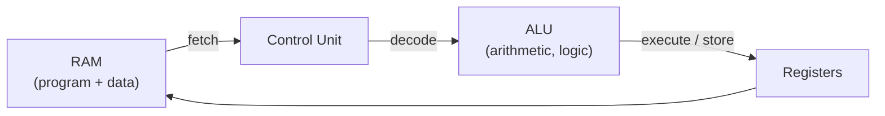
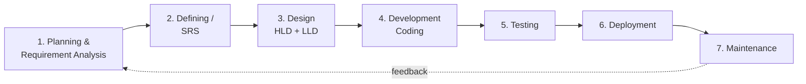
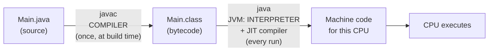
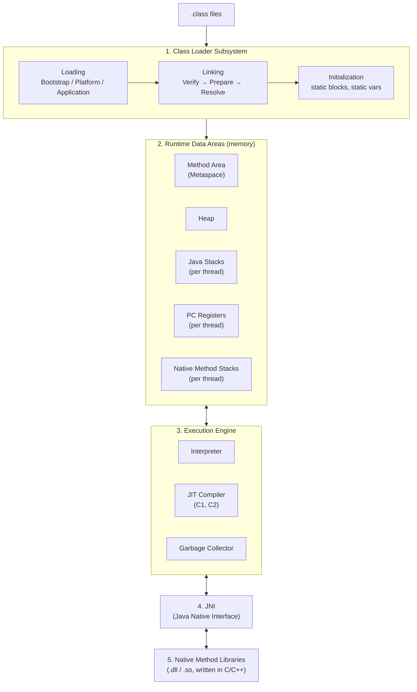
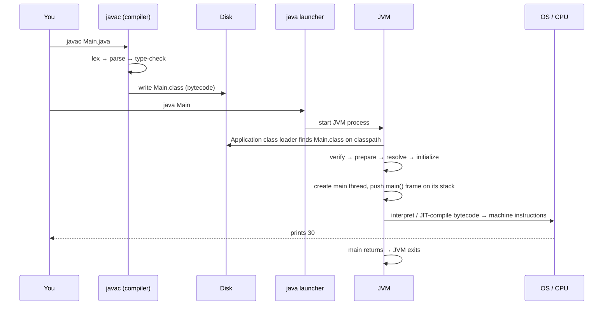

---
mdx:
  format: md
---

# Java Fundamentals Deep Dive - From Binary to Methods

> **Note**: Sections marked **(Interview Imp - Java)** are frequently asked in interviews.
>
> **How to read this file:** Every chapter ends with a **📘 Terms Explained** table. If you see a word you don't know, check the table right below that section.
>
> **Worked examples:** each chapter also contains numbered **Worked Examples**: complete programs you can paste into a file and run, followed by their exact **Output** and an **Explanation** of why that output appears (often with a step-by-step table). Every worked example was compiled and run on OpenJDK 17 and its output compared with the text shown. Programs that read keyboard input list the input in a `// stdin:` comment.
>
> **Scope:** The foundations *before* OOP, explained in depth: how a computer understands code, what a program is, the SDLC, compilers vs interpreters, Java's features and architecture, what really happens on `javac Main.java` / `java Main`, JRE/JVM segments (memory areas), data types, type casting, operators, `Scanner` input, and methods. All code outputs here were verified on OpenJDK 17.
>
> **Related files:** [Java_Complete_Guide.md](Java_Complete_Guide.md) (whole language, OOP onward) · [Java_Collections_Framework_Guide.md](Java_Collections_Framework_Guide.md) · [java-stream-api.md](java-stream-api.md) · [exception_handling/](exception_handling) · [Cpp_Complete_Guide.md](../cpp/Cpp_Complete_Guide.md) (a compiled-to-native comparison)

| Level | Chapters |
|---|---|
| **Basic (computer science)** | 1-4 (binary and machine code, programs, SDLC, compiler vs interpreter) |
| **Java platform** | 5-8 (features, architecture, `javac`/`java` step by step, JRE/JVM segments) |
| **Language core** | 9-12 (program structure, data types, type casting, operators) |
| **Input and methods** | 13-14 (`Scanner` and fast I/O, methods and the call stack) |
| **Mastery** | 15-17 (tricky outputs, interview questions, practice and cheat sheet) |

---

## Table of Contents
1. [What a Computer Understands: Binary and Machine Code](#1-what-a-computer-understands-binary-and-machine-code)
   - [1.1 Why Binary?](#11-why-binary)
   - [1.2 Bits, Bytes and Number Systems](#12-bits-bytes-and-number-systems)
   - [1.3 How Negative Numbers Are Stored: Two's Complement (Interview Imp - Java)](#13-how-negative-numbers-are-stored-twos-complement-interview-imp---java)
   - [1.4 Characters as Numbers: ASCII and Unicode](#14-characters-as-numbers-ascii-and-unicode)
   - [1.5 CPU, Instructions and Machine Code](#15-cpu-instructions-and-machine-code)
   - [1.6 Levels of Languages](#16-levels-of-languages)
2. [What is a Program?](#2-what-is-a-program)
3. [SDLC: Software Development Life Cycle (Interview Imp - Java)](#3-sdlc-software-development-life-cycle-interview-imp---java)
   - [3.1 The Phases](#31-the-phases)
   - [3.2 SDLC Models](#32-sdlc-models)
   - [3.3 Where Java Fits in the SDLC](#33-where-java-fits-in-the-sdlc)
4. [Translators: Compiler, Interpreter, Assembler (Interview Imp - Java)](#4-translators-compiler-interpreter-assembler-interview-imp---java)
   - [4.1 Compilation](#41-compilation)
   - [4.2 Interpretation](#42-interpretation)
   - [4.3 Compiler vs Interpreter](#43-compiler-vs-interpreter)
   - [4.4 Java: Compiled AND Interpreted (Hybrid)](#44-java-compiled-and-interpreted-hybrid)
   - [4.5 Compilation vs Execution: Two Separate Moments](#45-compilation-vs-execution-two-separate-moments)
5. [Java History and Features (Interview Imp - Java)](#5-java-history-and-features-interview-imp---java)
6. [Java Architecture: JDK, JRE, JVM (Interview Imp - Java)](#6-java-architecture-jdk-jre-jvm-interview-imp---java)
   - [6.1 JDK vs JRE vs JVM](#61-jdk-vs-jre-vs-jvm)
   - [6.2 JVM Architecture](#62-jvm-architecture)
   - [6.3 Class Loader Subsystem](#63-class-loader-subsystem)
   - [6.4 Execution Engine: Interpreter, JIT, GC](#64-execution-engine-interpreter-jit-gc)
7. [What Happens on `javac Main.java` and `java Main` (Interview Imp - Java)](#7-what-happens-on-javac-mainjava-and-java-main-interview-imp---java)
   - [7.1 Step by Step](#71-step-by-step)
   - [7.2 Looking Inside a .class File (`javap`)](#72-looking-inside-a-class-file-javap)
   - [7.3 Useful `javac` / `java` Options](#73-useful-javac--java-options)
   - [7.4 Packages, Classpath and Common Errors](#74-packages-classpath-and-common-errors)
8. [Segments of the JRE / JVM Memory Areas (Interview Imp - Java)](#8-segments-of-the-jre--jvm-memory-areas-interview-imp---java)
   - [8.1 What the JRE Contains](#81-what-the-jre-contains)
   - [8.2 Runtime Data Areas](#82-runtime-data-areas)
   - [8.3 Walkthrough: Where Does Each Thing Live?](#83-walkthrough-where-does-each-thing-live)
   - [8.4 Errors Tied to Each Segment](#84-errors-tied-to-each-segment)
9. [Structure of a Java Program](#9-structure-of-a-java-program)
   - [9.1 The `main` Method Explained Word by Word (Interview Imp - Java)](#91-the-main-method-explained-word-by-word-interview-imp---java)
   - [9.2 Tokens: Keywords, Identifiers, Literals, Comments](#92-tokens-keywords-identifiers-literals-comments)
   - [9.3 Variables: Local, Instance, Static](#93-variables-local-instance-static)
10. [Data Types (Interview Imp - Java)](#10-data-types-interview-imp---java)
    - [10.1 Primitive Types](#101-primitive-types)
    - [10.2 Literals](#102-literals)
    - [10.3 Non-Primitive (Reference) Types](#103-non-primitive-reference-types)
    - [10.4 Wrapper Classes](#104-wrapper-classes)
    - [10.5 Floating Point Pitfalls](#105-floating-point-pitfalls)
11. [Type Casting and Type Conversion (Interview Imp - Java)](#11-type-casting-and-type-conversion-interview-imp---java)
    - [11.1 Widening (Implicit)](#111-widening-implicit)
    - [11.2 Narrowing (Explicit)](#112-narrowing-explicit)
    - [11.3 How Narrowing Really Works (Bit Truncation)](#113-how-narrowing-really-works-bit-truncation)
    - [11.4 Type Promotion in Expressions](#114-type-promotion-in-expressions)
    - [11.5 Compound Assignment Hides a Cast](#115-compound-assignment-hides-a-cast)
    - [11.6 String Conversion and Parsing](#116-string-conversion-and-parsing)
12. [Operators (Interview Imp - Java)](#12-operators-interview-imp---java)
    - [12.1 Arithmetic](#121-arithmetic)
    - [12.2 Increment and Decrement](#122-increment-and-decrement)
    - [12.3 Relational and Logical (Short-Circuit)](#123-relational-and-logical-short-circuit)
    - [12.4 Bitwise and Shift Operators](#124-bitwise-and-shift-operators)
    - [12.5 Assignment, Ternary, instanceof, String `+`](#125-assignment-ternary-instanceof-string-)
    - [12.6 Precedence and Associativity Table](#126-precedence-and-associativity-table)
13. [Taking Input: Scanner and Faster Alternatives](#13-taking-input-scanner-and-faster-alternatives)
    - [13.1 Scanner Basics](#131-scanner-basics)
    - [13.2 The `nextInt()` + `nextLine()` Trap (Interview Imp - Java)](#132-the-nextint--nextline-trap-interview-imp---java)
    - [13.3 Reading Until End of Input](#133-reading-until-end-of-input)
    - [13.4 BufferedReader and Fast I/O](#134-bufferedreader-and-fast-io)
    - [13.5 Command-Line Arguments](#135-command-line-arguments)
14. [Methods (Interview Imp - Java)](#14-methods-interview-imp---java)
    - [14.1 Anatomy of a Method](#141-anatomy-of-a-method)
      - [14.1.1 Parameters (Formal) vs Arguments (Actual) (Interview Imp - Java)](#1411-parameters-formal-vs-arguments-actual-interview-imp---java)
    - [14.2 Types of Methods](#142-types-of-methods)
    - [14.3 How a Method Call Works: the Call Stack](#143-how-a-method-call-works-the-call-stack)
    - [14.4 Java is Always Pass-by-Value (Interview Imp - Java)](#144-java-is-always-pass-by-value-interview-imp---java)
    - [14.5 Method Overloading and Resolution Rules](#145-method-overloading-and-resolution-rules)
      - [14.5.1 What Is NOT Allowed in Overloading (Interview Imp - Java)](#1451-what-is-not-allowed-in-overloading-interview-imp---java)
      - [14.5.2 Compile-Time Polymorphism via Overloading (Interview Imp - Java)](#1452-compile-time-polymorphism-via-overloading-interview-imp---java)
    - [14.6 Varargs](#146-varargs)
    - [14.7 Recursion](#147-recursion)
    - [14.8 Static vs Instance Methods](#148-static-vs-instance-methods)
15. [Tricky Output Questions](#15-tricky-output-questions)
16. [Interview Questions](#16-interview-questions)
17. [Practice Programs and Cheat Sheet](#17-practice-programs-and-cheat-sheet)

---

# 1. What a Computer Understands: Binary and Machine Code

## 1.1 Why Binary?

A computer is built from billions of tiny electronic switches called **transistors**. A switch has only two reliable states: **ON** (current flows, high voltage) and **OFF** (no current, low voltage). We write them as **1** and **0**.

Two states are easy to tell apart even with electrical noise, so hardware uses **base 2 (binary)**. Everything you see on a computer (numbers, text, images, videos, *programs themselves*) is finally stored and processed as patterns of 0s and 1s.

```
Your Java code  ──►  bytecode  ──►  machine code  ──►  electrical signals
"int a = 5;"         bipush 5       10110000 ...       ON OFF ON ON ...
```

**So what does a computer "understand"?** Only **machine code**: binary instructions specific to its CPU (x86-64, ARM, ...). It does **not** understand Java, C, or Python. Every language needs a translator to reach machine code.

## 1.2 Bits, Bytes and Number Systems

| Unit | Size | Example |
|---|---|---|
| **Bit** | one 0 or 1 | `1` |
| **Nibble** | 4 bits | `1010` |
| **Byte** | 8 bits | `01000001` (= 65 = `'A'`) |
| **KB / MB / GB** | 1024 B / 1024 KB / 1024 MB | (strictly KiB/MiB/GiB) |
| **Word** | CPU's natural size: 32 or 64 bits | registers on a 64-bit CPU |

**Number systems you will see in Java:**

| System | Base | Digits | Java literal | Value 10 written as |
|---|---|---|---|---|
| Binary | 2 | 0-1 | `0b` prefix | `0b1010` |
| Octal | 8 | 0-7 | `0` prefix | `012` |
| Decimal | 10 | 0-9 | none | `10` |
| Hexadecimal | 16 | 0-9, A-F | `0x` prefix | `0xA` |

**Decimal → binary (divide by 2, read remainders bottom-up):**
```
13 / 2 = 6 r 1
 6 / 2 = 3 r 0
 3 / 2 = 1 r 1
 1 / 2 = 0 r 1      → 13 = 1101
```

**Binary → decimal (sum of powers of 2):**
```
1101 = 1×8 + 1×4 + 0×2 + 1×1 = 13
```

**Why hex?** One hex digit = exactly 4 bits, so long binary is easy to read: `1111 1111` = `0xFF` = 255.

```java
System.out.println(0b101);                     // 5
System.out.println(010);                       // 8   (octal! a leading 0 is a trap)
System.out.println(0x1F);                      // 31
System.out.println(Integer.toBinaryString(13)); // 1101
System.out.println(Integer.toHexString(255));  // ff
System.out.println(Integer.parseInt("1101", 2)); // 13
```

#### Worked Example 1: converting between number systems by hand and with the library

```java
public class Main {
    static String toBase(int n, int base) {               // repeated division, remainders read bottom-up
        String digits = "0123456789ABCDEF";
        if (n == 0) return "0";
        StringBuilder sb = new StringBuilder();
        while (n > 0) {
            sb.append(digits.charAt(n % base));
            n /= base;
        }
        return sb.reverse().toString();
    }

    static int fromBinary(String bits) {                   // sum of powers of 2 (Horner's method)
        int value = 0;
        for (char c : bits.toCharArray()) value = value * 2 + (c - '0');
        return value;
    }

    public static void main(String[] args) {
        int[] values = {13, 100, 255, 2024};
        System.out.println("decimal   binary         octal  hex");
        for (int v : values)
            System.out.printf("%-9d %-14s %-6s %s%n", v, toBase(v, 2), toBase(v, 8), toBase(v, 16));

        System.out.println("library : " + Integer.toBinaryString(2024) + " " + Integer.toOctalString(2024) + " " + Integer.toHexString(2024));
        System.out.println("1101 -> " + fromBinary("1101") + ", 11111111 -> " + fromBinary("11111111"));
        System.out.println("parse   : " + Integer.parseInt("7E8", 16) + " " + Integer.parseInt("3750", 8));
        System.out.println("literals: " + 0b11111101000 + " " + 03750 + " " + 0x7E8);
    }
}
```

**Output:**
```text
decimal   binary         octal  hex
13        1101           15     D
100       1100100        144    64
255       11111111       377    FF
2024      11111101000    3750   7E8
library : 11111101000 3750 7e8
1101 -> 13, 11111111 -> 255
parse   : 2024 2024
literals: 2024 2024 2024
```

**Explanation:**
- `toBase` is the "divide and collect remainders" method from above, generalised to any base up to 16. The remainders come out **least significant digit first**, so the builder is reversed at the end.
- `fromBinary` uses **Horner's method**: for `1101`, `0→1→3→6→13` (each step doubles the running value and adds the next bit). It avoids computing powers of 2 explicitly.
- `255 = FF` in hex: two hex digits are exactly one byte, which is why hex is used for memory dumps, colours (`#FF8800`) and the `CAFEBABE` magic number.
- The same value 2024 can be written as a binary (`0b`), octal (leading `0`) or hex (`0x`) literal; the compiler stores the same `int` for all three.

## 1.3 How Negative Numbers Are Stored: Two's Complement (Interview Imp - Java)

Java integer types (`byte`, `short`, `int`, `long`) are **signed** and use **two's complement**. The leftmost bit is the **sign bit** (0 = positive, 1 = negative).

**To get -x:** invert all bits of x, then add 1.
```
 5 in 8 bits     = 0000 0101
 invert          = 1111 1010
 add 1           = 1111 1011   → this is -5
```

Why two's complement? Addition works the same for positive and negative numbers (the CPU needs only one adder circuit) and there is only one zero.

**Range of an n-bit signed type:** -2ⁿ⁻¹ to 2ⁿ⁻¹ - 1. For `byte` (8 bits): -128 to 127. There is one more negative number than positive, which is why `Math.abs(Integer.MIN_VALUE)` is still negative.

```java
System.out.println(Integer.toBinaryString(-5));
// 11111111111111111111111111111011   (32 bits, int)
```

#### Worked Example 2: watching two's complement at work

```java
public class Main {
    static String bits8(int n) {                         // last 8 bits, zero-padded
        return String.format("%8s", Integer.toBinaryString(n & 0xFF)).replace(' ', '0');
    }

    public static void main(String[] args) {
        System.out.println("  n   8-bit pattern");
        for (int n : new int[]{5, -5, 1, -1, 127, -128, 0})
            System.out.printf("%4d   %s%n", n, bits8(n));

        int x = 5;
        int manual = ~x + 1;                                // invert all bits, add 1
        System.out.println("~5 + 1 = " + manual + "  (same as -5: " + (manual == -5) + ")");

        System.out.println("Integer.MIN_VALUE        = " + Integer.MIN_VALUE);
        System.out.println("Math.abs(MIN_VALUE)      = " + Math.abs(Integer.MIN_VALUE));
        System.out.println("-MIN_VALUE == MIN_VALUE ? " + (-Integer.MIN_VALUE == Integer.MIN_VALUE));
        byte b = 127;
        b++;
        System.out.println("byte 127 + 1             = " + b);
    }
}
```

**Output:**
```text
  n   8-bit pattern
   5   00000101
  -5   11111011
   1   00000001
  -1   11111111
 127   01111111
-128   10000000
   0   00000000
~5 + 1 = -5  (same as -5: true)
Integer.MIN_VALUE        = -2147483648
Math.abs(MIN_VALUE)      = -2147483648
-MIN_VALUE == MIN_VALUE ? true
byte 127 + 1             = -128
```

**Explanation:**
- Every negative number starts with a `1` bit (the sign bit). `-1` is all ones, because `-1 + 1` must overflow to all zeros.
- `127` (`01111111`) is the largest positive byte; adding 1 flips it to `10000000`, which two's complement reads as `-128`. Overflow is silent in Java.
- `~x + 1` is exactly the "invert and add 1" rule, and it equals `-x`.
- The range is asymmetric (`-128..127` for bytes, `-2³¹..2³¹-1` for `int`). `-MIN_VALUE` would be `2³¹`, which does not fit, so it wraps back to `MIN_VALUE`. That is why `Math.abs(Integer.MIN_VALUE)` is still negative, a classic interview trap (use `Math.absExact` to get an exception instead).

## 1.4 Characters as Numbers: ASCII and Unicode

Text is stored as numbers using a **character encoding**:

| Encoding | Size | Covers |
|---|---|---|
| **ASCII** | 7 bits (128 chars) | English letters, digits, symbols |
| **Unicode** | code points up to U+10FFFF | Every script: हिन्दी, 中文, emoji |
| **UTF-8** | 1-4 bytes per char | Common file/web encoding, ASCII-compatible |
| **UTF-16** | 2 or 4 bytes per char | What Java's `char` and `String` use internally |

Useful ASCII values: `'0'` = 48, `'A'` = 65, `'a'` = 97, space = 32. Lowercase = uppercase + 32.

```java
char c = 'A';
System.out.println(c + 1);          // 66  (char promoted to int)
System.out.println((char)(c + 1));  // B
System.out.println('7' - '0');      // 7   (digit char → its numeric value)
```

#### Worked Example 3: characters, code points and UTF-8 byte counts

```java
import java.nio.charset.StandardCharsets;

public class Main {
    public static void main(String[] args) {
        String[] samples = {"A", "z", "é", "न", "€", "😀"};
        System.out.println("char  code point  UTF-8 bytes  Java chars (UTF-16 units)");
        for (String s : samples) {
            int cp = s.codePointAt(0);
            System.out.printf("%-5s U+%04X      %d            %d%n",
                    s, cp, s.getBytes(StandardCharsets.UTF_8).length, s.length());
        }

        for (char c = 'a'; c <= 'e'; c++) System.out.print(c + "=" + (int) c + " ");
        System.out.println();
        System.out.println("'A' + 32 = " + (char) ('A' + 32) + ", 'q' - 32 = " + (char) ('q' - 32));
        System.out.println("Character.isLetter('é') = " + Character.isLetter('é') + ", isDigit('٣') = " + Character.isDigit('٣'));

        String text = "Hi😀";
        System.out.println("length() = " + text.length() + ", codePointCount = " + text.codePointCount(0, text.length()));
    }
}
```

**Output:**
```text
char  code point  UTF-8 bytes  Java chars (UTF-16 units)
A     U+0041      1            1
z     U+007A      1            1
é     U+00E9      2            1
न     U+0928      3            1
€     U+20AC      3            1
😀    U+1F600      4            2
a=97 b=98 c=99 d=100 e=101 
'A' + 32 = a, 'q' - 32 = Q
Character.isLetter('é') = true, isDigit('٣') = true
length() = 4, codePointCount = 3
```

**Explanation:**
- Every character has a Unicode **code point**. ASCII characters (`A`, `z`) take 1 byte in UTF-8; accented Latin letters take 2; most Indian scripts and symbols such as `€` take 3; emoji take 4.
- A Java `char` is one **UTF-16 unit** (16 bits). Code points above `U+FFFF`, such as 😀 (`U+1F600`), need **two** chars (a *surrogate pair*). That is why `"Hi😀".length()` is 4 while it contains only 3 characters. Use `codePointCount` or `codePoints()` when emoji or rare scripts matter.
- Uppercase and lowercase ASCII letters differ by exactly 32; `Character` methods (`isLetter`, `isDigit`, `toUpperCase`) also understand non-English characters (here the Arabic-Indic digit `٣`).
- `%-5s` pads by **UTF-16 units**, so the 2-unit emoji gets one space less padding than the other rows. Formatting code that must align non-ASCII text has to account for this.

## 1.5 CPU, Instructions and Machine Code



The CPU runs the **fetch → decode → execute** cycle billions of times per second:
1. **Fetch** the next instruction from memory (address held in the program counter).
2. **Decode** what the bits mean (e.g. "add register 1 and register 2").
3. **Execute** it in the ALU and store the result.

Each CPU family has its own **instruction set architecture (ISA)**. x86-64 machine code will not run on an ARM chip. This is exactly the problem Java's bytecode solves (Chapter 4.4).

## 1.6 Levels of Languages

| Level | Example | Readable by | Needs |
|---|---|---|---|
| **Machine language** | `10110000 01100001` | CPU only | nothing |
| **Assembly language** | `MOV AL, 61h` | humans (barely) | **assembler** |
| **High-level language** | `int a = 97;` (Java, C, Python) | humans | **compiler / interpreter** |

High-level languages are portable, readable and productive; the translator does the hard work of turning them into machine code.

#### 📘 Terms Explained

| Term | Simple meaning |
|---|---|
| **Transistor** | Tiny electronic switch; the building block of chips. |
| **Binary** | Base-2 number system using only 0 and 1. |
| **Bit / Byte** | One binary digit / a group of 8 bits. |
| **Two's complement** | Standard way to store negative integers: invert bits and add 1. |
| **Sign bit** | Leftmost bit; 1 means the number is negative. |
| **Encoding** | Rule mapping characters to numbers (ASCII, UTF-8, UTF-16). |
| **Code point** | The number Unicode assigns to a character (`'A'` = U+0041). |
| **CPU** | Central Processing Unit; executes machine instructions. |
| **ALU** | Arithmetic Logic Unit; the part of the CPU that calculates. |
| **Register** | Very fast storage slot inside the CPU. |
| **ISA** | Instruction Set Architecture; the machine language a CPU family understands. |
| **Machine code** | Binary instructions a CPU executes directly. |
| **Assembler** | Translates assembly language into machine code. |

---

# 2. What is a Program?

A **program** is an ordered set of instructions that tells a computer how to perform a task. A **software** product is one or more programs plus data, configuration and documentation.

```
Input  ──►  Processing (instructions)  ──►  Output
"5, 7"      add the two numbers             "12"
```

**Key related words:**

| Word | Meaning |
|---|---|
| **Algorithm** | Step-by-step solution to a problem, independent of any language. |
| **Pseudocode** | Algorithm written in plain English-like steps. |
| **Flowchart** | Algorithm drawn as a diagram. |
| **Source code** | The program as written by a human (`Main.java`). |
| **Object / byte code** | Translated form produced by a compiler (`Main.class`). |
| **Executable** | A file the OS can run directly (`.exe`, ELF binary). |
| **Process** | A program *while it is running*, with its own memory. |
| **Thread** | A path of execution inside a process (a process has at least one). |

**Algorithm → pseudocode → Java (sum of two numbers):**
```
Algorithm:   1. Read a and b   2. sum = a + b   3. Print sum
```
```java
import java.util.Scanner;

public class Sum {
    public static void main(String[] args) {
        Scanner sc = new Scanner(System.in);
        int a = sc.nextInt();
        int b = sc.nextInt();
        System.out.println(a + b);
    }
}
```

**Program vs Process (Interview Imp - Java):** a program is a passive file on disk; a process is an active instance in memory. Running `java Main` twice creates two processes (two JVMs) from the same program.

**Types of software:** *system software* (OS, drivers, compilers, the JVM itself) and *application software* (browsers, banking apps, the Spring Boot service you write).
#### Worked Example 4: from algorithm to a running program (average of N numbers)

**Algorithm (pseudocode):**
```
1. read n
2. sum ← 0
3. repeat n times: read x; sum ← sum + x
4. if n > 0 print sum / n   else print "no data"
```

```java
// stdin: 4\n10 20 35 41
import java.util.Scanner;

public class Main {
    public static void main(String[] args) {
        Scanner sc = new Scanner(System.in);
        int n = sc.nextInt();                       // step 1: input
        long sum = 0;                               // step 2
        for (int i = 0; i < n; i++) sum += sc.nextInt();   // step 3: processing
        if (n > 0) System.out.printf("count=%d sum=%d average=%.2f%n", n, sum, (double) sum / n);   // step 4: output
        else System.out.println("no data");
        System.out.println("this process has a PID > 0: " + (ProcessHandle.current().pid() > 0));
    }
}
```

**Output** (input `4` then `10 20 35 41`):
```text
count=4 sum=106 average=26.50
this process has a PID > 0: true
```

**Explanation:** each pseudocode step maps to one or two lines of Java, which is why writing the algorithm first makes coding easier. The `(double)` cast avoids integer division (`106 / 4` would be `26`). The last line shows that a running program is a **process** with its own process ID assigned by the operating system; run the program twice at the same time and you get two different PIDs from the same program file.

#### 📘 Terms Explained

| Term | Simple meaning |
|---|---|
| **Program** | A set of instructions for a computer. |
| **Algorithm** | Language-independent steps to solve a problem. |
| **Source code** | Human-written code. |
| **Executable** | A file that can be run directly. |
| **Process** | A running program with its own memory space. |
| **System software** | Software that runs the computer (OS, JVM). |
| **Application software** | Software that does a job for the user. |

---

# 3. SDLC: Software Development Life Cycle (Interview Imp - Java)

**SDLC** is the structured process a team follows to build software, from idea to retirement. It exists so that software is delivered on time, within budget, with fewer defects.

## 3.1 The Phases



| # | Phase | What happens | Output (artifact) | Who |
|---|---|---|---|---|
| 1 | **Planning & Requirement Analysis** | Talk to stakeholders, check feasibility (technical, cost, time) | Feasibility report | Business analyst, PM |
| 2 | **Defining requirements** | Write down *what* the system must do | **SRS** (Software Requirement Specification) | BA, client |
| 3 | **Design** | Decide *how*: architecture, DB schema, APIs, classes | **HLD** (High-Level Design), **LLD** (Low-Level Design) | Architect, senior devs |
| 4 | **Development** | Write the code, code reviews, unit tests | Source code, builds | Developers |
| 5 | **Testing** | Find defects: unit, integration, system, UAT | Test reports, bug list | QA / testers |
| 6 | **Deployment** | Release to production (often via CI/CD) | Running software | DevOps |
| 7 | **Maintenance** | Bug fixes, upgrades, new features | Patches, new versions | Dev + support |

## 3.2 SDLC Models

| Model | How it works | Good for | Weakness |
|---|---|---|---|
| **Waterfall** | Phases run once, strictly in order | Fixed, clear requirements (government, defence) | Late changes are very costly; working software appears only at the end |
| **V-Model** | Waterfall where each phase has a matching test phase (requirements ↔ acceptance test, design ↔ integration test) | Safety-critical systems (medical, automotive) | Still rigid |
| **Iterative / Incremental** | Build a small version, then add features in rounds | Large systems with evolving scope | Needs good architecture early |
| **Spiral** | Iterations driven by **risk analysis** each loop | High-risk, large projects | Complex and expensive |
| **Agile (Scrum, Kanban)** | Short sprints (1-4 weeks) delivering working software; constant feedback | Most modern product teams | Needs an engaged customer; less upfront documentation |
| **DevOps** | Agile + automation of build, test, deploy and monitoring | Cloud services, continuous delivery | Needs tooling and culture change |

**Scrum in one breath:** a *Product Owner* keeps a prioritized *backlog*; the team picks items into a *sprint*; there is a daily *stand-up*; the sprint ends with a *review* (demo) and a *retrospective* (improve the process).

## 3.3 Where Java Fits in the SDLC

| Phase | Java tools |
|---|---|
| Design | UML class diagrams, design patterns ([01_LLD_Design_Patterns.md](../design-patterns/01_LLD/01_LLD_Design_Patterns.md)) |
| Development | JDK (`javac`), IntelliJ / VS Code, Maven / Gradle |
| Testing | JUnit 5, Mockito, Testcontainers |
| Deployment | Executable JAR, Docker images ([00_Docker_Index.md](../docker/00_Docker_Index.md)), Kubernetes |
| Maintenance | Logging (SLF4J), monitoring (Micrometer), profilers (JFR) |

#### 📘 Terms Explained

| Term | Simple meaning |
|---|---|
| **SDLC** | The step-by-step process for building software. |
| **Stakeholder** | Anyone with an interest in the software (client, user, manager). |
| **Feasibility study** | Checking whether the project is possible and worth it. |
| **SRS** | Document listing every requirement of the system. |
| **HLD / LLD** | Big-picture architecture / detailed class- and method-level design. |
| **UAT** | User Acceptance Testing; the client confirms it meets their needs. |
| **Sprint** | A short, fixed time box in Scrum (1-4 weeks). |
| **Backlog** | Prioritized list of work items. |
| **CI/CD** | Continuous Integration / Delivery: automated build, test and release. |

---

# 4. Translators: Compiler, Interpreter, Assembler (Interview Imp - Java)

A **translator** converts code from one language to another. There are three classic kinds:

| Translator | Converts | Example |
|---|---|---|
| **Assembler** | Assembly → machine code | NASM, GNU `as` |
| **Compiler** | Whole high-level program → lower-level code, *before* running | `gcc` (C), `javac` (Java → bytecode) |
| **Interpreter** | High-level code → executed *statement by statement while running* | CPython, Node.js (with JIT), the JVM's bytecode interpreter |

## 4.1 Compilation

The compiler reads the **whole** source file, checks it, and writes a translated file. Nothing runs during compilation.

**Phases inside a compiler:**
```
Source code
   │  1. Lexical analysis   → splits text into tokens: int, a, =, 5, ;
   │  2. Syntax analysis    → builds a parse tree; catches "missing ;"
   │  3. Semantic analysis  → type checking; catches "String cannot be converted to int"
   │  4. Intermediate code  → (Java: this is the bytecode)
   │  5. Optimization       → removes waste (javac does little; the JIT does most)
   ▼  6. Code generation    → writes the output file (.class / .exe)
Target code
```

## 4.2 Interpretation

The interpreter reads one statement, translates it, executes it, then moves to the next. There is no separate output file; the source (or bytecode) is translated every time it runs.

```
read line 1 → translate → execute → read line 2 → translate → execute → ...
```

If line 50 has an error, lines 1-49 have already run.

## 4.3 Compiler vs Interpreter

| Point | Compiler | Interpreter |
|---|---|---|
| Translates | Whole program at once | One statement at a time |
| When | Before execution | During execution |
| Output file | Yes (`.exe`, `.class`) | No |
| Errors reported | All (many) at compile time, program does not run | One at a time, when that line is reached |
| Execution speed | Fast (already translated) | Slower (translates repeatedly) |
| Startup | Must compile first | Starts immediately |
| Memory | Needs more during compilation | Generally less |
| Debugging | Harder to map errors to runtime behaviour | Easier, line-by-line |
| Source needed to run | No (ship the binary) | Yes (or the bytecode) |
| Examples | C, C++, Go, Rust | Python, JavaScript, Ruby, shell |

## 4.4 Java: Compiled AND Interpreted (Hybrid)

Java uses **both**, in two stages:



1. **`javac` compiles** source into **bytecode**: instructions for an imaginary CPU (the JVM), not for any real hardware.
2. **The JVM interprets** that bytecode on the real machine. Methods that run often ("hot" code) are compiled to native machine code by the **JIT (Just-In-Time) compiler**, so they become as fast as C++ in many cases.

**Why this design?**
- **Platform independence:** the same `.class` file runs on Windows, Linux, macOS, x86 or ARM. Only the JVM is platform-specific.
- **Early error detection:** `javac` catches type and syntax errors before you ship.
- **Speed:** JIT gives near-native performance and can even optimize using runtime information a static compiler doesn't have (which branches are actually taken).
- **Security:** bytecode is verified before it runs.

> **"Java is platform independent, but the JVM is platform dependent."** (Interview Imp - Java) You download a different JDK for Windows and Linux, but the `.class` files are identical.

## 4.5 Compilation vs Execution: Two Separate Moments

| | Compile time (`javac`) | Run time (`java`) |
|---|---|---|
| Who works | Compiler | JVM |
| Input | `.java` | `.class` |
| Checks | Syntax, types, undeclared variables, missing return, unreachable code | Actual values: division by zero, null access, array bounds |
| Error type | **Compile-time error** (no `.class` produced) | **Runtime exception / error** (program crashes mid-run) |
| Example | `int x = "hi";` | `int[] a = new int[2]; a[5] = 1;` → `ArrayIndexOutOfBoundsException` |

```java
int x = 10 / 0;        // compiles fine! fails at RUN time: ArithmeticException
int y = "ten";         // fails at COMPILE time: incompatible types
```

A third kind is a **logical error**: the program compiles and runs but gives the wrong answer (e.g. `avg = a + b / 2` instead of `(a + b) / 2`). Only testing catches these.
#### Worked Example 5: the three kinds of errors side by side

```java
public class Main {
    static double averageBuggy(int a, int b) { return a + b / 2; }          // logical error
    static double averageFixed(int a, int b) { return (a + b) / 2.0; }

    public static void main(String[] args) {
        // int y = "ten";            // compile-time error: incompatible types (uncomment to see javac refuse)

        System.out.println("buggy average of 10 and 20 = " + averageBuggy(10, 20));
        System.out.println("fixed average of 10 and 20 = " + averageFixed(10, 20));

        int[] data = {1, 2};
        try {
            System.out.println(data[5]);                                     // runtime error
        } catch (ArrayIndexOutOfBoundsException e) {
            System.out.println("runtime error caught: " + e.getMessage());
        }
        int zero = 0;
        try {
            System.out.println(10 / zero);
        } catch (ArithmeticException e) {
            System.out.println("runtime error caught: " + e.getMessage());
        }
        System.out.println("program continues after handling runtime errors");
    }
}
```

**Output:**
```text
buggy average of 10 and 20 = 20.0
fixed average of 10 and 20 = 15.0
runtime error caught: Index 5 out of bounds for length 2
runtime error caught: / by zero
program continues after handling runtime errors
```

**Explanation:**

| Kind | Found by | In this program |
|---|---|---|
| Compile-time | `javac`, before running | `int y = "ten";` would stop compilation, so it is commented out |
| Runtime | the JVM, while running | `data[5]` and `10 / zero` throw exceptions; catching them keeps the program alive |
| Logical | only **testing** | `a + b / 2` computes `10 + 10 = 20` because `/` binds tighter than `+`; nothing crashes, the answer is just wrong |

Note that `10 / zero` compiles, while `10 / 0` written with a literal also compiles: the compiler does not evaluate division by zero, so the error always appears at run time.

#### 📘 Terms Explained

| Term | Simple meaning |
|---|---|
| **Translator** | Program that converts code from one language to another. |
| **Compiler** | Translates the whole program before it runs. |
| **Interpreter** | Translates and runs code one statement at a time. |
| **Token** | Smallest meaningful unit of code (keyword, name, symbol). |
| **Parse tree** | Tree structure showing the grammar of the code. |
| **Bytecode** | Platform-neutral instructions for the JVM, stored in `.class`. |
| **JIT compiler** | Compiles frequently used bytecode to native code during the run. |
| **Hot code** | Methods or loops executed many times. |
| **Compile-time error** | Error found by `javac`; no `.class` is produced. |
| **Runtime exception** | Error that happens while the program runs. |
| **Logical error** | Program runs but produces a wrong result. |

---

# 5. Java History and Features (Interview Imp - Java)

**History in short:**

| Year | Event |
|---|---|
| 1991 | James Gosling's "Green Project" at Sun Microsystems; language first named **Oak** (after a tree outside his office) |
| 1995 | Renamed **Java** (after Java coffee); Java 1.0 released 1996 |
| 2004 | Java 5: generics, enums, autoboxing, enhanced `for` |
| 2010 | Oracle acquires Sun |
| 2014 | **Java 8** (LTS): lambdas, streams, `java.time` |
| 2018+ | New version every 6 months; LTS every 2 years now: **11, 17, 21, 25** |

**The Java "buzzwords" (features):**

| Feature | What it means | How Java achieves it |
|---|---|---|
| **Simple** | Easy to learn if you know C/C++ | No pointers arithmetic, no operator overloading, no multiple class inheritance, no manual `free` |
| **Object-oriented** | Everything is organised into classes and objects | Encapsulation, inheritance, polymorphism, abstraction (primitives are the only non-objects, so it is not "pure" OOP) |
| **Platform independent** | Write Once, Run Anywhere (WORA) | Bytecode + JVM per platform |
| **Portable** | Same results on every platform | Fixed sizes for types (`int` is always 32-bit, unlike C) |
| **Robust** | Strong and reliable | Strong typing, exception handling, garbage collection, no pointer bugs, array bounds checks |
| **Secure** | Safe to run untrusted-ish code | Bytecode verifier, no direct memory access, class loader isolation |
| **Architecture neutral** | Not tied to a CPU | Bytecode is CPU-independent |
| **Interpreted** | Bytecode executed by the JVM | Interpreter in the execution engine |
| **High performance** | Faster than pure interpreters | JIT compilation |
| **Multithreaded** | Do many tasks at once | Built-in `Thread`, `synchronized`, `java.util.concurrent`, virtual threads |
| **Distributed** | Build networked apps | `java.net`, RMI, HTTP client |
| **Dynamic** | Loads code at run time | Classes are loaded on demand; reflection |

**Why is Java not 100% object-oriented?** (Interview Imp - Java) Because of the 8 primitive types (`int`, `char`, ...) which are not objects, and because `static` members belong to no object.

**Why no pointers?** Pointers allow reading arbitrary memory, which is unsafe and bug-prone. Java has **references** instead: you can point at an object but you cannot do arithmetic on the address.

#### 📘 Terms Explained

| Term | Simple meaning |
|---|---|
| **WORA** | Write Once, Run Anywhere: compile once, run on any JVM. |
| **Robust** | Hard to crash; catches errors early. |
| **Garbage collection** | JVM automatically frees memory of unused objects. |
| **Bytecode verifier** | JVM component that checks `.class` files are safe before running them. |
| **Reference** | A safe handle to an object (like a pointer, but no arithmetic). |
| **LTS** | Long-Term Support version that gets updates for years. |

---

# 6. Java Architecture: JDK, JRE, JVM (Interview Imp - Java)

## 6.1 JDK vs JRE vs JVM

```
┌─────────────────────────── JDK (Java Development Kit) ───────────────────────────┐
│  Development tools: javac, java, jar, javadoc, javap, jdb, jshell, jlink, jcmd     │
│  ┌──────────────────────── JRE (Java Runtime Environment) ────────────────────┐   │
│  │  Class libraries: java.lang, java.util, java.io, java.net, ... (rt / jmods) │   │
│  │  Supporting files: config, security policies, fonts                          │   │
│  │  ┌──────────────────── JVM (Java Virtual Machine) ───────────────────────┐ │   │
│  │  │ Class Loader │ Runtime Data Areas │ Execution Engine │ JNI │ GC         │ │   │
│  │  └────────────────────────────────────────────────────────────────────────┘ │   │
│  └─────────────────────────────────────────────────────────────────────────────┘   │
└────────────────────────────────────────────────────────────────────────────────────┘
```

| | JVM | JRE | JDK |
|---|---|---|---|
| Full form | Java Virtual Machine | Java Runtime Environment | Java Development Kit |
| Purpose | **Executes** bytecode | Provides everything to **run** Java | Provides everything to **develop** Java |
| Contains | Class loader, memory areas, execution engine | JVM + standard libraries | JRE + compiler + tools |
| Who needs it | (part of JRE) | End users who only run apps | Developers |
| Platform dependent? | Yes | Yes | Yes |

> **Modern note:** Since Java 11, Oracle/OpenJDK no longer ship a separate JRE download. You install the JDK, or build a trimmed custom runtime for your app with `jlink`. The JRE still exists as a *concept* (the runtime part of the JDK), and interviewers still ask about it.

**The JVM is a specification**, not one program. HotSpot (Oracle/OpenJDK), OpenJ9 (Eclipse) and GraalVM are different *implementations* of the same spec.

## 6.2 JVM Architecture



| Component | Job |
|---|---|
| **Class Loader Subsystem** | Finds `.class` files, loads them into memory, verifies and initializes them |
| **Runtime Data Areas** | The memory "segments" the JVM uses while running (Chapter 8) |
| **Execution Engine** | Actually runs bytecode: interpreter + JIT + garbage collector |
| **JNI** | Bridge that lets Java call C/C++ code (and vice versa) |
| **Native Method Libraries** | OS-specific compiled libraries that JNI calls (e.g. for file and network access) |

## 6.3 Class Loader Subsystem

**Three phases:**

**1. Loading** – read the `.class` bytes and create a `Class` object in the method area. Done by a hierarchy of loaders:

| Loader | Loads | Location |
|---|---|---|
| **Bootstrap** (written in native code) | Core classes: `java.lang.*`, `java.util.*` | `java.base` module (old: `rt.jar`) |
| **Platform** (old name: Extension) | Other JDK modules: `java.sql`, ... | JDK modules |
| **Application / System** | Your classes and libraries | The **classpath** (`-cp`) |

**Parent delegation model (Interview Imp - Java):** a loader first asks its parent to load a class; only if the parent can't, it loads the class itself. This is why you cannot replace `java.lang.String` with your own fake `String` class: the bootstrap loader always wins.

**2. Linking**
- **Verification:** the *bytecode verifier* checks the file is valid and safe (correct format, no stack overflow tricks, types used correctly). Throws `VerifyError` otherwise.
- **Preparation:** memory for `static` variables is allocated and set to **default values** (`0`, `false`, `null`).
- **Resolution:** symbolic names (like `java/io/PrintStream.println`) are replaced with direct memory references.

**3. Initialization** – `static` variables get their real values and `static {}` blocks run, top to bottom. Happens on first active use of the class.

```java
class Demo {
    static int x = 10;              // preparation: x = 0; initialization: x = 10
    static { System.out.println("Demo loaded, x = " + x); }
}
```

#### Worked Example 6: when classes are loaded and initialised, and the loader hierarchy

```java
public class Main {
    static class Config {
        static int x = 10;                                       // set during initialisation
        static { System.out.println("  [Config initialised, x = " + x + "]"); }
        static final int CONSTANT = 99;                           // compile-time constant: inlined
    }

    static class Lazy {
        static { System.out.println("  [Lazy initialised]"); }
        static void hello() { System.out.println("  Lazy.hello()"); }
    }

    public static void main(String[] args) throws Exception {
        System.out.println("1. main started");
        System.out.println("2. reading a constant: " + Config.CONSTANT);    // does NOT initialise Config
        System.out.println("3. reading a normal static: " + Config.x);      // first active use → initialise
        System.out.println("4. again: " + Config.x);                        // already initialised
        Lazy[] array = new Lazy[3];                                          // array creation is not an active use
        System.out.println("5. created an array of Lazy, length " + array.length);
        Lazy.hello();                                                        // first active use

        ClassLoader app = ClassLoader.getSystemClassLoader();
        System.out.println("loader chain: " + app.getName() + " -> " + app.getParent().getName() + " -> " + app.getParent().getParent());
        System.out.println("String loaded by bootstrap? " + (String.class.getClassLoader() == null));
        System.out.println("java.sql.Date loaded by: " + java.sql.Date.class.getClassLoader().getName());
    }
}
```

**Output:**
```text
1. main started
2. reading a constant: 99
  [Config initialised, x = 10]
3. reading a normal static: 10
4. again: 10
5. created an array of Lazy, length 3
  [Lazy initialised]
  Lazy.hello()
loader chain: app -> platform -> null
String loaded by bootstrap? true
java.sql.Date loaded by: platform
```

**Explanation:**
- Classes are initialised **lazily**, on their first *active use* (reading or writing a normal static field, calling a static method, creating an instance). Static blocks therefore run in the middle of `main`, not at program start.
- `Config.CONSTANT` is a `static final` primitive with a literal value, so `javac` **copies the value 99 into `Main`'s bytecode**. Reading it does not touch `Config` at all, which is why the static block has not run yet at step 2.
- Creating an **array** of `Lazy` does not initialise `Lazy`; only calling `Lazy.hello()` does.
- The loader chain matches the table above: **application** (`app`) → **platform** → **bootstrap**, which appears as `null` because it is implemented inside the JVM. Core classes (`String`) come from bootstrap, other JDK modules (`java.sql`) from platform. Parent delegation means `app` always asks `platform`, which asks bootstrap, before loading anything itself.

## 6.4 Execution Engine: Interpreter, JIT, GC

- **Interpreter:** executes bytecode one instruction at a time. Starts fast but is slower for repeated code.
- **JIT compiler:** HotSpot counts how often each method/loop runs. Past a threshold, it compiles that bytecode into native machine code and caches it. Two tiers: **C1** (quick, light optimization) and **C2** (slower to compile, heavy optimization like inlining and loop unrolling). This is called **tiered compilation**.
- **Profiler:** the part that finds hot spots (hence the name **HotSpot JVM**).
- **Garbage Collector:** finds objects on the heap that nothing references anymore and frees them. Collectors: Serial, Parallel, **G1** (default), ZGC, Shenandoah. Details in [Java_Complete_Guide.md §13.3](Java_Complete_Guide.md#133-garbage-collection-interview-imp).

```bash
java -Xint Main          # interpreter only (slow, for experiments)
java -XX:+PrintCompilation Main   # watch methods being JIT-compiled
```

#### 📘 Terms Explained

| Term | Simple meaning |
|---|---|
| **JDK / JRE / JVM** | Develop kit / runtime / the virtual machine that executes bytecode. |
| **Specification** | A written standard; many products can implement it. |
| **HotSpot** | The standard JVM implementation in OpenJDK. |
| **Class loader** | Component that loads `.class` files into memory. |
| **Parent delegation** | Loaders ask their parent first, protecting core classes. |
| **Classpath** | Folders/JARs where the application loader searches for classes. |
| **Verification** | Safety check of bytecode before running it. |
| **Static block** | `static { }` code that runs once when the class is initialized. |
| **Tiered compilation** | JIT uses a quick compiler (C1) first, then an optimizing one (C2). |
| **JNI** | Java Native Interface; calls C/C++ code from Java. |
| **jlink** | Tool that builds a minimal custom Java runtime. |

---

# 7. What Happens on `javac Main.java` and `java Main` (Interview Imp - Java)

## 7.1 Step by Step

```java
// Main.java
public class Main {
    public static void main(String[] args) {
        int a = 10;
        int b = 20;
        int sum = a + b;
        System.out.println(sum);
    }
}
```

```bash
javac Main.java     # step A: compile
java Main           # step B: run   (class name, NOT Main.class)
```



**Step A: `javac Main.java`**
1. The compiler reads `Main.java` and checks syntax and types.
2. If there are errors, they are printed and **no `.class` file** is created.
3. If successful, it writes **one `.class` file per class** (`Main.class`). A file with 3 classes produces 3 `.class` files, and inner classes become `Outer$Inner.class`.
4. `javac` itself is a Java program (it runs on a JVM).

**Step B: `java Main`**
1. The `java` launcher starts a new **JVM process** (allocates heap, starts GC threads, etc.).
2. The bootstrap loader loads core classes (`Object`, `String`, `System`, ...).
3. The application class loader searches the classpath (default: current folder `.`) for `Main.class`.
4. The class is **linked** (verified, prepared, resolved) and **initialized** (static blocks run).
5. The JVM looks for exactly `public static void main(String[])`. If missing: `Error: Main method not found in class Main`.
6. A **main thread** is created, a **stack frame** for `main` is pushed, and `args` is filled with command-line arguments.
7. The execution engine runs the bytecode (interpreter, then JIT for hot code).
8. When `main` returns (and no other non-daemon threads are running), the JVM shuts down. `System.exit(code)` ends it immediately.

**Shortcut (Java 11+):** `java Main.java` compiles in memory and runs a single-file program without writing a `.class` file. Great for scripts and learning.

## 7.2 Looking Inside a .class File (`javap`)

`javap -c` disassembles bytecode. For the program above (real output, JDK 17):

```
public static void main(java.lang.String[]);
  Code:
     0: bipush        10      // push constant 10 onto the operand stack
     2: istore_1              // pop it into local variable slot 1 (a)
     3: bipush        20
     5: istore_2              // b
     6: iload_1               // push a
     7: iload_2               // push b
     8: iadd                  // pop two ints, push their sum
     9: istore_3              // sum
    10: getstatic     #7      // Field java/lang/System.out:Ljava/io/PrintStream;
    13: iload_3
    14: invokevirtual #13     // Method java/io/PrintStream.println:(I)V
    17: return
```

Observations:
- The JVM is a **stack-based machine**: operations push and pop an *operand stack* instead of using CPU registers. This makes bytecode independent of how many registers a real CPU has.
- Slot 0 holds `args`; local variables live in numbered slots of the **local variable array**.
- `i` prefixes mean `int` (`iadd`, `iload`). There are also `l`, `f`, `d`, `a` (reference) variants.

**Every `.class` file starts with the magic number `CAFEBABE`**, followed by the version:
```bash
$ xxd Main.class | head -1
00000000: cafe babe 0000 003d ...      # 0x3d = 61 = Java 17
```
Class file major versions: Java 8 = 52, 11 = 55, 17 = 61, 21 = 65, 25 = 69. Running a class compiled for a newer Java on an older JVM gives `UnsupportedClassVersionError`.
#### Worked Example 7: compiling code from Java and reading the `.class` header

The JDK exposes `javac` as an API (`javax.tools`), so a program can compile source code and then inspect the bytes it produced.

```java
import javax.tools.JavaCompiler;
import javax.tools.ToolProvider;
import java.io.ByteArrayOutputStream;
import java.nio.file.*;

public class Main {
    public static void main(String[] args) throws Exception {
        Path dir = Files.createTempDirectory("demo");
        Path src = dir.resolve("Hello.java");
        Files.writeString(src, "public class Hello { public static void main(String[] a) { int x = 10, y = 20; System.out.println(x + y); } }");

        JavaCompiler javac = ToolProvider.getSystemJavaCompiler();
        int status = javac.run(null, null, null, "--release", "17", src.toString());
        System.out.println("javac exit status: " + status + " (0 = success)");

        byte[] bytes = Files.readAllBytes(dir.resolve("Hello.class"));
        System.out.printf("magic number : %02X%02X%02X%02X%n", bytes[0], bytes[1], bytes[2], bytes[3]);
        int major = ((bytes[6] & 0xFF) << 8) | (bytes[7] & 0xFF);
        System.out.println("major version: " + major + " (Java " + (major - 44) + ")");

        Files.writeString(src, "public class Hello { int x = \"ten\"; }");
        ByteArrayOutputStream err = new ByteArrayOutputStream();
        int bad = javac.run(null, null, err, src.toString());
        String firstLine = err.toString().lines().findFirst().orElse("");
        System.out.println("broken source exit status: " + bad);
        System.out.println("first error line ends with: " + firstLine.substring(firstLine.indexOf("error:")));
    }
}
```

**Output:**
```text
javac exit status: 0 (0 = success)
magic number : CAFEBABE
major version: 61 (Java 17)
broken source exit status: 1
first error line ends with: error: incompatible types: String cannot be converted to int
```

**Explanation:**
- `ToolProvider.getSystemJavaCompiler()` returns the same compiler the `javac` command uses (it only exists in a **JDK**, not a bare runtime). `run` returns `0` on success.
- Bytes 0-3 of every class file are the magic number `CA FE BA BE`; bytes 6-7 are the major version. `61 − 44 = 17` (the formula works for Java 5 and later).
- With the broken source, compilation fails with exit status `1`, the error message is written to the error stream, and **no `.class` file** is produced, exactly as described in Step A of §7.1.
- `& 0xFF` turns a signed Java `byte` (e.g. `(byte) 0xCA = -54`) into its unsigned value 0-255 before printing or combining.

## 7.3 Useful `javac` / `java` Options

```bash
javac -d out Main.java              # put .class files into ./out (keeps package folders)
javac --release 11 Main.java        # compile for Java 11 runtimes
javac -Xlint:all Main.java          # show all warnings
javac *.java                        # compile all files in the folder
javac -version / java -version

java -cp out Main                   # run with classpath = ./out
java -cp "out:lib/*" com.app.Main   # Linux/macOS separator ':'  (Windows uses ';')
java -Xms256m -Xmx1g Main           # initial / max heap size
java -Xss2m Main                    # thread stack size
java -jar app.jar                   # run an executable JAR (Main-Class in manifest)
java Main arg1 arg2                 # args[0]="arg1", args[1]="arg2"

jar cfe app.jar Main -C out .       # build a JAR with entry point Main
javap -c -p Main                    # disassemble, including private members
jshell                              # REPL: try code without a class or main
```

## 7.4 Packages, Classpath and Common Errors

```java
// src/com/example/Main.java
package com.example;
public class Main { public static void main(String[] a) { System.out.println("hi"); } }
```
```bash
javac -d out src/com/example/Main.java   # creates out/com/example/Main.class
java -cp out com.example.Main            # use the FULLY QUALIFIED name
```

| Error | Cause | Fix |
|---|---|---|
| `javac: command not found` | JDK not installed / not on `PATH` | Install JDK, set `JAVA_HOME` and `PATH` |
| `class Hello is public, should be declared in a file named Hello.java` | File name ≠ public class name | Rename file or class (case-sensitive) |
| `error: ';' expected` | Syntax error | Fix the line shown |
| `Error: Could not find or load main class Main` | Wrong folder / classpath, used `java Main.class`, or forgot package name | Run from the right folder, `java -cp out pkg.Main` |
| `Error: Main method not found in class Main` | `main` signature wrong (`Static`, missing `String[]`, not `static`) | Use `public static void main(String[] args)` |
| `UnsupportedClassVersionError` | Compiled with newer JDK than the runtime | Recompile with `--release N` or upgrade the JVM |
| `NoClassDefFoundError` | Class existed at compile time but is missing at run time | Fix the runtime classpath / dependency |

#### 📘 Terms Explained

| Term | Simple meaning |
|---|---|
| **Launcher** | The `java` command that starts the JVM. |
| **Stack frame** | Memory block for one method call: its local variables and operand stack. |
| **Operand stack** | Scratch stack the JVM uses to compute expressions. |
| **Stack-based VM** | A virtual machine whose instructions work on a stack, not registers. |
| **Magic number** | Fixed bytes at the start of a file identifying its type (`CAFEBABE`). |
| **`javap`** | JDK tool that shows the contents/bytecode of `.class` files. |
| **Fully qualified name** | Package + class name, e.g. `com.example.Main`. |
| **JAR** | Zip archive of `.class` files and resources. |
| **Daemon thread** | Background thread that doesn't keep the JVM alive. |

---

# 8. Segments of the JRE / JVM Memory Areas (Interview Imp - Java)

## 8.1 What the JRE Contains

| Segment of the JRE | Contents |
|---|---|
| **JVM** | Class loader, runtime data areas, execution engine, JNI |
| **Core class libraries** | `java.lang` (String, Math, System, Thread), `java.util` (Scanner, collections), `java.io` / `java.nio`, `java.net`, `java.time`, `java.sql` |
| **Integration libraries** | JDBC, JNDI, RMI |
| **UI libraries** | AWT, Swing, Java2D (desktop module) |
| **Deployment / support files** | `lib/` config, security policy files, certificates (`cacerts`), time-zone data, fonts |

When people ask "segments of JRE" in interviews, they usually mean the **runtime data areas** below: the memory segments the JVM creates when it runs your program.

## 8.2 Runtime Data Areas

```
                  ┌───────────────────── JVM process memory ─────────────────────┐
 SHARED by all    │  METHOD AREA (Metaspace)          │  HEAP                       │
 threads          │  - class metadata, method bytecode│  - all objects (new ...)    │
                  │  - runtime constant pool          │  - arrays                   │
                  │  - static variables*              │  - String pool              │
                  │                                   │  Young Gen │ Old Gen        │
                  ├───────────────────────────────────┴────────────────────────────┤
 ONE PER thread   │  Thread 1: [Java Stack] [PC Register] [Native Method Stack]     │
                  │  Thread 2: [Java Stack] [PC Register] [Native Method Stack]     │
                  └─────────────────────────────────────────────────────────────────┘
 * In HotSpot 8+, static fields are physically stored with the Class object on the heap,
   but conceptually (and in most interview answers) they "belong to the class / method area".
```

| Area | Shared? | Stores | Created | GC'd? | Error when full |
|---|---|---|---|---|---|
| **Method Area** (HotSpot: **Metaspace**, native memory since Java 8; was *PermGen* before) | All threads | Class structure, method bytecode, field info, runtime constant pool | JVM start | Yes (class unloading) | `OutOfMemoryError: Metaspace` |
| **Heap** | All threads | Every object and array, String pool (since Java 7) | JVM start (`-Xms`, `-Xmx`) | **Yes, main GC target** | `OutOfMemoryError: Java heap space` |
| **Java Stack** | Per thread | One **frame** per method call: local variables (primitives and references), operand stack, return info | Thread start (`-Xss`) | No (frames pop on return) | `StackOverflowError` |
| **PC Register** | Per thread | Address of the bytecode instruction currently executing | Thread start | No | (none) |
| **Native Method Stack** | Per thread | Frames for native (C/C++) methods called via JNI | Thread start | No | `StackOverflowError` / OOM |

**Heap generations (why GC is fast):** most objects die young, so the heap is split into **Young Generation** (Eden + two Survivor spaces, collected often and cheaply) and **Old Generation** (long-lived objects, collected rarely).

**Stack vs Heap (Interview Imp - Java):**

| Stack | Heap |
|---|---|
| Per thread | Shared by all threads |
| Local variables and method calls | Objects and arrays |
| LIFO; memory freed automatically when the method returns | Freed by the garbage collector |
| Very fast | Slower to allocate, needs GC |
| Small (≈ 512 KB-1 MB per thread by default) | Large (up to `-Xmx`) |
| Thread-safe by nature (not shared) | Needs synchronization when shared |
| `StackOverflowError` | `OutOfMemoryError` |

## 8.3 Walkthrough: Where Does Each Thing Live?

```java
public class Bank {
    static double rate = 4.5;                  // class-level → method area (conceptually)
    String owner;                               // instance field → inside the object on the heap

    public static void main(String[] args) {    // frame for main on main thread's stack
        int years = 3;                          // primitive local → stack (in main's frame)
        Bank acc = new Bank();                  // reference 'acc' → stack; Bank object → heap
        acc.owner = "Ritik";                    // "Ritik" literal → String pool (heap)
        double r = interest(1000, years);       // new frame for interest() pushed
        System.out.println(r);
    }

    static double interest(double p, int y) {  // p, y, result → interest()'s frame
        double result = p * rate * y / 100;
        return result;                          // frame popped, result copied back
    }
}
```

```
STACK (main thread)                         HEAP
┌──────────── interest() ───────┐
│ p=1000.0  y=3  result=135.0   │  ← popped after return
├──────────── main() ───────────┤          ┌──────── Bank object ────────┐
│ args ──────────────────────────┼────────► │ String[0]                   │
│ years = 3                      │          └─────────────────────────────┘
│ acc ───────────────────────────┼────────► ┌──────── Bank object ────────┐
│ r = 135.0                      │          │ owner ──► "Ritik" (pool)     │
└────────────────────────────────┘          └─────────────────────────────┘
METHOD AREA: class Bank { bytecode of main, interest; static rate = 4.5 }
```

Rule of thumb: **primitives and references declared inside methods → stack; anything created with `new` → heap; class definitions → method area.**
#### Worked Example 8: stack vs heap behaviour you can observe

```java
public class Main {
    static class Box { int value; Box(int v) { value = v; } }

    static int depth = 0;
    static void dive() { depth++; dive(); }

    public static void main(String[] args) {
        int a = 10;
        int b = a;            // primitive: the VALUE is copied into a new stack slot
        b = 99;
        System.out.println("a = " + a + ", b = " + b);

        Box p = new Box(10);
        Box q = p;            // reference: the ADDRESS is copied; one object on the heap
        q.value = 99;
        System.out.println("p.value = " + p.value + ", same object? " + (p == q));

        int[] big = new int[25_000_000];                   // the array object lives on the heap
        System.out.println("allocated " + (big.length * 4L / 1_000_000) + " MB on the heap; 'big' itself is one stack slot");

        try {
            dive();
        } catch (StackOverflowError e) {
            System.out.println("StackOverflowError caught; recursion depth > 1000? " + (depth > 1000));
        }
    }
}
```

**Output:**
```text
a = 10, b = 99
p.value = 99, same object? true
allocated 100 MB on the heap; 'big' itself is one stack slot
StackOverflowError caught; recursion depth > 1000? true
```

**Explanation:**
- Primitives live directly in the method's stack frame, so `b = a` makes an independent copy.
- `new Box(10)` allocates the object on the **heap**; `p` and `q` are two stack slots holding the **same address**, so a change through `q` is visible through `p`.
- `new int[25_000_000]` asks the heap for 25 million × 4 bytes = 100 MB, while the variable `big` is a single reference in `main`'s frame. When `big` is no longer used, the garbage collector may reclaim the array. (Run with `-Xmx64m` and this line throws `OutOfMemoryError: Java heap space`.)
- `dive()` has no base case, so frames pile up on the thread's stack until it is full. The exact depth depends on the stack size (`-Xss`) and frame size (typically 10,000-20,000 here), which is why the program only prints a comparison.

## 8.4 Errors Tied to Each Segment

```java
static void recurse() { recurse(); }          // no base case
recurse();                                    // java.lang.StackOverflowError

List<long[]> list = new ArrayList<>();
while (true) list.add(new long[1_000_000]);   // java.lang.OutOfMemoryError: Java heap space
```

#### 📘 Terms Explained

| Term | Simple meaning |
|---|---|
| **Runtime data areas** | Memory regions the JVM creates to run a program. |
| **Method area / Metaspace** | Stores class definitions and bytecode; Metaspace is HotSpot's implementation. |
| **PermGen** | Old (pre-Java 8) fixed-size area for class metadata; replaced by Metaspace. |
| **Heap** | Shared memory for all objects; managed by GC. |
| **Stack frame** | Memory for one method call's locals and partial results. |
| **PC register** | Holds the address of the current instruction for a thread. |
| **Native method** | Method implemented in C/C++, marked `native` in Java. |
| **Young / Old generation** | Heap parts for new and long-lived objects. |
| **Runtime constant pool** | Per-class table of constants and symbolic references. |
| **String pool** | Heap area that stores one shared copy of each string literal. |
| **LIFO** | Last In, First Out; how a stack works. |

---

# 9. Structure of a Java Program

```java
// 1. Package declaration (optional, must be first)
package com.example.basics;

// 2. Import statements (optional)
import java.util.Scanner;

/**
 * 3. Class declaration. Javadoc comment.
 */
public class Main {

    // 4. Fields (variables of the class)
    static final double PI = 3.14159;

    // 5. main method: entry point
    public static void main(String[] args) {
        // 6. Statements
        double area = PI * 2 * 2;
        System.out.println("Area = " + area);
    }

    // 7. Other methods
    static int square(int n) { return n * n; }
}
```

**Rules:**
- A file can hold many classes but **at most one `public`** top-level class, and the file must be named after it.
- Java is **case-sensitive**: `Main` ≠ `main`, `System` ≠ `system`.
- Every statement ends with `;`. Blocks use `{ }`.
- `java.lang` is imported automatically (that's why `String`, `System`, `Math` work without imports).

## 9.1 The `main` Method Explained Word by Word (Interview Imp - Java)

```java
public static void main(String[] args)
```

| Word | Meaning | What if removed / changed? |
|---|---|---|
| `public` | JVM (outside the class) must be able to call it | Compiles, but `java Main` fails: "Main method not found" |
| `static` | Called without creating an object (JVM has no object yet) | Compiles, run fails (on Java 21+ preview / 25: instance main is allowed) |
| `void` | Returns nothing to the JVM (use `System.exit(n)` for an exit code) | Changing to `int` makes it a different method; JVM won't find main |
| `main` | Name the JVM searches for | Any other name is just a normal method |
| `String[] args` | Command-line arguments | Must be `String[]` (or `String... args`) |

**Valid variations:** `static public void main(String[] args)`, `public static void main(String... args)`, `public static void main(String args[])`, `final public static void main(final String[] a)`. Parameter name can be anything.

**Can we overload `main`?** Yes, but the JVM only calls the `String[]` version. **Can a class have no `main`?** Yes, if it is not the entry point (libraries, Spring beans).

`System.out.println`: `System` is a class in `java.lang`; `out` is a `static` field of type `PrintStream`; `println` is a method of `PrintStream`. Related: `print` (no newline), `printf`/`String.format` (formatted), `System.err` (error stream).

```java
System.out.printf("%-8s|%5d|%8.2f%n", "Ritik", 42, 3.14159);   // Ritik   |   42|    3.14
```

#### Worked Example 9: a complete, well-structured program

```java
import java.util.Locale;

/**
 * Prints a small electricity bill. Demonstrates the standard layout:
 * imports, class, constants, main, helper methods.
 */
public class Main {
    static final double RATE_FIRST_100 = 5.0;     // per unit, first 100 units
    static final double RATE_ABOVE_100 = 7.5;     // per unit beyond 100
    static final double FIXED_CHARGE = 50.0;

    public static void main(String[] args) {
        String customer = "Ritik";
        int units = 240;
        double energy = energyCharge(units);
        double total = energy + FIXED_CHARGE;
        System.out.printf(Locale.US, "%-10s %8s%n", "Customer", customer);
        System.out.printf(Locale.US, "%-10s %8d%n", "Units", units);
        System.out.printf(Locale.US, "%-10s %8.2f%n", "Energy", energy);
        System.out.printf(Locale.US, "%-10s %8.2f%n", "Fixed", FIXED_CHARGE);
        System.out.printf(Locale.US, "%-10s %8.2f%n", "Total", total);
    }

    static double energyCharge(int units) {
        if (units <= 100) return units * RATE_FIRST_100;
        return 100 * RATE_FIRST_100 + (units - 100) * RATE_ABOVE_100;
    }
}
```

**Output:**
```text
Customer      Ritik
Units           240
Energy      1550.00
Fixed         50.00
Total       1600.00
```

**Explanation:**
- **Constants** (`static final`, `UPPER_SNAKE_CASE`) replace "magic numbers"; changing the tariff means editing one line.
- `main` only coordinates: it holds the input values, calls a helper, and prints. The calculation lives in `energyCharge`, which can be reused and tested on its own.
- Energy: `100 × 5.0 + 140 × 7.5 = 500 + 1050 = 1550`.
- `Locale.US` fixes the decimal separator to `.`; on a machine set to, say, German, plain `printf` would print `1550,00`.

## 9.2 Tokens: Keywords, Identifiers, Literals, Comments

| Token type | Examples |
|---|---|
| **Keywords** (reserved, ~50) | `class`, `public`, `static`, `int`, `if`, `for`, `return`, `new`, `this`, `final`, `try` |
| **Reserved but unused** | `goto`, `const` |
| **Literals** (not keywords) | `true`, `false`, `null`, `10`, `"hi"` |
| **Contextual keywords** | `var`, `record`, `yield`, `sealed`, `permits` (usable as names in most places) |
| **Identifiers** | Names you choose: `age`, `Main`, `totalSum` |
| **Operators / separators** | `+ - = == ( ) { } [ ] ; , .` |
| **Comments** | `// line`, `/* block */`, `/** javadoc */` |

**Identifier rules:** start with a letter, `_` or `$`; then letters, digits, `_`, `$`; no spaces; not a keyword; case-sensitive. `_` alone is not allowed since Java 9.

```
Valid:   age, _count, $price, total2, myVariable
Invalid: 2total (starts with digit), my-var (hyphen), class (keyword), my var (space)
```

**Naming conventions:** classes `PascalCase`, variables/methods `camelCase`, constants `UPPER_SNAKE_CASE`, packages `lowercase.dotted`.

## 9.3 Variables: Local, Instance, Static

A **variable** is a named memory location that holds a value. Declaration: `type name = value;`

| | Local | Instance | Static (class) |
|---|---|---|---|
| Declared | Inside a method/block | Inside class, outside methods | Inside class with `static` |
| Belongs to | The method call | Each object (own copy) | The class (one shared copy) |
| Memory | Stack | Heap (inside object) | Method area / with the Class |
| Default value | **None: must be initialized before use** | Yes (`0`, `false`, `null`) | Yes |
| Lifetime | Until method returns | Until object is garbage collected | Until class is unloaded |
| Access | Only inside its block | `obj.name` | `ClassName.name` |

```java
public class Student {
    static String school = "DPS";   // static: shared by all students
    String name;                     // instance: each student has one
    int marks;                       // default 0

    void show() {
        int bonus = 5;               // local
        System.out.println(name + " " + (marks + bonus) + " " + school);
    }

    public static void main(String[] args) {
        int x;
        // System.out.println(x);   // compile error: variable x might not have been initialized
        Student s = new Student();
        s.name = "Asha";
        s.show();                    // Asha 5 DPS
    }
}
```

**Constants:** `final int MAX = 100;` (cannot be reassigned). **Type inference:** `var count = 10;` (Java 10+, local variables only; the type is still fixed as `int`).

**Scope:** a variable exists only inside the `{ }` block where it is declared.
#### Worked Example 10: local, instance and static variables, defaults and shadowing

```java
public class Main {
    static int objectsCreated;          // static: one shared copy, default 0
    int id;                             // instance: one per object, default 0
    String label;                       // instance: default null
    int x = 1;                          // instance field named x

    Main(String label) {
        objectsCreated++;
        this.id = objectsCreated;       // 'this.' distinguishes the field...
        this.label = label;             // ...from the parameter with the same name
    }

    void showShadowing() {
        int x = 50;                     // local x SHADOWS the field x inside this method
        System.out.println("  local x = " + x + ", field this.x = " + this.x);
    }

    public static void main(String[] args) {
        Main blank = new Main(null);
        System.out.println("defaults: id=" + blank.id + " label=" + blank.label);
        Main a = new Main("first");
        Main b = new Main("second");
        System.out.println(a.label + " has id " + a.id + ", " + b.label + " has id " + b.id);
        System.out.println("objectsCreated (shared) = " + Main.objectsCreated);
        a.showShadowing();

        for (int i = 0; i < 2; i++) {
            int squared = i * i;        // new local in every iteration
            System.out.println("  i=" + i + " squared=" + squared);
        }
        // System.out.println(squared);  // compile error: cannot find symbol (out of scope)
        final int LIMIT = 3;
        var total = LIMIT * 10;         // inferred int
        System.out.println("total = " + total);
    }
}
```

**Output:**
```text
defaults: id=1 label=null
first has id 2, second has id 3
objectsCreated (shared) = 3
  local x = 50, field this.x = 1
  i=0 squared=0
  i=1 squared=1
total = 30
```

**Explanation:**
- `objectsCreated` is incremented by every constructor call but exists only once, so each object gets the next id (1, 2, 3).
- Instance fields receive defaults (`label` is `null` for `blank`); local variables do not, which is why `squared` must be assigned before use.
- Inside `showShadowing`, the local `x` hides the field `x`; `this.x` still reaches the field. Shadowing is legal but easy to misread, so most style guides use it only for constructor/setter parameters.
- `squared` is declared inside the loop body, so it is created fresh each iteration and is unknown after the loop.

#### 📘 Terms Explained

| Term | Simple meaning |
|---|---|
| **Entry point** | The method where execution starts (`main`). |
| **Keyword** | Reserved word with special meaning; cannot be a name. |
| **Identifier** | Name given to a class, variable or method. |
| **Literal** | A fixed value written in code (`10`, `'a'`, `"hi"`). |
| **Local variable** | Variable inside a method; no default value. |
| **Instance variable** | Field that each object gets its own copy of. |
| **Static variable** | Field shared by all objects of the class. |
| **Scope** | The region of code where a variable can be used. |
| **`final`** | Makes a variable a constant (assign once). |
| **`printf`** | Prints with a format string (`%d`, `%s`, `%.2f`, `%n`). |

---

# 10. Data Types (Interview Imp - Java)

A **data type** tells the compiler what kind of value a variable holds, how much memory it needs, and which operations are allowed. Java is **statically and strongly typed**: every variable has a type fixed at compile time, and mismatches are errors.

```
                     Data Types
                ┌────────┴─────────┐
           Primitive (8)       Non-primitive (reference)
       ┌────────┼────────┐        String, Arrays, Classes,
   Integer   Floating  char  boolean   Interfaces, Enums, Records
 byte short   float
 int  long    double
```

## 10.1 Primitive Types

| Type | Size | Range | Default | Example | Wrapper |
|---|---|---|---|---|---|
| `byte` | 1 byte (8 bit) | -128 to 127 | `0` | `byte b = 100;` | `Byte` |
| `short` | 2 bytes | -32,768 to 32,767 | `0` | `short s = 30000;` | `Short` |
| `int` | 4 bytes | -2,147,483,648 to 2,147,483,647 (≈ ±2.1 × 10⁹) | `0` | `int i = 1_000_000;` | `Integer` |
| `long` | 8 bytes | ≈ ±9.22 × 10¹⁸ | `0L` | `long l = 9_000_000_000L;` | `Long` |
| `float` | 4 bytes | ≈ ±3.4 × 10³⁸, ~6-7 significant digits | `0.0f` | `float f = 3.14f;` | `Float` |
| `double` | 8 bytes | ≈ ±1.8 × 10³⁰⁸, ~15-16 significant digits | `0.0d` | `double d = 3.14;` | `Double` |
| `char` | 2 bytes | `'\u0000'` to `'￿'` (0 to 65,535, **unsigned**) | `'\u0000'` | `char c = 'A';` | `Character` |
| `boolean` | JVM-dependent (1 bit of info) | `true` / `false` | `false` | `boolean ok = true;` | `Boolean` |

**Memory trick:** integer sizes double: byte 1 → short 2 → int 4 → long 8.

```java
System.out.println(Byte.MIN_VALUE);       // -128
System.out.println(Long.MAX_VALUE);       // 9223372036854775807
System.out.println(Character.MAX_VALUE + 0); // 65535
System.out.println(Float.MAX_VALUE);      // 3.4028235E38
System.out.println(Double.MIN_VALUE);     // 4.9E-324  (smallest POSITIVE double, not the most negative!)
```

**Which one to use?**
- Whole numbers: `int` by default; `long` for big values (timestamps in ms, IDs, factorials, sums that may exceed 2.1 billion).
- Decimals: `double` by default; `BigDecimal` for money.
- `byte`/`short`: only for large arrays or binary data where memory matters.
- `char` for a single character; `String` for text.

**Why is `char` 2 bytes in Java but 1 in C?** Java uses Unicode (UTF-16) from day one, so a `char` can hold characters from any language, not just ASCII.

**`boolean` in Java cannot be 0/1.** `if (1)` is a compile error, unlike C.

## 10.2 Literals

```java
int dec = 100, bin = 0b1100100, oct = 0144, hex = 0x64;   // all equal 100
long big = 10_000_000_000L;      // L suffix REQUIRED (int literal would overflow)
float f = 2.5f;                  // f REQUIRED: 2.5 alone is a double
double d1 = 2.5, d2 = 2.5e3;     // 2500.0 (scientific notation)
char c1 = 'A', c2 = 65, c3 = 'A';   // all 'A'
char tab = '\t', nl = '\n', quote = '\'', bs = '\\';
String s = "He said \"hi\"";
String block = """
        Multi-line
        text block (Java 15+)
        """;
```

| Escape | Meaning |
|---|---|
| `\n` | New line |
| `\t` | Tab |
| `\\` | Backslash |
| `\'` `\"` | Quotes |
| `\r` | Carriage return |
| `\uXXXX` | Unicode character |

Underscores in numbers (`1_000_000`) are only for readability; not allowed at the start/end or next to `.`, `L`, `0x`.
#### Worked Example 11: every literal form, printed

```java
public class Main {
    public static void main(String[] args) {
        int dec = 100, bin = 0b1100100, oct = 0144, hex = 0x64;
        System.out.println("100 four ways: " + dec + " " + bin + " " + oct + " " + hex);
        long big = 10_000_000_000L;
        float f = 2.5f;
        double sci = 2.5e3, tiny = 1.5e-4;
        System.out.println("long " + big + ", float " + f + ", 2.5e3 = " + sci + ", 1.5e-4 = " + tiny);
        char c1 = 'A', c2 = 65, c3 = 'A';
        System.out.println("chars: " + c1 + c2 + c3);
        System.out.println("escapes: [tab\there] [quote \"x\"] [apostrophe \'] [backslash \\]");
        System.out.println("unicode escape: ₹ 100 (rupee sign)");
        String block = """
                Name : Ritik
                Role : "Java developer"
                """;
        System.out.print(block);
        System.out.println("char + int literal: " + (char) (c1 + 2) + ", hex char: " + (char) 0x42);
    }
}
```

**Output:**
```text
100 four ways: 100 100 100 100
long 10000000000, float 2.5, 2.5e3 = 2500.0, 1.5e-4 = 1.5E-4
chars: AAA
escapes: [tab	here] [quote "x"] [apostrophe '] [backslash \]
unicode escape: ₹ 100 (rupee sign)
Name : Ritik
Role : "Java developer"
char + int literal: C, hex char: B
```

**Explanation:**
- `0b1100100`, `0144` and `0x64` are three spellings of 100. Beware the leading `0`: `0144` is octal, not one hundred forty-four.
- Very small or large doubles print in scientific notation (`1.5E-4`), while `2500.0` prints normally; Java switches format below 10⁻³ and at 10⁷ and above.
- A `char` can be written as a character, its code (`65`) or a Unicode escape (`'A'`); all three are `'A'`, and `"" + c1 + c2 + c3` joins them as text because the expression starts with a string.
- Inside a **text block**, double quotes need no escaping, and the common indentation is removed.

## 10.3 Non-Primitive (Reference) Types

| | Primitive | Non-primitive (reference) |
|---|---|---|
| Stores | The actual value | The **address** (reference) of an object |
| Defined by | The language (8 fixed) | Java library or you (`String`, `Scanner`, `Student`) |
| Default (as field) | `0` / `false` / `'\u0000'` | `null` |
| Can be `null`? | No | Yes |
| Methods? | No | Yes (`s.length()`) |
| Memory | Stack (as local) | Reference on stack, object on heap |
| Size | Fixed | Varies |
| `==` compares | Values | References (same object?) |
| Naming | lowercase (`int`) | Capitalized (`String`) by convention |

```java
int a = 10, b = 10;
System.out.println(a == b);            // true  (values)

String s1 = new String("hi"), s2 = new String("hi");
System.out.println(s1 == s2);          // false (different objects)
System.out.println(s1.equals(s2));     // true  (same content) ← always use equals for objects
```

Examples of reference types: `String`, arrays (`int[]`), classes, interfaces, enums, records, wrapper classes. Strings are covered in depth in [Java_Complete_Guide.md §2.3](Java_Complete_Guide.md#23-strings-interview-imp).

## 10.4 Wrapper Classes

Each primitive has an object form, needed for collections (`List<Integer>`), generics and `null`.

```java
Integer boxed = 10;              // autoboxing: Integer.valueOf(10)
int raw = boxed;                 // unboxing: boxed.intValue()
Integer n = null;
// int bad = n;                  // NullPointerException at run time!

Integer x = 127, y = 127;
System.out.println(x == y);      // true  (Integer cache: -128..127)
Integer p = 128, q = 128;
System.out.println(p == q);      // false (different objects) → compare with equals()
```

#### Worked Example 12: the most useful wrapper-class methods

```java
public class Main {
    public static void main(String[] args) {
        System.out.println(Integer.parseInt("-42") + " " + Double.parseDouble("3.5e2") + " " + Boolean.parseBoolean("yes"));
        System.out.println(Integer.valueOf(7).equals(7) + " " + Integer.compare(3, 9) + " " + Integer.compare(9, 3));
        System.out.println(Integer.max(4, 11) + " " + Integer.sum(4, 11) + " " + Integer.signum(-20));
        System.out.println(Integer.toBinaryString(42) + " " + Integer.toHexString(42) + " " + Integer.bitCount(42));
        System.out.println(Integer.reverse(1) + " " + Integer.highestOneBit(100) + " " + Integer.numberOfTrailingZeros(8));
        System.out.println(Character.isDigit('7') + " " + Character.isLetterOrDigit('_') + " " + Character.isWhitespace('\t'));
        System.out.println(Character.toUpperCase('g') + " " + Character.getNumericValue('9') + " " + (int) Character.forDigit(11, 16));
        System.out.println(Double.isNaN(0.0 / 0) + " " + Double.isInfinite(1 / 0.0) + " " + Double.compare(0.0, -0.0));

        Integer a = 1000, b = 1000;
        int c = 1000;
        System.out.println("a == b: " + (a == b) + ", a.equals(b): " + a.equals(b) + ", a == c: " + (a == c));
        Integer maybe = null;
        try {
            int value = maybe;                       // auto-unboxing a null
        } catch (NullPointerException e) {
            System.out.println("unboxing null -> NullPointerException");
        }
    }
}
```

**Output:**
```text
-42 350.0 false
true -1 1
11 15 -1
101010 2a 3
-2147483648 64 3
true false true
G 9 98
true true 1
a == b: false, a.equals(b): true, a == c: true
unboxing null -> NullPointerException
```

**Explanation:**
- `Boolean.parseBoolean` returns `true` only for `"true"` (any case); `"yes"` is `false`, not an error.
- `Integer.compare(x, y)` returns negative, zero or positive; it is what `Comparator`s use, and it never overflows (unlike `x - y`).
- `42 = 101010₂` has three 1-bits; `Integer.reverse(1)` moves the lowest bit to the sign position (`MIN_VALUE`); `highestOneBit(100)` is 64.
- `Character.forDigit(11, 16)` is `'b'`, printed here as its code 98.
- `Double.compare(0.0, -0.0)` is `1`: `compare` distinguishes the two zeros even though `0.0 == -0.0` is `true`.
- `a == b` compares two **different** `Integer` objects (1000 is outside the cache), but `a == c` **unboxes** `a` because `c` is a primitive, so the values are compared.
- Unboxing a `null` wrapper throws `NullPointerException`, a frequent bug when a `Map<String, Integer>.get()` returns `null`.

## 10.5 Floating Point Pitfalls

`float` and `double` use **IEEE 754** binary format. Most decimal fractions (like 0.1) cannot be represented exactly in binary, just like 1/3 can't be written exactly in decimal.

```java
System.out.println(0.1 + 0.2);            // 0.30000000000000004
System.out.println((float) 0.1 == 0.1);   // false (different precision)
System.out.println(10.0 / 0);             // Infinity   (no exception for floating point)
System.out.println(0.0 / 0);              // NaN        (Not a Number)
System.out.println(Double.NaN == Double.NaN); // false! use Double.isNaN(x)
// 10 / 0                                 // ArithmeticException (integer division)

// compare doubles with a tolerance:
boolean eq = Math.abs(a - b) < 1e-9;

// money:
BigDecimal total = new BigDecimal("0.1").add(new BigDecimal("0.2"));   // 0.3 exactly
```

#### Worked Example 13: seeing the real value stored in a `double`

```java
import java.math.BigDecimal;
import java.math.RoundingMode;

public class Main {
    public static void main(String[] args) {
        System.out.println("0.1 is really  " + new BigDecimal(0.1));
        System.out.println("0.5 is really  " + new BigDecimal(0.5));
        System.out.println("float 0.1 is   " + new BigDecimal(0.1f));

        double sum = 0;
        for (int i = 0; i < 10; i++) sum += 0.1;
        System.out.println("0.1 added 10x  = " + sum + " (== 1.0? " + (sum == 1.0) + ")");
        System.out.println("tolerance test = " + (Math.abs(sum - 1.0) < 1e-9));

        System.out.println("2^53     = " + (double) (1L << 53));
        System.out.println("2^53 + 1 = " + ((double) (1L << 53) + 1) + "  (cannot be represented)");
        System.out.println("NaN == NaN ? " + (Double.NaN == Double.NaN) + ", isNaN: " + Double.isNaN(Math.sqrt(-1)));
        System.out.println("1/0.0 = " + 1 / 0.0 + ", -1/0.0 = " + -1 / 0.0 + ", 1/-0.0 = " + 1 / -0.0);

        BigDecimal price = new BigDecimal("19.99");
        BigDecimal qty = new BigDecimal("3");
        BigDecimal total = price.multiply(qty);
        System.out.println("BigDecimal 19.99 x 3 = " + total);
        System.out.println("10 / 3 to 4 places   = " + BigDecimal.TEN.divide(new BigDecimal("3"), 4, RoundingMode.HALF_UP));
    }
}
```

**Output:**
```text
0.1 is really  0.1000000000000000055511151231257827021181583404541015625
0.5 is really  0.5
float 0.1 is   0.100000001490116119384765625
0.1 added 10x  = 0.9999999999999999 (== 1.0? false)
tolerance test = true
2^53     = 9.007199254740992E15
2^53 + 1 = 9.007199254740992E15  (cannot be represented)
NaN == NaN ? false, isNaN: true
1/0.0 = Infinity, -1/0.0 = -Infinity, 1/-0.0 = -Infinity
BigDecimal 19.99 x 3 = 59.97
10 / 3 to 4 places   = 3.3333
```

**Explanation:**
- `new BigDecimal(double)` reveals the **exact** binary value that the `double` holds. `0.1` is slightly more than one tenth; `0.5` (= 1/2) is exact because it is a power of two. A `float` is even less precise.
- The tiny errors accumulate, so ten additions of `0.1` miss `1.0`. Compare floating-point values with a tolerance.
- A `double` has 53 bits of precision, so above 2⁵³ not every whole number exists: `2⁵³ + 1` rounds back to `2⁵³`. This matters when storing large IDs or timestamps in a `double` (or in JavaScript, whose numbers are doubles).
- `NaN` is not equal to anything, including itself; use `Double.isNaN`.
- `BigDecimal` constructed from **strings** is exact. Division needs a scale and a rounding mode, because `10/3` has no finite decimal form (without them `divide` throws `ArithmeticException`).

#### 📘 Terms Explained

| Term | Simple meaning |
|---|---|
| **Data type** | Kind of value a variable can hold, and its size. |
| **Statically typed** | Types are checked at compile time. |
| **Strongly typed** | No silent mixing of incompatible types. |
| **Primitive** | Built-in basic type holding the value directly. |
| **Reference type** | Type whose variable holds the address of an object. |
| **`null`** | "Points to no object." |
| **Wrapper class** | Object version of a primitive (`Integer`). |
| **Autoboxing / unboxing** | Automatic primitive ↔ wrapper conversion. |
| **Integer cache** | `Integer.valueOf` reuses objects for -128..127. |
| **IEEE 754** | Standard binary format for floating-point numbers. |
| **NaN / Infinity** | Special double values from invalid / overflowing math. |
| **BigDecimal** | Exact decimal arithmetic class, used for money. |

---

# 11. Type Casting and Type Conversion (Interview Imp - Java)

**Type conversion** = changing a value from one type to another. If Java does it automatically, it is **implicit** (widening). If you write `(type)`, it is **explicit casting** (narrowing).

```
Widening (automatic, safe) →
byte → short → int → long → float → double
              ↑
            char
← Narrowing (manual cast, may lose data)
```

## 11.1 Widening (Implicit)

Smaller → larger type. No data loss in range, so Java does it automatically.

```java
int i = 100;
long l = i;          // 100
float f = l;         // 100.0
double d = f;        // 100.0
char c = 'A';
int code = c;        // 65
```

**Watch out:** `int → float` and `long → float/double` are widening but can **lose precision** (float has only ~7 digits):
```java
int big = 123_456_789;
float fl = big;
System.out.println(fl);   // 1.23456792E8  (last digits changed)
```

**Not allowed implicitly:** `byte/short → char` and `char → byte/short` (char is unsigned, short is signed), and **`boolean` ↔ anything** (never, not even with a cast).

## 11.2 Narrowing (Explicit)

Larger → smaller type. May lose data, so you must cast explicitly with `(type)`.

```java
double d = 3.99;
int i = (int) d;              // 3   (decimal part TRUNCATED, not rounded)
int n = (int) -3.99;          // -3  (truncation goes toward zero)
long l = 3_000_000_000L;
int x = (int) l;              // -1294967296  (overflow: upper bits dropped)
int r = (int) Math.round(3.99);   // 4   (round first if you want rounding)
char ch = (char) 66;          // 'B'
```

**Special cases for floating → integer:**
```java
(int) Double.NaN       // 0
(long) 1e19            // 9223372036854775807 (clamps to Long.MAX_VALUE)
(int) 1e10             // 2147483647        (clamps to Integer.MAX_VALUE)
```

## 11.3 How Narrowing Really Works (Bit Truncation)

For integer → smaller integer, Java simply **keeps the lowest bits** and drops the rest. The result is then read as two's complement.

```
(byte) 200
 200 as int  = 00000000 00000000 00000000 11001000
 keep 8 bits =                            11001000
 sign bit 1  → negative: invert 00110111, add 1 = 00111000 = 56 → -56
```

```java
System.out.println((byte) 200);   // -56
System.out.println((byte) 130);   // -126
System.out.println((byte) 256);   // 0
```

**Shortcut formula for `(byte) n`:** if `n > 127`, result = `n - 256` (repeat until in range). 130 - 256 = -126. ✓
#### Worked Example 14: narrowing in a loop shows the wrap-around pattern

```java
public class Main {
    public static void main(String[] args) {
        System.out.print("(byte) n for n = 125..131: ");
        for (int n = 125; n <= 131; n++) System.out.print((byte) n + " ");
        System.out.println();
        System.out.print("(byte) n for n = 254..258: ");
        for (int n = 254; n <= 258; n++) System.out.print((byte) n + " ");
        System.out.println();
        System.out.println("(short) 40000 = " + (short) 40000 + "   (40000 - 65536)");
        System.out.println("(char) 65601  = " + (char) 65601 + "   (65601 - 65536 = 65 = 'A')");
        System.out.println("(int) 3_000_000_000L = " + (int) 3_000_000_000L);
        System.out.println("(int) 'Z' = " + (int) 'Z' + ", (byte) 'Z' = " + (byte) 'Z');
        System.out.println("(int) Double.NaN = " + (int) Double.NaN + ", (int) -1e20 = " + (int) -1e20);
        System.out.println("(int) 2.9999999 = " + (int) 2.9999999 + ", (int) 2.99999999999999999 = " + (int) 2.99999999999999999);
    }
}
```

**Output:**
```text
(byte) n for n = 125..131: 125 126 127 -128 -127 -126 -125 
(byte) n for n = 254..258: -2 -1 0 1 2 
(short) 40000 = -25536   (40000 - 65536)
(char) 65601  = A   (65601 - 65536 = 65 = 'A')
(int) 3_000_000_000L = -1294967296
(int) 'Z' = 90, (byte) 'Z' = 90
(int) Double.NaN = 0, (int) -1e20 = -2147483648
(int) 2.9999999 = 2, (int) 2.99999999999999999 = 3
```

**Explanation:**
- Narrowing an integer keeps the low bits, so values wrap like a car's odometer: after 127 comes −128, and 256 maps back to 0. The cycle length is 2⁸ = 256 for `byte`, 2¹⁶ = 65,536 for `short` and `char`.
- `char` is unsigned, so `(char) 65601` wraps to 65 and prints `A`.
- From floating point to integer, Java **clamps** out-of-range values (`-1e20` → `MIN_VALUE`) and turns `NaN` into 0.
- The last pair is a trap: `2.99999999999999999` has more digits than a `double` can hold, so the literal itself is already rounded to exactly `3.0` by the compiler before any cast happens.

## 11.4 Type Promotion in Expressions

When an expression mixes types, Java promotes operands before calculating (**binary numeric promotion**):

1. `byte`, `short`, `char` are **always promoted to `int`** in arithmetic, even `byte + byte`.
2. If either operand is `long` → result is `long`.
3. If either is `float` → `float`.
4. If either is `double` → `double`.

```java
byte a = 10, b = 20;
// byte c = a + b;           // COMPILE ERROR: possible lossy conversion from int to byte
byte c = (byte) (a + b);     // OK
int sum = a + b;             // OK

short s = 10;
// s = s + 1;                // COMPILE ERROR (s + 1 is int)

char ch = 'a';
System.out.println(ch + 1);          // 98 (int)
System.out.println('a' + 'b');       // 195 (int addition, not "ab")

System.out.println(7 / 2);           // 3     (int / int)
System.out.println(7 / 2.0);         // 3.5   (int promoted to double)
System.out.println(7 / 2 * 2.0);     // 6.0   (7/2 = 3 first, then 3 * 2.0)

int x = 1_000_000;
long wrong = x * x;                  // -727379968  (overflow happens in int BEFORE widening)
long right = (long) x * x;           // 1000000000000
```

**Exception: compile-time constants.** `byte b = 10;` works even though `10` is an `int` literal, because the compiler knows the value fits. Same for `final int K = 10; byte b2 = K;`. But `int k = 10; byte b3 = k;` fails.
#### Worked Example 15: overflow before widening, and the safe "Exact" methods

```java
public class Main {
    public static void main(String[] args) {
        int x = 1_000_000;
        long wrong = x * x;                    // multiplied as int, overflowed, THEN widened
        long right = (long) x * x;             // x widened first, multiplied as long
        System.out.println("wrong = " + wrong + ", right = " + right);

        int secondsPerYear = 365 * 24 * 60 * 60;
        long msPerYearWrong = secondsPerYear * 1000;
        long msPerYearRight = secondsPerYear * 1000L;
        System.out.println("ms per year: wrong " + msPerYearWrong + ", right " + msPerYearRight);

        byte b1 = 100, b2 = 100;
        int promoted = b1 + b2;                // byte + byte → int
        System.out.println("byte + byte = " + promoted + " (an int)");

        char ch = 'x';
        System.out.println("char + 1 = " + (ch + 1) + ", char + \"1\" = " + (ch + "1"));
        System.out.println("7 / 2 * 2.0 = " + 7 / 2 * 2.0 + ", 7 / 2.0 * 2 = " + 7 / 2.0 * 2);

        try {
            Math.multiplyExact(x, x);
        } catch (ArithmeticException e) {
            System.out.println("multiplyExact: " + e.getMessage());
        }
        try {
            Math.toIntExact(3_000_000_000L);
        } catch (ArithmeticException e) {
            System.out.println("toIntExact: " + e.getMessage());
        }
    }
}
```

**Output:**
```text
wrong = -727379968, right = 1000000000000
ms per year: wrong 1471228928, right 31536000000
byte + byte = 200 (an int)
char + 1 = 121, char + "1" = x1
7 / 2 * 2.0 = 6.0, 7 / 2.0 * 2 = 7.0
multiplyExact: integer overflow
toIntExact: integer overflow
```

**Explanation:**
- In `long wrong = x * x;` the right side is evaluated **first**, entirely in `int`, and overflows; only the already-wrong result is widened to `long`. Making one operand `long` (`(long) x` or `1000L`) moves the whole multiplication into 64-bit arithmetic.
- The milliseconds-per-year bug is a real-world classic: 31.5 billion does not fit in an `int`, and the wrong answer looks plausible, so it is easy to miss.
- `b1 + b2` is `200`, which would not fit in a `byte`; promotion to `int` is what keeps the arithmetic correct.
- `7 / 2 * 2.0`: `7 / 2` is integer division (3), then `3 * 2.0 = 6.0`. Moving the decimal changes the result to `7.0`.
- `Math.addExact`, `multiplyExact` and `toIntExact` throw instead of silently overflowing; use them where wrong numbers would be costly (money, quotas).

## 11.5 Compound Assignment Hides a Cast

`+=`, `-=`, `*=`, `/=`, `++`, `--` include an **automatic cast** back to the variable's type.

```java
byte b = 10;
b += 5;          // OK  → b = (byte)(b + 5) = 15
b = b + 5;       // ERROR

char c = 'A';
c++;             // 'B'
c += 2;          // 'D'

byte big = 127;
big++;           // -128  (silent overflow via the hidden cast)
```

## 11.6 String Conversion and Parsing

```java
// String → number (throws NumberFormatException if invalid)
int i = Integer.parseInt("42");
double d = Double.parseDouble("3.14");
long l = Long.parseLong("9000000000");
boolean ok = Boolean.parseBoolean("TRUE");    // true (case-insensitive; anything else false)
Integer boxed = Integer.valueOf("42");        // returns wrapper

// number → String
String s1 = String.valueOf(42);
String s2 = Integer.toString(42);
String s3 = "" + 42;                           // works, less clear

// char ↔ int
int digit = '7' - '0';                         // 7
char ch = (char) ('0' + 7);                    // '7'
int val = Character.getNumericValue('7');      // 7

// Integer.parseInt("12a");   → NumberFormatException
// Integer.parseInt(" 12 ");  → NumberFormatException (trim first)
```

**Reference type casting (preview for OOP):** upcasting `Object o = "hi";` is automatic; downcasting `String s = (String) o;` needs a cast and may throw `ClassCastException`. Use `instanceof` first. Covered in [Java_Complete_Guide.md §6.2](Java_Complete_Guide.md#62-inheritance-and-polymorphism).
#### Worked Example 16: robust parsing of user-supplied text

```java
public class Main {
    static Integer tryParse(String s) {
        if (s == null) return null;
        try {
            return Integer.parseInt(s.trim());
        } catch (NumberFormatException e) {
            return null;
        }
    }

    public static void main(String[] args) {
        String[] inputs = {"42", " 17 ", "-8", "12a", "", "3.5", "2147483648", "+5", "0x1F"};
        for (String in : inputs) {
            Integer v = tryParse(in);
            System.out.printf("%-14s -> %s%n", "\"" + in + "\"", v == null ? "invalid" : v);
        }
        System.out.println("hex via radix : " + Integer.parseInt("1F", 16));
        System.out.println("decode('0x1F'): " + Integer.decode("0x1F"));
        System.out.println("3.5 as double then int: " + (int) Double.parseDouble("3.5"));
        System.out.println("String.valueOf(3.0) = " + String.valueOf(3.0) + ", Integer.toString(255, 2) = " + Integer.toString(255, 2));
    }
}
```

**Output:**
```text
"42"           -> 42
" 17 "         -> 17
"-8"           -> -8
"12a"          -> invalid
""             -> invalid
"3.5"          -> invalid
"2147483648"   -> invalid
"+5"           -> 5
"0x1F"         -> invalid
hex via radix : 31
decode('0x1F'): 31
3.5 as double then int: 3
String.valueOf(3.0) = 3.0, Integer.toString(255, 2) = 11111111
```

**Explanation:**
- `parseInt` accepts an optional sign and digits only. Letters, decimals, empty strings and values beyond `Integer.MAX_VALUE` (`2147483648`) all throw `NumberFormatException`.
- `trim()` first makes `" 17 "` acceptable; user input almost always needs it.
- Wrapping parsing in a helper that returns `null` (or an `Optional`) keeps the calling code free of `try/catch` noise.
- `0x1F` needs `Integer.decode` (which understands `0x`, `#` and leading-zero octal) or `parseInt("1F", 16)`.

#### 📘 Terms Explained

| Term | Simple meaning |
|---|---|
| **Type conversion** | Changing a value from one type to another. |
| **Widening / implicit** | Small → big type, done automatically. |
| **Narrowing / explicit cast** | Big → small type, you write `(type)`. |
| **Truncation** | Dropping the decimal part (3.99 → 3) or the high bits. |
| **Numeric promotion** | Java upgrading operand types before an operation. |
| **Lossy conversion** | A conversion that can lose information. |
| **Compile-time constant** | Value known to the compiler (`10`, `final int K = 10`). |
| **Compound assignment** | `+=`, `-=`... which include a hidden cast. |
| **Parsing** | Converting text into a number or other type. |
| **NumberFormatException** | Thrown when a string isn't a valid number. |
| **Upcasting / downcasting** | Converting to a parent / child reference type. |

---

# 12. Operators (Interview Imp - Java)

An **operator** is a symbol that performs an operation on **operands**. By operand count: **unary** (`-x`, `!b`, `++i`), **binary** (`a + b`), **ternary** (`c ? a : b`).

## 12.1 Arithmetic

| Operator | Meaning | Example (`a=10, b=3`) |
|---|---|---|
| `+` | Add (or string concatenation) | `13` |
| `-` | Subtract / unary minus | `7` |
| `*` | Multiply | `30` |
| `/` | Divide (integer division truncates) | `3` |
| `%` | Remainder (modulus) | `1` |

```java
System.out.println(10 / 3);       // 3
System.out.println(10 % 3);       // 1
System.out.println(-10 % 3);      // -1   (sign follows the LEFT operand)
System.out.println(10 % -3);      // 1
System.out.println(Math.floorMod(-10, 3));   // 2  (always non-negative for positive divisor)
System.out.println(5.5 % 2);      // 1.5  (works on doubles too)
System.out.println(Integer.MAX_VALUE + 1);   // -2147483648 (overflow wraps, no error)
// Math.addExact(Integer.MAX_VALUE, 1)       → ArithmeticException (safe version)
```

Common uses of `%`: even/odd (`n % 2 == 0`), last digit (`n % 10`), wrap around a circular array (`(i + 1) % n`).
#### Worked Example 17: `%` vs `Math.floorMod` for circular indexing and time

```java
public class Main {
    public static void main(String[] args) {
        String[] days = {"Mon", "Tue", "Wed", "Thu", "Fri", "Sat", "Sun"};
        int today = 2;                                       // Wed
        for (int shift : new int[]{1, 5, -1, -3, -10}) {
            int bad = (today + shift) % 7;
            int good = Math.floorMod(today + shift, 7);
            System.out.printf("Wed %+3d days -> %% gives %2d, floorMod gives %d (%s)%n", shift, bad, good, days[good]);
        }
        int totalSeconds = 9_754;
        System.out.printf("%d s = %d h %d min %d s%n", totalSeconds, totalSeconds / 3600, totalSeconds % 3600 / 60, totalSeconds % 60);
        int number = 98_765;
        System.out.println("last digit " + number % 10 + ", last two " + number % 100 + ", without last digit " + number / 10);
    }
}
```

**Output:**
```text
Wed  +1 days -> % gives  3, floorMod gives 3 (Thu)
Wed  +5 days -> % gives  0, floorMod gives 0 (Mon)
Wed  -1 days -> % gives  1, floorMod gives 1 (Tue)
Wed  -3 days -> % gives -1, floorMod gives 6 (Sun)
Wed -10 days -> % gives -1, floorMod gives 6 (Sun)
9754 s = 2 h 42 min 34 s
last digit 5, last two 65, without last digit 9876
```

**Explanation:**
- `%` keeps the sign of the left operand, so going back 3 days from Wednesday gives `-1`, an invalid array index. `Math.floorMod` always returns a value in `0..n-1` for positive `n`, which is what wrap-around indexing needs.
- `-10` days: `2 - 10 = -8`; `floorMod(-8, 7) = 6` (Sunday), because `-8 = 7 × (-2) + 6`.
- `/` and `%` together split a quantity into units: `9754 / 3600 = 2` hours, the remaining `9754 % 3600 = 2554` seconds give `42` minutes and `34` seconds.

## 12.2 Increment and Decrement

| Form | Meaning |
|---|---|
| `++x` (pre) | Increase first, then use the new value |
| `x++` (post) | Use the current value, then increase |

```java
int x = 5;
int a = x++;     // a = 5, x = 6
int b = ++x;     // x = 7, b = 7

int y = 5;
y = y++ + ++y;   // 5 + 7 = 12

int i = 10;
i = i++;         // i is still 10! (old value 10 saved, i becomes 11, then 10 assigned back)
```

`y++ + ++y` step by step: `y++` gives 5 (y becomes 6), `++y` makes y 7 and gives 7, sum 12. Avoid writing such code in real projects; it's interview-only.

`5++` is a compile error (needs a variable). `++` works on `char`, `double` too.

## 12.3 Relational and Logical (Short-Circuit)

**Relational** (result is always `boolean`): `==`, `!=`, `>`, `<`, `>=`, `<=`.

**Logical:**

| Operator | Name | Result true when | Short-circuit? |
|---|---|---|---|
| `&&` | AND | both true | Yes: skips right side if left is `false` |
| `\|\|` | OR | at least one true | Yes: skips right side if left is `true` |
| `!` | NOT | operand false | n/a |
| `&` | Logical AND (on booleans) | both true | **No**: always evaluates both |
| `\|` | Logical OR (on booleans) | either true | **No** |
| `^` | XOR | exactly one true | No |

```java
int a = 0;
boolean r = (a != 0) && (10 / a > 1);   // false, NO exception: right side skipped
// boolean r2 = (a != 0) & (10 / a > 1); // ArithmeticException: both sides run

String s = null;
if (s != null && s.length() > 3) { }   // the standard null-safe check

System.out.println(true ^ true);        // false
```

**Truth table:**

| A | B | A && B | A \|\| B | A ^ B | !A |
|---|---|---|---|---|---|
| T | T | T | T | F | F |
| T | F | F | T | T | F |
| F | T | F | T | T | T |
| F | F | F | F | F | T |

## 12.4 Bitwise and Shift Operators

These work on the **individual bits** of integer types.

| Operator | Name | Rule per bit |
|---|---|---|
| `&` | AND | 1 if both bits 1 |
| `\|` | OR | 1 if either bit 1 |
| `^` | XOR | 1 if bits differ |
| `~` | NOT (complement) | flips every bit; `~n == -n - 1` |
| `<<` | Left shift | shift left, fill 0s; `n << k == n × 2ᵏ` |
| `>>` | Signed right shift | shift right, fill with **sign bit**; `n >> k == floor(n / 2ᵏ)` |
| `>>>` | Unsigned right shift | shift right, fill with **0** (no unsigned types in Java, so this exists) |

```
  5 = 0101           5 = 0101          5 = 0101
& 3 = 0011         | 3 = 0011        ^ 3 = 0011
  ---------          ---------         ---------
      0001 = 1           0111 = 7          0110 = 6
```

```java
System.out.println(5 & 3);     // 1
System.out.println(5 | 3);     // 7
System.out.println(5 ^ 3);     // 6
System.out.println(~5);        // -6
System.out.println(1 << 10);   // 1024
System.out.println(5 >> 1);    // 2
System.out.println(-8 >> 1);   // -4   (sign preserved)
System.out.println(-8 >>> 28); // 15   (zeros shifted in, becomes positive)
System.out.println(-17 >> 2);  // -5   (floor(-17/4) = floor(-4.25) = -5)
```

**Bit tricks (used in competitive programming and interviews):**
```java
boolean odd     = (n & 1) == 1;          // check odd
boolean isPow2  = n > 0 && (n & (n - 1)) == 0;   // power of 2
boolean bitSet  = (n & (1 << k)) != 0;   // is k-th bit set?
n |=  (1 << k);                          // set k-th bit
n &= ~(1 << k);                          // clear k-th bit
n ^=  (1 << k);                          // toggle k-th bit
int lowest = n & -n;                     // lowest set bit
int count  = Integer.bitCount(n);        // number of 1 bits
a ^= b; b ^= a; a ^= b;                  // swap without temp (curiosity; just use temp)
int mid = (lo + hi) >>> 1;               // overflow-safe midpoint
```

#### Worked Example 18: a bit-manipulation toolkit with printed bits

```java
public class Main {
    static String b(int n) { return String.format("%8s", Integer.toBinaryString(n & 0xFF)).replace(' ', '0'); }

    public static void main(String[] args) {
        int n = 0b01011010;                               // 90
        int k = 2;
        System.out.println("n                  = " + b(n) + " (" + n + ")");
        System.out.println("bit " + k + " set?          " + ((n & (1 << k)) != 0));
        System.out.println("set bit 0          = " + b(n | 1));
        System.out.println("clear bit 3        = " + b(n & ~(1 << 3)));
        System.out.println("toggle bit 7       = " + b(n ^ (1 << 7)));
        System.out.println("lowest set bit     = " + b(n & -n));
        System.out.println("drop lowest set bit= " + b(n & (n - 1)));
        System.out.println("count of 1 bits    = " + Integer.bitCount(n));
        System.out.print("powers of two among 1..20: ");
        for (int i = 1; i <= 20; i++) if ((i & (i - 1)) == 0) System.out.print(i + " ");
        System.out.println();
        int lo = 2_000_000_000, hi = 2_100_000_000;
        System.out.println("(lo + hi) / 2  = " + (lo + hi) / 2 + "   (overflowed)");
        System.out.println("(lo + hi) >>> 1 = " + ((lo + hi) >>> 1));
    }
}
```

**Output:**
```text
n                  = 01011010 (90)
bit 2 set?          false
set bit 0          = 01011011
clear bit 3        = 01010010
toggle bit 7       = 11011010
lowest set bit     = 00000010
drop lowest set bit= 01011000
count of 1 bits    = 4
powers of two among 1..20: 1 2 4 8 16 
(lo + hi) / 2  = -97483648   (overflowed)
(lo + hi) >>> 1 = 2050000000
```

**Explanation:**
- `1 << k` builds a **mask** with only bit `k` set. `|` sets that bit, `& ~mask` clears it, `^` toggles it, and `& mask` tests it. Bits are numbered from 0 at the right.
- `n & -n` isolates the lowest 1-bit (two's complement makes `-n` share exactly that bit with `n`); `n & (n - 1)` removes it, which is also the basis of the power-of-two test.
- `lo + hi` exceeds `Integer.MAX_VALUE` and wraps negative, so `/ 2` gives a negative "midpoint". `>>> 1` treats the overflowed bit pattern as unsigned and shifts in a zero, recovering the correct value. This was a real bug in Java's own `binarySearch` for nine years.

## 12.5 Assignment, Ternary, instanceof, String `+`

**Assignment:** `=`, `+=`, `-=`, `*=`, `/=`, `%=`, `&=`, `|=`, `^=`, `<<=`, `>>=`, `>>>=`. Chaining works right-to-left: `a = b = c = 5;`.

**Ternary** (`condition ? valueIfTrue : valueIfFalse`): the only operator with 3 operands.
```java
int max = (a > b) ? a : b;
String grade = (m >= 90) ? "A" : (m >= 75) ? "B" : "C";    // nested (keep it readable)
```

**instanceof:** checks if an object is of a type.
```java
Object o = "hello";
if (o instanceof String s) {           // pattern matching (Java 16+): cast + bind in one step
    System.out.println(s.length());
}
System.out.println(null instanceof String);   // false (never throws)
```

**String concatenation `+`:** evaluated **left to right**; once a `String` appears, everything after becomes concatenation.
```java
System.out.println("" + 1 + 2);    // 12
System.out.println(1 + 2 + "");    // 3
System.out.println(1 + 2 + "3" + 4 + 5);   // 3345
System.out.println("a" + 'b' + 'c');       // abc
System.out.println('a' + 'b' + "c");       // 195c  (char + char = int first)
```

## 12.6 Precedence and Associativity Table

Higher rows bind tighter. When in doubt, **use parentheses**.

| Priority | Operators | Associativity |
|---|---|---|
| 1 (highest) | `()` `[]` `.` (member access), postfix `x++` `x--` | left → right |
| 2 | Unary: prefix `++x` `--x`, `+` `-` (sign), `!` `~`, cast `(type)` | **right → left** |
| 3 | `*` `/` `%` | left → right |
| 4 | `+` `-` | left → right |
| 5 | `<<` `>>` `>>>` | left → right |
| 6 | `<` `>` `<=` `>=` `instanceof` | left → right |
| 7 | `==` `!=` | left → right |
| 8 | `&` | left → right |
| 9 | `^` | left → right |
| 10 | `\|` | left → right |
| 11 | `&&` | left → right |
| 12 | `\|\|` | left → right |
| 13 | `? :` | **right → left** |
| 14 (lowest) | `=` `+=` `-=` ... | **right → left** |
| | `->` (lambda) | right → left |

**Memory hook:** "**U**nary, **M**ultiply, **A**dd, **S**hift, **R**elational, **E**quality, **B**itwise (& ^ |), **L**ogical (&& ||), **T**ernary, **A**ssign" → *"UMASREBLTA"*.

```java
int r = 2 + 3 * 4;            // 14, not 20
boolean b = 5 > 3 == true;    // (5 > 3) == true → true
int z = 10 - 4 - 3;           // (10 - 4) - 3 = 3   (left-assoc)
int w;  int v = w = 7;        // w = 7, then v = 7  (right-assoc)
if ((flags & MASK) == 0) {}   // parentheses REQUIRED: == binds tighter than &
```

**Evaluation order:** Java always evaluates operands **left to right**, even though precedence decides grouping. In `f() + g() * h()`, `f()` is called first.
#### Worked Example 19: precedence decides grouping, evaluation order is still left to right

```java
public class Main {
    static int f(String name, int v) { System.out.print(name + " "); return v; }

    public static void main(String[] args) {
        int r = f("a", 2) + f("b", 3) * f("c", 4);
        System.out.println("-> " + r);

        int i = 1;
        int[] arr = new int[3];
        arr[i] = i = 2;                        // index evaluated (1) BEFORE i is reassigned
        System.out.println("arr = " + java.util.Arrays.toString(arr) + ", i = " + i);

        int x = 3;
        int y = x++ * 2 + x;                    // 3 * 2 + 4
        System.out.println("y = " + y + ", x = " + x);

        int flags = 0b0110, MASK = 0b0100;
        System.out.println("(flags & MASK) != 0 -> " + ((flags & MASK) != 0));
        boolean b = 1 + 2 * 3 > 6 && !(4 < 2) || false;
        System.out.println("1 + 2 * 3 > 6 && !(4 < 2) || false -> " + b);
    }
}
```

**Output:**
```text
a b c -> 14
arr = [0, 2, 0], i = 2
y = 10, x = 4
(flags & MASK) != 0 -> true
1 + 2 * 3 > 6 && !(4 < 2) || false -> true
```

**Explanation:**
- `*` binds tighter, so the expression is grouped as `a + (b * c) = 2 + 12 = 14`, yet the calls print `a b c`: operands are **evaluated** left to right, then combined according to precedence.
- `arr[i] = i = 2`: Java fixes the array element (`arr[1]`) first, then evaluates the right side, which sets `i` to 2 and stores 2 into `arr[1]`.
- `x++ * 2 + x`: the left operand `x++` yields 3 and increments `x` to 4 before the right operand `x` is read, so `y = 6 + 4 = 10`.
- Without parentheses, `flags & MASK != 0` would parse as `flags & (MASK != 0)` and fail to compile (`int & boolean`).
- `1 + 2 * 3 > 6` → `7 > 6` → `true`; `!(4 < 2)` → `true`; `true && true || false` → `true`.

#### 📘 Terms Explained

| Term | Simple meaning |
|---|---|
| **Operand** | The value an operator works on. |
| **Unary / binary / ternary** | Operator taking 1 / 2 / 3 operands. |
| **Modulus `%`** | Remainder after division. |
| **Pre / post increment** | Change then use / use then change. |
| **Short-circuit** | `&&`/`||` stop as soon as the result is known. |
| **Bitwise operator** | Works on individual bits of integers. |
| **Sign bit fill** | `>>` copies the sign bit into vacated positions. |
| **Precedence** | Which operator is applied first. |
| **Associativity** | Direction (left/right) for operators of equal precedence. |
| **Pattern matching** | `instanceof` that also declares a typed variable. |
| **Concatenation** | Joining strings with `+`. |

---

# 13. Taking Input: Scanner and Faster Alternatives

## 13.1 Scanner Basics

`java.util.Scanner` reads input from the keyboard (`System.in`), files or strings. It splits input into **tokens** using whitespace (spaces, tabs, newlines) as the default **delimiter**.

```java
import java.util.Scanner;

public class InputDemo {
    public static void main(String[] args) {
        Scanner sc = new Scanner(System.in);

        System.out.print("Enter name: ");
        String name = sc.next();             // one word (stops at whitespace)

        System.out.print("Enter age: ");
        int age = sc.nextInt();

        System.out.print("Enter salary: ");
        double salary = sc.nextDouble();

        System.out.print("Married (true/false): ");
        boolean married = sc.nextBoolean();

        System.out.print("Enter grade: ");
        char grade = sc.next().charAt(0);    // no nextChar() exists!

        System.out.printf("%s, %d, %.2f, %b, %c%n", name, age, salary, married, grade);
        sc.close();
    }
}
```

| Method | Reads | Example input → value |
|---|---|---|
| `next()` | Next token (word) | `Ritik Sharma` → `"Ritik"` |
| `nextLine()` | Rest of the current line (including spaces), consumes the `\n` | `Ritik Sharma` → `"Ritik Sharma"` |
| `nextInt()` / `nextLong()` / `nextShort()` / `nextByte()` | Integer token | `42` → `42` |
| `nextDouble()` / `nextFloat()` | Decimal token | `3.5` → `3.5` |
| `nextBoolean()` | `true`/`false` (case-insensitive) | `TRUE` → `true` |
| `nextBigInteger()` / `nextBigDecimal()` | Huge numbers | |
| `hasNext()`, `hasNextInt()`, `hasNextLine()`... | `true` if such a token is available (doesn't consume) | used for validation / EOF |
| `useDelimiter(",")` | Change the separator | CSV parsing |

**Wrong type input:** `nextInt()` on `abc` throws `InputMismatchException`. Validate with `hasNextInt()`:
```java
while (!sc.hasNextInt()) {
    System.out.print("Not a number, try again: ");
    sc.next();                     // discard the bad token
}
int n = sc.nextInt();
```

**Other sources:**
```java
Scanner fromString = new Scanner("10 20 30");
Scanner fromFile   = new Scanner(new File("data.txt"));   // throws FileNotFoundException
```

**Closing:** `sc.close()` also closes `System.in`. After that, no part of the program can read the keyboard again (a second `new Scanner(System.in)` will fail with `NoSuchElementException`). So: create **one** Scanner for `System.in` for the whole program and close it at the very end (or don't close it at all in small programs). For files, always close (use try-with-resources).
#### Worked Example 20: `Scanner` on a string, with validation and a custom delimiter

```java
import java.util.Scanner;

public class Main {
    public static void main(String[] args) {
        Scanner sc = new Scanner("42 hello 3.5 true abc 7");      // a Scanner can read any text
        int sum = 0;
        while (sc.hasNext()) {
            if (sc.hasNextInt()) {
                int v = sc.nextInt();
                sum += v;
                System.out.println("int     : " + v);
            } else if (sc.hasNextDouble()) {
                System.out.println("double  : " + sc.nextDouble());
            } else if (sc.hasNextBoolean()) {
                System.out.println("boolean : " + sc.nextBoolean());
            } else {
                System.out.println("word    : " + sc.next());
            }
        }
        System.out.println("sum of ints = " + sum);

        Scanner csv = new Scanner("Asha,91,Pune\nRavi,78,Delhi").useDelimiter("[,\\n]");
        while (csv.hasNext()) {
            String name = csv.next();
            int marks = csv.nextInt();
            String city = csv.next();
            System.out.printf("%-5s %3d %s%n", name, marks, city);
        }
    }
}
```

**Output:**
```text
int     : 42
word    : hello
double  : 3.5
boolean : true
word    : abc
int     : 7
sum of ints = 49
Asha   91 Pune
Ravi   78 Delhi
```

**Explanation:**
- The `hasNextX()` methods **look ahead** without consuming input, so the program can decide how to read each token. The order of checks matters: `42` is also a valid double, so `hasNextInt` must come first.
- Reading from a `String` makes Scanner logic easy to test without typing anything.
- `useDelimiter("[,\\n]")` splits on commas **or** newlines, which turns Scanner into a tiny CSV reader. (Real CSV with quoted commas needs a proper library.)

## 13.2 The `nextInt()` + `nextLine()` Trap (Interview Imp - Java)

```java
Scanner sc = new Scanner(System.in);
int age = sc.nextInt();          // user types: 5⏎
String name = sc.nextLine();     // user wanted to type "Ritik Sharma"
System.out.println("age=" + age + " name=[" + name + "]");
```
Real output with input `5⏎Ritik Sharma⏎`:
```
age=5 name=[]
```

**Why?** Input buffer is `5\nRitik Sharma\n`. `nextInt()` reads `5` but **leaves the `\n`** in the buffer. `nextLine()` reads up to the next newline, finds it immediately, and returns an empty string.

**Fixes:**
```java
int age = sc.nextInt();
sc.nextLine();                    // fix 1: consume the leftover newline
String name = sc.nextLine();

// fix 2: read every line with nextLine() and parse
int age2 = Integer.parseInt(sc.nextLine().trim());
```

## 13.3 Reading Until End of Input

Online judges often give an unknown number of values.
```java
Scanner sc = new Scanner(System.in);
long sum = 0;
while (sc.hasNextInt()) {        // false at EOF (Ctrl+D on Linux/macOS, Ctrl+Z on Windows)
    sum += sc.nextInt();
}
System.out.println(sum);
```

Reading `n` then `n` numbers into an array:
```java
int n = sc.nextInt();
int[] arr = new int[n];
for (int i = 0; i < n; i++) arr[i] = sc.nextInt();
```

#### Worked Example 21: reading an unknown amount of input until end of file

```java
// stdin: 12 7 30\n5\n\n-4 9
import java.util.Scanner;

public class Main {
    public static void main(String[] args) {
        Scanner sc = new Scanner(System.in);
        long sum = 0;
        int count = 0, max = Integer.MIN_VALUE;
        while (sc.hasNextInt()) {
            int v = sc.nextInt();
            sum += v;
            count++;
            max = Math.max(max, v);
        }
        System.out.println("count = " + count + ", sum = " + sum + ", max = " + max);
        System.out.printf("average = %.2f%n", (double) sum / count);
    }
}
```

**Output** (input spread over four lines, including an empty one):
```text
count = 6, sum = 59, max = 30
average = 9.83
```

**Explanation:** `hasNextInt()` returns `false` when the input ends (end of file, Ctrl+D in a terminal, or the end of a redirected file), so the loop processes however many numbers arrive. Because `nextInt` skips all whitespace, it does not matter how the numbers are split across lines, or that one line is empty. `59 / 6 = 9.8333…`, printed with two decimals.

## 13.4 BufferedReader and Fast I/O

`Scanner` is convenient but **slow** (it uses regular expressions). For 10⁵+ numbers (competitive programming) use `BufferedReader`.

| | Scanner | BufferedReader |
|---|---|---|
| Speed | Slow | Fast (8 KB buffer, no regex) |
| Parses types | Yes (`nextInt`) | No: reads `String` lines; you parse |
| Exceptions | Unchecked | `IOException` (checked) |
| Thread-safe | No | Yes (synchronized) |
| Best for | Learning, small input | Large input, contests |

```java
import java.io.*;
import java.util.*;

public class FastIO {
    public static void main(String[] args) throws IOException {
        BufferedReader br = new BufferedReader(new InputStreamReader(System.in));
        int n = Integer.parseInt(br.readLine().trim());
        StringTokenizer st = new StringTokenizer(br.readLine());   // split a line of numbers
        long sum = 0;
        for (int i = 0; i < n; i++) sum += Long.parseLong(st.nextToken());

        PrintWriter out = new PrintWriter(new BufferedWriter(new OutputStreamWriter(System.out)));
        out.println(sum);
        out.flush();                     // IMPORTANT: buffered output must be flushed
    }
}
```

`System.console().readPassword()` reads a password without echoing (returns `null` inside IDEs).
#### Worked Example 22: fast input with `BufferedReader` and `StringTokenizer`

```java
// stdin: 5\n10 20 30 40 50\n3\n1 3\n2 4\n1 5
import java.io.*;
import java.util.StringTokenizer;

public class Main {
    public static void main(String[] args) throws IOException {
        BufferedReader br = new BufferedReader(new InputStreamReader(System.in));
        int n = Integer.parseInt(br.readLine().trim());
        long[] prefix = new long[n + 1];                        // prefix[i] = sum of first i numbers
        StringTokenizer st = new StringTokenizer(br.readLine());
        for (int i = 1; i <= n; i++) prefix[i] = prefix[i - 1] + Long.parseLong(st.nextToken());

        int q = Integer.parseInt(br.readLine().trim());
        StringBuilder out = new StringBuilder();
        for (int k = 0; k < q; k++) {
            st = new StringTokenizer(br.readLine());
            int l = Integer.parseInt(st.nextToken()), r = Integer.parseInt(st.nextToken());
            out.append("sum[").append(l).append("..").append(r).append("] = ").append(prefix[r] - prefix[l - 1]).append('\n');
        }
        System.out.print(out);                                   // one big write instead of q small ones
    }
}
```

**Output:**
```text
sum[1..3] = 60
sum[2..4] = 90
sum[1..5] = 150
```

**Explanation:**
- This is the typical shape of a competitive-programming solution: read `n`, read `n` numbers from one line, then answer `q` queries.
- `BufferedReader.readLine()` reads a whole line cheaply; `StringTokenizer` splits it on spaces without regular expressions. Together they are many times faster than `Scanner` for 10⁵+ numbers.
- **Prefix sums:** `prefix[i]` holds the sum of the first `i` values, so any range sum `l..r` is `prefix[r] − prefix[l−1]` in O(1). For example `sum[2..4] = 100 − 10 = 90`.
- Collecting output in a `StringBuilder` and printing once avoids thousands of slow console writes.

## 13.5 Command-Line Arguments

```java
public class Args {
    public static void main(String[] args) {
        System.out.println("Count: " + args.length);
        for (String a : args) System.out.println(a);
        if (args.length >= 2) {
            int x = Integer.parseInt(args[0]), y = Integer.parseInt(args[1]);
            System.out.println("Sum = " + (x + y));
        }
    }
}
```
```bash
java Args 10 20 "hello world"
# Count: 3   10   20   hello world   Sum = 30
```
With no arguments `args` is an **empty array** (length 0), never `null`. Accessing `args[0]` then throws `ArrayIndexOutOfBoundsException`.

#### 📘 Terms Explained

| Term | Simple meaning |
|---|---|
| **`System.in`** | Standard input stream (keyboard by default). |
| **Token** | A chunk of input separated by whitespace. |
| **Delimiter** | Character(s) separating tokens. |
| **Buffer** | Temporary memory holding input before it's read. |
| **EOF** | End Of File / input; no more data. |
| **InputMismatchException** | Token doesn't match the requested type. |
| **BufferedReader** | Fast line-based reader. |
| **StringTokenizer** | Splits a string into tokens quickly. |
| **Flush** | Force buffered output to actually be written. |
| **Command-line arguments** | Values passed after the class name in `java Main a b`. |

---

# 14. Methods (Interview Imp - Java)

A **method** is a named block of code that performs a task and runs only when **called**. Benefits: **reusability** (write once, call many times), **modularity** (break big problems into small pieces), **readability**, and easier **testing and debugging**.

## 14.1 Anatomy of a Method

```java
  public   static   int     add   (int a, int b)   throws Exception   {  return a + b;  }
// ──┬───   ──┬───  ─┬─    ─┬─     ──────┬──────    ───────┬────────     ──────┬──────
// access   non-   return  name    parameter list  (optional) checked       body
// modifier access type            (type name, ...) exceptions
//          modifier
```

| Part | Meaning |
|---|---|
| **Access modifier** | Who can call it: `public`, `protected`, default (none), `private` |
| **Non-access modifiers** | `static`, `final`, `abstract`, `synchronized`, `native` |
| **Return type** | Type of value returned; `void` if nothing |
| **Method name** | `camelCase` verb: `calculateTotal`, `isValid` |
| **Parameters** | Inputs declared in the method (`int a, int b`) |
| **Method signature** | **name + parameter types** (e.g. `add(int, int)`). Return type is NOT part of it. |
| **Body** | Statements inside `{ }` |

**Parameters vs arguments:** parameters are the variables in the definition (`a`, `b`); arguments are the actual values passed in the call (`add(5, 7)` → 5 and 7). Full explanation in [§14.1.1](#1411-parameters-formal-vs-arguments-actual-interview-imp---java).

**`return`:** ends the method immediately and sends a value back. A `void` method can use `return;` to exit early. A non-void method must return on **every** path, or it's a compile error ("missing return statement").

```java
static String grade(int marks) {
    if (marks >= 90) return "A";
    if (marks >= 75) return "B";
    return "C";                 // required: covers remaining cases
}
```

### 14.1.1 Parameters (Formal) vs Arguments (Actual) (Interview Imp - Java)

**What is it?**
- A **parameter** (also called a **formal parameter**) is a variable declared in the method's definition, between the `( )`. It is a **placeholder**: "this method needs a value of this type, and inside the body I'll call it `a`."
- An **argument** (also called an **actual parameter**) is the **real value** you supply when you **call** the method.

```java
static int add(int a, int b) {   // a, b  → PARAMETERS (formal): in the definition
    return a + b;
}

int sum = add(x, 10);            // x, 10 → ARGUMENTS (actual): in the call
```

> **Memory trick:** **P**arameter = **P**laceholder, **A**rgument = **A**ctual value.

**Why do we need both?** A method is written once but called many times with different data. Parameters let the definition talk about "some number `a`" without knowing it yet. Arguments supply the concrete value for *this particular* call.

**How it works (step by step):**
1. At the call site, Java **evaluates every argument expression**, left to right (`add(x * 2, x + 1)` first computes `10` and `6`).
2. A new **stack frame** is pushed for the method ([§14.3](#143-how-a-method-call-works-the-call-stack)).
3. Each argument **value is copied** into the matching parameter, **by position**: 1st argument → 1st parameter, 2nd → 2nd, and so on.
4. The body runs using the parameters, which behave like local variables.
5. When the method returns, the frame and its parameters are destroyed. The caller's arguments are untouched (see [§14.4](#144-java-is-always-pass-by-value-interview-imp---java) for what that means for objects).

```
 call site (main frame)             method frame for add
 ┌───────────────────────┐          ┌──────────────────────┐
 │ add(  x  ,   10  )    │  copy →  │ int a = 5            │
 │      =5      =10      │  copy →  │ int b = 10           │
 └───────────────────────┘          │ return a + b  → 15   │
        ARGUMENTS                   └──────────────────────┘
                                          PARAMETERS
```

| | Parameter (formal) | Argument (actual) |
|---|---|---|
| **Where it appears** | Method **declaration / definition** | Method **call** |
| **What it is** | A variable with a type: `int a` | A value or any expression: `x`, `10`, `x + 1`, `getAge()` |
| **Has a type written?** | Yes, always | No, its type is inferred from the expression |
| **Lifetime** | Created when the method starts, destroyed when it returns | Exists at the call site, before and after the call |
| **Memory** | Lives in the **called** method's stack frame | Lives in the **caller's** frame (or is a temporary value) |
| **Example** | `int a, int b` | `x, 10` |

**Rules the compiler checks (matching arguments to parameters):**
1. **Same count:** two parameters need two arguments (unless the last parameter is varargs).
2. **Same order:** matching is by **position**, never by name. A variable called `age` passed first goes into the *first* parameter, whatever that parameter is called.
3. **Compatible type:** each argument must be the parameter's type, or convertible to it automatically. Widening (`int` → `long` → `double`) and autoboxing (`int` → `Integer`) are allowed. Narrowing (`double` → `int`) needs an explicit cast ([§11](#11-type-casting-and-type-conversion-interview-imp---java)).

**Variants you'll meet:**

| Variant | Example | Note |
|---|---|---|
| No parameters | `static void greet()` | Called with empty `()` |
| Fixed parameters | `static int add(int a, int b)` | Most common |
| Varargs parameter | `static int sum(int... nums)` | 0 or more arguments, arrives as an array ([§14.6](#146-varargs)) |
| `final` parameter | `static void log(final String msg)` | Body cannot reassign `msg` |
| Constructor parameters | `Person(String name)` | Same rules as methods |
| Lambda parameters | `(a, b) -> a + b` | Types usually inferred |
| Command-line arguments | `main(String[] args)` | `args` is a **parameter**; the words after `java Main` are the **arguments** ([§13.5](#135-command-line-arguments)) |

#### Worked Example 23: parameters vs arguments, matching rules and pass-by-value

```java
public class Main {

    // a and b are PARAMETERS (formal parameters): declared with a type, act as placeholders
    static int add(int a, int b) {
        return a + b;
    }

    // Matching is by POSITION, not by name
    static String describe(String name, int age) {
        return name + " is " + age;
    }

    // An int ARGUMENT is widened automatically to a long PARAMETER
    static long twice(long value) {
        return value * 2;
    }

    // Arguments are evaluated left to right, BEFORE the method body runs
    static int show(int v) {
        System.out.println("  evaluating argument " + v);
        return v;
    }

    // Varargs PARAMETER: accepts zero or more ARGUMENTS, arrives as an array
    static int sum(int... nums) {
        int total = 0;
        for (int n : nums) total += n;
        return total;
    }

    // Pass-by-value: the parameter is a COPY of the argument's value
    static void change(int n, StringBuilder sb) {
        n = 99;                          // changes only the copy
        sb.append(" world");             // same object as the caller's: visible
        sb = new StringBuilder("new");   // re-points only the local copy: invisible
    }

    public static void main(String[] args) {   // args is a parameter too
        int x = 5;
        System.out.println("1) add(x, 10)          = " + add(x, 10));       // x and 10 are arguments
        System.out.println("2) add(x * 2, x + 1)   = " + add(x * 2, x + 1)); // expressions as arguments

        int years = 30;   // argument name "years" differs from parameter name "age": fine
        System.out.println("3) describe(\"Asha\", years) = " + describe("Asha", years));

        System.out.println("4) twice(x)            = " + twice(x));         // int -> long widening

        System.out.println("5) left-to-right evaluation:");
        int r = add(show(1), show(2));
        System.out.println("  result = " + r);

        System.out.println("6) sum()               = " + sum());
        System.out.println("   sum(1, 2, 3)        = " + sum(1, 2, 3));
        System.out.println("   sum(new int[]{4,5}) = " + sum(new int[]{4, 5}));

        int n = 1;
        StringBuilder sb = new StringBuilder("hello");
        change(n, sb);
        System.out.println("7) after change: n = " + n + ", sb = " + sb);

        System.out.println("8) args.length         = " + args.length);
    }
}
```

**Output (identical on all 3 runs, `javac Main.java && java Main`, JDK 17):**
```text
1) add(x, 10)          = 15
2) add(x * 2, x + 1)   = 16
3) describe("Asha", years) = Asha is 30
4) twice(x)            = 10
5) left-to-right evaluation:
  evaluating argument 1
  evaluating argument 2
  result = 3
6) sum()               = 0
   sum(1, 2, 3)        = 6
   sum(new int[]{4,5}) = 9
7) after change: n = 1, sb = hello world
8) args.length         = 0
```

**Explanation:**
1. `x` and `10` are the arguments. Their values `5` and `10` are copied into the parameters `a` and `b`.
2. An argument can be any expression. `x * 2` and `x + 1` are computed to `10` and `6` **before** `add` starts.
3. The argument variable is named `years` and the parameter is named `age`. That's fine, because only the position matters.
4. The `int` argument `5` is widened to the `long` parameter `value` with no cast needed.
5. Both `show(...)` calls finish, in left-to-right order, before `add`'s body runs.
6. With varargs, `sum()` passes an **empty array** (not `null`). You can also pass an existing array directly as the argument.
7. `n` stays `1` because the method changed only its copy. `sb` becomes `"hello world"` because the parameter and the argument referred to the **same object**. Re-pointing the parameter with `sb = new StringBuilder("new")` had no effect on the caller. This is pass-by-value; [§14.4](#144-java-is-always-pass-by-value-interview-imp---java) goes deeper.
8. Run with no command-line arguments, the parameter `args` is an empty array, length 0.

**When arguments don't match the parameters**, the compiler refuses. Notice that javac's own message uses the words *actual* and *formal*:

```java
public class Mismatch {
    static int add(int a, int b) { return a + b; }

    public static void main(String[] args) {
        System.out.println(add(5));        // too few arguments
        System.out.println(add("5", 10));  // wrong argument type
    }
}
```

**Compiler output (identical on all 3 runs, `javac Mismatch.java`, JDK 17):**
```text
Mismatch.java:5: error: method add in class Mismatch cannot be applied to given types;
        System.out.println(add(5));        // too few arguments
                           ^
  required: int,int
  found:    int
  reason: actual and formal argument lists differ in length
Mismatch.java:6: error: incompatible types: String cannot be converted to int
        System.out.println(add("5", 10));  // wrong argument type
                               ^
Note: Some messages have been simplified; recompile with -Xdiags:verbose to get full output
2 errors
```

**Pros & Cons of Java's parameter model:**

| ✅ Pros | ❌ Cons |
|---|---|
| Compiler checks count, order and type, so most mistakes are caught before running | No **named arguments** (`add(b=1, a=2)` isn't possible), so long parameter lists are easy to mix up |
| Pass-by-value means a method can never reassign the caller's variables | No **default parameter values**, so you write overloads (§14.5) or use a builder |
| Clear, predictable: position → position | Objects can still be *mutated* through a parameter, which surprises beginners |

**Common pitfalls:**
- **Swapping two same-type arguments:** `transfer(toAccount, fromAccount)` compiles happily if both are `String`. The compiler can't catch the swap. Use distinct types or a parameter object.
- **Thinking names connect them:** passing a variable called `b` doesn't put it into the parameter `b`.
- **Expecting a method to change a primitive argument:** it can't ([Worked Example 26](#worked-example-26-why-swap-fails-and-three-ways-that-work)).
- **Reassigning a parameter and expecting the caller to see it:** `list = new ArrayList<>()` inside a method only changes the local copy.
- **Too many parameters:** more than about 3–4 is a code smell. Group them into a class or `record`.

**Interview Questions:**
1. *What is the difference between a parameter and an argument?* A parameter is the typed variable in the method definition. An argument is the actual value passed at the call. Formal = definition, actual = call.
2. *How does Java match arguments to parameters?* By position, with compatible types and the same count (varargs aside). Names play no part.
3. *Is Java pass-by-value or pass-by-reference?* Always pass-by-value. For objects, the value copied is the reference, so the object can be mutated but the caller's variable can't be re-pointed.
4. *In `public static void main(String[] args)`, is `args` a parameter or an argument?* `args` is a parameter. The strings typed after `java Main` are the arguments.
5. *Are arguments evaluated before the method runs? In what order?* Yes. They're evaluated fully, left to right, before the body starts.
6. *Does Java support default or named parameters?* No. Use method overloading, varargs or the Builder pattern instead.
7. *Can you declare a parameter `final`? Why?* Yes. It stops the body from reassigning it. That's useful for clarity, and it used to be required for capture in anonymous classes before Java 8's "effectively final".

**Cheat sheet:**
```text
Definition:  static int add(int a, int b)   → a, b   = PARAMETERS (formal)
Call:        add(x, 10)                      → x, 10  = ARGUMENTS  (actual)
Matching:    by POSITION · same COUNT · compatible TYPE (widening/boxing OK)
Evaluation:  arguments fully evaluated, left → right, before the body
Passing:     always BY VALUE (objects: copy of the reference)
javac says:  "actual and formal argument lists differ in length"
```

## 14.2 Types of Methods

**By origin:**
- **Predefined (library) methods:** `Math.sqrt()`, `String.length()`, `System.out.println()`, `Integer.parseInt()`.
- **User-defined methods:** written by you.

**By parameters and return (the four combinations):**
```java
static void greet() { System.out.println("Hi"); }                 // no params, no return
static void greet(String n) { System.out.println("Hi " + n); }    // params, no return
static int random() { return 4; }                                  // no params, returns
static int square(int n) { return n * n; }                         // params, returns
```

**By ownership:** `static` (class) methods vs instance methods (§14.8). Others you'll meet later: `abstract`, `final`, `synchronized`, `native`, getters/setters, constructors (not technically methods: no return type, same name as class).

**Useful `Math` methods:**
```java
Math.max(3, 7)      // 7          Math.min(3, 7)      // 3
Math.abs(-5)        // 5          Math.pow(2, 10)     // 1024.0 (double!)
Math.sqrt(16)       // 4.0        Math.cbrt(27)       // 3.0
Math.ceil(4.1)      // 5.0        Math.floor(4.9)     // 4.0
Math.round(2.5)     // 3          Math.round(-2.5)    // -2  (rounds half UP, toward +∞)
Math.random()       // [0.0, 1.0)  → (int)(Math.random() * 6) + 1 is a dice roll
```

## 14.3 How a Method Call Works: the Call Stack

```java
public class CallStack {
    public static void main(String[] args) {
        int r = sumOfSquares(3, 4);
        System.out.println(r);         // 25
    }
    static int sumOfSquares(int a, int b) {
        return square(a) + square(b);
    }
    static int square(int n) {
        return n * n;
    }
}
```

```
Time ──►
          square(3)           square(4)
         ┌─────────┐         ┌─────────┐
         │ n=3     │ returns │ n=4     │ returns
         ├─────────┴─┐  9    ├─────────┴─┐  16
         │sumOfSq a=3├──────►│sumOfSq a=3├────────► returns 25
         │       b=4 │       │  b=4, 9   │
├────────┴───────────┤       ├───────────┤
│ main  args, r=?    │ ...   │ main      │  ... r=25
└────────────────────┘       └───────────┘
```

1. Each call **pushes a new stack frame** (parameters, local variables, return address).
2. Arguments are **copied** into the new frame's parameters.
3. When the method returns, its frame is **popped**, and the return value is handed to the caller.
4. Too many nested calls (deep recursion) → `StackOverflowError`.

When an exception is thrown, the **stack trace** you see is literally this stack printed from top to bottom.
#### Worked Example 24: making the call stack visible with indentation

```java
public class Main {
    static int depth = 0;

    static void enter(String msg) { System.out.println("  ".repeat(depth++) + "-> " + msg); }
    static void leave(String msg) { System.out.println("  ".repeat(--depth) + "<- " + msg); }

    static int square(int n) {
        enter("square(" + n + ")");
        int r = n * n;
        leave("square returns " + r);
        return r;
    }

    static int sumOfSquares(int a, int b) {
        enter("sumOfSquares(" + a + ", " + b + ")");
        int r = square(a) + square(b);
        leave("sumOfSquares returns " + r);
        return r;
    }

    static long factorial(int n) {
        enter("factorial(" + n + ")");
        long r = (n <= 1) ? 1 : n * factorial(n - 1);
        leave("factorial(" + n + ") = " + r);
        return r;
    }

    public static void main(String[] args) {
        enter("main");
        int r = sumOfSquares(3, 4);
        long f = factorial(4);
        leave("main finished: r=" + r + ", f=" + f);
    }
}
```

**Output:**
```text
-> main
  -> sumOfSquares(3, 4)
    -> square(3)
    <- square returns 9
    -> square(4)
    <- square returns 16
  <- sumOfSquares returns 25
  -> factorial(4)
    -> factorial(3)
      -> factorial(2)
        -> factorial(1)
        <- factorial(1) = 1
      <- factorial(2) = 2
    <- factorial(3) = 6
  <- factorial(4) = 24
<- main finished: r=25, f=24
```

**Explanation:**
- Each level of indentation is one **stack frame**. A call pushes a frame (indent grows); a return pops it (indent shrinks). The deepest point of `factorial(4)` has five frames: `main` and four `factorial` calls.
- `square(3)` returns and its frame is gone **before** `square(4)` is called, so both sit at the same depth.
- In recursion, every frame keeps its own `n`, which is why each `factorial` call can multiply by the right value when control comes back to it.

## 14.4 Java is Always Pass-by-Value (Interview Imp - Java)

**What is it?** When you call a method, Java **copies** each argument's value into the matching parameter ([§14.1.1](#1411-parameters-formal-vs-arguments-actual-interview-imp---java)). For **primitives**, the number is copied. For **objects**, the **reference** (the object's address) is copied, so both variables point to the *same* object.

**Why does it confuse people?** Changing an object inside a method *is* visible to the caller, so it **looks like** pass-by-reference. It isn't, and Case B below proves it.

> **The one-line answer:** Java is always pass-by-value. For objects, the value passed is **a copy of the reference**. A method can **modify the object** the reference points to, but it can never make the caller's variable **point to a different object**.

### Step 1: what an object variable really holds

```java
StringBuilder sb = new StringBuilder("hello");
```

`sb` does **not** contain the object. The object lives on the **heap** ([§8](#8-segments-of-the-jre--jvm-memory-areas-interview-imp---java)). `sb` holds only its **address**, which is called a **reference**. (`#500` below is a made-up address for illustration; Java never shows you real addresses.)

```
 STACK (main)                 HEAP
 ┌──────────────┐            ┌─────────────────┐
 │ sb = #500  ──┼──────────► │ #500  "hello"   │
 └──────────────┘            └─────────────────┘
```

> **Analogy:** the object is a **house**, and the reference is a **slip of paper with the house's address**. Your variable holds the slip, not the house.

### Step 2: passing it to a method photocopies the slip

```java
static void change(StringBuilder p) { ... }
change(sb);
```

Java **copies the slip**. Now there are **two slips with the same address** and **one house**. This copy is the "pass-by-**value**": the value being copied is the address.

```
 STACK                         HEAP
 ┌───────────────────┐
 │ main:   sb = #500 ┼──┐     ┌─────────────────┐
 ├───────────────────┤  ├───► │ #500  "hello"   │
 │ change: p  = #500 ┼──┘     └─────────────────┘
 └───────────────────┘
     two slips (copies)          ONE house
```

### Step 3, Case A: modifying the object (looks like pass-by-reference)

```java
static void modify(StringBuilder p) {
    p.append(" world");   // follow the slip to house #500 and repaint it
}
```

`p` goes to house #500 and changes it. The caller's `sb` points to the **same house**, so the caller sees the change.

```
 main:   sb = #500 ──┐     ┌──────────────────────┐
 modify: p  = #500 ──┴───► │ #500  "hello world"  │   ← caller sees this ✅
                           └──────────────────────┘
```

### Step 4, Case B: reassigning the parameter (proves it's NOT pass-by-reference)

```java
static void reassign(StringBuilder p) {
    p = new StringBuilder("new");   // write a NEW address on MY slip only
}
```

Only the **method's copy of the slip** is rewritten. The caller's slip still says #500. When the method ends, `p` and the new object are thrown away (the new object is later collected by the garbage collector).

```
 main:     sb = #500 ─────► │ #500  "hello world" │   ← caller unchanged ❌
 reassign: p  = #900 ─────► │ #900  "new"         │   ← discarded when the method returns
```

If Java were truly pass-by-reference, `sb` itself would now point to `"new"`. It doesn't. `p = null` behaves the same way: the caller's variable is not set to `null`.

### Summary table

| Inside the method you do... | Caller sees it? | Why |
|---|---|---|
| `p.append(...)`, `list.add(...)`, `obj.field = 5`, `arr[0] = 9` | ✅ Yes | You changed the **shared object** by following a copied address |
| `p = new ...`, `p = null`, `list = new ArrayList<>()` | ❌ No | You changed only **your copy** of the address |
| `n = 99` (primitive) | ❌ No | You changed only **your copy** of the number |
| `s = s + "!"` (`String`), `i = i + 1` (`Integer`) | ❌ No | Immutable types create a **new object**, so this is Case B in disguise |

#### Worked Example 25: modifying vs reassigning an object parameter, and the immutable trap

```java
import java.util.ArrayList;
import java.util.List;

public class Main {
    static StringBuilder seen;   // lets us compare the parameter with the caller's object

    // Case A: follow the copied reference and MODIFY the shared object
    static void modify(StringBuilder p) {
        System.out.println("  inside modify: same object as caller? " + (p == seen));
        p.append(" world");
    }

    // Case B: REASSIGN the parameter (only the local copy of the reference changes)
    static void reassign(StringBuilder p) {
        p = new StringBuilder("new");
        System.out.println("  inside reassign: p = " + p + ", same object as caller? " + (p == seen));
    }

    // Case B again: setting the parameter to null does not null the caller's variable
    static void clear(StringBuilder p) {
        p = null;
    }

    // Lists behave the same way
    static void addItem(List<String> list) { list.add("B"); }            // visible
    static void replaceList(List<String> list) {                         // invisible
        list = new ArrayList<>();
        list.add("Z");
    }

    // The trap: String and Integer are immutable, so "changing" them creates a NEW object
    static void exclaim(String s) { s = s + "!"; }
    static void increment(Integer i) { i = i + 1; }

    public static void main(String[] args) {
        StringBuilder sb = new StringBuilder("hello");
        seen = sb;

        System.out.println("1) Case A - modify the object");
        modify(sb);
        System.out.println("  caller sees: " + sb);

        System.out.println("2) Case B - reassign the parameter");
        reassign(sb);
        System.out.println("  caller sees: " + sb);

        System.out.println("3) Case B - set the parameter to null");
        clear(sb);
        System.out.println("  caller sees: " + sb);

        List<String> items = new ArrayList<>(List.of("A"));
        addItem(items);
        System.out.println("4) after addItem     : " + items);
        replaceList(items);
        System.out.println("5) after replaceList : " + items);

        String name = "Asha";
        exclaim(name);
        System.out.println("6) after exclaim     : " + name);

        Integer count = 10;
        increment(count);
        System.out.println("7) after increment   : " + count);
    }
}
```

**Output (identical on all 3 runs, `javac Main.java && java Main`, JDK 17):**
```text
1) Case A - modify the object
  inside modify: same object as caller? true
  caller sees: hello world
2) Case B - reassign the parameter
  inside reassign: p = new, same object as caller? false
  caller sees: hello world
3) Case B - set the parameter to null
  caller sees: hello world
4) after addItem     : [A, B]
5) after replaceList : [A, B]
6) after exclaim     : Asha
7) after increment   : 10
```

**Explanation:**
1. `p == seen` is `true`. `==` on objects compares **addresses**, so this proves the parameter holds the same reference as the caller's `sb`. `append` changes that one shared object.
2. After `p = new StringBuilder("new")`, `p == seen` is `false`. The parameter now points somewhere else, but the caller's `sb` still points to the original `"hello world"`.
3. `p = null` erased only the method's copy of the address. The caller's `sb` is not `null`.
4. `list.add("B")` follows the copied reference to the shared list, so the caller sees `[A, B]`.
5. `list = new ArrayList<>()` re-points only the local copy. The `"Z"` went into a list nobody else can see.
6. `String` is **immutable**. `s + "!"` builds a **new** `String` and assigns it to the local `s` only (Case B), so `name` is still `"Asha"`.
7. Same story for `Integer`. `i + 1` unboxes, adds, and **boxes a new** `Integer`, which is then assigned only to the local `i`.

### Contrast: real pass-by-reference in C++

Java has nothing like C++'s `&` reference parameter. In C++, a `&` parameter is an **alias**: another name for the caller's own variable, not a copy.

```cpp
#include <iostream>
#include <string>

void byValue(std::string p)      { p = "new"; }   // gets a copy (like a Java primitive)
void byReference(std::string& p) { p = "new"; }   // & = alias for the caller's variable

int main() {
    std::string a = "hello";
    byValue(a);
    std::cout << "after byValue     : " << a << '\n';

    std::string b = "hello";
    byReference(b);
    std::cout << "after byReference : " << b << '\n';
}
```

**Output (identical on all 3 runs, `g++ -std=c++17 -Wall -o ref ref.cpp && ./ref`):**
```text
after byValue     : hello
after byReference : new
```

`byReference` reassigned the **caller's** variable. No Java method can do that, which is the real test of pass-by-reference. That's also why `swap(int a, int b)` is impossible in Java (Worked Example 26 below).

**Pros & Cons of Java's "always by value" design:**

| ✅ Pros | ❌ Cons |
|---|---|
| A method can never secretly re-point your variables, which makes code easier to reason about | Objects can still be **mutated** through a parameter, so a method can unexpectedly change your list or object |
| Copying a reference is cheap (one address), even for huge objects | No way to "return" extra values through parameters (no `out` parameters); return an object or `record` instead |
| One simple rule for every type | Beginners mistake Case A for pass-by-reference |

**Common pitfalls:**
- **Believing "objects are passed by reference".** That's the wrong phrase for interviews. Say "references are passed by value".
- **Expecting `s = s.toUpperCase()` or `s += "!"` inside a method to change the caller's `String`.** Return the new value instead: `name = shout(name);`.
- **Accidental mutation:** a method that sorts or clears a list you passed in changes *your* list. Pass a copy (`new ArrayList<>(list)`) or an unmodifiable view (`List.copyOf(list)`) if the method shouldn't touch it.
- **Defensive copies:** a constructor that stores a caller's mutable list directly can be changed from outside later. Copy it on the way in.

**Interview Questions:**
1. *Is Java pass-by-value or pass-by-reference?* Always pass-by-value. For objects, the value is a copy of the reference.
2. *If Java is pass-by-value, why does `list.add()` inside a method change the caller's list?* Both references point to the same list object. The method modified the object, not the caller's variable.
3. *What does `p = new Foo()` inside a method do to the caller?* Nothing. It re-points only the parameter, which is a local copy.
4. *Why doesn't a `String` parameter change when you modify it in a method?* `String` is immutable. Every "modification" creates a new object and reassigns only the local copy.
5. *How do you write a method that "changes" a caller's `String` or `int`?* Return the new value and have the caller assign it. Or wrap it in a mutable holder (array, object field, `AtomicInteger`).
6. *Can you write a working `swap(Integer a, Integer b)`?* No, for the same reason as with `int`: you can only re-point local copies (see Worked Example 26).

**Cheat sheet:**
```text
Primitive arg  → number copied                     → caller never affected
Object arg     → reference (address) copied        → two variables, ONE object
  p.change()   → mutates the shared object         → caller SEES it      (Case A)
  p = new/null → re-points the local copy only     → caller does NOT see (Case B)
String/Integer → immutable: "change" = new object  → always Case B
Say it as:     "Java passes references BY VALUE"
```

**Classic interview: write `swap(int a, int b)`.** It cannot swap the caller's variables in Java. Return the values or swap elements inside an array instead.
#### Worked Example 26: why `swap` fails, and three ways that work

```java
import java.util.Arrays;

public class Main {
    static void swap(int a, int b) { int t = a; a = b; b = t; }            // swaps only the copies

    static void swap(int[] arr, int i, int j) { int t = arr[i]; arr[i] = arr[j]; arr[j] = t; }

    static int[] swapped(int a, int b) { return new int[]{b, a}; }

    static class Pair { int first, second; Pair(int f, int s) { first = f; second = s; } }
    static void swap(Pair p) { int t = p.first; p.first = p.second; p.second = t; }

    public static void main(String[] args) {
        int x = 1, y = 2;
        swap(x, y);
        System.out.println("after swap(x, y): x=" + x + " y=" + y);

        int[] arr = {1, 2};
        swap(arr, 0, 1);
        System.out.println("array swap      : " + Arrays.toString(arr));

        int[] r = swapped(x, y);
        x = r[0]; y = r[1];
        System.out.println("return values   : x=" + x + " y=" + y);

        Pair p = new Pair(1, 2);
        swap(p);
        System.out.println("object fields   : first=" + p.first + " second=" + p.second);
    }
}
```

**Output:**
```text
after swap(x, y): x=1 y=2
array swap      : [2, 1]
return values   : x=2 y=1
object fields   : first=2 second=1
```

**Explanation:** `swap(int, int)` receives **copies** of `x` and `y`, so it swaps its own locals and the caller sees nothing. The working versions all change something the caller can still see: elements of a shared array, fields of a shared object, or new values that the caller assigns itself. All three rely on the same rule: Java passes **values**, and for objects the value is a reference to the shared object.

## 14.5 Method Overloading and Resolution Rules

**Overloading** = several methods in the same class with the **same name** but **different parameter lists** (number, type or order). It is **compile-time (static) polymorphism**.

```java
static int add(int a, int b)            { return a + b; }
static int add(int a, int b, int c)     { return a + b + c; }     // different count
static double add(double a, double b)   { return a + b; }         // different types
static String add(String a, int b)      { return a + b; }
static String add(int a, String b)      { return a + b; }         // different order
// static double add(int a, int b) { }  // ERROR: only return type differs → not overloading
```

**How the compiler picks (in this order of phases):**
1. **Exact match** of types.
2. **Widening** primitive conversion (`int → long → float → double`).
3. **Autoboxing / unboxing** (`int → Integer`).
4. **Varargs** (`int...`).

Within a phase, the **most specific** type wins.

```java
static void f(long x)    { System.out.println("long"); }
static void f(Integer x) { System.out.println("Integer"); }
static void f(int... x)  { System.out.println("varargs"); }

f(5);          // long     (widening beats boxing beats varargs)

static void g(Object o)  { System.out.println("Object"); }
static void g(String s)  { System.out.println("String"); }
g(null);       // String   (String is more specific than Object)

static void h(double d)  { System.out.println("double"); }
static void h(float d)   { System.out.println("float"); }
h(5);          // float    (int widens to both; float is more specific)
char c = 'a';
h(c);          // float
```
(All outputs above verified by compiling and running.) If two candidates are equally specific, e.g. `g(String)` and `g(Integer)` called with `null`, the call is **ambiguous** → compile error.

**Overloading vs overriding (preview):** overloading = same class, different parameters, resolved at compile time. Overriding = subclass redefines a parent method with the **same** signature, resolved at run time. See [Java_Complete_Guide.md §6.2](Java_Complete_Guide.md#62-inheritance-and-polymorphism).
#### Worked Example 27: overloading resolution, including the ambiguous case

```java
public class Main {
    static String area(double r)              { return String.format("circle %.2f", Math.PI * r * r); }
    static String area(double l, double w)    { return "rectangle " + l * w; }
    static String area(double a, double b, double c) {                    // Heron's formula
        double s = (a + b + c) / 2;
        return String.format("triangle %.2f", Math.sqrt(s * (s - a) * (s - b) * (s - c)));
    }

    static void show(int x)     { System.out.println("int " + x); }
    static void show(long x)    { System.out.println("long " + x); }
    static void show(double x)  { System.out.println("double " + x); }
    static void show(Object x)  { System.out.println("Object " + x); }
    static void show(int... x)  { System.out.println("varargs of " + x.length); }

    public static void main(String[] args) {
        System.out.println(area(2));
        System.out.println(area(3, 4));
        System.out.println(area(3, 4, 5));

        byte b = 1; short s = 2; char c = 'A'; long l = 4; float f = 5f;
        show(b);          // byte → int (widening)
        show(s);          // short → int
        show(c);          // char → int (65)
        show(l);          // exact long
        show(f);          // float → double
        show("text");     // String → Object
        show(Integer.valueOf(9));   // exact? no Integer overload → Object
        show();           // only varargs fits
        // show(null);    // compiles and picks show(int...); see the explanation below
    }
}
```

**Output:**
```text
circle 12.57
rectangle 12.0
triangle 6.00
int 1
int 2
int 65
long 4
double 5.0
Object text
Object 9
varargs of 0
```

**Explanation:**
- `area` is overloaded by **number** of parameters; `area(2)` passes an `int`, which widens to `double`.
- `byte`, `short` and `char` all widen to `int`, the nearest available type; `float` widens to `double`.
- `show(Integer.valueOf(9))`: no `show(Integer)` exists. Phase 1 (no boxing) finds `show(Object)`, because `Integer` **is an** `Object`; phase 2 unboxing to `int` is never reached.
- `show()` with no arguments can only match varargs (phase 3).
- `show(null)` would compile and pick `show(int...)`, because `int[]` is more specific than `Object`. If two unrelated reference types were candidates (`show(String)` and `show(Integer)`), `null` would be **ambiguous** and rejected by the compiler.

### 14.5.1 What Is NOT Allowed in Overloading (Interview Imp - Java)

**The one rule:** two overloads must have **different parameter lists**: a different **number**, **type** or **order** of parameter types. Nothing else you change counts.

> **Signature = method name + parameter types (in order).** Only a change to the signature makes a valid overload. Return type, parameter names, modifiers, `throws` and generic type arguments are **not** part of the signature.

**Why?** At a call like `f(5);` the compiler only knows the method **name** and the **argument types**. It has to pick exactly one method from that information alone. If two methods look the same from the call site, there's no way to choose, so Java refuses to let you declare them.

#### ❌ Not allowed: these fail when you *declare* them

| # | Only this differs | Example | Why it's rejected |
|---|---|---|---|
| 1 | **Return type** | `int a(int)` / `double a(int)` | `a(5);` (result ignored) gives no hint which one you meant |
| 2 | **Parameter names** | `b(int first)` / `b(int second)` | Names aren't part of the signature |
| 3 | **Access modifier** | `public c(int)` / `private c(int)` | Modifiers aren't part of the signature |
| 4 | **`static` vs instance** | `static d(int)` / `d(int)` | Same signature means the same method declared twice |
| 5 | **`final` parameter** | `e(int x)` / `e(final int x)` | `final` affects only the body, not callers |
| 6 | **`throws` clause** | `f(int)` / `f(int) throws IOException` | Exceptions aren't part of the signature |
| 7 | **Generic type argument** | `g(List<String>)` / `g(List<Integer>)` | **Type erasure**: after compiling, both become `g(List)` |
| 8 | **Array vs varargs** | `h(int[])` / `h(int...)` | Varargs is an array internally, so it's the same signature |

All 8 in one class:

```java
import java.io.IOException;
import java.util.List;

public class NotAllowed {
    int    a(int x) { return x; }
    double a(int x) { return x; }                          // 1. only the return type differs

    void b(int first)  { }
    void b(int second) { }                                 // 2. only the parameter name differs

    public  void c(int x) { }
    private void c(int x) { }                              // 3. only the access modifier differs

    static void d(int x) { }
    void        d(int x) { }                               // 4. only static vs instance differs

    void e(int x)       { }
    void e(final int x) { }                                // 5. only a final parameter differs

    void f(int x) { }
    void f(int x) throws IOException { }                   // 6. only the throws clause differs

    void g(List<String> list)  { }
    void g(List<Integer> list) { }                         // 7. only the generic type argument differs

    void h(int[] nums)  { }
    void h(int... nums) { }                                // 8. array vs varargs
}
```

**Compiler output (identical on all 3 runs, `javac NotAllowed.java`, JDK 17):**
```text
NotAllowed.java:6: error: method a(int) is already defined in class NotAllowed
    double a(int x) { return x; }                          // 1. only the return type differs
           ^
NotAllowed.java:9: error: method b(int) is already defined in class NotAllowed
    void b(int second) { }                                 // 2. only the parameter name differs
         ^
NotAllowed.java:12: error: method c(int) is already defined in class NotAllowed
    private void c(int x) { }                              // 3. only the access modifier differs
                 ^
NotAllowed.java:15: error: method d(int) is already defined in class NotAllowed
    void        d(int x) { }                               // 4. only static vs instance differs
                ^
NotAllowed.java:18: error: method e(int) is already defined in class NotAllowed
    void e(final int x) { }                                // 5. only a final parameter differs
         ^
NotAllowed.java:21: error: method f(int) is already defined in class NotAllowed
    void f(int x) throws IOException { }                   // 6. only the throws clause differs
         ^
NotAllowed.java:24: error: name clash: g(List<Integer>) and g(List<String>) have the same erasure
    void g(List<Integer> list) { }                         // 7. only the generic type argument differs
         ^
NotAllowed.java:27: error: cannot declare both h(int...) and h(int[]) in NotAllowed
    void h(int... nums) { }                                // 8. array vs varargs
         ^
8 errors
```

Notice the three different messages:
- Cases 1–6: **"is already defined"**. The compiler sees the exact same signature twice. Its message names only `a(int)`, with no return type or modifiers, because those aren't part of the signature.
- Case 7: **"name clash … have the same erasure"**. The source signatures differ, but after **type erasure** they'd be identical in the `.class` file.
- Case 8: **"cannot declare both"**. `int...` and `int[]` compile to the same parameter type.

#### ⚠️ Allowed to declare, but some *calls* fail (ambiguous calls)

These overloads are legal. A particular **call** fails because two methods fit equally well and neither is more specific:

```java
public class Ambiguous {
    static void f(int a, double b) { System.out.println("f(int, double)"); }
    static void f(double a, int b) { System.out.println("f(double, int)"); }

    static void g(String s)  { System.out.println("g(String)"); }
    static void g(Integer i) { System.out.println("g(Integer)"); }

    public static void main(String[] args) {
        f(1, 2);      // both need exactly one widening
        g(null);      // null fits both; neither type is more specific
    }
}
```

**Compiler output (identical on all 3 runs, `javac Ambiguous.java`, JDK 17):**
```text
Ambiguous.java:9: error: reference to f is ambiguous
        f(1, 2);      // both need exactly one widening
        ^
  both method f(int,double) in Ambiguous and method f(double,int) in Ambiguous match
Ambiguous.java:10: error: reference to g is ambiguous
        g(null);      // null fits both; neither type is more specific
        ^
  both method g(String) in Ambiguous and method g(Integer) in Ambiguous match
2 errors
```

**Fix:** make the argument's type exact: `f(1, 2.0)`, `f(1.0, 2)`, `g((String) null)`. Note the difference from case 1–8: here the **declarations** compile, and only the ambiguous **call** is an error.

#### ✅ Allowed: things people often think are forbidden

#### Worked Example 28: legal overloads that look suspicious

```java
public class Allowed {
    // Different return types are fine WHEN the parameters also differ
    static int    twice(int x)    { return x * 2; }
    static String twice(String s) { return s + s; }

    // Primitive and wrapper are different types
    static String kind(int x)     { return "int"; }
    static String kind(Integer x) { return "Integer"; }

    // Overloaded constructors
    static class Person {
        final String name; final int age;
        Person()                    { this("unknown", 0); }
        Person(String name)         { this(name, 0); }
        Person(String name, int age) { this.name = name; this.age = age; }
        public String toString()    { return name + "(" + age + ")"; }
    }

    // A subclass can ADD an overload of an inherited method
    static class Printer        { String print(String s) { return "text: " + s; } }
    static class NumberPrinter extends Printer {
        String print(int n) { return "number: " + n; }       // overload, not override
    }

    // Overloaded main: legal, but the JVM only calls main(String[])
    public static void main(int x) { System.out.println("main(int) called with " + x); }

    // Fixing ambiguous calls with an exact argument type
    static String g(String s)  { return "g(String)"; }
    static String g(Integer i) { return "g(Integer)"; }

    public static void main(String[] args) {
        System.out.println("1) twice(4)       = " + twice(4));
        System.out.println("   twice(\"ab\")    = " + twice("ab"));
        System.out.println("2) kind(5)        = " + kind(5));
        System.out.println("   kind(Integer.valueOf(5)) = " + kind(Integer.valueOf(5)));
        System.out.println("3) constructors   = " + new Person() + ", " + new Person("Asha") + ", " + new Person("Ravi", 30));
        NumberPrinter p = new NumberPrinter();
        System.out.println("4) inherited      = " + p.print("hi") + " | " + p.print(42));
        System.out.print("5) ");
        main(7);
        System.out.println("6) g((String) null) = " + g((String) null));
    }
}
```

**Output (identical on all 3 runs, `javac Allowed.java && java Allowed`, JDK 17):**
```text
1) twice(4)       = 8
   twice("ab")    = abab
2) kind(5)        = int
   kind(Integer.valueOf(5)) = Integer
3) constructors   = unknown(0), Asha(0), Ravi(30)
4) inherited      = text: hi | number: 42
5) main(int) called with 7
6) g((String) null) = g(String)
```

**Explanation:**
1. The return types differ (`int` vs `String`), but that's allowed here because the **parameter types** differ too. Only "return type *alone*" is forbidden.
2. `int` and `Integer` are different types. `kind(5)` picks `int` (exact match, phase 1), and a real `Integer` picks `Integer`.
3. Constructors are overloaded like methods. `this(...)` lets the shorter ones reuse the full one ("constructor chaining").
4. `NumberPrinter` inherits `print(String)` and **adds** `print(int)`. Both are callable on the subclass. This is overloading across classes, not overriding, because the parameters differ.
5. `main(int)` is a normal overload. `java Allowed` still starts at `main(String[])`, which then calls `main(7)` itself.
6. A cast gives `null` an exact type, so the ambiguous call from above now compiles.

**Common pitfalls:**
- **Overloading when you meant to override:** writing `equals(Person p)` instead of `equals(Object o)` creates an *overload*, and `HashSet`/`List.contains` keep calling the old `equals(Object)`. Always put `@Override` on methods you intend to override, so the compiler catches it.
- **Overloads that differ only by `List<A>` / `List<B>`:** rename them (`sumInts`, `sumNames`) or take different types.
- **Boxing surprises:** `list.remove(1)` on a `List<Integer>` calls `remove(int index)`, not `remove(Object)`. Use `list.remove(Integer.valueOf(1))` to remove the value.
- **Too many look-alike overloads** (`f(int, long)`, `f(long, int)`) invite ambiguous calls. Prefer distinct names.

**Interview Questions:**
1. *Can two methods differ only in return type?* No: "method … is already defined". The call site can't tell them apart.
2. *Can you overload by changing only `static`, an access modifier or `throws`?* No. None of these are part of the signature.
3. *Why can't you overload `f(List<String>)` and `f(List<Integer>)`?* Type erasure turns both into `f(List)`. javac reports a "name clash … same erasure".
4. *Are `f(int[])` and `f(int...)` valid overloads?* No. Varargs compiles to an array: "cannot declare both".
5. *Can you overload `main`?* Yes, but the JVM only calls `public static void main(String[])`.
6. *Is `f(int)` vs `f(Integer)` legal?* Yes. They're different types, and `f(5)` picks `int`.
7. *Declaration error vs ambiguous call, what's the difference?* A duplicate signature fails where you declare it. An ambiguous call has legal declarations, and only that particular call fails to compile.

**Cheat sheet:**
```text
VALID overload  → parameter list differs: count | type | order
NOT valid       → only return type | names | access | static | final param | throws
                → List<A> vs List<B>   ("name clash: same erasure")
                → int[] vs int...       ("cannot declare both")
Declares OK, call fails → "reference to f is ambiguous"  → fix with exact types/casts
Allowed         → int vs Integer · constructors · main · subclass adds overload
Tip             → @Override on every intended override
```

### 14.5.2 Compile-Time Polymorphism via Overloading (Interview Imp - Java)

**What is it?** **Compile-time polymorphism** is one method **name** with many forms, where the **compiler** decides which form each call uses **before the program runs**. In Java you get it from **method overloading** (and constructor overloading).

> **Other names you'll see:** **static polymorphism**, **early binding**, and in some course notes **"false"** or **"virtual"** polymorphism ("not *real*, run-time polymorphism").
> ⚠️ Be careful with "virtual" in interviews. In C++ and in JVM terms, a **virtual method** means the *opposite*: a method chosen at **run time** (overriding). The safest terms are **compile-time / static polymorphism**.

#### Idea 1: polymorphism = one name, many behaviours

In real life one word covers different actions:

| You say... | What actually happens |
|---|---|
| "**open** the door" | push it |
| "**open** the bottle" | twist the cap |
| "**open** the laptop" | lift the lid |

The word stays the same, and **what you're opening** decides the action. "Poly" = many, "morph" = forms.

#### Idea 2: in Java, write the same method name several times

```java
static void open(Door d)   { ... }   // push the door
static void open(Bottle b) { ... }   // twist the cap
static void open(Laptop l) { ... }   // lift the lid

open(myDoor);     // you always write open(...)
open(myBottle);   // Java runs the right one based on WHAT you pass in
```

**That's all you need to do to achieve compile-time polymorphism: write overloaded methods (same name, different parameter lists, see [§14.5.1](#1451-what-is-not-allowed-in-overloading-interview-imp---java)) and call them.** There are no extra keywords and no special setup.

#### Idea 3: "compile time" = the decision is made in moment 1

Running Java has two separate moments ([§4.5](#45-compilation-vs-execution-two-separate-moments)):

```
 Moment 1: COMPILE                 Moment 2: RUN
 javac Main.java          →        java Main
 (checks & translates)             (actually executes)
   ▲
   └── overloading is decided HERE
```

The compiler looks at each call, sees the **types** of what you passed, and **pins the call to one exact method**, as if it renamed them:

```
What you wrote          What the compiler effectively turns it into
──────────────          ───────────────────────────────────────────
open(myDoor);     →     open_Door(myDoor);
open(myBottle);   →     open_Bottle(myBottle);
```

By the time the program **runs**, every call already knows exactly which method it will call. That explains the names: **compile-time** (decided while compiling), **static** (fixed, never changes while running), and **"false"** (after compiling, they're really just *different methods* sharing a name).

#### Idea 4: the parcel test (the compiler reads the label, not the content)

The compiler can decide **only from what it sees in the source code**, which is the **declared type** of a variable. It can't see the real object, because objects only exist while the program runs.

```
        ┌────────────────────┐
        │ LABEL:  Object     │  ← declared type: what the COMPILER reads (moment 1)
        │ ┌────────────────┐ │
        │ │ CONTENT:       │ │
        │ │ "hello"        │ │  ← real object, a String: exists only at RUN time (moment 2)
        │ │ (a String)     │ │
        │ └────────────────┘ │
        └────────────────────┘
   Object x = "hello";   show(x);   → compiler sorts by the label → show(Object)
```

#### Worked Example 29: compile-time polymorphism, the parcel test and the bytecode proof

```java
public class Main {
    record Door(String room) { }
    record Bottle(String drink) { }
    record Laptop(String brand) { }

    // ONE name, MANY forms: overloading = compile-time polymorphism
    static void open(Door d)   { System.out.println("open(Door)   -> push the " + d.room() + " door"); }
    static void open(Bottle b) { System.out.println("open(Bottle) -> twist the cap of the " + b.drink()); }
    static void open(Laptop l) { System.out.println("open(Laptop) -> lift the lid of the " + l.brand()); }

    // The "parcel" test: the compiler reads the LABEL (declared type), not the CONTENT
    static void show(Object o) { System.out.println("show(Object) version"); }
    static void show(String s) { System.out.println("show(String) version"); }

    public static void main(String[] args) {
        System.out.println("1) Same name, different arguments:");
        open(new Door("kitchen"));
        open(new Bottle("juice"));
        open(new Laptop("ThinkPad"));

        System.out.println("2) Parcel test:");
        Object x = "hello";                    // label: Object, content: a String
        System.out.println("   real class inside x = " + x.getClass().getSimpleName());
        show(x);                               // compiler sees only "Object"
        show((String) x);                      // cast changes the label → String version

        System.out.println("3) Contrast with overriding (decided at RUN time):");
        Object y = "hello";
        System.out.println("   y.toString() = " + y.toString());   // String's toString runs
        Object z = new Door("bedroom");
        System.out.println("   z.toString() = " + z.toString());   // Door's (record) toString runs
    }
}
```

**Output (identical on all 3 runs, `javac Main.java && java Main`, JDK 17):**
```text
1) Same name, different arguments:
open(Door)   -> push the kitchen door
open(Bottle) -> twist the cap of the juice
open(Laptop) -> lift the lid of the ThinkPad
2) Parcel test:
   real class inside x = String
show(Object) version
show(String) version
3) Contrast with overriding (decided at RUN time):
   y.toString() = hello
   z.toString() = Door[room=bedroom]
```

**Explanation:**
1. One name `open`, three forms. The argument type picks the form.
2. At run time, `x` really holds a `String` (`getClass()` proves it), yet **`show(Object)` runs**. The choice was made while compiling, when all the compiler knew was "`x` is an `Object`". The cast `(String) x` changes the label, so the compiler then picks `show(String)`.
3. This is the opposite behaviour. `toString()` is **overridden** by `String` and by the record `Door`. Even though `y` and `z` are labelled `Object`, the JVM looks **inside the box at run time** and runs the real object's own `toString()`. That's **run-time polymorphism** (overriding, see [Java_Complete_Guide.md §6.2](Java_Complete_Guide.md#62-inheritance-and-polymorphism)).

**The proof inside the `.class` file.** `javap -c` disassembles the compiled bytecode. This is the call lines only, filtered with `javap -c Main | grep -E 'invoke(static|virtual).*(open|show|toString)'`, identical on all 3 runs:

```text
      17: invokestatic  #51                 // Method open:(LMain$Door;)V
      29: invokestatic  #60                 // Method open:(LMain$Bottle;)V
      41: invokestatic  #66                 // Method open:(LMain$Laptop;)V
      74: invokestatic  #83                 // Method show:(Ljava/lang/Object;)V
      81: invokestatic  #89                 // Method show:(Ljava/lang/String;)V
      99: invokevirtual #93                 // Method java/lang/Object.toString:()Ljava/lang/String;
     124: invokevirtual #93                 // Method java/lang/Object.toString:()Ljava/lang/String;
```

How to read it:
- Each overloaded call is already **hard-wired to one exact method**, with its parameter type written into the bytecode: `open:(LMain$Door;)V` means "open, taking a `Door`, returning `void`". `show(x)` is permanently `show:(Ljava/lang/Object;)V`. **This is the "renaming" from Idea 3, for real.**
- 😮 **Surprising but correct:** both `toString()` calls are compiled as `Object.toString`, yet the output shows String's and Door's versions ran. `invokevirtual` tells the JVM to **find the real object's override at run time**. The compiler fixes the **signature**, and the JVM picks the **body**. Overloading decides everything at compile time. Overriding leaves the final choice to run time.

**Compile-time vs run-time polymorphism (Interview Imp):**

| | Compile-time (static) | Run-time (dynamic) |
|---|---|---|
| **Achieved by** | **Method overloading** (also constructor overloading) | **Method overriding** + inheritance/interfaces |
| **Decided by** | Compiler (`javac`) | JVM, while the program runs |
| **Decided using** | **Declared type** (the label) | **Actual object** (the content) |
| **Binding** | Early / static binding | Late / dynamic binding |
| **Bytecode** | Exact overload hard-wired (e.g. `invokestatic … show:(Ljava/lang/Object;)V`) | `invokevirtual`, with the override found at run time |
| **Speed** | No lookup needed | Tiny lookup cost (the JIT usually optimises it away) |
| **Flexibility** | Fixed when you compile | New subclasses can plug in without changing the caller |
| **Other names** | Static, early binding, "false" polymorphism | Dynamic, late binding, "true" polymorphism, virtual method call |

**Pros & Cons of compile-time polymorphism:**

| ✅ Pros | ❌ Cons |
|---|---|
| One readable name for one idea (`println` works for any type) | Can't adapt to the real object at run time (the parcel test) |
| Mistakes caught by the compiler (no matching overload means a compile error) | Many look-alike overloads cause ambiguous calls (§14.5.1) |
| No run-time lookup | Adding a new type means adding a new overload and recompiling |

**Common pitfalls:**
- **Expecting overloading to look at the real object.** `show(x)` with `Object x = "hello"` runs `show(Object)`. Overloading reads the declared type. If you need behaviour based on the real object, use **overriding**.
- **Calling overloading "virtual polymorphism" in an interview** without explaining. In Java/JVM terms, "virtual" means run-time dispatch.
- **Thinking Java has operator overloading.** You can't overload operators yourself. The only built-in case is `+`, which works for numbers and `String` concatenation.

**Interview Questions:**
1. *How do you achieve compile-time polymorphism in Java?* By method overloading (and constructor overloading): the same name with different parameter lists.
2. *Why is it called compile-time?* The compiler picks the method from the argument types and hard-wires that choice into the bytecode. `javap -c` shows it.
3. *Why do some notes call it "false" polymorphism?* After compiling, each overload is just a separate method. Nothing is decided at run time.
4. *`Object x = "hi"; show(x);` with `show(Object)` and `show(String)`: which runs?* `show(Object)`. Overloading uses the declared type.
5. *Difference between compile-time and run-time polymorphism?* Overloading vs overriding. Declared type vs actual object. Compiler vs JVM. Early vs late binding.
6. *Are calls to `static`, `private` or `final` methods polymorphic at run time?* No. They can't be overridden, so they're bound at compile time too.
7. *Does Java support operator overloading?* Not user-defined. Only the built-in `+` for `String`.

**Cheat sheet:**
```text
Compile-time polymorphism = METHOD OVERLOADING (same name, different params)
How to achieve: write overloads → call them → compiler picks by ARGUMENT TYPES
When decided:   javac (moment 1), hard-wired in bytecode (invokestatic …show:(LObject;)V)
Decides by:     DECLARED type (label), never the real object (content)
Aka:            static · early binding · "false"/"virtual" (in some notes)
Opposite:       run-time polymorphism = OVERRIDING (invokevirtual, real object, JVM)
```

## 14.6 Varargs

`type... name` accepts zero or more arguments; inside the method it is an **array**.

```java
static int sum(int... nums) {
    int total = 0;
    for (int n : nums) total += n;
    return total;
}

sum();               // 0
sum(1, 2, 3);        // 6
sum(new int[]{4, 5}); // 9

static void log(String level, Object... parts) { }   // varargs must be LAST, only one per method
```

#### Worked Example 30: varargs in practice

```java
public class Main {
    static int sum(int... nums) {
        int total = 0;
        for (int n : nums) total += n;
        return total;
    }

    static String join(String sep, String... parts) {        // a fixed parameter, then varargs LAST
        return parts.length == 0 ? "(nothing)" : String.join(sep, parts);
    }

    static double average(double first, double... rest) {    // forces at least one argument
        double s = first;
        for (double d : rest) s += d;
        return s / (rest.length + 1);
    }

    public static void main(String[] args) {
        System.out.println(sum() + " " + sum(5) + " " + sum(1, 2, 3) + " " + sum(new int[]{10, 20}));
        System.out.println(join(" | ") + " " + join("-", "a", "b", "c"));
        System.out.println(average(4) + " " + average(1, 2, 3, 4));
        System.out.println(String.format("%s scored %d (%.1f%%)", "Asha", 45, 90.0));
        System.out.println(java.util.List.of(1, 2, 3) + " " + java.util.Arrays.asList("x", "y"));
    }
}
```

**Output:**
```text
0 5 6 30
(nothing) a-b-c
4.0 2.5
Asha scored 45 (90.0%)
[1, 2, 3] [x, y]
```

**Explanation:**
- Inside the method a varargs parameter is just an array, so `nums.length` and for-each work; calling with no arguments passes an **empty array**, never `null`.
- You can pass an existing array directly (`sum(new int[]{10, 20})`).
- `average(double first, double... rest)` is a common trick to require **at least one** value at compile time.
- Many familiar APIs are varargs: `String.format`, `printf`, `List.of`, `Arrays.asList`.

## 14.7 Recursion

A method that calls itself. Every recursion needs:
1. A **base case** that stops it.
2. A **recursive case** that moves toward the base case.

```java
static long factorial(int n) {
    if (n <= 1) return 1;              // base case
    return n * factorial(n - 1);       // recursive case
}

static int fib(int n) {                // O(2^n): slow; use a loop or memoization in real code
    if (n < 2) return n;
    return fib(n - 1) + fib(n - 2);
}

static int sumDigits(int n) {
    if (n == 0) return 0;
    return n % 10 + sumDigits(n / 10);
}
```

```
factorial(4)
 = 4 * factorial(3)
 = 4 * (3 * factorial(2))
 = 4 * (3 * (2 * factorial(1)))
 = 4 * (3 * (2 * 1)) = 24
```

| Recursion | Iteration (loop) |
|---|---|
| Elegant for trees, divide & conquer, backtracking | Simple repeated work |
| Uses a stack frame per call (memory O(depth)) | O(1) extra memory |
| Risk of `StackOverflowError` (typically a few thousand to tens of thousands of frames) | No such risk |
| Java has **no tail-call optimization** | |

#### Worked Example 31: recursion vs iteration vs memoization (counting the work)

```java
import java.util.HashMap;
import java.util.Map;

public class Main {
    static long calls = 0;

    static long fibNaive(int n) {
        calls++;
        return n < 2 ? n : fibNaive(n - 1) + fibNaive(n - 2);
    }

    static Map<Integer, Long> memo = new HashMap<>();
    static long fibMemo(int n) {
        calls++;
        if (n < 2) return n;
        Long cached = memo.get(n);
        if (cached != null) return cached;
        long v = fibMemo(n - 1) + fibMemo(n - 2);
        memo.put(n, v);
        return v;
    }

    static long fibLoop(int n) {
        long a = 0, b = 1;
        for (int i = 0; i < n; i++) { long t = a + b; a = b; b = t; }
        return a;
    }

    static int sumDigits(int n) { return n == 0 ? 0 : n % 10 + sumDigits(n / 10); }
    static String reverse(String s) { return s.isEmpty() ? "" : reverse(s.substring(1)) + s.charAt(0); }
    static int power(int base, int exp) {                  // fast exponentiation: O(log exp)
        if (exp == 0) return 1;
        int half = power(base, exp / 2);
        return exp % 2 == 0 ? half * half : half * half * base;
    }

    public static void main(String[] args) {
        calls = 0; long a = fibNaive(25); System.out.println("naive fib(25) = " + a + " using " + calls + " calls");
        calls = 0; long b = fibMemo(25);  System.out.println("memo  fib(25) = " + b + " using " + calls + " calls");
        System.out.println("loop  fib(25) = " + fibLoop(25) + " using 25 iterations");
        System.out.println("loop  fib(90) = " + fibLoop(90));
        System.out.println("sumDigits(98765) = " + sumDigits(98765) + ", reverse(\"stack\") = " + reverse("stack") + ", power(3, 13) = " + power(3, 13));
    }
}
```

**Output:**
```text
naive fib(25) = 75025 using 242785 calls
memo  fib(25) = 75025 using 49 calls
loop  fib(25) = 75025 using 25 iterations
loop  fib(90) = 2880067194370816120
sumDigits(98765) = 35, reverse("stack") = kcats, power(3, 13) = 1594323
```

**Explanation:**
- The naive version recomputes the same subproblems again and again: `fib(25)` needs **242,785** calls, and each extra `n` multiplies the work by about 1.6.
- **Memoization** stores each result the first time it is computed, so every `fib(k)` is calculated once: 49 calls in total (each `n` from 2 to 25 makes two calls, plus the top call). This is the idea behind *dynamic programming*.
- The loop needs no stack frames at all and handles `fib(90)` instantly; naive recursion would need about 10¹⁸ calls for that.
- `power` halves the exponent at each step: `3¹³ = (3⁶)² × 3`, so it needs only about log₂ 13 ≈ 4 levels of recursion instead of 13 multiplications.
## 14.8 Static vs Instance Methods

| | `static` method | Instance method |
|---|---|---|
| Belongs to | The class | An object |
| Call with | `ClassName.method()` | `object.method()` |
| Can access instance fields directly? | **No** (no `this`) | Yes |
| Can access static fields? | Yes | Yes |
| Can use `this` / `super`? | No | Yes |
| Overriding | Not overridden (only hidden) | Can be overridden |
| Typical use | Utilities: `Math.max`, `Integer.parseInt`, `main` | Behaviour of an object: `account.deposit()` |

```java
public class Counter {
    int count;                          // instance
    static int totalCounters;           // static

    Counter() { totalCounters++; }

    void increment() { count++; }       // instance method: uses this.count

    static void report() {
        System.out.println("Counters made: " + totalCounters);
        // System.out.println(count);   // ERROR: non-static variable cannot be referenced from a static context
    }

    public static void main(String[] args) {
        Counter c1 = new Counter(), c2 = new Counter();
        c1.increment(); c1.increment(); c2.increment();
        System.out.println(c1.count + " " + c2.count);   // 2 1
        Counter.report();                                 // Counters made: 2
    }
}
```

**Why can't `main` call a non-static method directly?** `main` is static, so there is no object (`this`) yet. Create an object first: `new Counter().increment();`, or make the helper `static`.
#### Worked Example 32: static utilities vs instance behaviour in one class

```java
public class Main {
    private static int accountsOpened = 0;            // shared by all accounts
    private static final double INTEREST_RATE = 0.06;

    private final String owner;                       // per account
    private double balance;

    Main(String owner, double opening) {
        this.owner = owner;
        this.balance = opening;
        accountsOpened++;
    }

    void deposit(double amt) { balance += amt; }      // instance: changes THIS account
    double yearlyInterest() { return balance * INTEREST_RATE; }

    static int getAccountsOpened() { return accountsOpened; }   // static: about the class as a whole
    static double simpleInterest(double p, int years) { return p * INTEREST_RATE * years; }

    public static void main(String[] args) {
        Main a = new Main("Asha", 1000);
        Main b = new Main("Ravi", 5000);
        a.deposit(500);
        System.out.println(a.owner + " balance " + a.balance + ", interest " + a.yearlyInterest());
        System.out.println(b.owner + " balance " + b.balance + ", interest " + b.yearlyInterest());
        System.out.println("accounts opened: " + Main.getAccountsOpened());
        System.out.println("simple interest on 10000 for 3 years: " + Main.simpleInterest(10000, 3));
        // deposit(100);   // compile error: non-static method deposit(double) cannot be referenced from a static context
    }
}
```

**Output:**
```text
Asha balance 1500.0, interest 90.0
Ravi balance 5000.0, interest 300.0
accounts opened: 2
simple interest on 10000 for 3 years: 1800.0
```

**Explanation:**
- `deposit` and `yearlyInterest` need a specific account (`this`), so they are instance methods; calling `a.deposit(500)` changes only Asha's balance.
- `getAccountsOpened` and `simpleInterest` do not depend on any single account, so they are `static` and called on the class name.
- Inside `main` (static) there is no `this`, which is why `deposit(100)` alone does not compile: Java would not know *whose* balance to change.
- `10000 × 0.06 × 3 = 1800`; floating-point arithmetic happens to give an exact result here.

#### 📘 Terms Explained

| Term | Simple meaning |
|---|---|
| **Method** | Named reusable block of code. |
| **Signature** | Method name + parameter types (not return type). |
| **Parameter / argument** | Variable in the definition / value passed in the call. |
| **Formal parameter** | Another name for a parameter: the typed placeholder in the method definition (`int a`). |
| **Actual parameter** | Another name for an argument: the real value supplied at the call (`add(5, 7)` → `5`). |
| **Positional matching** | Arguments go to parameters by order (1st → 1st), never by name. |
| **Argument evaluation order** | Java computes all arguments left to right before the method body runs. |
| **Named / default parameters** | Features of other languages (Python, Kotlin) that Java does **not** have; use overloading or a builder instead. |
| **Parameter object** | A class or `record` that groups many parameters into one, to avoid long, easy-to-swap lists. |
| **Return type** | Type of value a method gives back (`void` = nothing). |
| **Call stack** | Stack of frames for currently running method calls. |
| **Pass-by-value** | Method receives a copy of the value (for objects, a copy of the reference). |
| **Reference** | The address of an object on the heap; what an object variable actually stores. |
| **Pass-by-reference** | The parameter is an alias for the caller's own variable, so reassigning it changes the caller (C++ `&`). Java does **not** have this. |
| **Alias** | A second name for the same variable (not a copy). |
| **Mutate** | Change the contents of an existing object (`list.add`, `sb.append`). |
| **Reassign** | Make a variable point to a different object (`p = new ...`). |
| **Immutable** | An object that can't change after creation (`String`, `Integer`); "changing" it creates a new object. |
| **Defensive copy** | Copying a mutable object you receive or return, so other code can't change your internal data. |
| **Overloading** | Same method name, different parameter lists. |
| **Static polymorphism** | Choosing the method at compile time (overloading). |
| **Compile-time polymorphism** | Same as static polymorphism: one name, many forms, chosen by the compiler (overloading). Some notes call it "false" or "virtual" polymorphism. |
| **Run-time polymorphism** | The JVM chooses the method while running, based on the real object (overriding). |
| **Early / static binding** | Linking a call to a method body at compile time. |
| **Late / dynamic binding** | Linking a call to a method body at run time. |
| **Declared type** | The type written in the code for a variable (`Object x`); the "label" the compiler reads. |
| **Runtime type** | The real class of the object a variable points to (`x.getClass()`); the "content" seen at run time. |
| **`javap -c`** | JDK tool that disassembles a `.class` file into readable bytecode instructions. |
| **`invokestatic` / `invokevirtual`** | Bytecode instructions: call one exact static method / call an instance method whose override is found at run time. |
| **Type erasure** | The compiler removes generic type arguments, so `List<String>` and `List<Integer>` are both just `List` in the `.class` file. |
| **Name clash** | javac's error when two methods differ only in generic types and so have the same erasure. |
| **Ambiguous call** | A call where two overloads fit equally well; the declarations are legal, but that call doesn't compile. |
| **Constructor chaining** | One constructor calling another with `this(...)` to reuse code. |
| **`@Override`** | Annotation that makes the compiler check you are really overriding a parent method, not accidentally overloading it. |
| **Varargs** | `type...` parameter that accepts any number of values. |
| **Recursion** | A method calling itself. |
| **Base case** | Condition that stops recursion. |
| **Static context** | Code with no current object (`this`), e.g. a static method. |

---

# 15. Tricky Output Questions

All answers verified on JDK 17.

| # | Code | Output | Why |
|---|---|---|---|
| 1 | `System.out.println(010);` | `8` | Leading `0` = octal |
| 2 | `System.out.println((byte) 130);` | `-126` | 130 - 256 |
| 3 | `System.out.println('a' + 'b');` | `195` | char + char = int (97 + 98) |
| 4 | `System.out.println('a' + 'b' + "c");` | `195c` | left to right: int first, then concat |
| 5 | `System.out.println("" + 1 + 2);` | `12` | String first, so concat |
| 6 | `int i = 10; i = i++; System.out.println(i);` | `10` | Old value assigned back |
| 7 | `int x = 5; x = x++ + ++x;` | `12` | 5 + 7 |
| 8 | `System.out.println(-10 % 3);` | `-1` | Sign of dividend |
| 9 | `System.out.println(10.0 / 0);` | `Infinity` | Floating point, no exception |
| 10 | `System.out.println(10 / 0);` | `ArithmeticException` | Integer division by zero |
| 11 | `System.out.println(0.1 + 0.2);` | `0.30000000000000004` | Binary floating point |
| 12 | `System.out.println(Integer.MAX_VALUE + 1);` | `-2147483648` | Overflow wraps |
| 13 | `System.out.println(Math.round(-2.5));` | `-2` | Rounds half toward +∞ |
| 14 | `System.out.println(~5);` | `-6` | `~n = -n - 1` |
| 15 | `System.out.println(-8 >>> 28);` | `15` | Zero-fill shift |
| 16 | `byte b = 10; b = b + 1;` | Compile error | `b + 1` is int |
| 17 | `byte b = 10; b += 1;` | `11` | Hidden cast |
| 18 | `System.out.println((int) 3.99);` | `3` | Truncation |
| 19 | `System.out.println(7 / 2 * 2.0);` | `6.0` | `7/2` is 3 first |
| 20 | `Integer a = 128, b = 128; System.out.println(a == b);` | `false` | Outside Integer cache |
| 21 | `System.out.println((float) 0.1 == 0.1);` | `false` | Different precision |
| 22 | `char c = 'A'; c += 2; System.out.println(c);` | `C` | `'A'` (65) + 2 = 67 = `'C'`; the hidden cast turns the int back into a char |
| 23 | `System.out.println(1 + 2 + "3" + 4 + 5);` | `3345` | 3, then "33", "334", "3345" |
| 24 | `long l = 1_000_000 * 1_000_000;` | `-727379968` | Overflow in int before widening |
| 25 | `System.out.println(Double.MIN_VALUE > 0);` | `true` | Smallest positive double |
#### Worked Example 33: running the tricky-output table

Every row above, in one program, so you can check your predictions:

```java
public class Main {
    public static void main(String[] args) {
        System.out.println(010);
        System.out.println((byte) 130);
        System.out.println('a' + 'b');
        System.out.println('a' + 'b' + "c");
        System.out.println("" + 1 + 2);
        int i = 10; i = i++; System.out.println(i);
        int x = 5; x = x++ + ++x; System.out.println(x);
        System.out.println(-10 % 3);
        System.out.println(10.0 / 0);
        System.out.println(0.1 + 0.2);
        System.out.println(Integer.MAX_VALUE + 1);
        System.out.println(Math.round(-2.5));
        System.out.println(~5);
        System.out.println(-8 >>> 28);
        byte b = 10; b += 1; System.out.println(b);
        System.out.println((int) 3.99);
        System.out.println(7 / 2 * 2.0);
        Integer p = 128, q = 128; System.out.println(p == q);
        System.out.println((float) 0.1 == 0.1);
        char c = 'A'; c += 2; System.out.println(c);
        System.out.println(1 + 2 + "3" + 4 + 5);
        long l = 1_000_000 * 1_000_000; System.out.println(l);
        System.out.println(Double.MIN_VALUE > 0);
    }
}
```

**Output:**
```text
8
-126
195
195c
12
10
12
-1
Infinity
0.30000000000000004
-2147483648
-2
-6
15
11
3
6.0
false
false
C
3345
-727379968
true
```

Rows 10 (`10 / 0`) and 16 (`b = b + 1`) are left out because one throws and the other does not compile.

---

# 16. Interview Questions

**Fundamentals**
1. **What does a computer actually understand?** Only machine code (binary instructions for its CPU's ISA). Everything else must be translated.
2. **Difference between compiler and interpreter?** Compiler translates the whole program before execution and produces a file; interpreter translates and executes statement by statement. See [§4.3](#43-compiler-vs-interpreter).
3. **Is Java compiled or interpreted?** Both. `javac` compiles to bytecode; the JVM interprets bytecode and JIT-compiles hot code to native.
4. **What is bytecode and why does it make Java platform independent?** CPU-neutral instructions in `.class` files. Any OS with a JVM can run them.
5. **Is the JVM platform independent?** No. Bytecode is; the JVM is written per OS/CPU.
6. **Name the SDLC phases.** Planning/requirement analysis, defining (SRS), design (HLD/LLD), development, testing, deployment, maintenance.
7. **Waterfall vs Agile?** Waterfall: sequential, one delivery at end, good for fixed requirements. Agile: short iterations, continuous feedback, embraces change.

**Architecture and execution**

8. **JDK vs JRE vs JVM?** JDK = JRE + dev tools; JRE = JVM + libraries; JVM = executes bytecode.
9. **What happens when you run `java Main`?** JVM starts → class loaders load `Main.class` → link (verify, prepare, resolve) → initialize statics → find `main` → create main thread and frame → interpret/JIT → exit. See [§7.1](#71-step-by-step).
10. **What is the parent delegation model?** Class loaders ask their parent first, so core classes can't be replaced.
11. **Name the JVM memory areas.** Method area (Metaspace), heap, Java stack, PC register, native method stack. First two shared, last three per thread.
12. **Stack vs heap?** See [§8.2](#82-runtime-data-areas).
13. **What replaced PermGen in Java 8?** Metaspace, which lives in native memory and grows dynamically.
14. **What is the JIT compiler?** Compiles frequently executed bytecode to machine code at run time; C1 and C2 tiers.
15. **What is `CAFEBABE`?** The magic number at the start of every `.class` file.
16. **`ClassNotFoundException` vs `NoClassDefFoundError`?** The first is thrown when code asks for a class by name (e.g. `Class.forName`) and it isn't found. The second is an `Error` for a class that was present at compile time but is missing at run time.

**Language basics**

17. **Why is `main` public static void?** JVM must access it (public), call it without an object (static), and expects no return value (void).
18. **Can we overload/override `main`?** Overload yes (JVM calls only `String[]` version). It's static, so it can be *hidden* but not overridden.
19. **Why is Java not purely object-oriented?** Primitives and static members.
20. **Size of `char` and why?** 2 bytes, because Java uses UTF-16 Unicode.
21. **Default value of a local variable?** None; must be initialized or compile error. Fields get defaults.
22. **Widening vs narrowing?** Automatic small→big vs explicit big→small cast with possible data loss.
23. **Why does `byte c = a + b;` fail?** Arithmetic on byte/short/char promotes to `int`.
24. **Why does `b += 1` work but `b = b + 1` fails for a byte?** Compound assignment includes an implicit cast.
25. **`&` vs `&&`?** `&&` short-circuits; `&` always evaluates both (and is also bitwise AND on integers).
26. **`>>` vs `>>>`?** `>>` keeps the sign bit; `>>>` fills with zero.
27. **Result of `i = i++`?** `i` unchanged.

**Input and methods**

28. **`next()` vs `nextLine()`?** `next()` reads one token; `nextLine()` reads the rest of the line.
29. **Why does `nextLine()` after `nextInt()` return empty?** Leftover newline. Call an extra `nextLine()`.
30. **Scanner vs BufferedReader?** BufferedReader is faster and synchronized but reads strings only; Scanner parses types but is slow.
31. **Is Java pass-by-value or pass-by-reference?** Always pass-by-value; for objects the reference value is copied.
32. **Can we overload by return type only?** No; signature excludes the return type.
33. **Overload resolution order?** Exact → widening → boxing → varargs.
34. **Can a static method use instance variables?** Not directly; it needs an object reference.
35. **What causes `StackOverflowError`?** Too-deep (usually infinite) recursion filling the thread's stack.

---

# 17. Practice Programs and Cheat Sheet

## Practice (do these in order)

| # | Program | Concepts practised |
|---|---|---|
| 1 | Print your name; compile with `javac`, run with `java`; inspect with `javap -c` | Toolchain, bytecode |
| 2 | Read two numbers with `Scanner`, print sum, difference, product, quotient, remainder | Scanner, arithmetic, int vs double division |
| 3 | Convert Celsius ↔ Fahrenheit | `double`, formulas, `printf` |
| 4 | Simple interest and compound interest (`Math.pow`) | Methods, `Math` |
| 5 | Even/odd using `%` and using `& 1` | Arithmetic vs bitwise |
| 6 | Largest of three numbers with the ternary operator | Ternary, relational |
| 7 | Swap two numbers: with temp, with `+ -`, with XOR | Operators |
| 8 | Decimal → binary/octal/hex by hand and with `Integer.toBinaryString` | Number systems |
| 9 | Print `(byte)` of 0..300 and explain the pattern | Narrowing, two's complement |
| 10 | Read name (full line) then age, then age then name; fix the `nextLine` trap | Scanner pitfalls |
| 11 | Overloaded `area()` for circle, rectangle, triangle | Overloading |
| 12 | `isPrime`, `factorial`, `gcd`, `reverse(int)`, `isPalindrome(int)`, `sumDigits` as methods | Methods, loops, recursion |
| 13 | Recursive and iterative Fibonacci; time both for n = 40 | Recursion cost |
| 14 | Count set bits, check power of 2 | Bit manipulation |
| 15 | Read N numbers fast with `BufferedReader` and print their sum | Fast I/O |

## Solutions to selected practice programs

#### Worked Example 34: practice programs 3, 4, 5, 6, 7 and 9 solved

```java
public class Main {
    static double cToF(double c) { return c * 9 / 5 + 32; }
    static double fToC(double f) { return (f - 32) * 5 / 9; }
    static double simpleInterest(double p, double r, int t) { return p * r * t / 100; }
    static double compoundAmount(double p, double r, int t) { return p * Math.pow(1 + r / 100, t); }

    public static void main(String[] args) {
        // 3. temperature conversion
        System.out.printf("37 C = %.1f F, 212 F = %.1f C, -40 C = %.1f F%n", cToF(37), fToC(212), cToF(-40));

        // 4. simple and compound interest
        System.out.printf("SI on 10000 at 8%% for 3 years = %.2f%n", simpleInterest(10000, 8, 3));
        System.out.printf("CI amount on 10000 at 8%% for 3 years = %.2f%n", compoundAmount(10000, 8, 3));

        // 5. even/odd two ways
        for (int n : new int[]{14, -7})
            System.out.println(n + ": % says " + (n % 2 == 0 ? "even" : "odd") + ", & says " + ((n & 1) == 0 ? "even" : "odd"));

        // 6. largest of three with the ternary operator
        int a = 17, b = 42, c = 29;
        int largest = a > b ? (a > c ? a : c) : (b > c ? b : c);
        System.out.println("largest of 17, 42, 29 = " + largest);

        // 7. swap three ways
        int x = 3, y = 8, t;
        t = x; x = y; y = t;               System.out.println("temp swap : x=" + x + " y=" + y);
        x = x + y; y = x - y; x = x - y;   System.out.println("+/- swap  : x=" + x + " y=" + y);
        x ^= y; y ^= x; x ^= y;            System.out.println("XOR swap  : x=" + x + " y=" + y);

        // 9. the (byte) pattern
        StringBuilder sb = new StringBuilder();
        for (int n = 0; n <= 300; n += 50) sb.append(n).append("->").append((byte) n).append("  ");
        System.out.println(sb.toString().trim());
    }
}
```

**Output:**
```text
37 C = 98.6 F, 212 F = 100.0 C, -40 C = -40.0 F
SI on 10000 at 8% for 3 years = 2400.00
CI amount on 10000 at 8% for 3 years = 12597.12
14: % says even, & says even
-7: % says odd, & says odd
largest of 17, 42, 29 = 42
temp swap : x=8 y=3
+/- swap  : x=3 y=8
XOR swap  : x=8 y=3
0->0  50->50  100->100  150->-106  200->-56  250->-6  300->44
```

**Explanation:**
- −40 is the one temperature that is the same in Celsius and Fahrenheit, a handy check for conversion formulas.
- Compound amount: `10000 × 1.08³ = 12597.12`, so compound interest is `2597.12`, versus `2400` simple interest.
- `-7 % 2` is `-1`, which is not `0`, so the `%` test still reports "odd" correctly (testing `== 1` would not).
- Each swap undoes the previous one, which is why `x` and `y` alternate between the lines.
- The byte pattern: values up to 127 are unchanged; 150 → 150 − 256 = −106; 300 → 300 − 256 = 44.

#### Worked Example 35: practice programs 12 and 14 solved

```java
public class Main {
    static boolean isPrime(int n) {
        if (n < 2) return false;
        for (int i = 2; (long) i * i <= n; i++) if (n % i == 0) return false;
        return true;
    }
    static long factorial(int n) { return n <= 1 ? 1 : n * factorial(n - 1); }
    static int gcd(int a, int b) { return b == 0 ? a : gcd(b, a % b); }
    static int reverse(int n) { int r = 0; while (n > 0) { r = r * 10 + n % 10; n /= 10; } return r; }
    static boolean isPalindrome(int n) { return n == reverse(n); }
    static int sumDigits(int n) { return n == 0 ? 0 : n % 10 + sumDigits(n / 10); }
    static boolean isPowerOfTwo(int n) { return n > 0 && (n & (n - 1)) == 0; }

    public static void main(String[] args) {
        System.out.print("primes below 30: ");
        for (int i = 0; i < 30; i++) if (isPrime(i)) System.out.print(i + " ");
        System.out.println();
        System.out.println("10! = " + factorial(10) + ", gcd(84, 36) = " + gcd(84, 36));
        System.out.println("reverse(1234) = " + reverse(1234) + ", isPalindrome(1221) = " + isPalindrome(1221) + ", sumDigits(1234) = " + sumDigits(1234));
        for (int n : new int[]{1, 6, 64, 255})
            System.out.println(n + ": set bits = " + Integer.bitCount(n) + ", power of 2? " + isPowerOfTwo(n));
    }
}
```

**Output:**
```text
primes below 30: 2 3 5 7 11 13 17 19 23 29 
10! = 3628800, gcd(84, 36) = 12
reverse(1234) = 4321, isPalindrome(1221) = true, sumDigits(1234) = 10
1: set bits = 1, power of 2? true
6: set bits = 2, power of 2? false
64: set bits = 1, power of 2? true
255: set bits = 8, power of 2? false
```

**Explanation:** each helper does one job and returns a value, so `main` stays short and every helper can be tested on its own. `gcd(84, 36)` → `gcd(36, 12)` → `gcd(12, 0)` = 12. A number is a power of two exactly when it has one set bit, which is what both `bitCount == 1` and `n & (n − 1) == 0` express.

## Cheat Sheet

```text
COMPUTER     only understands machine code (binary, CPU-specific)
JAVA FLOW    Main.java --javac--> Main.class (bytecode, CAFEBABE) --java/JVM--> machine code
             javac = compiler (once)      JVM = interpreter + JIT (every run)
RUN          javac Main.java ; java Main ; java Main.java (11+) ; javap -c Main
PACKAGES     javac -d out src/com/x/Main.java ; java -cp out com.x.Main
JDK ⊃ JRE ⊃ JVM     develop ⊃ run ⊃ execute
JVM          Class loader (Bootstrap→Platform→App; load→link[verify,prepare,resolve]→init)
             Runtime areas: Method area/Metaspace + Heap (shared) | Stack + PC + Native stack (per thread)
             Execution engine: Interpreter, JIT (C1/C2), GC
ERRORS       StackOverflowError (stack) | OutOfMemoryError (heap/metaspace)
SDLC         Plan → SRS → Design → Code → Test → Deploy → Maintain ; Waterfall/V/Spiral/Agile
TYPES        byte1 short2 int4 long8 | float4 double8 | char2 (unsigned UTF-16) | boolean
LITERALS     10L  2.5f  0b1010  012 (octal!)  0xFF  1_000_000  'A'=65 'a'=97 '0'=48
CASTING      byte→short→int→long→float→double (char→int) widening auto; reverse needs (type)
             (int)3.99=3  (byte)200=-56  byte+byte=int  b+=1 has hidden cast
OPERATORS    precedence: Unary > * / % > + - > shifts > relational > == != > & > ^ > | > && > || > ?: > =
             x++ use-then-inc ; ++x inc-then-use ; && || short-circuit ; >> sign, >>> zero
             -10%3=-1 ; 10.0/0=Infinity ; 10/0=ArithmeticException ; ~n=-n-1
SCANNER      next() word | nextLine() line | nextInt() then nextLine() → add extra nextLine()
             no nextChar(): sc.next().charAt(0) ; close only once (closes System.in)
FAST IO      BufferedReader + StringTokenizer ; PrintWriter + flush()
METHODS      signature = name + param types ; always pass-by-value
             overload: exact → widening → boxing → varargs ; static can't touch instance members
```

**Next steps:** control flow, arrays, OOP, exceptions and collections continue in [Java_Complete_Guide.md](Java_Complete_Guide.md) (chapters 3 onward) and [Java_Collections_Framework_Guide.md](Java_Collections_Framework_Guide.md).
