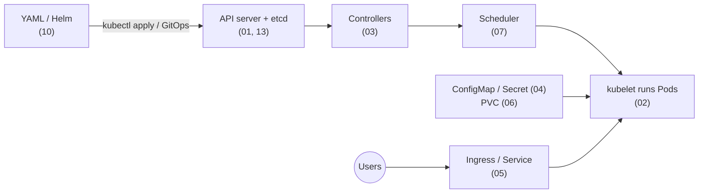

---
mdx:
  format: md
---

# Kubernetes Complete Guide - Index (Basic to Advanced)

> **Note**: Sections marked **(Interview Imp)** are frequently asked in interviews.
>
> **How to read this wiki:** Read the files in number order. Every file has its own table of contents, Previous/Next links and a **📘 Terms Explained** table for any word you don't know.
>
> **Scope:** Architecture, kubectl, Pods and probes, Deployments/StatefulSets/DaemonSets/Jobs, autoscaling, ConfigMaps and Secrets, Services/Ingress/Gateway API/NetworkPolicy, storage (PV/PVC/CSI), scheduling, RBAC and security, observability and a troubleshooting playbook, Helm/Kustomize/GitOps/Operators, production operations, internals (control loops, etcd, API machinery), running Spring Boot apps (Actuator probes, JVM memory, graceful shutdown), interview questions, CKA/CKAD/CKS prep, projects, a learning path and a one-page cheat sheet.
>
> **Related files:** [00_Docker_Index.md](../docker/00_Docker_Index.md) (prerequisite) · [DevOps_Complete_Guide.md](../devops/DevOps_Complete_Guide.md) (CI/CD, IaC, cloud) · [01_Cloud_Native_Pattern.md](../design-patterns/04_Specialized/01_Cloud_Native_Pattern.md) (cloud native patterns) · [09_Deployment_Pattern.md](../design-patterns/03_System_Design/09_Deployment_Pattern.md) (rolling, blue/green, canary) · [01_Scalability_Pattern.md](../design-patterns/03_System_Design/01_Scalability_Pattern.md) · [Java_Complete_Guide.md](../java/Java_Complete_Guide.md) (Spring Boot apps)

## Table of Contents
1. [Study Levels](#1-study-levels)
2. [Files in Study Order](#2-files-in-study-order)
3. [Big Picture in One Diagram](#3-big-picture-in-one-diagram)
4. [Verification Status](#4-verification-status)

---

## 1. Study Levels

| Level | Files |
|---|---|
| **Beginner** | 01-02 (architecture, kubectl, Pods, probes, resources) |
| **Intermediate** | 03-06 (controllers, autoscaling, config and secrets, networking, storage) |
| **Advanced** | 07-10 (scheduling, security, observability and debugging, Helm/GitOps/Operators) |
| **Professional** | 11-13 (production operations, running Spring Boot apps, internals) |
| **Mastery** | 14-16 (interview questions, certification/projects/learning path, big picture and cheat sheet) |

## 2. Files in Study Order

| # | File | What you learn | Key sections |
|---|---|---|---|
| 01 | [01_Kubernetes_Fundamentals.md](01_Kubernetes_Fundamentals.md) | What Kubernetes is, how it is built, using kubectl | [Architecture (Interview Imp)](01_Kubernetes_Fundamentals.md#12-architecture-interview-imp), [kubectl essentials (Interview Imp)](01_Kubernetes_Fundamentals.md#15-kubectl-essentials-interview-imp) |
| 02 | [02_Pods.md](02_Pods.md) | The smallest unit: Pods, lifecycle, probes, resources (all verified on minikube) | [Probes (Interview Imp)](02_Pods.md#23-probes-interview-imp), [Requests, limits, QoS (Interview Imp)](02_Pods.md#25-resources-requests-limits-and-qos-interview-imp) |
| 03 | [03_Workload_Controllers.md](03_Workload_Controllers.md) | Deployments, StatefulSets, DaemonSets, Jobs, autoscaling | [Deployment](03_Workload_Controllers.md#31-deployment-stateless-apps), [StatefulSet (Interview Imp)](03_Workload_Controllers.md#33-statefulset-stateful-apps-interview-imp), [Autoscaling (Interview Imp)](03_Workload_Controllers.md#36-autoscaling-interview-imp) |
| 04 | [04_Configuration_and_Secrets.md](04_Configuration_and_Secrets.md) | Getting settings and passwords into Pods | [ConfigMap](04_Configuration_and_Secrets.md#41-configmap), [Secrets (Interview Imp)](04_Configuration_and_Secrets.md#42-secrets-interview-imp) |
| 05 | [05_Networking.md](05_Networking.md) | Services, Ingress, Gateway API, NetworkPolicy | [Services](05_Networking.md#52-services), [Ingress and Gateway API](05_Networking.md#53-ingress-and-gateway-api), [NetworkPolicy (verified)](05_Networking.md#54-networkpolicy-pod-firewall) |
| 06 | [06_Storage.md](06_Storage.md) | Volumes and persistent data | [PV, PVC, StorageClass](06_Storage.md#62-pv-pvc-storageclass) |
| 07 | [07_Scheduling_and_Resources.md](07_Scheduling_and_Resources.md) | Where Pods run and how resources are shared | [Placement controls](07_Scheduling_and_Resources.md#72-placement-controls), [Disruptions (PDB)](07_Scheduling_and_Resources.md#73-availability-during-disruptions) |
| 08 | [08_Security.md](08_Security.md) | RBAC, admission, Pod Security, hardening | [RBAC and admission](08_Security.md#82-authentication-authorisation-rbac-admission), [Pod Security (verified)](08_Security.md#83-pod-security), [Security checklist](08_Security.md#84-security-checklist) |
| 09 | [09_Observability_and_Troubleshooting.md](09_Observability_and_Troubleshooting.md) | Metrics, logs, traces and fixing broken Pods (6 failures reproduced) | [Debugging playbook](09_Observability_and_Troubleshooting.md#92-debugging-playbook), [Failure scenarios (Interview Imp)](09_Observability_and_Troubleshooting.md#93-failure-scenarios-reproduced-interview-imp) |
| 10 | [10_Helm_GitOps_and_Operators.md](10_Helm_GitOps_and_Operators.md) | Packaging, delivery and extending Kubernetes | [Helm](10_Helm_GitOps_and_Operators.md#101-helm-package-manager), [GitOps (Interview Imp)](10_Helm_GitOps_and_Operators.md#103-gitops-interview-imp), [CRDs and Operators (Interview Imp)](10_Helm_GitOps_and_Operators.md#105-extending-kubernetes-crds-and-operators-interview-imp) |
| 11 | [11_Production_Operations.md](11_Production_Operations.md) | Running clusters and workloads in production | [Workload checklist (Interview Imp)](11_Production_Operations.md#112-checklist-for-every-workload-interview-imp), [Zero-downtime recipe](11_Production_Operations.md#114-zero-downtime-deployment-recipe) |
| 12 | [12_Spring_Boot_on_Kubernetes.md](12_Spring_Boot_on_Kubernetes.md) | Probes, JVM memory, config and graceful shutdown for Java apps | [Actuator probes (Interview Imp)](12_Spring_Boot_on_Kubernetes.md#125-health-probes-with-actuator-interview-imp), [JVM memory (Interview Imp)](12_Spring_Boot_on_Kubernetes.md#126-jvm-memory-and-cpu-in-containers-interview-imp), [Graceful shutdown (Interview Imp)](12_Spring_Boot_on_Kubernetes.md#128-graceful-shutdown-and-prestop-interview-imp) |
| 13 | [13_Kubernetes_Internals.md](13_Kubernetes_Internals.md) | Control loops, etcd, API machinery, CRI/CNI/CSI | [What happens on `kubectl apply`](13_Kubernetes_Internals.md#132-what-happens-on-kubectl-apply--f-deployyaml) |
| 14 | [14_Interview_Questions.md](14_Interview_Questions.md) | 40 questions plus tricky scenarios | [Basics](14_Interview_Questions.md#141-basics), [Advanced](14_Interview_Questions.md#143-advanced--scenario-based), [Tricky scenarios](14_Interview_Questions.md#144-tricky-scenarios) |
| 15 | [15_Certification_Projects_and_Learning_Path.md](15_Certification_Projects_and_Learning_Path.md) | CKA/CKAD/CKS prep, hands-on projects, study plan | [Certification](15_Certification_Projects_and_Learning_Path.md#151-certification-prep-cka-ckad-cks), [Projects](15_Certification_Projects_and_Learning_Path.md#152-practice-projects-by-level), [Learning path](15_Certification_Projects_and_Learning_Path.md#153-learning-path) |
| 16 | [16_Big_Picture_and_Cheat_Sheet.md](16_Big_Picture_and_Cheat_Sheet.md) | How it all fits together + one-page cheat sheet | [How it all fits together (Interview Imp)](16_Big_Picture_and_Cheat_Sheet.md#161-how-it-all-fits-together-interview-imp), [Cheat sheet](16_Big_Picture_and_Cheat_Sheet.md#162-kubernetes-cheat-sheet) |

## 3. Big Picture in One Diagram

The full walkthrough of this diagram is in [16_Big_Picture_and_Cheat_Sheet.md](16_Big_Picture_and_Cheat_Sheet.md#161-how-it-all-fits-together-interview-imp).

## 4. Verification Status

| Item | Status |
|---|---|
| Spring Boot demo app ([examples/greeting-api](https://github.com/ritiksharma142001/one-notes/tree/main/docs/tech-wiki/kubernetes/examples/greeting-api)) in 12 | Local tests (3 runs each) and the image build plus all `kubectl` steps on **minikube v1.38.1 / Kubernetes v1.35.1** (QEMU driver) **executed**, real output pasted. Buildpacks/Jib/GraalVM/Spring Cloud Kubernetes only described. |
| Pods (02) and troubleshooting (09) scenarios ([examples/pods-and-debugging](https://github.com/ritiksharma142001/one-notes/tree/main/docs/tech-wiki/kubernetes/examples/pods-and-debugging)) | **Executed on minikube** (each scenario once), real output pasted. Prometheus/Loki/tracing tools, node-level debugging, Ingress and node failures only described. |
| RBAC, Pod Security Admission (08) and NetworkPolicy (5.4) ([examples/security-and-networkpolicy](https://github.com/ritiksharma142001/one-notes/tree/main/docs/tech-wiki/kubernetes/examples/security-and-networkpolicy)) | **Executed on minikube with Calico** (each scenario once), real output pasted. The original 5.4 example was **wrong** (default-deny egress without DNS/egress allows) and is now shown as a mistake plus fix. OIDC, audit logs, policy engines only described. |
| YAML manifests and `kubectl` commands in 01, 03, 04, the rest of 05, 06, 07, 10, 11 and 13-15 | **Not yet executed.** They were written before the "run everything" rule. They will be applied on minikube, with real output pasted under each example, as each file is revisited. |
| Mermaid diagrams | Checked with the mermaid parser |
| Links and anchors | Checked across the whole wiki |
| Helm examples (10.1) | Cannot be run yet: **Helm is not installed** on this machine |
| Cloud-specific items (EKS/GKE/AKS, IRSA, cloud load balancers, Karpenter) | Cannot be run locally (need a cloud account) |

#### 📘 Terms Explained

| Term | Simple meaning |
|---|---|
| **Kubernetes (K8s)** | System that runs containers across many machines and keeps them healthy. |
| **Cluster** | A set of machines (nodes) managed together by one Kubernetes control plane. |
| **Pod** | The smallest thing Kubernetes runs: one or more containers sharing an IP and storage. |
| **Manifest** | A YAML file describing an object you want Kubernetes to create. |
| **kubectl** | The command-line tool for talking to a cluster. |
| **minikube** | Tool that runs a small single-node Kubernetes cluster on your own computer for learning. |
