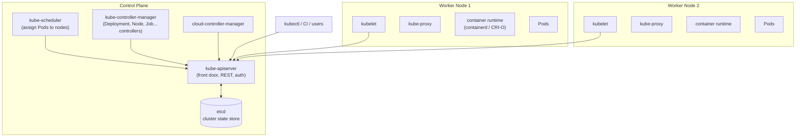
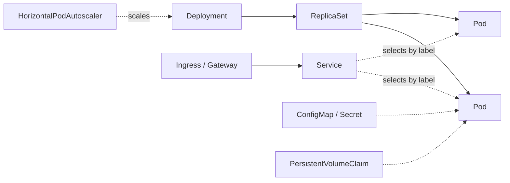

# 1. Kubernetes Fundamentals

> **Note**: Sections marked **(Interview Imp)** are frequently asked in interviews. Every chapter ends with a **📘 Terms Explained** table for the jargon it uses.
>
> **Navigation:** [Index](00_Kubernetes_Index.md) · [Next: 02_Pods ➡](02_Pods.md)

## Table of Contents
- [1.1 What is Kubernetes and Why?](#11-what-is-kubernetes-and-why)
- [1.2 Architecture (Interview Imp)](#12-architecture-interview-imp)
- [1.3 Core Objects at a Glance](#13-core-objects-at-a-glance)
- [1.4 Getting a Cluster](#14-getting-a-cluster)
- [1.5 kubectl Essentials (Interview Imp)](#15-kubectl-essentials-interview-imp)
- [1.6 Manifest (YAML) Structure](#16-manifest-yaml-structure)

---

## 1.1 What is Kubernetes and Why?

**Kubernetes (K8s)** is an open-source **container orchestration platform** (born at Google, now CNCF) that automates **deploying, scaling, healing and managing** containerised applications across a cluster of machines.

Running one container is easy (`docker run`). Running hundreds across many servers raises hard questions:

| Problem | Kubernetes answer |
|---|---|
| Which server should run this container? | **Scheduler** places Pods by resources and rules |
| A container or node crashed | **Self-healing**: restart, reschedule, replace |
| Traffic spikes | **Autoscaling** (HPA, VPA, cluster autoscaler) |
| How do services find each other? | **Services + DNS + service discovery** |
| Deploy new version without downtime | **Rolling updates**, rollbacks, canary patterns |
| Config and secrets per environment | **ConfigMaps / Secrets** |
| Stateful workloads (databases) | **StatefulSets + PersistentVolumes** |
| Load balancing | **Services / Ingress / Gateway API** |
| Access control and isolation | **RBAC, namespaces, NetworkPolicy, quotas** |
| Declarative infrastructure | **YAML manifests + reconciliation** |

Kubernetes is **declarative**: you describe the **desired state** ("3 replicas of image X"), and controllers continuously work to make the **actual state** match it.

#### 📘 Terms Explained

| Term | Simple meaning |
|---|---|
| **Orchestration** | Automating placement, scaling, networking and lifecycle of many containers. |
| **Cluster** | A set of machines (nodes) managed by Kubernetes. |
| **Desired state / actual state** | What you asked for / what currently exists. |
| **Declarative** | You say *what* you want; the system figures out *how*. |
| **CNCF** | Cloud Native Computing Foundation that hosts Kubernetes. |
| **Self-healing** | Automatic recovery of failed workloads. |

---

## 1.2 Architecture (Interview Imp)



### Control plane components

| Component | Role |
|---|---|
| **kube-apiserver** | The only component that talks to etcd. REST API for everything; authentication, authorisation, admission control, validation, watch streams. Horizontally scalable. |
| **etcd** | Consistent, highly-available key-value store (Raft consensus) holding **all cluster state**. Back it up! |
| **kube-scheduler** | Watches unscheduled Pods; filters nodes (resources, taints, affinity) then scores them; binds Pod to a node. |
| **kube-controller-manager** | Runs control loops: Node, ReplicaSet, Deployment, Job, Endpoints, ServiceAccount, etc. |
| **cloud-controller-manager** | Integrates with cloud APIs (load balancers, node lifecycle, routes). |

### Node components

| Component | Role |
|---|---|
| **kubelet** | Agent on each node: registers the node, watches Pods assigned to it, tells the runtime to start containers, runs probes, reports status. |
| **kube-proxy** | Implements Service virtual IPs using iptables/IPVS/nftables rules (some CNIs, like Cilium, replace it). |
| **Container runtime** | containerd or CRI-O, via the **CRI** (Container Runtime Interface). |
| **CNI plugin** | Pod networking (Calico, Cilium, Flannel, Weave, AWS VPC CNI). |
| **CSI driver** | Storage integration. |

### Add-ons
CoreDNS (cluster DNS), metrics-server, Ingress controller, Dashboard, CNI, CSI, Prometheus stack, cert-manager.

## 1.3 Core Objects at a Glance



| Object | Purpose |
|---|---|
| **Pod** | Smallest deployable unit: one or more containers sharing network and storage |
| **ReplicaSet** | Keeps N identical Pods running |
| **Deployment** | Declarative updates and rollbacks for stateless apps (manages ReplicaSets) |
| **StatefulSet** | Stable identity and storage for stateful apps |
| **DaemonSet** | One Pod per node (log/monitoring agents) |
| **Job / CronJob** | Run-to-completion tasks / scheduled tasks |
| **Service** | Stable virtual IP + DNS name + load balancing for a set of Pods |
| **Ingress / Gateway** | HTTP(S) routing from outside to Services |
| **ConfigMap / Secret** | Configuration / sensitive data |
| **PersistentVolume / Claim / StorageClass** | Durable storage |
| **Namespace** | Virtual cluster partition for isolation and quotas |
| **ServiceAccount, Role, RoleBinding** | Identity and permissions (RBAC) |
| **HPA / VPA** | Autoscaling |
| **NetworkPolicy** | Pod-level firewall rules |
| **CRD / Operator** | Extend Kubernetes with your own resource types |

## 1.4 Getting a Cluster

| Option | Use |
|---|---|
| **kind** (Kubernetes in Docker) | Local multi-node clusters for dev/CI (`kind create cluster`) |
| **minikube** | Local single-node VM/container cluster with addons |
| **k3s / k3d / MicroK8s** | Lightweight clusters (edge, home lab, CI) |
| **Docker Desktop / Rancher Desktop** | Built-in single-node K8s |
| **kubeadm** | Bootstrap your own cluster on VMs/bare metal |
| **Managed services** | **EKS** (AWS), **GKE** (Google), **AKS** (Azure), DOKS, OKE: provider runs the control plane |
| **OpenShift, Rancher, Talos** | Distributions/platforms |

```bash
kind create cluster --name dev
kubectl cluster-info
kubectl get nodes -o wide
```

## 1.5 kubectl Essentials (Interview Imp)

```bash
kubectl config get-contexts | use-context prod | current-context      # which cluster am I talking to?
kubectl get pods -A                       # all namespaces   (-n ns for one; -o wide|yaml|json|name; -w watch; -l app=web)
kubectl describe pod web-7d9f              # details + EVENTS (first place to look when debugging)
kubectl logs web-7d9f -c app -f --previous --since=10m   # container logs (previous = crashed instance)
kubectl exec -it web-7d9f -- sh
kubectl apply -f deploy.yaml               # create/update declaratively (idempotent)
kubectl apply -k overlays/prod             # Kustomize
kubectl delete -f deploy.yaml | kubectl delete pod web-7d9f
kubectl create deployment web --image=nginx --replicas=3 --dry-run=client -o yaml > deploy.yaml    # generate YAML
kubectl run tmp --rm -it --image=busybox -- sh                          # throwaway debug Pod
kubectl port-forward svc/web 8080:80       # tunnel a Service/Pod to localhost
kubectl scale deploy/web --replicas=5
kubectl rollout status|history|undo|restart deploy/web
kubectl set image deploy/web app=myorg/web:1.2.0
kubectl top pods|nodes                      # needs metrics-server
kubectl get events --sort-by=.lastTimestamp
kubectl explain pod.spec.containers.resources          # built-in docs for any field
kubectl diff -f deploy.yaml                  # preview changes
kubectl auth can-i create pods --as system:serviceaccount:dev:app
kubectl cp pod:/path ./local ; kubectl debug -it pod --image=busybox --target=app
kubectl get pod web -o jsonpath='{.status.podIP}'
kubectl label|annotate|taint|cordon|drain|uncordon ...
alias k=kubectl ; source <(kubectl completion bash)
```
Tools: **k9s** (terminal UI), **Lens**, **kubectx/kubens**, **stern** (multi-pod logs), **kubectl neat**, **kubeconform/kubeval** (manifest validation), **popeye/kube-score** (best-practice checks).

## 1.6 Manifest (YAML) Structure

```yaml
apiVersion: apps/v1          # API group/version of the resource
kind: Deployment             # resource type
metadata:
  name: web
  namespace: shop
  labels: { app: web, tier: frontend }       # identifying key/values (used by selectors)
  annotations: { owner: "team-a" }            # non-identifying metadata
spec:                        # desired state (schema depends on kind)
  ...
status:                      # actual state - written by the system, not by you
```
Every object: `apiVersion`, `kind`, `metadata`, `spec` (and `status`). Use `kubectl api-resources` and `kubectl explain` to discover fields.

**Labels & selectors** glue objects together: a Service selects Pods with `app=web`; Deployments manage Pods matching their selector. Equality (`app=web`) and set-based (`env in (prod,stage)`) selectors.
**Namespaces** partition a cluster (`default`, `kube-system`, `kube-public`, `kube-node-lease`); names are unique per namespace; some resources (Nodes, PersistentVolumes, StorageClasses, ClusterRoles) are cluster-scoped.

#### 📘 Terms Explained

| Term | Simple meaning |
|---|---|
| **API server** | Central gateway; every interaction goes through it. |
| **etcd** | Database storing all cluster state. |
| **Controller** | Loop that compares desired vs actual state and fixes differences. |
| **kubelet** | Per-node agent running Pods. |
| **CRI / CNI / CSI** | Plug-in interfaces for runtimes / networking / storage. |
| **Label / Selector** | Key-value tags / queries on those tags. |
| **Namespace** | Logical partition of a cluster. |
| **Manifest** | YAML/JSON file describing resources. |
| **Idempotent** | Applying it repeatedly yields the same result. |

---

> **Navigation:** [Index](00_Kubernetes_Index.md) · [Next: 02_Pods ➡](02_Pods.md)
