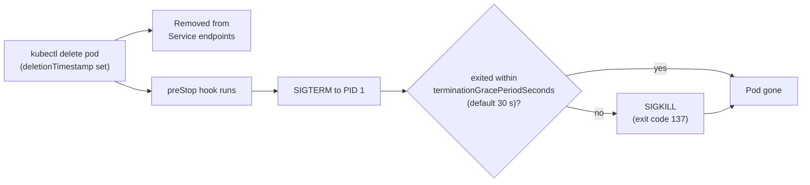

# 2. Pods: The Basic Unit (Interview Imp)

> **Note**: Sections marked **(Interview Imp)** are frequently asked in interviews. Every chapter ends with a **📘 Terms Explained** table for the jargon it uses.
>
> **Navigation:** [⬅ Previous: 01_Kubernetes_Fundamentals](01_Kubernetes_Fundamentals.md) · [Index](00_Kubernetes_Index.md) · [Next: 03_Workload_Controllers ➡](03_Workload_Controllers.md)

## Table of Contents
- [2.1 What is a Pod?](#21-what-is-a-pod)
- [2.2 Pod Lifecycle](#22-pod-lifecycle)
- [2.3 Probes (Interview Imp)](#23-probes-interview-imp)
- [2.4 Multi-Container Patterns](#24-multi-container-patterns)
- [2.5 Resources: Requests, Limits and QoS (Interview Imp)](#25-resources-requests-limits-and-qos-interview-imp)
- [2.6 Pod Security Context](#26-pod-security-context)
- [2.7 Pros and Cons of the Pod Model](#27-pros-and-cons-of-the-pod-model)
- [2.8 Common Pitfalls](#28-common-pitfalls)
- [2.9 Interview Questions](#29-interview-questions)
- [2.10 Cheat Sheet](#210-cheat-sheet)

---

> **Verification status of this file**
>
> | What | Status |
> |---|---|
> | Every manifest in [examples/pods-and-debugging/](examples/pods-and-debugging/) used here (01-08) | **Executed on minikube v1.38.1** (Kubernetes v1.35.1, QEMU driver, Docker runtime). Real output pasted. Each scenario ran **once** (the liveness scenario twice); they take minutes each on this small VM. All resources were deleted afterwards. |
> | Native sidecar YAML (2.4), `fsGroup` (2.6) | **NOT executed**: shown for reference only. |
>
> Things that change between runs: Pod IPs, ages, timestamps, container IDs and UIDs in messages.

## 2.1 What is a Pod?

**What is it?** A **Pod** is the smallest thing Kubernetes runs: one or more containers that always run together on the same node and share:
- one **network namespace**: the same IP address; containers reach each other on `localhost`, so their ports must not clash;
- optional shared **volumes** (folders);
- the same lifecycle: they are scheduled, started and deleted together.

**Why is it needed?** Some helpers must sit right next to the app (a log shipper reading its files, a proxy on `localhost`). A Pod gives them a shared home without merging them into one image.

**How it works:** you send a Pod spec to the API server; the scheduler picks a node; that node's kubelet asks the container runtime to start the containers; the kubelet then keeps reporting status and runs the health checks (probes).

Pods are **ephemeral and replaceable**: when a Pod is recreated it gets a new name and a new IP. You rarely create bare Pods. Use a controller (Deployment, StatefulSet, Job; see [03_Workload_Controllers.md](03_Workload_Controllers.md)) that recreates them for you.

[examples/pods-and-debugging/01-pod-basic.yaml](examples/pods-and-debugging/01-pod-basic.yaml) uses the Spring Boot demo image from [12_Spring_Boot_on_Kubernetes.md](12_Spring_Boot_on_Kubernetes.md):
```yaml
apiVersion: v1
kind: Pod
metadata:
  name: web
  labels: { app: web }
spec:
  containers:
    - name: app
      image: greeting-api:1.0.0
      imagePullPolicy: IfNotPresent
      ports: [{ containerPort: 8080 }]
      env:
        - { name: APP_GREETING, value: "Hello from a bare Pod" }
      resources:
        requests: { cpu: 250m, memory: 512Mi }
        limits:   { memory: 512Mi }
      readinessProbe:
        httpGet: { path: /actuator/health/readiness, port: 8080 }
        periodSeconds: 5
      livenessProbe:
        httpGet: { path: /actuator/health/liveness, port: 8080 }
        initialDelaySeconds: 20
        periodSeconds: 10
  restartPolicy: Always
```
```bash
kubectl apply -f 01-pod-basic.yaml
kubectl get pod web -w                      # watch status changes (Ctrl+C to stop)
kubectl get pod web -o wide
kubectl get pod web -o jsonpath='{.status.phase} {.status.podIP} {.status.qosClass}'
kubectl delete pod web
```
Output:
```
pod/web created
NAME   READY   STATUS              RESTARTS   AGE
web    0/1     ContainerCreating   0          0s
web    0/1     Running             0          2s
web    1/1     Running             0          19s

NAME   READY   STATUS    RESTARTS   AGE   IP            NODE       NOMINATED NODE   READINESS GATES
web    1/1     Running   0          30s   10.244.0.32   minikube   <none>           <none>

Running 10.244.0.32 Burstable

pod "web" deleted from default namespace
```
**Read it like this:**
- `READY 0/1` while `STATUS Running` for 17 seconds: **Running is not Ready.** The container process runs, but the readiness probe hasn't passed yet (the JVM is still starting), so a Service would not send it traffic.
- `READY 1/1` means 1 of 1 containers is ready.
- QoS class `Burstable` because it has requests but no CPU limit (see [2.5](#25-resources-requests-limits-and-qos-interview-imp)).

## 2.2 Pod Lifecycle

**What is it?** The stages a Pod goes through from creation to deletion, and how you read them.

**Why needed?** Every debugging session starts with `kubectl get pods`. You must know what each status means to know where to look next.

**How it works:** a Pod has one **phase** and each container has a **state**.

| Pod phase | Meaning |
|---|---|
| **Pending** | Accepted, but not running yet: waiting for a node (scheduling), or images still downloading |
| **Running** | Bound to a node; at least one container is running (or starting/restarting) |
| **Succeeded** | All containers exited with code 0 and won't restart |
| **Failed** | All containers stopped and at least one failed (non-zero exit) |
| **Unknown** | The node stopped reporting (network/kubelet problem) |

Container states: **Waiting** (with a reason such as `ContainerCreating`, `ImagePullBackOff`, `CrashLoopBackOff`, `CreateContainerConfigError`), **Running**, **Terminated** (with a reason: `Completed`, `Error`, `OOMKilled`, and an exit code).

**Important:** the `STATUS` column of `kubectl get pods` is **not** the phase. It shows the most useful reason (a waiting/terminated reason if there is one, else the phase).

### Example: a Pod that succeeds and one that fails
[02-lifecycle-succeeded-failed.yaml](examples/pods-and-debugging/02-lifecycle-succeeded-failed.yaml): two busybox Pods with `restartPolicy: Never`; one ends with `exit 0`, the other with `exit 1`.
```bash
kubectl apply -f 02-lifecycle-succeeded-failed.yaml
kubectl get pods -l demo=phases -w
kubectl get pods -l demo=phases -o custom-columns=NAME:.metadata.name,PHASE:.status.phase,EXIT:.status.containerStatuses[0].state.terminated.exitCode,REASON:.status.containerStatuses[0].state.terminated.reason
kubectl logs job-fail
```
Output:
```
pod/job-ok created
pod/job-fail created
NAME       READY   STATUS              RESTARTS   AGE
job-fail   0/1     ContainerCreating   0          0s
job-ok     0/1     ContainerCreating   0          0s
job-ok     1/1     Running             0          2s
job-fail   1/1     Running             0          2s
job-ok     0/1     Completed           0          6s
job-fail   0/1     Error               0          8s
job-ok     0/1     Completed           0          8s
job-fail   0/1     Error               0          9s

NAME       PHASE       EXIT   REASON
job-fail   Failed      1      Error
job-ok     Succeeded   0      Completed

working
something broke
```
`STATUS` says `Completed` / `Error` while the real phase is `Succeeded` / `Failed`: the column shows the container's termination reason.

**Surprise:** watching two Pods by name doesn't work:
```
$ kubectl get pods job-ok job-fail -w
error: you may only watch a single resource or type of resource at a time
```
Watch by label instead (`-l demo=phases`), as above.

**restartPolicy** decides what happens when a container exits: `Always` (default; restart forever: Deployments), `OnFailure` (restart only on non-zero exit: Jobs), `Never`. Restarts use a growing delay (**back-off**): 10 s, 20 s, 40 s ... up to 5 minutes, which is what `CrashLoopBackOff` means (see [09](09_Observability_and_Troubleshooting.md#92-debugging-playbook)).

**Termination sequence** (when a Pod is deleted):

Endpoint removal and `preStop` happen **in parallel**, which is why a short `preStop` sleep prevents failed requests. Measured proof: [12.8](12_Spring_Boot_on_Kubernetes.md#128-graceful-shutdown-and-prestop-interview-imp) (0 failures with `preStop`, 4-8 without).

#### 📘 Terms Explained

| Term | Simple meaning |
|---|---|
| **Phase** | The Pod's overall stage: Pending, Running, Succeeded, Failed, Unknown. |
| **Container state** | Each container's own status: Waiting, Running or Terminated, with a reason. |
| **Exit code** | Number a process returns when it stops; 0 = success. 137 = killed by SIGKILL, 143 = stopped by SIGTERM. |
| **restartPolicy** | What the kubelet does when a container exits: Always, OnFailure, Never. |
| **Back-off** | Waiting longer after each failure before trying again (10 s, 20 s, 40 s ... 5 min). |
| **`-w` (watch)** | Keep the command running and print a new line on every change. |

## 2.3 Probes (Interview Imp)

**What is it?** Periodic health checks the **kubelet** runs against each container.

**Why needed?** A process can be running and still useless: deadlocked, still loading, or unable to reach its database. Without probes Kubernetes only knows "process alive", so it would keep sending traffic to broken Pods and never restart hung ones.

**How it works / types:**

| Probe | Question it answers | On failure | Runs when |
|---|---|---|---|
| **startupProbe** | Has the app finished starting? | After `failureThreshold` failures: **restart** the container | First; liveness and readiness wait until it passes |
| **livenessProbe** | Is it stuck / broken beyond repair? | **Restart the container** | All the time after startup |
| **readinessProbe** | Can it serve traffic right now? | **Remove the Pod from Service endpoints** (no restart) | All the time after startup |

Mechanisms: `httpGet` (status 200-399 = success), `tcpSocket` (port accepts a connection), `exec` (command exits 0), `grpc` (gRPC health protocol).

Parameters: `initialDelaySeconds` (wait before the first check), `periodSeconds` (how often, default 10), `timeoutSeconds` (default 1), `failureThreshold` (failures in a row before acting, default 3), `successThreshold` (successes needed to count as healthy again; must be 1 for liveness/startup).

**Time to act ≈ initialDelaySeconds + periodSeconds × failureThreshold.** For a startup probe this is the *maximum start time* you allow.

### Example 1: liveness failure → restart
[03-liveness-exec.yaml](examples/pods-and-debugging/03-liveness-exec.yaml): the container creates `/tmp/healthy`, "hangs" after 20 s (deletes the file), and an `exec` probe checks the file every 5 s.
```yaml
command: ["sh", "-c", "touch /tmp/healthy; sleep 20; rm /tmp/healthy; sleep 600"]
livenessProbe:
  exec: { command: ["cat", "/tmp/healthy"] }
  initialDelaySeconds: 5
  periodSeconds: 5
  failureThreshold: 3
```
```bash
kubectl apply -f 03-liveness-exec.yaml
kubectl get pod liveness-demo -w
kubectl describe pod liveness-demo | sed -n '/^Events:/,$p'
```
Output:
```
NAME            READY   STATUS              RESTARTS   AGE
liveness-demo   0/1     ContainerCreating   0          1s
liveness-demo   1/1     Running             0          2s
liveness-demo   1/1     Running             1 (1s ago)   67s

Events:
  Type     Reason     Age                From               Message
  ----     ------     ----               ----               -------
  Normal   Scheduled  79s                default-scheduler  Successfully assigned default/liveness-demo to minikube
  Warning  Unhealthy  43s (x3 over 53s)  kubelet            spec.containers{app}: Liveness probe failed: cat: can't open '/tmp/healthy': No such file or directory
  Normal   Killing    43s                kubelet            spec.containers{app}: Container app failed liveness probe, will be restarted
  Normal   Pulled     13s (x2 over 78s)  kubelet            spec.containers{app}: Container image "busybox:1.36" already present on machine and can be accessed by the pod
  Normal   Created    13s (x2 over 78s)  kubelet            spec.containers{app}: Container created
  Normal   Started    13s (x2 over 77s)  kubelet            spec.containers{app}: Container started
```
**Surprise: the restart came 30 s after the "Killing" event.** A second run recorded the old container's end state:
```bash
kubectl get pod liveness-demo -o jsonpath='restarts={.status.containerStatuses[0].restartCount} reason={.status.containerStatuses[0].lastState.terminated.reason} exitCode={.status.containerStatuses[0].lastState.terminated.exitCode} started={...startedAt} finished={...finishedAt}'
```
```
restarts=1 reason=Error exitCode=137 started=2026-10-31T21:52:51Z finished=2026-10-31T21:53:56Z
```
The container lived 65 s: 20 s healthy + about 15 s of failed probes + **the full 30 s grace period**. The `sh` running as PID 1 ignored SIGTERM, so the kubelet waited 30 s and then sent SIGKILL (exit code **137**). The same thing slows down every restart and every deployment of apps that don't handle SIGTERM. Fix: make PID 1 your real app with a SIGTERM handler (exec form `ENTRYPOINT`, see [09_Runtime_Limits_Logging_Health.md](../docker/09_Runtime_Limits_Logging_Health.md#94-pid-1-signals-and-graceful-shutdown-interview-imp)).

### Example 2: readiness failure → out of the Service, no restart
[04-readiness-service.yaml](examples/pods-and-debugging/04-readiness-service.yaml): a `greeting-api` Pod behind a Service. Its readiness is switched off by hand (`POST /admin/readiness?ready=false`, see [12.5](12_Spring_Boot_on_Kubernetes.md#125-health-probes-with-actuator-interview-imp)).
```bash
kubectl apply -f 04-readiness-service.yaml
kubectl get endpointslices -l kubernetes.io/service-name=ready-demo -o yaml | grep -A8 '^  endpoints:'
# ... readiness switched off from a curl Pod, then:
kubectl get pod ready-demo
kubectl get endpointslices -l kubernetes.io/service-name=ready-demo -o yaml | grep -A8 '^  endpoints:'
kubectl get endpoints ready-demo
kubectl describe pod ready-demo | grep -E 'Readiness probe failed|Restart Count'
kubectl run curl --image=curlimages/curl:8.11.1 --restart=Never --rm -i --quiet -- curl -sS -m 3 http://ready-demo/hello
```
Output (readiness UP, then DOWN):
```
  endpoints:
  - addresses:
    - 10.244.0.45
    conditions:
      ready: true
      serving: true
      terminating: false

NAME         READY   STATUS    RESTARTS   AGE
ready-demo   0/1     Running   0          18s

  endpoints:
  - addresses:
    - 10.244.0.45
    conditions:
      ready: false
      serving: false
      terminating: false

Warning: v1 Endpoints is deprecated in v1.33+; use discovery.k8s.io/v1 EndpointSlice
NAME         ENDPOINTS   AGE
ready-demo               21s

    Restart Count:  0
  Warning  Unhealthy  2s (x5 over 8s)    kubelet            spec.containers{app}: Readiness probe failed: HTTP probe failed with statuscode: 503

curl: (28) Connection timed out after 3002 milliseconds
```
**What this shows:**
- `READY 0/1`, `RESTARTS 0`: readiness never restarts anything.
- **Surprise:** the EndpointSlice still *lists* the Pod's IP, but with `ready: false`. The plain `kubectl get endpointslices` table shows the IP either way, so look at the `conditions`. The old `kubectl get endpoints` view (deprecated since v1.33) only lists ready addresses, so it showed an empty list.
- With no ready endpoint, calls to the Service **timed out** (not "connection refused").
- After switching readiness back on, the Pod went back to `1/1` and `ready: true` within 5 s, with no restart.

### Example 3: probe timing that's too strict → CrashLoopBackOff
[05-startup-too-short.yaml](examples/pods-and-debugging/05-startup-too-short.yaml): an app that needs about 30 s to start (5 s JVM + 25 s simulated warm-up), **no startupProbe**, and a liveness probe that gives up after `5 + 3 × 3 = 14 s`.
```yaml
env:
  - { name: APP_STARTUP_DELAY_MS, value: "25000" }
livenessProbe:
  httpGet: { path: /actuator/health/liveness, port: 8080 }
  initialDelaySeconds: 5
  periodSeconds: 3
  failureThreshold: 3
```
```bash
kubectl apply -f 05-startup-too-short.yaml
kubectl get pod slow-start-demo                    # after ~3 minutes
kubectl describe pod slow-start-demo | sed -n '/^Events:/,$p'
kubectl logs slow-start-demo | grep -E 'Started Greeting|Simulating|Commencing'
```
Output:
```
NAME              READY   STATUS             RESTARTS      AGE
slow-start-demo   0/1     CrashLoopBackOff   5 (53s ago)   3m15s

Events:
  Type     Reason     Age                  From               Message
  ----     ------     ----                 ----               -------
  Normal   Scheduled  3m15s                default-scheduler  Successfully assigned default/slow-start-demo to minikube
  Normal   Started    65s (x6 over 3m14s)  kubelet            spec.containers{app}: Container started
  Warning  Unhealthy  59s (x5 over 3m8s)   kubelet            spec.containers{app}: Liveness probe failed: Get "http://10.244.0.47:8080/actuator/health/liveness": dial tcp 10.244.0.47:8080: connect: connection refused
  Warning  Unhealthy  53s (x13 over 3m5s)  kubelet            spec.containers{app}: Liveness probe failed: HTTP probe failed with statuscode: 503
  Normal   Killing    53s (x6 over 3m2s)   kubelet            spec.containers{app}: Container app failed liveness probe, will be restarted
  Warning  BackOff    53s (x6 over 2m26s)  kubelet            spec.containers{app}: Back-off restarting failed container app in pod slow-start-demo_default(2ea29723-...)

2026-10-31T21:57:26.675Z  INFO 1 --- [gr...GreetingApplication   : Started GreetingApplication in 5.049 seconds (process running for 5.665)
2026-10-31T21:57:26.766Z  INFO 1 --- [gr...GreetingController    : Simulating slow startup: sleeping 25000 ms
2026-10-31T21:57:32.163Z  INFO 1 --- [gr...cefulShutdown         : Commencing graceful shutdown. Waiting for active requests to complete
```
The app is healthy; it is simply never allowed to finish starting. Each attempt is killed about 5 s into its warm-up, forever. **Fix:** add a `startupProbe` whose `failureThreshold × periodSeconds` is longer than the worst start time (e.g. `periodSeconds: 2`, `failureThreshold: 30` = 60 s), as in [12.5](12_Spring_Boot_on_Kubernetes.md#125-health-probes-with-actuator-interview-imp). Don't paper over it with a huge `initialDelaySeconds`, which delays detection of real hangs too.

**Rules of thumb:**
- Liveness must be cheap and **must not depend on other services** (DB, other APIs). Otherwise one DB outage restarts every Pod.
- Readiness may check dependencies the Pod truly can't work without.
- Use `httpGet` on a real health endpoint; `tcpSocket` only proves the port is open (a JVM's port opens before the app is ready: [12.5](12_Spring_Boot_on_Kubernetes.md#example-1-what-the-probes-see-during-a-slow-start)).
- Slow starters: use `startupProbe`, not a large `initialDelaySeconds`.

#### 📘 Terms Explained

| Term | Simple meaning |
|---|---|
| **Probe** | A health check the kubelet runs periodically against a container. |
| **kubelet** | The Kubernetes agent on each node; it starts containers and runs probes. |
| **Endpoint / EndpointSlice** | The list of Pod IPs behind a Service, each marked ready or not. |
| **`exec` probe** | Runs a command inside the container; exit code 0 = healthy. |
| **CrashLoopBackOff** | The container keeps dying and Kubernetes waits longer before each restart. |
| **SIGKILL / 137** | Forced kill that can't be ignored; shows up as exit code 137. |
| **PID 1** | The first process in the container; it gets the stop signal and must handle it. |

## 2.4 Multi-Container Patterns

**What is it?** Putting more than one container in a Pod, each with one job.

**Why needed?** Keeps the app image focused while helpers (log shipping, proxies, setup steps) are added and versioned separately.

**Types:**

| Pattern | Idea | Example |
|---|---|---|
| **Init container** | Runs to completion **before** the app containers start; runs in order, one after another | Wait for a dependency, run DB migrations, download config |
| **Sidecar** | Helper running alongside the app for its whole life | Log shipper, service-mesh proxy (Envoy), certificate refresher |
| **Ambassador** | Sidecar that proxies the app's *outgoing* connections | Local DB proxy (Cloud SQL proxy) |
| **Adapter** | Sidecar that converts the app's output into a standard format | Metrics exporter |

**Native sidecars:** an init container with `restartPolicy: Always` starts before the app, keeps running, and is stopped *after* the app (beta and on by default since Kubernetes 1.29, GA in 1.33). This fixes old problems such as Jobs never finishing because a sidecar kept running. *(Shown for reference; NOT executed.)*
```yaml
initContainers:
  - name: log-shipper
    image: fluent/fluent-bit:3.1
    restartPolicy: Always          # makes it a native sidecar
```

### Example: init container waiting for a dependency
[06-init-container.yaml](examples/pods-and-debugging/06-init-container.yaml):
```yaml
initContainers:
  - name: wait-db
    image: busybox:1.36
    command: ["sh", "-c", "until nslookup db.default.svc.cluster.local; do echo waiting for db; sleep 2; done"]
containers:
  - name: app
    image: busybox:1.36
    command: ["sh", "-c", "echo app started; sleep 600"]
```
```bash
kubectl apply -f 06-init-container.yaml
kubectl get pod init-demo
kubectl logs init-demo -c wait-db --tail=3
kubectl apply -f 06b-db-service.yaml          # create the Service it waits for
kubectl get pod init-demo
kubectl logs init-demo
```
Output:
```
NAME        READY   STATUS     RESTARTS   AGE
init-demo   0/1     Init:0/1   0          12s

** server can't find db.default.svc.cluster.local: NXDOMAIN

waiting for db

service/db created

NAME        READY   STATUS    RESTARTS   AGE
init-demo   1/1     Running   0          21s

Defaulted container "app" out of: app, wait-db (init)
app started
```
`Init:0/1` means 0 of 1 init containers have finished. Read an init container's log with `-c <name>`; without `-c`, kubectl picks the app container and says so ("Defaulted container").

#### 📘 Terms Explained

| Term | Simple meaning |
|---|---|
| **Init container** | Container that must finish successfully before the main containers start. |
| **Sidecar** | Helper container running next to the main app for its whole life. |
| **Native sidecar** | An init container with `restartPolicy: Always`: starts first, stops last. |
| **NXDOMAIN** | DNS answer meaning "this name does not exist". |
| **`-c <container>`** | kubectl flag to pick one container in a multi-container Pod. |

## 2.5 Resources: Requests, Limits and QoS (Interview Imp)

**What is it?** How much CPU and memory a container is promised (request) and allowed (limit).

**Why needed?** The scheduler needs requests to place Pods on nodes with room; limits stop one noisy app from starving its neighbours; and under memory pressure the node needs to know whom to evict first.

**How it works:**

| | Requests | Limits |
|---|---|---|
| Meaning | Guaranteed minimum; used by the **scheduler** to pick a node | Maximum allowed; enforced at **runtime** by the kernel (cgroups) |
| CPU (compressible) | Share of CPU time | Exceeding → **throttled** (slowed down, not killed) |
| Memory (incompressible) | Reserved | Exceeding → **OOMKilled** (exit code 137) |

Units: CPU `1` = 1 core, `500m` = 0.5 core ("m" = millicores); memory `128Mi`, `1Gi` (binary, 1 Mi = 1024 × 1024 bytes), `1G` (decimal, 1 000 000 000 bytes).

**QoS classes** (Quality of Service) are derived automatically from requests and limits and decide the **eviction order** when a node runs out of memory:

| Class | Rule | Evicted |
|---|---|---|
| **Guaranteed** | Every container has requests == limits for **both** CPU and memory | Last |
| **Burstable** | At least one request or limit set, but not Guaranteed | In between |
| **BestEffort** | No requests or limits at all | **First** |

### Example: the three classes
[07-qos-classes.yaml](examples/pods-and-debugging/07-qos-classes.yaml):
```yaml
# qos-guaranteed
resources:
  requests: { cpu: 100m, memory: 32Mi }
  limits:   { cpu: 100m, memory: 32Mi }
# qos-burstable
resources:
  requests: { memory: 32Mi }
# qos-besteffort: no resources block
```
```bash
kubectl apply -f 07-qos-classes.yaml
kubectl get pods qos-guaranteed qos-burstable qos-besteffort -o custom-columns=NAME:.metadata.name,QOS:.status.qosClass
```
Output:
```
NAME             QOS
qos-guaranteed   Guaranteed
qos-burstable    Burstable
qos-besteffort   BestEffort
```

**Guidelines:** always set memory requests and limits (often equal); always set CPU requests; think twice about CPU limits (throttling hurts latency, and the JVM sizes thread pools from the CPU limit: [12.6](12_Spring_Boot_on_Kubernetes.md#126-jvm-memory-and-cpu-in-containers-interview-imp)); size from real usage (`kubectl top pod`, VPA recommendations). What happens when requests don't fit anywhere (`Pending`) is shown in [09.2](09_Observability_and_Troubleshooting.md#92-debugging-playbook); real OOMKilled output is in [12.6](12_Spring_Boot_on_Kubernetes.md#example-both-kinds-of-oom-in-real-pods).

#### 📘 Terms Explained

| Term | Simple meaning |
|---|---|
| **Request** | Amount of CPU/memory reserved for the container; the scheduler uses it. |
| **Limit** | Maximum CPU/memory the container may use. |
| **Millicore (`m`)** | One thousandth of a CPU core: `250m` = a quarter core. |
| **Mi / Gi** | Mebibyte / gibibyte: binary units (1 Mi = 1,048,576 bytes). |
| **Throttling** | The kernel pauses a container that used up its CPU limit for the current time slice. |
| **QoS class** | Guaranteed, Burstable or BestEffort: decides who is evicted first under memory pressure. |
| **Eviction** | The kubelet stopping Pods to free resources on a node that is running out. |

## 2.6 Pod Security Context

**What is it?** Per-Pod and per-container security settings: which user runs the process, whether it can gain privileges, whether the filesystem is writable.

**Why needed?** By default many images run as **root**. If an attacker breaks into such a container, they have root inside it, which makes escaping to the node much easier.

**How it works:** the kubelet and the container runtime apply these settings when they create the container, and refuse to start it if the image breaks a rule.
```yaml
securityContext:               # pod-level: applies to all containers
  runAsNonRoot: true           # refuse to start a container whose user is root
  runAsUser: 10001
  fsGroup: 2000                # group that owns mounted volumes (NOT executed here)
  seccompProfile: { type: RuntimeDefault }
containers:
  - securityContext:           # container-level
      allowPrivilegeEscalation: false
      readOnlyRootFilesystem: true
      capabilities: { drop: ["ALL"] }
```

### Example: `runAsNonRoot` blocks a root image
[08-run-as-root-blocked.yaml](examples/pods-and-debugging/08-run-as-root-blocked.yaml) runs the official `nginx:1.27` image (which starts as root) with `runAsNonRoot: true`:
```bash
kubectl apply -f 08-run-as-root-blocked.yaml
kubectl get pod root-blocked
kubectl describe pod root-blocked | grep -E 'Warning|Reason'
```
Output:
```
NAME           READY   STATUS                       RESTARTS   AGE
root-blocked   0/1     CreateContainerConfigError   0          10s

      Reason:       CreateContainerConfigError
  Warning  Failed     9s (x2 over 10s)  kubelet            spec.containers{web}: Error: container has runAsNonRoot and image will run as root (pod: "root-blocked_default(0ca74233-...)", container: web)
```
Fix: use an image built to run as non-root (for nginx, `nginxinc/nginx-unprivileged`) or set `runAsUser` to a non-zero UID the image supports. A fully hardened, working example (non-root, read-only root filesystem, all capabilities dropped) is verified in [12.9](12_Spring_Boot_on_Kubernetes.md#deploy-and-test-on-minikube). Cluster-wide enforcement (Pod Security Standards) is in [08_Security.md](08_Security.md#83-pod-security).

#### 📘 Terms Explained

| Term | Simple meaning |
|---|---|
| **securityContext** | Security settings for a Pod or container (user, privileges, filesystem). |
| **`runAsNonRoot`** | Kubernetes refuses to start the container if it would run as root (UID 0). |
| **UID** | Numeric user ID in Linux; 0 is root. |
| **Capabilities** | Pieces of root's power (e.g. `NET_ADMIN`); `drop: ["ALL"]` removes them all. |
| **`allowPrivilegeEscalation`** | Whether a process can gain more privileges than its parent (e.g. via setuid programs). |
| **seccomp** | Linux filter that blocks dangerous system calls; `RuntimeDefault` is a safe preset. |
| **`fsGroup`** | Group ID that Kubernetes applies to mounted volumes so the app can write to them. |

## 2.7 Pros and Cons of the Pod Model

| Pros | Cons |
|---|---|
| Helpers (sidecars, init containers) live next to the app without changing its image | Containers in a Pod scale together, even if only one needs more replicas |
| Shared `localhost` and volumes make sidecars simple | Pods are disposable: new IP and name on every restart, so you need Services |
| Probes give automatic restart and traffic control | Wrong probe settings cause restarts and outages (see Example 3) |
| Requests/limits give predictable scheduling and isolation | Sizing is guesswork until you measure; too-high requests waste money |
| securityContext hardens containers without changing them | Many public images run as root and break under strict settings |

## 2.8 Common Pitfalls

| Pitfall | What happens | Fix |
|---|---|---|
| Treating `Running` as "working" | Traffic expectations wrong; app may still be starting | Check `READY` (readiness), not just `STATUS` |
| No startupProbe for slow apps | Killed during startup → CrashLoopBackOff ([Example 3](#example-3-probe-timing-thats-too-strict--crashloopbackoff)) | startupProbe with enough `failureThreshold × periodSeconds` |
| Liveness checks the database | DB outage restarts every Pod | Dependencies only in readiness |
| App (or `sh`) as PID 1 ignores SIGTERM | Every stop waits the full grace period, then SIGKILL (137) ([Example 1](#example-1-liveness-failure--restart)) | Handle SIGTERM; exec-form entrypoint |
| Reading only `kubectl get endpointslices` table | Shows not-ready IPs too | Check `conditions.ready`, or the Pod's `READY` column |
| `kubectl get pods a b -w` | Error: can only watch one resource | Watch by label: `-l app=x -w` |
| Forgetting `-c` with init containers | You read the wrong container's logs | `kubectl logs pod -c init-name` |
| No memory limit | One leaking Pod can push the node into eviction | Always set memory requests/limits |
| CPU limit set very low | Throttling: slow responses, probe timeouts | Request CPU; avoid tight CPU limits |
| Bare Pods in production | Nothing recreates them if the node dies | Use a Deployment/StatefulSet/Job |
| Root images with `runAsNonRoot` | `CreateContainerConfigError` | Non-root image or `runAsUser` |

## 2.9 Interview Questions

**Q1. What is a Pod and why not just run containers directly?** The smallest schedulable unit: one or more containers that share network, volumes and lifecycle on one node. It lets helpers (sidecars, init containers) sit next to the app and gives Kubernetes one object to schedule, probe and replace.

**Q2. Liveness vs readiness vs startup probe?** Startup: "finished starting?" (others wait for it; failure → restart). Liveness: "stuck?" (failure → restart). Readiness: "can serve now?" (failure → removed from Service endpoints, no restart).

**Q3. A Pod is `Running` but `0/1` ready. What's going on?** The container process runs but the readiness probe fails (still starting, dependency down, wrong path/port). Check `describe pod` events for "Readiness probe failed".

**Q4. Why did my container take 30 s to stop?** PID 1 didn't handle SIGTERM, so the kubelet waited `terminationGracePeriodSeconds` (default 30) and sent SIGKILL (exit 137). Handle SIGTERM and use exec-form entrypoints.

**Q5. What are QoS classes and why do they matter?** Guaranteed (requests == limits for CPU and memory), Burstable, BestEffort. They decide eviction order under memory pressure: BestEffort goes first.

**Q6. What happens if a container exceeds its CPU limit? Its memory limit?** CPU: throttled (slowed). Memory: killed by the kernel (OOMKilled, exit 137) and restarted per `restartPolicy`.

**Q7. What is an init container? A native sidecar?** Init containers run one by one to completion before the app starts (migrations, waiting for dependencies). A native sidecar is an init container with `restartPolicy: Always`: it starts before and stops after the app.

**Q8. Difference between Pod phase and the STATUS column?** Phase is one of five values (Pending, Running, Succeeded, Failed, Unknown). STATUS shows the most specific reason, such as `CrashLoopBackOff`, `Completed` or `Error`.

**Q9. How do you stop a container from running as root?** `securityContext.runAsNonRoot: true` (plus `runAsUser`), and enforce it cluster-wide with Pod Security Admission `restricted`.

## 2.10 Cheat Sheet

```
POD        1+ containers, shared IP/localhost/volumes, same node. Disposable: use controllers.
STATUS     ContainerCreating -> Running (READY 0/1 until readiness passes) -> 1/1
PHASES     Pending | Running | Succeeded | Failed | Unknown. STATUS column != phase (Completed/Error/CrashLoopBackOff)
RESTART    restartPolicy Always | OnFailure | Never. Back-off 10s, 20s, 40s ... 5 min = CrashLoopBackOff
STOP       delete -> endpoints removed || preStop -> SIGTERM -> grace 30s -> SIGKILL (137)
PROBES     startup (restart; gates others) | liveness (restart) | readiness (out of Service, no restart)
           time to act = initialDelay + period x failureThreshold. Liveness never checks dependencies.
QOS        Guaranteed (req==lim cpu+mem) > Burstable > BestEffort (evicted first)
RESOURCES  CPU over limit = throttled. Memory over limit = OOMKilled (137). 500m = half a core. Mi = 1024^2
SECURITY   runAsNonRoot, runAsUser, readOnlyRootFilesystem (+ emptyDir /tmp), drop ALL, no privilege escalation
COMMANDS   kubectl get pod -w -l app=x | describe pod (Events!) | logs -c <container> | get pod -o jsonpath='{.status.qosClass}'
```

---

> **Navigation:** [⬅ Previous: 01_Kubernetes_Fundamentals](01_Kubernetes_Fundamentals.md) · [Index](00_Kubernetes_Index.md) · [Next: 03_Workload_Controllers ➡](03_Workload_Controllers.md)
