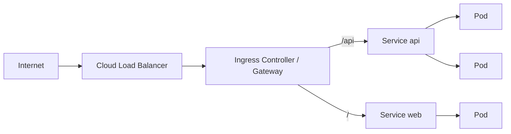

# 5. Networking (Interview Imp)

> **Note**: Sections marked **(Interview Imp)** are frequently asked in interviews. Every chapter ends with a **📘 Terms Explained** table for the jargon it uses.
>
> **Navigation:** [⬅ Previous: 04_Configuration_and_Secrets](04_Configuration_and_Secrets.md) · [Index](00_Kubernetes_Index.md) · [Next: 06_Storage ➡](06_Storage.md)

## Table of Contents
- [5.1 The Kubernetes Network Model](#51-the-kubernetes-network-model)
- [5.2 Services](#52-services)
- [5.3 Ingress and Gateway API](#53-ingress-and-gateway-api)
- [5.4 NetworkPolicy (Pod Firewall)](#54-networkpolicy-pod-firewall)
- [5.5 Service Mesh and Advanced Networking](#55-service-mesh-and-advanced-networking)

---

## 5.1 The Kubernetes Network Model
1. Every Pod gets its **own IP**.
2. All Pods can reach all other Pods **without NAT** (flat network), across nodes.
3. Agents on a node can reach all Pods on that node.
Implemented by a **CNI plugin** (Calico, Cilium, Flannel, AWS VPC CNI, Azure CNI). Pod IPs are ephemeral, so never hard-code them: use **Services**.

## 5.2 Services

A **Service** gives a set of Pods (selected by labels) a stable **virtual IP (ClusterIP)**, DNS name and load balancing.

```yaml
apiVersion: v1
kind: Service
metadata: { name: web }
spec:
  type: ClusterIP
  selector: { app: web }
  ports:
    - name: http
      port: 80            # Service port
      targetPort: 8080    # container port (name or number)
```

| Type | Exposure | Use |
|---|---|---|
| **ClusterIP** (default) | Internal virtual IP only | Service-to-service traffic |
| **NodePort** | Opens a port (30000-32767) on every node | Quick tests, on-prem LBs |
| **LoadBalancer** | Cloud provider provisions an external L4 load balancer | Public service on cloud |
| **ExternalName** | DNS CNAME to an external name | Alias external services |
| **Headless** (`clusterIP: None`) | No VIP; DNS returns Pod IPs | StatefulSets, client-side discovery |

- **Endpoints/EndpointSlices:** list of ready Pod IPs behind a Service (only Pods passing **readiness** are included).
- **DNS (CoreDNS):** `web.shop.svc.cluster.local` (`<service>.<namespace>.svc.<cluster-domain>`); within the same namespace just `web`. Pods get `/etc/resolv.conf` with search domains (`ndots:5` causes extra lookups: use FQDNs or tune).
- **kube-proxy modes:** iptables (default), IPVS (many Services), nftables; Cilium can replace it with eBPF.
- **Session affinity:** `sessionAffinity: ClientIP`.
- `externalTrafficPolicy: Local` preserves client source IP and avoids an extra hop.

## 5.3 Ingress and Gateway API

**Ingress** routes external HTTP(S) traffic to Services (host/path rules, TLS) and needs an **Ingress controller** (NGINX, Traefik, HAProxy, AWS ALB, GCE, Istio, Contour).

```yaml
apiVersion: networking.k8s.io/v1
kind: Ingress
metadata:
  name: shop
  annotations: { cert-manager.io/cluster-issuer: letsencrypt }
spec:
  ingressClassName: nginx
  tls: [{ hosts: [shop.example.com], secretName: shop-tls }]
  rules:
    - host: shop.example.com
      http:
        paths:
          - { path: /api, pathType: Prefix, backend: { service: { name: api, port: { number: 80 } } } }
          - { path: /,    pathType: Prefix, backend: { service: { name: web, port: { number: 80 } } } }
```
**Gateway API** (`GatewayClass`, `Gateway`, `HTTPRoute`, `GRPCRoute`, `TCPRoute`) is the modern, role-oriented, more expressive successor (header matching, traffic splitting, cross-namespace routes). **cert-manager** automates TLS certificates (Let's Encrypt); **ExternalDNS** manages DNS records.



## 5.4 NetworkPolicy (Pod Firewall)

> **Verified** on minikube v1.38.1 (Kubernetes v1.35.1) with the **Calico** network plugin (`minikube start --cni=calico`). Each step ran **once**; manifests are in [examples/security-and-networkpolicy/](examples/security-and-networkpolicy/).

**What is it?** A firewall for Pods. A NetworkPolicy says which Pods may send traffic to (ingress) or from (egress) the Pods it selects.

**Why needed?** By default **every Pod can talk to every Pod** in the cluster, across all namespaces. One compromised Pod can then reach your database directly.

**How it works:**
- A policy **selects Pods** with `podSelector` (empty `{}` = all Pods in the namespace) and lists **allowed** traffic. There are no "deny" rules.
- A Pod that **no** policy selects for a direction (Ingress or Egress) is open in that direction.
- As soon as **any** policy selects a Pod for a direction, everything in that direction is blocked **except** what some policy allows. Policies add up (union).
- Traffic must be allowed on **both** sides: egress from the sender (if the sender is selected for Egress) **and** ingress to the receiver.
- Enforcement is done by the **network plugin (CNI)**: Calico, Cilium and others enforce it; some (plain Flannel, minikube's default bridge) **silently ignore** policies. The objects are accepted either way.

**Types of selectors in `from`/`to`:** `podSelector` (Pods in the same namespace), `namespaceSelector` (all Pods in matching namespaces), both in the **same** list item (Pods with label X in namespaces with label Y), `ipBlock` (CIDR ranges, for traffic outside the cluster).

### Test bed
[00-namespace-and-apps.yaml](examples/security-and-networkpolicy/00-namespace-and-apps.yaml): namespace `shop` with a `db` Pod (a tiny web server on port 5432) and its Service, an `api` Pod and an `other` Pod. Each test calls `db` by Service name and by Pod IP, to tell DNS problems apart from blocked TCP:
```bash
kubectl exec -n shop api   -- wget -qO- -T 3 http://db:5432
kubectl exec -n shop api   -- wget -qO- -T 3 http://<db-pod-ip>:5432
kubectl exec -n shop other -- wget -qO- -T 3 http://db:5432
kubectl exec -n shop other -- wget -qO- -T 3 http://<db-pod-ip>:5432
```
Output with **no policies**:
```
api -> db (by name db:5432): db-ok
api -> db (by Pod IP):       db-ok
other -> db (by name db:5432): db-ok
other -> db (by Pod IP):       db-ok
```

### Step 1: the classic mistake (this guide's original example)
Before verification, this section showed the YAML below. **It doesn't work**: [01-netpol-guide-original.yaml](examples/security-and-networkpolicy/01-netpol-guide-original.yaml)
```yaml
# default deny ingress AND egress in the namespace, then allow only api -> db
apiVersion: networking.k8s.io/v1
kind: NetworkPolicy
metadata: { name: default-deny, namespace: shop }
spec: { podSelector: {}, policyTypes: [Ingress, Egress] }
---
apiVersion: networking.k8s.io/v1
kind: NetworkPolicy
metadata: { name: db-from-api, namespace: shop }
spec:
  podSelector: { matchLabels: { app: db } }
  policyTypes: [Ingress]
  ingress:
    - from: [{ podSelector: { matchLabels: { app: api } } }]
      ports: [{ port: 5432 }]
```
```bash
kubectl apply -f 01-netpol-guide-original.yaml
# same 4 tests, plus a DNS lookup from api:
kubectl exec -n shop api -- nslookup -timeout=3 db.shop.svc.cluster.local
```
Output:
```
api -> db (by name db:5432): wget: bad address 'db:5432' command terminated with exit code 1
api -> db (by Pod IP):       wget: download timed out command terminated with exit code 1
other -> db (by name db:5432): wget: bad address 'db:5432' command terminated with exit code 1
other -> db (by Pod IP):       wget: download timed out command terminated with exit code 1

;; connection timed out; no servers could be reached
command terminated with exit code 1
```
**Even the allowed path `api → db` is broken**, for two reasons:
1. `default-deny` blocks **Egress** for every Pod, so `api` can't *send* anything. `db-from-api` only opens **Ingress** on `db`.
2. Egress to CoreDNS (port 53) is blocked too, so names don't resolve at all (`bad address`).

### Step 2: the fix: allow DNS and the api → db egress
[02-netpol-fix-egress.yaml](examples/security-and-networkpolicy/02-netpol-fix-egress.yaml), added **on top of** step 1:
```yaml
apiVersion: networking.k8s.io/v1
kind: NetworkPolicy
metadata: { name: allow-dns, namespace: shop }
spec:
  podSelector: {}                      # all Pods in "shop"
  policyTypes: [Egress]
  egress:
    - to:
        - namespaceSelector: { matchLabels: { kubernetes.io/metadata.name: kube-system } }
          podSelector: { matchLabels: { k8s-app: kube-dns } }     # same item = AND
      ports:
        - { port: 53, protocol: UDP }
        - { port: 53, protocol: TCP }
---
apiVersion: networking.k8s.io/v1
kind: NetworkPolicy
metadata: { name: api-to-db, namespace: shop }
spec:
  podSelector: { matchLabels: { app: api } }
  policyTypes: [Egress]
  egress:
    - to: [{ podSelector: { matchLabels: { app: db } } }]
      ports: [{ port: 5432 }]
```
```bash
kubectl apply -f 02-netpol-fix-egress.yaml
# same 4 tests
kubectl get networkpolicy -n shop
kubectl describe networkpolicy api-to-db -n shop
```
Output:
```
api -> db (by name db:5432): db-ok
api -> db (by Pod IP):       db-ok
other -> db (by name db:5432): wget: download timed out command terminated with exit code 1
other -> db (by Pod IP):       wget: download timed out command terminated with exit code 1

NAME           POD-SELECTOR   AGE
allow-dns      <none>         12s
api-to-db      app=api        12s
db-from-api    app=db         69s
default-deny   <none>         69s

Name:         api-to-db
Namespace:    shop
Spec:
  PodSelector:     app=api
  Not affecting ingress traffic
  Allowing egress traffic:
    To Port: 5432/TCP
    To:
      PodSelector: app=db
  Policy Types: Egress
```
Now `api → db` works, and `other → db` is blocked. `other` can resolve the name now (DNS is allowed), so the failure is a clean **timeout**: blocked packets are dropped silently, not refused.

| From → db | No policy | Step 1 (original) | Step 2 (fixed) |
|---|---|---|---|
| `api` | ✅ | ❌ DNS and TCP blocked | ✅ |
| `other` | ✅ | ❌ | ❌ (intended) |

Note `api` reached `db` through the **Service** name even though the policy only names Pods: policies match the real Pod behind the Service IP.

**Pros:** built in; label-based, so it follows Pods as they move; simple default-deny model. **Cons:** depends on the CNI (silently ignored by some); allow-only; no layer-7 rules (HTTP paths) in the core API; easy to break DNS.

**Pitfalls:**
- Default-deny **Egress** without allowing DNS (port 53 UDP **and** TCP to `kube-dns`) breaks every name lookup (step 1).
- Allowing ingress on the receiver but forgetting egress on the sender.
- `namespaceSelector` and `podSelector` as **two list items** (`- namespaceSelector...` / `- podSelector...`) means OR, which is much wider than the AND you get with both in **one** item.
- Testing on a CNI that doesn't enforce policies: everything "works", proving nothing. Always test a path that **should** fail.

#### 📘 Terms Explained

| Term | Simple meaning |
|---|---|
| **NetworkPolicy** | Kubernetes object that allows specific traffic to/from selected Pods; everything else to them is blocked. |
| **Ingress / Egress** | Traffic coming **into** a Pod / going **out of** a Pod. |
| **Default deny** | A policy selecting all Pods with no allow rules, so only explicitly allowed traffic remains. |
| **CNI plugin** | The component that gives Pods their network; it is also what enforces NetworkPolicy (Calico, Cilium). |
| **Calico** | Popular CNI plugin that enforces NetworkPolicy. |
| **kube-dns / CoreDNS** | The cluster DNS Pods (label `k8s-app: kube-dns`) that every Pod needs for name lookups. |
| **CIDR / `ipBlock`** | An IP address range such as `10.0.0.0/16`, used for traffic to/from outside the cluster. |

## 5.5 Service Mesh and Advanced Networking
- **Service mesh** (Istio, Linkerd, Cilium Service Mesh, Consul): sidecar or ambient proxies give mTLS, retries, timeouts, circuit breaking, traffic splitting/canaries, observability, policy, without app changes. Adds complexity and resource cost.
- **Multi-cluster networking:** Submariner, Cilium Cluster Mesh, Istio multi-cluster, MCS API.
- **Egress control:** egress gateways, NAT gateways, network policies.
- **IPv6/dual-stack**, **eBPF** dataplanes (Cilium) for performance and observability.

#### 📘 Terms Explained

| Term | Simple meaning |
|---|---|
| **ClusterIP** | Stable internal virtual IP of a Service. |
| **Endpoints / EndpointSlice** | The actual Pod IPs a Service sends traffic to. |
| **CoreDNS** | Cluster DNS server. |
| **Ingress** | Rules for routing external HTTP(S) traffic into the cluster. |
| **Ingress controller** | Software (NGINX, Traefik...) that implements Ingress rules. |
| **Gateway API** | Newer, richer API for ingress and traffic routing. |
| **CNI** | Plugin that gives Pods network connectivity. |
| **NetworkPolicy** | Allow-list rules for Pod-to-Pod traffic. |
| **mTLS** | Mutual TLS: both sides authenticate with certificates. |
| **Service mesh** | Infrastructure layer handling service-to-service communication features. |
| **eBPF** | Kernel technology for programmable networking/observability. |

---

> **Navigation:** [⬅ Previous: 04_Configuration_and_Secrets](04_Configuration_and_Secrets.md) · [Index](00_Kubernetes_Index.md) · [Next: 06_Storage ➡](06_Storage.md)
