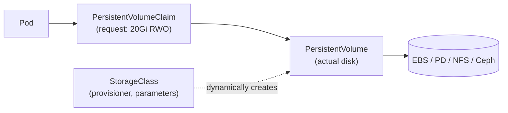

# 6. Storage (Interview Imp)

> **Note**: Sections marked **(Interview Imp)** are frequently asked in interviews. Every chapter ends with a **📘 Terms Explained** table for the jargon it uses.
>
> **Navigation:** [⬅ Previous: 05_Networking](05_Networking.md) · [Index](00_Kubernetes_Index.md) · [Next: 07_Scheduling_and_Resources ➡](07_Scheduling_and_Resources.md)

## Table of Contents
- [6.1 Volume Types (Pod-level)](#61-volume-types-pod-level)
- [6.2 PV, PVC, StorageClass](#62-pv-pvc-storageclass)

---

## 6.1 Volume Types (Pod-level)

| Volume | Lifetime / use |
|---|---|
| `emptyDir` | Scratch space for the Pod's lifetime (`medium: Memory` for tmpfs); shared between containers |
| `hostPath` | Node directory (avoid; security risk; only for node agents) |
| `configMap` / `secret` / `projected` / `downwardAPI` | Configuration injection |
| `persistentVolumeClaim` | Durable storage (below) |
| `nfs`, `csi`, cloud disks | Network/cloud storage |
| `ephemeral` (generic ephemeral volumes) | Per-Pod PVC created and deleted with the Pod |

## 6.2 PV, PVC, StorageClass



- **PersistentVolume (PV):** a piece of storage in the cluster (admin-provisioned or dynamic).
- **PersistentVolumeClaim (PVC):** a user's request for storage (size, access mode, class); binds to a matching PV.
- **StorageClass:** defines a "type" of storage and its **provisioner** (CSI driver); enables **dynamic provisioning**: creating a PVC automatically creates the disk.

```yaml
apiVersion: storage.k8s.io/v1
kind: StorageClass
metadata: { name: fast-ssd }
provisioner: ebs.csi.aws.com
parameters: { type: gp3, iops: "3000" }
reclaimPolicy: Delete                 # or Retain
allowVolumeExpansion: true
volumeBindingMode: WaitForFirstConsumer     # provision in the zone where the Pod is scheduled
---
apiVersion: v1
kind: PersistentVolumeClaim
metadata: { name: data }
spec:
  accessModes: [ReadWriteOnce]
  storageClassName: fast-ssd
  resources: { requests: { storage: 20Gi } }
---
# in the Pod: volumes: [{ name: data, persistentVolumeClaim: { claimName: data } }]
```

| Access mode | Meaning |
|---|---|
| **RWO** ReadWriteOnce | Mounted read-write by one **node** |
| **ROX** ReadOnlyMany | Read-only by many nodes |
| **RWX** ReadWriteMany | Read-write by many nodes (NFS, CephFS, EFS, Azure Files) |
| **RWOP** ReadWriteOncePod | One **Pod** only |

Reclaim policy: `Delete` (disk removed with PV) vs `Retain` (keep data). Features: volume expansion, snapshots (`VolumeSnapshot`), cloning, topology-aware provisioning. Zonal disks (EBS) tie a Pod to its zone.

**Backup/DR:** Velero (cluster resources + volume snapshots), CSI snapshots, database-native backups (pgBackRest, WAL archiving), cross-region replication. A PVC is not a backup.

#### 📘 Terms Explained

| Term | Simple meaning |
|---|---|
| **PV / PVC** | Actual storage / a request for storage. |
| **StorageClass** | Template for provisioning a kind of storage dynamically. |
| **CSI** | Container Storage Interface: plug-in standard for storage drivers. |
| **Dynamic provisioning** | Disk is created automatically when a PVC is made. |
| **Access mode** | Who can mount the volume and how (RWO/ROX/RWX). |
| **Reclaim policy** | What happens to a volume when its claim is deleted. |
| **WaitForFirstConsumer** | Delay binding until a Pod is scheduled, to pick the right zone. |

---

> **Navigation:** [⬅ Previous: 05_Networking](05_Networking.md) · [Index](00_Kubernetes_Index.md) · [Next: 07_Scheduling_and_Resources ➡](07_Scheduling_and_Resources.md)
