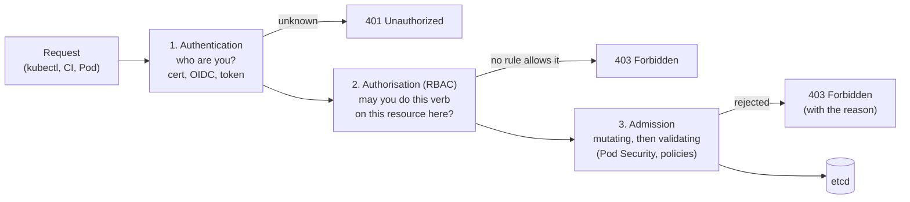

---
mdx:
  format: md
---

# 8. Security (Interview Imp)

> **Note**: Sections marked **(Interview Imp)** are frequently asked in interviews. Every chapter ends with a **📘 Terms Explained** table for the jargon it uses.
>
> **Navigation:** [⬅ Previous: 07_Scheduling_and_Resources](07_Scheduling_and_Resources.md) · [Index](00_Kubernetes_Index.md) · [Next: 09_Observability_and_Troubleshooting ➡](09_Observability_and_Troubleshooting.md)

## Table of Contents
- [8.1 Layers of Kubernetes Security (4 Cs)](#81-layers-of-kubernetes-security-4-cs)
- [8.2 Authentication, Authorisation (RBAC), Admission](#82-authentication-authorisation-rbac-admission)
- [8.3 Pod Security](#83-pod-security)
- [8.4 Security Checklist](#84-security-checklist)
- [8.5 Pros and Cons](#85-pros-and-cons)
- [8.6 Common Pitfalls](#86-common-pitfalls)
- [8.7 Interview Questions](#87-interview-questions)
- [8.8 Cheat Sheet](#88-cheat-sheet)

---

> **Verification status of this file**
>
> | What | Status |
> |---|---|
> | RBAC (8.2: Role, RoleBinding, ClusterRole `view`, `kubectl auth can-i`, a real ServiceAccount token, `automountServiceAccountToken`) and Pod Security Admission (8.3) with the manifests in [examples/security-and-networkpolicy/](https://github.com/ritiksharma142001/one-notes/tree/main/docs/tech-wiki/kubernetes/examples/security-and-networkpolicy) | **Executed on minikube v1.38.1** (Kubernetes v1.35.1, QEMU driver, Calico CNI, separate `netpol` profile). Real output pasted. Each scenario ran **once**; all resources and the profile were deleted afterwards. |
> | OIDC login, audit logging, Kyverno/Gatekeeper/ValidatingAdmissionPolicy, everything in the 8.4 checklist | **NOT executed**: described for reference. |
>
> Things that change between runs: UIDs, token IDs (`JTI=...`), ages.

## 8.1 Layers of Kubernetes Security (4 Cs)

**What is it?** A way to think about security from the outside in: **Cloud/Infrastructure → Cluster → Container → Code**. Each layer can only be as safe as the one around it.

| Layer | Examples of what to secure |
|---|---|
| **Cloud / infrastructure** | Private networks, firewall rules, who can reach the API server, node OS patching |
| **Cluster** | Authentication, RBAC, admission policies, NetworkPolicy ([5.4](05_Networking.md#54-networkpolicy-pod-firewall)), Secret encryption ([4.2](04_Configuration_and_Secrets.md#42-secrets-interview-imp)) |
| **Container** | Non-root, read-only filesystem, dropped capabilities, scanned and signed images |
| **Code** | Dependency updates, input validation, no hard-coded secrets, TLS |

## 8.2 Authentication, Authorisation (RBAC), Admission

**What is it?** The three checks every request to the API server passes before anything is saved.

**Why needed?** `kubectl`, CI pipelines, controllers and your own Pods all talk to the same API. Without these checks anyone who can reach it could read Secrets or delete workloads.

**How it works:**

- **Authentication:** client certificates, OIDC (company login), ServiceAccount tokens, cloud IAM. Kubernetes has no user database; "users" are just names in a certificate or token.
- **Authorisation:** RBAC rules say which **verbs** (`get`, `list`, `watch`, `create`, `update`, `patch`, `delete`) are allowed on which **resources** (`pods`, `pods/log`, `secrets`...) in which **scope** (one namespace or the whole cluster). Everything not allowed is denied; there are no "deny" rules.
- **Admission:** can change the object (mutating: add defaults, inject sidecars) and then accept or reject it (validating: Pod Security, Kyverno, OPA Gatekeeper, ValidatingAdmissionPolicy).

**Types of RBAC objects:**

| Object | Scope | Purpose |
|---|---|---|
| **Role** | One namespace | List of allowed verbs on resources |
| **ClusterRole** | Cluster-wide definition | Same, but usable for cluster-scoped resources (nodes) or reusable in many namespaces |
| **RoleBinding** | One namespace | Gives a Role **or a ClusterRole** to subjects, only inside this namespace |
| **ClusterRoleBinding** | Whole cluster | Gives a ClusterRole to subjects in every namespace |
| **ServiceAccount** | One namespace | Identity for Pods and automation |

### Example 1: a Role that can only read Pods
[10-rbac-pod-reader.yaml](https://github.com/ritiksharma142001/one-notes/blob/main/docs/tech-wiki/kubernetes/examples/security-and-networkpolicy/10-rbac-pod-reader.yaml):
```yaml
apiVersion: v1
kind: ServiceAccount
metadata: { name: app, namespace: shop }
automountServiceAccountToken: false          # disable if the Pod doesn't call the API
---
apiVersion: rbac.authorization.k8s.io/v1
kind: Role                                    # namespaced (ClusterRole = cluster-wide)
metadata: { name: pod-reader, namespace: shop }
rules:
  - apiGroups: [""]                           # "" = the core API group (pods, services, secrets...)
    resources: ["pods", "pods/log"]
    verbs: ["get", "list", "watch"]
---
apiVersion: rbac.authorization.k8s.io/v1
kind: RoleBinding                             # grants the Role to subjects (ClusterRoleBinding = cluster-wide)
metadata: { name: app-reads-pods, namespace: shop }
subjects: [{ kind: ServiceAccount, name: app, namespace: shop }]
roleRef: { kind: Role, name: pod-reader, apiGroup: rbac.authorization.k8s.io }
```
Check permissions without logging in as the account (`--as` impersonates it; you need admin rights to impersonate):
```bash
kubectl apply -f 10-rbac-pod-reader.yaml
SA=system:serviceaccount:shop:app             # how a ServiceAccount's username looks
kubectl auth can-i get pods -n shop --as=$SA
kubectl auth can-i list pods -n shop --as=$SA
kubectl auth can-i get pods/log -n shop --as=$SA
kubectl auth can-i delete pods -n shop --as=$SA
kubectl auth can-i get secrets -n shop --as=$SA
kubectl auth can-i get pods -n default --as=$SA
kubectl auth can-i create deployments -n shop --as=$SA
kubectl auth can-i --list -n shop --as=$SA
```
Output:
```
serviceaccount/app created
role.rbac.authorization.k8s.io/pod-reader created
rolebinding.rbac.authorization.k8s.io/app-reads-pods created
yes
yes
yes
no
no
no
no
Resources                                       Non-Resource URLs                      Resource Names   Verbs
selfsubjectreviews.authentication.k8s.io        []                                     []               [create]
selfsubjectaccessreviews.authorization.k8s.io   []                                     []               [create]
selfsubjectrulesreviews.authorization.k8s.io    []                                     []               [create]
pods/log                                        []                                     []               [get list watch]
pods                                            []                                     []               [get list watch]
                                                [/.well-known/openid-configuration/]   []               [get]
                                                [/api/*]                               []               [get]
                                                [/apis/*]                              []               [get]
                                                [/healthz]                             []               [get]
                                                [/livez]                               []               [get]
                                                [/readyz]                              []               [get]
                                                [/version]                             []               [get]
                                                ...  (more read-only discovery URLs, some listed twice)
```
- `get pods -n default` is **no**: a RoleBinding only works in its own namespace.
- The extra rows in `--list` (`selfsubject...reviews`, `/healthz`, `/version`...) come from built-in ClusterRoles that **every** authenticated identity gets (`system:basic-user`, `system:discovery`, `system:public-info-viewer`). They allow "who am I / what can I do" questions and harmless discovery only.

### Example 2: using the ServiceAccount's real token
`--as` only *asks* the API server. To prove it end to end, get a short-lived token for the ServiceAccount and use it in a separate kubeconfig that holds **only** that token:
```bash
TOKEN=$(kubectl create token app -n shop --duration=10m)
SERVER=$(kubectl config view --minify -o jsonpath='{.clusters[0].cluster.server}')
CA=$(kubectl config view --minify --raw -o jsonpath='{.clusters[0].cluster.certificate-authority}')
kubectl config --kubeconfig=sa-app.kubeconfig set-cluster c --server=$SERVER --certificate-authority=$CA
kubectl config --kubeconfig=sa-app.kubeconfig set-credentials sa-app --token=$TOKEN
kubectl config --kubeconfig=sa-app.kubeconfig set-context sa-app --cluster=c --user=sa-app --namespace=shop
kubectl config --kubeconfig=sa-app.kubeconfig use-context sa-app

kubectl --kubeconfig=sa-app.kubeconfig auth whoami
kubectl --kubeconfig=sa-app.kubeconfig get pods
kubectl --kubeconfig=sa-app.kubeconfig logs db --tail=1
kubectl --kubeconfig=sa-app.kubeconfig get secrets
kubectl --kubeconfig=sa-app.kubeconfig delete pod other
kubectl --kubeconfig=sa-app.kubeconfig get pods -A
```
Output:
```
ATTRIBUTE                                           VALUE
Username                                            system:serviceaccount:shop:app
UID                                                 9ffe390b-c575-4da2-8d2d-f1eb25d79821
Groups                                              [system:serviceaccounts system:serviceaccounts:shop system:authenticated]
Extra: authentication.kubernetes.io/credential-id   [JTI=39f6c958-8b8a-4451-b17f-87ea7e622dcc]

NAME    READY   STATUS    RESTARTS   AGE
api     1/1     Running   0          2m2s
db      1/1     Running   0          2m2s
other   1/1     Running   0          2m2s

Error from server (Forbidden): secrets is forbidden: User "system:serviceaccount:shop:app" cannot list resource "secrets" in API group "" in the namespace "shop"
Error from server (Forbidden): pods "other" is forbidden: User "system:serviceaccount:shop:app" cannot delete resource "pods" in API group "" in the namespace "shop"
Error from server (Forbidden): pods is forbidden: User "system:serviceaccount:shop:app" cannot list resource "pods" in API group "" at the cluster scope
```
- `logs db` printed nothing and no error: allowed (the busybox web server simply writes no logs).
- Each `Forbidden` message names the **user, verb, resource, API group and scope**. That's exactly what to add to a Role if the access is really needed.
- `kubectl create token` makes a **short-lived** token (here 10 minutes) that isn't stored anywhere. Prefer it over long-lived Secret-based tokens.
- **Surprise:** adding `--token=...` to your normal kubectl does **not** test the ServiceAccount, because kubectl also sends your admin client certificate. And `--user=nobody` fails with `error: auth info "nobody" does not exist`, since `--user` picks an entry from the kubeconfig. A separate kubeconfig avoids both.

### Example 3: reuse a ClusterRole in one namespace
Built-in ClusterRoles (`view`, `edit`, `admin`, `cluster-admin`) save you writing rules. Binding one with a **RoleBinding** limits it to that namespace.
[11-rbac-clusterrole-view.yaml](https://github.com/ritiksharma142001/one-notes/blob/main/docs/tech-wiki/kubernetes/examples/security-and-networkpolicy/11-rbac-clusterrole-view.yaml):
```yaml
kind: RoleBinding
metadata: { name: auditor-view, namespace: shop }
subjects: [{ kind: ServiceAccount, name: auditor, namespace: shop }]
roleRef: { kind: ClusterRole, name: view, apiGroup: rbac.authorization.k8s.io }
```
```bash
A=system:serviceaccount:shop:auditor
kubectl auth can-i list deployments -n shop --as=$A
kubectl auth can-i get configmaps -n shop --as=$A
kubectl auth can-i get secrets -n shop --as=$A
kubectl auth can-i list pods -n kube-system --as=$A
kubectl auth can-i update pods -n shop --as=$A
```
Output:
```
yes
yes
no
no
no
```
`view` can read most things **but not Secrets** (on purpose: reading a Secret could reveal credentials that give more power). It works only in `shop` because it was bound with a RoleBinding.

### Example 4: `automountServiceAccountToken: false`
By default every Pod gets a token for its ServiceAccount mounted at `/var/run/secrets/kubernetes.io/serviceaccount`. If the app never calls the Kubernetes API, that token is only a gift to an attacker.
```bash
# Pod using the "app" ServiceAccount (automount disabled):
kubectl run -n shop sa-test --image=busybox:1.36 --restart=Never --overrides='{"spec":{"serviceAccountName":"app"}}' -- sleep 300
kubectl exec -n shop sa-test -- ls /var/run/secrets/kubernetes.io/serviceaccount
# Pod using the namespace's "default" ServiceAccount:
kubectl run -n shop sa-default --image=busybox:1.36 --restart=Never -- sleep 300
kubectl exec -n shop sa-default -- ls /var/run/secrets/kubernetes.io/serviceaccount
```
Output:
```
ls: /var/run/secrets/kubernetes.io/serviceaccount: No such file or directory
command terminated with exit code 1

ca.crt
namespace
token
```

**Principles:** least privilege; one ServiceAccount per app; no `cluster-admin` for apps; avoid wildcards (`*`); avoid `get/list secrets` and `create pods` unless needed (`list secrets` reads every secret; `create pods` can mount any secret); audit with `kubectl auth can-i --list`, `rbac-tool`, `kubectl-who-can`. Humans log in via OIDC/IAM with groups, not static tokens.

#### 📘 Terms Explained

| Term | Simple meaning |
|---|---|
| **Verb** | The action in a request: get, list, watch, create, update, patch, delete. |
| **API group** | Family of resources: `""` (core: pods, secrets), `apps` (deployments), `rbac.authorization.k8s.io`... |
| **Subresource** | A part of a resource with its own permission, e.g. `pods/log`, `pods/exec`. |
| **Impersonation (`--as`)** | Admin asks the API server "what would this user be allowed to do?". |
| **`kubectl create token`** | Creates a short-lived signed token (JWT) for a ServiceAccount. |
| **JWT** | JSON Web Token: a signed text token that carries an identity and an expiry time. |
| **Built-in ClusterRoles** | Ready-made roles: `view` (read, no Secrets), `edit`, `admin`, `cluster-admin`. |
| **401 / 403** | Unauthorized (we don't know who you are) / Forbidden (we know, but you may not). |

## 8.3 Pod Security

**What is it?** **Pod Security Standards (PSS)**: three official levels of Pod hardening, enforced by the built-in **Pod Security Admission (PSA)** controller using labels on each namespace.

**Why needed?** The securityContext settings from [2.6](02_Pods.md#26-pod-security-context) only help if every team remembers to set them. PSA makes the API server reject Pods that don't.

| Level | Meaning |
|---|---|
| **Privileged** | Unrestricted |
| **Baseline** | Blocks known privilege escalations (no hostNetwork, privileged, hostPath...) |
| **Restricted** | Hardened best practice (non-root, drop ALL caps, seccomp RuntimeDefault, no privilege escalation) |

**Modes** (one label each, can be combined): `enforce` (reject the Pod), `warn` (accept, but print a warning to the user), `audit` (accept, but record it in the audit log).

### Example: a namespace that enforces `restricted`
[20-pod-security-restricted.yaml](https://github.com/ritiksharma142001/one-notes/blob/main/docs/tech-wiki/kubernetes/examples/security-and-networkpolicy/20-pod-security-restricted.yaml), [21-pod-insecure.yaml](https://github.com/ritiksharma142001/one-notes/blob/main/docs/tech-wiki/kubernetes/examples/security-and-networkpolicy/21-pod-insecure.yaml) (plain busybox Pod), [22-pod-restricted-ok.yaml](https://github.com/ritiksharma142001/one-notes/blob/main/docs/tech-wiki/kubernetes/examples/security-and-networkpolicy/22-pod-restricted-ok.yaml) (hardened):
```yaml
apiVersion: v1
kind: Namespace
metadata:
  name: secure
  labels:
    pod-security.kubernetes.io/enforce: restricted
    pod-security.kubernetes.io/warn: restricted
---
# 22-pod-restricted-ok.yaml (the parts that make it pass)
spec:
  securityContext:
    runAsNonRoot: true
    runAsUser: 10001
    seccompProfile: { type: RuntimeDefault }
  containers:
    - name: app
      image: busybox:1.36
      securityContext:
        allowPrivilegeEscalation: false
        capabilities: { drop: ["ALL"] }
```
```bash
kubectl apply -f 20-pod-security-restricted.yaml
kubectl apply -f 21-pod-insecure.yaml
kubectl apply -f 22-pod-restricted-ok.yaml
kubectl get pods -n secure
```
Output:
```
namespace/secure created
Error from server (Forbidden): error when creating "21-pod-insecure.yaml": pods "insecure" is forbidden: violates PodSecurity "restricted:latest": allowPrivilegeEscalation != false (container "app" must set securityContext.allowPrivilegeEscalation=false), unrestricted capabilities (container "app" must set securityContext.capabilities.drop=["ALL"]), runAsNonRoot != true (pod or container "app" must set securityContext.runAsNonRoot=true), seccompProfile (pod or container "app" must set securityContext.seccompProfile.type to "RuntimeDefault" or "Localhost")
pod/hardened created
NAME       READY   STATUS              RESTARTS   AGE
hardened   0/1     ContainerCreating   0          0s
```
- The insecure Pod is rejected **by the API server** and never exists. The message lists **every** missing setting and how to fix it.
- Compare [2.6](02_Pods.md#26-pod-security-context): there `runAsNonRoot` was checked by the **kubelet**, so the Pod was created and then sat in `CreateContainerConfigError`. PSA catches problems earlier, at `kubectl apply`.
- `restricted:latest` means "the restricted rules of the current Kubernetes version". Pin a version with the `enforce-version` label if you don't want rules to change on upgrades.

### Before you switch it on: test with a server-side dry run
```bash
kubectl label --dry-run=server --overwrite ns shop pod-security.kubernetes.io/enforce=restricted
```
Output:
```
Warning: existing pods in namespace "shop" violate the new PodSecurity enforce level "restricted:latest"
Warning: api (and 2 other pods): allowPrivilegeEscalation != false, unrestricted capabilities, runAsNonRoot != true, seccompProfile
namespace/shop labeled (server dry run)
```
Nothing changed, but you now know which running Pods would be blocked the next time they're recreated. Existing Pods are **not** evicted when you enable `enforce`; only new Pods are checked. That's why the dry run matters.

Policy engines for richer rules: **Kyverno**, **OPA Gatekeeper**, **ValidatingAdmissionPolicy** (CEL, built-in) *(NOT executed here)*.

## 8.4 Security Checklist

| Area | Practice |
|---|---|
| **Images** | Minimal/distroless, pinned digests, scanned (Trivy), signed (cosign) + verified by admission policy, private registry with pull secrets |
| **Pods** | Non-root, read-only root FS, drop all capabilities, no privileged/hostPath/hostNetwork, seccomp RuntimeDefault, resource limits |
| **Network** | Default-deny NetworkPolicies ([5.4](05_Networking.md#54-networkpolicy-pod-firewall)), mTLS (mesh), restrict egress, private API server endpoint |
| **Secrets** | etcd encryption, external secret managers, workload identity, short-lived tokens, no secrets in Git/env |
| **API access** | RBAC least privilege, OIDC SSO, disable anonymous auth, audit logging, `automountServiceAccountToken: false` where not needed |
| **Nodes** | Hardened minimal OS (Bottlerocket, Talos, Flatcar), automated patching, no SSH, IMDSv2/metadata blocking for Pods |
| **Runtime** | Falco/Tetragon for threat detection; sandboxed runtimes (gVisor, Kata) for untrusted code |
| **Supply chain** | SBOMs, provenance (SLSA), admission verification, dependency updates |
| **Governance** | CIS Benchmark (kube-bench), kubescape, Polaris, kube-score; regular upgrades |
| **Multi-tenancy** | Namespaces + quotas + policies + dedicated node pools; vcluster/separate clusters for hard isolation |

## 8.5 Pros and Cons

| Mechanism | Pros | Cons |
|---|---|---|
| **RBAC** | Built in, fine-grained (verb × resource × namespace), easy to test with `can-i` | Allow-only (no deny rules); permissions spread over many bindings and are hard to audit |
| **ServiceAccount tokens** | Short-lived, auto-rotated projected tokens | Mounted by default into every Pod unless you turn it off |
| **Pod Security Admission** | Built in, zero install, clear error messages, per-namespace | Only three fixed levels; no custom rules (use Kyverno/Gatekeeper/VAP for those) |
| **Policy engines** | Any rule you can express (registries, labels, limits) | Extra component to run and keep highly available; a broken webhook can block deployments |

## 8.6 Common Pitfalls

| Pitfall | What happens | Fix |
|---|---|---|
| Testing a token with `kubectl --token=...` on your admin kubeconfig | Your admin certificate is also sent: you test yourself, not the token | Separate kubeconfig with only the token ([Example 2](#example-2-using-the-serviceaccounts-real-token)) |
| `ClusterRoleBinding` when a `RoleBinding` would do | Permission in **every** namespace | Bind ClusterRoles with RoleBindings per namespace |
| Granting `view` and expecting Secrets access, or `edit` and not expecting it | `view` excludes Secrets; `edit` can read them | Know the built-in roles; write your own Role if unsure |
| `list secrets` or `create pods` for an app | Effectively reads every Secret in the namespace | Grant `get` on named Secrets (`resourceNames`) only |
| Token mounted in Pods that never call the API | Stolen container = stolen API identity | `automountServiceAccountToken: false` ([Example 4](#example-4-automountserviceaccounttoken-false)) |
| Switching PSA `enforce` on without checking | Next rollout or node drain fails to recreate Pods | `kubectl label --dry-run=server` first, start with `warn` |
| Expecting PSA to evict existing bad Pods | They keep running until recreated | Fix and redeploy them; use `audit`/`warn` to find them |
| Wildcards (`*`) in Roles | Grants future resources too | List resources and verbs explicitly |

## 8.7 Interview Questions

**Q1. Walk through what happens to a request at the API server.** Authentication (who: cert, OIDC, token) → authorisation (RBAC: verb on resource in scope) → mutating admission → schema validation → validating admission (Pod Security, policies) → etcd. 401 if unknown, 403 if not allowed or rejected.

**Q2. Role vs ClusterRole, RoleBinding vs ClusterRoleBinding?** Role/RoleBinding live in one namespace. ClusterRole is a cluster-wide definition; a ClusterRoleBinding grants it everywhere, while a RoleBinding can grant a ClusterRole inside one namespace only.

**Q3. How do you check what a ServiceAccount can do?** `kubectl auth can-i <verb> <resource> -n <ns> --as=system:serviceaccount:<ns>:<name>`, or `--list` for everything. For an end-to-end test, use a token from `kubectl create token` in a kubeconfig containing only that token.

**Q4. Can RBAC deny something?** No, RBAC is allow-only and the union of all bindings applies. To block something, remove the binding that grants it, or use an admission policy.

**Q5. What are Pod Security Standards and how are they enforced?** Privileged, Baseline, Restricted; enforced by Pod Security Admission via namespace labels (`enforce`, `warn`, `audit`). Restricted requires non-root, dropping all capabilities, no privilege escalation and a seccomp profile.

**Q6. Why disable automounting of ServiceAccount tokens?** Most apps never call the Kubernetes API; a mounted token only helps an attacker who breaks into the container.

**Q7. Which permissions are dangerous even though they sound harmless?** `list secrets` (reads all values), `create pods` (can mount any Secret or ServiceAccount in the namespace), `pods/exec`, `escalate`/`bind` on roles, `impersonate`.

## 8.8 Cheat Sheet

```
FLOW      AuthN (cert/OIDC/token) -> AuthZ (RBAC) -> mutating admission -> validating admission (PSA, policies) -> etcd
          401 = who are you? 403 = not allowed (message names user, verb, resource, group, scope)
RBAC      Role/RoleBinding = namespace. ClusterRole = definition. ClusterRoleBinding = everywhere.
          RoleBinding -> ClusterRole = reuse built-in role in one namespace. Allow-only, no deny.
BUILT-IN  view (no Secrets) | edit (can read Secrets) | admin (+ RBAC in ns) | cluster-admin (everything)
TEST      kubectl auth can-i get pods -n ns --as=system:serviceaccount:ns:sa  [--list]
          kubectl create token sa -n ns --duration=10m   -> separate kubeconfig with only that token
TOKENS    automountServiceAccountToken: false unless the Pod calls the API
PSA       label ns pod-security.kubernetes.io/enforce=restricted (+ warn, audit). Rejects at the API server.
          Dry run first: kubectl label --dry-run=server --overwrite ns X pod-security.kubernetes.io/enforce=restricted
RESTRICT  runAsNonRoot, allowPrivilegeEscalation=false, capabilities.drop=[ALL], seccompProfile RuntimeDefault
```

#### 📘 Terms Explained

| Term | Simple meaning |
|---|---|
| **4 Cs** | Cloud, Cluster, Container, Code: the four layers you must secure, outer to inner. |
| **Authentication (AuthN)** | Proving *who* you are (certificate, OIDC login, token). |
| **Authorisation (AuthZ)** | Deciding *what* you may do once known. In Kubernetes this is mostly RBAC. |
| **RBAC** | Role-Based Access Control: permissions are grouped into roles and roles are given to users/apps. |
| **Role / ClusterRole** | A list of allowed verbs (get, list, create...) on resources, in one namespace / in the whole cluster. |
| **RoleBinding / ClusterRoleBinding** | Gives a Role/ClusterRole to a user, group or ServiceAccount. |
| **ServiceAccount** | An identity for Pods (apps), as opposed to human users. |
| **Admission controller** | Code in the API server that can change (mutating) or reject (validating) a request before it is saved. |
| **Webhook** | An HTTP call-out: the API server asks your service "is this object allowed?". |
| **Pod Security Standards (PSS)** | Three built-in security levels for Pods: Privileged, Baseline, Restricted. |
| **Pod Security Admission (PSA)** | The built-in admission controller that enforces PSS per namespace via labels. |
| **Server-side dry run** | The API server runs all checks and reports the result without saving anything. |
| **Kyverno / OPA Gatekeeper** | Policy engines: write your own rules such as "every image must come from our registry". |
| **ValidatingAdmissionPolicy** | Built-in way to write validation rules in CEL (a small expression language) without a webhook. |
| **OIDC** | OpenID Connect: log in with your company identity provider (Google, Okta, Entra ID). |
| **Capabilities** | Pieces of root's power in Linux (e.g. `NET_ADMIN`); "drop ALL" removes them all. |
| **seccomp** | Linux filter that blocks dangerous system calls; `RuntimeDefault` is a safe preset. |
| **CIS Benchmark** | Published security checklist for Kubernetes; `kube-bench` tests a cluster against it. |
| **Falco / Tetragon** | Runtime security tools that alert on suspicious behaviour (e.g. a shell started inside a container). |
| **Multi-tenancy** | Several teams or customers sharing one cluster safely. |

---

> **Navigation:** [⬅ Previous: 07_Scheduling_and_Resources](07_Scheduling_and_Resources.md) · [Index](00_Kubernetes_Index.md) · [Next: 09_Observability_and_Troubleshooting ➡](09_Observability_and_Troubleshooting.md)
