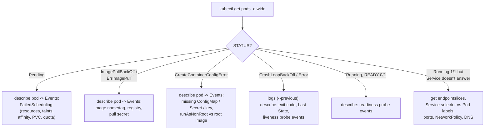

---
mdx:
  format: md
---

# 9. Observability and Troubleshooting (Interview Imp)

> **Note**: Sections marked **(Interview Imp)** are frequently asked in interviews. Every chapter ends with a **📘 Terms Explained** table for the jargon it uses.
>
> **Navigation:** [⬅ Previous: 08_Security](08_Security.md) · [Index](00_Kubernetes_Index.md) · [Next: 10_Helm_GitOps_and_Operators ➡](10_Helm_GitOps_and_Operators.md)

## Table of Contents
- [9.1 The Three Pillars in Kubernetes](#91-the-three-pillars-in-kubernetes)
- [9.2 Debugging Playbook](#92-debugging-playbook)
- [9.3 Failure Scenarios Reproduced (Interview Imp)](#93-failure-scenarios-reproduced-interview-imp)
- [9.4 Debugging Tools: kubectl debug, DNS checks, Events](#94-debugging-tools-kubectl-debug-dns-checks-events)
- [9.5 Pros and Cons of the Debugging Tools](#95-pros-and-cons-of-the-debugging-tools)
- [9.6 Common Pitfalls](#96-common-pitfalls)
- [9.7 Interview Questions](#97-interview-questions)
- [9.8 Cheat Sheet](#98-cheat-sheet)

---

> **Verification status of this file**
>
> | What | Status |
> |---|---|
> | Scenarios 11-16 in [examples/pods-and-debugging/](https://github.com/ritiksharma142001/one-notes/tree/main/docs/tech-wiki/kubernetes/examples/pods-and-debugging), `kubectl debug`, DNS checks, `kubectl top` (metrics-server addon) | **Executed on minikube v1.38.1** (Kubernetes v1.35.1, QEMU driver, Docker runtime). Real output pasted. Each scenario ran **once**. All resources were deleted and the addon disabled afterwards. |
> | Prometheus, Grafana, Loki, OpenTelemetry, Alertmanager (9.1), `kubectl debug node/...`, `journalctl -u kubelet`, Ingress errors, node NotReady, DNS outages | **NOT executed**: listed for reference. |
>
> Things that change between runs: Pod names and hashes, IPs, ages, counts like `(x5 over 97s)`, container IDs, UIDs.

## 9.1 The Three Pillars in Kubernetes

**What is it?** Observability means being able to tell *what is going on inside* the system from the outside. In Kubernetes it comes from metrics, logs, traces, plus Kubernetes' own **events**.

**Why needed?** Pods move, restart and get replaced. You can't SSH into "the server" and look around, so you need data collected centrally.

| Pillar | Tools |
|---|---|
| **Metrics** | metrics-server (`kubectl top`, HPA), **Prometheus** + kube-state-metrics + node-exporter + cAdvisor, Grafana, `kube-prometheus-stack` Helm chart, Thanos/Mimir for long-term |
| **Logs** | stdout/stderr → node files; collect with Fluent Bit/Vector/Promtail → Loki, Elasticsearch/OpenSearch, CloudWatch, Datadog |
| **Traces** | OpenTelemetry Collector → Jaeger/Tempo/Zipkin |
| **Events & audit** | `kubectl get events`, API audit logs |
| **Alerting** | Alertmanager, SLO-based alerts |

Key metrics: Pod restarts, CPU throttling, memory working set vs limit, pending Pods, node pressure, request rate/errors/latency (RED), saturation (USE), HPA status, PVC usage.

### Example: `kubectl top` (metrics-server)
`kubectl top` needs the metrics-server add-on. On minikube:
```bash
minikube addons enable metrics-server
kubectl top node
kubectl top pods
kubectl top pods -n kube-system --sort-by=memory | head -4
```
Output (straight after enabling, then again about a minute later):
```
* The 'metrics-server' addon is enabled

$ kubectl top node                # right away
error: Metrics API not available

$ kubectl top node                # ~1 minute later
NAME       CPU(cores)   CPU(%)   MEMORY(bytes)   MEMORY(%)
minikube   275m         13%      1763Mi          71%

$ kubectl top pods
NAME                    CPU(cores)   MEMORY(bytes)
shop-749d7888c9-7mbpb   1m           0Mi
shop-749d7888c9-vjjpv   1m           0Mi

$ kubectl top pods -n kube-system --sort-by=memory | head -4
NAME                               CPU(cores)   MEMORY(bytes)
kube-apiserver-minikube            56m          288Mi
kube-controller-manager-minikube   22m          103Mi
etcd-minikube                      30m          84Mi
```
- `Metrics API not available` straight after enabling is normal: metrics-server needs one scrape cycle (about a minute).
- `0Mi` for the `shop` Pods: a busybox web server uses less than 1 MiB and the value is rounded down.
- `kubectl top` shows *current* usage only; for history and alerts you need Prometheus.

## 9.2 Debugging Playbook

**What is it?** A fixed order of commands that finds the cause of almost any Pod problem.

**Why needed?** Under pressure people jump straight to logs. But for most failures (Pending, ImagePullBackOff, config errors) **there are no logs**, because the container never started. The answer is in the **Events**.

**How it works:**


```bash
kubectl get pods -o wide                       # status, node, IP
kubectl describe pod <pod>                     # Events at the bottom!
kubectl logs <pod> [-c container] [--previous]
kubectl get events --sort-by=.lastTimestamp -n <ns>
kubectl exec -it <pod> -- sh
kubectl debug -it <pod> --image=busybox:1.36 --target=<container>   # ephemeral debug container
kubectl debug node/<node> -it --image=ubuntu                        # shell on the node (NOT executed here)
kubectl get endpointslices -l kubernetes.io/service-name=<svc>      # Pods behind a Service
kubectl run -it --rm dbg --image=curlimages/curl:8.11.1 -- curl -sS http://<svc>.<ns>
kubectl top pod --containers
kubectl rollout status deploy/<name> ; kubectl rollout undo deploy/<name>
```

| Symptom | Likely causes | Checks / fixes | Real output |
|---|---|---|---|
| **Pending** | No node with enough requests; taints; affinity; unbound PVC; quota | `describe pod` → Events (`0/1 nodes are available: 1 Insufficient memory`); add nodes / reduce requests / fix selectors | [9.3 C](#c-pending-not-enough-memory-on-any-node) |
| **ImagePullBackOff / ErrImagePull** | Wrong name/tag, private registry without `imagePullSecrets`, rate limit, network | Check image name, secret, registry access | [9.3 A](#a-imagepullbackoff) |
| **CrashLoopBackOff** | App crash, bad config, missing env, failing liveness probe, OOM | `logs` / `logs --previous`, exit code in `describe`, relax probes, fix config | [9.3 B](#b-crashloopbackoff), [2.3 Ex. 3](02_Pods.md#example-3-probe-timing-thats-too-strict--crashloopbackoff) |
| **OOMKilled (exit 137)** | Memory limit too low / leak / JVM heap too big | Raise limit, tune heap, profile | [12.6](12_Spring_Boot_on_Kubernetes.md#example-both-kinds-of-oom-in-real-pods) |
| **CreateContainerConfigError** | Missing ConfigMap/Secret/key; `runAsNonRoot` with a root image | `describe`, create the resource / fix the image | [9.3 D](#d-createcontainerconfigerror), [2.6](02_Pods.md#26-pod-security-context) |
| **Running but not Ready** | Readiness probe failing | Probe path/port/timeouts, dependencies | [2.3 Ex. 2](02_Pods.md#example-2-readiness-failure--out-of-the-service-no-restart) |
| **Service unreachable** | Selector mismatch, no Ready endpoints, wrong port/targetPort, NetworkPolicy, DNS | `get endpointslices`, `describe svc`, test from a debug Pod | [9.3 E](#e-service-with-no-endpoints-selector-typo) |
| **Rollout stuck** | New Pods not Ready (bad probe/image) | `rollout status`, `describe`, `rollout undo` | [9.3 F](#f-rollout-stuck-on-a-bad-image) |
| **Ingress 404/502/503** | Wrong host/path, backend Service/port, no ready Pods | Inspect Ingress & controller logs | not run |
| **Evicted** | Node pressure (disk/memory) | Fix requests, clean disk, add capacity | not run |
| **Terminating forever** | Finalizers, stuck volume/node | Check finalizers, node status; force delete as last resort | not run |
| **Node NotReady** | kubelet/runtime down, network, disk pressure | `describe node`, kubelet logs (`journalctl -u kubelet`) | not run |
| **HPA not scaling** | No metrics-server, no CPU requests, at max | `describe hpa`, `top pods` | not run |
| **DNS failures** | CoreDNS down, `ndots`, NetworkPolicy blocks port 53 | `nslookup <fqdn>`, CoreDNS logs | [9.4](#dns-check-from-a-pod) |

**Exit codes:** 0 ok, 1 app error, 3 JVM `ExitOnOutOfMemoryError` ([12.6](12_Spring_Boot_on_Kubernetes.md#example-heap-full-with--xxexitonoutofmemoryerror)), 137 = 128 + 9 SIGKILL (OOM or grace period expired), 139 segfault, 143 = 128 + 15 SIGTERM.

## 9.3 Failure Scenarios Reproduced (Interview Imp)

All five broken Pods (A-E) were applied at once from [examples/pods-and-debugging/](https://github.com/ritiksharma142001/one-notes/tree/main/docs/tech-wiki/kubernetes/examples/pods-and-debugging), together with the too-strict-probe Pod from [2.3](02_Pods.md#example-3-probe-timing-thats-too-strict--crashloopbackoff) started a minute earlier:
```bash
kubectl apply -f 11-imagepullbackoff.yaml -f 12-crashloopbackoff.yaml -f 13-pending-insufficient.yaml \
              -f 14-createcontainerconfigerror.yaml -f 15-service-selector-mismatch.yaml
kubectl get pods            # 90 s later
```
Output:
```
NAME              READY   STATUS                       RESTARTS      AGE
bad-image         0/1     ImagePullBackOff             0             94s
crasher           0/1     Error                        4 (51s ago)   94s
missing-secret    0/1     CreateContainerConfigError   0             94s
slow-start-demo   0/1     CrashLoopBackOff             5 (1s ago)    2m23s
too-big           0/1     Pending                      0             94s
web2              1/1     Running                      0             94s
```
One screen, almost every classic failure. Note `crasher` shows `Error` here, not `CrashLoopBackOff`: at that instant it had just exited again; the STATUS flips between `Error`, `CrashLoopBackOff` and briefly `Running` as it loops. Look at `RESTARTS` growing, not one snapshot.

### A. ImagePullBackOff
[11-imagepullbackoff.yaml](https://github.com/ritiksharma142001/one-notes/blob/main/docs/tech-wiki/kubernetes/examples/pods-and-debugging/11-imagepullbackoff.yaml): `image: greeting-api:9.9.9` (never built).
```bash
kubectl describe pod bad-image | sed -n '/^Events:/,$p'
```
Output:
```
Events:
  Type     Reason     Age                From               Message
  ----     ------     ----               ----               -------
  Normal   Scheduled  101s               default-scheduler  Successfully assigned default/bad-image to minikube
  Normal   BackOff    14s (x5 over 97s)  kubelet            spec.containers{app}: Back-off pulling image "greeting-api:9.9.9"
  Warning  Failed     14s (x5 over 97s)  kubelet            spec.containers{app}: Error: ImagePullBackOff
  Normal   Pulling    3s (x4 over 100s)  kubelet            spec.containers{app}: Pulling image "greeting-api:9.9.9"
  Warning  Failed     0s (x4 over 97s)   kubelet            spec.containers{app}: Failed to pull image "greeting-api:9.9.9": Error response from daemon: pull access denied for greeting-api, repository does not exist or may require 'docker login': denied: requested access to the resource is denied
  Warning  Failed     0s (x4 over 97s)   kubelet            spec.containers{app}: Error: ErrImagePull
```
- `ErrImagePull` is one failed attempt; `ImagePullBackOff` is the waiting period between attempts. They alternate.
- A short name like `greeting-api` means `docker.io/library/greeting-api`. "Repository does not exist **or may require 'docker login'**" is the same message for a typo and for a private image without credentials. Check the spelling first, then `imagePullSecrets`.

### B. CrashLoopBackOff
[12-crashloopbackoff.yaml](https://github.com/ritiksharma142001/one-notes/blob/main/docs/tech-wiki/kubernetes/examples/pods-and-debugging/12-crashloopbackoff.yaml): the app prints an error and exits 1.
```bash
kubectl describe pod crasher | sed -n '/    State:/,/Restart Count/p'
kubectl describe pod crasher | sed -n '/^Events:/,$p'
kubectl logs crasher --previous
kubectl logs crasher
```
Output:
```
    State:          Terminated
      Reason:       Error
      Exit Code:    1
      Started:      Sun, 01 Nov 2026 03:27:24 +0530
      Finished:     Sun, 01 Nov 2026 03:27:25 +0530
    Last State:     Terminated
      Reason:       Error
      Exit Code:    1
      Started:      Sun, 01 Nov 2026 03:26:42 +0530
      Finished:     Sun, 01 Nov 2026 03:26:42 +0530
    Ready:          False
    Restart Count:  4

Events:
  Type     Reason     Age                 From               Message
  ----     ------     ----                ----               -------
  Normal   Scheduled  103s                default-scheduler  Successfully assigned default/crasher to minikube
  Normal   Started    17s (x5 over 102s)  kubelet            spec.containers{app}: Container started
  Warning  BackOff    17s (x5 over 100s)  kubelet            spec.containers{app}: Back-off restarting failed container app in pod crasher_default(69215f23-...)

$ kubectl logs crasher --previous
unable to retrieve container logs for docker://40e03baa1455d5e457a29f10128804cee71802fb21fac889b06916ca14f6e9d3

$ kubectl logs crasher
starting app
ERROR: DATABASE_URL is not set
```
- **Exit Code 1** = the app itself failed (not a kill). The **log** tells you why: `DATABASE_URL is not set`.
- The restarts in the timestamps: 03:26:42 → 03:27:24 is the growing back-off (10 s, 20 s, 40 s, then 80 s ...).
- **Surprise:** `logs --previous` failed 3 times in a row on this minikube (Docker runtime via cri-dockerd). Plain `kubectl logs` worked because the *current* attempt had also already exited, so it showed the same output. On other clusters `--previous` normally works; if it doesn't, try plain `logs` right after a crash, or use your central log store.

### C. Pending: not enough memory on any node
[13-pending-insufficient.yaml](https://github.com/ritiksharma142001/one-notes/blob/main/docs/tech-wiki/kubernetes/examples/pods-and-debugging/13-pending-insufficient.yaml): requests `memory: 10Gi` on a node with about 2.4 GiB allocatable.
```bash
kubectl describe pod too-big | sed -n '/^Events:/,$p'
```
Output:
```
Events:
  Type     Reason            Age   From               Message
  ----     ------            ----  ----               -------
  Warning  FailedScheduling  102s  default-scheduler  0/1 nodes are available: 1 Insufficient memory. no new claims to deallocate, preemption: 0/1 nodes are available: 1 Preemption is not helpful for scheduling.
```
- `From: default-scheduler`: Pending problems are always the **scheduler**; no node was chosen, so there is no kubelet event and no log.
- Read `0/1 nodes are available: 1 Insufficient memory` as "of 1 node, 1 was rejected because of memory". On big clusters you'll see a mix like `3 Insufficient cpu, 2 node(s) had untolerated taint`.
- "Preemption is not helpful": even evicting lower-priority Pods wouldn't free 10 Gi. See [7.1](07_Scheduling_and_Resources.md#71-how-the-scheduler-decides) for how the scheduler decides.

### D. CreateContainerConfigError
[14-createcontainerconfigerror.yaml](https://github.com/ritiksharma142001/one-notes/blob/main/docs/tech-wiki/kubernetes/examples/pods-and-debugging/14-createcontainerconfigerror.yaml): an env var from Secret `db-credentials`, which doesn't exist.
```bash
kubectl describe pod missing-secret | sed -n '/^Events:/,$p'
```
Output:
```
Events:
  Type     Reason     Age                From               Message
  ----     ------     ----               ----               -------
  Normal   Scheduled  102s               default-scheduler  Successfully assigned default/missing-secret to minikube
  Normal   Pulled     5s (x9 over 101s)  kubelet            spec.containers{app}: Container image "busybox:1.36" already present on machine and can be accessed by the pod
  Warning  Failed     5s (x9 over 101s)  kubelet            spec.containers{app}: Error: secret "db-credentials" not found
```
The kubelet keeps retrying (`x9`). As soon as the Secret is created, the Pod starts by itself; no restart needed. The same status appears when `runAsNonRoot` meets a root image ([2.6](02_Pods.md#26-pod-security-context)).

### E. Service with no endpoints (selector typo)
[15-service-selector-mismatch.yaml](https://github.com/ritiksharma142001/one-notes/blob/main/docs/tech-wiki/kubernetes/examples/pods-and-debugging/15-service-selector-mismatch.yaml): Pod label `app: web`, Service selector `app: webb`.
```bash
kubectl get svc web-svc
kubectl get endpointslices -l kubernetes.io/service-name=web-svc
kubectl get svc web-svc -o jsonpath='{.spec.selector}'; kubectl get pods --show-labels -l app=web
kubectl run curl --image=curlimages/curl:8.11.1 --restart=Never --rm -i --quiet -- sh -c 'curl -sS -m 3 http://web-svc/; echo "(curl exit $?)"'
kubectl patch svc web-svc -p '{"spec":{"selector":{"app":"web"}}}'        # fix
kubectl get endpointslices -l kubernetes.io/service-name=web-svc
kubectl run curl ... curl -sS -m 3 http://web-svc/                      # again
```
Output:
```
NAME      TYPE        CLUSTER-IP       EXTERNAL-IP   PORT(S)   AGE
web-svc   ClusterIP   10.104.107.126   <none>        80/TCP    2m27s

NAME            ADDRESSTYPE   PORTS     ENDPOINTS   AGE
web-svc-v2fzx   IPv4          <unset>   <unset>     2m27s

{"app":"webb"}
NAME   READY   STATUS    RESTARTS   AGE     LABELS
web2   1/1     Running   0          2m28s   app=web

(curl exit 28)
curl: (28) Connection timed out after 3001 milliseconds

service/web-svc patched

NAME            ADDRESSTYPE   PORTS   ENDPOINTS     AGE
web-svc-v2fzx   IPv4          8080    10.244.0.56   2m37s

hello
(curl exit 0)
```
- The Service looks perfectly normal (it has a ClusterIP); only the **EndpointSlice** reveals the problem: `<unset>`.
- Compare `.spec.selector` with `--show-labels`: `webb` vs `web`.
- A Service with no endpoints **timed out** on this cluster rather than refusing the connection, so a timeout doesn't automatically mean "network problem".
- (`kubectl run -i` printed `(curl exit 28)` before curl's own error line: stdout and stderr arrive separately.)

### F. Rollout stuck on a bad image
[16-rollout-stuck.yaml](https://github.com/ritiksharma142001/one-notes/blob/main/docs/tech-wiki/kubernetes/examples/pods-and-debugging/16-rollout-stuck.yaml): a working 2-replica Deployment with `maxUnavailable: 0` and `progressDeadlineSeconds: 60`, then updated to an image that doesn't exist.
```bash
kubectl apply -f 16-rollout-stuck.yaml && kubectl rollout status deployment/shop
kubectl set image deployment/shop app=busybox:9.9.9
time kubectl rollout status deployment/shop --timeout=120s; echo "exit code: $?"
kubectl get pods -l app=shop
kubectl get deployment shop -o jsonpath='{range .status.conditions[*]}{.type}={.status} {.reason}: {.message}{"\n"}{end}'
kubectl rollout history deployment/shop
kubectl rollout undo deployment/shop
kubectl get pods -l app=shop
```
Output:
```
deployment "shop" successfully rolled out
deployment.apps/shop image updated

Waiting for deployment "shop" rollout to finish: 1 out of 2 new replicas have been updated...
error: deployment "shop" exceeded its progress deadline
real	1m0.269s
exit code: 1

NAME                    READY   STATUS         RESTARTS   AGE
shop-56596fb994-55xzc   0/1     ErrImagePull   0          61s
shop-749d7888c9-7mbpb   1/1     Running        0          62s
shop-749d7888c9-vjjpv   1/1     Running        0          62s

Available=True MinimumReplicasAvailable: Deployment has minimum availability.
Progressing=False ProgressDeadlineExceeded: ReplicaSet "shop-56596fb994" has timed out progressing.

REVISION  CHANGE-CAUSE
1         <none>
2         <none>

deployment.apps/shop rolled back

NAME                    READY   STATUS        RESTARTS   AGE
shop-56596fb994-55xzc   0/1     Terminating   0          63s
shop-749d7888c9-7mbpb   1/1     Running        0          64s
shop-749d7888c9-vjjpv   1/1     Running        0          64s
```
- **No downtime:** with `maxUnavailable: 0`, Kubernetes created one new Pod, saw it fail, and **never removed the two old ones**. `Available=True` the whole time.
- `rollout status` gave up exactly at the 60 s progress deadline with **exit code 1**, so a CI/CD pipeline can detect the failure and stop.
- The two ReplicaSet hashes (`749d7888c9` old, `56596fb994` new) show which Pods belong to which version.
- `rollout undo` instantly went back to revision 1; the broken Pod was removed. `CHANGE-CAUSE <none>`: set the `kubernetes.io/change-cause` annotation if you want readable history.

#### 📘 Terms Explained

| Term | Simple meaning |
|---|---|
| **ErrImagePull / ImagePullBackOff** | One failed image download / the waiting time before the next try. |
| **FailedScheduling** | Scheduler event: no node can take the Pod; the message says why. |
| **Preemption** | Evicting lower-priority Pods to make room for a higher-priority one. |
| **Selector** | The label query a Service (or Deployment) uses to find its Pods. |
| **progressDeadlineSeconds** | How long a Deployment rollout may go without progress before it is marked failed (default 600). |
| **Revision** | A numbered version of a Deployment's Pod template, used by `rollout undo`. |
| **ReplicaSet hash** | The middle part of a Pod name (`shop-749d7888c9-...`); one per Pod-template version. |

## 9.4 Debugging Tools: kubectl debug, DNS checks, Events

### Ephemeral debug container
**What:** `kubectl debug` adds a temporary container to a running Pod, with your choice of image, sharing the target container's process list and network.
**Why:** production images are often minimal or distroless (no shell, no `ps`, no `curl`), so `kubectl exec` has nothing to run.
```bash
kubectl debug -i shop-749d7888c9-7mbpb --image=busybox:1.36 --target=app --quiet -- sh -c 'ps; wget -qO- localhost:8080'
kubectl get pod shop-749d7888c9-7mbpb -o jsonpath='{.spec.ephemeralContainers[*].name}'
```
Output:
```
--profile=legacy is deprecated and will be removed in the future. It is recommended to explicitly specify a profile, for example "--profile=general".
PID   USER     TIME  COMMAND
    1 root      0:00 httpd -f -p 8080 -h /www
   46 root      0:00 sh -c ps; wget -qO- localhost:8080
   52 root      0:00 ps
shop

debugger-wg5xf
```
- `--target=app` shares the app's **process namespace**: `ps` shows the app's `httpd` as PID 1, and `localhost:8080` reaches it.
- The ephemeral container **stays in the Pod spec** (`debugger-wg5xf`) until the Pod is deleted; it can't be removed.
- **Surprise:** kubectl v1.35 warns that the default `--profile=legacy` is deprecated. Pass `--profile=general` (or `restricted`, `netadmin`, ...) explicitly.

### DNS check from a Pod
```bash
kubectl run dns --image=busybox:1.36 --restart=Never --rm -i --quiet -- sh -c 'cat /etc/resolv.conf; nslookup kubernetes.default'
kubectl run dns --image=busybox:1.36 --restart=Never --rm -i --quiet -- nslookup kubernetes.default.svc.cluster.local
kubectl run dns2 --image=curlimages/curl:8.11.1 --restart=Never --rm -i --quiet -- \
  curl -sk -m 5 -o /dev/null -w "kubernetes.default resolved to %{remote_ip}, HTTP %{http_code}\n" https://kubernetes.default
```
Output:
```
nameserver 10.96.0.10
search default.svc.cluster.local svc.cluster.local cluster.local
options ndots:5
Server:		10.96.0.10
Address:	10.96.0.10:53

** server can't find kubernetes.default: NXDOMAIN

** server can't find kubernetes.default: NXDOMAIN

pod default/dns terminated (Error)

Server:		10.96.0.10
Address:	10.96.0.10:53

Name:	kubernetes.default.svc.cluster.local
Address: 10.96.0.1

kubernetes.default resolved to 10.96.0.1, HTTP 403
```
- **Surprise / trap:** busybox's `nslookup` reported `NXDOMAIN` for the short name `kubernetes.default`, which looks like broken DNS. But the full name resolved, and curl (which uses the normal system resolver and the `search` list) resolved the **same short name** fine. Busybox's `nslookup` doesn't apply the search domains. Test with the **full name** (`<svc>.<ns>.svc.cluster.local`) or with a real client before blaming CoreDNS.
- `resolv.conf` shows how Pod DNS works: the cluster DNS Service (`10.96.0.10`), the search domains that make `my-svc` work inside the same namespace, and `ndots:5` (names with fewer than 5 dots try the search domains first).
- HTTP 403 just means an anonymous request reached the API server.

### Events, sorted
```bash
kubectl get events --sort-by=.lastTimestamp | tail -8
```
Output (columns cut at 170 characters):
```
20s         Normal    SuccessfulDelete          replicaset/shop-56596fb994           Deleted pod: shop-56596fb994-55xzc
7s          Normal    Pulled                    pod/shop-749d7888c9-7mbpb            Container image "busybox:1.36" already present on machine and can be accessed by the
7s          Normal    Created                   pod/shop-749d7888c9-7mbpb            Container created
7s          Normal    Started                   pod/shop-749d7888c9-7mbpb            Container started
5s          Normal    Scheduled                 pod/dns                              Successfully assigned default/dns to minikube
4s          Normal    Started                   pod/dns                              Container started
4s          Normal    Created                   pod/dns                              Container created
4s          Normal    Pulled                    pod/dns                              Container image "busybox:1.36" already present on machine and can be accessed by the
```
Events cover all objects in the namespace (Pods, ReplicaSets, Deployments...), so they show causes that `describe pod` can't, such as a ReplicaSet failing to create Pods because of a quota. They are kept for only about **1 hour** by default; ship them to your log system if you need them later.

#### 📘 Terms Explained

| Term | Simple meaning |
|---|---|
| **Ephemeral container** | Temporary debug container added to a running Pod; it can't be removed until the Pod is deleted. |
| **Process namespace sharing** | Containers seeing each other's processes (`--target`), so a debug tool can inspect the app. |
| **Distroless image** | Image with only the app and its runtime: no shell or tools, so `exec` into it is impossible. |
| **CoreDNS** | The cluster's DNS server; resolves Service names to ClusterIPs. |
| **Search domains** | Suffixes tried automatically for short names (`db` → `db.default.svc.cluster.local`). |
| **`ndots`** | DNS option: names with fewer dots than this are tried with the search domains first. |
| **FQDN** | Fully qualified domain name: the complete name, e.g. `db.default.svc.cluster.local`. |

## 9.5 Pros and Cons of the Debugging Tools

| Tool | Pros | Cons |
|---|---|---|
| `kubectl describe` (Events) | Explains failures where there are no logs (Pending, pull, config) | Events expire after ~1 h; only recent history |
| `kubectl logs` | The app's own explanation of a crash | Empty if the container never started; `--previous` not always available |
| `kubectl exec` | Look inside the real container | Needs a shell in the image; changes you make are lost on restart |
| `kubectl debug` (ephemeral) | Works on distroless images, sees the app's processes | Stays in the Pod spec; needs RBAC permission; image pull |
| `kubectl top` | Quick current CPU/memory | Needs metrics-server; no history |
| Prometheus/Grafana, Loki, traces | History, alerts, cross-service views | Setup and running cost; must be in place *before* the incident |

## 9.6 Common Pitfalls

| Pitfall | What happens | Fix |
|---|---|---|
| Going straight to `logs` | Nothing there for Pending/ImagePull/config errors | `describe pod` first: read Events |
| Trusting one `get pods` snapshot | A crash-looping Pod may show `Error` or even `Running` at that instant | Watch `RESTARTS`; use `-w` |
| `nslookup` from busybox with a short name | False NXDOMAIN, wrong conclusion "DNS is broken" ([9.4](#dns-check-from-a-pod)) | Use the FQDN or curl |
| Looking at the Service, not its endpoints | Service looks fine; selector typo hidden ([9.3 E](#e-service-with-no-endpoints-selector-typo)) | `kubectl get endpointslices -l kubernetes.io/service-name=<svc>` |
| Testing through `kubectl port-forward` | Hits one Pod only; hides load-balancing and rollout problems | Test from a Pod inside the cluster ([12.9](12_Spring_Boot_on_Kubernetes.md#deploy-and-test-on-minikube)) |
| Expecting `kubectl run -i` to show everything | First lines lost; stdout/stderr order mixed | Read `kubectl logs` afterwards |
| `maxUnavailable` > 0 with a bad image | Old Pods removed before new ones work: outage | `maxUnavailable: 0`, readiness probe, `progressDeadlineSeconds` ([9.3 F](#f-rollout-stuck-on-a-bad-image)) |
| No `progressDeadlineSeconds` awareness in CI | Pipeline waits 10 min (default 600 s) on a broken rollout | Lower it; check `rollout status` exit code |
| Debugging with events from yesterday | Events are gone after ~1 h | Ship events/logs to central storage |
| Force-deleting stuck Pods first | Can leave volumes/StatefulSet identity in a bad state | Check finalizers and node first; force delete last |

## 9.7 Interview Questions

**Q1. A Pod is stuck in Pending. How do you debug it?** `kubectl describe pod` → Events from `default-scheduler`: `FailedScheduling` with the reason per node (insufficient CPU/memory, taints, affinity, unbound PVC, quota). Fix requests, add capacity or fix the constraint. There are no logs: the container never started.

**Q2. ImagePullBackOff vs ErrImagePull?** ErrImagePull is a failed attempt; ImagePullBackOff is the wait between attempts. Causes: wrong name/tag, private registry without `imagePullSecrets`, rate limits, network. The message is the same for a typo and a missing login, so check both.

**Q3. CrashLoopBackOff: what do you check?** `kubectl logs` (and `--previous`), the exit code and Last State in `describe` (1 = app error, 137 = killed/OOM, 143 = SIGTERM), liveness probe events (too strict?), missing config. Kubernetes waits longer between each restart (up to 5 min).

**Q4. The Service exists but nothing answers. Steps?** Check the EndpointSlice: empty → selector doesn't match Pod labels, or Pods not Ready. Then ports (`port` vs `targetPort`), NetworkPolicy, DNS (test the FQDN), and test from a Pod inside the cluster.

**Q5. A rollout is stuck. What happened and how do you recover?** New Pods aren't becoming Ready (bad image, failing probe, missing config). With `maxUnavailable: 0` the old Pods keep serving. `rollout status` fails after `progressDeadlineSeconds`; recover with `kubectl rollout undo`, then fix and redeploy.

**Q6. How do you debug a distroless container with no shell?** `kubectl debug -it <pod> --image=busybox --target=<container>` adds an ephemeral container sharing its processes and network.

**Q7. What does exit code 137 mean? 143?** 137 = 128 + 9 (SIGKILL): OOMKilled, or the grace period ran out after SIGTERM. 143 = 128 + 15: the process stopped on SIGTERM.

**Q8. What's the difference between metrics-server and Prometheus?** metrics-server keeps only current CPU/memory for `kubectl top` and HPA. Prometheus stores history of many metrics and supports queries and alerts.

## 9.8 Cheat Sheet

```
ORDER       get pods -o wide -> describe pod (EVENTS) -> logs [-c x] [--previous] -> get events --sort-by=.lastTimestamp
PENDING     scheduler: "0/N nodes are available: X Insufficient memory / untolerated taint / ..." -> no logs exist
PULL        ErrImagePull <-> ImagePullBackOff. "does not exist or may require docker login" = typo OR missing pull secret
CONFIG      CreateContainerConfigError: missing Secret/ConfigMap/key, or runAsNonRoot + root image. Starts by itself once fixed
CRASH       CrashLoopBackOff: exit 1 = app (read logs), 137 = SIGKILL/OOM, 143 = SIGTERM, 3 = JVM ExitOnOutOfMemoryError
NOT READY   Running 0/1 -> readiness probe events in describe
NO ANSWER   get endpointslices -l kubernetes.io/service-name=svc  (<unset> = selector/labels; ready:false = readiness)
ROLLOUT     rollout status (exit 1 after progressDeadlineSeconds) -> rollout undo. maxUnavailable: 0 keeps old Pods
DEBUG       kubectl debug -it pod --image=busybox:1.36 --target=app --profile=general   (stays in spec)
DNS         nslookup <svc>.<ns>.svc.cluster.local (FQDN! busybox ignores search domains). resolv.conf: 10.96.0.10, ndots:5
METRICS     minikube addons enable metrics-server ; wait ~1 min ; kubectl top node|pods [--sort-by=memory]
```

#### 📘 Terms Explained

| Term | Simple meaning |
|---|---|
| **Observability** | Being able to tell what a system is doing from the outside, using metrics, logs and traces. |
| **metrics-server** | Small add-on that collects current CPU/memory per Pod and node; powers `kubectl top` and HPA. |
| **Prometheus** | Time-series database that scrapes (pulls) metrics from apps and cluster components. |
| **kube-state-metrics** | Turns object state (desired vs ready replicas, Pod phase...) into Prometheus metrics. |
| **cAdvisor** | Built into the kubelet; reports per-container resource usage. |
| **Fluent Bit / Vector / Promtail** | Log shippers running on each node that read container logs and send them to storage. |
| **Loki** | Log storage system from Grafana, indexed by labels. |
| **OpenTelemetry (OTel)** | Vendor-neutral standard and SDKs for metrics, logs and traces. |
| **Trace** | The path of one request through many services, with timing for each step (span). |
| **Endpoints / EndpointSlice** | The list of Pod IPs behind a Service, each marked ready or not. |
| **Exit code** | Number a process returns when it stops; 128 + N means it was killed by signal N (137 = 128 + 9 = SIGKILL). |
| **RED / USE** | Two metric checklists: Rate-Errors-Duration (for services) and Utilisation-Saturation-Errors (for resources). |
| **SLO** | Service Level Objective: a reliability target such as "99.9% of requests under 300 ms". |
| **Events** | Short records Kubernetes writes about what happened to an object (scheduled, pulled, failed...); kept ~1 hour. |

---

> **Navigation:** [⬅ Previous: 08_Security](08_Security.md) · [Index](00_Kubernetes_Index.md) · [Next: 10_Helm_GitOps_and_Operators ➡](10_Helm_GitOps_and_Operators.md)
