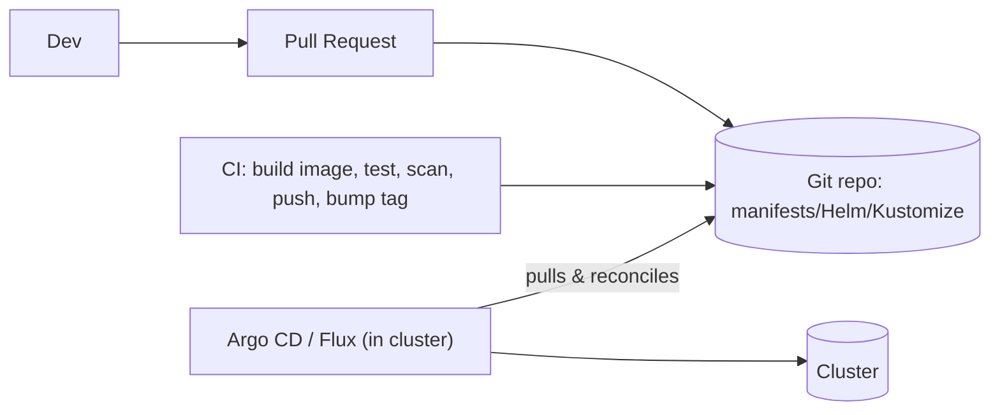

---
mdx:
  format: md
---

# 10. Packaging, Delivery and Extensibility

> **Note**: Sections marked **(Interview Imp)** are frequently asked in interviews. Every chapter ends with a **📘 Terms Explained** table for the jargon it uses.
>
> **Navigation:** [⬅ Previous: 09_Observability_and_Troubleshooting](09_Observability_and_Troubleshooting.md) · [Index](00_Kubernetes_Index.md) · [Next: 11_Production_Operations ➡](11_Production_Operations.md)

## Table of Contents
- [10.1 Helm (Package Manager)](#101-helm-package-manager)
- [10.2 Kustomize (Template-free Overlays)](#102-kustomize-template-free-overlays)
- [10.3 GitOps (Interview Imp)](#103-gitops-interview-imp)
- [10.4 CI/CD Flow](#104-cicd-flow)
- [10.5 Extending Kubernetes: CRDs and Operators (Interview Imp)](#105-extending-kubernetes-crds-and-operators-interview-imp)

---

## 10.1 Helm (Package Manager)

A **chart** = templated manifests + `values.yaml`; a **release** = chart installed with specific values.

```
mychart/
├── Chart.yaml            # name, version, appVersion, dependencies
├── values.yaml           # defaults
├── templates/
│   ├── deployment.yaml   # Go templates: {{ .Values.image.tag }}
│   ├── service.yaml
│   ├── _helpers.tpl
│   └── NOTES.txt
└── charts/               # sub-charts
```
```yaml
# templates/deployment.yaml (excerpt)
image: "{{ .Values.image.repository }}:{{ .Values.image.tag | default .Chart.AppVersion }}"
replicas: {{ .Values.replicaCount }}
{{- with .Values.resources }}
resources: {{- toYaml . | nindent 12 }}
{{- end }}
annotations:
  checksum/config: {{ include (print $.Template.BasePath "/configmap.yaml") . | sha256sum }}   # restart on config change
```
```bash
helm repo add bitnami https://charts.bitnami.com/bitnami
helm install web ./mychart -n shop --create-namespace -f values-prod.yaml --set image.tag=1.2.0
helm upgrade --install web ./mychart -n shop -f values-prod.yaml --atomic --wait
helm template ./mychart | kubectl apply --dry-run=server -f -         # render locally
helm lint . ; helm diff upgrade ... (plugin) ; helm rollback web 2 ; helm uninstall web
helm list -A ; helm history web ; helm get values web
```

## 10.2 Kustomize (Template-free Overlays)
```
base/        deployment.yaml service.yaml kustomization.yaml
overlays/
  dev/       kustomization.yaml  (replicas: 1)
  prod/      kustomization.yaml  (replicas: 5, patches, image tag, configMapGenerator)
```
```yaml
# overlays/prod/kustomization.yaml
resources: [../../base]
namespace: shop
images: [{ name: myorg/web, newTag: 1.2.0 }]
patches:
  - target: { kind: Deployment, name: web }
    patch: |-
      - op: replace
        path: /spec/replicas
        value: 5
configMapGenerator: [{ name: app-config, files: [application.yaml] }]     # hash suffix triggers rollouts
```
`kubectl apply -k overlays/prod`. **Helm vs Kustomize:** Helm for distributing/parameterising reusable apps; Kustomize for environment overlays of your own manifests; they combine well (Argo CD supports both).

## 10.3 GitOps (Interview Imp)

**Git is the source of truth** for cluster state; an in-cluster agent continuously reconciles the cluster to the repo.


Benefits: auditability, easy rollback (`git revert`), drift detection/self-heal, no cluster credentials in CI. Tools: **Argo CD** (UI, ApplicationSets), **Flux**; progressive delivery with **Argo Rollouts** or **Flagger** (canary/blue-green with metrics analysis). Separate app-code and config repos; promote via PRs between env folders; manage secrets with SOPS/External Secrets.

## 10.4 CI/CD Flow
Commit → CI: lint, unit tests, build image (BuildKit/Kaniko/Buildpacks), scan (Trivy), sign (cosign), push to registry with immutable tag → update manifests (image tag) → GitOps sync → rollout with health checks → smoke/e2e tests → promote → monitor (SLOs) → auto-rollback on failure.

## 10.5 Extending Kubernetes: CRDs and Operators (Interview Imp)

A **CustomResourceDefinition (CRD)** adds new resource types to the API. An **Operator** = CRD + custom **controller** that automates operations (install, backup, failover, upgrade) of a complex app.

```yaml
apiVersion: postgresql.cnpg.io/v1
kind: Cluster
metadata: { name: pg }
spec: { instances: 3, storage: { size: 50Gi } }      # the operator creates Pods, PVCs, Services, handles failover & backups
```
Build operators with **Kubebuilder**, **Operator SDK** (Go), **kopf** (Python), **Java Operator SDK**, **Metacontroller**. Pattern: watch resources → compare desired vs actual → act → update `status` (the **reconciliation loop**).
Other extension points: admission webhooks, aggregated APIs, scheduler plugins, CNI/CSI/CRI, device plugins (GPU), kubectl plugins (krew).

#### 📘 Terms Explained

| Term | Simple meaning |
|---|---|
| **RBAC** | Role-Based Access Control: permissions granted to users/service accounts via roles. |
| **ServiceAccount** | Identity for Pods talking to the API. |
| **Admission controller** | Plug-in that validates/mutates requests before they are stored. |
| **Pod Security Standards** | Built-in profiles (privileged, baseline, restricted). |
| **Helm chart / release** | Packaged templates / an installed instance. |
| **Kustomize overlay** | Environment-specific patch layered over a base. |
| **GitOps** | Operating the cluster by committing desired state to Git. |
| **CRD / Operator** | New API type / controller that automates an application's operations. |
| **Reconciliation loop** | Continuous compare-and-correct cycle of a controller. |
| **Ephemeral container** | Temporary debug container added to a running Pod. |

---

> **Navigation:** [⬅ Previous: 09_Observability_and_Troubleshooting](09_Observability_and_Troubleshooting.md) · [Index](00_Kubernetes_Index.md) · [Next: 11_Production_Operations ➡](11_Production_Operations.md)
