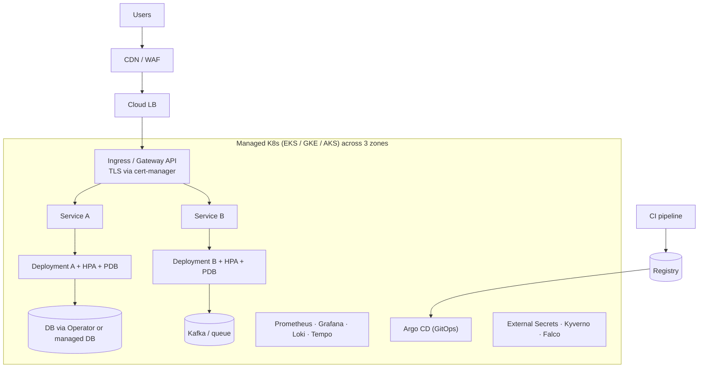

---
mdx:
  format: md
---

# 11. Production Architecture and Operations

> **Note**: Sections marked **(Interview Imp)** are frequently asked in interviews. Every chapter ends with a **📘 Terms Explained** table for the jargon it uses.
>
> **Navigation:** [⬅ Previous: 10_Helm_GitOps_and_Operators](10_Helm_GitOps_and_Operators.md) · [Index](00_Kubernetes_Index.md) · [Next: 12_Spring_Boot_on_Kubernetes ➡](12_Spring_Boot_on_Kubernetes.md)

## Table of Contents
- [11.1 Reference Production Setup](#111-reference-production-setup)
- [11.2 Checklist for Every Workload (Interview Imp)](#112-checklist-for-every-workload-interview-imp)
- [11.3 Cluster Operations](#113-cluster-operations)
- [11.4 Zero-Downtime Deployment Recipe](#114-zero-downtime-deployment-recipe)

---

## 11.1 Reference Production Setup

## 11.2 Checklist for Every Workload (Interview Imp)

| Category | Practice |
|---|---|
| **Availability** | ≥ 2-3 replicas, spread across zones (topology spread/anti-affinity), PDB, readiness + startup probes, rolling updates with `maxUnavailable: 0` |
| **Resources** | Requests and memory limits, HPA, right-sizing via VPA recommendations / metrics |
| **Lifecycle** | Graceful shutdown (SIGTERM handling, `preStop`, `terminationGracePeriodSeconds`), idempotent startup, retry connections |
| **Config** | ConfigMaps/Secrets, 12-factor, environment overlays, immutable image tags |
| **Security** | Non-root, read-only FS, drop caps, NetworkPolicy, minimal RBAC, scanned/signed images |
| **Observability** | Metrics endpoint, structured logs, traces, dashboards, SLO alerts, runbooks |
| **State** | Prefer managed databases; operators for in-cluster state; tested backups/restores |
| **Delivery** | GitOps, canary/progressive rollouts, automated rollback, database migrations that are backward compatible |
| **Cost** | Right-size, spot/preemptible nodes for stateless workloads, autoscale nodes (Karpenter), namespace quotas, cost tools (Kubecost/OpenCost) |

## 11.3 Cluster Operations

- **Managed vs self-managed:** EKS/GKE/AKS run (and patch) the control plane; you manage node pools, add-ons and upgrades. Self-managed (kubeadm, Talos, k3s) gives control but requires etcd care, HA load balancer for the API server, certificate rotation.
- **HA control plane:** 3 (or 5) etcd members and API servers across zones.
- **Upgrades:** upgrade one minor version at a time (control plane first, then nodes); check deprecated APIs (`kubectl convert`, `pluto`, `kubent`); use PDBs; blue/green node pools; surge upgrades.
- **Node management:** immutable/minimal OS images, node pools by workload type (GPU, high-mem, spot), taints for isolation, auto-repair.
- **Multi-tenancy:** namespaces + RBAC + quotas + NetworkPolicy + Pod security; stronger: separate node pools, vcluster, or separate clusters per environment/team.
- **Multi-cluster / multi-region:** active-active with global load balancing (GSLB), Cluster API for lifecycle, Karmada/Fleet/Argo ApplicationSets for fleet management, service mesh multi-cluster.
- **Backup & DR:** etcd snapshots (self-managed), Velero for resources + PVs, regional replication, regular **restore drills**; infrastructure as code (Terraform/Pulumi/Crossplane) to rebuild clusters.
- **Cost:** requests drive node count: inflated requests waste money; use bin-packing, Karpenter consolidation, spot instances, scale-to-zero (KEDA) for non-prod.
- **Day-2 tooling:** k9s, Lens, kubectl plugins (krew), Popeye, kube-bench, Goldilocks (VPA recs), Robusta/Komodor.

## 11.4 Zero-Downtime Deployment Recipe
1. Readiness probe reflects true ability to serve.
2. `maxUnavailable: 0`, `maxSurge: 1+`.
3. `preStop` sleep (5-10 s) + SIGTERM handler that drains connections; grace period > longest request. Spring Boot example with real output: [12.8](12_Spring_Boot_on_Kubernetes.md#128-graceful-shutdown-and-prestop-interview-imp).
4. PDB + multiple replicas + zone spread.
5. Backward-compatible DB changes (expand → migrate → contract).
6. Connection draining at LB; keep-alive tuning.
7. Canary with automated analysis; instant rollback (`rollout undo` / revert in Git).

#### 📘 Terms Explained

| Term | Simple meaning |
|---|---|
| **Managed Kubernetes** | A cloud provider runs the control plane for you (EKS on AWS, GKE on Google Cloud, AKS on Azure). |
| **HA control plane** | Several copies of the API server and etcd across zones, so losing one machine doesn't stop the cluster. |
| **Availability zone** | A separate data centre within a cloud region; spreading across zones survives one zone failing. |
| **WAF / CDN** | Web Application Firewall (blocks attacks) / Content Delivery Network (serves content from edge locations). |
| **cert-manager** | Add-on that obtains and renews TLS certificates automatically (e.g. from Let's Encrypt). |
| **Karpenter / Cluster Autoscaler** | Tools that add and remove worker nodes to match what the Pods need. |
| **Spot / preemptible nodes** | Cheap spare cloud capacity that can be taken back at short notice; fine for stateless work. |
| **KEDA** | Event-driven autoscaler: scales on queue length etc., and can scale to zero. |
| **Velero** | Backup and restore tool for Kubernetes objects and persistent volumes. |
| **DR (Disaster Recovery)** | Plan and tooling to bring the system back after a major failure (region loss, data corruption). |
| **vcluster** | A virtual cluster running inside a namespace of a real cluster, giving each tenant its own API server. |
| **Cluster API** | Kubernetes-style API for creating and upgrading whole clusters. |
| **GSLB** | Global Server Load Balancing: DNS-level routing of users across regions/clusters. |
| **Drain / cordon** | Cordon marks a node unschedulable; drain also evicts its Pods so the node can be maintained. |
| **Expand → migrate → contract** | Safe database change: add new schema, move data/code, then remove the old schema later. |
| **Canary** | Release a new version to a small share of traffic first, watch metrics, then roll it out to everyone. |
| **Day-2 operations** | Everything after the first install: upgrades, scaling, backups, monitoring, incident handling. |

---

> **Navigation:** [⬅ Previous: 10_Helm_GitOps_and_Operators](10_Helm_GitOps_and_Operators.md) · [Index](00_Kubernetes_Index.md) · [Next: 12_Spring_Boot_on_Kubernetes ➡](12_Spring_Boot_on_Kubernetes.md)
