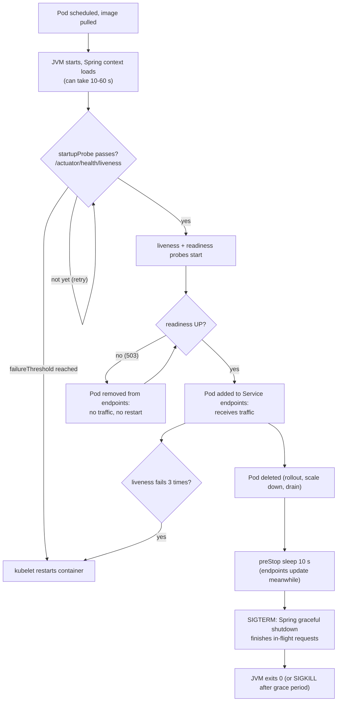
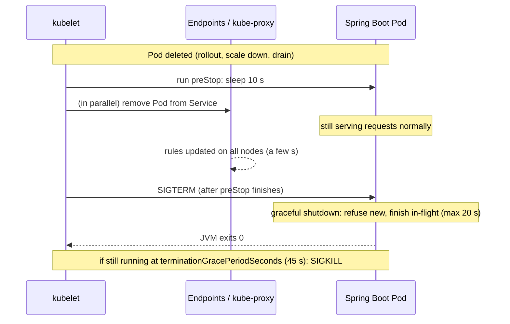

# 12. Running Spring Boot Apps on Kubernetes (Interview Imp)

> **Note**: Sections marked **(Interview Imp)** are frequently asked in interviews. Every chapter ends with a **📘 Terms Explained** table for the jargon it uses.
>
> **Navigation:** [⬅ Previous: 11_Production_Operations](11_Production_Operations.md) · [Index](00_Kubernetes_Index.md) · [Next: 13_Kubernetes_Internals ➡](13_Kubernetes_Internals.md)

## Table of Contents
- [12.1 What Is It and Why Is It Needed?](#121-what-is-it-and-why-is-it-needed)
- [12.2 How It Works: the Life of a Spring Boot Pod](#122-how-it-works-the-life-of-a-spring-boot-pod)
- [12.3 The Demo App (greeting-api)](#123-the-demo-app-greeting-api)
- [12.4 Container Image for Spring Boot](#124-container-image-for-spring-boot)
- [12.5 Health Probes with Actuator (Interview Imp)](#125-health-probes-with-actuator-interview-imp)
- [12.6 JVM Memory and CPU in Containers (Interview Imp)](#126-jvm-memory-and-cpu-in-containers-interview-imp)
- [12.7 Configuration: ConfigMaps and Secrets into Spring Properties](#127-configuration-configmaps-and-secrets-into-spring-properties)
- [12.8 Graceful Shutdown and preStop (Interview Imp)](#128-graceful-shutdown-and-prestop-interview-imp)
- [12.9 Complete Manifests and Deploying on minikube](#129-complete-manifests-and-deploying-on-minikube)
- [12.10 Pros and Cons](#1210-pros-and-cons)
- [12.11 Common Pitfalls](#1211-common-pitfalls)
- [12.12 Interview Questions](#1212-interview-questions)
- [12.13 Cheat Sheet](#1213-cheat-sheet)

---

> **Verification status of this file**
>
> | What | Status |
> |---|---|
> | Maven build, app endpoints, Actuator health, readiness switch, slow start, mounted config, configtree secret, JVM heap under a memory limit, heap OOM exit code, graceful shutdown | **Executed locally** (Spring Boot 4.1.2, OpenJDK 17.0.20.1, Maven 3.9.12). Real output is pasted below each example. Each test ran 3 times. |
> | Image build (12.4), all manifests and `kubectl` commands (12.6, 12.8, 12.9) | **Executed on minikube v1.38.1** (Kubernetes v1.35.1, QEMU driver, 2 CPUs, 2560 MB), real output pasted. The rolling-restart test ran 3 times with and 3 times without `preStop`; the other cluster steps ran once (they take minutes each on this small VM). All resources were deleted afterwards. |
> | Buildpacks, Jib, GraalVM native, Spring Cloud Kubernetes | **NOT executed** (only described as alternatives). |
>
> Things that change between runs: timestamps, PIDs, generated Pod names (`greeting-api-6d6f99c987-5kznb`: the middle part is the Pod-template hash, the end is random), Pod IPs, and the **order of keys in the JSON** responses (Java's `Map.of` uses a different iteration order on each JVM start).

## 12.1 What Is It and Why Is It Needed?

**What is it?** Running a Spring Boot application (a Java web app with an embedded Tomcat server) as Pods managed by a Deployment, reachable through a Service.

**Why is it needed (why not just "put the jar in a container")?** A JVM app behaves differently from a small Go or Node binary, and Kubernetes makes assumptions about the apps it runs. Five things must line up, and each one has its own section below:

| Kubernetes expects... | Spring Boot gives you... | Section |
|---|---|---|
| A way to ask "are you alive?" and "can you take traffic?" | Actuator `/actuator/health/liveness` and `/readiness` | [12.5](#125-health-probes-with-actuator-interview-imp) |
| The app to fit inside its memory limit | JVM heap sizing from the container limit (`MaxRAMPercentage`) | [12.6](#126-jvm-memory-and-cpu-in-containers-interview-imp) |
| Config and secrets from outside the image | Externalised configuration (env vars, `config/application.yml`, configtree) | [12.7](#127-configuration-configmaps-and-secrets-into-spring-properties) |
| The app to stop cleanly on SIGTERM | `server.shutdown=graceful` | [12.8](#128-graceful-shutdown-and-prestop-interview-imp) |
| A container image that starts fast and runs as non-root | Layered jars, small JRE base image | [12.4](#124-container-image-for-spring-boot) |

Get any one wrong and you see the classic symptoms: Pods restarted during startup, `OOMKilled`, 502 errors during every deployment, or secrets baked into images.

## 12.2 How It Works: the Life of a Spring Boot Pod



1. **Start:** the kubelet starts the container; the JVM boots and Spring builds the application context.
2. **Startup probe:** while it is failing, the liveness and readiness probes are **not** run, so a slow start is never mistaken for a hang.
3. **Readiness:** when Spring reports `ACCEPTING_TRAFFIC`, the Pod joins the Service and gets requests.
4. **Liveness:** if the app becomes broken (deadlock, fatal error), liveness fails and the kubelet restarts the container.
5. **Shutdown:** on deletion, `preStop` runs first, then SIGTERM; Spring finishes in-flight requests and exits.

## 12.3 The Demo App (greeting-api)

The full source lives in [examples/greeting-api](examples/greeting-api/): Maven project, Dockerfile and Kubernetes manifests. It is a small REST service built only to demonstrate this chapter.

| Endpoint | Purpose |
|---|---|
| `GET /hello` | Returns the greeting from config, the Pod name (`HOSTNAME`) and whether the DB password was injected |
| `GET /work?ms=8000` | A slow request, to test graceful shutdown |
| `GET /jvm` | Shows the max heap the JVM chose and its CPU count |
| `POST /leak?mb=50` | **Demo only:** allocates memory and never frees it, to trigger an OOM |
| `POST /admin/readiness?ready=false` | Flips Spring's readiness state by hand |
| `GET /actuator/health/liveness`, `/readiness` | Probe endpoints from Spring Boot Actuator |

Key dependencies ([pom.xml](examples/greeting-api/pom.xml)):
```xml
<parent>
  <groupId>org.springframework.boot</groupId>
  <artifactId>spring-boot-starter-parent</artifactId>
  <version>4.1.2</version>
</parent>
...
<artifactId>spring-boot-starter-webmvc</artifactId>   <!-- REST + embedded Tomcat (was starter-web before Boot 4) -->
<artifactId>spring-boot-starter-actuator</artifactId> <!-- health endpoints -->
```

The Kubernetes-relevant part of [application.yml](examples/greeting-api/src/main/resources/application.yml):
```yaml
server:
  shutdown: graceful                       # on SIGTERM: refuse new requests, finish in-flight ones
spring:
  lifecycle:
    timeout-per-shutdown-phase: 20s        # max wait for in-flight requests
management:
  endpoint:
    health:
      probes:
        enabled: true                      # /actuator/health/liveness and /readiness
```
`probes.enabled` is switched on automatically when Spring detects it runs inside Kubernetes (it looks for the `KUBERNETES_SERVICE_HOST` env var). We set it explicitly so the endpoints also exist when running locally.

Build and run locally:
```bash
cd examples/greeting-api
mvn -q -B -DskipTests package
ls -l target/greeting-api-1.0.0.jar
APP_GREETING="Hello from env (ConfigMap stand-in)" APP_DB_PASSWORD="s3cr3t" java -jar target/greeting-api-1.0.0.jar
```
Output of the build (`-q` prints nothing on success):
```
-rw-rw-r-- 1 eshu eshu 22045797 Nov  1 00:44 target/greeting-api-1.0.0.jar
```
The app's startup log (excerpt; timestamps and PID change on every run):
```
 :: Spring Boot ::                (v4.1.2)
... Starting GreetingApplication v1.0.0 using Java 17.0.20.1 with PID 242820 ...
... Tomcat initialized with port 8080 (http)
... Starting Servlet engine: [Apache Tomcat/11.0.27]
... Exposing 2 endpoints beneath base path '/actuator'
... Tomcat started on port 8080 (http) with context path '/'
... Started GreetingApplication in 3.275 seconds (process running for 3.872)
```

#### 📘 Terms Explained

| Term | Simple meaning |
|---|---|
| **Spring Boot** | Java framework that builds a ready-to-run web app (with its own web server) from very little config. |
| **Embedded Tomcat** | The web server is inside the jar; you run `java -jar app.jar`, no separate server to install. |
| **Actuator** | Spring Boot module that adds operational endpoints: health, metrics, info. |
| **Fat jar** | One jar file containing your code and all its dependencies. |
| **`application.yml`** | Spring Boot's main settings file. |

## 12.4 Container Image for Spring Boot

**What:** a Dockerfile that turns the jar into a small, non-root image whose layers cache well.

**Why layers matter:** a fat jar is about 22 MB, but your own code is only a few KB of it. If the whole jar is one image layer, every code change re-uploads 22 MB. Spring Boot can split the jar into layers (dependencies, loader, snapshot dependencies, application) so only the small last layer changes. Docker basics are covered in [03_Dockerfile_and_Image_Building.md](../docker/03_Dockerfile_and_Image_Building.md#34-multi-stage-builds-interview-imp).

[Dockerfile](examples/greeting-api/Dockerfile):
```dockerfile
# ---- stage 1: build the jar ----
FROM maven:3.9-eclipse-temurin-17 AS build
WORKDIR /src
COPY pom.xml .
RUN mvn -q dependency:go-offline           # cached layer: re-runs only when pom.xml changes
COPY src ./src
RUN mvn -q -DskipTests package

# ---- stage 2: split the jar into layers (dependencies change less often than our code) ----
FROM eclipse-temurin:17-jre AS layers
WORKDIR /layers
COPY --from=build /src/target/greeting-api-1.0.0.jar app.jar
RUN java -Djarmode=tools -jar app.jar extract --layers --launcher --destination extracted

# ---- stage 3: small runtime image, non-root ----
FROM eclipse-temurin:17-jre
WORKDIR /app
RUN useradd --uid 10001 --no-create-home appuser
COPY --from=layers /layers/extracted/dependencies/ ./
COPY --from=layers /layers/extracted/spring-boot-loader/ ./
COPY --from=layers /layers/extracted/snapshot-dependencies/ ./
COPY --from=layers /layers/extracted/application/ ./
USER 10001
EXPOSE 8080
ENV JAVA_TOOL_OPTIONS="-XX:MaxRAMPercentage=75 -XX:+ExitOnOutOfMemoryError"
# Exec form: java is PID 1 and receives SIGTERM directly (needed for graceful shutdown).
ENTRYPOINT ["java", "org.springframework.boot.loader.launch.JarLauncher"]
```
Build it straight into minikube's image store (no registry needed):
```bash
cd examples/greeting-api
time minikube image build -t greeting-api:1.0.0 .
minikube ssh -- docker images greeting-api
```
Output (excerpt; first build, so every base image and Maven dependency was downloaded):
```
#13 [build 4/6] RUN mvn -q dependency:go-offline           # cached layer: re-runs only when pom.xml changes
#13 DONE 82.9s
#15 [build 6/6] RUN mvn -q -DskipTests package
#15 DONE 9.3s
#17 [layers 4/4] RUN java -Djarmode=tools -jar app.jar extract --layers --launcher --destination extracted
#17 DONE 2.3s
#18 [stage-2 4/7] COPY --from=layers /layers/extracted/dependencies/ ./
#21 [stage-2 7/7] COPY --from=layers /layers/extracted/application/ ./
#22 naming to docker.io/library/greeting-api:1.0.0 0.0s done
real	3m2.822s

REPOSITORY     TAG       IMAGE ID       CREATED          SIZE
greeting-api   1.0.0     6b7a4ad74d9d   11 seconds ago   318MB
```
83 of the 183 seconds went into downloading Maven dependencies. That step is its own cached layer, so later builds that only change `src/` skip it. Most of the 318 MB is the JRE base image; the app's own layer is a few KB.

**Variants:**

| Way to build | How | When |
|---|---|---|
| **Dockerfile with layers** (above) | Multi-stage build, `jarmode=tools extract --layers` | Full control; most common in interviews |
| **Buildpacks** | `mvn spring-boot:build-image` (no Dockerfile at all) | Quick, secure defaults, memory calculator built in; needs Docker |
| **Jib** | Maven/Gradle plugin builds and pushes the image without Docker | CI without a Docker daemon |
| **Native image (GraalVM)** | `mvn -Pnative spring-boot:build-image` | Start in milliseconds, low memory; long builds, some libraries need extra config |

**Must-haves:** exec-form `ENTRYPOINT` (otherwise a shell is PID 1 and SIGTERM never reaches Java; see [09_Runtime_Limits_Logging_Health.md](../docker/09_Runtime_Limits_Logging_Health.md#94-pid-1-signals-and-graceful-shutdown-interview-imp)), a JRE (not a JDK) base image, a non-root user, and an immutable version tag (`1.0.0` or the Git SHA, never `latest`).

#### 📘 Terms Explained

| Term | Simple meaning |
|---|---|
| **Layered jar** | The jar split into folders that change at different speeds, each copied as its own image layer. |
| **JRE / JDK** | Java Runtime (enough to run apps) / Java Development Kit (adds the compiler and tools; bigger). |
| **Buildpacks** | Tool that builds an image from source code using best-practice defaults, no Dockerfile needed. |
| **Jib** | Google's plugin that builds Java images directly from Maven/Gradle without Docker. |
| **GraalVM native image** | Compiles the Java app ahead of time into a native executable: very fast start, less memory. |
| **PID 1** | The first process in a container; it receives the stop signal (SIGTERM). |

## 12.5 Health Probes with Actuator (Interview Imp)

**What:** Spring Boot keeps two **availability states** and exposes each as an HTTP endpoint that a Kubernetes probe can call.

**Why:** the generic probe rules from [02_Pods.md](02_Pods.md#23-probes-interview-imp) apply, but a Spring app has its own answers to "alive?" and "ready?", and they must be wired to the right probes.

**How it works:**

| Spring state | Values | Endpoint | Kubernetes probe | What happens on failure |
|---|---|---|---|---|
| **LivenessState** | `CORRECT` / `BROKEN` | `/actuator/health/liveness` | `startupProbe`, `livenessProbe` | Container is **restarted** |
| **ReadinessState** | `ACCEPTING_TRAFFIC` / `REFUSING_TRAFFIC` | `/actuator/health/readiness` | `readinessProbe` | Pod is **removed from the Service** (no restart) |

UP returns **HTTP 200**; DOWN / OUT_OF_SERVICE return **HTTP 503**. A Kubernetes HTTP probe treats any status from 200 to 399 as success.

Spring changes the states for you: readiness becomes `ACCEPTING_TRAFFIC` only after the app has fully started (after `ApplicationReadyEvent`) and becomes `REFUSING_TRAFFIC` as soon as shutdown begins. Your code can change them too (`AvailabilityChangeEvent.publish(...)`), for example to stop traffic while a cache reloads. That is what our `/admin/readiness` endpoint does.

### Example 1: what the probes see during a slow start
The app sleeps 3 s during startup (`APP_STARTUP_DELAY_MS=3000`, a stand-in for loading caches or running migrations). Both endpoints are polled every 0.5 s ([script](#how-these-local-tests-were-run)):
```bash
APP_STARTUP_DELAY_MS=3000 java -jar target/greeting-api-1.0.0.jar &
# every 0.5 s: curl -s -o /dev/null -w '%{http_code}' localhost:8080/actuator/health/liveness   (and /readiness)
```
Output (counted with `uniq -c`; the number of `000` lines was 7, 7 and 8 in the 3 runs, the rest identical):
```
      7 liveness=000 readiness=000
      5 liveness=503 readiness=503
      1 liveness=200 readiness=200
```
What this shows:
- `000` = connection refused: the JVM is still starting and Tomcat isn't listening yet.
- `503` for about 2.5 s: **Tomcat is already listening, but the app is not ready.** A probe that only checks "is port 8080 open?" (`tcpSocket`) would wrongly say "ready" here. Use the Actuator HTTP endpoints.
- In this demo the extra 3 s run just *after* Tomcat starts (in an `ApplicationStartedEvent` listener). Slow work during bean creation happens *before* Tomcat listens, and shows up as more `000` lines instead of `503`. Either way the probes fail until startup is done.
- Liveness is also 503 during startup. **Without a startupProbe**, a livenessProbe with a short `initialDelaySeconds` would see these failures and **restart the app before it ever finishes starting**: the classic CrashLoopBackOff of slow JVM apps.

### Example 2: readiness down, liveness still up
```bash
curl -s -X POST "localhost:8080/admin/readiness?ready=false"
curl -s -w ' HTTP %{http_code}\n' localhost:8080/actuator/health/readiness
curl -s -w ' HTTP %{http_code}\n' localhost:8080/actuator/health/liveness
```
Output (identical on all 3 runs):
```
{"readiness":"REFUSING_TRAFFIC"}
{"status":"OUT_OF_SERVICE"} HTTP 503
{"status":"UP"} HTTP 200
```
In Kubernetes this Pod would stay running (liveness OK) but would be taken out of the Service (readiness failing). That is exactly what you want while an app is temporarily unable to serve.

The full health response (local run, `show-details: always` set for the demo only; don't expose details publicly in production):
```json
{"components":{"diskSpace":{"details":{"total":2800586752,"free":2200268800,"threshold":10485760,"path":"...","exists":true},"status":"UP"},
 "livenessState":{"status":"UP"},"ping":{"status":"UP"},"readinessState":{"status":"UP"},
 "ssl":{"details":{"expiringChains":[],"invalidChains":[],"validChains":[]},"status":"UP"}},
 "groups":["liveness","readiness"],"status":"UP"}
```

### The probe YAML
```yaml
startupProbe:                      # up to 30 x 2 s = 60 s to start; liveness/readiness wait for it
  httpGet: { path: /actuator/health/liveness, port: http }
  periodSeconds: 2
  failureThreshold: 30
livenessProbe:                     # stuck? -> restart
  httpGet: { path: /actuator/health/liveness, port: http }
  periodSeconds: 10
  failureThreshold: 3
readinessProbe:                    # can serve? -> in/out of the Service
  httpGet: { path: /actuator/health/readiness, port: http }
  periodSeconds: 5
  failureThreshold: 2
```

**Should readiness check the database?** You can add components to the readiness group (`management.endpoint.health.group.readiness.include: readinessState,db`). Then a DB outage removes Pods from the Service, which is fine. **Never add the DB to liveness**: a DB outage would restart every Pod, which fixes nothing and turns a DB problem into a full outage.

**Types / variants:** `httpGet` (used here), `tcpSocket` (port open only: too weak for Spring, see Example 1), `exec` (runs a command in the container; costly with a JVM), `grpc` (for gRPC services). Separate management port (`management.server.port: 8081`): keeps probes off the public port, but probes then don't prove the main port works.

#### 📘 Terms Explained

| Term | Simple meaning |
|---|---|
| **Availability state** | Spring Boot's own record of whether the app is alive (liveness) and able to serve (readiness). |
| **`ApplicationReadyEvent`** | Event Spring fires when startup has completely finished; readiness turns UP after it. |
| **OUT_OF_SERVICE** | Health status meaning "running but don't send me traffic"; returned with HTTP 503. |
| **Health group** | A named subset of health checks with its own endpoint (e.g. `liveness`, `readiness`). |
| **`failureThreshold`** | How many failed probe attempts in a row count as a real failure. |
| **Management port** | Optional separate port for Actuator endpoints. |

## 12.6 JVM Memory and CPU in Containers (Interview Imp)

**What:** making the JVM size itself from the **container's** memory limit instead of the machine's RAM.

**Why:** the JVM's heap is only part of its memory. It also uses metaspace (class data), thread stacks, code cache, GC structures and direct buffers. If the heap alone is allowed to grow to the container limit, the total goes over the limit and the kernel kills the container: **OOMKilled, exit code 137**. You won't see a Java `OutOfMemoryError`, just a dead Pod.

**How it works:** since JDK 10 (and 8u191) the JVM is **container aware**: it reads the cgroup memory limit and uses it as "physical RAM". `-XX:MaxRAMPercentage=75` then means "heap = 75% of the limit", leaving about 25% for non-heap memory.

### Example: the same flag, with and without a memory limit
On the host (5.3 GB RAM, no limit) the app reported:
```
$ curl -s localhost:8080/jvm
{"availableProcessors":8,"jvmArgs":["-XX:MaxRAMPercentage=75"],"maxHeapMiB":4008}
```
Under a 512 MiB cgroup limit, the same mechanism a container uses (created here with `systemd-run --user --scope -p MemoryMax=512M`, because Docker isn't available):
```bash
JAVA_TOOL_OPTIONS="-XX:MaxRAMPercentage=75" systemd-run --user --scope --quiet -p MemoryMax=512M java -jar target/greeting-api-1.0.0.jar
curl -s localhost:8080/jvm
```
Output (identical on all 3 runs, apart from key order):
```
Picked up JAVA_TOOL_OPTIONS: -XX:MaxRAMPercentage=75
{"maxHeapMiB":371,"jvmArgs":["-XX:MaxRAMPercentage=75"],"availableProcessors":8}
```
And the JVM's own chosen flags:
```bash
systemd-run --user --scope --quiet -p MemoryMax=512M java -XX:MaxRAMPercentage=75 -XX:+PrintCommandLineFlags -version
java -XX:MaxRAMPercentage=75 -XX:+PrintCommandLineFlags -version     # host, no limit
```
Output (identical on all 3 runs; only the relevant flags shown):
```
# under 512M limit
-XX:MaxHeapSize=402653184
-XX:+UseSerialGC
# host, no limit
-XX:MaxHeapSize=4200880128
-XX:+UseG1GC
```
**Surprises in this output:**
1. `MaxHeapSize=402653184` bytes is exactly **384 MiB = 75% of 512 MiB**, but the app reports **371 MiB**. `Runtime.maxMemory()` leaves out one survivor space (a small area the collector keeps in reserve), so the two numbers differ slightly. Both are correct.
2. **The garbage collector changed from G1 to SerialGC.** The JVM treats a machine with less than about 1792 MB of memory (or fewer than 2 CPUs) as a "client" machine and picks the single-threaded SerialGC. Many Spring apps in small Pods silently run with SerialGC. Set `-XX:+UseG1GC` (or another GC) explicitly if you want a specific one.
3. `availableProcessors` stayed 8, because no CPU limit was set. In Kubernetes, the JVM counts CPUs from the **CPU limit**; with only a CPU *request*, it sees all the node's CPUs and sizes thread pools for them. Use `-XX:ActiveProcessorCount=N` to override. Verified on minikube below.

### Example: the same thing inside a real Pod
In a `greeting-api` Pod (limit 512Mi, see [12.9](#129-complete-manifests-and-deploying-on-minikube)):
```bash
curl -s localhost:8080/jvm          # through kubectl port-forward
kubectl exec greeting-api-6d6f99c987-5kznb -- java -XX:+PrintCommandLineFlags -version 2>&1 | tr ' ' '\n' | grep -E 'MaxHeapSize|Use.*GC'
```
Output:
```
{"jvmArgs":["-XX:MaxRAMPercentage=75","-XX:+ExitOnOutOfMemoryError"],"availableProcessors":2,"maxHeapMiB":371}
-XX:MaxHeapSize=402653184
-XX:+UseSerialGC
```
Same numbers as the local cgroup test: 384 MiB configured, 371 reported, SerialGC. `availableProcessors` is 2 because the minikube node has 2 CPUs and the Pod has no CPU limit.

**CPU limit vs CPU request:** two throw-away Pods ran `java -XshowSettings:system -version` from the same image, one with `limits.cpu: 1` and one with only `requests.cpu: 250m`:
```bash
kubectl logs cpu-limit-1cpu   | grep -E 'CPU|Memory Limit'
kubectl logs cpu-request-only | grep -E 'CPU|Memory Limit'
```
Output:
```
# limits.cpu: 1, requests.cpu: 250m
    Effective CPU Count: 1
    CPU Period: 100000us
    CPU Quota: 100000us
    CPU Shares: 1024us
    Memory Limit: Unlimited
# requests.cpu: 250m only
    Effective CPU Count: 2
    CPU Period: 100000us
    CPU Quota: -1
    CPU Shares: 1024us
    Memory Limit: Unlimited
```
The CPU **limit** becomes a CFS quota (100000us per 100000us period = 1 CPU), and the JVM counts 1 CPU. With only a **request** there is no quota (`-1`), so the JVM uses all of the node's CPUs (2 here, but 32 or 64 on a real node). The request isn't used for this at all. ("Memory Limit: Unlimited" because these two test Pods had no memory limit.)

### Variants

| Option | Effect | Use when |
|---|---|---|
| `-XX:MaxRAMPercentage=75` | Heap max = 75% of the limit | **Default choice**; heap follows the limit automatically |
| `-Xmx384m` | Fixed heap | You want an exact number; must be changed by hand if the limit changes |
| `-XX:InitialRAMPercentage=50` | Start with a bigger heap | Avoid early heap growth pauses |
| `-XX:+ExitOnOutOfMemoryError` | JVM exits on Java OOM | Let Kubernetes restart a broken JVM instead of leaving it half-working |
| `-XX:ActiveProcessorCount=2` | Overrides detected CPUs | No CPU limit, but you want thread pools sized for your request |

**Recommended resources for a Spring Boot Pod:**
```yaml
resources:
  requests: { cpu: 250m, memory: 512Mi }
  limits:   { memory: 512Mi }        # memory limit = request: predictable, no surprise OOM from overcommit
```
- **Memory:** limit = request, and heap at 70-75% of it. A small Spring Boot app needs roughly 250-400 MiB total; measure with `kubectl top pod` and Actuator metrics.
- **CPU:** set a request, and often **no CPU limit**. JVM startup is CPU-heavy (class loading, JIT compilation); a tight CPU limit throttles startup and can make the startup probe time out.

### Example: heap full with `-XX:+ExitOnOutOfMemoryError`
Without this flag, a JVM that hits `OutOfMemoryError` often keeps running half-broken: some threads died, but the process is alive, so liveness may still pass. With the flag it exits at once, and Kubernetes restarts the container.
```bash
java -Xmx128m -XX:+ExitOnOutOfMemoryError -jar target/greeting-api-1.0.0.jar &
curl -s -X POST 'localhost:8080/leak?mb=50'     # repeated 4 times
```
Output (identical on all 3 runs):
```
{"leakedMiB":50}
curl: (52) Empty reply from server
curl: (7) Failed to connect to localhost port 8080 after 0 ms: Could not connect to server
curl: (7) Failed to connect to localhost port 8080 after 0 ms: Could not connect to server
java exit code: 3
Terminating due to java.lang.OutOfMemoryError: Java heap space
```
The second request pushed the heap past 128 MiB, and the JVM exited with **code 3** in the middle of it ("Empty reply"). So in Kubernetes there are two different "out of memory" deaths:

| What filled up | Who kills it | Exit code in `kubectl describe pod` | Reason shown |
|---|---|---|---|
| Java heap (`-Xmx` / `MaxRAMPercentage`) | The JVM itself (`ExitOnOutOfMemoryError`) | **3** | `Error` |
| Whole container (heap + non-heap > limit) | The Linux kernel (cgroup OOM killer) | **137** (128 + SIGKILL 9) | `OOMKilled` |

### Example: both kinds of OOM in real Pods
**Case 1: heap full** in a normal `greeting-api` Pod (heap 75% of 512Mi). The `/leak` calls were sent from a temporary curl Pod straight to the Pod's IP:
```bash
kubectl run curl --image=curlimages/curl:8.11.1 --restart=Never --rm -i --quiet -- \
  sh -c "for i in 1 2 3 4 5 6 7 8 9 10; do curl -sS -m 10 -X POST 'http://10.244.0.4:8080/leak?mb=50'; echo; done"
kubectl get pod greeting-api-6d6f99c987-5kznb
kubectl describe pod greeting-api-6d6f99c987-5kznb | sed -n '/Last State/,/Finished/p'
kubectl logs greeting-api-6d6f99c987-5kznb --previous | tail -1
```
Output:
```
{"leakedMiB":150}
{"leakedMiB":200}
{"leakedMiB":250}
{"leakedMiB":300}
{"leakedMiB":350}
curl: (52) Empty reply from server
curl: (7) Failed to connect to 10.244.0.4 port 8080 after 0 ms: Could not connect to server
curl: (7) Failed to connect to 10.244.0.4 port 8080 after 0 ms: Could not connect to server

NAME                            READY   STATUS    RESTARTS     AGE
greeting-api-6d6f99c987-5kznb   0/1     Running   1 (7s ago)   119s

    Last State:     Terminated
      Reason:       Error
      Exit Code:    3
      Started:      Sun, 01 Nov 2026 01:19:39 +0530
      Finished:     Sun, 01 Nov 2026 01:21:29 +0530

Terminating due to java.lang.OutOfMemoryError: Java heap space
```
**Surprise:** the output starts at 150; the replies for 50 and 100 are missing. `kubectl run -i` attaches to the Pod only after it is running, so output printed in the first moment is lost. Don't rely on it to capture everything (use `kubectl logs` afterwards).

The JVM exited itself (code 3) at about 384 MiB of heap, the kubelet restarted the container (`RESTARTS 1`), and `READY 0/1` shows it was out of the Service while the new JVM started. The other replica kept serving.

**Case 2: the classic mistake.** [demos/oom-demo-pod.yaml](examples/greeting-api/demos/oom-demo-pod.yaml) (kept out of `k8s/` so `kubectl apply -f k8s/` never starts it) is the same image and the same 512Mi limit, but with `-XX:MaxRAMPercentage=100`:
```bash
kubectl apply -f demos/oom-demo-pod.yaml
# from a curl Pod: GET /jvm, then POST /leak?mb=40 up to 14 times
kubectl get pod oom-demo
kubectl describe pod oom-demo | sed -n '/    State:/,/Finished/p'
```
Output:
```
{"jvmArgs":["-XX:MaxRAMPercentage=100","-XX:+ExitOnOutOfMemoryError"],"availableProcessors":2,"maxHeapMiB":494}
{"leakedMiB":40}
...
{"leakedMiB":320}
curl: (52) Empty reply from server
curl: (7) Failed to connect to 10.244.0.9 port 8080 after 0 ms: Could not connect to server
...

NAME       READY   STATUS      RESTARTS   AGE
oom-demo   0/1     OOMKilled   0          24s

    State:          Terminated
      Reason:       OOMKilled
      Exit Code:    137
```
The JVM thought it could use 494 MiB of heap, but heap + non-heap passed 512Mi after about 320 MiB of leaked objects, and **the kernel** killed it. `kubectl logs oom-demo` ends with a normal INFO line: no Java error at all. That's why OOMKilled is confusing until you know to look at `describe`.

| | Case 1 (`MaxRAMPercentage=75`) | Case 2 (`MaxRAMPercentage=100`) |
|---|---|---|
| Who stopped it | The JVM | The Linux kernel |
| `describe pod` | `Reason: Error`, `Exit Code: 3` | `Reason: OOMKilled`, `Exit Code: 137` |
| Last log line | `Terminating due to java.lang.OutOfMemoryError: Java heap space` | Nothing special |

#### 📘 Terms Explained

| Term | Simple meaning |
|---|---|
| **Heap** | Memory where Java objects live; controlled by `-Xmx` / `MaxRAMPercentage`. |
| **Non-heap memory** | Everything else the JVM uses: metaspace, thread stacks, code cache, GC data, direct buffers. |
| **Metaspace** | Memory for class definitions. |
| **cgroup** | Linux feature that limits a group of processes' memory/CPU; containers use it. |
| **Container aware** | The JVM reads the cgroup limits instead of the whole machine's RAM and CPUs. |
| **Survivor space** | Small heap area used by the garbage collector to hold objects that survived a collection. |
| **SerialGC / G1GC** | Single-threaded garbage collector for small machines / the default multi-threaded collector for larger ones. |
| **CPU throttling** | The kernel pauses a container that used up its CPU limit for the current time slice. |
| **`JAVA_TOOL_OPTIONS`** | Env var the JVM reads for extra flags; handy for setting JVM options from a Kubernetes manifest. |

## 12.7 Configuration: ConfigMaps and Secrets into Spring Properties

**What:** feeding Spring properties from Kubernetes objects, so the **same image** runs in dev, test and prod with different settings. ConfigMap/Secret basics are in [04_Configuration_and_Secrets.md](04_Configuration_and_Secrets.md).

**Why:** rebuilding an image per environment breaks "build once, deploy many", and secrets baked into images leak to anyone who can pull the image.

**Types / variants:**

| Way | How Spring sees it | Updates without restart? | Use for |
|---|---|---|---|
| **Env vars** (`env`, `envFrom`) | Relaxed binding: `APP_GREETING` → `app.greeting` | No | A few simple values |
| **Mounted `application.yml`** from a ConfigMap | Mount at `/app/config/` (`./config/` next to the working dir), loaded automatically and **overrides** the jar's file | No (Spring reads it at startup) | Whole config files; readable diffs |
| **configtree** for Secrets | `spring.config.import: optional:configtree:/etc/secrets/`; each **file name** is a property name, its **content** the value | No | Secrets as files (safer than env vars) |
| **Spring Cloud Kubernetes** | Library reads ConfigMaps/Secrets through the Kubernetes API, can reload | Yes (optional) | Live reload; needs RBAC permission to read ConfigMaps |

**Order of precedence (simplified, highest wins):** command-line args > env vars > `config/application.yml` outside the jar > `application.yml` inside the jar. So an env var always beats a mounted file.

### Example 1: env vars (relaxed binding)
```bash
APP_GREETING="Hello from env (ConfigMap stand-in)" APP_DB_PASSWORD="s3cr3t" java -jar target/greeting-api-1.0.0.jar
curl -s localhost:8080/hello
```
Output (identical on all 3 runs, apart from key order):
```
{"dbPasswordSet":true,"pod":"local","message":"Hello from env (ConfigMap stand-in)"}
```

### Example 2: mounted `config/application.yml` + configtree secret
Locally, a `config/` folder and a `secrets/` folder in the working directory stand in for the two volume mounts:
```bash
mkdir -p config secrets
cat > config/application.yml <<'EOF'
app:
  greeting: "Hello from mounted config/application.yml"
spring:
  config:
    import: "optional:configtree:./secrets/"
EOF
printf 's3cr3t-from-file' > secrets/app.db-password      # file name = property name
java -jar target/greeting-api-1.0.0.jar
curl -s localhost:8080/hello
```
Output (identical on all 3 runs, apart from key order):
```
{"pod":"local","dbPasswordSet":true,"message":"Hello from mounted config/application.yml"}
```
The mounted file overrode the greeting from the jar, and the password was read from the file.

### The Kubernetes version
[k8s/configmap.yaml](examples/greeting-api/k8s/configmap.yaml) and [k8s/secret.yaml](examples/greeting-api/k8s/secret.yaml):
```yaml
apiVersion: v1
kind: ConfigMap
metadata: { name: greeting-config }
data:
  application.yml: |
    app:
      greeting: "Hello from the greeting-config ConfigMap"
      startup-delay-ms: 3000
    spring:
      config:
        import: "optional:configtree:/etc/secrets/"
---
apiVersion: v1
kind: Secret
metadata: { name: greeting-secret }
type: Opaque
stringData:
  app.db-password: "s3cr3t-demo-only"      # DEMO ONLY. Real secrets: Sealed Secrets / SOPS / External Secrets
```
Mounted in the Deployment:
```yaml
volumeMounts:
  - { name: config,  mountPath: /app/config,  readOnly: true }   # -> /app/config/application.yml
  - { name: secrets, mountPath: /etc/secrets, readOnly: true }   # -> /etc/secrets/app.db-password
volumes:
  - { name: config,  configMap: { name: greeting-config } }
  - { name: secrets, secret: { secretName: greeting-secret } }
```

Checked inside a running Pod (Pod names are generated and change on every run):
```bash
curl -s localhost:8080/hello                                        # through kubectl port-forward
kubectl exec greeting-api-6d6f99c987-5kznb -- ls /app/config /etc/secrets
```
Output:
```
{"message":"Hello from the greeting-config ConfigMap","dbPasswordSet":true,"pod":"greeting-api-6d6f99c987-5kznb"}
/app/config:
application.yml

/etc/secrets:
app.db-password
```
The greeting came from the ConfigMap's `application.yml` and the password from the Secret file via configtree.

**Changing config:** the mounted files update in the Pod after about a minute, but Spring has already read them, so nothing changes until the Pod restarts. Run `kubectl rollout restart deployment/greeting-api`, or have Helm/Kustomize put a hash of the ConfigMap in a Pod annotation so every config change rolls the Pods automatically.

#### 📘 Terms Explained

| Term | Simple meaning |
|---|---|
| **Externalised configuration** | Settings live outside the code/image and are supplied at run time. |
| **Relaxed binding** | Spring matches `APP_DB_PASSWORD`, `app.db-password` and `app.dbPassword` to the same property. |
| **configtree** | Spring feature that turns a folder of files into properties (file name = key, content = value). |
| **`spring.config.import`** | Property that tells Spring to load extra config sources; `optional:` means "don't fail if missing". |
| **Spring Cloud Kubernetes** | Library that reads ConfigMaps/Secrets via the Kubernetes API and can reload them live. |
| **Build once, deploy many** | The same image goes through every environment; only configuration changes. |

## 12.8 Graceful Shutdown and preStop (Interview Imp)

**What:** stopping a Pod without failing any request, during rollouts, scale-down and node drains.

**Why:** when a Pod is deleted, two things happen **in parallel**, not one after the other:
1. the kubelet sends SIGTERM to the container, and
2. the endpoints controller removes the Pod from the Service, and every node's kube-proxy (plus any Ingress controller) updates its rules. This takes a few seconds.

If the app stops accepting connections immediately, requests routed during those seconds fail (502/503 or "connection refused").

### Example: what Spring does on SIGTERM
An 8-second request is started, SIGTERM is sent 1 s later (what the kubelet does), then a new request is tried during shutdown ([script](#how-these-local-tests-were-run)):

Output (identical on all 3 runs except timestamps and PIDs; this is run 1):
```
00:46:32.593 app ready (java PID 243469)
00:46:33.610 kill -TERM 243469   (what the kubelet sends when a Pod stops)
00:46:34.651 new request during shutdown: 'curl: (7) Failed to connect to localhost port 8080 after 0 ms: Could not connect to server
HTTP 000' (curl exit 7)
00:46:40.650 in-flight request returned: {"status":"done","sleptMs":8000} HTTP 200
00:46:40.733 java exited with code 0
```
App log from the same kind of run:
```
... [nio-8080-exec-2] c.example.greeting.GreetingController: Work request started (8000 ms)
... [ionShutdownHook] o.s.boot.tomcat.GracefulShutdown: Commencing graceful shutdown. Waiting for active requests to complete
... [nio-8080-exec-2] c.example.greeting.GreetingController: Work request finished
... [tomcat-shutdown] o.s.boot.tomcat.GracefulShutdown: Graceful shutdown complete
```
What this shows:
- **The in-flight request finished** (HTTP 200 after the full 8 s) and Java exited cleanly with code 0: `server.shutdown=graceful` works.
- **New connections are refused immediately after SIGTERM.** This is correct for Spring, but in Kubernetes the Service may still send traffic to this Pod for a few seconds. **That is exactly why the `preStop` sleep is needed.**

### The fix: preStop sleep, then graceful shutdown



```yaml
spec:
  terminationGracePeriodSeconds: 45     # must be > preStop (10) + timeout-per-shutdown-phase (20) + margin
  containers:
    - name: app
      lifecycle:
        preStop:
          sleep: { seconds: 10 }        # built-in sleep action (Kubernetes 1.30+); no shell needed
```
On older clusters use `exec: { command: ["sh", "-c", "sleep 10"] }` (the image needs a shell). The grace period counts from the start of `preStop`, so **budget the sum**: 10 s sleep + up to 20 s Spring shutdown + margin = 45 s.

### Example: rolling restart under load, with and without preStop
A load-generator Pod calls `http://greeting-api/hello` about every 50 ms for 100 s, printing each HTTP status code. 5 s in, `kubectl rollout restart` replaces both Pods ([script](#how-these-local-tests-were-run)). Then the `lifecycle` block is removed and the same test runs again:
```bash
kubectl run loadgen --image=curlimages/curl:8.11.1 --restart=Never -- sh -c '
  end=$(( $(date +%s) + 100 ))
  while [ $(date +%s) -lt $end ]; do
    curl -s -o /dev/null -m 3 -w "%{http_code}\n" http://greeting-api/hello; sleep 0.05
  done'
kubectl rollout restart deployment/greeting-api
kubectl logs loadgen | sort | uniq -c          # after it finishes

# then remove preStop and repeat:
kubectl patch deployment greeting-api --type=json -p '[{"op":"remove","path":"/spec/template/spec/containers/0/lifecycle"}]'
```
Output (`count http_code`; `000` = the connection failed):
```
[with preStop, run 1]          1242 200
[with preStop, run 2]          1256 200
[with preStop, run 3]          1248 200

[WITHOUT preStop, run 1]          5 000
                               1012 200
[WITHOUT preStop, run 2]          8 000
                               1200 200
[WITHOUT preStop, run 3]          4 000
                               1261 200
```
**With `preStop` there were zero failures in all 3 runs. Without it, 4-8 requests failed in each run**, even on a single-node cluster where endpoint updates are fast. On a real multi-node cluster with an Ingress controller and cloud load balancer in front, the window (and the number of errors) is larger. The request counts per run differ a little because each curl call takes a variable time.

#### 📘 Terms Explained

| Term | Simple meaning |
|---|---|
| **SIGTERM** | Polite "please stop" signal; the app may clean up first. |
| **SIGKILL** | Forced stop that can't be caught; sent when the grace period runs out. |
| **Graceful shutdown** | Stop taking new work, finish current work, then exit. |
| **`preStop` hook** | Command or sleep run in the container before SIGTERM is sent. |
| **`terminationGracePeriodSeconds`** | Total time Kubernetes waits (preStop + shutdown) before SIGKILL; default 30. |
| **In-flight request** | A request that has started but not finished yet. |

## 12.9 Complete Manifests and Deploying on minikube

All files: [examples/greeting-api/k8s/](examples/greeting-api/k8s/) (the app), [examples/greeting-api/demos/](examples/greeting-api/demos/) (OOM demo only). The Deployment ties everything above together:

[k8s/deployment.yaml](examples/greeting-api/k8s/deployment.yaml):
```yaml
apiVersion: apps/v1
kind: Deployment
metadata:
  name: greeting-api
  labels: { app: greeting-api }
spec:
  replicas: 2
  selector:
    matchLabels: { app: greeting-api }
  strategy:
    type: RollingUpdate
    rollingUpdate:
      maxUnavailable: 0          # never drop below 2 Ready Pods during a rollout
      maxSurge: 1                # add one new Pod at a time
  template:
    metadata:
      labels: { app: greeting-api }
    spec:
      terminationGracePeriodSeconds: 45     # > preStop (10 s) + Spring shutdown timeout (20 s) + margin
      securityContext:
        runAsNonRoot: true
        runAsUser: 10001
        seccompProfile: { type: RuntimeDefault }
      containers:
        - name: app
          image: greeting-api:1.0.0
          imagePullPolicy: IfNotPresent      # image is loaded into minikube, not pulled from a registry
          ports:
            - name: http
              containerPort: 8080
          env:
            - name: JAVA_TOOL_OPTIONS        # heap = 75% of the memory limit; exit (so K8s restarts) on OOM
              value: "-XX:MaxRAMPercentage=75 -XX:+ExitOnOutOfMemoryError"
          resources:
            requests: { cpu: 250m, memory: 512Mi }
            limits:   { memory: 512Mi }      # memory limit = request; no CPU limit (avoids throttling)
          startupProbe:                      # gives a slow JVM up to 30 x 2 s = 60 s to start
            httpGet: { path: /actuator/health/liveness, port: http }
            periodSeconds: 2
            failureThreshold: 30
          livenessProbe:                     # "is the process stuck?" -> restart. Never checks the DB.
            httpGet: { path: /actuator/health/liveness, port: http }
            periodSeconds: 10
            failureThreshold: 3
          readinessProbe:                    # "can it take traffic now?" -> add/remove from the Service
            httpGet: { path: /actuator/health/readiness, port: http }
            periodSeconds: 5
            failureThreshold: 2
          lifecycle:
            preStop:
              sleep: { seconds: 10 }         # keep serving while the Pod is removed from Service endpoints
          securityContext:
            allowPrivilegeEscalation: false
            readOnlyRootFilesystem: true
            capabilities: { drop: ["ALL"] }
          volumeMounts:
            - { name: config,  mountPath: /app/config, readOnly: true }
            - { name: secrets, mountPath: /etc/secrets, readOnly: true }
            - { name: tmp,     mountPath: /tmp }           # Tomcat needs a writable temp dir
      volumes:
        - name: config
          configMap: { name: greeting-config }
        - name: secrets
          secret: { secretName: greeting-secret }
        - name: tmp
          emptyDir: {}
```
[k8s/service.yaml](examples/greeting-api/k8s/service.yaml):
```yaml
apiVersion: v1
kind: Service
metadata:
  name: greeting-api
spec:
  selector: { app: greeting-api }     # only Ready Pods with this label receive traffic
  ports:
    - name: http
      port: 80
      targetPort: http
```

### Deploy and test on minikube

**Step 1: start a cluster and build the image.**
```bash
minikube start                                        # Docker driver (needs your user in the docker group)
# or, without Docker, as a VM (what this guide used):
minikube start --driver=qemu2 --qemu-firmware-path=/usr/share/qemu/OVMF.fd --memory=2560 --cpus=2
cd examples/greeting-api
minikube image build -t greeting-api:1.0.0 .          # builds inside minikube, no registry needed (see 12.4)
```
Two things went wrong with the QEMU driver on Ubuntu 26.04, both fixed by the flags above:
1. `PROVIDER_QEMU2_NOT_FOUND: stat /usr/share/OVMF/OVMF_CODE.fd: no such file or directory`. The `ovmf` package now names the file `OVMF_CODE_4M.fd`; `--qemu-firmware-path` points at a file that exists.
2. With `--memory=2048` the VM never booted. Its serial log showed `Killed | tar -C /sysroot/ -xf -` and then `Kernel panic - not syncing: Attempted to kill init!`: the ISO copies its root filesystem into RAM at boot, and 2 GB isn't enough. 2560 MB works.

**Step 2: apply and wait.**
```bash
kubectl apply -f k8s/
time kubectl rollout status deployment/greeting-api --timeout=180s
kubectl get pods -l app=greeting-api -o wide
```
Output:
```
configmap/greeting-config created
deployment.apps/greeting-api created
secret/greeting-secret created
service/greeting-api created
Waiting for deployment "greeting-api" rollout to finish: 0 out of 2 new replicas have been updated...
Waiting for deployment "greeting-api" rollout to finish: 0 of 2 updated replicas are available...
Waiting for deployment "greeting-api" rollout to finish: 1 of 2 updated replicas are available...
deployment "greeting-api" successfully rolled out

real	0m25.599s

NAME                            READY   STATUS    RESTARTS   AGE   IP           NODE       NOMINATED NODE   READINESS GATES
greeting-api-6d6f99c987-5kznb   1/1     Running   0          26s   10.244.0.4   minikube   <none>           <none>
greeting-api-6d6f99c987-62qnd   1/1     Running   0          26s   10.244.0.3   minikube   <none>           <none>
```

**Step 3: watch the probes at work** in the Pod's events:
```bash
kubectl describe pod greeting-api-6d6f99c987-5kznb | sed -n '/^Events:/,$p'
```
Output:
```
Events:
  Type     Reason     Age                From               Message
  ----     ------     ----               ----               -------
  Normal   Scheduled  47s                default-scheduler  Successfully assigned default/greeting-api-6d6f99c987-5kznb to minikube
  Normal   Pulled     45s                kubelet            spec.containers{app}: Container image "greeting-api:1.0.0" already present on machine and can be accessed by the pod
  Normal   Created    45s                kubelet            spec.containers{app}: Container created
  Normal   Started    45s                kubelet            spec.containers{app}: Container started
  Warning  Unhealthy  28s (x9 over 44s)  kubelet            spec.containers{app}: Startup probe failed: Get "http://10.244.0.4:8080/actuator/health/liveness": dial tcp 10.244.0.4:8080: connect: connection refused
  Warning  Unhealthy  24s (x2 over 25s)  kubelet            spec.containers{app}: Startup probe failed: HTTP probe failed with statuscode: 503
```
This is the slow start from [12.5](#example-1-what-the-probes-see-during-a-slow-start), seen by Kubernetes: 9 failures while the JVM boots (connection refused), 2 while Spring runs its startup work (503), then success. With `failureThreshold: 30` these "Warning" events are expected and harmless; a liveness probe without a startup probe would have restarted the container.

**Step 4: check the Service and security settings.**
```bash
kubectl get endpointslices -l kubernetes.io/service-name=greeting-api
kubectl exec greeting-api-6d6f99c987-5kznb -- id
kubectl exec greeting-api-6d6f99c987-5kznb -- touch /app/x
```
Output:
```
NAME                 ADDRESSTYPE   PORTS   ENDPOINTS               AGE
greeting-api-2gwpl   IPv4          8080    10.244.0.3,10.244.0.4   46s
uid=10001(appuser) gid=10001(appuser) groups=10001(appuser)
touch: cannot touch '/app/x': Read-only file system
command terminated with exit code 1
```
Both Ready Pods are endpoints. The app runs as uid 10001, and the root filesystem really is read-only. Tomcat still starts because `/tmp` is a writable `emptyDir`.

**Step 5: call the Service.** First through port-forward, then from inside the cluster:
```bash
kubectl port-forward svc/greeting-api 8080:80 &
for i in 1 2 3 4; do curl -s localhost:8080/hello; echo; done

kubectl run curl --image=curlimages/curl:8.11.1 --restart=Never --rm -i --quiet -- \
  sh -c 'for i in 1 2 3 4 5 6; do curl -s http://greeting-api/hello; echo; done'
```
Output:
```
# port-forward: 4 of 4 to the same Pod
{"message":"Hello from the greeting-config ConfigMap","dbPasswordSet":true,"pod":"greeting-api-6d6f99c987-5kznb"}
{"message":"Hello from the greeting-config ConfigMap","dbPasswordSet":true,"pod":"greeting-api-6d6f99c987-5kznb"}
{"message":"Hello from the greeting-config ConfigMap","dbPasswordSet":true,"pod":"greeting-api-6d6f99c987-5kznb"}
{"message":"Hello from the greeting-config ConfigMap","dbPasswordSet":true,"pod":"greeting-api-6d6f99c987-5kznb"}
# inside the cluster: spread over both Pods
{"message":"Hello from the greeting-config ConfigMap","dbPasswordSet":true,"pod":"greeting-api-6d6f99c987-5kznb"}
{"message":"Hello from the greeting-config ConfigMap","pod":"greeting-api-6d6f99c987-62qnd","dbPasswordSet":true}
{"message":"Hello from the greeting-config ConfigMap","pod":"greeting-api-6d6f99c987-62qnd","dbPasswordSet":true}
{"message":"Hello from the greeting-config ConfigMap","dbPasswordSet":true,"pod":"greeting-api-6d6f99c987-5kznb"}
{"message":"Hello from the greeting-config ConfigMap","pod":"greeting-api-6d6f99c987-62qnd","dbPasswordSet":true}
{"message":"Hello from the greeting-config ConfigMap","dbPasswordSet":true,"pod":"greeting-api-6d6f99c987-5kznb"}
```
**Surprise:** `kubectl port-forward svc/...` does **not** load-balance. It picks one Pod behind the Service and tunnels to it. Real Service traffic (from inside the cluster) is spread over both Pods. Never test load balancing or zero-downtime through port-forward.

**Step 6: clean up.**
```bash
kubectl delete -f k8s/ --ignore-not-found
kubectl get all
minikube stop                                         # frees the VM's RAM; the built image stays on its disk
```
Output:
```
configmap "greeting-config" deleted from default namespace
deployment.apps "greeting-api" deleted from default namespace
secret "greeting-secret" deleted from default namespace
service "greeting-api" deleted from default namespace
NAME                 TYPE        CLUSTER-IP   EXTERNAL-IP   PORT(S)   AGE
service/kubernetes   ClusterIP   10.96.0.1    <none>        443/TCP   68m
```

Deeper production concerns (PDB, topology spread, HPA) are in [11_Production_Operations.md](11_Production_Operations.md#112-checklist-for-every-workload-interview-imp) and [03_Workload_Controllers.md](03_Workload_Controllers.md#36-autoscaling-interview-imp). Rollout strategies (blue/green, canary) are in [09_Deployment_Pattern.md](../design-patterns/03_System_Design/09_Deployment_Pattern.md).

## 12.10 Pros and Cons

| Pros | Cons |
|---|---|
| Actuator gives probe endpoints with zero code | JVM startup is slow (seconds to a minute), so scale-up reacts late |
| Graceful shutdown is one property | Memory-hungry compared with Go/Node; small Pods need careful JVM tuning |
| Externalised config fits ConfigMaps/Secrets naturally | Many knobs must agree (grace period, preStop, shutdown timeout, probe timings) |
| Container-aware JVM sizes itself from the Pod limit | JVM ergonomics change silently in small Pods (SerialGC, CPU count) |
| Same image for every environment | Fat images if built naively; layering or buildpacks needed |
| GraalVM native images can fix startup and memory | Native builds are slow and some libraries need extra configuration |

## 12.11 Common Pitfalls

| Pitfall | What happens | Fix |
|---|---|---|
| No startupProbe, liveness with short delay | App restarted while still starting → CrashLoopBackOff | `startupProbe` with a generous `failureThreshold` |
| `tcpSocket` probe on 8080 | Pod marked ready while Spring is still starting (see [12.5](#example-1-what-the-probes-see-during-a-slow-start)) | `httpGet` on `/actuator/health/readiness` |
| DB check in liveness | DB outage restarts every Pod | DB only in readiness, or nowhere |
| `-Xmx` equal to the memory limit | Heap + non-heap > limit → `OOMKilled` (137) | `MaxRAMPercentage=70-75`, or `-Xmx` well below the limit |
| Shell-form `ENTRYPOINT` / `sh -c java ...` | SIGTERM goes to the shell, Java never shuts down gracefully, SIGKILL after 30 s | Exec form; `exec java ...` in scripts |
| No `preStop` sleep | 502s during every rollout | `preStop: sleep 5-10 s` |
| Grace period shorter than preStop + shutdown | SIGKILL cuts in-flight requests | `terminationGracePeriodSeconds` > the sum |
| Tight CPU limit | Slow, throttled startup; probes time out | Request CPU, avoid low CPU limits (or raise them) |
| `readOnlyRootFilesystem` without `/tmp` | Tomcat fails to start (can't create its work dir) | `emptyDir` volume at `/tmp` |
| Changed ConfigMap, nothing happens | Spring read config only at startup | `rollout restart` or hash annotation |
| Secrets as env vars printed in logs / `/actuator/env` | Secret leak | Mount as files (configtree), don't expose `env` endpoint |
| `latest` tag | Unclear which version runs; rollbacks impossible | Version or Git SHA tags |
| Testing through `kubectl port-forward svc/...` | Always hits one Pod: no load balancing, and it hides rollout errors (see [12.9](#deploy-and-test-on-minikube)) | Test from a Pod inside the cluster, or through the Ingress |
| Trusting `kubectl run -i` to capture all output | The first lines are lost before kubectl attaches | Read `kubectl logs <pod>` afterwards |

## 12.12 Interview Questions

**Q1. How do you configure health checks for a Spring Boot app on Kubernetes?** Add Actuator; point `startupProbe` and `livenessProbe` at `/actuator/health/liveness` and `readinessProbe` at `/actuator/health/readiness`. Spring sets these states itself (readiness UP only after startup finishes, DOWN as shutdown starts).

**Q2. Why both a startup and a liveness probe?** The startup probe protects slow JVM starts: until it passes, liveness/readiness are disabled. That lets liveness stay strict (fast restart on a real hang) without killing apps that are just starting.

**Q3. Should the readiness probe check the database? The liveness probe?** Readiness may (a Pod that can't reach its DB shouldn't get traffic). Liveness must not, or a DB outage restarts every Pod.

**Q4. Your Spring Boot Pod keeps getting OOMKilled but you never see an OutOfMemoryError. Why?** The kernel killed the container because the *total* JVM memory (heap + metaspace + threads + buffers) exceeded the limit; the heap itself wasn't full. Lower heap to ~75% of the limit (`MaxRAMPercentage`), check thread count and direct memory, or raise the limit.

**Q5. `-Xmx` vs `-XX:MaxRAMPercentage`?** `-Xmx` is a fixed number; `MaxRAMPercentage` follows the container limit, so changing the limit in YAML automatically resizes the heap.

**Q6. Users see 502 errors during every deployment. What do you check?** Readiness probe correctness, `maxUnavailable: 0`, `server.shutdown=graceful`, a `preStop` sleep to cover endpoint propagation, `terminationGracePeriodSeconds` large enough, and exec-form entrypoint so Java receives SIGTERM.

**Q7. How do you pass configuration and secrets to Spring Boot in Kubernetes?** ConfigMap as env vars or as a mounted `config/application.yml`; Secrets preferably as files read via `spring.config.import=configtree:`; or Spring Cloud Kubernetes for API-based loading and reload. Real secrets come from an external manager (External Secrets, Vault).

**Q8. A ConfigMap was updated but the app still uses the old value. Why?** Spring reads configuration at startup; env vars never change in a running container; mounted files change but aren't re-read. Restart (`kubectl rollout restart`) or automate with a config hash annotation, or use Spring Cloud Kubernetes reload.

**Q9. Should you set CPU limits for Java apps?** Often not: JVM startup and JIT compilation burst CPU, and limits cause throttling. Set CPU requests for scheduling. If you omit limits, consider `-XX:ActiveProcessorCount` so thread pools are sized sensibly.

**Q10. How do you make Spring Boot start faster on Kubernetes?** Fewer dependencies/auto-configs, lazy initialisation where safe, Class Data Sharing (CDS), CRaC checkpoint/restore, or GraalVM native images; and don't throttle CPU during startup.

## 12.13 Cheat Sheet

```
PROBES    startup + liveness -> /actuator/health/liveness   readiness -> /actuator/health/readiness
          200 = UP, 503 = DOWN/OUT_OF_SERVICE. Tomcat listens before the app is ready: use httpGet, not tcpSocket.
          DB in readiness only, never in liveness. startupProbe failureThreshold x periodSeconds > worst start time.
MEMORY    limit = request; -XX:MaxRAMPercentage=75 ; -XX:+ExitOnOutOfMemoryError
          OOMKilled/137 = total JVM memory > limit (not a Java OOM). < ~1792 MB -> JVM picks SerialGC.
CPU       request yes, limit often no (startup/JIT bursts). JVM CPU count follows the CPU limit; -XX:ActiveProcessorCount=N
CONFIG    env APP_GREETING -> app.greeting (relaxed binding) ; ConfigMap -> /app/config/application.yml (auto-loaded)
          Secret files -> spring.config.import=optional:configtree:/etc/secrets/ ; change config -> rollout restart
SHUTDOWN  server.shutdown=graceful ; spring.lifecycle.timeout-per-shutdown-phase=20s
          preStop sleep 10 s ; terminationGracePeriodSeconds 45 (> 10 + 20 + margin) ; exec-form ENTRYPOINT
IMAGE     multi-stage, layered jar (jarmode=tools extract --layers), JRE base, non-root, version tags
          alternatives: mvn spring-boot:build-image (buildpacks), Jib, GraalVM native
SECURITY  runAsNonRoot, readOnlyRootFilesystem + emptyDir /tmp, drop ALL caps, expose only health/info
```

### How these local tests were run
- **Local tests** (slow-start polling, mounted config, cgroup memory limit, heap OOM, SIGTERM test) ran the jar directly with Java 17, each 3 times. The cgroup limit was created with `systemd-run --user --scope -p MemoryMax=512M`, which applies the same kind of kernel memory limit that a container runtime does.
- **Cluster tests** ran on minikube v1.38.1 (Kubernetes v1.35.1, QEMU VM, 2 CPUs, 2560 MB, Docker runtime inside the VM). The rolling-restart test used the `loadgen` Pod shown in [12.8](#example-rolling-restart-under-load-with-and-without-prestop), 3 runs with and 3 without `preStop`. All test resources were deleted afterwards.

#### 📘 Terms Explained

| Term | Simple meaning |
|---|---|
| **CDS (Class Data Sharing)** | JVM feature that stores pre-processed classes on disk so later starts are faster. |
| **CRaC** | Coordinated Restore at Checkpoint: save a warmed-up JVM to disk and restore it in milliseconds. |
| **JIT compilation** | The JVM compiles hot code to machine code while running; uses a lot of CPU early on. |
| **Lazy initialisation** | Create beans only when first used, so startup does less work. |
| **Config hash annotation** | A Pod annotation holding a checksum of the ConfigMap; when config changes, the Pod template changes and a rollout happens. |
| **Port-forward** | `kubectl port-forward` tunnels a local port to a Pod/Service, handy for testing without an Ingress. |

---

> **Navigation:** [⬅ Previous: 11_Production_Operations](11_Production_Operations.md) · [Index](00_Kubernetes_Index.md) · [Next: 13_Kubernetes_Internals ➡](13_Kubernetes_Internals.md)
