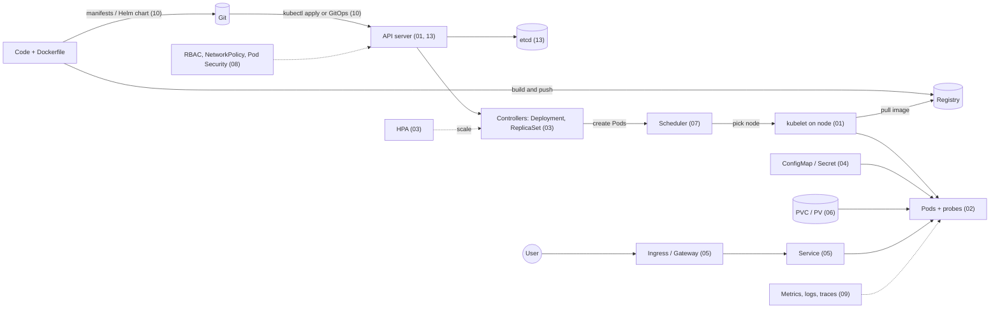

# 16. Big Picture and Cheat Sheet

> **Note**: Sections marked **(Interview Imp)** are frequently asked in interviews. Every chapter ends with a **📘 Terms Explained** table for the jargon it uses.
>
> **Navigation:** [⬅ Previous: 15_Certification_Projects_and_Learning_Path](15_Certification_Projects_and_Learning_Path.md) · [Index](00_Kubernetes_Index.md)

## Table of Contents
- [16.1 How It All Fits Together (Interview Imp)](#161-how-it-all-fits-together-interview-imp)
- [16.2 Kubernetes Cheat Sheet](#162-kubernetes-cheat-sheet)

---

## 16.1 How It All Fits Together (Interview Imp)

**What is it?** One end-to-end picture that joins every chapter: from a container image to a user's request being served, kept healthy and kept safe.

**Why needed?** Interviewers often ask "walk me through what happens when..." questions. They want the *flow* between pieces, not the definition of each piece.



**How it works, step by step** (numbers in brackets are the files to read):

1. **Package the app.** Build a container image and push it to a registry. See [00_Docker_Index.md](../docker/00_Docker_Index.md).
2. **Describe the desired state.** Write YAML: a Deployment for the app, a Service in front of it, a ConfigMap and Secret for settings, a PVC if it stores files. Package it with Helm or Kustomize. → [03](03_Workload_Controllers.md), [04](04_Configuration_and_Secrets.md), [05](05_Networking.md), [06](06_Storage.md), [10](10_Helm_GitOps_and_Operators.md)
3. **Send it to the cluster.** `kubectl apply` or a GitOps tool (Argo CD) sends the objects to the **API server**. The request is authenticated, checked by RBAC and admission policies, then saved in **etcd**. → [08](08_Security.md), [13](13_Kubernetes_Internals.md#132-what-happens-on-kubectl-apply--f-deployyaml)
4. **Controllers make it real.** The Deployment controller creates a ReplicaSet, which creates Pod objects. Nothing runs yet. → [03](03_Workload_Controllers.md)
5. **The scheduler places Pods.** It picks a node with enough requested CPU/memory that also satisfies taints, affinity and spread rules. → [07](07_Scheduling_and_Resources.md)
6. **The kubelet starts containers.** On the chosen node it pulls the image, mounts ConfigMaps/Secrets/volumes, starts the containers and runs the **startup, liveness and readiness probes**. → [02](02_Pods.md)
7. **Traffic arrives.** Only **Ready** Pods are added to the Service's endpoints. A user's request goes Ingress/Gateway → Service → one Ready Pod. → [05](05_Networking.md)
8. **It stays healthy by itself.** If a container crashes, the kubelet restarts it. If a node dies, the ReplicaSet creates replacement Pods elsewhere. The HPA adds Pods when CPU rises. This is the **reconciliation loop**: desired state vs actual state, forever. → [03](03_Workload_Controllers.md#36-autoscaling-interview-imp), [13](13_Kubernetes_Internals.md#131-the-reconciliation-control-loop)
9. **You watch and fix it.** Metrics, logs and traces show what is going on; `kubectl describe` and events explain failures. → [09](09_Observability_and_Troubleshooting.md)
10. **You run it like production.** Multiple replicas across zones, PDBs, graceful shutdown, safe rollouts, backups. → [11](11_Production_Operations.md); for Java apps (Actuator probes, JVM memory, shutdown) → [12](12_Spring_Boot_on_Kubernetes.md)

**One sentence for interviews:** *"You declare the desired state in YAML, the API server stores it in etcd, controllers and the scheduler turn it into Pods on nodes, the kubelet runs and health-checks them, Services route traffic only to Ready Pods, and control loops keep fixing any difference between what you asked for and what is running."*

Related design topics: [01_Cloud_Native_Pattern.md](../design-patterns/04_Specialized/01_Cloud_Native_Pattern.md) (cloud native patterns), [09_Deployment_Pattern.md](../design-patterns/03_System_Design/09_Deployment_Pattern.md) (rolling, blue/green, canary).

#### 📘 Terms Explained

| Term | Simple meaning |
|---|---|
| **Desired state** | What you asked for in YAML (e.g. 3 replicas of image v2). |
| **Actual state** | What is really running right now. |
| **Reconciliation loop** | A controller repeatedly compares desired vs actual state and acts to close the gap. |
| **Registry** | Server that stores container images (Docker Hub, ECR, GHCR...). |
| **GitOps** | Git is the source of truth; a tool in the cluster keeps the cluster matching Git. |
| **Ready Pod** | A Pod whose readiness probe passes; only these receive Service traffic. |

## 16.2 Kubernetes Cheat Sheet

```
ARCH      Control plane: apiserver · etcd · scheduler · controller-manager · cloud-controller.
          Node: kubelet · kube-proxy · runtime (containerd) · CNI · CSI. Desired state vs actual state; controllers reconcile.
OBJECTS   Pod < ReplicaSet < Deployment (stateless) | StatefulSet (stable id+storage) | DaemonSet | Job/CronJob
          Service (ClusterIP/NodePort/LoadBalancer/Headless) · Ingress/Gateway · ConfigMap · Secret · PV/PVC/StorageClass
          Namespace · ServiceAccount/Role/RoleBinding · HPA · PDB · NetworkPolicy · ResourceQuota/LimitRange · CRD
PODS      requests (schedule) vs limits (cap): CPU throttles, memory OOM-kills. Probes: startup / liveness (restart) / readiness (traffic).
          SecurityContext: runAsNonRoot, readOnlyRootFilesystem, drop ALL, seccomp RuntimeDefault. Graceful: SIGTERM + preStop + grace period.
DEPLOY    RollingUpdate maxSurge/maxUnavailable · rollout status|history|undo|restart · set image · scale
CONFIG    ConfigMap/Secret via env (static) or volume (updates). Secrets = base64 -> encrypt at rest + external managers.
NETWORK   Flat Pod network (CNI). Service VIP via kube-proxy. DNS svc.ns.svc.cluster.local. Ingress controller / Gateway API. Default-deny NetworkPolicy.
STORAGE   PVC -> PV via StorageClass (CSI). RWO/ROX/RWX/RWOP. StatefulSet volumeClaimTemplates. Backups: Velero/snapshots.
SCHEDULE  nodeSelector · affinity/anti-affinity · taints/tolerations · topologySpread · PriorityClass · cordon/drain · PDB
SECURITY  RBAC least privilege · Pod Security restricted · NetworkPolicy · image scan+sign · etcd encryption · audit · Kyverno/Gatekeeper
DEBUG     get pods -o wide -> describe (Events) -> logs [--previous] -> exec/debug -> get endpoints -> events -> top
          Pending=scheduling/PVC · ImagePullBackOff=image/secret · CrashLoop=app/probe/OOM · NotReady=readiness · 137=OOM
DELIVERY  Helm (charts/releases) · Kustomize (overlays) · GitOps (Argo CD/Flux) · Argo Rollouts/Flagger · Operators (CRD+controller)
SCALE     HPA (pods) · VPA (size) · Cluster Autoscaler/Karpenter (nodes) · KEDA (events, scale-to-zero)
```

### Top Interview Traps
1. Liveness probes that check dependencies cause cascading restarts.
2. No requests → HPA can't compute utilisation and the scheduler packs badly.
3. Secrets are not encrypted by default; ConfigMap changes don't restart Pods.
4. Services route only to **Ready** Pods; empty endpoints mean selector or readiness problems.
5. `latest` image tags and missing `imagePullPolicy` understanding cause unpredictable rollouts.
6. PVCs outlive StatefulSets; deleting data requires explicit action.
7. RWO volumes pin Pods to a node/zone.
8. CPU limits cause throttling; memory limits cause OOM kills.
9. Namespaces are not hard security boundaries without RBAC, quotas and NetworkPolicy.
10. A single replica with no PDB turns every node drain into downtime.

---

> **Navigation:** [⬅ Previous: 15_Certification_Projects_and_Learning_Path](15_Certification_Projects_and_Learning_Path.md) · [Index](00_Kubernetes_Index.md)
