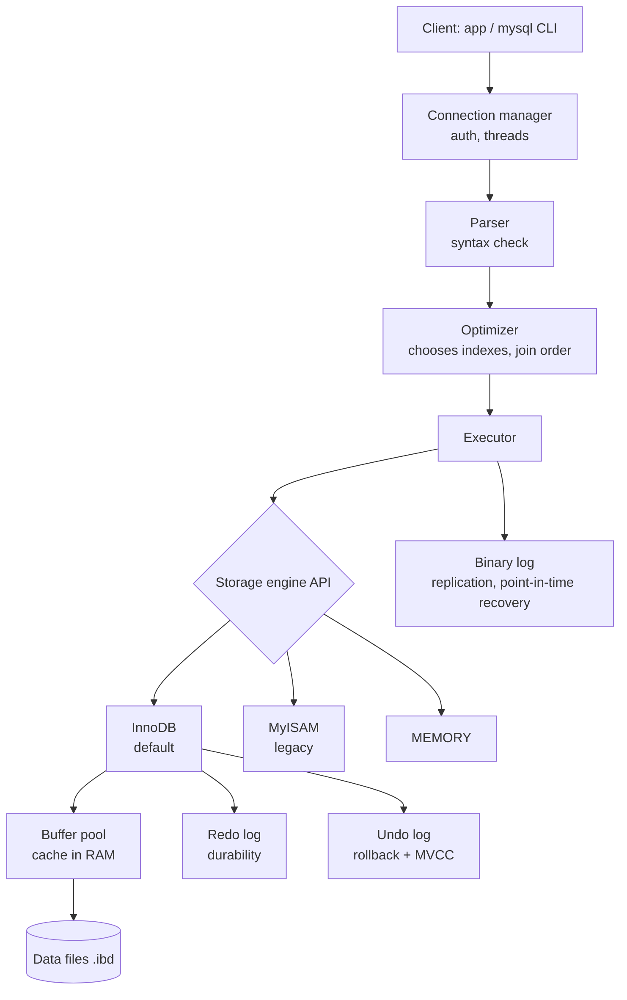
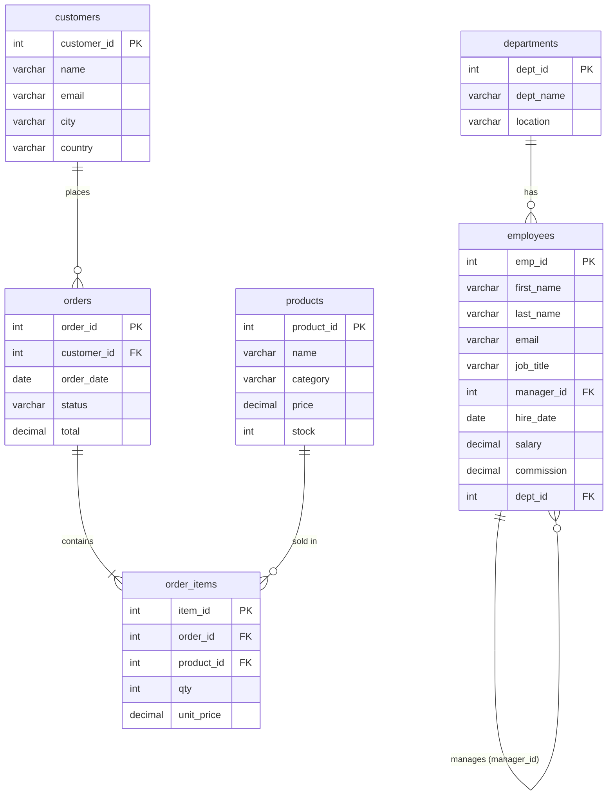
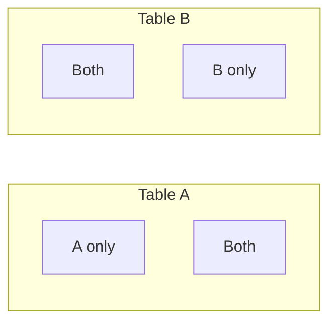
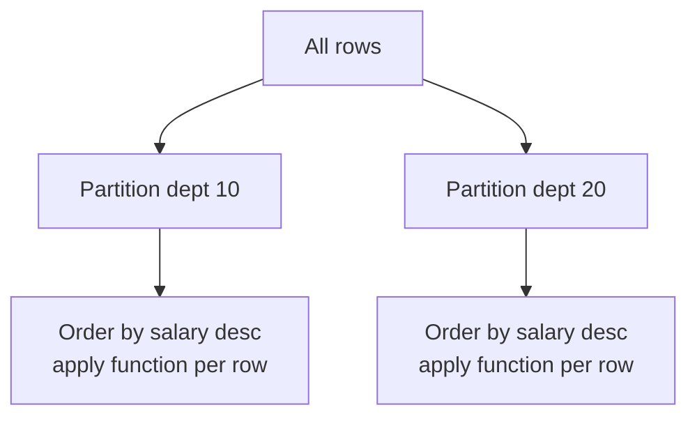
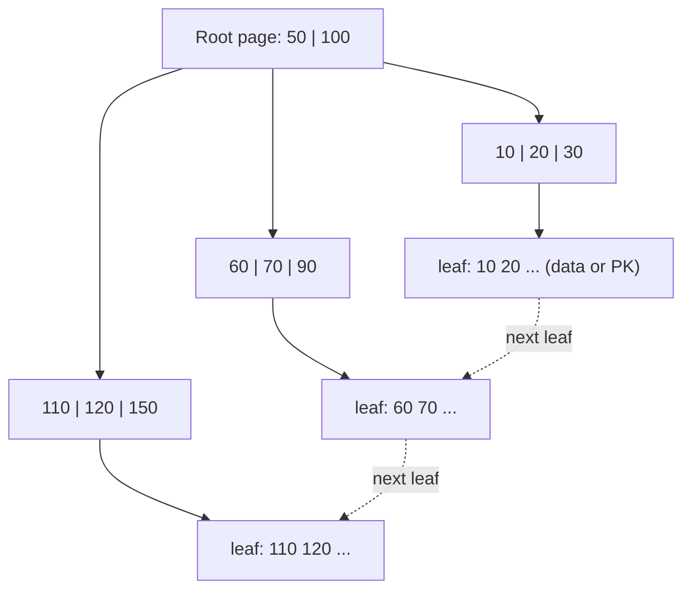
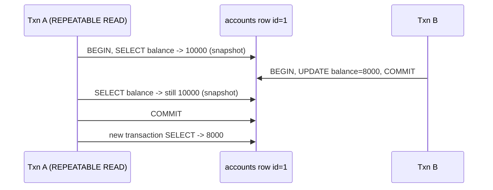
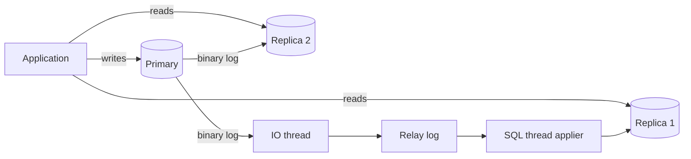

# MySQL Complete Guide - Basic to Advanced (every query type, with example tables)

> **Note**: Sections marked **(Interview Imp)** are frequently asked in interviews.
>
> **How to read this file:** All examples use ONE shared sample database (a small company + online shop) defined in chapter 2. Create it once, then run every example yourself. Every chapter has **📘 Terms Explained** tables. Result tables shown under a query were produced by running that query on the sample data; decimal places and date formatting can differ slightly in a real MySQL client.
>
> **Scope:** MySQL 8.x (8.0 to 9.x): installation and architecture (InnoDB), data types, DDL, DML, every form of `SELECT`, functions, aggregation, all join types, subqueries, set operations, CTEs (incl. recursive), window functions, views, indexes and `EXPLAIN`, transactions and locking, stored programs (procedures, functions, triggers, events, cursors), JSON, full-text, partitioning, security, backup, replication, tuning, interview questions and a practice set.
>
> **Related files:** [Oracle_SQL_Complete_Guide.md](../oracle/Oracle_SQL_Complete_Guide.md) (same sample tables, Oracle syntax) · [Java_Complete_Guide.md](../java/Java_Complete_Guide.md) · [01_Scalability_Pattern.md](../design-patterns/03_System_Design/01_Scalability_Pattern.md)

| Level | Chapters |
|---|---|
| **Beginner** | 1-6 (intro, sample data, types, DDL, DML, SELECT basics) |
| **Intermediate** | 7-11 (functions, aggregation, joins, subqueries, set ops and CTEs) |
| **Advanced** | 12-16 (window functions, views, indexes/EXPLAIN, transactions, stored programs) |
| **Professional** | 17-20 (JSON/full-text/partitioning, security/backup/replication, tuning, SQL patterns) |
| **Mastery** | 21-23 (interview questions, practice queries, cheat sheet) |

---

## Table of Contents
1. [Introduction and Architecture](#1-introduction-and-architecture)
   - [1.1 What is a database, SQL and MySQL? **(Interview Imp)**](#11-what-is-a-database-sql-and-mysql-interview-imp)
   - [1.2 Installing and connecting](#12-installing-and-connecting)
   - [1.3 Architecture: what happens when you run a query **(Interview Imp)**](#13-architecture-what-happens-when-you-run-a-query-interview-imp)
2. [The Sample Database (used everywhere)](#2-the-sample-database-used-everywhere)
   - [2.1 Create the tables](#21-create-the-tables)
   - [2.2 Insert the data](#22-insert-the-data)
   - [2.3 The data at a glance](#23-the-data-at-a-glance)
3. [Data Types **(Interview Imp)**](#3-data-types-interview-imp)
   - [3.1 Numeric](#31-numeric)
   - [3.2 String](#32-string)
   - [3.3 Date and time](#33-date-and-time)
   - [3.4 Other](#34-other)
4. [DDL - Defining Structure](#4-ddl---defining-structure)
   - [4.1 `CREATE TABLE` variants](#41-create-table-variants)
   - [4.2 Constraints **(Interview Imp)**](#42-constraints-interview-imp)
   - [4.3 `ALTER TABLE` - change an existing table](#43-alter-table---change-an-existing-table)
   - [4.4 `DROP`, `TRUNCATE`, `DELETE` **(Interview Imp)**](#44-drop-truncate-delete-interview-imp)
5. [DML - Changing Data](#5-dml---changing-data)
   - [5.1 `INSERT` in all forms **(Interview Imp)**](#51-insert-in-all-forms-interview-imp)
   - [5.2 `UPDATE`](#52-update)
   - [5.3 `DELETE`](#53-delete)
   - [5.4 Bulk loading and exporting](#54-bulk-loading-and-exporting)
6. [`SELECT` Basics](#6-select-basics)
   - [6.1 Logical order of a query **(Interview Imp)**](#61-logical-order-of-a-query-interview-imp)
   - [6.2 Selecting columns, aliases, expressions](#62-selecting-columns-aliases-expressions)
   - [6.3 `DISTINCT`](#63-distinct)
   - [6.4 `WHERE` - filtering rows](#64-where---filtering-rows)
   - [6.5 `ORDER BY`](#65-order-by)
   - [6.6 `LIMIT` and `OFFSET` (pagination)](#66-limit-and-offset-pagination)
7. [Built-in Functions](#7-built-in-functions)
   - [7.1 String functions](#71-string-functions)
   - [7.2 Numeric functions](#72-numeric-functions)
   - [7.3 Date and time functions **(Interview Imp)**](#73-date-and-time-functions-interview-imp)
   - [7.4 Conditional and NULL functions **(Interview Imp)**](#74-conditional-and-null-functions-interview-imp)
   - [7.5 Information and misc](#75-information-and-misc)
8. [Aggregation, `GROUP BY`, `HAVING`](#8-aggregation-group-by-having)
   - [8.1 Aggregate functions **(Interview Imp)**](#81-aggregate-functions-interview-imp)
   - [8.2 `GROUP BY`](#82-group-by)
   - [8.3 `WHERE` vs `HAVING` **(Interview Imp)**](#83-where-vs-having-interview-imp)
   - [8.4 Conditional aggregation (manual pivot) **(CP-style trick, Interview Imp)**](#84-conditional-aggregation-manual-pivot-cp-style-trick-interview-imp)
   - [8.5 `WITH ROLLUP` - subtotals and grand total](#85-with-rollup---subtotals-and-grand-total)
   - [8.6 Aggregates across tables](#86-aggregates-across-tables)
9. [Joins **(Interview Imp)**](#9-joins-interview-imp)
   - [9.1 `INNER JOIN`](#91-inner-join)
   - [9.2 `LEFT JOIN` - keep everything from the left](#92-left-join---keep-everything-from-the-left)
   - [9.3 `RIGHT JOIN`](#93-right-join)
   - [9.4 `FULL OUTER JOIN` (emulated in MySQL)](#94-full-outer-join-emulated-in-mysql)
   - [9.5 `CROSS JOIN`](#95-cross-join)
   - [9.6 Self join - the hierarchy](#96-self-join---the-hierarchy)
   - [9.7 Multi-table joins](#97-multi-table-joins)
   - [9.8 `USING`, `NATURAL JOIN`, non-equi joins](#98-using-natural-join-non-equi-joins)
   - [9.9 Join algorithms inside MySQL (advanced)](#99-join-algorithms-inside-mysql-advanced)
10. [Subqueries **(Interview Imp)**](#10-subqueries-interview-imp)
   - [10.1 Scalar subquery](#101-scalar-subquery)
   - [10.2 `IN`, `NOT IN`, `ANY`, `ALL`](#102-in-not-in-any-all)
   - [10.3 Correlated subquery](#103-correlated-subquery)
   - [10.4 `EXISTS` / `NOT EXISTS` **(Interview Imp)**](#104-exists--not-exists-interview-imp)
   - [10.5 Subquery in `FROM` (derived table)](#105-subquery-in-from-derived-table)
   - [10.6 Subquery in `SELECT`](#106-subquery-in-select)
   - [10.7 Row subquery and classic "Nth highest" problems **(Interview Imp)**](#107-row-subquery-and-classic-nth-highest-problems-interview-imp)
   - [10.8 Subqueries in DML](#108-subqueries-in-dml)
11. [Set Operations and CTEs](#11-set-operations-and-ctes)
   - [11.1 `UNION`, `UNION ALL`, `INTERSECT`, `EXCEPT`](#111-union-union-all-intersect-except)
   - [11.2 Common Table Expressions (`WITH`) **(Interview Imp)**](#112-common-table-expressions-with-interview-imp)
   - [11.3 Recursive CTE - hierarchies and sequences **(Interview Imp)**](#113-recursive-cte---hierarchies-and-sequences-interview-imp)
12. [Window Functions **(Interview Imp)**](#12-window-functions-interview-imp)
   - [12.1 Ranking: `ROW_NUMBER`, `RANK`, `DENSE_RANK`, `NTILE`](#121-ranking-row_number-rank-dense_rank-ntile)
   - [12.2 Aggregates as window functions](#122-aggregates-as-window-functions)
   - [12.3 `LAG`, `LEAD`, `FIRST_VALUE`, `LAST_VALUE`, `NTH_VALUE`](#123-lag-lead-first_value-last_value-nth_value)
   - [12.4 Running totals and moving averages (frames)](#124-running-totals-and-moving-averages-frames)
   - [12.5 Classic problems with window functions](#125-classic-problems-with-window-functions)
13. [Views](#13-views)
14. [Indexes and `EXPLAIN` **(Interview Imp)**](#14-indexes-and-explain-interview-imp)
   - [14.1 What is an index?](#141-what-is-an-index)
   - [14.2 Creating indexes](#142-creating-indexes)
   - [14.3 Composite index and the left-most prefix rule **(Interview Imp)**](#143-composite-index-and-the-left-most-prefix-rule-interview-imp)
   - [14.4 When an index is NOT used (sargability) **(Interview Imp)**](#144-when-an-index-is-not-used-sargability-interview-imp)
   - [14.5 `EXPLAIN` - read the plan **(Interview Imp)**](#145-explain---read-the-plan-interview-imp)
15. [Transactions, Isolation and Locking **(Interview Imp)**](#15-transactions-isolation-and-locking-interview-imp)
   - [15.1 Transactions and ACID](#151-transactions-and-acid)
   - [15.2 Concurrency problems and isolation levels **(Interview Imp)**](#152-concurrency-problems-and-isolation-levels-interview-imp)
   - [15.3 Locking **(Interview Imp)**](#153-locking-interview-imp)
16. [Stored Programs: Procedures, Functions, Triggers, Events](#16-stored-programs-procedures-functions-triggers-events)
   - [16.1 Stored procedure](#161-stored-procedure)
   - [16.2 Stored function](#162-stored-function)
   - [16.3 Error handling](#163-error-handling)
   - [16.4 Cursors - row-by-row processing](#164-cursors---row-by-row-processing)
   - [16.5 Triggers **(Interview Imp)**](#165-triggers-interview-imp)
   - [16.6 Events (the built-in scheduler)](#166-events-the-built-in-scheduler)
   - [16.7 Prepared statements (dynamic SQL)](#167-prepared-statements-dynamic-sql)
17. [JSON, Full-Text Search, Generated Columns, Partitioning](#17-json-full-text-search-generated-columns-partitioning)
   - [17.1 JSON **(Interview Imp)**](#171-json-interview-imp)
   - [17.2 Full-text search](#172-full-text-search)
   - [17.3 Generated (computed) columns](#173-generated-computed-columns)
   - [17.4 Partitioning](#174-partitioning)
   - [17.5 Other handy features](#175-other-handy-features)
18. [Users, Security, Backup, Replication](#18-users-security-backup-replication)
   - [18.1 Users, privileges, roles **(Interview Imp)**](#181-users-privileges-roles-interview-imp)
   - [18.2 Backup and restore](#182-backup-and-restore)
   - [18.3 Replication and high availability **(Interview Imp)**](#183-replication-and-high-availability-interview-imp)
19. [Performance Tuning Checklist **(Interview Imp)**](#19-performance-tuning-checklist-interview-imp)
   - [19.1 Query-level](#191-query-level)
   - [19.2 Server-level](#192-server-level)
   - [19.3 Schema-level](#193-schema-level)
   - [19.4 Monitoring commands](#194-monitoring-commands)
20. [SQL Patterns: "All the Query Possibilities" by Task **(Interview Imp)**](#20-sql-patterns-all-the-query-possibilities-by-task-interview-imp)
   - [20.1 Find and handle duplicates](#201-find-and-handle-duplicates)
   - [20.2 Unpivot (columns to rows)](#202-unpivot-columns-to-rows)
   - [20.3 Percentage of total](#203-percentage-of-total)
   - [20.4 Median (no built-in `MEDIAN` in MySQL)](#204-median-no-built-in-median-in-mysql)
   - [20.5 Cumulative distribution / percentile buckets](#205-cumulative-distribution--percentile-buckets)
   - [20.6 Relational division ("customers who bought ALL Stationery products")](#206-relational-division-customers-who-bought-all-stationery-products)
   - [20.7 Market-basket: products bought together](#207-market-basket-products-bought-together)
   - [20.8 Retention-style: customers with orders in consecutive months](#208-retention-style-customers-with-orders-in-consecutive-months)
   - [20.9 Date spine with left join (show months with zero orders)](#209-date-spine-with-left-join-show-months-with-zero-orders)
   - [20.10 Normalisation in 60 seconds **(Interview Imp)**](#2010-normalisation-in-60-seconds-interview-imp)
21. [Interview Questions **(Interview Imp)**](#21-interview-questions-interview-imp)
   - [21.1 Conceptual](#211-conceptual)
   - [21.2 Write-the-query warm-ups (answers are in the chapters)](#212-write-the-query-warm-ups-answers-are-in-the-chapters)
22. [Practice Set with Solutions (on the sample data)](#22-practice-set-with-solutions-on-the-sample-data)
23. [Cheat Sheet](#23-cheat-sheet)

---

# 1. Introduction and Architecture

## 1.1 What is a database, SQL and MySQL? **(Interview Imp)**

- A **database** stores data permanently and lets many users read and write it safely.
- A **relational database** keeps data in **tables** (rows and columns) connected by **keys**.
- **SQL** (Structured Query Language) is the language to talk to it. It is *declarative*: you say **what** you want, the engine decides **how**.
- **MySQL** is an open-source relational database (owned by Oracle Corporation). Default engine: **InnoDB**.

SQL commands are grouped by purpose:

| Group | Full name | Commands | Purpose |
|---|---|---|---|
| **DDL** | Data Definition Language | `CREATE`, `ALTER`, `DROP`, `TRUNCATE`, `RENAME` | Define structure |
| **DML** | Data Manipulation Language | `INSERT`, `UPDATE`, `DELETE`, `REPLACE` | Change data |
| **DQL** | Data Query Language | `SELECT` | Read data |
| **DCL** | Data Control Language | `GRANT`, `REVOKE` | Permissions |
| **TCL** | Transaction Control Language | `COMMIT`, `ROLLBACK`, `SAVEPOINT`, `START TRANSACTION` | Transactions |

### 📘 Terms Explained

| Term | Meaning |
|---|---|
| Table | A grid of rows (records) and columns (fields) |
| Row / tuple | One record, e.g. one employee |
| Column / attribute | One property, e.g. `salary` |
| Primary key | Column(s) that uniquely identify a row |
| Foreign key | A column that points to the primary key of another table |
| Declarative | You describe the result, not the steps |
| Schema / database | A named container of tables (in MySQL they mean the same) |

---

## 1.2 Installing and connecting

```bash
# Ubuntu / Debian
sudo apt install mysql-server
sudo systemctl start mysql
sudo mysql_secure_installation

# macOS
brew install mysql && brew services start mysql

# Docker (quickest for practice)
docker run --name mysql8 -e MYSQL_ROOT_PASSWORD=secret -p 3306:3306 -d mysql:8

# Connect
mysql -u root -p
mysql -h 127.0.0.1 -P 3306 -u app_user -p mydb
```

Useful client commands:

```sql
SELECT VERSION();
SHOW DATABASES;
CREATE DATABASE company_db CHARACTER SET utf8mb4 COLLATE utf8mb4_0900_ai_ci;
USE company_db;
SHOW TABLES;
DESCRIBE employees;           -- or DESC employees;
SHOW CREATE TABLE employees;  -- the exact DDL
SHOW COLUMNS FROM employees;
SHOW INDEX FROM employees;
SELECT DATABASE(), USER(), NOW();
SOURCE /path/to/script.sql;   -- run a script file
```

GUI tools: MySQL Workbench, DBeaver, DataGrip.

---

## 1.3 Architecture: what happens when you run a query **(Interview Imp)**



1. **Connection layer**: authentication, one thread per connection.
2. **Parser**: checks syntax, builds a parse tree. (MySQL 8 removed the query cache.)
3. **Optimizer**: picks the cheapest plan using statistics (which index, which join order).
4. **Executor** calls the **storage engine**. MySQL's pluggable design means each table can use a different engine.

### Storage engines compared **(Interview Imp)**

| Feature | InnoDB (default) | MyISAM | MEMORY |
|---|---|---|---|
| Transactions (ACID) | Yes | No | No |
| Row-level locking | Yes | Table lock only | Table lock |
| Foreign keys | Yes | No | No |
| Crash recovery | Yes (redo log) | Poor | Data lost on restart |
| Full-text search | Yes (5.6+) | Yes | No |
| Use today | Almost always | Legacy | Temporary lookups |

### The InnoDB pieces you must know

| Piece | Job |
|---|---|
| **Buffer pool** | RAM cache of data and index pages (set to ~50-75% of RAM on a dedicated server) |
| **Clustered index** | InnoDB stores table rows **inside the primary key B+tree**; the PK *is* the table |
| **Redo log** | Write-ahead log: committed changes survive a crash (the **D** in ACID) |
| **Undo log** | Old versions of rows: used for `ROLLBACK` and for consistent reads (MVCC) |
| **Doublewrite buffer** | Protects against half-written pages |
| **Binary log** | Server-level log of changes: replication and point-in-time recovery |

### 📘 Terms Explained

| Term | Meaning |
|---|---|
| ACID | Atomicity, Consistency, Isolation, Durability (chapter 15) |
| Optimizer | Part that chooses the execution plan |
| Page | InnoDB's unit of I/O, 16 KB by default |
| B+tree | Balanced tree used for indexes; leaves hold data/pointers in sorted order |
| MVCC | Multi-Version Concurrency Control: readers see a snapshot and don't block writers |
| Write-ahead logging | Log the change first, write the data pages later |

---

# 2. The Sample Database (used everywhere)

Two small domains: **HR** (`departments`, `employees`) and an **online shop** (`customers`, `products`, `orders`, `order_items`).



## 2.1 Create the tables

```sql
CREATE DATABASE IF NOT EXISTS company_db;
USE company_db;

CREATE TABLE departments (
    dept_id    INT          PRIMARY KEY,
    dept_name  VARCHAR(50)  NOT NULL UNIQUE,
    location   VARCHAR(50)
);

CREATE TABLE employees (
    emp_id      INT           PRIMARY KEY AUTO_INCREMENT,
    first_name  VARCHAR(50)   NOT NULL,
    last_name   VARCHAR(50)   NOT NULL,
    email       VARCHAR(100)  UNIQUE,
    job_title   VARCHAR(50),
    manager_id  INT,
    hire_date   DATE          NOT NULL,
    salary      DECIMAL(10,2) NOT NULL CHECK (salary > 0),
    commission  DECIMAL(10,2),
    dept_id     INT,
    CONSTRAINT fk_emp_dept    FOREIGN KEY (dept_id)    REFERENCES departments(dept_id),
    CONSTRAINT fk_emp_manager FOREIGN KEY (manager_id) REFERENCES employees(emp_id)
);

CREATE TABLE customers (
    customer_id INT          PRIMARY KEY AUTO_INCREMENT,
    name        VARCHAR(100) NOT NULL,
    email       VARCHAR(100) UNIQUE,
    city        VARCHAR(50),
    country     VARCHAR(50)
);

CREATE TABLE products (
    product_id INT           PRIMARY KEY AUTO_INCREMENT,
    name       VARCHAR(100)  NOT NULL,
    category   VARCHAR(50),
    price      DECIMAL(10,2) NOT NULL CHECK (price >= 0),
    stock      INT           NOT NULL DEFAULT 0
);

CREATE TABLE orders (
    order_id    INT           PRIMARY KEY AUTO_INCREMENT,
    customer_id INT           NOT NULL,
    order_date  DATE          NOT NULL,
    status      VARCHAR(20)   NOT NULL DEFAULT 'PENDING',
    total       DECIMAL(12,2),
    CONSTRAINT fk_ord_cust FOREIGN KEY (customer_id) REFERENCES customers(customer_id)
);

CREATE TABLE order_items (
    item_id    INT           PRIMARY KEY AUTO_INCREMENT,
    order_id   INT           NOT NULL,
    product_id INT           NOT NULL,
    qty        INT           NOT NULL CHECK (qty > 0),
    unit_price DECIMAL(10,2) NOT NULL,
    CONSTRAINT fk_oi_order   FOREIGN KEY (order_id)   REFERENCES orders(order_id) ON DELETE CASCADE,
    CONSTRAINT fk_oi_product FOREIGN KEY (product_id) REFERENCES products(product_id)
);
```

## 2.2 Insert the data

```sql
INSERT INTO departments VALUES
(10,'Engineering','Bangalore'),(20,'Sales','Mumbai'),(30,'HR','Delhi'),
(40,'Finance','Pune'),(50,'Support','Chennai');

INSERT INTO employees
(emp_id,first_name,last_name,email,job_title,manager_id,hire_date,salary,commission,dept_id) VALUES
(1,'Asha','Rao','asha.rao@corp.com','CEO',NULL,'2015-01-10',250000,NULL,10),
(2,'Vikram','Singh','vikram.singh@corp.com','Engineering Manager',1,'2016-03-15',150000,NULL,10),
(3,'Neha','Gupta','neha.gupta@corp.com','Senior Developer',2,'2017-07-01',120000,NULL,10),
(4,'Rahul','Verma','rahul.verma@corp.com','Developer',2,'2019-09-20',90000,NULL,10),
(5,'Priya','Nair','priya.nair@corp.com','Developer',2,'2021-01-05',85000,NULL,10),
(6,'Arjun','Mehta','arjun.mehta@corp.com','Sales Manager',1,'2016-05-12',130000,5000,20),
(7,'Kavya','Iyer','kavya.iyer@corp.com','Sales Executive',6,'2020-02-14',60000,8000,20),
(8,'Sameer','Khan','sameer.khan@corp.com','Sales Executive',6,'2022-06-30',55000,6000,20),
(9,'Anita','Desai','anita.desai@corp.com','HR Manager',1,'2018-11-11',95000,NULL,30),
(10,'Rohan','Joshi','rohan.joshi@corp.com','Accountant',1,'2019-04-22',70000,NULL,40),
(11,'Isha','Kapoor','isha.kapoor@corp.com','Intern',3,'2023-08-01',25000,NULL,NULL);

INSERT INTO customers VALUES
(1,'Amit Shah','amit@mail.com','Mumbai','India'),
(2,'Sara Ali','sara@mail.com','Delhi','India'),
(3,'John Smith','john@mail.com','New York','USA'),
(4,'Emma Brown','emma@mail.com','London','UK'),
(5,'Li Wei','li@mail.com','Shanghai','China'),
(6,'Ravi Kumar','ravi@mail.com','Bangalore','India');

INSERT INTO products VALUES
(1,'Laptop','Electronics',55000,20),(2,'Phone','Electronics',30000,50),
(3,'Headphones','Electronics',3000,100),(4,'Desk','Furniture',8000,15),
(5,'Chair','Furniture',5000,30),(6,'Notebook','Stationery',100,500),
(7,'Pen','Stationery',20,1000),(8,'Monitor','Electronics',12000,0);

INSERT INTO orders (order_id,customer_id,order_date,status) VALUES
(101,1,'2024-01-15','DELIVERED'),(102,1,'2024-02-20','SHIPPED'),
(103,2,'2024-02-25','DELIVERED'),(104,3,'2024-03-05','CANCELLED'),
(105,4,'2024-03-18','DELIVERED'),(106,2,'2024-04-02','PENDING'),
(107,5,'2024-04-10','DELIVERED'),(108,1,'2024-05-01','PENDING');

INSERT INTO order_items VALUES
(1,101,1,1,55000),(2,101,3,2,3000),(3,102,2,1,30000),(4,103,4,1,8000),
(5,103,5,2,5000),(6,104,1,1,55000),(7,105,6,10,100),(8,105,7,20,20),
(9,105,3,1,3000),(10,106,8,2,12000),(11,107,2,2,30000),(12,107,3,1,3000),
(13,108,5,4,5000),(14,108,6,5,100);

-- compute each order's total from its items
UPDATE orders o
SET total = (SELECT SUM(qty * unit_price) FROM order_items i WHERE i.order_id = o.order_id);
```

## 2.3 The data at a glance

```sql
SELECT * FROM departments
```

```text
+---------+-------------+-----------+
| dept_id | dept_name   | location  |
+---------+-------------+-----------+
| 10      | Engineering | Bangalore |
| 20      | Sales       | Mumbai    |
| 30      | HR          | Delhi     |
| 40      | Finance     | Pune      |
| 50      | Support     | Chennai   |
+---------+-------------+-----------+
5 row(s)
```

```sql
SELECT emp_id, first_name, last_name, job_title, manager_id, salary, commission, dept_id FROM employees
```

```text
+--------+------------+-----------+---------------------+------------+--------+------------+---------+
| emp_id | first_name | last_name | job_title           | manager_id | salary | commission | dept_id |
+--------+------------+-----------+---------------------+------------+--------+------------+---------+
| 1      | Asha       | Rao       | CEO                 | NULL       | 250000 | NULL       | 10      |
| 2      | Vikram     | Singh     | Engineering Manager | 1          | 150000 | NULL       | 10      |
| 3      | Neha       | Gupta     | Senior Developer    | 2          | 120000 | NULL       | 10      |
| 4      | Rahul      | Verma     | Developer           | 2          | 90000  | NULL       | 10      |
| 5      | Priya      | Nair      | Developer           | 2          | 85000  | NULL       | 10      |
| 6      | Arjun      | Mehta     | Sales Manager       | 1          | 130000 | 5000       | 20      |
| 7      | Kavya      | Iyer      | Sales Executive     | 6          | 60000  | 8000       | 20      |
| 8      | Sameer     | Khan      | Sales Executive     | 6          | 55000  | 6000       | 20      |
| 9      | Anita      | Desai     | HR Manager          | 1          | 95000  | NULL       | 30      |
| 10     | Rohan      | Joshi     | Accountant          | 1          | 70000  | NULL       | 40      |
| 11     | Isha       | Kapoor    | Intern              | 3          | 25000  | NULL       | NULL    |
+--------+------------+-----------+---------------------+------------+--------+------------+---------+
11 row(s)
```

```sql
SELECT * FROM orders
```

```text
+----------+-------------+------------+-----------+-------+
| order_id | customer_id | order_date | status    | total |
+----------+-------------+------------+-----------+-------+
| 101      | 1           | 2024-01-15 | DELIVERED | 61000 |
| 102      | 1           | 2024-02-20 | SHIPPED   | 30000 |
| 103      | 2           | 2024-02-25 | DELIVERED | 18000 |
| 104      | 3           | 2024-03-05 | CANCELLED | 55000 |
| 105      | 4           | 2024-03-18 | DELIVERED | 4400  |
| 106      | 2           | 2024-04-02 | PENDING   | 24000 |
| 107      | 5           | 2024-04-10 | DELIVERED | 63000 |
| 108      | 1           | 2024-05-01 | PENDING   | 20500 |
+----------+-------------+------------+-----------+-------+
8 row(s)
```

Notes you will use in later chapters: employee 11 (Isha) has **no department** (NULL); department 50 (Support) has **no employees**; customer 6 (Ravi) has **no orders**; product 8 (Monitor) has **stock 0**; only the sales people have a commission.

---

# 3. Data Types **(Interview Imp)**

## 3.1 Numeric

| Type | Size | Range / use |
|---|---|---|
| `TINYINT` | 1 byte | -128..127 (0..255 unsigned); flags |
| `SMALLINT` | 2 | +-32,767 |
| `MEDIUMINT` | 3 | +-8.3 million |
| `INT` | 4 | +-2.1 billion (0..4.29 billion unsigned) |
| `BIGINT` | 8 | +-9.2 x 10^18; large ids |
| `DECIMAL(p,s)` | variable | **Exact** numbers, use for money. `DECIMAL(10,2)` = 8 digits + 2 decimals |
| `FLOAT`, `DOUBLE` | 4 / 8 | **Approximate**; never for money |
| `BIT(n)`, `BOOLEAN` | | `BOOLEAN` is an alias of `TINYINT(1)` (`TRUE`=1) |

`INT(11)` does **not** mean 11 digits; the number is only a legacy display width (deprecated in 8).

## 3.2 String

| Type | Notes |
|---|---|
| `CHAR(n)` | Fixed length, padded; codes like `'IN'`, `'US'` |
| `VARCHAR(n)` | Variable length, up to 65,535 bytes per row; names, emails |
| `TEXT` family | `TINYTEXT` 255 B, `TEXT` 64 KB, `MEDIUMTEXT` 16 MB, `LONGTEXT` 4 GB; cannot have a full-column default; index needs a prefix |
| `BINARY`, `VARBINARY`, `BLOB` family | Bytes, not characters |
| `ENUM('a','b')` | One value from a fixed list (stored as 1-2 bytes) |
| `SET('a','b','c')` | Zero or more values from a list (bitmask) |

Use `utf8mb4` (real UTF-8, 4 bytes per char, supports emojis). The old `utf8` is only 3 bytes and incomplete.

## 3.3 Date and time

| Type | Format | Range |
|---|---|---|
| `DATE` | `YYYY-MM-DD` | 1000-01-01 to 9999-12-31 |
| `TIME` | `HH:MM:SS` | -838:59:59 to 838:59:59 (can be a duration) |
| `DATETIME` | `YYYY-MM-DD HH:MM:SS[.ffffff]` | 1000 to 9999, stored as-is |
| `TIMESTAMP` | same | 1970 to **2038** (UTC internally, converted to the session time zone) |
| `YEAR` | `YYYY` | 1901-2155 |

## 3.4 Other

`JSON` (validated, binary stored), spatial types (`POINT`, `POLYGON`), and generated columns (chapter 17).

### Choosing types - quick rules

- Money: `DECIMAL`, never `FLOAT`.
- Primary keys: `INT UNSIGNED` or `BIGINT UNSIGNED AUTO_INCREMENT`.
- Pick the **smallest** type that fits: smaller rows mean more rows per page, faster scans and a smaller index.
- Store dates as `DATE`/`DATETIME`, not as strings.

### 📘 Terms Explained

| Term | Meaning |
|---|---|
| Exact vs approximate | `DECIMAL` is exact; `FLOAT` loses tiny fractions (0.1 + 0.2 != 0.3) |
| Unsigned | Only zero and positive numbers (doubles the positive range) |
| Collation | Rules for comparing and sorting text (case/accent sensitivity) |
| `utf8mb4` | The proper UTF-8 character set in MySQL |
| Year 2038 problem | 32-bit `TIMESTAMP` overflows in January 2038 |

---
# 4. DDL - Defining Structure

## 4.1 `CREATE TABLE` variants

```sql
-- Safe re-run
CREATE TABLE IF NOT EXISTS audit_log (
    log_id     BIGINT UNSIGNED PRIMARY KEY AUTO_INCREMENT,
    table_name VARCHAR(50) NOT NULL,
    action     ENUM('INSERT','UPDATE','DELETE') NOT NULL,
    changed_by VARCHAR(50) DEFAULT (CURRENT_USER()),
    changed_at TIMESTAMP   NOT NULL DEFAULT CURRENT_TIMESTAMP,
    details    JSON
) ENGINE = InnoDB DEFAULT CHARSET = utf8mb4;

-- Copy structure only (keeps indexes)
CREATE TABLE employees_backup LIKE employees;

-- Copy structure AND data (CTAS: Create Table As Select; loses indexes/constraints)
CREATE TABLE high_earners AS
SELECT emp_id, first_name, salary FROM employees WHERE salary > 100000;

-- Temporary table: visible to this session only, dropped automatically
CREATE TEMPORARY TABLE tmp_totals (customer_id INT, total DECIMAL(12,2));
```

## 4.2 Constraints **(Interview Imp)**

| Constraint | Meaning | Example |
|---|---|---|
| `NOT NULL` | Value required | `first_name VARCHAR(50) NOT NULL` |
| `UNIQUE` | No duplicates (NULLs allowed, many) | `email VARCHAR(100) UNIQUE` |
| `PRIMARY KEY` | `NOT NULL` + `UNIQUE`; one per table; may be composite | `PRIMARY KEY (order_id, product_id)` |
| `FOREIGN KEY` | Must match a parent row | see below |
| `CHECK` | Condition must be true (enforced from 8.0.16) | `CHECK (salary > 0)` |
| `DEFAULT` | Value if none given | `status VARCHAR(20) DEFAULT 'PENDING'` |
| `AUTO_INCREMENT` | Automatic sequence number | `emp_id INT AUTO_INCREMENT` |

**Foreign key actions** (what happens to children when the parent changes):

| Action | `ON DELETE` / `ON UPDATE` behaviour |
|---|---|
| `RESTRICT` / `NO ACTION` (default) | Refuse the change |
| `CASCADE` | Apply the same change to children (delete parent, children deleted) |
| `SET NULL` | Set the child column to NULL (column must be nullable) |
| `SET DEFAULT` | Not supported by InnoDB |

```sql
ALTER TABLE orders
  ADD CONSTRAINT fk_ord_cust FOREIGN KEY (customer_id)
  REFERENCES customers(customer_id)
  ON DELETE RESTRICT ON UPDATE CASCADE;

CREATE TABLE enrollment (                       -- composite primary key
    student_id INT, course_id INT, enrolled_on DATE,
    PRIMARY KEY (student_id, course_id)
);
```

**Primary key vs unique key:** one PK per table, no NULL; many UNIQUE keys, NULLs allowed. In InnoDB the PK is the clustered index (chapter 14).

## 4.3 `ALTER TABLE` - change an existing table

```sql
ALTER TABLE employees ADD COLUMN phone VARCHAR(15) AFTER email;       -- position optional
ALTER TABLE employees ADD COLUMN (bonus DECIMAL(10,2), grade CHAR(1));
ALTER TABLE employees MODIFY COLUMN phone VARCHAR(20) NOT NULL;       -- change type/nullability
ALTER TABLE employees CHANGE COLUMN phone mobile VARCHAR(20);         -- rename + redefine
ALTER TABLE employees RENAME COLUMN mobile TO phone_no;               -- 8.0 rename only
ALTER TABLE employees ALTER COLUMN grade SET DEFAULT 'B';
ALTER TABLE employees ALTER COLUMN grade DROP DEFAULT;
ALTER TABLE employees DROP COLUMN grade;

ALTER TABLE employees ADD UNIQUE (phone_no);
ALTER TABLE employees ADD INDEX idx_last (last_name);
ALTER TABLE employees ADD CONSTRAINT chk_sal CHECK (salary < 1000000);
ALTER TABLE employees DROP CHECK chk_sal;
ALTER TABLE employees DROP FOREIGN KEY fk_emp_dept;
ALTER TABLE employees DROP INDEX idx_last;
ALTER TABLE employees DROP PRIMARY KEY;
ALTER TABLE employees AUTO_INCREMENT = 1000;
ALTER TABLE employees ENGINE = InnoDB;                                -- rebuild table
RENAME TABLE employees_backup TO employees_old;                       -- or ALTER TABLE ... RENAME TO
```

Big tables: MySQL 8 does many changes **online** (`ALGORITHM=INSTANT` for adding a column at the end, `INPLACE` otherwise). Check with `ALTER TABLE t ADD COLUMN x INT, ALGORITHM=INSTANT;`. For very large tables use `pt-online-schema-change` or `gh-ost`.

## 4.4 `DROP`, `TRUNCATE`, `DELETE` **(Interview Imp)**

| | `DELETE` | `TRUNCATE` | `DROP` |
|---|---|---|---|
| Type | DML | DDL | DDL |
| Removes | Rows (all or `WHERE`) | All rows | Whole table + structure |
| `WHERE` allowed | Yes | No | No |
| Rollback | Yes (in a transaction) | **No** (implicit commit) | **No** |
| Speed | Slow (row by row, logs each) | Fast (drops and recreates) | Fast |
| `AUTO_INCREMENT` reset | No | **Yes** | n/a |
| Triggers fire | Yes | No | No |
| Blocked by FK | Only if rows referenced | Yes, if referenced | Yes |

```sql
DROP TABLE IF EXISTS tmp_totals;
DROP DATABASE IF EXISTS scratch_db;
TRUNCATE TABLE audit_log;
```

### 📘 Terms Explained

| Term | Meaning |
|---|---|
| CTAS | Create Table As Select |
| Composite key | A key made of two or more columns |
| Cascade | Pass the change on to related rows |
| Implicit commit | MySQL commits the open transaction automatically before DDL |
| Online DDL | Changing a table while it stays readable/writable |
| Clustered index | The index that physically holds the row data |

---

# 5. DML - Changing Data

## 5.1 `INSERT` in all forms **(Interview Imp)**

```sql
-- 1. Full row (values in column order) - fragile, avoid
INSERT INTO departments VALUES (60, 'Legal', 'Kolkata');

-- 2. Named columns (recommended)
INSERT INTO departments (dept_id, dept_name, location) VALUES (70, 'Marketing', 'Hyderabad');

-- 3. Multi-row: one statement, much faster than many single inserts
INSERT INTO products (name, category, price, stock) VALUES
('Mouse','Electronics',800,200),
('Keyboard','Electronics',1500,150);

-- 4. SET syntax (MySQL only)
INSERT INTO customers SET name='Neel Rao', email='neel@mail.com', city='Pune', country='India';

-- 5. INSERT ... SELECT (copy from a query)
INSERT INTO high_earners (emp_id, first_name, salary)
SELECT emp_id, first_name, salary FROM employees WHERE salary > 100000;

-- 6. DEFAULT values
INSERT INTO orders (customer_id, order_date) VALUES (1, CURDATE());   -- status = 'PENDING'

-- 7. IGNORE: skip rows that would violate a unique/PK constraint (warning, not error)
INSERT IGNORE INTO departments VALUES (10, 'Engineering', 'Bangalore');
```

**Upsert (insert or update) - `ON DUPLICATE KEY UPDATE`:**

```sql
INSERT INTO products (product_id, name, category, price, stock)
VALUES (3, 'Headphones', 'Electronics', 3200, 100)
ON DUPLICATE KEY UPDATE price = VALUES(price);        -- 8.0.19+: use an alias, see below

-- Modern alias form (VALUES() is deprecated)
INSERT INTO products (product_id, name, category, price, stock)
VALUES (3, 'Headphones', 'Electronics', 3200, 100) AS new
ON DUPLICATE KEY UPDATE price = new.price, stock = products.stock + new.stock;
```

**`REPLACE INTO`**: deletes the old row, then inserts the new one. It triggers `DELETE` + `INSERT`, resets unspecified columns to defaults and can break foreign keys. Prefer `ON DUPLICATE KEY UPDATE`.

```sql
SELECT LAST_INSERT_ID();      -- the AUTO_INCREMENT id of the last insert in THIS session
```

## 5.2 `UPDATE`

```sql
UPDATE employees SET salary = salary * 1.10 WHERE dept_id = 20;            -- 10% raise for Sales
UPDATE employees SET commission = 0 WHERE commission IS NULL;
UPDATE employees SET job_title = 'Lead', salary = salary + 5000 WHERE emp_id = 3;

-- Always preview with SELECT first, and remember: no WHERE = every row!
-- Safety net: SET sql_safe_updates = 1;   (refuses UPDATE/DELETE without a key in WHERE)

-- Limit and order
UPDATE employees SET salary = salary + 1000 ORDER BY hire_date LIMIT 3;

-- Update using a join (MySQL syntax)
UPDATE employees e
JOIN departments d ON d.dept_id = e.dept_id
SET e.salary = e.salary * 1.05
WHERE d.location = 'Bangalore';

-- Update with a subquery
UPDATE products p
SET stock = stock - (SELECT COALESCE(SUM(qty),0) FROM order_items WHERE product_id = p.product_id)
WHERE p.product_id = 1;

-- CASE inside UPDATE
UPDATE employees
SET salary = CASE
      WHEN salary < 60000  THEN salary * 1.15
      WHEN salary < 100000 THEN salary * 1.10
      ELSE salary * 1.05 END;
```

## 5.3 `DELETE`

```sql
DELETE FROM order_items WHERE order_id = 104;
DELETE FROM employees WHERE dept_id IS NULL;
DELETE FROM orders ORDER BY order_date LIMIT 1;

-- Delete using a join: remove customers who never ordered
DELETE c FROM customers c
LEFT JOIN orders o ON o.customer_id = c.customer_id
WHERE o.order_id IS NULL;

-- Delete duplicates keeping the lowest id (self-join)
DELETE e1 FROM employees e1
JOIN employees e2 ON e1.email = e2.email AND e1.emp_id > e2.emp_id;

DELETE FROM audit_log;            -- all rows, one by one, rollback possible
```

## 5.4 Bulk loading and exporting

```sql
LOAD DATA INFILE '/var/lib/mysql-files/emp.csv'
INTO TABLE employees
FIELDS TERMINATED BY ',' ENCLOSED BY '"'
LINES TERMINATED BY '\n'
IGNORE 1 LINES
(first_name, last_name, email, job_title, hire_date, salary, dept_id);

SELECT * FROM employees
INTO OUTFILE '/var/lib/mysql-files/emp_out.csv'
FIELDS TERMINATED BY ',' ENCLOSED BY '"' LINES TERMINATED BY '\n';
```

```bash
mysqldump -u root -p company_db > backup.sql
mysql -u root -p company_db < backup.sql
```

### 📘 Terms Explained

| Term | Meaning |
|---|---|
| Upsert | Update the row if it exists, otherwise insert |
| `LAST_INSERT_ID()` | Id generated by the last auto-increment insert in your session |
| Preview before change | Run the `WHERE` as a `SELECT` before using it in `UPDATE`/`DELETE` |
| `sql_safe_updates` | Session switch that blocks unkeyed UPDATE/DELETE |
| Bulk load | Importing many rows at once, much faster than single inserts |

---

# 6. `SELECT` Basics

## 6.1 Logical order of a query **(Interview Imp)**

You write `SELECT` first, but the engine **evaluates** in a different order. This explains why you cannot use a column alias in `WHERE`.


Full syntax skeleton:

```sql
SELECT [DISTINCT] expr [AS alias], ...
FROM table [alias]
  [JOIN other ON condition ...]
[WHERE row_condition]
[GROUP BY columns]
[HAVING group_condition]
[ORDER BY expr [ASC|DESC], ...]
[LIMIT count [OFFSET skip]];
```

## 6.2 Selecting columns, aliases, expressions

```sql
SELECT first_name, last_name, salary FROM employees
```

```text
+------------+-----------+--------+
| first_name | last_name | salary |
+------------+-----------+--------+
| Asha       | Rao       | 250000 |
| Vikram     | Singh     | 150000 |
| Neha       | Gupta     | 120000 |
| Rahul      | Verma     | 90000  |
| Priya      | Nair      | 85000  |
| Arjun      | Mehta     | 130000 |
| Kavya      | Iyer      | 60000  |
| Sameer     | Khan      | 55000  |
| Anita      | Desai     | 95000  |
| Rohan      | Joshi     | 70000  |
| Isha       | Kapoor    | 25000  |
+------------+-----------+--------+
11 row(s)
```

```sql
SELECT CONCAT(first_name, ' ', last_name) AS full_name, salary * 12 AS annual_salary
FROM employees
WHERE emp_id <= 3
```

```text
+--------------+---------------+
| full_name    | annual_salary |
+--------------+---------------+
| Asha Rao     | 3000000       |
| Vikram Singh | 1800000       |
| Neha Gupta   | 1440000       |
+--------------+---------------+
3 row(s)
```

`CONCAT` joins strings (in MySQL the `||` operator means OR unless `PIPES_AS_CONCAT` mode is on).

```sql
SELECT 2 + 3 AS five, NOW(), 'hello' AS greeting;         -- SELECT without FROM
SELECT * FROM employees;                                  -- fine for exploring, avoid in applications
```

Aliases containing spaces need quotes/backticks: ``AS `Annual Salary` ``.

## 6.3 `DISTINCT`

```sql
SELECT DISTINCT job_title FROM employees ORDER BY job_title
```

```text
+---------------------+
| job_title           |
+---------------------+
| Accountant          |
| CEO                 |
| Developer           |
| Engineering Manager |
| HR Manager          |
| Intern              |
| Sales Executive     |
| Sales Manager       |
| Senior Developer    |
+---------------------+
9 row(s)
```

```sql
SELECT DISTINCT dept_id, job_title FROM employees ORDER BY dept_id, job_title
```

```text
+---------+---------------------+
| dept_id | job_title           |
+---------+---------------------+
| NULL    | Intern              |
| 10      | CEO                 |
| 10      | Developer           |
| 10      | Engineering Manager |
| 10      | Senior Developer    |
| 20      | Sales Executive     |
| 20      | Sales Manager       |
| 30      | HR Manager          |
| 40      | Accountant          |
+---------+---------------------+
9 row(s)
```

`DISTINCT` applies to the **whole row** of selected columns, and treats NULLs as equal to each other.

## 6.4 `WHERE` - filtering rows

### Comparison and logical operators

| Operator | Meaning |
|---|---|
| `=`, `<>` / `!=`, `<`, `<=`, `>`, `>=` | Compare |
| `<=>` | NULL-safe equal (MySQL): `NULL <=> NULL` is 1 |
| `AND`, `OR`, `NOT` | Combine (precedence: `NOT` > `AND` > `OR`; use brackets) |
| `BETWEEN a AND b` | Inclusive range |
| `IN (list)` / `NOT IN` | Match any |
| `LIKE` / `NOT LIKE` | Pattern: `%` any characters, `_` one character |
| `REGEXP` / `RLIKE` | Regular expression |
| `IS NULL` / `IS NOT NULL` | NULL test |
| `EXISTS (subquery)` | Any row returned |

```sql
SELECT first_name, salary, dept_id FROM employees WHERE salary > 100000 AND dept_id = 10
```

```text
+------------+--------+---------+
| first_name | salary | dept_id |
+------------+--------+---------+
| Asha       | 250000 | 10      |
| Vikram     | 150000 | 10      |
| Neha       | 120000 | 10      |
+------------+--------+---------+
3 row(s)
```

```sql
SELECT first_name, dept_id FROM employees WHERE dept_id = 10 OR dept_id = 20 AND salary > 100000
```

```text
+------------+---------+
| first_name | dept_id |
+------------+---------+
| Asha       | 10      |
| Vikram     | 10      |
| Neha       | 10      |
| Rahul      | 10      |
| Priya      | 10      |
| Arjun      | 20      |
+------------+---------+
6 row(s)
```

The second query is read as `dept_id = 10 OR (dept_id = 20 AND salary > 100000)` because `AND` binds tighter than `OR`. Use brackets to say what you mean.

```sql
SELECT first_name, salary FROM employees WHERE salary BETWEEN 60000 AND 95000 ORDER BY salary
```

```text
+------------+--------+
| first_name | salary |
+------------+--------+
| Kavya      | 60000  |
| Rohan      | 70000  |
| Priya      | 85000  |
| Rahul      | 90000  |
| Anita      | 95000  |
+------------+--------+
5 row(s)
```

```sql
SELECT first_name, dept_id FROM employees WHERE dept_id IN (20, 30, 40) ORDER BY emp_id
```

```text
+------------+---------+
| first_name | dept_id |
+------------+---------+
| Arjun      | 20      |
| Kavya      | 20      |
| Sameer     | 20      |
| Anita      | 30      |
| Rohan      | 40      |
+------------+---------+
5 row(s)
```

### Pattern matching with `LIKE`

```sql
SELECT first_name, last_name FROM employees WHERE first_name LIKE 'A%'
```

```text
+------------+-----------+
| first_name | last_name |
+------------+-----------+
| Asha       | Rao       |
| Arjun      | Mehta     |
| Anita      | Desai     |
+------------+-----------+
3 row(s)
```

```sql
SELECT first_name FROM employees WHERE first_name LIKE '_a%'
```

```text
+------------+
| first_name |
+------------+
| Rahul      |
| Kavya      |
| Sameer     |
+------------+
3 row(s)
```

| Pattern | Matches |
|---|---|
| `'A%'` | Starts with A |
| `'%n'` | Ends with n |
| `'%an%'` | Contains "an" |
| `'_a%'` | Second letter is a |
| `'____'` | Exactly 4 characters |
| `'100\%'` | A literal percent (escape with `\`) |

MySQL's default collation is case-insensitive, so `LIKE 'a%'` also matches `Asha`. A pattern that starts with `%` cannot use a normal index (full scan).

```sql
SELECT first_name FROM employees WHERE first_name REGEXP '^[AK]';       -- starts with A or K
SELECT first_name FROM employees WHERE first_name REGEXP 'a$';          -- ends with a
SELECT email FROM employees WHERE REGEXP_LIKE(email, '^[a-z.]+@corp\\.com$');
```

### NULL handling **(Interview Imp)**

`NULL` means "unknown". Any comparison with NULL gives **UNKNOWN**, which `WHERE` treats as false.

```sql
SELECT first_name, commission FROM employees WHERE commission = NULL
```

```text
+------------+------------+
| first_name | commission |
+------------+------------+
+------------+------------+
0 row(s)
```

```sql
SELECT first_name, commission FROM employees WHERE commission IS NOT NULL
```

```text
+------------+------------+
| first_name | commission |
+------------+------------+
| Arjun      | 5000       |
| Kavya      | 8000       |
| Sameer     | 6000       |
+------------+------------+
3 row(s)
```

```sql
SELECT first_name, COALESCE(commission, 0) AS commission, salary + COALESCE(commission, 0) AS total_pay
FROM employees WHERE dept_id = 20
```

```text
+------------+------------+-----------+
| first_name | commission | total_pay |
+------------+------------+-----------+
| Arjun      | 5000       | 135000    |
| Kavya      | 8000       | 68000     |
| Sameer     | 6000       | 61000     |
+------------+------------+-----------+
3 row(s)
```

Three-valued logic table:

| a | b | `a AND b` | `a OR b` |
|---|---|---|---|
| TRUE | NULL | NULL | TRUE |
| FALSE | NULL | FALSE | NULL |
| NULL | NULL | NULL | NULL |

The famous trap: `x NOT IN (1, 2, NULL)` is never true (it is UNKNOWN for every row). Prefer `NOT EXISTS`.

## 6.5 `ORDER BY`

```sql
SELECT first_name, dept_id, salary FROM employees WHERE dept_id IS NOT NULL ORDER BY dept_id ASC, salary DESC
```

```text
+------------+---------+--------+
| first_name | dept_id | salary |
+------------+---------+--------+
| Asha       | 10      | 250000 |
| Vikram     | 10      | 150000 |
| Neha       | 10      | 120000 |
| Rahul      | 10      | 90000  |
| Priya      | 10      | 85000  |
| Arjun      | 20      | 130000 |
| Kavya      | 20      | 60000  |
| Sameer     | 20      | 55000  |
| Anita      | 30      | 95000  |
| Rohan      | 40      | 70000  |
+------------+---------+--------+
10 row(s)
```

```sql
SELECT first_name, salary FROM employees ORDER BY 2 DESC;                    -- by column position (avoid)
SELECT first_name, salary * 12 AS annual FROM employees ORDER BY annual;     -- alias allowed here
SELECT first_name, commission FROM employees ORDER BY commission IS NULL, commission;  -- NULLs last
SELECT first_name, commission FROM employees ORDER BY commission DESC;       -- MySQL: NULLs are smallest
SELECT order_id, status FROM orders ORDER BY FIELD(status,'PENDING','SHIPPED','DELIVERED'); -- custom order
SELECT * FROM employees ORDER BY RAND() LIMIT 3;                             -- random rows (slow on big tables)
```

MySQL puts NULLs **first** in ascending order and last in descending (Oracle is the opposite; see the Oracle guide).

## 6.6 `LIMIT` and `OFFSET` (pagination)

```sql
SELECT first_name, salary FROM employees ORDER BY salary DESC LIMIT 3
```

```text
+------------+--------+
| first_name | salary |
+------------+--------+
| Asha       | 250000 |
| Vikram     | 150000 |
| Arjun      | 130000 |
+------------+--------+
3 row(s)
```

```sql
SELECT first_name, salary FROM employees ORDER BY salary DESC LIMIT 3 OFFSET 3
```

```text
+------------+--------+
| first_name | salary |
+------------+--------+
| Neha       | 120000 |
| Anita      | 95000  |
| Rahul      | 90000  |
+------------+--------+
3 row(s)
```

```sql
SELECT ... LIMIT 3, 3;        -- same thing: LIMIT offset, count
```

Page `p` of size `n`: `LIMIT n OFFSET (p-1)*n`. Without `ORDER BY` the page order is undefined. **Deep pages are slow** (`OFFSET 1000000` still reads and discards a million rows). Use **keyset pagination** instead:

```sql
SELECT * FROM orders WHERE order_id > 105 ORDER BY order_id LIMIT 10;   -- "after the last id I saw"
```

### 📘 Terms Explained

| Term | Meaning |
|---|---|
| Alias | A temporary name for a column or table (`AS`) |
| Predicate | A condition that is TRUE, FALSE or UNKNOWN |
| Three-valued logic | SQL has TRUE, FALSE and UNKNOWN (from NULL) |
| Wildcard | `%` and `_` in `LIKE` |
| Keyset pagination | Paging by "id greater than the last seen id" instead of `OFFSET` |
| `COALESCE` | Returns the first non-NULL argument |
| Collation | Decides if `A` equals `a` in comparisons |

---
# 7. Built-in Functions

## 7.1 String functions

| Function | Example | Result |
|---|---|---|
| `CONCAT(a,b,...)` | `CONCAT('My','SQL')` | `MySQL` |
| `CONCAT_WS(sep,a,b)` | `CONCAT_WS('-','2024','05','01')` | `2024-05-01` |
| `LENGTH(s)` / `CHAR_LENGTH(s)` | `LENGTH('café')` / `CHAR_LENGTH('café')` | 5 bytes / 4 chars |
| `UPPER`, `LOWER` | `UPPER('abc')` | `ABC` |
| `TRIM`, `LTRIM`, `RTRIM` | `TRIM('  hi  ')` | `hi` |
| `SUBSTRING(s,pos,len)` | `SUBSTRING('Database',1,4)` | `Data` |
| `LEFT(s,n)`, `RIGHT(s,n)` | `RIGHT('Database',4)` | `base` |
| `REPLACE(s,from,to)` | `REPLACE('a-b-c','-','/')` | `a/b/c` |
| `INSTR(s,sub)` / `LOCATE(sub,s)` | `INSTR('hello','ll')` | 3 |
| `LPAD(s,n,pad)`, `RPAD` | `LPAD('7',3,'0')` | `007` |
| `REVERSE(s)` | `REVERSE('abc')` | `cba` |
| `REPEAT(s,n)` | `REPEAT('ab',3)` | `ababab` |
| `SUBSTRING_INDEX(s,d,n)` | `SUBSTRING_INDEX('a@b.com','@',-1)` | `b.com` |
| `FORMAT(n,d)` | `FORMAT(1234567.891,2)` | `1,234,567.89` |
| `STRCMP(a,b)` | `STRCMP('a','b')` | -1 |
| `GROUP_CONCAT(col)` | aggregate, see chapter 8 | |

```sql
SELECT UPPER(last_name) AS last_name, LENGTH(email) AS len, SUBSTR(email, 1, INSTR(email, '@') - 1) AS username
FROM employees WHERE emp_id <= 3
```

```text
+-----------+-----+--------------+
| last_name | len | username     |
+-----------+-----+--------------+
| RAO       | 17  | asha.rao     |
| SINGH     | 21  | vikram.singh |
| GUPTA     | 19  | neha.gupta   |
+-----------+-----+--------------+
3 row(s)
```

## 7.2 Numeric functions

| Function | Example | Result |
|---|---|---|
| `ROUND(x,d)` | `ROUND(123.456,1)` / `ROUND(123.456,-1)` | 123.5 / 120 |
| `CEIL(x)` / `FLOOR(x)` | `CEIL(4.1)` / `FLOOR(-4.1)` | 5 / -5 |
| `TRUNCATE(x,d)` | `TRUNCATE(123.456,1)` | 123.4 |
| `ABS(x)` | `ABS(-7)` | 7 |
| `MOD(a,b)` or `a % b` | `MOD(17,5)` | 2 |
| `POWER(x,y)`, `SQRT(x)` | `POWER(2,10)` | 1024 |
| `SIGN(x)` | `SIGN(-9)` | -1 |
| `RAND()` | `FLOOR(RAND()*6)+1` | dice roll 1-6 |
| `GREATEST(a,b,..)`, `LEAST(..)` | `GREATEST(3,9,5)` | 9 |
| `LOG`, `LN`, `EXP`, `PI` | | |

`ROUND(2.5)` is 3 for `DECIMAL` (round half away from zero) but 2 for `DOUBLE` (banker's behaviour of the C library). Another reason to use `DECIMAL`.

## 7.3 Date and time functions **(Interview Imp)**

| Function | Example | Result |
|---|---|---|
| `NOW()` / `SYSDATE()` | `NOW()` | current datetime (`NOW` is fixed at statement start; `SYSDATE` is real time) |
| `CURDATE()`, `CURTIME()` | | today / current time |
| `YEAR(d)`, `MONTH(d)`, `DAY(d)` | `YEAR('2024-05-01')` | 2024 |
| `DAYNAME(d)`, `MONTHNAME(d)` | `DAYNAME('2024-05-01')` | Wednesday |
| `DAYOFWEEK(d)` | Sunday = 1 | |
| `WEEK(d)`, `QUARTER(d)` | | |
| `DATE_ADD(d, INTERVAL n unit)` | `DATE_ADD('2024-01-31', INTERVAL 1 MONTH)` | 2024-02-29 |
| `DATE_SUB(d, INTERVAL n unit)` | | |
| `DATEDIFF(d1,d2)` | `DATEDIFF('2024-05-01','2024-04-01')` | 30 (days) |
| `TIMESTAMPDIFF(unit,d1,d2)` | `TIMESTAMPDIFF(YEAR,'2015-01-10',CURDATE())` | whole years |
| `DATE_FORMAT(d, fmt)` | `DATE_FORMAT('2024-05-01','%d %b %Y')` | `01 May 2024` |
| `STR_TO_DATE(s, fmt)` | `STR_TO_DATE('01/05/2024','%d/%m/%Y')` | 2024-05-01 |
| `LAST_DAY(d)` | `LAST_DAY('2024-02-10')` | 2024-02-29 |
| `EXTRACT(unit FROM d)` | `EXTRACT(YEAR_MONTH FROM d)` | 202405 |
| `UNIX_TIMESTAMP()`, `FROM_UNIXTIME(n)` | | epoch seconds conversion |

Format specifiers: `%Y` 4-digit year, `%y` 2-digit, `%m` month 01-12, `%b` Jan, `%M` January, `%d` day, `%H` 24h, `%h` 12h, `%i` minutes, `%s` seconds, `%W` weekday name.

```sql
-- Years of service
SELECT first_name, TIMESTAMPDIFF(YEAR, hire_date, CURDATE()) AS years_of_service FROM employees;

-- Orders in the last 30 days
SELECT * FROM orders WHERE order_date >= CURDATE() - INTERVAL 30 DAY;

-- Orders in May 2024 (index-friendly: no function on the column)
SELECT * FROM orders WHERE order_date >= '2024-05-01' AND order_date < '2024-06-01';

-- Group by month
SELECT DATE_FORMAT(order_date, '%Y-%m') AS ym, COUNT(*) AS orders
FROM orders GROUP BY ym ORDER BY ym;
```

**Never write `WHERE YEAR(order_date) = 2024`** on a big table: the function on the column prevents index use. Use a range as shown.

## 7.4 Conditional and NULL functions **(Interview Imp)**

| Function | Meaning |
|---|---|
| `IF(cond, a, b)` | MySQL-only ternary |
| `IFNULL(x, d)` | `d` if `x` is NULL (two arguments) |
| `NULLIF(a, b)` | NULL if `a = b` else `a` (avoids divide-by-zero) |
| `COALESCE(a,b,c,...)` | First non-NULL (standard SQL) |
| `CASE` | General branching (standard SQL) |
| `CAST(x AS type)`, `CONVERT(x, type)` | Type conversion |

**Simple CASE and searched CASE:**

```sql
SELECT first_name, salary,
       CASE
         WHEN salary >= 150000 THEN 'Executive'
         WHEN salary >= 90000  THEN 'Senior'
         WHEN salary >= 60000  THEN 'Mid'
         ELSE 'Junior'
       END AS band
FROM employees
ORDER BY salary DESC
```

```text
+------------+--------+-----------+
| first_name | salary | band      |
+------------+--------+-----------+
| Asha       | 250000 | Executive |
| Vikram     | 150000 | Executive |
| Arjun      | 130000 | Senior    |
| Neha       | 120000 | Senior    |
| Anita      | 95000  | Senior    |
| Rahul      | 90000  | Senior    |
| Priya      | 85000  | Mid       |
| Rohan      | 70000  | Mid       |
| Kavya      | 60000  | Mid       |
| Sameer     | 55000  | Junior    |
| Isha       | 25000  | Junior    |
+------------+--------+-----------+
11 row(s)
```

```sql
SELECT order_id,
       CASE status WHEN 'DELIVERED' THEN 'Done' WHEN 'CANCELLED' THEN 'Dead' ELSE 'In progress' END AS state
FROM orders
```

```text
+----------+-------------+
| order_id | state       |
+----------+-------------+
| 101      | Done        |
| 102      | In progress |
| 103      | Done        |
| 104      | Dead        |
| 105      | Done        |
| 106      | In progress |
| 107      | Done        |
| 108      | In progress |
+----------+-------------+
8 row(s)
```

```sql
SELECT product_id, name, stock, price * 1.0 / NULLIF(stock, 0) AS price_per_unit FROM products WHERE category = 'Electronics'
```

```text
+------------+------------+-------+----------------+
| product_id | name       | stock | price_per_unit |
+------------+------------+-------+----------------+
| 1          | Laptop     | 20    | 2750.0         |
| 2          | Phone      | 50    | 600.0          |
| 3          | Headphones | 100   | 30.0           |
| 8          | Monitor    | 0     | NULL           |
+------------+------------+-------+----------------+
4 row(s)
```

```sql
SELECT IF(salary > 100000, 'High', 'Normal') FROM employees;
SELECT IFNULL(commission, 0) FROM employees;
SELECT CAST('123' AS UNSIGNED), CAST(salary AS CHAR), CAST('2024-05-01' AS DATE);
```

## 7.5 Information and misc

`DATABASE()`, `USER()`, `VERSION()`, `CONNECTION_ID()`, `ROW_COUNT()` (rows changed by the last DML), `FOUND_ROWS()`, `UUID()`, `MD5()`, `SHA2('text',256)`, `LAST_INSERT_ID()`.

### 📘 Terms Explained

| Term | Meaning |
|---|---|
| Scalar function | Returns one value per row |
| Aggregate function | Returns one value per group (chapter 8) |
| Sargable | A condition the engine can answer with an index (no function on the column) |
| Epoch | 1970-01-01 00:00:00 UTC, the zero point of Unix time |
| `CAST` | Convert a value to another type |

---

# 8. Aggregation, `GROUP BY`, `HAVING`

## 8.1 Aggregate functions **(Interview Imp)**

| Function | Meaning | NULL handling |
|---|---|---|
| `COUNT(*)` | Number of rows | Counts all rows |
| `COUNT(col)` | Non-NULL values | Skips NULL |
| `COUNT(DISTINCT col)` | Distinct non-NULL values | Skips NULL |
| `SUM(col)`, `AVG(col)` | Total, average | Skip NULL (AVG divides by non-NULL count) |
| `MIN(col)`, `MAX(col)` | Smallest/largest | Skip NULL |
| `GROUP_CONCAT(col)` | Join values into one string | Skips NULL |
| `STD()`, `VARIANCE()` | Statistics | |
| `JSON_ARRAYAGG`, `JSON_OBJECTAGG` | Build JSON | |
| `BIT_AND`, `BIT_OR` | Bitwise | |

```sql
SELECT COUNT(*) AS all_rows, COUNT(commission) AS with_commission, COUNT(DISTINCT dept_id) AS depts,
       SUM(salary) AS total_salary, ROUND(AVG(salary), 2) AS avg_salary, MIN(salary) AS lowest, MAX(salary) AS highest
FROM employees
```

```text
+----------+-----------------+-------+--------------+------------+--------+---------+
| all_rows | with_commission | depts | total_salary | avg_salary | lowest | highest |
+----------+-----------------+-------+--------------+------------+--------+---------+
| 11       | 3               | 4     | 1130000      | 102727.27  | 25000  | 250000  |
+----------+-----------------+-------+--------------+------------+--------+---------+
1 row(s)
```

Note `COUNT(commission)` is 3, not 11, because the NULLs are skipped, and `AVG(commission)` averages only the three people who have one.

## 8.2 `GROUP BY`

Groups rows that share the same values, then aggregates each group.

```sql
SELECT dept_id, COUNT(*) AS headcount, SUM(salary) AS payroll, ROUND(AVG(salary)) AS avg_salary
FROM employees
GROUP BY dept_id
ORDER BY dept_id
```

```text
+---------+-----------+---------+------------+
| dept_id | headcount | payroll | avg_salary |
+---------+-----------+---------+------------+
| NULL    | 1         | 25000   | 25000.0    |
| 10      | 5         | 695000  | 139000.0   |
| 20      | 3         | 245000  | 81667.0    |
| 30      | 1         | 95000   | 95000.0    |
| 40      | 1         | 70000   | 70000.0    |
+---------+-----------+---------+------------+
5 row(s)
```

(Employees with `dept_id` NULL form their own group.)

```sql
SELECT category, COUNT(*) AS products, MIN(price) AS cheapest, MAX(price) AS dearest
FROM products
GROUP BY category
```

```text
+-------------+----------+----------+---------+
| category    | products | cheapest | dearest |
+-------------+----------+----------+---------+
| Electronics | 4        | 3000     | 55000   |
| Furniture   | 2        | 5000     | 8000    |
| Stationery  | 2        | 20       | 100     |
+-------------+----------+----------+---------+
3 row(s)
```

```sql
SELECT dept_id, job_title, COUNT(*) AS n
FROM employees
WHERE dept_id IS NOT NULL
GROUP BY dept_id, job_title
ORDER BY dept_id, job_title
```

```text
+---------+---------------------+---+
| dept_id | job_title           | n |
+---------+---------------------+---+
| 10      | CEO                 | 1 |
| 10      | Developer           | 2 |
| 10      | Engineering Manager | 1 |
| 10      | Senior Developer    | 1 |
| 20      | Sales Executive     | 2 |
| 20      | Sales Manager       | 1 |
| 30      | HR Manager          | 1 |
| 40      | Accountant          | 1 |
+---------+---------------------+---+
8 row(s)
```

**Rule:** every selected column must either be in `GROUP BY` or inside an aggregate function. MySQL's `ONLY_FULL_GROUP_BY` mode (default since 5.7) enforces it. Selecting a non-grouped column is ambiguous: which row's value would be shown?

```sql
SELECT dept_id, GROUP_CONCAT(first_name ORDER BY first_name SEPARATOR ', ') AS people
FROM employees WHERE dept_id IS NOT NULL GROUP BY dept_id;
-- 10 | Asha, Neha, Priya, Rahul, Vikram
-- 20 | Arjun, Kavya, Sameer
```

## 8.3 `WHERE` vs `HAVING` **(Interview Imp)**

| | `WHERE` | `HAVING` |
|---|---|---|
| Filters | Individual rows, **before** grouping | Groups, **after** aggregation |
| Can use aggregates | No | Yes |
| Can use index | Yes | No (works on the grouped result) |

```sql
SELECT dept_id, COUNT(*) AS headcount, SUM(salary) AS payroll
FROM employees
WHERE salary >= 60000
GROUP BY dept_id
HAVING COUNT(*) >= 2
ORDER BY payroll DESC
```

```text
+---------+-----------+---------+
| dept_id | headcount | payroll |
+---------+-----------+---------+
| 10      | 5         | 695000  |
| 20      | 2         | 190000  |
+---------+-----------+---------+
2 row(s)
```

Put as much filtering as possible in `WHERE` (it shrinks the data before grouping).

## 8.4 Conditional aggregation (manual pivot) **(CP-style trick, Interview Imp)**

```sql
SELECT customer_id,
       SUM(CASE WHEN status = 'DELIVERED' THEN 1 ELSE 0 END) AS delivered,
       SUM(CASE WHEN status = 'PENDING'   THEN 1 ELSE 0 END) AS pending,
       SUM(CASE WHEN status = 'CANCELLED' THEN 1 ELSE 0 END) AS cancelled,
       COUNT(*) AS total_orders
FROM orders
GROUP BY customer_id
```

```text
+-------------+-----------+---------+-----------+--------------+
| customer_id | delivered | pending | cancelled | total_orders |
+-------------+-----------+---------+-----------+--------------+
| 1           | 1         | 1       | 0         | 3            |
| 2           | 1         | 1       | 0         | 2            |
| 3           | 0         | 0       | 1         | 1            |
| 4           | 1         | 0       | 0         | 1            |
| 5           | 1         | 0       | 0         | 1            |
+-------------+-----------+---------+-----------+--------------+
5 row(s)
```

```sql
SELECT SUM(CASE WHEN dept_id = 10 THEN salary END) AS eng_payroll,
       SUM(CASE WHEN dept_id = 20 THEN salary END) AS sales_payroll
FROM employees
```

```text
+-------------+---------------+
| eng_payroll | sales_payroll |
+-------------+---------------+
| 695000      | 245000        |
+-------------+---------------+
1 row(s)
```

## 8.5 `WITH ROLLUP` - subtotals and grand total

```sql
SELECT dept_id, job_title, SUM(salary) AS payroll
FROM employees WHERE dept_id IN (10, 20)
GROUP BY dept_id, job_title WITH ROLLUP;
-- adds a subtotal row per dept_id (job_title NULL) and a grand total (both NULL)
-- GROUPING(dept_id) returns 1 on those generated NULLs, so you can label them:
SELECT IF(GROUPING(dept_id), 'ALL', dept_id) AS dept, SUM(salary) FROM employees GROUP BY dept_id WITH ROLLUP;
```

(`CUBE` and `GROUPING SETS` are not in MySQL; Oracle has them. Emulate with `UNION ALL`.)

## 8.6 Aggregates across tables

```sql
SELECT o.status, COUNT(DISTINCT o.order_id) AS orders, SUM(i.qty * i.unit_price) AS revenue
FROM orders o
JOIN order_items i ON i.order_id = o.order_id
GROUP BY o.status
ORDER BY revenue DESC
```

```text
+-----------+--------+---------+
| status    | orders | revenue |
+-----------+--------+---------+
| DELIVERED | 4      | 146400  |
| CANCELLED | 1      | 55000   |
| PENDING   | 2      | 44500   |
| SHIPPED   | 1      | 30000   |
+-----------+--------+---------+
4 row(s)
```

### 📘 Terms Explained

| Term | Meaning |
|---|---|
| Aggregate | Collapses many rows into one value |
| Group | Set of rows with the same grouping key |
| `ONLY_FULL_GROUP_BY` | SQL mode that rejects ambiguous non-grouped columns |
| Conditional aggregation | `SUM(CASE WHEN ...)` to compute several filtered totals in one pass |
| Rollup | Adds subtotal and grand-total rows |
| Pivot | Turning row values into columns |

---

# 9. Joins **(Interview Imp)**

A **join** combines rows of two tables using a related column.



| Join | Returns |
|---|---|
| `INNER JOIN` | Only matching rows from both |
| `LEFT JOIN` | All of A + matches from B (NULLs where none) |
| `RIGHT JOIN` | All of B + matches from A |
| `FULL OUTER JOIN` | All of both (not in MySQL: emulate with `UNION`) |
| `CROSS JOIN` | Every A row with every B row (Cartesian product, n x m rows) |
| Self join | A table joined with itself |
| `NATURAL JOIN` | Joins on all same-named columns (avoid) |
| `JOIN ... USING (col)` | Equi-join on a same-named column; shows it once |

## 9.1 `INNER JOIN`

```sql
SELECT e.first_name, e.job_title, d.dept_name, d.location
FROM employees e
INNER JOIN departments d ON d.dept_id = e.dept_id
ORDER BY e.emp_id
```

```text
+------------+---------------------+-------------+-----------+
| first_name | job_title           | dept_name   | location  |
+------------+---------------------+-------------+-----------+
| Asha       | CEO                 | Engineering | Bangalore |
| Vikram     | Engineering Manager | Engineering | Bangalore |
| Neha       | Senior Developer    | Engineering | Bangalore |
| Rahul      | Developer           | Engineering | Bangalore |
| Priya      | Developer           | Engineering | Bangalore |
| Arjun      | Sales Manager       | Sales       | Mumbai    |
| Kavya      | Sales Executive     | Sales       | Mumbai    |
| Sameer     | Sales Executive     | Sales       | Mumbai    |
| Anita      | HR Manager          | HR          | Delhi     |
| Rohan      | Accountant          | Finance     | Pune      |
+------------+---------------------+-------------+-----------+
10 row(s)
```

Isha (no department) is missing, and so is the Support department (no employees): inner join keeps only matches.

## 9.2 `LEFT JOIN` - keep everything from the left

```sql
SELECT e.first_name, d.dept_name
FROM employees e
LEFT JOIN departments d ON d.dept_id = e.dept_id
WHERE e.emp_id >= 9
```

```text
+------------+-----------+
| first_name | dept_name |
+------------+-----------+
| Anita      | HR        |
| Rohan      | Finance   |
| Isha       | NULL      |
+------------+-----------+
3 row(s)
```

**Find rows with no match (anti-join):**

```sql
SELECT c.customer_id, c.name
FROM customers c
LEFT JOIN orders o ON o.customer_id = c.customer_id
WHERE o.order_id IS NULL
```

```text
+-------------+------------+
| customer_id | name       |
+-------------+------------+
| 6           | Ravi Kumar |
+-------------+------------+
1 row(s)
```

**Trap: filter in `ON` vs `WHERE` for outer joins.**

```sql
SELECT c.name, COUNT(o.order_id) AS delivered_orders
FROM customers c
LEFT JOIN orders o ON o.customer_id = c.customer_id AND o.status = 'DELIVERED'
GROUP BY c.customer_id, c.name
ORDER BY c.customer_id
```

```text
+------------+------------------+
| name       | delivered_orders |
+------------+------------------+
| Amit Shah  | 1                |
| Sara Ali   | 1                |
| John Smith | 0                |
| Emma Brown | 1                |
| Li Wei     | 1                |
| Ravi Kumar | 0                |
+------------+------------------+
6 row(s)
```

If `o.status = 'DELIVERED'` were in `WHERE`, customers without a delivered order would vanish and the join would silently behave like an inner join. Conditions on the **right** table of a LEFT JOIN belong in `ON`.

## 9.3 `RIGHT JOIN`

```sql
SELECT d.dept_name, COUNT(e.emp_id) AS headcount
FROM employees e
RIGHT JOIN departments d ON d.dept_id = e.dept_id
GROUP BY d.dept_id, d.dept_name
ORDER BY d.dept_id
```

```text
+-------------+-----------+
| dept_name   | headcount |
+-------------+-----------+
| Engineering | 5         |
| Sales       | 3         |
| HR          | 1         |
| Finance     | 1         |
| Support     | 0         |
+-------------+-----------+
5 row(s)
```

Support appears with 0. Most people just swap the tables and write a `LEFT JOIN`.

## 9.4 `FULL OUTER JOIN` (emulated in MySQL)

```sql
SELECT e.first_name, d.dept_name
FROM employees e LEFT JOIN departments d ON d.dept_id = e.dept_id
UNION
SELECT e.first_name, d.dept_name
FROM employees e RIGHT JOIN departments d ON d.dept_id = e.dept_id;
-- includes Isha (no dept) and Support (no employees)
```

`UNION` removes duplicates; use `UNION ALL` with `WHERE e.emp_id IS NULL` on the second half if duplicates matter.

## 9.5 `CROSS JOIN`

```sql
SELECT d.dept_name, p.category
FROM (SELECT dept_name FROM departments WHERE dept_id <= 20) d
CROSS JOIN (SELECT DISTINCT category FROM products WHERE category <> 'Stationery') p
```

```text
+-------------+-------------+
| dept_name   | category    |
+-------------+-------------+
| Engineering | Electronics |
| Engineering | Furniture   |
| Sales       | Electronics |
| Sales       | Furniture   |
+-------------+-------------+
4 row(s)
```

Use it to generate combinations (all sizes x all colours), calendars, or test data. A forgotten join condition makes an accidental cross join: millions of rows.

## 9.6 Self join - the hierarchy

```sql
SELECT e.first_name AS employee, e.job_title, m.first_name AS manager
FROM employees e
LEFT JOIN employees m ON m.emp_id = e.manager_id
ORDER BY e.emp_id
```

```text
+----------+---------------------+---------+
| employee | job_title           | manager |
+----------+---------------------+---------+
| Asha     | CEO                 | NULL    |
| Vikram   | Engineering Manager | Asha    |
| Neha     | Senior Developer    | Vikram  |
| Rahul    | Developer           | Vikram  |
| Priya    | Developer           | Vikram  |
| Arjun    | Sales Manager       | Asha    |
| Kavya    | Sales Executive     | Arjun   |
| Sameer   | Sales Executive     | Arjun   |
| Anita    | HR Manager          | Asha    |
| Rohan    | Accountant          | Asha    |
| Isha     | Intern              | Neha    |
+----------+---------------------+---------+
11 row(s)
```

Employees who earn more than their manager:

```sql
SELECT e.first_name, e.salary, m.first_name AS manager, m.salary AS manager_salary
FROM employees e JOIN employees m ON m.emp_id = e.manager_id
WHERE e.salary > m.salary
```

```text
+------------+--------+---------+----------------+
| first_name | salary | manager | manager_salary |
+------------+--------+---------+----------------+
+------------+--------+---------+----------------+
0 row(s)
```

(No rows: nobody does in our data.) Pairs of colleagues in the same dept:

```sql
SELECT a.first_name AS emp1, b.first_name AS emp2, a.dept_id
FROM employees a JOIN employees b ON a.dept_id = b.dept_id AND a.emp_id < b.emp_id
WHERE a.dept_id = 20
```

```text
+-------+--------+---------+
| emp1  | emp2   | dept_id |
+-------+--------+---------+
| Arjun | Kavya  | 20      |
| Arjun | Sameer | 20      |
| Kavya | Sameer | 20      |
+-------+--------+---------+
3 row(s)
```

`a.emp_id < b.emp_id` removes mirrored pairs and self-pairs.

## 9.7 Multi-table joins

```sql
SELECT c.name AS customer, o.order_id, o.order_date, p.name AS product, i.qty, i.qty * i.unit_price AS line_total
FROM customers c
JOIN orders o       ON o.customer_id = c.customer_id
JOIN order_items i  ON i.order_id    = o.order_id
JOIN products p     ON p.product_id  = i.product_id
WHERE o.order_id IN (101, 103)
ORDER BY o.order_id, i.item_id
```

```text
+-----------+----------+------------+------------+-----+------------+
| customer  | order_id | order_date | product    | qty | line_total |
+-----------+----------+------------+------------+-----+------------+
| Amit Shah | 101      | 2024-01-15 | Laptop     | 1   | 55000      |
| Amit Shah | 101      | 2024-01-15 | Headphones | 2   | 6000       |
| Sara Ali  | 103      | 2024-02-25 | Desk       | 1   | 8000       |
| Sara Ali  | 103      | 2024-02-25 | Chair      | 2   | 10000      |
+-----------+----------+------------+------------+-----+------------+
4 row(s)
```

## 9.8 `USING`, `NATURAL JOIN`, non-equi joins

```sql
SELECT * FROM orders JOIN customers USING (customer_id);       -- one customer_id column in the output
SELECT * FROM orders NATURAL JOIN customers;                   -- implicit, dangerous when schemas change
```

A **non-equi join** uses `<`, `>`, `BETWEEN`:

```sql
-- Salary bands
CREATE TABLE salary_grades (grade CHAR(1), low INT, high INT);
INSERT INTO salary_grades VALUES ('A',0,59999),('B',60000,99999),('C',100000,999999);
SELECT e.first_name, e.salary, g.grade
FROM employees e JOIN salary_grades g ON e.salary BETWEEN g.low AND g.high;
```

## 9.9 Join algorithms inside MySQL (advanced)

| Algorithm | When |
|---|---|
| **Nested Loop Join** | Classic: for each outer row, look up inner rows (fast when the inner column is indexed) |
| **Block Nested Loop** (replaced) | No index: scan the inner table per block of outer rows |
| **Hash Join** (8.0.18+) | Equi-join without a usable index: build a hash table in memory from the smaller side |
| **Batched Key Access** | Sort lookups to read disk sequentially |

**Index the join columns** (foreign keys are indexed automatically by InnoDB).

### 📘 Terms Explained

| Term | Meaning |
|---|---|
| Inner / outer | Inner keeps matches only; outer keeps unmatched rows too |
| Anti-join | Rows in A with no match in B (`LEFT JOIN ... IS NULL` or `NOT EXISTS`) |
| Semi-join | Rows in A that have a match in B (`EXISTS`/`IN`) without duplicating A |
| Cartesian product | All pairs; n x m rows |
| Equi-join | Join with `=` |
| Self join | Table joined to itself with different aliases |
| Driving table | The table the optimizer reads first |

---
# 10. Subqueries **(Interview Imp)**

A **subquery** is a `SELECT` inside another statement. It can appear in `WHERE`, `FROM`, `SELECT`, `HAVING`, `INSERT/UPDATE/DELETE`.

| Kind | Returns | Used with |
|---|---|---|
| Scalar | One value | `=`, `>`, in `SELECT` list |
| Row | One row, several columns | `(a,b) = (SELECT ...)` |
| Column / list | One column, many rows | `IN`, `ANY`, `ALL` |
| Table (derived table) | A result set | `FROM (...) alias` |
| Correlated | Refers to the outer query; re-evaluated per outer row | `EXISTS`, per-row comparisons |

## 10.1 Scalar subquery

```sql
SELECT first_name, salary
FROM employees
WHERE salary > (SELECT AVG(salary) FROM employees)
ORDER BY salary DESC
```

```text
+------------+--------+
| first_name | salary |
+------------+--------+
| Asha       | 250000 |
| Vikram     | 150000 |
| Arjun      | 130000 |
| Neha       | 120000 |
+------------+--------+
4 row(s)
```

```sql
SELECT first_name, salary, salary - (SELECT ROUND(AVG(salary)) FROM employees) AS diff_from_avg
FROM employees WHERE dept_id = 20
```

```text
+------------+--------+---------------+
| first_name | salary | diff_from_avg |
+------------+--------+---------------+
| Arjun      | 130000 | 27273.0       |
| Kavya      | 60000  | -42727.0      |
| Sameer     | 55000  | -47727.0      |
+------------+--------+---------------+
3 row(s)
```

## 10.2 `IN`, `NOT IN`, `ANY`, `ALL`

```sql
SELECT name FROM customers
WHERE customer_id IN (SELECT customer_id FROM orders WHERE status = 'PENDING')
```

```text
+-----------+
| name      |
+-----------+
| Amit Shah |
| Sara Ali  |
+-----------+
2 row(s)
```

```sql
SELECT first_name, salary FROM employees
WHERE salary > ALL (SELECT salary FROM employees WHERE dept_id = 20);
-- Asha 250000, Vikram 150000   (the Sales maximum is 130000)
```

`> ALL` means greater than the maximum of the list; `> ANY` means greater than the minimum. (`= ANY` is the same as `IN`.)

**`NOT IN` and NULL trap:**

```sql
SELECT dept_name FROM departments
WHERE dept_id NOT IN (SELECT dept_id FROM employees)
```

```text
+-----------+
| dept_name |
+-----------+
+-----------+
0 row(s)
```

This returns **nothing** because `employees.dept_id` contains a NULL (Isha): `10 NOT IN (10, ..., NULL)` evaluates to UNKNOWN. Fix with a filter or `NOT EXISTS`:

```sql
SELECT dept_name FROM departments
WHERE dept_id NOT IN (SELECT dept_id FROM employees WHERE dept_id IS NOT NULL)
```

```text
+-----------+
| dept_name |
+-----------+
| Support   |
+-----------+
1 row(s)
```

## 10.3 Correlated subquery

The inner query uses a column from the outer row, so it runs once per outer row (conceptually).

```sql
SELECT e.first_name, e.dept_id, e.salary
FROM employees e
WHERE e.salary > (SELECT AVG(x.salary) FROM employees x WHERE x.dept_id = e.dept_id)
ORDER BY e.dept_id, e.salary DESC
```

```text
+------------+---------+--------+
| first_name | dept_id | salary |
+------------+---------+--------+
| Asha       | 10      | 250000 |
| Vikram     | 10      | 150000 |
| Arjun      | 20      | 130000 |
+------------+---------+--------+
3 row(s)
```

(People earning more than their own department's average.)

## 10.4 `EXISTS` / `NOT EXISTS` **(Interview Imp)**

`EXISTS` returns TRUE as soon as the subquery finds **one** row. It stops early, ignores the select list, and is NULL-safe.

```sql
SELECT c.name FROM customers c
WHERE EXISTS (SELECT 1 FROM orders o WHERE o.customer_id = c.customer_id AND o.status = 'CANCELLED')
```

```text
+------------+
| name       |
+------------+
| John Smith |
+------------+
1 row(s)
```

```sql
SELECT p.name FROM products p
WHERE NOT EXISTS (SELECT 1 FROM order_items i WHERE i.product_id = p.product_id)
```

```text
+------+
| name |
+------+
+------+
0 row(s)
```

(Products never sold: none; Monitor was ordered in 106.) Customers with no orders:

```sql
SELECT c.name FROM customers c WHERE NOT EXISTS (SELECT 1 FROM orders o WHERE o.customer_id = c.customer_id)
```

```text
+------------+
| name       |
+------------+
| Ravi Kumar |
+------------+
1 row(s)
```

| Pattern | `IN` | `EXISTS` |
|---|---|---|
| NULL in the list | `NOT IN` breaks | Safe |
| Typical use | Small static list / uncorrelated | Correlated "has a related row" |
| Performance in MySQL 8 | Both are turned into **semi-joins** by the optimizer, so they usually perform alike | |

## 10.5 Subquery in `FROM` (derived table)

```sql
SELECT d.dept_name, t.headcount, t.payroll
FROM departments d
JOIN (SELECT dept_id, COUNT(*) AS headcount, SUM(salary) AS payroll FROM employees GROUP BY dept_id) t
  ON t.dept_id = d.dept_id
ORDER BY t.payroll DESC
```

```text
+-------------+-----------+---------+
| dept_name   | headcount | payroll |
+-------------+-----------+---------+
| Engineering | 5         | 695000  |
| Sales       | 3         | 245000  |
| HR          | 1         | 95000   |
| Finance     | 1         | 70000   |
+-------------+-----------+---------+
4 row(s)
```

A derived table **must have an alias**.

## 10.6 Subquery in `SELECT`

```sql
SELECT c.name, (SELECT COUNT(*) FROM orders o WHERE o.customer_id = c.customer_id) AS order_count
FROM customers c
ORDER BY order_count DESC, c.name
```

```text
+------------+-------------+
| name       | order_count |
+------------+-------------+
| Amit Shah  | 3           |
| Sara Ali   | 2           |
| Emma Brown | 1           |
| John Smith | 1           |
| Li Wei     | 1           |
| Ravi Kumar | 0           |
+------------+-------------+
6 row(s)
```

## 10.7 Row subquery and classic "Nth highest" problems **(Interview Imp)**

```sql
SELECT first_name, salary FROM employees
WHERE salary = (SELECT MAX(salary) FROM employees WHERE salary < (SELECT MAX(salary) FROM employees))
```

```text
+------------+--------+
| first_name | salary |
+------------+--------+
| Vikram     | 150000 |
+------------+--------+
1 row(s)
```

(Second highest salary.) More ways:

```sql
-- 1. LIMIT / OFFSET with DISTINCT (Nth = OFFSET N-1)
SELECT DISTINCT salary FROM employees ORDER BY salary DESC LIMIT 1 OFFSET 1;

-- 2. Correlated count: N-1 salaries are higher
SELECT DISTINCT e1.salary FROM employees e1
WHERE (SELECT COUNT(DISTINCT e2.salary) FROM employees e2 WHERE e2.salary > e1.salary) = 1;

-- 3. DENSE_RANK() window function (best, handles ties) - chapter 12
SELECT salary FROM (SELECT salary, DENSE_RANK() OVER (ORDER BY salary DESC) r FROM employees) t WHERE r = 2 LIMIT 1;
```

Highest salary per department with the employee name:

```sql
SELECT e.dept_id, e.first_name, e.salary
FROM employees e
WHERE e.salary = (SELECT MAX(salary) FROM employees WHERE dept_id = e.dept_id)
ORDER BY e.dept_id
```

```text
+---------+------------+--------+
| dept_id | first_name | salary |
+---------+------------+--------+
| 10      | Asha       | 250000 |
| 20      | Arjun      | 130000 |
| 30      | Anita      | 95000  |
| 40      | Rohan      | 70000  |
+---------+------------+--------+
4 row(s)
```

## 10.8 Subqueries in DML

```sql
INSERT INTO high_earners SELECT emp_id, first_name, salary FROM employees WHERE salary > (SELECT AVG(salary) FROM employees);
UPDATE products SET price = price * 0.9 WHERE product_id IN (SELECT product_id FROM order_items GROUP BY product_id HAVING SUM(qty) < 3);
DELETE FROM customers WHERE customer_id NOT IN (SELECT customer_id FROM orders);   -- MySQL cannot select from the table it deletes from,
                                                                                    -- unless wrapped as a derived table
```

### 📘 Terms Explained

| Term | Meaning |
|---|---|
| Correlated | The subquery depends on the current outer row |
| Derived table | A subquery in `FROM` treated as a temporary table |
| Semi-join | Optimizer strategy for `IN`/`EXISTS`: stop at the first match |
| `ANY` / `ALL` | Compare against at least one / every value of the subquery |
| Dense rank | Ranking with no gaps after ties |

---

# 11. Set Operations and CTEs

## 11.1 `UNION`, `UNION ALL`, `INTERSECT`, `EXCEPT`

Combine the **results** of queries that have the same number of columns with compatible types. Column names come from the first query.

| Operator | Result | Duplicates | MySQL |
|---|---|---|---|
| `UNION` | A or B | removed (sorts/dedupes) | all versions |
| `UNION ALL` | A and B stacked | kept (faster) | all versions |
| `INTERSECT` | In both | removed | 8.0.31+ |
| `EXCEPT` | In A not in B | removed | 8.0.31+ |

```sql
SELECT city, 'customer' AS source FROM customers WHERE country = 'India'
UNION
SELECT location, 'department' FROM departments
ORDER BY 1, 2
```

```text
+-----------+------------+
| city      | source     |
+-----------+------------+
| Bangalore | customer   |
| Bangalore | department |
| Chennai   | department |
| Delhi     | customer   |
| Delhi     | department |
| Mumbai    | customer   |
| Mumbai    | department |
| Pune      | department |
+-----------+------------+
8 row(s)
```

```sql
SELECT dept_id FROM departments
EXCEPT
SELECT dept_id FROM employees
```

```text
+---------+
| dept_id |
+---------+
| 50      |
+---------+
1 row(s)
```

```sql
SELECT dept_id FROM departments WHERE dept_id <= 30
INTERSECT
SELECT dept_id FROM employees
```

```text
+---------+
| dept_id |
+---------+
| 10      |
| 20      |
| 30      |
+---------+
3 row(s)
```

Before 8.0.31, emulate with `NOT EXISTS` / `IN`. Use `UNION ALL` unless you really need to remove duplicates.

## 11.2 Common Table Expressions (`WITH`) **(Interview Imp)**

A CTE is a named temporary result you can reference in the main query. It makes long queries readable and can be reused several times.

```sql
WITH dept_pay AS (
    SELECT dept_id, SUM(salary) AS payroll, COUNT(*) AS headcount
    FROM employees WHERE dept_id IS NOT NULL GROUP BY dept_id
)
SELECT d.dept_name, p.payroll, p.headcount
FROM dept_pay p JOIN departments d ON d.dept_id = p.dept_id
WHERE p.payroll > (SELECT AVG(payroll) FROM dept_pay)
```

```text
+-------------+---------+-----------+
| dept_name   | payroll | headcount |
+-------------+---------+-----------+
| Engineering | 695000  | 5         |
+-------------+---------+-----------+
1 row(s)
```

**Multiple CTEs (one can use the previous):**

```sql
WITH order_totals AS (
    SELECT o.customer_id, o.order_id, SUM(i.qty * i.unit_price) AS total
    FROM orders o JOIN order_items i ON i.order_id = o.order_id
    WHERE o.status <> 'CANCELLED'
    GROUP BY o.customer_id, o.order_id
),
customer_spend AS (
    SELECT customer_id, SUM(total) AS spend, COUNT(*) AS orders FROM order_totals GROUP BY customer_id
)
SELECT c.name, s.orders, s.spend
FROM customer_spend s JOIN customers c ON c.customer_id = s.customer_id
ORDER BY s.spend DESC
```

```text
+------------+--------+--------+
| name       | orders | spend  |
+------------+--------+--------+
| Amit Shah  | 3      | 111500 |
| Li Wei     | 1      | 63000  |
| Sara Ali   | 2      | 42000  |
| Emma Brown | 1      | 4400   |
+------------+--------+--------+
4 row(s)
```

## 11.3 Recursive CTE - hierarchies and sequences **(Interview Imp)**

Structure: an **anchor** query (starting rows) `UNION ALL` a **recursive** query that refers to the CTE itself. It repeats until no new rows appear.


**Org chart: everyone under the CEO with their level and path**

```sql
WITH RECURSIVE org AS (
    SELECT emp_id, first_name, manager_id, 1 AS level, CAST(first_name AS CHAR(200)) AS path
    FROM employees WHERE manager_id IS NULL
    UNION ALL
    SELECT e.emp_id, e.first_name, e.manager_id, o.level + 1, CONCAT(o.path, ' > ', e.first_name)
    FROM employees e JOIN org o ON e.manager_id = o.emp_id
)
SELECT level, first_name, path FROM org ORDER BY path
```

```text
+-------+------------+-----------------------------+
| level | first_name | path                        |
+-------+------------+-----------------------------+
| 1     | Asha       | Asha                        |
| 2     | Anita      | Asha > Anita                |
| 2     | Arjun      | Asha > Arjun                |
| 3     | Kavya      | Asha > Arjun > Kavya        |
| 3     | Sameer     | Asha > Arjun > Sameer       |
| 2     | Rohan      | Asha > Rohan                |
| 2     | Vikram     | Asha > Vikram               |
| 3     | Neha       | Asha > Vikram > Neha        |
| 4     | Isha       | Asha > Vikram > Neha > Isha |
| 3     | Priya      | Asha > Vikram > Priya       |
| 3     | Rahul      | Asha > Vikram > Rahul       |
+-------+------------+-----------------------------+
11 row(s)
```

Number series and date series:

```sql
WITH RECURSIVE n(i) AS (SELECT 1 UNION ALL SELECT i + 1 FROM n WHERE i < 5)
SELECT i, i * i AS square FROM n
```

```text
+---+--------+
| i | square |
+---+--------+
| 1 | 1      |
| 2 | 4      |
| 3 | 9      |
| 4 | 16     |
| 5 | 25     |
+---+--------+
5 row(s)
```

```sql
-- every day of January 2024
WITH RECURSIVE d(day) AS (
    SELECT DATE('2024-01-01') UNION ALL SELECT day + INTERVAL 1 DAY FROM d WHERE day < '2024-01-31')
SELECT day FROM d;

-- safety: limit runaway recursion
SET SESSION cte_max_recursion_depth = 10000;      -- default 1000
```

**Count of all reports (direct + indirect) for each manager:**

```sql
WITH RECURSIVE tree AS (
    SELECT emp_id AS root, emp_id AS member FROM employees
    UNION ALL
    SELECT t.root, e.emp_id FROM tree t JOIN employees e ON e.manager_id = t.member
)
SELECT e.first_name, COUNT(*) - 1 AS total_reports
FROM tree t JOIN employees e ON e.emp_id = t.root
GROUP BY t.root, e.first_name
HAVING COUNT(*) - 1 > 0
ORDER BY total_reports DESC
```

```text
+------------+---------------+
| first_name | total_reports |
+------------+---------------+
| Asha       | 10            |
| Vikram     | 4             |
| Arjun      | 2             |
| Neha       | 1             |
+------------+---------------+
4 row(s)
```

### 📘 Terms Explained

| Term | Meaning |
|---|---|
| CTE | Common Table Expression: `WITH name AS (query)` |
| Anchor member | The non-recursive starting part of a recursive CTE |
| Recursive member | The part that references the CTE itself |
| Hierarchy | Parent-child data stored in one table (`manager_id`) |
| Compatible columns | Same count and comparable types in set operations |

---

# 12. Window Functions **(Interview Imp)**

A window function computes a value for **each row** using a set of related rows (the *window*) **without collapsing** rows like `GROUP BY` does. Available from MySQL 8.0.

```
function(args) OVER ( [PARTITION BY cols] [ORDER BY cols] [frame] )
```

- `PARTITION BY`: split rows into independent groups (like GROUP BY but rows stay).
- `ORDER BY`: order inside each partition.
- **frame** (`ROWS`/`RANGE BETWEEN ...`): which rows around the current row are used.



## 12.1 Ranking: `ROW_NUMBER`, `RANK`, `DENSE_RANK`, `NTILE`

```sql
SELECT first_name, dept_id, salary,
       ROW_NUMBER() OVER (PARTITION BY dept_id ORDER BY salary DESC) AS row_num,
       RANK()       OVER (PARTITION BY dept_id ORDER BY salary DESC) AS rnk,
       DENSE_RANK() OVER (PARTITION BY dept_id ORDER BY salary DESC) AS dense_rnk
FROM employees WHERE dept_id IN (10, 20)
ORDER BY dept_id, salary DESC
```

```text
+------------+---------+--------+---------+-----+-----------+
| first_name | dept_id | salary | row_num | rnk | dense_rnk |
+------------+---------+--------+---------+-----+-----------+
| Asha       | 10      | 250000 | 1       | 1   | 1         |
| Vikram     | 10      | 150000 | 2       | 2   | 2         |
| Neha       | 10      | 120000 | 3       | 3   | 3         |
| Rahul      | 10      | 90000  | 4       | 4   | 4         |
| Priya      | 10      | 85000  | 5       | 5   | 5         |
| Arjun      | 20      | 130000 | 1       | 1   | 1         |
| Kavya      | 20      | 60000  | 2       | 2   | 2         |
| Sameer     | 20      | 55000  | 3       | 3   | 3         |
+------------+---------+--------+---------+-----+-----------+
8 row(s)
```

| Function | Ties | Example for values 100,90,90,80 |
|---|---|---|
| `ROW_NUMBER` | Arbitrary unique numbers | 1,2,3,4 |
| `RANK` | Same rank, then **gap** | 1,2,2,4 |
| `DENSE_RANK` | Same rank, **no gap** | 1,2,2,3 |
| `NTILE(n)` | Splits into n buckets | quartiles etc. |
| `PERCENT_RANK`, `CUME_DIST` | Relative position 0..1 | |

```sql
SELECT first_name, salary, NTILE(4) OVER (ORDER BY salary DESC) AS quartile FROM employees
```

```text
+------------+--------+----------+
| first_name | salary | quartile |
+------------+--------+----------+
| Asha       | 250000 | 1        |
| Vikram     | 150000 | 1        |
| Arjun      | 130000 | 1        |
| Neha       | 120000 | 2        |
| Anita      | 95000  | 2        |
| Rahul      | 90000  | 2        |
| Priya      | 85000  | 3        |
| Rohan      | 70000  | 3        |
| Kavya      | 60000  | 3        |
| Sameer     | 55000  | 4        |
| Isha       | 25000  | 4        |
+------------+--------+----------+
11 row(s)
```

**Top-N per group (the most common interview use):**

```sql
SELECT dept_id, first_name, salary FROM (
    SELECT dept_id, first_name, salary, ROW_NUMBER() OVER (PARTITION BY dept_id ORDER BY salary DESC) AS rn
    FROM employees WHERE dept_id IS NOT NULL
) t WHERE rn <= 2 ORDER BY dept_id, rn
```

```text
+---------+------------+--------+
| dept_id | first_name | salary |
+---------+------------+--------+
| 10      | Asha       | 250000 |
| 10      | Vikram     | 150000 |
| 20      | Arjun      | 130000 |
| 20      | Kavya      | 60000  |
| 30      | Anita      | 95000  |
| 40      | Rohan      | 70000  |
+---------+------------+--------+
6 row(s)
```

(Window functions cannot be used directly in `WHERE`; wrap them in a subquery or CTE.)

**Remove duplicates keeping one row:**

```sql
DELETE FROM t WHERE id IN (
  SELECT id FROM (SELECT id, ROW_NUMBER() OVER (PARTITION BY email ORDER BY id) rn FROM t) x WHERE rn > 1);
```

## 12.2 Aggregates as window functions

```sql
SELECT first_name, dept_id, salary,
       SUM(salary) OVER (PARTITION BY dept_id) AS dept_total,
       ROUND(100.0 * salary / SUM(salary) OVER (PARTITION BY dept_id), 1) AS pct_of_dept,
       ROUND(AVG(salary) OVER (PARTITION BY dept_id)) AS dept_avg
FROM employees WHERE dept_id = 20
```

```text
+------------+---------+--------+------------+-------------+----------+
| first_name | dept_id | salary | dept_total | pct_of_dept | dept_avg |
+------------+---------+--------+------------+-------------+----------+
| Arjun      | 20      | 130000 | 245000     | 53.1        | 81667.0  |
| Kavya      | 20      | 60000  | 245000     | 24.5        | 81667.0  |
| Sameer     | 20      | 55000  | 245000     | 22.4        | 81667.0  |
+------------+---------+--------+------------+-------------+----------+
3 row(s)
```

## 12.3 `LAG`, `LEAD`, `FIRST_VALUE`, `LAST_VALUE`, `NTH_VALUE`

```sql
SELECT order_id, order_date, total,
       LAG(total)  OVER (ORDER BY order_date) AS prev_total,
       LEAD(total) OVER (ORDER BY order_date) AS next_total,
       total - LAG(total) OVER (ORDER BY order_date) AS change_from_prev
FROM orders
```

```text
+----------+------------+-------+------------+------------+------------------+
| order_id | order_date | total | prev_total | next_total | change_from_prev |
+----------+------------+-------+------------+------------+------------------+
| 101      | 2024-01-15 | 61000 | NULL       | 30000      | NULL             |
| 102      | 2024-02-20 | 30000 | 61000      | 18000      | -31000           |
| 103      | 2024-02-25 | 18000 | 30000      | 55000      | -12000           |
| 104      | 2024-03-05 | 55000 | 18000      | 4400       | 37000            |
| 105      | 2024-03-18 | 4400  | 55000      | 24000      | -50600           |
| 106      | 2024-04-02 | 24000 | 4400       | 63000      | 19600            |
| 107      | 2024-04-10 | 63000 | 24000      | 20500      | 39000            |
| 108      | 2024-05-01 | 20500 | 63000      | NULL       | -42500           |
+----------+------------+-------+------------+------------+------------------+
8 row(s)
```

`LAG(col, n, default)` looks `n` rows back (default 1), returning `default` instead of NULL at the edge.

```sql
SELECT first_name, dept_id, salary,
       FIRST_VALUE(first_name) OVER (PARTITION BY dept_id ORDER BY salary DESC) AS top_earner
FROM employees WHERE dept_id IN (10, 20)
```

```text
+------------+---------+--------+------------+
| first_name | dept_id | salary | top_earner |
+------------+---------+--------+------------+
| Asha       | 10      | 250000 | Asha       |
| Vikram     | 10      | 150000 | Asha       |
| Neha       | 10      | 120000 | Asha       |
| Rahul      | 10      | 90000  | Asha       |
| Priya      | 10      | 85000  | Asha       |
| Arjun      | 20      | 130000 | Arjun      |
| Kavya      | 20      | 60000  | Arjun      |
| Sameer     | 20      | 55000  | Arjun      |
+------------+---------+--------+------------+
8 row(s)
```

## 12.4 Running totals and moving averages (frames)

```sql
SELECT order_id, order_date, total,
       SUM(total) OVER (ORDER BY order_date, order_id) AS running_total,
       ROUND(AVG(total) OVER (ORDER BY order_date, order_id ROWS BETWEEN 2 PRECEDING AND CURRENT ROW)) AS moving_avg_3
FROM orders
```

```text
+----------+------------+-------+---------------+--------------+
| order_id | order_date | total | running_total | moving_avg_3 |
+----------+------------+-------+---------------+--------------+
| 101      | 2024-01-15 | 61000 | 61000         | 61000.0      |
| 102      | 2024-02-20 | 30000 | 91000         | 45500.0      |
| 103      | 2024-02-25 | 18000 | 109000        | 36333.0      |
| 104      | 2024-03-05 | 55000 | 164000        | 34333.0      |
| 105      | 2024-03-18 | 4400  | 168400        | 25800.0      |
| 106      | 2024-04-02 | 24000 | 192400        | 27800.0      |
| 107      | 2024-04-10 | 63000 | 255400        | 30467.0      |
| 108      | 2024-05-01 | 20500 | 275900        | 35833.0      |
+----------+------------+-------+---------------+--------------+
8 row(s)
```

Frame keywords: `UNBOUNDED PRECEDING`, `n PRECEDING`, `CURRENT ROW`, `n FOLLOWING`, `UNBOUNDED FOLLOWING`.

| Frame type | Meaning |
|---|---|
| `ROWS` | Counts physical rows |
| `RANGE` | Includes all peer rows with equal `ORDER BY` value (default frame with `ORDER BY` is `RANGE BETWEEN UNBOUNDED PRECEDING AND CURRENT ROW`) |

**Gotcha:** `LAST_VALUE` with the default frame returns the *current* row's value, because the default frame ends at the current row. Add `ROWS BETWEEN UNBOUNDED PRECEDING AND UNBOUNDED FOLLOWING`.

**Named windows** avoid repetition:

```sql
SELECT first_name, salary,
       RANK()  OVER w AS r,
       SUM(salary) OVER w AS running
FROM employees
WINDOW w AS (PARTITION BY dept_id ORDER BY salary DESC);
```

## 12.5 Classic problems with window functions

**Consecutive/gaps and islands** (e.g. consecutive order dates): group by `date - ROW_NUMBER()`.

```sql
SELECT MIN(d) AS start_day, MAX(d) AS end_day, COUNT(*) AS days
FROM (SELECT d, DATE_SUB(d, INTERVAL ROW_NUMBER() OVER (ORDER BY d) DAY) AS grp FROM (SELECT DISTINCT order_date d FROM orders) x) y
GROUP BY grp;
```

**Month-over-month growth, running share, first/last order per customer** are all `LAG`, `SUM() OVER`, `ROW_NUMBER() OVER (PARTITION BY customer_id ORDER BY order_date)`.

```sql
SELECT customer_id, order_id, order_date FROM (
    SELECT customer_id, order_id, order_date,
           ROW_NUMBER() OVER (PARTITION BY customer_id ORDER BY order_date) AS rn_first
    FROM orders) t WHERE rn_first = 1 ORDER BY customer_id
```

```text
+-------------+----------+------------+
| customer_id | order_id | order_date |
+-------------+----------+------------+
| 1           | 101      | 2024-01-15 |
| 2           | 103      | 2024-02-25 |
| 3           | 104      | 2024-03-05 |
| 4           | 105      | 2024-03-18 |
| 5           | 107      | 2024-04-10 |
+-------------+----------+------------+
5 row(s)
```

### 📘 Terms Explained

| Term | Meaning |
|---|---|
| Window | The set of rows a window function looks at for the current row |
| Partition | Independent group inside a window function |
| Frame | The sliding sub-range of the partition |
| Running total | Cumulative sum up to the current row |
| Islands and gaps | Finding runs of consecutive values |
| Peer rows | Rows with the same `ORDER BY` value |

---

# 13. Views

A **view** is a saved `SELECT` that behaves like a virtual table. It stores no data (MySQL has no materialized views; emulate with a table refreshed by an event).

```sql
CREATE VIEW v_employee_details AS
SELECT e.emp_id, CONCAT(e.first_name,' ',e.last_name) AS full_name, e.job_title, e.salary,
       d.dept_name, CONCAT(m.first_name,' ',m.last_name) AS manager
FROM employees e
LEFT JOIN departments d ON d.dept_id = e.dept_id
LEFT JOIN employees m   ON m.emp_id  = e.manager_id;

SELECT * FROM v_employee_details WHERE dept_name = 'Sales';

CREATE OR REPLACE VIEW v_sales_team AS
SELECT emp_id, first_name, salary FROM employees WHERE dept_id = 20
WITH CHECK OPTION;                      -- inserts/updates through the view must satisfy its WHERE

ALTER VIEW v_sales_team AS SELECT emp_id, first_name FROM employees WHERE dept_id = 20;
DROP VIEW IF EXISTS v_sales_team;
SHOW FULL TABLES WHERE Table_type = 'VIEW';
SHOW CREATE VIEW v_employee_details;
```

| Why use views | Detail |
|---|---|
| Simplicity | Hide complex joins behind a name |
| Security | Expose only some columns/rows (`GRANT SELECT` on the view, not the table) |
| Consistency | One definition of "active customer" for everyone |
| Backward compatibility | Keep an old table shape after refactoring |

**Updatable views:** a view can be updated only if it maps to rows of one base table directly (no `DISTINCT`, `GROUP BY`, aggregates, window functions, `UNION`). Algorithms: `MERGE` (the view text is merged into the outer query) vs `TEMPTABLE` (materialised into a temp table each time; slower).

### 📘 Terms Explained

| Term | Meaning |
|---|---|
| View | A stored query presented as a table |
| Materialized view | A view whose result is stored on disk (Oracle has it, MySQL doesn't) |
| `WITH CHECK OPTION` | Blocks changes that would make a row vanish from the view |
| Base table | The real table underneath a view |

---
# 14. Indexes and `EXPLAIN` **(Interview Imp)**

## 14.1 What is an index?

An index is a separate sorted structure that lets the engine find rows without scanning the whole table, like the index at the back of a book. InnoDB indexes are **B+trees**: a shallow, balanced tree (usually 3-4 levels even for hundreds of millions of rows) whose leaves are linked in sorted order, so both lookups and range scans are fast.



### Clustered vs secondary index (InnoDB) **(Interview Imp)**

| | Clustered (primary key) | Secondary index |
|---|---|---|
| Leaf contains | The **entire row** | The indexed column(s) + the **primary key value** |
| Count per table | Exactly one | Many |
| Lookup | One tree traversal | Traverse secondary tree, then (if the query needs other columns) look up the PK in the clustered tree: a **double lookup** |

Consequences: keep the primary key **short** (it is copied into every secondary index) and **monotonic** (auto-increment inserts append; random UUIDs split pages and fragment). A **covering index** (the index alone has all columns the query needs) avoids the second lookup.

## 14.2 Creating indexes

```sql
CREATE INDEX idx_emp_last ON employees (last_name);
CREATE UNIQUE INDEX uq_emp_email ON employees (email);
CREATE INDEX idx_emp_dept_sal ON employees (dept_id, salary);           -- composite
CREATE INDEX idx_email_prefix ON customers (email(10));                  -- prefix index for long strings
CREATE INDEX idx_sal_desc ON employees (salary DESC);                    -- descending (real in 8.0)
CREATE INDEX idx_lower ON customers ((LOWER(name)));                     -- functional index (8.0.13+)
CREATE FULLTEXT INDEX ft_name ON products (name);
ALTER TABLE orders ADD INDEX idx_cust_date (customer_id, order_date);
ALTER TABLE orders ALTER INDEX idx_cust_date INVISIBLE;                  -- test dropping it safely
DROP INDEX idx_emp_last ON employees;
SHOW INDEX FROM employees;
```

| Index type | Use |
|---|---|
| B-tree (default) | `=`, ranges, `ORDER BY`, prefix `LIKE 'abc%'` |
| Hash (MEMORY engine, adaptive hash inside InnoDB) | Only equality |
| Full-text | Word search (`MATCH ... AGAINST`) |
| Spatial (R-tree) | Geometry |
| Unique | Uniqueness + lookup |
| Invisible | Maintained but ignored by the optimizer (safe experiments) |

## 14.3 Composite index and the left-most prefix rule **(Interview Imp)**

An index on `(a, b, c)` is sorted by `a`, then `b` within equal `a`, then `c`. It helps queries that use a **left-most prefix**:

| Query filters on | Uses `(a,b,c)`? |
|---|---|
| `a` | Yes |
| `a, b` | Yes |
| `a, b, c` | Yes |
| `a, c` | Partly (only `a`; `c` is checked after) |
| `b`, `c`, or `b, c` | No (no leading column) |
| `a = 1 AND b > 5 AND c = 3` | Uses `a`, range on `b`; `c` can't be used for seeking after a range |

**Column order rule of thumb:** equality columns first, then the range column, then columns for sorting. Put the most selective equality column early.

```sql
-- Serves WHERE dept_id = ? AND salary > ? ORDER BY salary
CREATE INDEX idx_dept_salary ON employees (dept_id, salary);
```

## 14.4 When an index is NOT used (sargability) **(Interview Imp)**

| Problem | Bad | Good |
|---|---|---|
| Function on the column | `WHERE YEAR(order_date) = 2024` | `WHERE order_date >= '2024-01-01' AND order_date < '2025-01-01'` |
| Arithmetic on the column | `WHERE salary * 12 > 1000000` | `WHERE salary > 1000000 / 12` |
| Leading wildcard | `WHERE name LIKE '%son'` | `LIKE 'son%'`, or full-text, or a reversed-string column |
| Type mismatch | `WHERE phone = 9876543210` (phone is VARCHAR) | `WHERE phone = '9876543210'` |
| Collation / charset mismatch in joins | different collations | same collation |
| `OR` across different columns | `a = 1 OR b = 2` | `UNION` of two indexed queries |
| `!=`, `NOT IN` | often scans | rewrite if selective |
| Low selectivity | index on a boolean/status with 2 values | not worth it; optimizer chooses a scan |
| `SELECT *` | prevents covering | list needed columns |

Indexes cost: extra disk and RAM, and slower `INSERT/UPDATE/DELETE` (each index must be maintained). Index what you query; don't index everything.

## 14.5 `EXPLAIN` - read the plan **(Interview Imp)**

```sql
EXPLAIN SELECT * FROM employees WHERE dept_id = 10 AND salary > 100000;
EXPLAIN FORMAT=TREE SELECT ...;
EXPLAIN ANALYZE SELECT ...;     -- actually runs it, shows real timings and row counts (8.0.18+)
```

Important columns:

| Column | Meaning |
|---|---|
| `type` | Access method, from best to worst: `system`, `const` (PK/unique equality), `eq_ref` (unique join lookup), `ref` (non-unique index equality), `range`, `index` (full index scan), `ALL` (full table scan) |
| `possible_keys` / `key` | Indexes considered / chosen |
| `key_len` | Bytes of the index used (shows how many composite columns are used) |
| `ref` | What is compared to the index |
| `rows` | Estimated rows to examine |
| `filtered` | % of examined rows kept by the remaining conditions |
| `Extra` | `Using index` (covering, good), `Using where`, `Using filesort` (sort not from an index), `Using temporary` (temp table, e.g. for GROUP BY), `Using index condition` (index condition pushdown) |

**Typical tuning loop:**

```sql
EXPLAIN SELECT * FROM orders WHERE customer_id = 1 ORDER BY order_date DESC LIMIT 5;
-- type: ALL, Extra: Using where; Using filesort   -> slow
ALTER TABLE orders ADD INDEX idx_cust_date (customer_id, order_date);
-- type: ref, key: idx_cust_date, Extra: Backward index scan  -> no filesort, reads only 5 index entries
```

Refresh statistics: `ANALYZE TABLE employees;`. Force/ignore (last resort): `SELECT ... FROM t USE INDEX (idx)`, `FORCE INDEX`, `IGNORE INDEX`; or optimizer hints `/*+ INDEX(t idx) */`.

Slow query log:

```sql
SET GLOBAL slow_query_log = 1;
SET GLOBAL long_query_time = 1;       -- seconds
-- analyse with: mysqldumpslow, pt-query-digest, or the performance_schema / sys schema
SELECT * FROM sys.statements_with_full_table_scans LIMIT 10;
```

### 📘 Terms Explained

| Term | Meaning |
|---|---|
| B+tree | Balanced tree with linked leaves; the standard index structure |
| Selectivity | How well a column narrows results (unique id = high, gender = low) |
| Covering index | An index that contains all the columns a query needs |
| Cardinality | Number of distinct values in an index |
| Full table scan | Reading every row |
| Filesort | Sorting rows outside an index (not necessarily on disk) |
| Left-most prefix | Composite indexes are usable from their first column onward |
| Index condition pushdown | The engine filters on index columns before fetching rows |

---

# 15. Transactions, Isolation and Locking **(Interview Imp)**

## 15.1 Transactions and ACID

A **transaction** is a group of statements that succeed or fail together. Classic example: transfer money.

```sql
CREATE TABLE accounts (acc_id INT PRIMARY KEY, owner VARCHAR(50), balance DECIMAL(12,2));
INSERT INTO accounts VALUES (1,'Amit',10000),(2,'Sara',5000);

START TRANSACTION;                                   -- or BEGIN
UPDATE accounts SET balance = balance - 2000 WHERE acc_id = 1;
UPDATE accounts SET balance = balance + 2000 WHERE acc_id = 2;
COMMIT;                                              -- make permanent
-- or ROLLBACK;                                      -- undo everything since START

SAVEPOINT after_debit;
ROLLBACK TO SAVEPOINT after_debit;                   -- partial undo
RELEASE SAVEPOINT after_debit;

SET autocommit = 0;                                  -- default is 1: every statement commits by itself
```

| Letter | Property | Meaning | Implemented by |
|---|---|---|---|
| **A** | Atomicity | All or nothing | Undo log |
| **C** | Consistency | Data goes from one valid state to another (constraints hold) | Constraints + application logic |
| **I** | Isolation | Concurrent transactions don't see each other's half-done work | Locks + MVCC |
| **D** | Durability | Committed data survives a crash | Redo log + fsync (`innodb_flush_log_at_trx_commit=1`) |

DDL statements (`CREATE`, `ALTER`, `DROP`, `TRUNCATE`) cause an **implicit commit**.

## 15.2 Concurrency problems and isolation levels **(Interview Imp)**

| Problem | Meaning |
|---|---|
| **Dirty read** | Reading another transaction's uncommitted change |
| **Non-repeatable read** | Reading the same row twice and getting different values (someone updated and committed) |
| **Phantom read** | Re-running a range query and seeing new rows (someone inserted and committed) |
| **Lost update** | Two transactions overwrite each other's change |

| Isolation level | Dirty read | Non-repeatable | Phantom (standard) | MySQL InnoDB note |
|---|---|---|---|---|
| `READ UNCOMMITTED` | Possible | Possible | Possible | Rarely used |
| `READ COMMITTED` | No | Possible | Possible | Each statement gets a fresh snapshot |
| **`REPEATABLE READ`** (default) | No | No | **Mostly prevented** | One snapshot per transaction + gap locks |
| `SERIALIZABLE` | No | No | No | Plain `SELECT` becomes `SELECT ... FOR SHARE` |

```sql
SELECT @@transaction_isolation;
SET SESSION TRANSACTION ISOLATION LEVEL READ COMMITTED;
SET GLOBAL  TRANSACTION ISOLATION LEVEL REPEATABLE READ;
```

(Oracle defaults to `READ COMMITTED`; PostgreSQL too. MySQL differs.)

### MVCC - how readers don't block writers

InnoDB stores hidden columns on each row (transaction id, roll pointer to the previous version in the undo log). A plain `SELECT` reads the row version that was committed when the transaction's **read view** was created; older versions are rebuilt from the undo log. So readers take no locks.



## 15.3 Locking **(Interview Imp)**

| Lock | Scope | Notes |
|---|---|---|
| **Shared (S)** | Row | Many can read; blocks writers. `SELECT ... FOR SHARE` |
| **Exclusive (X)** | Row | One writer. `UPDATE`, `DELETE`, `SELECT ... FOR UPDATE` |
| **Intention (IS/IX)** | Table | Announces row-lock intent so table locks can be checked quickly |
| **Record lock** | Index record | Locks one index entry |
| **Gap lock** | Gap between index records | Prevents inserts into the gap (stops phantoms in REPEATABLE READ) |
| **Next-key lock** | Record + gap before it | InnoDB default lock in RR |
| **Table lock** | Whole table | `LOCK TABLES t WRITE` (avoid), DDL metadata locks |

```sql
START TRANSACTION;
SELECT balance FROM accounts WHERE acc_id = 1 FOR UPDATE;    -- lock the row, others wait
UPDATE accounts SET balance = balance - 500 WHERE acc_id = 1;
COMMIT;

SELECT * FROM jobs WHERE status='NEW' ORDER BY id LIMIT 1 FOR UPDATE SKIP LOCKED;  -- job-queue pattern (8.0)
SELECT * FROM accounts WHERE acc_id = 1 FOR UPDATE NOWAIT;                          -- fail instead of waiting
```

InnoDB row locks are taken on **index entries**. A `WHERE` without a usable index locks every scanned row (or effectively the whole table). Another reason to index your `UPDATE` conditions.

### Deadlock

Two transactions each hold a lock the other needs.

```
Txn A: UPDATE accounts ... WHERE acc_id=1;   -- locks row 1
Txn B: UPDATE accounts ... WHERE acc_id=2;   -- locks row 2
Txn A: UPDATE accounts ... WHERE acc_id=2;   -- waits for B
Txn B: UPDATE accounts ... WHERE acc_id=1;   -- waits for A  -> DEADLOCK
```

InnoDB detects it, **rolls back the cheaper transaction** (error 1213) and the other proceeds. Prevention: access rows in a **consistent order**, keep transactions **short**, index the lookup columns, and **retry** on error 1213. Inspect with `SHOW ENGINE INNODB STATUS\G`, `performance_schema.data_locks`.

### Optimistic vs pessimistic locking

```sql
-- Optimistic: a version column; update only if unchanged
UPDATE products SET stock = stock - 1, version = version + 1 WHERE product_id = 1 AND version = 7;
-- ROW_COUNT() = 0 means someone else changed it -> reload and retry

-- Pessimistic: SELECT ... FOR UPDATE (above)
```

### 📘 Terms Explained

| Term | Meaning |
|---|---|
| Transaction | A unit of work that is committed or rolled back as a whole |
| Snapshot / read view | The consistent point-in-time picture a transaction reads |
| Gap lock | Lock on the empty space between index values |
| Deadlock | A cycle of transactions waiting for each other |
| `SKIP LOCKED` | Ignore rows another transaction has locked (work queues) |
| Optimistic locking | Assume no conflict; detect it at update time with a version |
| Metadata lock | Lock that protects table structure while queries use it |

---

# 16. Stored Programs: Procedures, Functions, Triggers, Events

Stored programs live in the database and run on the server. Because they contain `;` inside, change the client delimiter while creating them.

## 16.1 Stored procedure

```sql
DELIMITER //

CREATE PROCEDURE raise_salary (IN p_dept INT, IN p_pct DECIMAL(5,2), OUT p_affected INT)
BEGIN
    UPDATE employees SET salary = salary * (1 + p_pct / 100) WHERE dept_id = p_dept;
    SET p_affected = ROW_COUNT();
END //

DELIMITER ;

CALL raise_salary(20, 10, @n);
SELECT @n;                          -- rows changed
SHOW PROCEDURE STATUS WHERE Db = 'company_db';
DROP PROCEDURE IF EXISTS raise_salary;
```

Parameter modes: `IN` (input, default), `OUT` (returned), `INOUT` (both).

**Variables, control flow, loops:**

```sql
DELIMITER //
CREATE PROCEDURE demo_flow (IN n INT)
BEGIN
    DECLARE i INT DEFAULT 1;
    DECLARE total INT DEFAULT 0;

    IF n <= 0 THEN
        SELECT 'n must be positive' AS msg;
    ELSEIF n > 100 THEN
        SELECT 'too big' AS msg;
    ELSE
        WHILE i <= n DO
            SET total = total + i;
            SET i = i + 1;
        END WHILE;
        SELECT total AS sum_1_to_n;
    END IF;

    -- other loops:  REPEAT ... UNTIL cond END REPEAT;   and   loop_label: LOOP ... LEAVE loop_label; END LOOP;
    -- CASE n WHEN 1 THEN ... ELSE ... END CASE;
END //
DELIMITER ;
```

## 16.2 Stored function

Returns exactly one value and can be used inside queries.

```sql
DELIMITER //
CREATE FUNCTION annual_pay (p_emp INT) RETURNS DECIMAL(12,2)
    DETERMINISTIC READS SQL DATA
BEGIN
    DECLARE v_pay DECIMAL(12,2);
    SELECT salary * 12 + COALESCE(commission, 0) INTO v_pay FROM employees WHERE emp_id = p_emp;
    RETURN v_pay;
END //
DELIMITER ;

SELECT first_name, annual_pay(emp_id) FROM employees;
```

| Procedure | Function |
|---|---|
| `CALL proc()` | Used inside SQL: `SELECT f(x)` |
| 0..n result sets, OUT params | Exactly one scalar return |
| Can do transactions and DML freely | Restricted (no transaction control) |

## 16.3 Error handling

```sql
DELIMITER //
CREATE PROCEDURE transfer (IN p_from INT, IN p_to INT, IN p_amt DECIMAL(12,2))
BEGIN
    DECLARE EXIT HANDLER FOR SQLEXCEPTION
    BEGIN
        ROLLBACK;
        RESIGNAL;                       -- re-raise the original error to the caller
    END;

    START TRANSACTION;
    IF (SELECT balance FROM accounts WHERE acc_id = p_from FOR UPDATE) < p_amt THEN
        SIGNAL SQLSTATE '45000' SET MESSAGE_TEXT = 'Insufficient funds';
    END IF;
    UPDATE accounts SET balance = balance - p_amt WHERE acc_id = p_from;
    UPDATE accounts SET balance = balance + p_amt WHERE acc_id = p_to;
    COMMIT;
END //
DELIMITER ;
```

`SIGNAL` raises your own error; `DECLARE ... HANDLER` (`CONTINUE` or `EXIT`) catches `SQLEXCEPTION`, `SQLWARNING`, `NOT FOUND` or a specific code.

## 16.4 Cursors - row-by-row processing

Use only when a set-based statement is impossible; cursors are slow.

```sql
DELIMITER //
CREATE PROCEDURE print_big_orders ()
BEGIN
    DECLARE done INT DEFAULT 0;
    DECLARE v_id INT; DECLARE v_total DECIMAL(12,2);
    DECLARE cur CURSOR FOR SELECT order_id, total FROM orders WHERE total > 50000;
    DECLARE CONTINUE HANDLER FOR NOT FOUND SET done = 1;

    OPEN cur;
    read_loop: LOOP
        FETCH cur INTO v_id, v_total;
        IF done THEN LEAVE read_loop; END IF;
        SELECT CONCAT('Order ', v_id, ' = ', v_total) AS info;
    END LOOP;
    CLOSE cur;
END //
DELIMITER ;
```

## 16.5 Triggers **(Interview Imp)**

A trigger runs automatically `BEFORE` or `AFTER` an `INSERT`, `UPDATE` or `DELETE`, per row. `NEW` is the new row, `OLD` the old row.

```sql
-- Audit every salary change
DELIMITER //
CREATE TRIGGER trg_salary_audit
AFTER UPDATE ON employees
FOR EACH ROW
BEGIN
    IF OLD.salary <> NEW.salary THEN
        INSERT INTO audit_log (table_name, action, details)
        VALUES ('employees', 'UPDATE',
                JSON_OBJECT('emp_id', OLD.emp_id, 'old_salary', OLD.salary, 'new_salary', NEW.salary));
    END IF;
END //

-- Validate / default before insert
CREATE TRIGGER trg_emp_before_ins
BEFORE INSERT ON employees
FOR EACH ROW
BEGIN
    IF NEW.salary < 0 THEN SIGNAL SQLSTATE '45000' SET MESSAGE_TEXT = 'Negative salary'; END IF;
    SET NEW.email = LOWER(NEW.email);
END //

-- Keep stock in step with orders
CREATE TRIGGER trg_item_stock
AFTER INSERT ON order_items
FOR EACH ROW
BEGIN
    UPDATE products SET stock = stock - NEW.qty WHERE product_id = NEW.product_id;
END //
DELIMITER ;

SHOW TRIGGERS;
DROP TRIGGER IF EXISTS trg_item_stock;
```

| Timing x Event | `NEW` | `OLD` | Typical use |
|---|---|---|---|
| BEFORE INSERT | yes (modifiable) | no | Validate, default |
| AFTER INSERT | yes | no | Audit, cascade |
| BEFORE UPDATE | yes (modifiable) | yes | Validate changes |
| AFTER UPDATE | yes | yes | Audit |
| BEFORE/AFTER DELETE | no | yes | Archive, protect |

Drawbacks: hidden logic, hard to debug, can slow bulk operations, and not fired by `ON DELETE CASCADE` actions of foreign keys. Use sparingly.

## 16.6 Events (the built-in scheduler)

```sql
SET GLOBAL event_scheduler = ON;

CREATE EVENT evt_cleanup_old_logs
ON SCHEDULE EVERY 1 DAY STARTS '2024-06-01 02:00:00'
DO DELETE FROM audit_log WHERE changed_at < NOW() - INTERVAL 90 DAY;

CREATE EVENT evt_one_off ON SCHEDULE AT NOW() + INTERVAL 1 HOUR DO CALL some_proc();
SHOW EVENTS;
DROP EVENT IF EXISTS evt_cleanup_old_logs;
```

## 16.7 Prepared statements (dynamic SQL)

```sql
PREPARE stmt FROM 'SELECT * FROM employees WHERE dept_id = ? AND salary > ?';
SET @d = 10, @s = 100000;
EXECUTE stmt USING @d, @s;
DEALLOCATE PREPARE stmt;
```

Placeholders (`?`) are sent separately from the SQL text, which **prevents SQL injection** and lets the server reuse the plan. Always use them in application code (`PreparedStatement` in JDBC). Identifiers (table/column names) cannot be parameters; whitelist them.

### 📘 Terms Explained

| Term | Meaning |
|---|---|
| `DELIMITER` | Client command that changes the statement terminator so `;` can appear inside a body |
| `DETERMINISTIC` | Same inputs always give the same output |
| Handler | Code that runs when an error/condition occurs |
| Cursor | A pointer to walk a result set one row at a time |
| `SIGNAL` | Raise a custom error |
| SQL injection | Attack by smuggling SQL through user input |
| Scheduler | Built-in cron-like service running events |

---
# 17. JSON, Full-Text Search, Generated Columns, Partitioning

## 17.1 JSON **(Interview Imp)**

MySQL has a native `JSON` type (validated, stored in a binary format).

```sql
CREATE TABLE product_specs (
    product_id INT PRIMARY KEY,
    specs      JSON
);
INSERT INTO product_specs VALUES
(1, '{"brand":"Acme","ram_gb":16,"tags":["work","portable"],"dims":{"w":32,"h":2}}'),
(2, JSON_OBJECT('brand','Zeta','ram_gb',8,'tags',JSON_ARRAY('budget')));

SELECT specs->'$.brand'            AS brand_json,      -- "Acme"  (JSON value, with quotes)
       specs->>'$.brand'           AS brand_text,      -- Acme    (unquoted text)
       JSON_EXTRACT(specs,'$.dims.w') AS width,
       specs->'$.tags[0]'          AS first_tag
FROM product_specs;

-- filter, search arrays
SELECT product_id FROM product_specs WHERE specs->>'$.brand' = 'Acme';
SELECT product_id FROM product_specs WHERE JSON_CONTAINS(specs->'$.tags', '"portable"');
SELECT product_id FROM product_specs WHERE 'work' MEMBER OF (specs->'$.tags');

-- modify
UPDATE product_specs SET specs = JSON_SET(specs, '$.ram_gb', 32, '$.color', 'grey') WHERE product_id = 1;
UPDATE product_specs SET specs = JSON_REMOVE(specs, '$.dims') WHERE product_id = 1;
UPDATE product_specs SET specs = JSON_ARRAY_APPEND(specs, '$.tags', 'new') WHERE product_id = 2;

-- relational rows <-> JSON
SELECT JSON_ARRAYAGG(name) FROM products WHERE category='Furniture';              -- ["Desk","Chair"]
SELECT JSON_OBJECT('id', emp_id, 'name', first_name) FROM employees WHERE emp_id = 1;
SELECT jt.* FROM product_specs, JSON_TABLE(specs, '$.tags[*]' COLUMNS (tag VARCHAR(20) PATH '$')) AS jt;
```

Index a JSON field through a **generated column** (17.3) or a functional index: `CREATE INDEX i ON product_specs ((CAST(specs->>'$.brand' AS CHAR(30))));`. Use JSON for flexible/sparse attributes; keep core queryable data in normal columns.

## 17.2 Full-text search

```sql
CREATE TABLE articles (
    id INT PRIMARY KEY AUTO_INCREMENT, title VARCHAR(200), body TEXT,
    FULLTEXT KEY ft_title_body (title, body)
);

-- Natural language mode: ranks by relevance
SELECT id, title, MATCH(title, body) AGAINST ('database indexing') AS score
FROM articles WHERE MATCH(title, body) AGAINST ('database indexing');

-- Boolean mode: + must have, - must not, * prefix, "phrase"
SELECT id, title FROM articles
WHERE MATCH(title, body) AGAINST ('+mysql -oracle "query plan" optimi*' IN BOOLEAN MODE);
```

Much faster than `LIKE '%word%'`. Words shorter than `innodb_ft_min_token_size` (3) and "stopwords" are ignored. For serious search use Elasticsearch/OpenSearch.

## 17.3 Generated (computed) columns

```sql
ALTER TABLE employees
  ADD COLUMN annual_salary DECIMAL(12,2) GENERATED ALWAYS AS (salary * 12) VIRTUAL,        -- computed on read
  ADD COLUMN email_domain  VARCHAR(50)   GENERATED ALWAYS AS (SUBSTRING_INDEX(email,'@',-1)) STORED; -- saved on disk
CREATE INDEX idx_domain ON employees (email_domain);                                          -- indexable
```

## 17.4 Partitioning

Splits one big table into smaller physical pieces by a rule; queries filtering on the partition key read only the needed pieces (**partition pruning**).

```sql
CREATE TABLE sales_log (
    id BIGINT AUTO_INCREMENT, sale_date DATE NOT NULL, amount DECIMAL(10,2),
    PRIMARY KEY (id, sale_date)                       -- partition key must be part of every unique key
)
PARTITION BY RANGE (YEAR(sale_date)) (
    PARTITION p2023 VALUES LESS THAN (2024),
    PARTITION p2024 VALUES LESS THAN (2025),
    PARTITION pmax  VALUES LESS THAN MAXVALUE
);
ALTER TABLE sales_log DROP PARTITION p2023;           -- instant "delete old year"
```

| Type | Rule | Use |
|---|---|---|
| `RANGE` | Value ranges | Time-series, archiving |
| `LIST` | Explicit value lists | Region codes |
| `HASH` / `KEY` | Hash of a column | Even spread |

Partitioning is for manageability (drop old data fast) more than speed; no foreign keys on partitioned InnoDB tables.

## 17.5 Other handy features

```sql
-- Pivot-style string aggregation, user variables, DUAL
SELECT 1 FROM DUAL;
SET @rank := 0;                                                -- user variable
SELECT (@rank := @rank + 1) AS rn, first_name FROM employees;  -- old numbering trick; use ROW_NUMBER() now

-- Insert ... returning the id; JSON; spatial: ST_Distance_Sphere(point1, point2)
-- Lateral derived tables (8.0.14): per-row subquery that can see the outer row
SELECT c.name, t.total FROM customers c,
LATERAL (SELECT SUM(total) AS total FROM orders o WHERE o.customer_id = c.customer_id) t;

-- Optimizer hints, EXPLAIN ANALYZE, invisible indexes, descending indexes, CHECK constraints, roles: all 8.0
```

### 📘 Terms Explained

| Term | Meaning |
|---|---|
| JSON path | `$.a.b[0]` expression to navigate inside a JSON document |
| `->` / `->>` | Extract JSON / extract unquoted text |
| Stored vs virtual column | Stored is written to disk; virtual is calculated on the fly |
| Partition pruning | Skipping partitions that can't match the `WHERE` |
| Boolean mode | Full-text search with operators (+, -, *) |
| Lateral join | A derived table allowed to reference earlier tables in `FROM` |

---

# 18. Users, Security, Backup, Replication

## 18.1 Users, privileges, roles **(Interview Imp)**

```sql
CREATE USER 'app'@'10.0.%' IDENTIFIED BY 'Str0ng!Pass';          -- host part limits where it may connect from
GRANT SELECT, INSERT, UPDATE, DELETE ON company_db.* TO 'app'@'10.0.%';
GRANT SELECT (first_name, dept_id) ON company_db.employees TO 'report'@'%';     -- column-level
GRANT EXECUTE ON PROCEDURE company_db.raise_salary TO 'hr_app'@'%';
SHOW GRANTS FOR 'app'@'10.0.%';
REVOKE DELETE ON company_db.* FROM 'app'@'10.0.%';
ALTER USER 'app'@'10.0.%' IDENTIFIED BY 'New!Pass' PASSWORD EXPIRE INTERVAL 90 DAY;
DROP USER 'app'@'10.0.%';

-- Roles (8.0)
CREATE ROLE 'analyst';
GRANT SELECT ON company_db.* TO 'analyst';
GRANT 'analyst' TO 'bob'@'%';
SET DEFAULT ROLE 'analyst' TO 'bob'@'%';
FLUSH PRIVILEGES;                                                 -- only needed after editing grant tables by hand
```

Security checklist: least privilege (never use `root` in apps), no `%` host for admin accounts, TLS (`REQUIRE SSL`), strong auth (`caching_sha2_password`), parameterised queries (SQL injection), encrypt at rest (InnoDB tablespace encryption), audit logging, keep patched, firewall port 3306.

## 18.2 Backup and restore

| Method | Type | Notes |
|---|---|---|
| `mysqldump` | Logical (SQL text) | Portable, slow on big data. `--single-transaction` gives a consistent InnoDB backup without locking |
| `mysqlpump` / MySQL Shell dump utilities | Logical, parallel | Faster |
| Percona XtraBackup / MySQL Enterprise Backup | Physical, hot | Fast for large DBs, supports incremental |
| Binary log | Incremental / point-in-time | Replay changes after a full backup |

```bash
mysqldump -u root -p --single-transaction --routines --triggers --events company_db > full.sql
mysql -u root -p company_db < full.sql

# Point-in-time recovery: restore full.sql, then replay binlog up to just before the mistake
mysqlbinlog --stop-datetime="2024-06-01 10:59:00" binlog.000012 | mysql -u root -p
```

## 18.3 Replication and high availability **(Interview Imp)**



- The **primary** writes every change to the **binary log**. A **replica**'s IO thread copies it to a relay log; the SQL thread replays it.
- Default is **asynchronous** (replica can lag). **Semi-sync** waits for one replica to receive the event. **Group Replication / InnoDB Cluster** gives automatic failover with consensus (Paxos-based).
- Use replicas for read scaling and backups; **replication is not a backup** (a bad `DELETE` replicates too).
- Formats: `ROW` (default, safest), `STATEMENT`, `MIXED`. **GTIDs** identify transactions globally and simplify failover.
- Scaling beyond one primary: sharding (Vitess, application-level), caching (Redis). See [01_Scalability_Pattern.md](../design-patterns/03_System_Design/01_Scalability_Pattern.md).

### 📘 Terms Explained

| Term | Meaning |
|---|---|
| Least privilege | Give accounts only the rights they need |
| Logical vs physical backup | SQL statements vs raw data files |
| Point-in-time recovery | Restore a backup, then replay logs to a chosen moment |
| Replication lag | Delay between a write on the primary and its appearance on a replica |
| GTID | Global Transaction ID |
| Sharding | Splitting data across several independent databases |

---

# 19. Performance Tuning Checklist **(Interview Imp)**

## 19.1 Query-level

1. `EXPLAIN` every slow query; look for `type=ALL`, `Using filesort`, `Using temporary`.
2. Add composite indexes matching `WHERE` equality + range + `ORDER BY`.
3. Select only needed columns; avoid `SELECT *`.
4. Keep columns free of functions in `WHERE` (sargable).
5. Replace correlated subqueries or `OR` chains with joins / `UNION ALL` where it helps.
6. Use keyset pagination instead of deep `OFFSET`.
7. Batch writes: multi-row `INSERT`, transactions of a sensible size (hundreds to thousands of rows), `LOAD DATA`.
8. Avoid N+1 queries from the application: one join or `IN (...)` instead of a query per row.
9. Use `EXISTS` for "is there any", `COUNT(*)` only when you need the count.
10. Avoid implicit conversions (compare string to string, number to number).
11. Normalise for correctness first; denormalise (summary columns, caches) only with measurements.

## 19.2 Server-level

| Setting | Guideline |
|---|---|
| `innodb_buffer_pool_size` | 50-75% of RAM on a dedicated DB host; the most important setting |
| `innodb_log_file_size` / `innodb_redo_log_capacity` | Large enough for ~1 hour of writes; reduces checkpoint stalls |
| `innodb_flush_log_at_trx_commit` | 1 = fully durable (default); 2 = faster, may lose ~1s on OS crash |
| `max_connections` | Don't just raise it; use a connection pool (HikariCP) |
| `tmp_table_size`, `max_heap_table_size` | Avoid on-disk temp tables |
| `slow_query_log`, `performance_schema`, `sys` schema | Find the real offenders |

## 19.3 Schema-level

- Smallest sensible data types; `NOT NULL` where possible; `utf8mb4`.
- Short, sequential primary key (auto-increment); avoid random UUIDv4 as clustered PK (use `UUID_TO_BIN(uuid, 1)` ordered, or UUIDv7).
- Foreign keys indexed; drop unused/duplicate indexes (`sys.schema_unused_indexes`, `sys.schema_redundant_indexes`).
- Archive/partition old data; keep hot tables small.

## 19.4 Monitoring commands

```sql
SHOW PROCESSLIST;                     -- who is running what now
SHOW FULL PROCESSLIST;
KILL 1234;                            -- stop a runaway query
SHOW ENGINE INNODB STATUS\G
SHOW GLOBAL STATUS LIKE 'Threads%';
SHOW VARIABLES LIKE 'innodb_buffer_pool%';
SELECT * FROM information_schema.TABLES WHERE table_schema='company_db';          -- sizes, row estimates
SELECT * FROM sys.statement_analysis ORDER BY total_latency DESC LIMIT 10;
```

---

# 20. SQL Patterns: "All the Query Possibilities" by Task **(Interview Imp)**

Every query pattern you will meet, as a quick-find table, followed by the ones not shown earlier. Chapter references in brackets.

| Task | Technique |
|---|---|
| Filter rows | `WHERE` [6] |
| Sort / page | `ORDER BY`, `LIMIT` [6] |
| Unique values | `DISTINCT` [6] |
| Totals per group | `GROUP BY` + aggregates [8] |
| Filter groups | `HAVING` [8] |
| Combine tables | `JOIN` [9] |
| Rows with no match | `LEFT JOIN ... IS NULL` / `NOT EXISTS` [9, 10] |
| Compare to an aggregate | Scalar subquery / window [10, 12] |
| Hierarchies | Self join / recursive CTE [9, 11] |
| Rank / Top-N per group | `ROW_NUMBER`, `RANK` [12] |
| Running total / difference | `SUM() OVER`, `LAG` [12] |
| Pivot rows to columns | `SUM(CASE ...)` [8] |
| Unpivot columns to rows | `UNION ALL` (below) |
| Duplicates | `GROUP BY ... HAVING COUNT(*) > 1` (below) |
| Gaps/islands, date series | Row-number trick, recursive CTE [11, 12] |
| Upsert | `ON DUPLICATE KEY UPDATE` [5] |

## 20.1 Find and handle duplicates

```sql
SELECT job_title, COUNT(*) AS n FROM employees GROUP BY job_title HAVING COUNT(*) > 1
```

```text
+-----------------+---+
| job_title       | n |
+-----------------+---+
| Developer       | 2 |
| Sales Executive | 2 |
+-----------------+---+
2 row(s)
```

```sql
-- rows that are duplicates (every copy)
SELECT * FROM employees WHERE email IN (SELECT email FROM employees GROUP BY email HAVING COUNT(*) > 1);
-- keep the first, delete the rest: see 5.3 (self join) or 12.1 (ROW_NUMBER)
-- prevent in future
ALTER TABLE employees ADD UNIQUE (email);
```

## 20.2 Unpivot (columns to rows)

```sql
SELECT emp_id, 'salary' AS component, salary AS amount FROM employees WHERE emp_id IN (6, 7)
UNION ALL
SELECT emp_id, 'commission', commission FROM employees WHERE emp_id IN (6, 7) AND commission IS NOT NULL
ORDER BY emp_id, component
```

```text
+--------+------------+--------+
| emp_id | component  | amount |
+--------+------------+--------+
| 6      | commission | 5000   |
| 6      | salary     | 130000 |
| 7      | commission | 8000   |
| 7      | salary     | 60000  |
+--------+------------+--------+
4 row(s)
```

## 20.3 Percentage of total

```sql
SELECT category, SUM(stock * price) AS stock_value,
       ROUND(100.0 * SUM(stock * price) / (SELECT SUM(stock * price) FROM products), 1) AS pct
FROM products GROUP BY category ORDER BY stock_value DESC
```

```text
+-------------+-------------+------+
| category    | stock_value | pct  |
+-------------+-------------+------+
| Electronics | 2900000     | 89.5 |
| Furniture   | 270000      | 8.3  |
| Stationery  | 70000       | 2.2  |
+-------------+-------------+------+
3 row(s)
```

## 20.4 Median (no built-in `MEDIAN` in MySQL)

```sql
SELECT AVG(salary) AS median_salary FROM (
    SELECT salary, ROW_NUMBER() OVER (ORDER BY salary) AS rn, COUNT(*) OVER () AS cnt FROM employees
) t WHERE rn IN ((cnt + 1) / 2, (cnt + 2) / 2)
```

```text
+---------------+
| median_salary |
+---------------+
| 90000.0       |
+---------------+
1 row(s)
```

## 20.5 Cumulative distribution / percentile buckets

```sql
SELECT first_name, salary, ROUND(PERCENT_RANK() OVER (ORDER BY salary), 2) AS pct_rank,
       ROUND(CUME_DIST() OVER (ORDER BY salary), 2) AS cume
FROM employees WHERE dept_id IN (10, 20) ORDER BY salary
```

```text
+------------+--------+----------+------+
| first_name | salary | pct_rank | cume |
+------------+--------+----------+------+
| Sameer     | 55000  | 0.0      | 0.13 |
| Kavya      | 60000  | 0.14     | 0.25 |
| Priya      | 85000  | 0.29     | 0.38 |
| Rahul      | 90000  | 0.43     | 0.5  |
| Neha       | 120000 | 0.57     | 0.63 |
| Arjun      | 130000 | 0.71     | 0.75 |
| Vikram     | 150000 | 0.86     | 0.88 |
| Asha       | 250000 | 1.0      | 1.0  |
+------------+--------+----------+------+
8 row(s)
```

## 20.6 Relational division ("customers who bought ALL Stationery products")

```sql
SELECT o.customer_id
FROM orders o JOIN order_items i ON i.order_id = o.order_id JOIN products p ON p.product_id = i.product_id
WHERE p.category = 'Stationery'
GROUP BY o.customer_id
HAVING COUNT(DISTINCT p.product_id) = (SELECT COUNT(*) FROM products WHERE category = 'Stationery')
```

```text
+-------------+
| customer_id |
+-------------+
| 4           |
+-------------+
1 row(s)
```

## 20.7 Market-basket: products bought together

```sql
SELECT a.product_id AS p1, b.product_id AS p2, COUNT(*) AS together
FROM order_items a JOIN order_items b ON a.order_id = b.order_id AND a.product_id < b.product_id
GROUP BY a.product_id, b.product_id
HAVING COUNT(*) >= 1
ORDER BY together DESC, p1, p2
```

```text
+----+----+----------+
| p1 | p2 | together |
+----+----+----------+
| 1  | 3  | 1        |
| 2  | 3  | 1        |
| 3  | 6  | 1        |
| 3  | 7  | 1        |
| 4  | 5  | 1        |
| 5  | 6  | 1        |
| 6  | 7  | 1        |
+----+----+----------+
7 row(s)
```

## 20.8 Retention-style: customers with orders in consecutive months

```sql
SELECT DISTINCT a.customer_id
FROM orders a JOIN orders b
  ON b.customer_id = a.customer_id
 AND PERIOD_DIFF(DATE_FORMAT(b.order_date,'%Y%m'), DATE_FORMAT(a.order_date,'%Y%m')) = 1;
```

```text
+-------------+
| customer_id |
+-------------+
| 1           |
+-------------+
```

(Customer 1 ordered in January and February.)

## 20.9 Date spine with left join (show months with zero orders)

```sql
WITH RECURSIVE months(m) AS (
    SELECT DATE('2024-01-01') UNION ALL SELECT m + INTERVAL 1 MONTH FROM months WHERE m < '2024-06-01')
SELECT DATE_FORMAT(m, '%Y-%m') AS ym, COUNT(o.order_id) AS orders
FROM months LEFT JOIN orders o ON DATE_FORMAT(o.order_date, '%Y-%m') = DATE_FORMAT(m, '%Y-%m')
GROUP BY m ORDER BY m;
```

## 20.10 Normalisation in 60 seconds **(Interview Imp)**

| Form | Rule | Violation example |
|---|---|---|
| **1NF** | One value per cell, no repeating groups | `phones = '111, 222'` |
| **2NF** | 1NF + no partial dependency on part of a composite key | `order_items(order_id, product_id, product_name)`: name depends only on product_id |
| **3NF** | 2NF + no transitive dependency (non-key depends only on the key) | `employees(dept_id, dept_name)`: dept_name depends on dept_id, not emp_id |
| **BCNF** | Every determinant is a candidate key | |

Normalise to reduce duplication and update anomalies; **denormalise** deliberately for read speed (reports, caches).

### 📘 Terms Explained

| Term | Meaning |
|---|---|
| Pivot / unpivot | Rows to columns / columns to rows |
| Relational division | "Find X related to ALL of Y" |
| Date spine | Generated list of dates joined to data so empty periods show up |
| Normalisation | Organising tables to remove redundancy |
| Anomaly | Inconsistency from redundant data (update, insert, delete anomalies) |

---

# 21. Interview Questions **(Interview Imp)**

## 21.1 Conceptual

| # | Question | Short answer |
|---|---|---|
| 1 | DDL vs DML vs DCL vs TCL? | Structure / data change / permissions / transactions (1.1) |
| 2 | `DELETE` vs `TRUNCATE` vs `DROP`? | Table in 4.4 |
| 3 | `WHERE` vs `HAVING`? | Row filter before grouping vs group filter after (8.3) |
| 4 | Primary key vs unique key? | One per table, no NULL, clustered vs many, NULLs allowed |
| 5 | Primary key vs foreign key? | Identifies a row vs references another table's PK |
| 6 | `CHAR` vs `VARCHAR`? | Fixed padded vs variable length |
| 7 | `UNION` vs `UNION ALL`? | Removes duplicates vs keeps (faster) |
| 8 | `INNER` vs `LEFT` join? | Matches only vs all left rows (9) |
| 9 | `COUNT(*)` vs `COUNT(col)` vs `COUNT(DISTINCT col)`? | All rows / non-NULL / distinct non-NULL |
| 10 | `IN` vs `EXISTS`? | List/uncorrelated vs correlated, NULL-safe (10.4) |
| 11 | `RANK` vs `DENSE_RANK` vs `ROW_NUMBER`? | Gaps / no gaps / unique numbers (12.1) |
| 12 | What is a view; can it be updated? | Saved query; only if simple one-table mapping (13) |
| 13 | What is an index and its cost? | B+tree; faster reads, slower writes, more space (14) |
| 14 | Clustered vs non-clustered index? | PK holds the row vs separate structure pointing to PK (14.1) |
| 15 | What is a covering index? | Contains all columns of the query; no table lookup |
| 16 | What is the left-most prefix rule? | 14.3 |
| 17 | What are ACID properties? | 15.1 |
| 18 | Isolation levels and the default? | 15.2; REPEATABLE READ |
| 19 | What is MVCC? | Snapshot reads using the undo log; readers don't block writers |
| 20 | What is a deadlock and how to avoid it? | 15.3 |
| 21 | Procedure vs function vs trigger? | 16 |
| 22 | InnoDB vs MyISAM? | 1.3 |
| 23 | What is normalisation? 1NF/2NF/3NF? | 20.10 |
| 24 | How do you find the 2nd highest salary? | 10.7 (DENSE_RANK or subquery) |
| 25 | How to delete duplicate rows? | `ROW_NUMBER()` or self-join delete (5.3, 12.1) |
| 26 | What is a CTE; recursive CTE use? | 11.2, 11.3 |
| 27 | What is `NULL`; how is it different from 0 or ''? | Unknown value; use `IS NULL`, three-valued logic (6.4) |
| 28 | What is SQL injection and prevention? | Prepared statements (16.7) |
| 29 | What is a temporary table? | Session-private table dropped on disconnect |
| 30 | How does replication work? | 18.3 |
| 31 | What is a self join? | Table joined with itself (9.6) |
| 32 | `TIMESTAMP` vs `DATETIME`? | UTC-converted, 1970-2038 vs stored as-is, 1000-9999 |
| 33 | `DECIMAL` vs `FLOAT`? | Exact vs approximate |
| 34 | How do you speed up a slow query? | `EXPLAIN`, index, rewrite, 19 |
| 35 | Why is `SELECT *` discouraged? | Extra I/O, breaks covering indexes, fragile to schema change |

## 21.2 Write-the-query warm-ups (answers are in the chapters)

1. Employees with no department. (`IS NULL`) 2. Departments with no employees. (`LEFT JOIN`/`NOT EXISTS`) 3. Employees earning more than their manager. (self join) 4. Department with the highest payroll. (`GROUP BY` + `ORDER BY ... LIMIT 1`) 5. Top 2 earners per department. (`ROW_NUMBER`) 6. Customers who never ordered. 7. Monthly revenue with running total. 8. Orders above the average order value. 9. Name of the customer with the largest single order. 10. Running difference between consecutive orders (`LAG`).

---

# 22. Practice Set with Solutions (on the sample data)

Try each on your own first. Answers use the sample tables.

## Level 1 - Basics

**Q1. List all Electronics products cheaper than 20,000, cheapest first.**

```sql
SELECT name, price FROM products WHERE category = 'Electronics' AND price < 20000 ORDER BY price
```

```text
+------------+-------+
| name       | price |
+------------+-------+
| Headphones | 3000  |
| Monitor    | 12000 |
+------------+-------+
2 row(s)
```

**Q2. Employees hired in 2019 or later with a name ending in 'a'.**

```sql
SELECT first_name, hire_date FROM employees WHERE hire_date >= '2019-01-01' AND first_name LIKE '%a'
```

```text
+------------+------------+
| first_name | hire_date  |
+------------+------------+
| Priya      | 2021-01-05 |
| Kavya      | 2020-02-14 |
| Isha       | 2023-08-01 |
+------------+------------+
3 row(s)
```

**Q3. Count of employees per job title, most common first.**

```sql
SELECT job_title, COUNT(*) AS n FROM employees GROUP BY job_title ORDER BY n DESC, job_title
```

```text
+---------------------+---+
| job_title           | n |
+---------------------+---+
| Developer           | 2 |
| Sales Executive     | 2 |
| Accountant          | 1 |
| CEO                 | 1 |
| Engineering Manager | 1 |
| HR Manager          | 1 |
| Intern              | 1 |
| Sales Manager       | 1 |
| Senior Developer    | 1 |
+---------------------+---+
9 row(s)
```

## Level 2 - Joins and aggregates

**Q4. Revenue per customer (excluding cancelled orders), highest first.**

```sql
SELECT c.name, SUM(i.qty * i.unit_price) AS revenue
FROM customers c JOIN orders o ON o.customer_id = c.customer_id AND o.status <> 'CANCELLED'
JOIN order_items i ON i.order_id = o.order_id
GROUP BY c.customer_id, c.name ORDER BY revenue DESC
```

```text
+------------+---------+
| name       | revenue |
+------------+---------+
| Amit Shah  | 111500  |
| Li Wei     | 63000   |
| Sara Ali   | 42000   |
| Emma Brown | 4400    |
+------------+---------+
4 row(s)
```

**Q5. Best-selling product by quantity.**

```sql
SELECT p.name, SUM(i.qty) AS units
FROM order_items i JOIN products p ON p.product_id = i.product_id
GROUP BY p.product_id, p.name ORDER BY units DESC LIMIT 3
```

```text
+----------+-------+
| name     | units |
+----------+-------+
| Pen      | 20    |
| Notebook | 15    |
| Chair    | 6     |
+----------+-------+
3 row(s)
```

**Q6. Average salary per department, including departments without employees.**

```sql
SELECT d.dept_name, ROUND(AVG(e.salary)) AS avg_salary
FROM departments d LEFT JOIN employees e ON e.dept_id = d.dept_id
GROUP BY d.dept_id, d.dept_name ORDER BY d.dept_id
```

```text
+-------------+------------+
| dept_name   | avg_salary |
+-------------+------------+
| Engineering | 139000.0   |
| Sales       | 81667.0    |
| HR          | 95000.0    |
| Finance     | 70000.0    |
| Support     | NULL       |
+-------------+------------+
5 row(s)
```

**Q7. Which cities have more than one customer?**

```sql
SELECT country, COUNT(*) AS customers FROM customers GROUP BY country HAVING COUNT(*) > 1
```

```text
+---------+-----------+
| country | customers |
+---------+-----------+
| India   | 3         |
+---------+-----------+
1 row(s)
```

## Level 3 - Subqueries and CTEs

**Q8. Customers whose total spend is above the average customer spend.**

```sql
WITH spend AS (
    SELECT o.customer_id, SUM(i.qty * i.unit_price) AS total
    FROM orders o JOIN order_items i ON i.order_id = o.order_id GROUP BY o.customer_id)
SELECT c.name, s.total FROM spend s JOIN customers c ON c.customer_id = s.customer_id
WHERE s.total > (SELECT AVG(total) FROM spend)
```

```text
+-----------+--------+
| name      | total  |
+-----------+--------+
| Amit Shah | 111500 |
| Li Wei    | 63000  |
+-----------+--------+
2 row(s)
```

**Q9. Products never ordered by anyone from India.**

```sql
SELECT p.name FROM products p
WHERE NOT EXISTS (
    SELECT 1 FROM order_items i JOIN orders o ON o.order_id = i.order_id JOIN customers c ON c.customer_id = o.customer_id
    WHERE i.product_id = p.product_id AND c.country = 'India')
```

```text
+------+
| name |
+------+
| Pen  |
+------+
1 row(s)
```

**Q10. Employees and the number of people reporting to them (direct), only managers.**

```sql
SELECT m.first_name AS manager, COUNT(*) AS direct_reports
FROM employees e JOIN employees m ON m.emp_id = e.manager_id
GROUP BY m.emp_id, m.first_name ORDER BY direct_reports DESC
```

```text
+---------+----------------+
| manager | direct_reports |
+---------+----------------+
| Asha    | 4              |
| Vikram  | 3              |
| Arjun   | 2              |
| Neha    | 1              |
+---------+----------------+
4 row(s)
```

## Level 4 - Window functions

**Q11. Each employee's salary versus their department average.**

```sql
SELECT first_name, dept_id, salary, ROUND(AVG(salary) OVER (PARTITION BY dept_id)) AS dept_avg,
       salary - ROUND(AVG(salary) OVER (PARTITION BY dept_id)) AS diff
FROM employees WHERE dept_id = 10 ORDER BY salary DESC
```

```text
+------------+---------+--------+----------+----------+
| first_name | dept_id | salary | dept_avg | diff     |
+------------+---------+--------+----------+----------+
| Asha       | 10      | 250000 | 139000.0 | 111000.0 |
| Vikram     | 10      | 150000 | 139000.0 | 11000.0  |
| Neha       | 10      | 120000 | 139000.0 | -19000.0 |
| Rahul      | 10      | 90000  | 139000.0 | -49000.0 |
| Priya      | 10      | 85000  | 139000.0 | -54000.0 |
+------------+---------+--------+----------+----------+
5 row(s)
```

**Q12. Customers with more than one order: first order, last order and the count.**

```sql
SELECT customer_id, MIN(order_date) AS first_order, MAX(order_date) AS last_order, COUNT(*) AS orders
FROM orders GROUP BY customer_id HAVING COUNT(*) > 1
```

```text
+-------------+-------------+------------+--------+
| customer_id | first_order | last_order | orders |
+-------------+-------------+------------+--------+
| 1           | 2024-01-15  | 2024-05-01 | 3      |
| 2           | 2024-02-25  | 2024-04-02 | 2      |
+-------------+-------------+------------+--------+
2 row(s)
```

**Q13. Each product's share of its category's revenue.**

```sql
SELECT p.category, p.name, SUM(i.qty * i.unit_price) AS revenue,
       ROUND(100.0 * SUM(i.qty * i.unit_price) / SUM(SUM(i.qty * i.unit_price)) OVER (PARTITION BY p.category), 1) AS pct_in_category
FROM order_items i JOIN products p ON p.product_id = i.product_id
GROUP BY p.category, p.product_id, p.name ORDER BY p.category, revenue DESC
```

```text
+-------------+------------+---------+-----------------+
| category    | name       | revenue | pct_in_category |
+-------------+------------+---------+-----------------+
| Electronics | Laptop     | 110000  | 46.6            |
| Electronics | Phone      | 90000   | 38.1            |
| Electronics | Monitor    | 24000   | 10.2            |
| Electronics | Headphones | 12000   | 5.1             |
| Furniture   | Chair      | 30000   | 78.9            |
| Furniture   | Desk       | 8000    | 21.1            |
| Stationery  | Notebook   | 1500    | 78.9            |
| Stationery  | Pen        | 400     | 21.1            |
+-------------+------------+---------+-----------------+
8 row(s)
```

## Level 5 - Challenge ideas (no answers shown)

1. Quarter-by-quarter revenue with growth percentage. 2. Employees whose salary is within 10% of their manager's. 3. The longest streak of consecutive months with an order, per customer. 4. Build an `employee_history` table and a trigger that stores every change. 5. Write a procedure that places an order for a product only if stock suffices, using a transaction and `FOR UPDATE`. 6. Using `EXPLAIN`, compare the plan for `WHERE YEAR(order_date)=2024` against a range filter, then add the best index.

---

# 23. Cheat Sheet

```sql
-- QUERY ORDER:  SELECT .. FROM .. JOIN .. WHERE .. GROUP BY .. HAVING .. ORDER BY .. LIMIT
-- RUN ORDER:    FROM > JOIN > WHERE > GROUP BY > HAVING > SELECT > DISTINCT > ORDER BY > LIMIT

-- DDL
CREATE TABLE t (id INT PRIMARY KEY AUTO_INCREMENT, name VARCHAR(50) NOT NULL, ...);
ALTER TABLE t ADD/MODIFY/CHANGE/DROP COLUMN ..;   DROP TABLE t;   TRUNCATE TABLE t;
-- DML
INSERT INTO t (a,b) VALUES (1,2),(3,4);   UPDATE t SET a=1 WHERE ..;   DELETE FROM t WHERE ..;
INSERT .. ON DUPLICATE KEY UPDATE ..;
-- FILTER
WHERE a BETWEEN 1 AND 5 AND b IN (..) AND c LIKE 'x%' AND d IS NOT NULL
-- AGGREGATE
COUNT(*) COUNT(DISTINCT x) SUM AVG MIN MAX GROUP_CONCAT   ..GROUP BY a HAVING COUNT(*) > 1
-- JOIN
A JOIN B ON ..   A LEFT JOIN B ON ..   (anti-join: WHERE B.id IS NULL)   A CROSS JOIN B
-- SUBQUERY / CTE
WHERE x IN (SELECT ..)   WHERE EXISTS (SELECT 1 ..)   WITH c AS (SELECT ..) SELECT .. FROM c
WITH RECURSIVE r AS (anchor UNION ALL recursive) SELECT .. FROM r
-- WINDOW
ROW_NUMBER() RANK() DENSE_RANK() NTILE(n) LAG() LEAD() SUM() OVER (PARTITION BY .. ORDER BY .. ROWS BETWEEN ..)
-- NULL SAFE
COALESCE(x,0)  IFNULL(x,0)  NULLIF(a,b)  x IS NULL   x <=> y
-- DATES
NOW() CURDATE() DATE_ADD(d, INTERVAL 1 MONTH) DATEDIFF(a,b) TIMESTAMPDIFF(YEAR,a,b) DATE_FORMAT(d,'%Y-%m')
-- INDEX / PLAN
CREATE INDEX i ON t (a,b);   EXPLAIN [ANALYZE] SELECT ..;   (equality cols, then range, then sort)
-- TRANSACTION
START TRANSACTION; .. COMMIT | ROLLBACK;   SELECT .. FOR UPDATE;   SET TRANSACTION ISOLATION LEVEL ..
```

**Top traps:** `= NULL` instead of `IS NULL`; `NOT IN` with NULLs; filter on the right table in `WHERE` of a LEFT JOIN; non-grouped column in `SELECT`; `UPDATE`/`DELETE` without `WHERE`; function on an indexed column; leading `%` in `LIKE`; `OFFSET` on huge tables; `FLOAT` for money; `utf8` instead of `utf8mb4`; forgetting that DDL auto-commits; relying on row order without `ORDER BY`; long transactions causing lock waits.

**Where next:** [Oracle_SQL_Complete_Guide.md](../oracle/Oracle_SQL_Complete_Guide.md) for the same tables in Oracle syntax, [Java_Complete_Guide.md](../java/Java_Complete_Guide.md) for JDBC/Spring Data access, [01_Scalability_Pattern.md](../design-patterns/03_System_Design/01_Scalability_Pattern.md) for sharding, caching and replication at scale.

### 📘 Terms Explained

| Term | Meaning |
|---|---|
| Cheat sheet | One-page summary for quick revision |
| Anti-join | Find rows without a match |
| Sargable | Index-friendly predicate |
| Keyset pagination | Page using the last seen key |

---
