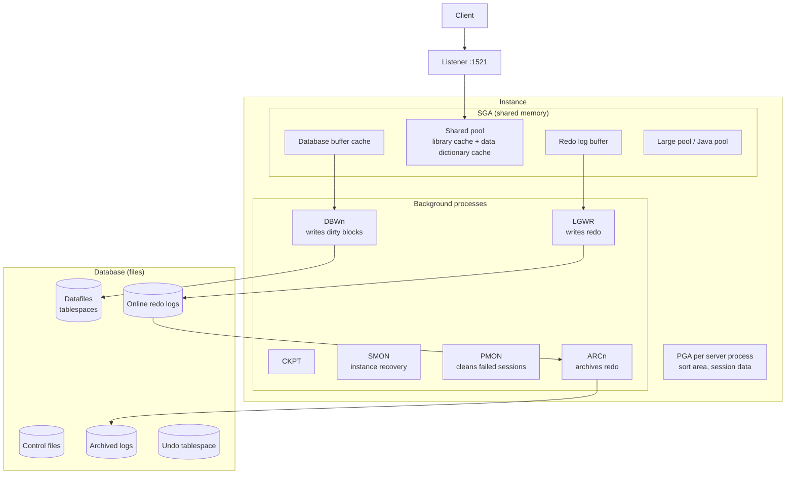
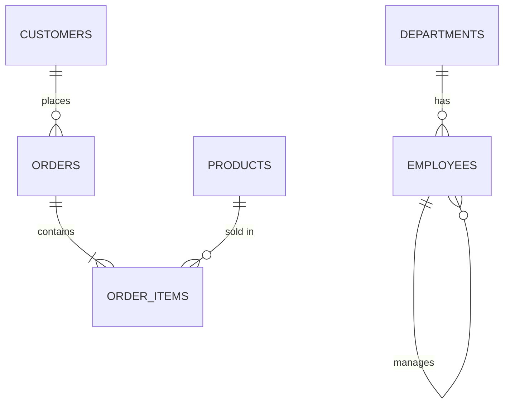
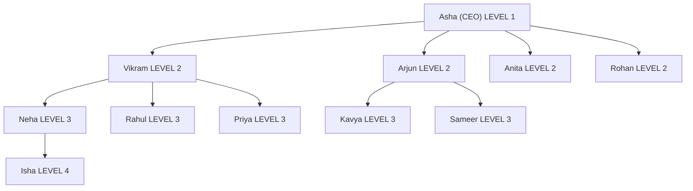
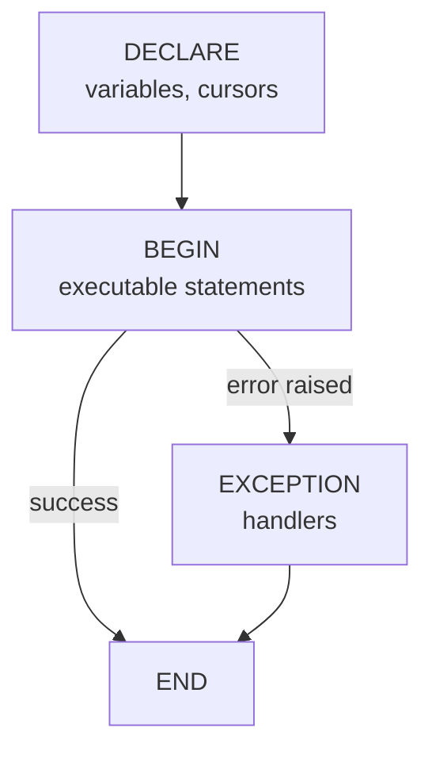
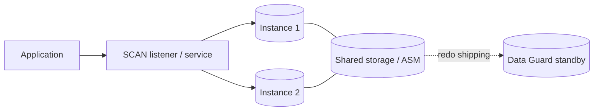

---
mdx:
  format: md
---

# Oracle SQL and PL/SQL Complete Guide - Basic to Advanced (every query type, with example tables)

> **Note**: Sections marked **(Interview Imp)** are frequently asked in interviews.
>
> **How to read this file:** All examples use the SAME sample database as the MySQL guide (a small company + online shop), written in Oracle syntax in chapter 2. Every chapter has **📘 Terms Explained** tables. Result tables shown under a query were produced by running an equivalent query on the sample data; formatting (number scale, date format, header case) can differ slightly in SQL*Plus / SQL Developer. Oracle upper-cases unquoted names, so column headers appear as `FIRST_NAME`.
>
> **Scope:** Oracle Database 12c to 23ai: architecture (instance, SGA, PGA, tablespaces, undo/redo), data types, DDL (sequences, identity, synonyms, flashback), DML (`MERGE`, multi-table insert, `RETURNING`), every form of `SELECT` (including `ROWNUM`, `FETCH FIRST`, `CONNECT BY`, `PIVOT`), functions, `ROLLUP/CUBE/GROUPING SETS`, joins, subqueries, set operations (`MINUS`), CTEs, analytic functions, views and materialized views, indexes and execution plans, transactions and locking, full PL/SQL (cursors, exceptions, procedures, functions, packages, triggers, collections, bulk processing, dynamic SQL), JSON, partitioning, security, RMAN/Data Guard/RAC overview, tuning, MySQL-vs-Oracle differences, interview questions and a practice set.
>
> **Related files:** [MySQL_Complete_Guide.md](../mysql/MySQL_Complete_Guide.md) (same sample tables, MySQL syntax) · [Java_Complete_Guide.md](../java/Java_Complete_Guide.md) · [01_Scalability_Pattern.md](../design-patterns/03_System_Design/01_Scalability_Pattern.md)

| Level | Chapters |
|---|---|
| **Beginner** | 1-6 (intro/architecture, sample data, types, DDL, DML, SELECT basics) |
| **Intermediate** | 7-11 (functions, aggregation, joins, subqueries, set ops/CTE/hierarchies) |
| **Advanced** | 12-15 (analytic functions, views/materialized views, indexes/plans, transactions) |
| **PL/SQL** | 16 (blocks to packages, triggers, collections, bulk, dynamic SQL) |
| **Professional** | 17-20 (advanced features, security/backup/HA, tuning, SQL patterns) |
| **Mastery** | 21-24 (MySQL vs Oracle, interview questions, practice set, cheat sheet) |

---

## Table of Contents
1. [Introduction and Architecture](#1-introduction-and-architecture)
   - [1.1 What is Oracle Database? **(Interview Imp)**](#11-what-is-oracle-database-interview-imp)
   - [1.2 Architecture: instance vs database **(Interview Imp)**](#12-architecture-instance-vs-database-interview-imp)
2. [The Sample Database (same data as the MySQL guide)](#2-the-sample-database-same-data-as-the-mysql-guide)
   - [2.1 Create the tables (Oracle syntax)](#21-create-the-tables-oracle-syntax)
   - [2.2 Insert the data](#22-insert-the-data)
   - [2.3 The data at a glance](#23-the-data-at-a-glance)
3. [Data Types **(Interview Imp)**](#3-data-types-interview-imp)
   - [3.1 Character](#31-character)
   - [3.2 Numeric](#32-numeric)
   - [3.3 Date and time **(Interview Imp)**](#33-date-and-time-interview-imp)
   - [3.4 Binary, row and special types](#34-binary-row-and-special-types)
4. [DDL - Defining Structure](#4-ddl---defining-structure)
   - [4.1 `CREATE TABLE` variants](#41-create-table-variants)
   - [4.2 Constraints **(Interview Imp)**](#42-constraints-interview-imp)
   - [4.3 Sequences and identity **(Interview Imp)**](#43-sequences-and-identity-interview-imp)
   - [4.4 `ALTER TABLE`](#44-alter-table)
   - [4.5 `DROP`, `TRUNCATE`, `DELETE`, recycle bin **(Interview Imp)**](#45-drop-truncate-delete-recycle-bin-interview-imp)
   - [4.6 Synonyms, schemas, other objects](#46-synonyms-schemas-other-objects)
5. [DML - Changing Data](#5-dml---changing-data)
   - [5.1 `INSERT` forms](#51-insert-forms)
   - [5.2 `UPDATE`](#52-update)
   - [5.3 `DELETE`](#53-delete)
   - [5.4 `MERGE` - upsert **(Interview Imp)**](#54-merge---upsert-interview-imp)
   - [5.5 Transaction commands and data movement](#55-transaction-commands-and-data-movement)
6. [`SELECT` Basics](#6-select-basics)
   - [6.1 Logical order and syntax](#61-logical-order-and-syntax)
   - [6.2 Columns, aliases, concatenation](#62-columns-aliases-concatenation)
   - [6.3 `DISTINCT`](#63-distinct)
   - [6.4 `WHERE`](#64-where)
   - [6.5 `ORDER BY` and NULL ordering](#65-order-by-and-null-ordering)
   - [6.6 Limiting rows: `ROWNUM`, `FETCH FIRST`, pagination **(Interview Imp)**](#66-limiting-rows-rownum-fetch-first-pagination-interview-imp)
7. [Built-in Functions](#7-built-in-functions)
   - [7.1 String functions](#71-string-functions)
   - [7.2 Numeric functions](#72-numeric-functions)
   - [7.3 Date functions **(Interview Imp)**](#73-date-functions-interview-imp)
   - [7.4 NULL-handling and conditional functions **(Interview Imp)**](#74-null-handling-and-conditional-functions-interview-imp)
   - [7.5 Information functions](#75-information-functions)
8. [Aggregation, `GROUP BY`, `ROLLUP`, `CUBE`, `PIVOT`](#8-aggregation-group-by-rollup-cube-pivot)
   - [8.1 Aggregate functions](#81-aggregate-functions)
   - [8.2 `GROUP BY` and `HAVING`](#82-group-by-and-having)
   - [8.3 `LISTAGG` - string aggregation **(Interview Imp)**](#83-listagg---string-aggregation-interview-imp)
   - [8.4 Conditional aggregation (manual pivot)](#84-conditional-aggregation-manual-pivot)
   - [8.5 `ROLLUP`, `CUBE`, `GROUPING SETS` **(Interview Imp)**](#85-rollup-cube-grouping-sets-interview-imp)
   - [8.6 `PIVOT` and `UNPIVOT` (11g+) **(Interview Imp)**](#86-pivot-and-unpivot-11g-interview-imp)
   - [8.7 `KEEP (DENSE_RANK FIRST/LAST)`](#87-keep-dense_rank-firstlast)
   - [8.8 Aggregates across tables](#88-aggregates-across-tables)
9. [Joins **(Interview Imp)**](#9-joins-interview-imp)
   - [9.1 ANSI join syntax (use this)](#91-ansi-join-syntax-use-this)
   - [9.2 `FULL OUTER JOIN` (native!)](#92-full-outer-join-native)
   - [9.3 `CROSS JOIN`, self join, multi-table join](#93-cross-join-self-join-multi-table-join)
   - [9.4 Old Oracle join syntax `(+)` (you WILL see it in legacy code)](#94-old-oracle-join-syntax--you-will-see-it-in-legacy-code)
   - [9.5 `LATERAL` / `CROSS APPLY` (12c+) and partitioned outer join](#95-lateral--cross-apply-12c-and-partitioned-outer-join)
   - [9.6 Join methods the optimizer picks **(Interview Imp)**](#96-join-methods-the-optimizer-picks-interview-imp)
10. [Subqueries **(Interview Imp)**](#10-subqueries-interview-imp)
   - [10.1 Scalar and list subqueries](#101-scalar-and-list-subqueries)
   - [10.2 Correlated subqueries and `EXISTS`](#102-correlated-subqueries-and-exists)
   - [10.3 Inline views and scalar subqueries in `SELECT`](#103-inline-views-and-scalar-subqueries-in-select)
   - [10.4 Nth highest salary (the classic) **(Interview Imp)**](#104-nth-highest-salary-the-classic-interview-imp)
   - [10.5 Subqueries in DML and `WITH` functions](#105-subqueries-in-dml-and-with-functions)
11. [Set Operations, CTEs and Hierarchical Queries](#11-set-operations-ctes-and-hierarchical-queries)
   - [11.1 `UNION`, `UNION ALL`, `INTERSECT`, `MINUS` **(Interview Imp)**](#111-union-union-all-intersect-minus-interview-imp)
   - [11.2 CTEs (`WITH`, subquery factoring)](#112-ctes-with-subquery-factoring)
   - [11.3 `CONNECT BY` - Oracle's hierarchical queries **(Interview Imp)**](#113-connect-by---oracles-hierarchical-queries-interview-imp)
12. [Analytic (Window) Functions **(Interview Imp)**](#12-analytic-window-functions-interview-imp)
   - [12.1 Ranking](#121-ranking)
   - [12.2 Aggregates over windows, `RATIO_TO_REPORT`](#122-aggregates-over-windows-ratio_to_report)
   - [12.3 `LAG`, `LEAD`, `FIRST_VALUE`, `LAST_VALUE`](#123-lag-lead-first_value-last_value)
   - [12.4 Running totals and moving windows](#124-running-totals-and-moving-windows)
   - [12.5 Remove duplicates with `ROW_NUMBER`, and `MATCH_RECOGNIZE`](#125-remove-duplicates-with-row_number-and-match_recognize)
13. [Views and Materialized Views](#13-views-and-materialized-views)
   - [13.1 Views](#131-views)
   - [13.2 Materialized views **(Interview Imp)**](#132-materialized-views-interview-imp)
14. [Indexes, Optimizer and Execution Plans **(Interview Imp)**](#14-indexes-optimizer-and-execution-plans-interview-imp)
   - [14.1 Index types](#141-index-types)
   - [14.2 The cost-based optimizer and statistics](#142-the-cost-based-optimizer-and-statistics)
   - [14.3 Reading an execution plan **(Interview Imp)**](#143-reading-an-execution-plan-interview-imp)
   - [14.4 Hints and tuning habits](#144-hints-and-tuning-habits)
15. [Transactions, Consistency and Locking **(Interview Imp)**](#15-transactions-consistency-and-locking-interview-imp)
   - [15.1 Transaction basics](#151-transaction-basics)
   - [15.2 Isolation levels in Oracle](#152-isolation-levels-in-oracle)
   - [15.3 Locking](#153-locking)
   - [15.4 Autonomous transactions and flashback **(Interview Imp)**](#154-autonomous-transactions-and-flashback-interview-imp)
16. [PL/SQL - Oracle's Programming Language **(Interview Imp)**](#16-plsql---oracles-programming-language-interview-imp)
   - [16.1 Anonymous block structure](#161-anonymous-block-structure)
   - [16.2 Variables, types, control flow](#162-variables-types-control-flow)
   - [16.3 Cursors **(Interview Imp)**](#163-cursors-interview-imp)
   - [16.4 Exception handling **(Interview Imp)**](#164-exception-handling-interview-imp)
   - [16.5 Stored procedures and functions](#165-stored-procedures-and-functions)
   - [16.6 Packages **(Interview Imp)**](#166-packages-interview-imp)
   - [16.7 Triggers **(Interview Imp)**](#167-triggers-interview-imp)
   - [16.8 Collections and records **(Interview Imp)**](#168-collections-and-records-interview-imp)
   - [16.9 Bulk processing: `BULK COLLECT` and `FORALL` **(Interview Imp)**](#169-bulk-processing-bulk-collect-and-forall-interview-imp)
   - [16.10 Dynamic SQL](#1610-dynamic-sql)
   - [16.11 Scheduler jobs, `UTL_FILE`, misc](#1611-scheduler-jobs-utl_file-misc)
17. [Advanced Features: JSON, Partitioning, External Tables, Links](#17-advanced-features-json-partitioning-external-tables-links)
   - [17.1 JSON **(Interview Imp)**](#171-json-interview-imp)
   - [17.2 Partitioning **(Interview Imp)**](#172-partitioning-interview-imp)
   - [17.3 External tables, directories, Data Pump, SQL*Loader](#173-external-tables-directories-data-pump-sqlloader)
   - [17.4 Database links and other features](#174-database-links-and-other-features)
18. [Users, Security, Backup and High Availability](#18-users-security-backup-and-high-availability)
   - [18.1 Users, privileges, roles **(Interview Imp)**](#181-users-privileges-roles-interview-imp)
   - [18.2 Backup and recovery **(Interview Imp)**](#182-backup-and-recovery-interview-imp)
   - [18.3 High availability and scale-out](#183-high-availability-and-scale-out)
19. [Performance Tuning Checklist **(Interview Imp)**](#19-performance-tuning-checklist-interview-imp)
   - [19.1 SQL-level](#191-sql-level)
   - [19.2 Instance-level](#192-instance-level)
   - [19.3 Diagnostic views and tools](#193-diagnostic-views-and-tools)
20. [SQL Patterns: "All the Query Possibilities" by Task **(Interview Imp)**](#20-sql-patterns-all-the-query-possibilities-by-task-interview-imp)
   - [20.1 Duplicates](#201-duplicates)
   - [20.2 Gaps in a sequence of ids](#202-gaps-in-a-sequence-of-ids)
   - [20.3 Percentage of total](#203-percentage-of-total)
   - [20.4 Market basket (products bought together)](#204-market-basket-products-bought-together)
   - [20.5 Date spine: months with zero orders](#205-date-spine-months-with-zero-orders)
   - [20.6 Normalisation reminder](#206-normalisation-reminder)
21. [MySQL vs Oracle: Differences You Must Know **(Interview Imp)**](#21-mysql-vs-oracle-differences-you-must-know-interview-imp)
22. [Interview Questions **(Interview Imp)**](#22-interview-questions-interview-imp)
   - [22.1 SQL](#221-sql)
   - [22.2 Architecture and administration](#222-architecture-and-administration)
   - [22.3 PL/SQL](#223-plsql)
23. [Practice Set with Solutions (on the sample data)](#23-practice-set-with-solutions-on-the-sample-data)
24. [Cheat Sheet](#24-cheat-sheet)

---

# 1. Introduction and Architecture

## 1.1 What is Oracle Database? **(Interview Imp)**

Oracle Database is a commercial relational (and multi-model) database from Oracle Corporation, widely used in banking, telecom and ERP. Its SQL dialect is standard SQL plus Oracle extensions; its procedural language is **PL/SQL**. Editions: Enterprise, Standard, Express (XE, free), and Autonomous Database in the cloud.

| Group | Commands | Purpose |
|---|---|---|
| **DDL** | `CREATE`, `ALTER`, `DROP`, `TRUNCATE`, `RENAME`, `COMMENT` | Define structure (auto-commits) |
| **DML** | `INSERT`, `UPDATE`, `DELETE`, `MERGE` | Change data |
| **DQL** | `SELECT` | Read data |
| **DCL** | `GRANT`, `REVOKE` | Permissions |
| **TCL** | `COMMIT`, `ROLLBACK`, `SAVEPOINT` | Transactions (Oracle starts a transaction implicitly at the first DML) |

### Getting started

```bash
# Quickest: Oracle XE or Free in Docker
docker run -d --name ora -p 1521:1521 -e ORACLE_PWD=secret container-registry.oracle.com/database/free
sqlplus system/secret@//localhost:1521/FREEPDB1
```

```sql
SELECT banner FROM v$version;
SELECT sys_context('USERENV','CON_NAME') FROM dual;          -- which container (PDB) am I in
SELECT user FROM dual;
DESC employees                                               -- SQL*Plus describe (no semicolon needed)
SET LINESIZE 200 PAGESIZE 50                                 -- SQL*Plus formatting
SELECT table_name FROM user_tables;                          -- data dictionary: my tables
SELECT * FROM user_tab_columns WHERE table_name = 'EMPLOYEES';
SELECT object_name, object_type, status FROM user_objects;
```

Tools: SQL*Plus (CLI), SQL Developer (free GUI), SQLcl, TOAD, DBeaver.

### The data dictionary

Oracle describes itself with views: `USER_*` (objects I own), `ALL_*` (objects I can access), `DBA_*` (everything), and dynamic performance views `V$*` (live instance state). Examples: `USER_TABLES`, `USER_INDEXES`, `USER_CONSTRAINTS`, `USER_SOURCE`, `V$SESSION`, `V$SQL`.

### 📘 Terms Explained

| Term | Meaning |
|---|---|
| PL/SQL | Oracle's procedural extension of SQL |
| `DUAL` | A one-row dummy table used for `SELECT expression FROM dual` |
| Data dictionary | Metadata views that describe all objects |
| SQL*Plus | The classic command-line client |
| Schema | The set of objects owned by one user (user = schema in Oracle) |
| PDB | Pluggable Database (see below) |

---

## 1.2 Architecture: instance vs database **(Interview Imp)**

An Oracle **database** is the set of files on disk. An **instance** is the memory plus background processes that operate on it.



| Component | Job |
|---|---|
| **Buffer cache** | Caches data blocks in RAM |
| **Shared pool** | Library cache stores parsed SQL and PL/SQL; reuse avoids a hard parse (why **bind variables** matter) |
| **Redo log buffer / LGWR** | Every change is first written to the redo log (write-ahead). Commit = redo is on disk |
| **DBWn** | Lazily writes changed ("dirty") blocks from the cache to datafiles |
| **Undo** | Before-images of changed data: rollback, read consistency, flashback |
| **PGA** | Private memory of one session: sorts, hash joins |
| **Control file** | Database structure and checkpoint info |
| **Listener** | Network process that accepts connections (port 1521) |

**Logical storage:** `Database > Tablespace > Segment (table/index) > Extent > Block (8 KB default)`. A **tablespace** is a logical container made of one or more datafiles: `SYSTEM`, `SYSAUX`, `UNDOTBS1`, `TEMP`, `USERS`.

**Multitenant (12c+):** one **container database (CDB)** hosts many **pluggable databases (PDBs)**. Applications connect to a PDB service (e.g. `FREEPDB1`).

**Life of a `SELECT`:** parse (syntax, semantics, privileges) > optimise (cost-based optimizer chooses a plan from statistics) > execute (read blocks from cache, else disk) > fetch rows. **Soft parse** reuses a cached plan; **hard parse** builds a new one (expensive).

### 📘 Terms Explained

| Term | Meaning |
|---|---|
| SGA / PGA | Shared / private memory areas |
| Redo | Log of all changes for recovery |
| Undo | Old versions of data for rollback and consistent reads |
| Checkpoint | Point where dirty blocks are flushed so recovery starts later |
| Hard / soft parse | New plan built / existing plan reused |
| Bind variable | Placeholder (`:id`) so many executions share one plan |
| Extent / segment | Allocation units inside a tablespace |

---

# 2. The Sample Database (same data as the MySQL guide)



## 2.1 Create the tables (Oracle syntax)

```sql
CREATE TABLE departments (
    dept_id    NUMBER(4)     CONSTRAINT pk_dept PRIMARY KEY,
    dept_name  VARCHAR2(50)  NOT NULL CONSTRAINT uq_dept_name UNIQUE,
    location   VARCHAR2(50)
);

CREATE TABLE employees (
    emp_id      NUMBER(6)     GENERATED BY DEFAULT AS IDENTITY CONSTRAINT pk_emp PRIMARY KEY,
    first_name  VARCHAR2(50)  NOT NULL,
    last_name   VARCHAR2(50)  NOT NULL,
    email       VARCHAR2(100) CONSTRAINT uq_emp_email UNIQUE,
    job_title   VARCHAR2(50),
    manager_id  NUMBER(6),
    hire_date   DATE          NOT NULL,
    salary      NUMBER(10,2)  NOT NULL CONSTRAINT chk_emp_sal CHECK (salary > 0),
    commission  NUMBER(10,2),
    dept_id     NUMBER(4),
    CONSTRAINT fk_emp_dept    FOREIGN KEY (dept_id)    REFERENCES departments(dept_id),
    CONSTRAINT fk_emp_manager FOREIGN KEY (manager_id) REFERENCES employees(emp_id)
);

CREATE TABLE customers (
    customer_id NUMBER(6)     GENERATED BY DEFAULT AS IDENTITY PRIMARY KEY,
    name        VARCHAR2(100) NOT NULL,
    email       VARCHAR2(100) UNIQUE,
    city        VARCHAR2(50),
    country     VARCHAR2(50)
);

CREATE TABLE products (
    product_id NUMBER(6)     GENERATED BY DEFAULT AS IDENTITY PRIMARY KEY,
    name       VARCHAR2(100) NOT NULL,
    category   VARCHAR2(50),
    price      NUMBER(10,2)  NOT NULL CHECK (price >= 0),
    stock      NUMBER(8)     DEFAULT 0 NOT NULL
);

CREATE TABLE orders (
    order_id    NUMBER(8)     GENERATED BY DEFAULT AS IDENTITY PRIMARY KEY,
    customer_id NUMBER(6)     NOT NULL REFERENCES customers(customer_id),
    order_date  DATE          NOT NULL,
    status      VARCHAR2(20)  DEFAULT 'PENDING' NOT NULL,
    total       NUMBER(12,2)
);

CREATE TABLE order_items (
    item_id    NUMBER(8)     GENERATED BY DEFAULT AS IDENTITY PRIMARY KEY,
    order_id   NUMBER(8)     NOT NULL REFERENCES orders(order_id) ON DELETE CASCADE,
    product_id NUMBER(6)     NOT NULL REFERENCES products(product_id),
    qty        NUMBER(6)     NOT NULL CHECK (qty > 0),
    unit_price NUMBER(10,2)  NOT NULL
);
```

(Oracle has no `ON UPDATE CASCADE` and no `AUTO_INCREMENT`; identity columns and sequences replace it.)

## 2.2 Insert the data

Before 23ai, `INSERT` accepts one `VALUES` row. Use `INSERT ALL` for several rows, or run separate statements.

```sql
INSERT ALL
  INTO departments VALUES (10,'Engineering','Bangalore')
  INTO departments VALUES (20,'Sales','Mumbai')
  INTO departments VALUES (30,'HR','Delhi')
  INTO departments VALUES (40,'Finance','Pune')
  INTO departments VALUES (50,'Support','Chennai')
SELECT 1 FROM dual;

INSERT ALL
  INTO employees (emp_id,first_name,last_name,email,job_title,manager_id,hire_date,salary,commission,dept_id) VALUES (1,'Asha','Rao','asha.rao@corp.com','CEO',NULL,DATE '2015-01-10',250000,NULL,10)
  INTO employees (emp_id,first_name,last_name,email,job_title,manager_id,hire_date,salary,commission,dept_id) VALUES (2,'Vikram','Singh','vikram.singh@corp.com','Engineering Manager',1,DATE '2016-03-15',150000,NULL,10)
  INTO employees (emp_id,first_name,last_name,email,job_title,manager_id,hire_date,salary,commission,dept_id) VALUES (3,'Neha','Gupta','neha.gupta@corp.com','Senior Developer',2,DATE '2017-07-01',120000,NULL,10)
  INTO employees (emp_id,first_name,last_name,email,job_title,manager_id,hire_date,salary,commission,dept_id) VALUES (4,'Rahul','Verma','rahul.verma@corp.com','Developer',2,DATE '2019-09-20',90000,NULL,10)
  INTO employees (emp_id,first_name,last_name,email,job_title,manager_id,hire_date,salary,commission,dept_id) VALUES (5,'Priya','Nair','priya.nair@corp.com','Developer',2,DATE '2021-01-05',85000,NULL,10)
  INTO employees (emp_id,first_name,last_name,email,job_title,manager_id,hire_date,salary,commission,dept_id) VALUES (6,'Arjun','Mehta','arjun.mehta@corp.com','Sales Manager',1,DATE '2016-05-12',130000,5000,20)
  INTO employees (emp_id,first_name,last_name,email,job_title,manager_id,hire_date,salary,commission,dept_id) VALUES (7,'Kavya','Iyer','kavya.iyer@corp.com','Sales Executive',6,DATE '2020-02-14',60000,8000,20)
  INTO employees (emp_id,first_name,last_name,email,job_title,manager_id,hire_date,salary,commission,dept_id) VALUES (8,'Sameer','Khan','sameer.khan@corp.com','Sales Executive',6,DATE '2022-06-30',55000,6000,20)
  INTO employees (emp_id,first_name,last_name,email,job_title,manager_id,hire_date,salary,commission,dept_id) VALUES (9,'Anita','Desai','anita.desai@corp.com','HR Manager',1,DATE '2018-11-11',95000,NULL,30)
  INTO employees (emp_id,first_name,last_name,email,job_title,manager_id,hire_date,salary,commission,dept_id) VALUES (10,'Rohan','Joshi','rohan.joshi@corp.com','Accountant',1,DATE '2019-04-22',70000,NULL,40)
  INTO employees (emp_id,first_name,last_name,email,job_title,manager_id,hire_date,salary,commission,dept_id) VALUES (11,'Isha','Kapoor','isha.kapoor@corp.com','Intern',3,DATE '2023-08-01',25000,NULL,NULL)
SELECT 1 FROM dual;

INSERT ALL
  INTO customers VALUES (1,'Amit Shah','amit@mail.com','Mumbai','India')
  INTO customers VALUES (2,'Sara Ali','sara@mail.com','Delhi','India')
  INTO customers VALUES (3,'John Smith','john@mail.com','New York','USA')
  INTO customers VALUES (4,'Emma Brown','emma@mail.com','London','UK')
  INTO customers VALUES (5,'Li Wei','li@mail.com','Shanghai','China')
  INTO customers VALUES (6,'Ravi Kumar','ravi@mail.com','Bangalore','India')
SELECT 1 FROM dual;

INSERT ALL
  INTO products VALUES (1,'Laptop','Electronics',55000,20)
  INTO products VALUES (2,'Phone','Electronics',30000,50)
  INTO products VALUES (3,'Headphones','Electronics',3000,100)
  INTO products VALUES (4,'Desk','Furniture',8000,15)
  INTO products VALUES (5,'Chair','Furniture',5000,30)
  INTO products VALUES (6,'Notebook','Stationery',100,500)
  INTO products VALUES (7,'Pen','Stationery',20,1000)
  INTO products VALUES (8,'Monitor','Electronics',12000,0)
SELECT 1 FROM dual;

INSERT ALL
  INTO orders (order_id,customer_id,order_date,status) VALUES (101,1,DATE '2024-01-15','DELIVERED')
  INTO orders (order_id,customer_id,order_date,status) VALUES (102,1,DATE '2024-02-20','SHIPPED')
  INTO orders (order_id,customer_id,order_date,status) VALUES (103,2,DATE '2024-02-25','DELIVERED')
  INTO orders (order_id,customer_id,order_date,status) VALUES (104,3,DATE '2024-03-05','CANCELLED')
  INTO orders (order_id,customer_id,order_date,status) VALUES (105,4,DATE '2024-03-18','DELIVERED')
  INTO orders (order_id,customer_id,order_date,status) VALUES (106,2,DATE '2024-04-02','PENDING')
  INTO orders (order_id,customer_id,order_date,status) VALUES (107,5,DATE '2024-04-10','DELIVERED')
  INTO orders (order_id,customer_id,order_date,status) VALUES (108,1,DATE '2024-05-01','PENDING')
SELECT 1 FROM dual;

INSERT ALL
  INTO order_items VALUES (1,101,1,1,55000)   INTO order_items VALUES (2,101,3,2,3000)
  INTO order_items VALUES (3,102,2,1,30000)   INTO order_items VALUES (4,103,4,1,8000)
  INTO order_items VALUES (5,103,5,2,5000)    INTO order_items VALUES (6,104,1,1,55000)
  INTO order_items VALUES (7,105,6,10,100)    INTO order_items VALUES (8,105,7,20,20)
  INTO order_items VALUES (9,105,3,1,3000)    INTO order_items VALUES (10,106,8,2,12000)
  INTO order_items VALUES (11,107,2,2,30000)  INTO order_items VALUES (12,107,3,1,3000)
  INTO order_items VALUES (13,108,5,4,5000)   INTO order_items VALUES (14,108,6,5,100)
SELECT 1 FROM dual;

UPDATE orders o
SET total = (SELECT SUM(qty * unit_price) FROM order_items i WHERE i.order_id = o.order_id);

COMMIT;
```

Explicit ids into a `GENERATED BY DEFAULT` identity column are allowed. (Use `GENERATED ALWAYS` to forbid that.)

## 2.3 The data at a glance

```sql
SELECT * FROM departments ORDER BY dept_id
```

```text
+---------+-------------+-----------+
| dept_id | dept_name   | location  |
+---------+-------------+-----------+
| 10      | Engineering | Bangalore |
| 20      | Sales       | Mumbai    |
| 30      | HR          | Delhi     |
| 40      | Finance     | Pune      |
| 50      | Support     | Chennai   |
+---------+-------------+-----------+
5 row(s)
```

```sql
SELECT emp_id, first_name, last_name, job_title, manager_id, salary, commission, dept_id FROM employees ORDER BY emp_id
```

```text
+--------+------------+-----------+---------------------+------------+--------+------------+---------+
| emp_id | first_name | last_name | job_title           | manager_id | salary | commission | dept_id |
+--------+------------+-----------+---------------------+------------+--------+------------+---------+
| 1      | Asha       | Rao       | CEO                 | NULL       | 250000 | NULL       | 10      |
| 2      | Vikram     | Singh     | Engineering Manager | 1          | 150000 | NULL       | 10      |
| 3      | Neha       | Gupta     | Senior Developer    | 2          | 120000 | NULL       | 10      |
| 4      | Rahul      | Verma     | Developer           | 2          | 90000  | NULL       | 10      |
| 5      | Priya      | Nair      | Developer           | 2          | 85000  | NULL       | 10      |
| 6      | Arjun      | Mehta     | Sales Manager       | 1          | 130000 | 5000       | 20      |
| 7      | Kavya      | Iyer      | Sales Executive     | 6          | 60000  | 8000       | 20      |
| 8      | Sameer     | Khan      | Sales Executive     | 6          | 55000  | 6000       | 20      |
| 9      | Anita      | Desai     | HR Manager          | 1          | 95000  | NULL       | 30      |
| 10     | Rohan      | Joshi     | Accountant          | 1          | 70000  | NULL       | 40      |
| 11     | Isha       | Kapoor    | Intern              | 3          | 25000  | NULL       | NULL    |
+--------+------------+-----------+---------------------+------------+--------+------------+---------+
11 row(s)
```

Remember: Isha (11) has no department, Support (50) has no employees, Ravi (customer 6) has no orders, Monitor (8) has zero stock, only sales staff have a commission.

---

# 3. Data Types **(Interview Imp)**

## 3.1 Character

| Type | Notes |
|---|---|
| `VARCHAR2(n [BYTE\|CHAR])` | Variable length, up to 4000 bytes (32767 with `MAX_STRING_SIZE=EXTENDED`). **Use this**; plain `VARCHAR` is reserved for future use |
| `CHAR(n)` | Fixed, blank-padded, up to 2000 bytes |
| `NVARCHAR2`, `NCHAR` | National character set (Unicode) |
| `CLOB`, `NCLOB` | Large text up to 128 TB; `LONG` is obsolete |

**Critical Oracle quirk: the empty string is NULL.** `INSERT ... VALUES ('')` stores NULL; `'' IS NULL` is true. In MySQL `''` and NULL differ.

## 3.2 Numeric

| Type | Notes |
|---|---|
| `NUMBER(p,s)` | The universal exact number: precision `p` digits, scale `s` decimals. `NUMBER(10,2)` money; `NUMBER(5)` integer; `NUMBER` unbounded |
| `INTEGER`, `INT`, `SMALLINT` | Aliases for `NUMBER(38)` |
| `FLOAT`, `BINARY_FLOAT`, `BINARY_DOUBLE` | Approximate (IEEE); `NUMBER` is decimal-exact |

A negative scale rounds left of the point: `NUMBER(5,-2)` stores 12345 as 12300.

## 3.3 Date and time **(Interview Imp)**

| Type | Notes |
|---|---|
| `DATE` | **Contains date AND time** to the second (7 bytes). No pure-date type |
| `TIMESTAMP(n)` | Fractional seconds up to 9 digits |
| `TIMESTAMP WITH TIME ZONE` / `WITH LOCAL TIME ZONE` | Time-zone aware |
| `INTERVAL YEAR TO MONTH`, `INTERVAL DAY TO SECOND` | Durations |

Date arithmetic is in **days**: `SYSDATE + 1` is tomorrow, `SYSDATE - 1/24` is one hour ago. Date literals: `DATE '2024-05-01'`, `TIMESTAMP '2024-05-01 10:30:00'`, or `TO_DATE('01-05-2024','DD-MM-YYYY')`. Never rely on implicit conversion, which uses the session's `NLS_DATE_FORMAT`.

## 3.4 Binary, row and special types

| Type | Meaning |
|---|---|
| `RAW(n)`, `BLOB` | Bytes / large binary |
| `BFILE` | Pointer to an OS file |
| `ROWID` | Physical address of a row (`AAAR3sAAEAAAACXAAA`); fastest access path |
| `UROWID` | Universal rowid (index-organized tables) |
| `XMLTYPE`, `JSON` (21c native) | Document data |
| `BOOLEAN` | In PL/SQL always; in SQL columns from 23ai |

### 📘 Terms Explained

| Term | Meaning |
|---|---|
| `NUMBER(p,s)` | Decimal number with p total digits and s digits after the point |
| `SYSDATE` | Current date and time of the database server |
| `NLS_*` | National Language Support settings (date format, decimal separator, language) |
| ROWID | Internal physical row address |
| Blank-padded | Short values extended with spaces to the declared length |

---
# 4. DDL - Defining Structure

DDL statements **auto-commit** (before and after) in Oracle.

## 4.1 `CREATE TABLE` variants

```sql
CREATE TABLE audit_log (
    log_id     NUMBER GENERATED ALWAYS AS IDENTITY PRIMARY KEY,
    table_name VARCHAR2(50) NOT NULL,
    action     VARCHAR2(10) NOT NULL CHECK (action IN ('INSERT','UPDATE','DELETE')),
    changed_by VARCHAR2(50) DEFAULT USER,
    changed_at TIMESTAMP    DEFAULT SYSTIMESTAMP NOT NULL,
    details    CLOB
);

-- CTAS: structure + data, but no constraints except NOT NULL
CREATE TABLE high_earners AS
SELECT emp_id, first_name, salary FROM employees WHERE salary > 100000;

-- structure only
CREATE TABLE employees_copy AS SELECT * FROM employees WHERE 1 = 0;

-- Global temporary table: structure is permanent, DATA is private to the session/transaction
CREATE GLOBAL TEMPORARY TABLE tmp_totals (customer_id NUMBER, total NUMBER(12,2))
ON COMMIT DELETE ROWS;                 -- or ON COMMIT PRESERVE ROWS

-- Virtual (computed) column
ALTER TABLE employees ADD (annual_salary NUMBER GENERATED ALWAYS AS (salary * 12) VIRTUAL);

-- Table in a chosen tablespace, with compression
CREATE TABLE sales_hist (id NUMBER, amt NUMBER) TABLESPACE users ROW STORE COMPRESS ADVANCED;
```

Table types: **heap** (default), **index-organized (IOT)** (rows stored inside a B-tree on the PK), **partitioned**, **external** (a file read through SQL), **temporary**, **cluster**.

## 4.2 Constraints **(Interview Imp)**

| Constraint | Notes |
|---|---|
| `NOT NULL` | Value required |
| `UNIQUE` | Duplicates not allowed; multiple NULLs OK for a single column (a composite key with all columns NULL is also allowed) |
| `PRIMARY KEY` | Not null + unique; creates an index automatically |
| `FOREIGN KEY ... REFERENCES` | `ON DELETE CASCADE` or `ON DELETE SET NULL` (no `ON UPDATE` clause; you can't update keys that are referenced) |
| `CHECK` | Condition, e.g. `CHECK (status IN ('A','B'))` |
| `DEFAULT` | Value when none is supplied (also `DEFAULT ON NULL`) |

```sql
ALTER TABLE employees ADD CONSTRAINT chk_comm CHECK (commission >= 0);
ALTER TABLE employees DISABLE CONSTRAINT chk_comm;           -- keep definition, stop enforcing
ALTER TABLE employees ENABLE NOVALIDATE CONSTRAINT chk_comm; -- enforce new rows only (fast on big tables)
ALTER TABLE employees DROP CONSTRAINT chk_comm;
ALTER TABLE employees ADD CONSTRAINT fk_mgr FOREIGN KEY (manager_id) REFERENCES employees(emp_id) DEFERRABLE INITIALLY DEFERRED;
SELECT constraint_name, constraint_type, status FROM user_constraints WHERE table_name = 'EMPLOYEES';
-- types: P primary, R foreign (referential), U unique, C check/not null
```

`DEFERRABLE` constraints are checked at **commit** instead of per statement, useful for circular references.

## 4.3 Sequences and identity **(Interview Imp)**

Before 12c every auto-number used a **sequence** plus a trigger. Both still exist.

```sql
CREATE SEQUENCE seq_emp START WITH 1000 INCREMENT BY 1 NOCACHE NOCYCLE;   -- or CACHE 20 for speed
INSERT INTO employees (emp_id, first_name, last_name, hire_date, salary)
VALUES (seq_emp.NEXTVAL, 'Tina', 'Rao', SYSDATE, 50000);
SELECT seq_emp.CURRVAL FROM dual;                             -- last value in THIS session
ALTER SEQUENCE seq_emp INCREMENT BY 10;
DROP SEQUENCE seq_emp;

-- 12c+: sequence as a column default
CREATE TABLE t1 (id NUMBER DEFAULT seq_emp.NEXTVAL PRIMARY KEY, v VARCHAR2(10));

-- 12c+: identity column (uses a system sequence underneath)
-- GENERATED ALWAYS AS IDENTITY | GENERATED BY DEFAULT AS IDENTITY | GENERATED BY DEFAULT ON NULL AS IDENTITY
```

Sequence numbers are **not gap-free** (a rollback or cache loss skips values). Never use them to count rows.

## 4.4 `ALTER TABLE`

```sql
ALTER TABLE employees ADD (phone VARCHAR2(15), grade CHAR(1));
ALTER TABLE employees MODIFY (phone VARCHAR2(20) NOT NULL);       -- change type/size/nullability
ALTER TABLE employees RENAME COLUMN phone TO phone_no;
ALTER TABLE employees DROP COLUMN grade;
ALTER TABLE employees DROP (phone_no, annual_salary);
ALTER TABLE employees SET UNUSED COLUMN grade;                    -- fast logical drop, physically removed later
RENAME employees_copy TO employees_old;                           -- or ALTER TABLE ... RENAME TO
ALTER TABLE employees READ ONLY;  ALTER TABLE employees READ WRITE;
ALTER TABLE employees MOVE TABLESPACE users;                      -- relocate (indexes become unusable; rebuild)
COMMENT ON TABLE employees IS 'Company staff';
COMMENT ON COLUMN employees.salary IS 'Monthly gross, INR';
```

`MODIFY` to a shorter size or incompatible type fails if existing data does not fit.

## 4.5 `DROP`, `TRUNCATE`, `DELETE`, recycle bin **(Interview Imp)**

| | `DELETE` | `TRUNCATE` | `DROP` |
|---|---|---|---|
| Kind | DML | DDL | DDL |
| `WHERE` | Yes | No | No |
| Rollback | **Yes** | **No** (auto-commit) | Recoverable via recycle bin (`FLASHBACK TABLE`) |
| Speed | Slow, generates undo/redo | Fast; resets the high-water mark | Fast |
| Triggers | Fire | Don't | Don't |
| Sequence/identity | Unchanged | Not reset (use `RESTART`) | n/a |

```sql
TRUNCATE TABLE audit_log;
DROP TABLE tmp_totals;                      -- goes to the recycle bin (BIN$...)
FLASHBACK TABLE tmp_totals TO BEFORE DROP;  -- bring it back
SHOW RECYCLEBIN
PURGE TABLE tmp_totals;                     -- really delete
DROP TABLE employees CASCADE CONSTRAINTS PURGE;
```

## 4.6 Synonyms, schemas, other objects

```sql
CREATE SYNONYM emp FOR hr.employees;                 -- alias; PUBLIC SYNONYM for all users
CREATE USER shop IDENTIFIED BY "Str0ng#Pw" DEFAULT TABLESPACE users QUOTA 100M ON users;
GRANT CREATE SESSION, CREATE TABLE TO shop;
```

Other schema objects: tables, views, materialized views, indexes, sequences, synonyms, procedures, functions, packages, triggers, types, database links, directories, jobs.

### 📘 Terms Explained

| Term | Meaning |
|---|---|
| Identity column | Auto-generated number column backed by a sequence |
| Sequence | Database object that hands out increasing numbers |
| Recycle bin | Holding area for dropped tables so they can be flashed back |
| High-water mark | The highest block ever used by a table; `TRUNCATE` resets it |
| Deferrable constraint | One checked at commit time |
| Global temporary table | Table whose rows are private to each session |
| `NOVALIDATE` | Do not check existing rows |

---

# 5. DML - Changing Data

Oracle starts a transaction at the first DML; nothing is permanent (and other sessions see nothing) until `COMMIT`.

## 5.1 `INSERT` forms

```sql
INSERT INTO departments (dept_id, dept_name, location) VALUES (60, 'Legal', 'Kolkata');
INSERT INTO departments VALUES (70, 'Marketing', 'Hyderabad');                  -- positional

-- 23ai (and later) allows multi-row VALUES:
-- INSERT INTO departments VALUES (80,'R&D','Pune'), (90,'QA','Noida');

-- Insert from a query
INSERT INTO high_earners (emp_id, first_name, salary)
SELECT emp_id, first_name, salary FROM employees WHERE salary > 100000;

-- Insert ALL: several rows / several tables at once
INSERT ALL
  INTO products (name, category, price) VALUES ('Mouse','Electronics',800)
  INTO products (name, category, price) VALUES ('Keyboard','Electronics',1500)
SELECT 1 FROM dual;

-- Conditional multi-table insert: route rows
INSERT ALL
  WHEN salary >= 100000 THEN INTO high_pay (emp_id, salary) VALUES (emp_id, salary)
  WHEN salary <  100000 THEN INTO normal_pay (emp_id, salary) VALUES (emp_id, salary)
SELECT emp_id, salary FROM employees;
-- INSERT FIRST: only the first matching WHEN is used

-- RETURNING: get generated values back (avoids a second query)
-- (PL/SQL or bind variables)
INSERT INTO customers (name, email) VALUES ('Neel Rao', 'neel@mail.com') RETURNING customer_id INTO :new_id;

-- Direct-path load for bulk: skips the buffer cache, writes above the high-water mark
INSERT /*+ APPEND */ INTO sales_hist SELECT * FROM staging;
-- Log errors and continue instead of failing the whole statement
INSERT INTO products SELECT * FROM products_stage LOG ERRORS INTO err$_products ('batch1') REJECT LIMIT UNLIMITED;
```

## 5.2 `UPDATE`

```sql
UPDATE employees SET salary = salary * 1.10 WHERE dept_id = 20;
UPDATE employees SET commission = 0 WHERE commission IS NULL;
UPDATE employees SET (job_title, salary) = (SELECT 'Lead', 130000 FROM dual) WHERE emp_id = 3;   -- multi-column from subquery

-- Correlated update (Oracle has NO "UPDATE ... JOIN" syntax)
UPDATE employees e
SET salary = salary * 1.05
WHERE EXISTS (SELECT 1 FROM departments d WHERE d.dept_id = e.dept_id AND d.location = 'Bangalore');

UPDATE orders o
SET total = (SELECT SUM(i.qty * i.unit_price) FROM order_items i WHERE i.order_id = o.order_id);

-- Update through an inline view (the join must be "key preserved")
UPDATE (SELECT e.salary, d.dept_name FROM employees e JOIN departments d ON d.dept_id = e.dept_id WHERE d.dept_name = 'Sales')
SET salary = salary + 1000;

-- RETURNING
UPDATE employees SET salary = salary + 500 WHERE emp_id = 7 RETURNING salary INTO :new_salary;

-- CASE inside UPDATE
UPDATE employees SET salary = CASE WHEN salary < 60000 THEN salary * 1.15
                                    WHEN salary < 100000 THEN salary * 1.10 ELSE salary * 1.05 END;
```

## 5.3 `DELETE`

```sql
DELETE FROM order_items WHERE order_id = 104;
DELETE employees WHERE dept_id IS NULL;                      -- FROM is optional in Oracle
DELETE FROM customers c WHERE NOT EXISTS (SELECT 1 FROM orders o WHERE o.customer_id = c.customer_id);

-- Delete duplicates, keep the lowest ROWID (works without a key!)
DELETE FROM employees e1
WHERE e1.rowid > (SELECT MIN(e2.rowid) FROM employees e2 WHERE e2.email = e1.email);

-- Delete a fixed number of rows
DELETE FROM audit_log WHERE changed_at < SYSDATE - 90 AND ROWNUM <= 10000;

DELETE FROM orders WHERE order_id = 108 RETURNING total INTO :t;
```

## 5.4 `MERGE` - upsert **(Interview Imp)**

`MERGE` updates rows that match and inserts the ones that don't, in one statement.

```sql
MERGE INTO products p
USING (SELECT 3 AS product_id, 'Headphones' AS name, 'Electronics' AS category, 3200 AS price, 50 AS stock FROM dual) s
   ON (p.product_id = s.product_id)
WHEN MATCHED THEN
     UPDATE SET p.price = s.price, p.stock = p.stock + s.stock
     WHERE p.price <> s.price                 -- optional filter on updates
     DELETE WHERE p.stock = 0                 -- optional: delete rows that match this after update
WHEN NOT MATCHED THEN
     INSERT (product_id, name, category, price, stock)
     VALUES (s.product_id, s.name, s.category, s.price, s.stock);

-- Sync a table from a staging table
MERGE INTO customers c
USING customer_stage s ON (c.email = s.email)
WHEN MATCHED THEN UPDATE SET c.city = s.city
WHEN NOT MATCHED THEN INSERT (name, email, city, country) VALUES (s.name, s.email, s.city, s.country);
```

## 5.5 Transaction commands and data movement

```sql
COMMIT;   ROLLBACK;   SAVEPOINT s1;   ROLLBACK TO s1;
SET AUTOCOMMIT OFF                                 -- SQL*Plus default is off; JDBC default is ON, change it!
```

```bash
# Bulk load / export tools
sqlldr userid=scott/tiger control=emp.ctl          # SQL*Loader (flat files > tables)
expdp / impdp   (Data Pump, logical backup and migration)
```

External tables read flat files directly with SQL; `UTL_FILE` reads/writes files from PL/SQL.

### 📘 Terms Explained

| Term | Meaning |
|---|---|
| `MERGE` | Update-or-insert in a single statement |
| `RETURNING INTO` | Capture values changed by DML without re-querying |
| Direct-path insert | Bulk insert writing above the high-water mark (`APPEND` hint) |
| Key-preserved view | A join view where each base-table row appears at most once |
| `ROWNUM` | Number assigned to rows as they are fetched |
| SQL*Loader | Oracle's flat-file loader |

---

# 6. `SELECT` Basics

## 6.1 Logical order and syntax


```sql
SELECT [DISTINCT] expr [alias], ...
FROM table [alias] [JOIN ...]
[WHERE condition]
[START WITH .. CONNECT BY ..]
[GROUP BY ..] [HAVING ..]
[ORDER BY expr [ASC|DESC] [NULLS FIRST|LAST]]
[OFFSET n ROWS] [FETCH FIRST n ROWS ONLY | WITH TIES];
```

`SELECT` without `FROM` does not exist in Oracle (before 23ai): use `FROM dual`. Aliases that need spaces or case: `AS "Annual Salary"` (double quotes, not single).

## 6.2 Columns, aliases, concatenation

```sql
SELECT first_name || ' ' || last_name AS full_name, salary * 12 AS annual_salary
FROM employees
WHERE emp_id <= 3
```

```text
+--------------+---------------+
| full_name    | annual_salary |
+--------------+---------------+
| Asha Rao     | 3000000       |
| Vikram Singh | 1800000       |
| Neha Gupta   | 1440000       |
+--------------+---------------+
3 row(s)
```

`||` concatenates and treats NULL as an empty string (`'a' || NULL` is `'a'`). `CONCAT` takes only two arguments.

```sql
SELECT 2 + 3 AS five, SYSDATE, 'hello' FROM dual;
SELECT q'[It's O'Reilly]' FROM dual;                 -- alternative quoting: no doubled quotes
SELECT 'It''s' FROM dual;                            -- single quote escaped by doubling
SELECT ROWID, emp_id FROM employees;                 -- pseudo-columns: ROWID, ROWNUM, LEVEL
```

## 6.3 `DISTINCT`

```sql
SELECT DISTINCT job_title FROM employees ORDER BY job_title
```

```text
+---------------------+
| job_title           |
+---------------------+
| Accountant          |
| CEO                 |
| Developer           |
| Engineering Manager |
| HR Manager          |
| Intern              |
| Sales Executive     |
| Sales Manager       |
| Senior Developer    |
+---------------------+
9 row(s)
```

`UNIQUE` is an Oracle synonym of `DISTINCT`.

## 6.4 `WHERE`

Operators: `=`, `<>`/`!=`/`^=`, `<`, `>`, `<=`, `>=`, `AND`, `OR`, `NOT`, `BETWEEN`, `IN`, `LIKE`, `REGEXP_LIKE`, `IS [NOT] NULL`, `EXISTS`, `ANY/SOME/ALL`.

```sql
SELECT first_name, salary, dept_id FROM employees WHERE salary > 100000 AND dept_id = 10
```

```text
+------------+--------+---------+
| first_name | salary | dept_id |
+------------+--------+---------+
| Asha       | 250000 | 10      |
| Vikram     | 150000 | 10      |
| Neha       | 120000 | 10      |
+------------+--------+---------+
3 row(s)
```

```sql
SELECT first_name, salary FROM employees WHERE salary BETWEEN 60000 AND 95000 ORDER BY salary
```

```text
+------------+--------+
| first_name | salary |
+------------+--------+
| Kavya      | 60000  |
| Rohan      | 70000  |
| Priya      | 85000  |
| Rahul      | 90000  |
| Anita      | 95000  |
+------------+--------+
5 row(s)
```

```sql
SELECT first_name, dept_id FROM employees WHERE dept_id IN (20, 30, 40) ORDER BY emp_id
```

```text
+------------+---------+
| first_name | dept_id |
+------------+---------+
| Arjun      | 20      |
| Kavya      | 20      |
| Sameer     | 20      |
| Anita      | 30      |
| Rohan      | 40      |
+------------+---------+
5 row(s)
```

### `LIKE` is case-SENSITIVE in Oracle **(Interview Imp)**

```sql
SELECT first_name FROM employees WHERE first_name LIKE 'A%';          -- Asha, Arjun, Anita
SELECT first_name FROM employees WHERE first_name LIKE 'a%';          -- no rows (case matters)
SELECT first_name FROM employees WHERE UPPER(first_name) LIKE 'A%';   -- case-insensitive (use a function-based index)
SELECT first_name FROM employees WHERE first_name LIKE '_a%';         -- Kavya, Rahul, Sameer (2nd letter a)
SELECT name FROM products WHERE name LIKE '100\%%' ESCAPE '\';        -- literal percent via ESCAPE
```

Case-insensitive session: `ALTER SESSION SET NLS_COMP=LINGUISTIC; ALTER SESSION SET NLS_SORT=BINARY_CI;`.

Regular expressions:

```sql
SELECT first_name FROM employees WHERE REGEXP_LIKE(first_name, '^[AK]');
SELECT first_name FROM employees WHERE REGEXP_LIKE(first_name, '^a', 'i');         -- 'i' = case-insensitive
SELECT REGEXP_SUBSTR(email, '[^@]+$') AS domain FROM employees;                    -- text after @
SELECT REGEXP_REPLACE('a1b22c', '[0-9]+', '#') FROM dual;                          -- a#b#c
SELECT REGEXP_INSTR('abc123', '[0-9]') FROM dual;                                  -- 4
SELECT REGEXP_COUNT('banana', 'a') FROM dual;                                      -- 3
```

### NULL handling **(Interview Imp)**

```sql
SELECT first_name, commission FROM employees WHERE commission IS NOT NULL ORDER BY emp_id
```

```text
+------------+------------+
| first_name | commission |
+------------+------------+
| Arjun      | 5000       |
| Kavya      | 8000       |
| Sameer     | 6000       |
+------------+------------+
3 row(s)
```

```sql
SELECT first_name, NVL(commission, 0) AS commission, salary + NVL(commission, 0) AS total_pay
FROM employees WHERE dept_id = 20 ORDER BY emp_id
```

```text
+------------+------------+-----------+
| first_name | commission | total_pay |
+------------+------------+-----------+
| Arjun      | 5000       | 135000    |
| Kavya      | 8000       | 68000     |
| Sameer     | 6000       | 61000     |
+------------+------------+-----------+
3 row(s)
```

`WHERE commission = NULL` never matches; use `IS NULL`. In Oracle, **`'' = NULL`**: an empty-string column is NULL, so `WHERE name = ''` also returns nothing; use `IS NULL`. And `x NOT IN (1, 2, NULL)` is never true, same trap as MySQL.

## 6.5 `ORDER BY` and NULL ordering

Oracle sorts NULLs **last** in ascending and **first** in descending order (the opposite of MySQL). Control it explicitly:

```sql
SELECT first_name, commission FROM employees ORDER BY commission DESC NULLS LAST;
SELECT first_name, commission FROM employees ORDER BY commission ASC NULLS FIRST;
SELECT first_name, salary FROM employees ORDER BY 2 DESC;                 -- position
SELECT first_name, salary*12 AS annual FROM employees ORDER BY annual;    -- alias allowed
SELECT * FROM employees ORDER BY dbms_random.value;                        -- random order
SELECT ... ORDER BY DECODE(status,'PENDING',1,'SHIPPED',2,3);              -- custom order
```

```sql
SELECT first_name, dept_id, salary FROM employees WHERE dept_id IS NOT NULL ORDER BY dept_id ASC, salary DESC
```

```text
+------------+---------+--------+
| first_name | dept_id | salary |
+------------+---------+--------+
| Asha       | 10      | 250000 |
| Vikram     | 10      | 150000 |
| Neha       | 10      | 120000 |
| Rahul      | 10      | 90000  |
| Priya      | 10      | 85000  |
| Arjun      | 20      | 130000 |
| Kavya      | 20      | 60000  |
| Sameer     | 20      | 55000  |
| Anita      | 30      | 95000  |
| Rohan      | 40      | 70000  |
+------------+---------+--------+
10 row(s)
```

## 6.6 Limiting rows: `ROWNUM`, `FETCH FIRST`, pagination **(Interview Imp)**

**`ROWNUM`** is assigned as rows are *produced*, **before** `ORDER BY`. This is the classic trap:

```sql
-- WRONG: picks 3 arbitrary rows, THEN sorts them
SELECT first_name, salary FROM employees WHERE ROWNUM <= 3 ORDER BY salary DESC;

-- RIGHT (all versions): sort first in an inline view, then number
SELECT * FROM (SELECT first_name, salary FROM employees ORDER BY salary DESC) WHERE ROWNUM <= 3;

-- ROWNUM = 2 or > 1 never matches directly (the first row fetched is number 1, fails, and the counter does not advance)
SELECT * FROM employees WHERE ROWNUM = 2;           -- no rows!

-- Nth row / pagination (old style): rownum alias in an outer query
SELECT * FROM (
    SELECT a.*, ROWNUM rn FROM (SELECT first_name, salary FROM employees ORDER BY salary DESC) a WHERE ROWNUM <= 6
) WHERE rn > 3;
```

**Row limiting clause (12c+, standard, preferred):**

```sql
SELECT first_name, salary FROM employees ORDER BY salary DESC FETCH FIRST 3 ROWS ONLY
```

```text
+------------+--------+
| first_name | salary |
+------------+--------+
| Asha       | 250000 |
| Vikram     | 150000 |
| Arjun      | 130000 |
+------------+--------+
3 row(s)
```

```sql
SELECT first_name, salary FROM employees ORDER BY salary DESC OFFSET 3 ROWS FETCH NEXT 3 ROWS ONLY
```

```text
+------------+--------+
| first_name | salary |
+------------+--------+
| Neha       | 120000 |
| Anita      | 95000  |
| Rahul      | 90000  |
+------------+--------+
3 row(s)
```

```sql
SELECT first_name, salary FROM employees ORDER BY salary DESC FETCH FIRST 2 ROWS WITH TIES;   -- includes ties for the last place
SELECT first_name, salary FROM employees ORDER BY salary DESC FETCH FIRST 10 PERCENT ROWS ONLY;
```

Deep `OFFSET` has the same cost problem as in MySQL: use keyset pagination (`WHERE id > :last ORDER BY id FETCH FIRST 20 ROWS ONLY`).

### 📘 Terms Explained

| Term | Meaning |
|---|---|
| `DUAL` | One-row, one-column system table for expression-only selects |
| Pseudo-column | Value that behaves like a column but isn't stored: `ROWID`, `ROWNUM`, `LEVEL` |
| `NVL` | Oracle's "if NULL then" function |
| `NULLS FIRST/LAST` | Controls where NULLs appear in a sort |
| `WITH TIES` | Include extra rows that tie with the last row |
| Inline view | A subquery in `FROM` |
| Case-sensitive `LIKE` | Oracle compares characters exactly unless `NLS_COMP` is changed |

---
# 7. Built-in Functions

## 7.1 String functions

| Function | Example | Result |
|---|---|---|
| `a \|\| b` | `'Ora' \|\| 'cle'` | `Oracle` |
| `CONCAT(a,b)` | two arguments only | |
| `LENGTH(s)` / `LENGTHB(s)` | `LENGTH('café')` | 4 chars / 5 bytes |
| `UPPER`, `LOWER`, `INITCAP` | `INITCAP('hello world')` | `Hello World` |
| `TRIM`, `LTRIM(s,set)`, `RTRIM(s,set)` | `TRIM('  hi  ')`; `LTRIM('xxhi','x')` | `hi`; `hi` |
| `SUBSTR(s,pos,len)` | `SUBSTR('Database',1,4)`; negative pos counts from the end: `SUBSTR('Database',-4)` | `Data`; `base` |
| `INSTR(s,sub[,start[,nth]])` | `INSTR('hello','l',1,2)` | 4 |
| `REPLACE(s,from,to)` | `REPLACE('a-b','-','/')` | `a/b` |
| `TRANSLATE(s,from,to)` | `TRANSLATE('abc','abc','xyz')` | `xyz` (character-by-character) |
| `LPAD(s,n,pad)`, `RPAD` | `LPAD('7',3,'0')` | `007` |
| `REVERSE(s)` | undocumented but works | |
| `ASCII`, `CHR` | `CHR(65)` | `A` |
| `SOUNDEX(s)` | phonetic code | |
| `LISTAGG(col, sep)` | aggregate string join (8.4) | |
| `REGEXP_*` | see 6.4 | |

SUBSTR position starts at **1** (position 0 is treated as 1). Note again: `LENGTH('')` is NULL because `''` is NULL.

```sql
SELECT UPPER(last_name) AS last_name, LENGTH(email) AS len, SUBSTR(email, 1, INSTR(email, '@') - 1) AS username
FROM employees WHERE emp_id <= 3
```

```text
+-----------+-----+--------------+
| last_name | len | username     |
+-----------+-----+--------------+
| RAO       | 17  | asha.rao     |
| SINGH     | 21  | vikram.singh |
| GUPTA     | 19  | neha.gupta   |
+-----------+-----+--------------+
3 row(s)
```

## 7.2 Numeric functions

| Function | Example | Result |
|---|---|---|
| `ROUND(x,d)` | `ROUND(123.456,1)`; `ROUND(123.456,-1)` | 123.5; 120 |
| `TRUNC(x,d)` | `TRUNC(123.456,1)` | 123.4 |
| `CEIL`, `FLOOR` | `CEIL(4.1)`, `FLOOR(-4.1)` | 5, -5 |
| `MOD(a,b)` | `MOD(17,5)` | 2 (no `%` operator) |
| `REMAINDER(a,b)` | | IEEE remainder |
| `ABS`, `SIGN`, `POWER`, `SQRT`, `EXP`, `LN`, `LOG(b,x)` | | |
| `GREATEST(..)`, `LEAST(..)` | `GREATEST(3,9,5)` | 9 (NULL if any argument is NULL) |
| `WIDTH_BUCKET(x,min,max,n)` | histogram bucket | |
| `DBMS_RANDOM.VALUE(lo,hi)` | random number | |
| `TO_NUMBER(s, fmt)` | `TO_NUMBER('1,234.5','9,999.9')` | 1234.5 |

## 7.3 Date functions **(Interview Imp)**

| Function | Example | Result |
|---|---|---|
| `SYSDATE` | current date+time (server) | |
| `CURRENT_DATE`, `SYSTIMESTAMP`, `CURRENT_TIMESTAMP` | session time zone aware | |
| `date + n` | `SYSDATE + 7` | one week later (days) |
| `date1 - date2` | | difference in **days** (decimal) |
| `ADD_MONTHS(d,n)` | `ADD_MONTHS(DATE '2024-01-31',1)` | 2024-02-29 |
| `MONTHS_BETWEEN(d1,d2)` | | fractional months |
| `LAST_DAY(d)` | `LAST_DAY(DATE '2024-02-10')` | 2024-02-29 |
| `NEXT_DAY(d,'MONDAY')` | next Monday after d | |
| `TRUNC(d[,fmt])` | `TRUNC(SYSDATE)` midnight; `TRUNC(d,'MM')` first of month; `TRUNC(d,'YYYY')` | |
| `ROUND(d,fmt)` | round to month/year | |
| `EXTRACT(YEAR FROM d)` | | 2024 (also MONTH, DAY, HOUR...) |
| `NUMTODSINTERVAL(n,'DAY')`, `NUMTOYMINTERVAL(n,'MONTH')` | build intervals | |

### `TO_CHAR` / `TO_DATE` formats **(Interview Imp)**

```sql
SELECT TO_CHAR(SYSDATE, 'DD-MON-YYYY HH24:MI:SS') FROM dual;       -- 01-MAY-2024 14:05:09
SELECT TO_CHAR(hire_date, 'Day, DD Month YYYY') FROM employees;
SELECT TO_CHAR(hire_date, 'YYYY-MM') AS ym, TO_CHAR(hire_date,'Q') AS quarter FROM employees;
SELECT TO_DATE('01/05/2024', 'DD/MM/YYYY') FROM dual;
SELECT TO_CHAR(1234567.891, 'FM9,999,999.00') FROM dual;           -- 1,234,567.89
SELECT TO_CHAR(0.5, 'FM990.00') FROM dual;                          -- 0.50
SELECT TO_TIMESTAMP('2024-05-01 10:30:00','YYYY-MM-DD HH24:MI:SS') FROM dual;
```

| Element | Meaning | Element | Meaning |
|---|---|---|---|
| `YYYY` | year | `HH24` | hour 0-23 |
| `MM` | month number | `HH12` + `AM` | 12-hour clock |
| `MON` / `MONTH` | JAN / JANUARY | `MI`, `SS` | minute, second |
| `DD` | day of month | `DY` / `DAY` | MON / MONDAY |
| `D` | weekday number | `Q`, `WW`, `IW` | quarter, week |
| `FM` | trim padding | `9` / `0` | digit / forced digit |

```sql
-- Years of service (whole years)
SELECT first_name, TRUNC(MONTHS_BETWEEN(SYSDATE, hire_date) / 12) AS years FROM employees;

-- Orders in May 2024 - index friendly (no function on the column)
SELECT * FROM orders WHERE order_date >= DATE '2024-05-01' AND order_date < DATE '2024-06-01';

-- Group by month
SELECT TO_CHAR(order_date, 'YYYY-MM') AS ym, COUNT(*) AS orders FROM orders GROUP BY TO_CHAR(order_date, 'YYYY-MM') ORDER BY ym;

-- Days between
SELECT DATE '2024-05-01' - DATE '2024-04-01' AS days FROM dual;                  -- 30

-- Age in years, months, days
SELECT EXTRACT(YEAR FROM SYSDATE) - EXTRACT(YEAR FROM hire_date) FROM employees;
```

Because `DATE` has a time part, `WHERE order_date = DATE '2024-05-01'` misses rows stamped `2024-05-01 10:30`. Use a range, or `TRUNC(order_date) = ...` (which disables a normal index; create a function-based index on `TRUNC(order_date)` if needed).

## 7.4 NULL-handling and conditional functions **(Interview Imp)**

| Function | Meaning |
|---|---|
| `NVL(x, d)` | `d` if `x` is NULL |
| `NVL2(x, a, b)` | `a` if `x` is NOT NULL, else `b` |
| `NULLIF(a, b)` | NULL if equal |
| `COALESCE(a, b, c..)` | First non-NULL (standard; short-circuits) |
| `DECODE(x, v1, r1, v2, r2, .., default)` | Old-style CASE; treats NULL = NULL as equal |
| `CASE` | Standard branching |
| `LNNVL(cond)` | TRUE if condition is false or unknown |
| `CAST(x AS type)` | Conversion |
| `TO_CHAR`, `TO_NUMBER`, `TO_DATE` | Explicit conversions |
| `CAST(.. DEFAULT x ON CONVERSION ERROR)` | 12.2 safe conversion |

```sql
SELECT first_name, salary,
       CASE
         WHEN salary >= 150000 THEN 'Executive'
         WHEN salary >= 90000  THEN 'Senior'
         WHEN salary >= 60000  THEN 'Mid'
         ELSE 'Junior'
       END AS band
FROM employees ORDER BY salary DESC
```

```text
+------------+--------+-----------+
| first_name | salary | band      |
+------------+--------+-----------+
| Asha       | 250000 | Executive |
| Vikram     | 150000 | Executive |
| Arjun      | 130000 | Senior    |
| Neha       | 120000 | Senior    |
| Anita      | 95000  | Senior    |
| Rahul      | 90000  | Senior    |
| Priya      | 85000  | Mid       |
| Rohan      | 70000  | Mid       |
| Kavya      | 60000  | Mid       |
| Sameer     | 55000  | Junior    |
| Isha       | 25000  | Junior    |
+------------+--------+-----------+
11 row(s)
```

```sql
SELECT first_name, DECODE(dept_id, 10, 'Eng', 20, 'Sales', 30, 'HR', 'Other') AS dept FROM employees;
SELECT first_name, NVL2(commission, 'Has commission', 'No commission') FROM employees;
SELECT product_id, price / NULLIF(stock, 0) AS price_per_unit FROM products;     -- avoids ORA-01476 divide by zero
```

## 7.5 Information functions

`USER`, `SYS_CONTEXT('USERENV','SESSION_USER')`, `SYS_CONTEXT('USERENV','IP_ADDRESS')`, `SYS_GUID()` (unique id), `ORA_HASH(x)`, `STANDARD_HASH(x,'SHA256')`, `DBMS_UTILITY.GET_TIME`, `USERENV('SESSIONID')`, `ROWNUM`, `ROWID`, `VSIZE(x)` (storage bytes).

### 📘 Terms Explained

| Term | Meaning |
|---|---|
| `NVL` / `NVL2` / `DECODE` | Oracle-specific null and branching helpers; `COALESCE` and `CASE` are the portable versions |
| Format model | The pattern string in `TO_CHAR`/`TO_DATE` such as `DD-MON-YYYY` |
| `FM` | Fill-mode: removes padding blanks/zeros |
| Truncate (date) | Cut the time part or round down to a unit |
| Implicit conversion | The database silently converts types; avoid it |

---

# 8. Aggregation, `GROUP BY`, `ROLLUP`, `CUBE`, `PIVOT`

## 8.1 Aggregate functions

| Function | Notes |
|---|---|
| `COUNT(*)`, `COUNT(col)`, `COUNT(DISTINCT col)` | Rows / non-NULL / distinct non-NULL |
| `SUM`, `AVG`, `MIN`, `MAX` | Skip NULLs |
| `MEDIAN(col)` | Built in (MySQL has none) |
| `STDDEV`, `VARIANCE`, `CORR`, `REGR_*` | Statistics |
| `LISTAGG(col, sep) WITHIN GROUP (ORDER BY ..)` | String aggregation |
| `COLLECT`, `JSON_ARRAYAGG`, `JSON_OBJECTAGG`, `XMLAGG` | Collections / JSON / XML |
| `APPROX_COUNT_DISTINCT` | Fast estimate |
| `FIRST`/`LAST` with `KEEP (DENSE_RANK ...)` | Value of one column at the min/max of another |

```sql
SELECT COUNT(*) AS all_rows, COUNT(commission) AS with_commission, COUNT(DISTINCT dept_id) AS depts,
       SUM(salary) AS total_salary, ROUND(AVG(salary), 2) AS avg_salary, MIN(salary) AS lowest, MAX(salary) AS highest
FROM employees
```

```text
+----------+-----------------+-------+--------------+------------+--------+---------+
| all_rows | with_commission | depts | total_salary | avg_salary | lowest | highest |
+----------+-----------------+-------+--------------+------------+--------+---------+
| 11       | 3               | 4     | 1130000      | 102727.27  | 25000  | 250000  |
+----------+-----------------+-------+--------------+------------+--------+---------+
1 row(s)
```

## 8.2 `GROUP BY` and `HAVING`

```sql
SELECT dept_id, COUNT(*) AS headcount, SUM(salary) AS payroll, ROUND(AVG(salary)) AS avg_salary
FROM employees
GROUP BY dept_id
ORDER BY dept_id
```

```text
+---------+-----------+---------+------------+
| dept_id | headcount | payroll | avg_salary |
+---------+-----------+---------+------------+
| 10      | 5         | 695000  | 139000.0   |
| 20      | 3         | 245000  | 81667.0    |
| 30      | 1         | 95000   | 95000.0    |
| 40      | 1         | 70000   | 70000.0    |
| NULL    | 1         | 25000   | 25000.0    |
+---------+-----------+---------+------------+
5 row(s)
```

(NULL group last, matching Oracle's default ordering.)

**Rule:** every non-aggregated column in `SELECT` must appear in `GROUP BY`; Oracle always enforces this (error `ORA-00979: not a GROUP BY expression`). You cannot group by a select-list alias in Oracle before 23ai; repeat the expression.

```sql
SELECT dept_id, COUNT(*) AS headcount, SUM(salary) AS payroll
FROM employees
WHERE salary >= 60000
GROUP BY dept_id
HAVING COUNT(*) >= 2
ORDER BY payroll DESC
```

```text
+---------+-----------+---------+
| dept_id | headcount | payroll |
+---------+-----------+---------+
| 10      | 5         | 695000  |
| 20      | 2         | 190000  |
+---------+-----------+---------+
2 row(s)
```

`WHERE` filters rows before grouping (can use indexes); `HAVING` filters groups after aggregation.

## 8.3 `LISTAGG` - string aggregation **(Interview Imp)**

```sql
SELECT dept_id, LISTAGG(first_name, ', ') WITHIN GROUP (ORDER BY first_name) AS people
FROM employees WHERE dept_id IS NOT NULL GROUP BY dept_id;
-- 10 | Asha, Neha, Priya, Rahul, Vikram
-- 20 | Arjun, Kavya, Sameer
-- 12.2+: LISTAGG(.. ON OVERFLOW TRUNCATE '...' WITH COUNT) and LISTAGG(DISTINCT col, ',')
```

Result is limited to 4000 bytes (unless extended strings), hence `ON OVERFLOW`.

## 8.4 Conditional aggregation (manual pivot)

```sql
SELECT customer_id,
       SUM(CASE WHEN status = 'DELIVERED' THEN 1 ELSE 0 END) AS delivered,
       SUM(CASE WHEN status = 'PENDING'   THEN 1 ELSE 0 END) AS pending,
       SUM(CASE WHEN status = 'CANCELLED' THEN 1 ELSE 0 END) AS cancelled,
       COUNT(*) AS total_orders
FROM orders GROUP BY customer_id ORDER BY customer_id
```

```text
+-------------+-----------+---------+-----------+--------------+
| customer_id | delivered | pending | cancelled | total_orders |
+-------------+-----------+---------+-----------+--------------+
| 1           | 1         | 1       | 0         | 3            |
| 2           | 1         | 1       | 0         | 2            |
| 3           | 0         | 0       | 1         | 1            |
| 4           | 1         | 0       | 0         | 1            |
| 5           | 1         | 0       | 0         | 1            |
+-------------+-----------+---------+-----------+--------------+
5 row(s)
```

## 8.5 `ROLLUP`, `CUBE`, `GROUPING SETS` **(Interview Imp)**

These produce subtotals in one query (MySQL has only `WITH ROLLUP`).

| Clause | Produces |
|---|---|
| `ROLLUP(a, b)` | (a,b), (a), grand total: hierarchical subtotals |
| `CUBE(a, b)` | (a,b), (a), (b), grand total: every combination |
| `GROUPING SETS ((a),(b),())` | Exactly the groupings you list |
| `GROUPING(col)` | 1 if the NULL in that column is a generated subtotal; `GROUPING_ID(a,b)` bit-vector |

```sql
SELECT dept_id, job_title, SUM(salary) AS payroll,
       GROUPING(dept_id) g_dept, GROUPING(job_title) g_job
FROM employees WHERE dept_id IN (10, 20)
GROUP BY ROLLUP (dept_id, job_title);

SELECT NVL(TO_CHAR(dept_id), 'ALL DEPTS') AS dept, SUM(salary)
FROM employees GROUP BY ROLLUP (dept_id);

SELECT category, status, SUM(i.qty * i.unit_price) AS revenue
FROM order_items i JOIN products p ON p.product_id = i.product_id JOIN orders o ON o.order_id = i.order_id
GROUP BY CUBE (category, status);
```

`ROLLUP (dept_id)` on the sample data returns one row per department (10: 695000, 20: 245000, 30: 95000, 40: 70000, NULL dept: 25000) plus a final grand-total row of 1,130,000 where `GROUPING(dept_id) = 1`. Note the NULL department (Isha) and the grand total both show a NULL; `GROUPING()` tells them apart.

## 8.6 `PIVOT` and `UNPIVOT` (11g+) **(Interview Imp)**

```sql
-- Rows to columns: payroll per department as columns
SELECT * FROM (
    SELECT job_title, dept_id, salary FROM employees WHERE dept_id IN (10, 20)
)
PIVOT (SUM(salary) FOR dept_id IN (10 AS eng, 20 AS sales))
ORDER BY job_title;

-- Order status counts as columns
SELECT * FROM (SELECT customer_id, status FROM orders)
PIVOT (COUNT(*) FOR status IN ('DELIVERED' AS delivered, 'PENDING' AS pending, 'SHIPPED' AS shipped, 'CANCELLED' AS cancelled));

-- Columns to rows
SELECT emp_id, component, amount
FROM (SELECT emp_id, salary, commission FROM employees WHERE emp_id IN (6, 7))
UNPIVOT INCLUDE NULLS (amount FOR component IN (salary AS 'SALARY', commission AS 'COMMISSION'));
```

`PIVOT` needs a fixed list of values (use dynamic SQL or `PIVOT XML` for unknown lists).

## 8.7 `KEEP (DENSE_RANK FIRST/LAST)`

Get a value from the row that has the min/max of something, per group, without a join or subquery.

```sql
SELECT dept_id,
       MAX(first_name) KEEP (DENSE_RANK FIRST ORDER BY salary DESC) AS top_earner,
       MAX(salary) AS top_salary
FROM employees WHERE dept_id IS NOT NULL GROUP BY dept_id ORDER BY dept_id
```

```text
+---------+------------+------------+
| dept_id | top_earner | top_salary |
+---------+------------+------------+
| 10      | Asha       | 250000     |
| 20      | Arjun      | 130000     |
| 30      | Anita      | 95000      |
| 40      | Rohan      | 70000      |
+---------+------------+------------+
4 row(s)
```

## 8.8 Aggregates across tables

```sql
SELECT o.status, COUNT(DISTINCT o.order_id) AS orders, SUM(i.qty * i.unit_price) AS revenue
FROM orders o JOIN order_items i ON i.order_id = o.order_id
GROUP BY o.status ORDER BY revenue DESC
```

```text
+-----------+--------+---------+
| status    | orders | revenue |
+-----------+--------+---------+
| DELIVERED | 4      | 146400  |
| CANCELLED | 1      | 55000   |
| PENDING   | 2      | 44500   |
| SHIPPED   | 1      | 30000   |
+-----------+--------+---------+
4 row(s)
```

```sql
SELECT MEDIAN(salary) AS median_salary FROM employees
```

```text
+---------------+
| median_salary |
+---------------+
| 90000.0       |
+---------------+
1 row(s)
```

### 📘 Terms Explained

| Term | Meaning |
|---|---|
| `LISTAGG` | Concatenates group values into one string |
| `ROLLUP` / `CUBE` | Subtotals along a hierarchy / along every combination |
| `GROUPING SETS` | Pick exactly which groupings to compute |
| `PIVOT` / `UNPIVOT` | Rows to columns / columns to rows |
| `KEEP DENSE_RANK` | Aggregate over only the top-ranked rows of a group |
| `ORA-00979` | Error: selected column not in GROUP BY |

---

# 9. Joins **(Interview Imp)**

## 9.1 ANSI join syntax (use this)

| Join | Result |
|---|---|
| `INNER JOIN` / `JOIN` | Matching rows only |
| `LEFT [OUTER] JOIN` | All left + matches |
| `RIGHT [OUTER] JOIN` | All right + matches |
| `FULL [OUTER] JOIN` | All rows from both (**native in Oracle**) |
| `CROSS JOIN` | Cartesian product |
| `NATURAL JOIN` | On all same-named columns (avoid) |
| `JOIN ... USING (col)` | Equi-join on a same-named column |
| `CROSS APPLY` / `OUTER APPLY` / `LATERAL` (12c+) | Per-row subquery/function that sees the left row |

```sql
SELECT e.first_name, e.job_title, d.dept_name, d.location
FROM employees e INNER JOIN departments d ON d.dept_id = e.dept_id
ORDER BY e.emp_id
```

```text
+------------+---------------------+-------------+-----------+
| first_name | job_title           | dept_name   | location  |
+------------+---------------------+-------------+-----------+
| Asha       | CEO                 | Engineering | Bangalore |
| Vikram     | Engineering Manager | Engineering | Bangalore |
| Neha       | Senior Developer    | Engineering | Bangalore |
| Rahul      | Developer           | Engineering | Bangalore |
| Priya      | Developer           | Engineering | Bangalore |
| Arjun      | Sales Manager       | Sales       | Mumbai    |
| Kavya      | Sales Executive     | Sales       | Mumbai    |
| Sameer     | Sales Executive     | Sales       | Mumbai    |
| Anita      | HR Manager          | HR          | Delhi     |
| Rohan      | Accountant          | Finance     | Pune      |
+------------+---------------------+-------------+-----------+
10 row(s)
```

```sql
SELECT e.first_name, d.dept_name
FROM employees e LEFT JOIN departments d ON d.dept_id = e.dept_id
WHERE e.emp_id >= 9 ORDER BY e.emp_id
```

```text
+------------+-----------+
| first_name | dept_name |
+------------+-----------+
| Anita      | HR        |
| Rohan      | Finance   |
| Isha       | NULL      |
+------------+-----------+
3 row(s)
```

**Anti-join (no match):**

```sql
SELECT c.customer_id, c.name
FROM customers c LEFT JOIN orders o ON o.customer_id = c.customer_id
WHERE o.order_id IS NULL
```

```text
+-------------+------------+
| customer_id | name       |
+-------------+------------+
| 6           | Ravi Kumar |
+-------------+------------+
1 row(s)
```

**Outer-join condition placement** (same rule as MySQL): conditions on the right table belong in `ON`.

```sql
SELECT c.name, COUNT(o.order_id) AS delivered_orders
FROM customers c LEFT JOIN orders o ON o.customer_id = c.customer_id AND o.status = 'DELIVERED'
GROUP BY c.customer_id, c.name ORDER BY c.customer_id
```

```text
+------------+------------------+
| name       | delivered_orders |
+------------+------------------+
| Amit Shah  | 1                |
| Sara Ali   | 1                |
| John Smith | 0                |
| Emma Brown | 1                |
| Li Wei     | 1                |
| Ravi Kumar | 0                |
+------------+------------------+
6 row(s)
```

## 9.2 `FULL OUTER JOIN` (native!)

```sql
SELECT e.first_name, d.dept_name
FROM employees e FULL OUTER JOIN departments d ON d.dept_id = e.dept_id
WHERE e.emp_id IS NULL OR d.dept_id IS NULL
```

```text
+------------+-----------+
| first_name | dept_name |
+------------+-----------+
| Isha       | NULL      |
| NULL       | Support   |
+------------+-----------+
2 row(s)
```

This shows the unmatched rows from both sides: Isha (no dept) and Support (no employees).

## 9.3 `CROSS JOIN`, self join, multi-table join

```sql
SELECT e.first_name AS employee, e.job_title, m.first_name AS manager
FROM employees e LEFT JOIN employees m ON m.emp_id = e.manager_id
ORDER BY e.emp_id
```

```text
+----------+---------------------+---------+
| employee | job_title           | manager |
+----------+---------------------+---------+
| Asha     | CEO                 | NULL    |
| Vikram   | Engineering Manager | Asha    |
| Neha     | Senior Developer    | Vikram  |
| Rahul    | Developer           | Vikram  |
| Priya    | Developer           | Vikram  |
| Arjun    | Sales Manager       | Asha    |
| Kavya    | Sales Executive     | Arjun   |
| Sameer   | Sales Executive     | Arjun   |
| Anita    | HR Manager          | Asha    |
| Rohan    | Accountant          | Asha    |
| Isha     | Intern              | Neha    |
+----------+---------------------+---------+
11 row(s)
```

```sql
SELECT c.name AS customer, o.order_id, p.name AS product, i.qty, i.qty * i.unit_price AS line_total
FROM customers c
JOIN orders o      ON o.customer_id = c.customer_id
JOIN order_items i ON i.order_id    = o.order_id
JOIN products p    ON p.product_id  = i.product_id
WHERE o.order_id IN (101, 103)
ORDER BY o.order_id, i.item_id
```

```text
+-----------+----------+------------+-----+------------+
| customer  | order_id | product    | qty | line_total |
+-----------+----------+------------+-----+------------+
| Amit Shah | 101      | Laptop     | 1   | 55000      |
| Amit Shah | 101      | Headphones | 2   | 6000       |
| Sara Ali  | 103      | Desk       | 1   | 8000       |
| Sara Ali  | 103      | Chair      | 2   | 10000      |
+-----------+----------+------------+-----+------------+
4 row(s)
```

```sql
SELECT d.dept_name, p.category FROM departments d CROSS JOIN (SELECT DISTINCT category FROM products) p;
SELECT * FROM orders JOIN customers USING (customer_id);              -- no table prefix allowed on the USING column
```

## 9.4 Old Oracle join syntax `(+)` (you WILL see it in legacy code)

```sql
-- inner join
SELECT e.first_name, d.dept_name FROM employees e, departments d WHERE e.dept_id = d.dept_id;

-- left outer join: (+) goes on the side that may have NO matching rows
SELECT e.first_name, d.dept_name FROM employees e, departments d WHERE e.dept_id = d.dept_id (+);

-- right outer join
SELECT e.first_name, d.dept_name FROM employees e, departments d WHERE e.dept_id (+) = d.dept_id;
```

Limitations: no full outer join, awkward with `OR`/`IN`, and filters on the outer table need `(+)` too. Forgetting the join condition silently gives a Cartesian product. Convert to ANSI when you can.

## 9.5 `LATERAL` / `CROSS APPLY` (12c+) and partitioned outer join

```sql
-- Latest order of each customer
SELECT c.name, x.order_id, x.order_date
FROM customers c
CROSS APPLY (SELECT o.order_id, o.order_date FROM orders o WHERE o.customer_id = c.customer_id
             ORDER BY o.order_date DESC FETCH FIRST 1 ROW ONLY) x;
-- OUTER APPLY keeps customers without orders

-- Partitioned outer join: densify per customer (every customer gets a row for every month, even with 0 orders)
SELECT o.customer_id, m.ym, COUNT(o.order_id) AS orders
FROM orders o PARTITION BY (o.customer_id)
RIGHT OUTER JOIN (SELECT TO_CHAR(ADD_MONTHS(DATE '2024-01-01', LEVEL - 1), 'YYYY-MM') AS ym
                  FROM dual CONNECT BY LEVEL <= 5) m
     ON (TO_CHAR(o.order_date, 'YYYY-MM') = m.ym)
GROUP BY o.customer_id, m.ym
ORDER BY o.customer_id, m.ym;
```

## 9.6 Join methods the optimizer picks **(Interview Imp)**

| Method | Idea | Best when |
|---|---|---|
| **Nested loops** | For each outer row, probe the inner (via index) | Small outer set, indexed inner |
| **Hash join** | Build an in-memory hash on the smaller input, probe with the larger | Large equi-joins without useful indexes |
| **Sort-merge join** | Sort both inputs, merge | Non-equi joins (`<`, `>`) or already sorted data |
| **Cartesian (merge join cartesian)** | No join condition | Rarely intended |

See them in the plan with `DBMS_XPLAN` (chapter 14).

### 📘 Terms Explained

| Term | Meaning |
|---|---|
| Native full outer join | Oracle supports `FULL OUTER JOIN` directly |
| `(+)` | Legacy outer-join marker |
| `CROSS APPLY` / `LATERAL` | Join where the right side can reference the left row |
| Partitioned outer join | Outer join that fills gaps separately within each partition value |
| Hash join | Join using an in-memory hash table |
| Cartesian product | Every row paired with every row |

---
# 10. Subqueries **(Interview Imp)**

Oracle supports subqueries in `WHERE`, `FROM` (inline views), `SELECT` (scalar), `HAVING`, DML, and even `ORDER BY`. The kinds are the same as in the [MySQL guide](../mysql/MySQL_Complete_Guide.md#10-subqueries-interview-imp): scalar, column/list, row, table (inline view), correlated.

## 10.1 Scalar and list subqueries

```sql
SELECT first_name, salary FROM employees
WHERE salary > (SELECT AVG(salary) FROM employees) ORDER BY salary DESC
```

```text
+------------+--------+
| first_name | salary |
+------------+--------+
| Asha       | 250000 |
| Vikram     | 150000 |
| Arjun      | 130000 |
| Neha       | 120000 |
+------------+--------+
4 row(s)
```

```sql
SELECT name FROM customers
WHERE customer_id IN (SELECT customer_id FROM orders WHERE status = 'PENDING') ORDER BY name
```

```text
+-----------+
| name      |
+-----------+
| Amit Shah |
| Sara Ali  |
+-----------+
2 row(s)
```

`ANY` / `SOME` / `ALL` work in Oracle:

```sql
SELECT first_name, salary FROM employees
WHERE salary > ALL (SELECT salary FROM employees WHERE dept_id = 20);     -- Asha 250000, Vikram 150000
SELECT first_name FROM employees WHERE salary > ANY (SELECT salary FROM employees WHERE dept_id = 40);   -- more than the minimum (70000)
```

**Multi-column subquery** (compare several columns at once):

```sql
SELECT first_name, dept_id, salary FROM employees
WHERE (dept_id, salary) IN (SELECT dept_id, MAX(salary) FROM employees GROUP BY dept_id);
```

**`NOT IN` and NULL trap** applies exactly as in MySQL: `dept_id NOT IN (SELECT dept_id FROM employees)` returns no rows because Isha's `dept_id` is NULL. Use `NOT EXISTS` or filter the NULLs.

```sql
SELECT dept_name FROM departments
WHERE dept_id NOT IN (SELECT dept_id FROM employees WHERE dept_id IS NOT NULL)
```

```text
+-----------+
| dept_name |
+-----------+
| Support   |
+-----------+
1 row(s)
```

## 10.2 Correlated subqueries and `EXISTS`

```sql
SELECT e.first_name, e.dept_id, e.salary
FROM employees e
WHERE e.salary > (SELECT AVG(x.salary) FROM employees x WHERE x.dept_id = e.dept_id)
ORDER BY e.dept_id, e.salary DESC
```

```text
+------------+---------+--------+
| first_name | dept_id | salary |
+------------+---------+--------+
| Asha       | 10      | 250000 |
| Vikram     | 10      | 150000 |
| Arjun      | 20      | 130000 |
+------------+---------+--------+
3 row(s)
```

```sql
SELECT c.name FROM customers c
WHERE NOT EXISTS (SELECT 1 FROM orders o WHERE o.customer_id = c.customer_id)
```

```text
+------------+
| name       |
+------------+
| Ravi Kumar |
+------------+
1 row(s)
```

The Oracle optimizer turns `IN`/`EXISTS` into **semi-joins** and `NOT EXISTS`/`NOT IN` (with NOT NULL columns) into **anti-joins**, so choose by readability and NULL-safety.

## 10.3 Inline views and scalar subqueries in `SELECT`

```sql
SELECT d.dept_name, t.headcount, t.payroll
FROM departments d
JOIN (SELECT dept_id, COUNT(*) AS headcount, SUM(salary) AS payroll FROM employees GROUP BY dept_id) t
  ON t.dept_id = d.dept_id
ORDER BY t.payroll DESC
```

```text
+-------------+-----------+---------+
| dept_name   | headcount | payroll |
+-------------+-----------+---------+
| Engineering | 5         | 695000  |
| Sales       | 3         | 245000  |
| HR          | 1         | 95000   |
| Finance     | 1         | 70000   |
+-------------+-----------+---------+
4 row(s)
```

Table alias in Oracle has **no `AS`** (`FROM employees e`, not `FROM employees AS e`); column aliases may use `AS`.

```sql
SELECT c.name, (SELECT COUNT(*) FROM orders o WHERE o.customer_id = c.customer_id) AS order_count FROM customers c;
```

## 10.4 Nth highest salary (the classic) **(Interview Imp)**

```sql
SELECT salary FROM (
    SELECT salary, DENSE_RANK() OVER (ORDER BY salary DESC) AS rnk FROM employees
) WHERE rnk = 2
```

```text
+--------+
| salary |
+--------+
| 150000 |
+--------+
1 row(s)
```

```sql
-- Without analytics
SELECT MAX(salary) FROM employees WHERE salary < (SELECT MAX(salary) FROM employees);
-- 12c: FETCH
SELECT DISTINCT salary FROM employees ORDER BY salary DESC OFFSET 1 ROW FETCH NEXT 1 ROW ONLY;
-- Pre-12c: ROWNUM on a distinct, sorted inline view, nested twice
SELECT salary FROM (SELECT salary, ROWNUM rn FROM (SELECT DISTINCT salary FROM employees ORDER BY salary DESC)) WHERE rn = 2;
```

Highest paid per department:

```sql
SELECT e.dept_id, e.first_name, e.salary
FROM employees e
WHERE e.salary = (SELECT MAX(salary) FROM employees WHERE dept_id = e.dept_id)
ORDER BY e.dept_id
```

```text
+---------+------------+--------+
| dept_id | first_name | salary |
+---------+------------+--------+
| 10      | Asha       | 250000 |
| 20      | Arjun      | 130000 |
| 30      | Anita      | 95000  |
| 40      | Rohan      | 70000  |
+---------+------------+--------+
4 row(s)
```

## 10.5 Subqueries in DML and `WITH` functions

```sql
UPDATE products p SET stock = stock - (SELECT NVL(SUM(qty),0) FROM order_items WHERE product_id = p.product_id) WHERE p.product_id = 1;
DELETE FROM customers WHERE customer_id NOT IN (SELECT customer_id FROM orders);
INSERT INTO high_earners SELECT emp_id, first_name, salary FROM employees WHERE salary > (SELECT AVG(salary) FROM employees);

-- 12c: a PL/SQL function declared inside the query
WITH FUNCTION bonus(p_sal NUMBER) RETURN NUMBER IS BEGIN RETURN p_sal * 0.1; END;
SELECT first_name, bonus(salary) FROM employees
/
```

### 📘 Terms Explained

| Term | Meaning |
|---|---|
| Inline view | Subquery in `FROM`, treated as a table |
| Multi-column subquery | Subquery compared against a tuple `(a, b)` |
| Semi-join / anti-join | Optimizer forms for `EXISTS` / `NOT EXISTS` |
| Scalar subquery | Returns one row and one column |
| `ANY` / `ALL` | Compare with at least one / every value |

---

# 11. Set Operations, CTEs and Hierarchical Queries

## 11.1 `UNION`, `UNION ALL`, `INTERSECT`, `MINUS` **(Interview Imp)**

| Operator | Result | Notes |
|---|---|---|
| `UNION` | A or B, duplicates removed | Sorts |
| `UNION ALL` | A and B, duplicates kept | Fastest |
| `INTERSECT` | In both | |
| `MINUS` | In A, not in B | Oracle's name for `EXCEPT` (21c/23ai also accept `EXCEPT`) |

Rules: same number of columns, compatible types in order; names come from the first query; `ORDER BY` goes only at the very end.

```sql
SELECT dept_id FROM departments
MINUS
SELECT dept_id FROM employees
```

```text
+---------+
| dept_id |
+---------+
| 50      |
+---------+
1 row(s)
```

```sql
SELECT city, 'customer' AS source FROM customers WHERE country = 'India'
UNION
SELECT location, 'department' FROM departments
ORDER BY 1, 2
```

```text
+-----------+------------+
| city      | source     |
+-----------+------------+
| Bangalore | customer   |
| Bangalore | department |
| Chennai   | department |
| Delhi     | customer   |
| Delhi     | department |
| Mumbai    | customer   |
| Mumbai    | department |
| Pune      | department |
+-----------+------------+
8 row(s)
```

```sql
SELECT dept_id FROM departments WHERE dept_id <= 30
INTERSECT
SELECT dept_id FROM employees
```

```text
+---------+
| dept_id |
+---------+
| 10      |
| 20      |
| 30      |
+---------+
3 row(s)
```

Compare data of two tables (full diff): `(A MINUS B) UNION ALL (B MINUS A)`.

## 11.2 CTEs (`WITH`, subquery factoring)

```sql
WITH dept_pay AS (
    SELECT dept_id, SUM(salary) AS payroll, COUNT(*) AS headcount
    FROM employees WHERE dept_id IS NOT NULL GROUP BY dept_id
)
SELECT d.dept_name, p.payroll, p.headcount
FROM dept_pay p JOIN departments d ON d.dept_id = p.dept_id
WHERE p.payroll > (SELECT AVG(payroll) FROM dept_pay)
```

```text
+-------------+---------+-----------+
| dept_name   | payroll | headcount |
+-------------+---------+-----------+
| Engineering | 695000  | 5         |
+-------------+---------+-----------+
1 row(s)
```

Oracle may materialise a CTE used more than once; hints `/*+ MATERIALIZE */` and `/*+ INLINE */` control that.

**Recursive CTE (11gR2+)**: written **without** the word `RECURSIVE`, and the column list is mandatory.

```sql
WITH n (i) AS (
    SELECT 1 FROM dual
    UNION ALL
    SELECT i + 1 FROM n WHERE i < 5
)
SELECT i, i * i AS square FROM n
```

```text
+---+--------+
| i | square |
+---+--------+
| 1 | 1      |
| 2 | 4      |
| 3 | 9      |
| 4 | 16     |
| 5 | 25     |
+---+--------+
5 row(s)
```

## 11.3 `CONNECT BY` - Oracle's hierarchical queries **(Interview Imp)**

The classic, concise way to walk a tree stored in one table (`employees.manager_id`).

```
SELECT ... FROM table
START WITH <root condition>
CONNECT BY [NOCYCLE] PRIOR <parent column> = <child column>
[ORDER SIBLINGS BY ...]
```

`PRIOR` marks the column taken from the **parent** row. Pseudo-columns: `LEVEL` (1 for roots), `CONNECT_BY_ISLEAF`, `CONNECT_BY_ISCYCLE`; functions: `SYS_CONNECT_BY_PATH(col, sep)`, `CONNECT_BY_ROOT col`.



```sql
SELECT LEVEL AS lvl,
       LPAD(' ', 2 * (LEVEL - 1)) || first_name AS org_chart,
       SYS_CONNECT_BY_PATH(first_name, '/') AS path
FROM employees
START WITH manager_id IS NULL
CONNECT BY PRIOR emp_id = manager_id
ORDER SIBLINGS BY first_name
```

```text
+-----+------------+------------------------+
| lvl | org_chart  | path                   |
+-----+------------+------------------------+
| 1   | Asha       | /Asha                  |
| 2   |   Anita    | /Asha/Anita            |
| 2   |   Arjun    | /Asha/Arjun            |
| 3   |     Kavya  | /Asha/Arjun/Kavya      |
| 3   |     Sameer | /Asha/Arjun/Sameer     |
| 2   |   Rohan    | /Asha/Rohan            |
| 2   |   Vikram   | /Asha/Vikram           |
| 3   |     Neha   | /Asha/Vikram/Neha      |
| 4   |       Isha | /Asha/Vikram/Neha/Isha |
| 3   |     Priya  | /Asha/Vikram/Priya     |
| 3   |     Rahul  | /Asha/Vikram/Rahul     |
+-----+------------+------------------------+
11 row(s)
```

More hierarchy tricks:

```sql
-- Everyone under Vikram (emp 2)
SELECT emp_id, first_name, LEVEL FROM employees START WITH emp_id = 2 CONNECT BY PRIOR emp_id = manager_id;

-- Walk UP: the management chain of Isha (11)
SELECT emp_id, first_name, LEVEL FROM employees START WITH emp_id = 11 CONNECT BY emp_id = PRIOR manager_id;

-- Leaf nodes only (people who manage nobody)
SELECT first_name FROM employees WHERE CONNECT_BY_ISLEAF = 1 START WITH manager_id IS NULL CONNECT BY PRIOR emp_id = manager_id;

-- Root of each branch
SELECT first_name, CONNECT_BY_ROOT first_name AS top_boss FROM employees START WITH manager_id IS NULL CONNECT BY PRIOR emp_id = manager_id;

-- Count of all reports per manager
SELECT CONNECT_BY_ROOT emp_id AS mgr, COUNT(*) - 1 AS total_reports
FROM employees CONNECT BY PRIOR emp_id = manager_id GROUP BY CONNECT_BY_ROOT emp_id HAVING COUNT(*) > 1;

-- Generate rows (very common trick): numbers 1..10 and a date series
SELECT LEVEL AS n FROM dual CONNECT BY LEVEL <= 10;
SELECT DATE '2024-01-01' + LEVEL - 1 AS day FROM dual CONNECT BY LEVEL <= 31;
```

| `CONNECT BY` | Recursive CTE |
|---|---|
| Oracle-only, concise, pseudo-columns | ANSI standard, portable |
| `NOCYCLE` to survive loops | `CYCLE col SET is_cycle TO 'Y' DEFAULT 'N'` clause |
| `ORDER SIBLINGS BY` | `SEARCH DEPTH FIRST BY col SET seq` |

### 📘 Terms Explained

| Term | Meaning |
|---|---|
| `MINUS` | Rows of the first query not in the second |
| `PRIOR` | Refers to the parent row's column in `CONNECT BY` |
| `LEVEL` | Depth in the hierarchy (root = 1) |
| `START WITH` | Which rows are the roots |
| Subquery factoring | Oracle's name for the `WITH` clause |
| Leaf | A node with no children |

---

# 12. Analytic (Window) Functions **(Interview Imp)**

Same idea as MySQL window functions: compute across related rows **without collapsing them**.

```
function(args) OVER ( [PARTITION BY ..] [ORDER BY ..] [windowing clause] )
```

Oracle has had these since 8i, with a few extras (`LISTAGG`, `RATIO_TO_REPORT`, `KEEP`, `MATCH_RECOGNIZE`).

## 12.1 Ranking

```sql
SELECT first_name, dept_id, salary,
       ROW_NUMBER() OVER (PARTITION BY dept_id ORDER BY salary DESC) AS row_num,
       RANK()       OVER (PARTITION BY dept_id ORDER BY salary DESC) AS rnk,
       DENSE_RANK() OVER (PARTITION BY dept_id ORDER BY salary DESC) AS dense_rnk
FROM employees WHERE dept_id IN (10, 20) ORDER BY dept_id, salary DESC
```

```text
+------------+---------+--------+---------+-----+-----------+
| first_name | dept_id | salary | row_num | rnk | dense_rnk |
+------------+---------+--------+---------+-----+-----------+
| Asha       | 10      | 250000 | 1       | 1   | 1         |
| Vikram     | 10      | 150000 | 2       | 2   | 2         |
| Neha       | 10      | 120000 | 3       | 3   | 3         |
| Rahul      | 10      | 90000  | 4       | 4   | 4         |
| Priya      | 10      | 85000  | 5       | 5   | 5         |
| Arjun      | 20      | 130000 | 1       | 1   | 1         |
| Kavya      | 20      | 60000  | 2       | 2   | 2         |
| Sameer     | 20      | 55000  | 3       | 3   | 3         |
+------------+---------+--------+---------+-----+-----------+
8 row(s)
```

**Top-N per group:**

```sql
SELECT dept_id, first_name, salary FROM (
    SELECT dept_id, first_name, salary, ROW_NUMBER() OVER (PARTITION BY dept_id ORDER BY salary DESC) AS rn
    FROM employees WHERE dept_id IS NOT NULL
) WHERE rn <= 2 ORDER BY dept_id, rn
```

```text
+---------+------------+--------+
| dept_id | first_name | salary |
+---------+------------+--------+
| 10      | Asha       | 250000 |
| 10      | Vikram     | 150000 |
| 20      | Arjun      | 130000 |
| 20      | Kavya      | 60000  |
| 30      | Anita      | 95000  |
| 40      | Rohan      | 70000  |
+---------+------------+--------+
6 row(s)
```

`NTILE(n)`, `PERCENT_RANK`, `CUME_DIST` also exist. `RANK` and `DENSE_RANK` can take **aggregate form** too: `RANK(60000) WITHIN GROUP (ORDER BY salary)` = rank this hypothetical value would get.

## 12.2 Aggregates over windows, `RATIO_TO_REPORT`

```sql
SELECT first_name, dept_id, salary,
       SUM(salary) OVER (PARTITION BY dept_id) AS dept_total,
       ROUND(100 * RATIO_TO_REPORT(salary) OVER (PARTITION BY dept_id), 1) AS pct_of_dept
FROM employees WHERE dept_id = 20 ORDER BY salary DESC
```

```text
+------------+---------+--------+------------+-------------+
| first_name | dept_id | salary | dept_total | pct_of_dept |
+------------+---------+--------+------------+-------------+
| Arjun      | 20      | 130000 | 245000     | 53.1        |
| Kavya      | 20      | 60000  | 245000     | 24.5        |
| Sameer     | 20      | 55000  | 245000     | 22.4        |
+------------+---------+--------+------------+-------------+
3 row(s)
```

## 12.3 `LAG`, `LEAD`, `FIRST_VALUE`, `LAST_VALUE`

```sql
SELECT order_id, order_date, total,
       LAG(total, 1, 0) OVER (ORDER BY order_date) AS prev_total,
       LEAD(total)      OVER (ORDER BY order_date) AS next_total
FROM orders
```

```text
+----------+------------+-------+------------+------------+
| order_id | order_date | total | prev_total | next_total |
+----------+------------+-------+------------+------------+
| 101      | 2024-01-15 | 61000 | 0          | 30000      |
| 102      | 2024-02-20 | 30000 | 61000      | 18000      |
| 103      | 2024-02-25 | 18000 | 30000      | 55000      |
| 104      | 2024-03-05 | 55000 | 18000      | 4400       |
| 105      | 2024-03-18 | 4400  | 55000      | 24000      |
| 106      | 2024-04-02 | 24000 | 4400       | 63000      |
| 107      | 2024-04-10 | 63000 | 24000      | 20500      |
| 108      | 2024-05-01 | 20500 | 63000      | NULL       |
+----------+------------+-------+------------+------------+
8 row(s)
```

`LEAD/LAG(col, offset, default)` and 11gR2's `IGNORE NULLS` option: `LAG(x IGNORE NULLS)` skips NULLs (forward-fill trick).

## 12.4 Running totals and moving windows

```sql
SELECT order_id, order_date, total,
       SUM(total) OVER (ORDER BY order_date, order_id) AS running_total,
       ROUND(AVG(total) OVER (ORDER BY order_date, order_id ROWS BETWEEN 2 PRECEDING AND CURRENT ROW)) AS moving_avg_3
FROM orders
```

```text
+----------+------------+-------+---------------+--------------+
| order_id | order_date | total | running_total | moving_avg_3 |
+----------+------------+-------+---------------+--------------+
| 101      | 2024-01-15 | 61000 | 61000         | 61000.0      |
| 102      | 2024-02-20 | 30000 | 91000         | 45500.0      |
| 103      | 2024-02-25 | 18000 | 109000        | 36333.0      |
| 104      | 2024-03-05 | 55000 | 164000        | 34333.0      |
| 105      | 2024-03-18 | 4400  | 168400        | 25800.0      |
| 106      | 2024-04-02 | 24000 | 192400        | 27800.0      |
| 107      | 2024-04-10 | 63000 | 255400        | 30467.0      |
| 108      | 2024-05-01 | 20500 | 275900        | 35833.0      |
+----------+------------+-------+---------------+--------------+
8 row(s)
```

Frames: `ROWS` (physical rows), `RANGE` (logical: peers with equal value; also `RANGE BETWEEN INTERVAL '7' DAY PRECEDING AND CURRENT ROW` for date windows), `GROUPS` (21c). Default frame with `ORDER BY` is `RANGE BETWEEN UNBOUNDED PRECEDING AND CURRENT ROW`; remember it when using `LAST_VALUE`.

```sql
-- 7-day rolling revenue by date
SELECT order_date, SUM(total) OVER (ORDER BY order_date RANGE BETWEEN INTERVAL '6' DAY PRECEDING AND CURRENT ROW) FROM orders;
-- LISTAGG as an analytic
SELECT dept_id, first_name, LISTAGG(first_name, ',') WITHIN GROUP (ORDER BY first_name) OVER (PARTITION BY dept_id) FROM employees;
-- Named window not supported in Oracle < 23ai: repeat the OVER clause
```

## 12.5 Remove duplicates with `ROW_NUMBER`, and `MATCH_RECOGNIZE`

```sql
DELETE FROM employees WHERE ROWID IN (
  SELECT rid FROM (SELECT ROWID rid, ROW_NUMBER() OVER (PARTITION BY email ORDER BY emp_id) rn FROM employees) WHERE rn > 1);
```

`MATCH_RECOGNIZE` (12c) does regular-expression pattern matching across ordered rows: stock price V-shapes, consecutive-day streaks, sessionisation.

```sql
SELECT * FROM orders
MATCH_RECOGNIZE (
    ORDER BY order_date
    MEASURES FIRST(order_date) AS start_d, LAST(order_date) AS end_d, COUNT(*) AS n
    ONE ROW PER MATCH
    PATTERN (up{2,})                          -- two or more consecutive increases
    DEFINE up AS total > PREV(total)
);
```

### 📘 Terms Explained

| Term | Meaning |
|---|---|
| Analytic function | Computes per row over a window of rows, keeps all rows |
| `RATIO_TO_REPORT` | A row's share of the partition total |
| `IGNORE NULLS` | Skip NULLs when looking back/forward |
| Hypothetical rank | Rank a value as if it were inserted |
| `MATCH_RECOGNIZE` | Row pattern matching with regular-expression syntax |

---

# 13. Views and Materialized Views

## 13.1 Views

```sql
CREATE OR REPLACE VIEW v_employee_details AS
SELECT e.emp_id, e.first_name || ' ' || e.last_name AS full_name, e.job_title, e.salary,
       d.dept_name, m.first_name AS manager
FROM employees e
LEFT JOIN departments d ON d.dept_id = e.dept_id
LEFT JOIN employees m   ON m.emp_id  = e.manager_id;

CREATE OR REPLACE VIEW v_sales_team AS
SELECT emp_id, first_name, salary FROM employees WHERE dept_id = 20
WITH CHECK OPTION CONSTRAINT ck_sales;           -- or WITH READ ONLY

CREATE OR REPLACE FORCE VIEW v_future AS SELECT * FROM not_yet_created;   -- FORCE: create even if invalid
DROP VIEW v_sales_team;
SELECT view_name, text FROM user_views;
```

A simple view over one table is updatable; a join view is updatable only for its **key-preserved** table. `INSTEAD OF` triggers make any view updatable (chapter 16).

## 13.2 Materialized views **(Interview Imp)**

A **materialized view (MV)** *stores* the query result physically; you refresh it on a schedule or on commit. Useful for expensive aggregates and for replicating data.

```sql
CREATE MATERIALIZED VIEW LOG ON orders WITH ROWID, PRIMARY KEY (customer_id, status, total) INCLUDING NEW VALUES;

CREATE MATERIALIZED VIEW mv_customer_sales
BUILD IMMEDIATE
REFRESH FAST ON COMMIT              -- or COMPLETE / FORCE, ON DEMAND, START WITH SYSDATE NEXT SYSDATE+1
ENABLE QUERY REWRITE                -- the optimizer may transparently use it for matching queries
AS
SELECT customer_id, COUNT(*) AS orders, SUM(total) AS spend, COUNT(total) AS cnt_total
FROM orders GROUP BY customer_id;

BEGIN DBMS_MVIEW.REFRESH('MV_CUSTOMER_SALES', 'C'); END;     -- C complete, F fast, ? force
```

| Refresh mode | Meaning |
|---|---|
| `COMPLETE` | Re-run the whole query |
| `FAST` | Apply only the changes recorded in an MV log (needs a log and eligible query) |
| `FORCE` | Fast if possible, else complete |
| `ON COMMIT` | Refresh when the base-table transaction commits |
| `ON DEMAND` | Refresh when you call it |

| View | Materialized view |
|---|---|
| No stored data | Stored result set |
| Always current | Stale until refreshed |
| No extra space | Needs storage (and can be indexed) |
| Security / simplification | Performance / replication |

### 📘 Terms Explained

| Term | Meaning |
|---|---|
| Materialized view | A view whose result is stored on disk and refreshed |
| MV log | Table that records changes for fast refresh |
| Query rewrite | Optimizer silently redirects a query to a matching MV |
| `WITH CHECK OPTION` | Stops changes that would make rows disappear from the view |
| `FORCE` view | A view created even if it is not yet valid |
| `INSTEAD OF` trigger | Trigger that replaces DML on a view |

---
# 14. Indexes, Optimizer and Execution Plans **(Interview Imp)**

## 14.1 Index types

| Index | Structure / idea | Use |
|---|---|---|
| **B-tree** (default) | Balanced tree of sorted keys; leaf blocks hold key + `ROWID` | High-cardinality columns, equality and range |
| **Unique** | B-tree enforcing uniqueness (auto-created by PK/UNIQUE) | |
| **Composite** | Several columns; usable by its **leading** columns (and by **skip scan** if the leading column has few values) | |
| **Bitmap** | One bitmap per distinct value | Low-cardinality columns in **data warehouses** (read-mostly). Heavy locking on DML, so poor for OLTP |
| **Function-based** | Index on an expression | `UPPER(name)`, `TRUNC(order_date)` |
| **Reverse key** | Key bytes reversed to spread sequential inserts | Reduce right-edge contention in RAC (breaks range scans) |
| **Descending**, **Invisible**, **Partial (12c)** | Special-purpose | Test an index without the optimizer using it |
| **Local / global partitioned** | Index per partition vs across all | Partitioned tables |
| **Domain** (Oracle Text) | Full-text, spatial | Word search |
| **IOT** | The table itself is a B-tree on its PK | Key-only lookups |

```sql
CREATE INDEX idx_emp_last ON employees (last_name);
CREATE UNIQUE INDEX uq_cust_email ON customers (email);
CREATE INDEX idx_emp_dept_sal ON employees (dept_id, salary);
CREATE INDEX idx_upper_name ON customers (UPPER(name));                       -- function-based
CREATE BITMAP INDEX bix_status ON orders (status);                            -- warehouse only
CREATE INDEX idx_inv ON employees (salary) INVISIBLE;
ALTER INDEX idx_inv VISIBLE;
ALTER INDEX idx_emp_last REBUILD ONLINE;
DROP INDEX idx_emp_last;
SELECT index_name, uniqueness, status FROM user_indexes WHERE table_name = 'EMPLOYEES';
SELECT index_name, column_name, column_position FROM user_ind_columns WHERE table_name = 'EMPLOYEES';
```

**When an index is not used** (same ideas as MySQL): function on the column (unless function-based index), implicit type conversion (`WHERE varchar_col = 123` converts the column!), leading wildcard `LIKE '%x'`, `<>`, `NOT IN`, low-selectivity column, stale statistics, `NULL` search (single-column B-tree indexes do not store all-NULL keys: `WHERE col IS NULL` cannot use them; add a constant column to a composite index or use a function-based index).

## 14.2 The cost-based optimizer and statistics

Oracle's **cost-based optimizer (CBO)** estimates the cost of alternative plans from **statistics** (row counts, distinct values, histograms, clustering factor) and picks the cheapest.

```sql
EXEC DBMS_STATS.GATHER_TABLE_STATS(USER, 'EMPLOYEES', cascade => TRUE);
EXEC DBMS_STATS.GATHER_SCHEMA_STATS(USER);
SELECT table_name, num_rows, last_analyzed FROM user_tables;
```

Stale or missing stats are the number-one cause of sudden plan regressions. Other features: **adaptive plans**, **SQL plan baselines** (lock a good plan), **SQL profiles**, **dynamic sampling**.

## 14.3 Reading an execution plan **(Interview Imp)**

```sql
EXPLAIN PLAN FOR
SELECT e.first_name, d.dept_name FROM employees e JOIN departments d ON d.dept_id = e.dept_id WHERE e.salary > 100000;
SELECT * FROM TABLE(DBMS_XPLAN.DISPLAY);

-- The real plan of the last run, with actual row counts and timings
SELECT /*+ GATHER_PLAN_STATISTICS */ ... ;
SELECT * FROM TABLE(DBMS_XPLAN.DISPLAY_CURSOR(FORMAT => 'ALLSTATS LAST'));

SET AUTOTRACE ON         -- SQL*Plus: plan + statistics (consistent gets, physical reads)
```

| Operation | Meaning |
|---|---|
| `TABLE ACCESS FULL` | Full table scan |
| `TABLE ACCESS BY INDEX ROWID` | Row fetched through an index |
| `INDEX UNIQUE SCAN` | One row via a unique index |
| `INDEX RANGE SCAN` | Several rows via an index range |
| `INDEX FULL SCAN` / `INDEX FAST FULL SCAN` | Read the whole index in order / multiblock |
| `INDEX SKIP SCAN` | Use a composite index without its leading column |
| `NESTED LOOPS` / `HASH JOIN` / `MERGE JOIN` | Join methods |
| `SORT ORDER BY`, `HASH GROUP BY`, `WINDOW SORT` | Sorting and aggregation steps |

Read the plan from the **innermost, most-indented** operation outward; the Cost, Rows (cardinality estimate) and Bytes columns show what the optimizer believed. A big difference between estimated and actual rows points to bad statistics.

## 14.4 Hints and tuning habits

```sql
SELECT /*+ INDEX(e idx_emp_dept_sal) */ * FROM employees e WHERE dept_id = 10;
SELECT /*+ FULL(e) */ ...;      SELECT /*+ USE_HASH(o c) LEADING(c o) */ ...;      SELECT /*+ PARALLEL(4) */ ...;
SELECT /*+ FIRST_ROWS(10) */ ...;                    -- optimise for the first rows
```

Hints are a last resort; prefer fixing statistics, indexes and the SQL. **Always use bind variables** in application code (`WHERE emp_id = :id`) so the plan is reused (soft parse) and SQL injection is prevented. Literals concatenated into SQL cause hard parses and fill the shared pool.

Other tools: AWR / ASH reports (`DBA_HIST_*`), SQL Tuning Advisor, SQL Monitor, `V$SQL`, `V$SESSION`, `V$SESSION_LONGOPS`, `TKPROF`, SQL trace (`DBMS_MONITOR`).

### 📘 Terms Explained

| Term | Meaning |
|---|---|
| CBO | Cost-based optimizer |
| Cardinality | Estimated number of rows an operation returns |
| Histogram | Statistics describing skewed value distributions |
| Clustering factor | How well index order matches table row order |
| Skip scan | Using a composite index even when its first column isn't filtered |
| Soft/hard parse | Reuse of a cached plan / building a new one |
| Plan baseline | A stored accepted plan that the optimizer must prefer |
| Bind variable | A parameter placeholder like `:id` |

---

# 15. Transactions, Consistency and Locking **(Interview Imp)**

## 15.1 Transaction basics

- A transaction begins implicitly with the first DML (or `SET TRANSACTION`) and ends at `COMMIT`, `ROLLBACK`, DDL (auto-commit) or session exit (normal exit commits in SQL*Plus; abnormal rolls back).
- **ACID** works as in MySQL (chapter 15 of the MySQL guide): atomicity via undo, durability via redo (`LGWR` writes redo at commit), isolation via MVCC and locks.

```sql
CREATE TABLE accounts (acc_id NUMBER PRIMARY KEY, owner VARCHAR2(50), balance NUMBER(12,2));
INSERT INTO accounts VALUES (1, 'Amit', 10000);
INSERT INTO accounts VALUES (2, 'Sara', 5000);
COMMIT;

UPDATE accounts SET balance = balance - 2000 WHERE acc_id = 1;
SAVEPOINT debited;
UPDATE accounts SET balance = balance + 2000 WHERE acc_id = 2;
ROLLBACK TO SAVEPOINT debited;      -- undo only the second update
COMMIT;
COMMIT WRITE BATCH NOWAIT;          -- relaxed durability for throughput
```

## 15.2 Isolation levels in Oracle

| Level | Dirty read | Non-repeatable | Phantom | Notes |
|---|---|---|---|---|
| **`READ COMMITTED`** (default) | No | Possible | Possible | **Statement-level** read consistency: each query sees data as of its own start |
| `SERIALIZABLE` | No | No | No | **Transaction-level** snapshot; fails with `ORA-08177: can't serialize access` if another session changed rows you try to change |
| `READ ONLY` | No | No | No | Whole transaction sees one snapshot; no DML |

Oracle never allows dirty reads (no `READ UNCOMMITTED`) and **readers never block writers, writers never block readers**. This is **multi-version read consistency**: if a query meets a block changed after it started, Oracle rebuilds the old version from **undo**. Too small an undo retention gives `ORA-01555: snapshot too old` in long queries.

```sql
SET TRANSACTION ISOLATION LEVEL SERIALIZABLE;
ALTER SESSION SET ISOLATION_LEVEL = SERIALIZABLE;
SET TRANSACTION READ ONLY;
```

## 15.3 Locking

| Lock | Notes |
|---|---|
| **Row lock (TX)** | Taken by `INSERT/UPDATE/DELETE/SELECT FOR UPDATE`; held to commit/rollback; stored in the block header, so no lock escalation and no memory cost per row |
| **Table lock (TM)** | Taken in a mode (RS, RX, S, SRX, X) alongside row locks to block conflicting DDL; unindexed foreign keys cause table-level locks on the child when the parent is changed |
| **Latches/mutexes** | Internal memory protection |

```sql
SELECT * FROM accounts WHERE acc_id = 1 FOR UPDATE;                 -- lock the row; waits for others
SELECT * FROM accounts WHERE acc_id = 1 FOR UPDATE NOWAIT;         -- ORA-00054 immediately if locked
SELECT * FROM accounts WHERE acc_id = 1 FOR UPDATE WAIT 5;         -- wait up to 5 seconds
SELECT * FROM jobs WHERE status = 'NEW' FOR UPDATE SKIP LOCKED FETCH FIRST 1 ROW ONLY;   -- job queue
LOCK TABLE accounts IN EXCLUSIVE MODE;

-- Who blocks whom?
SELECT s.sid, s.serial#, s.blocking_session, s.event, s.sql_id FROM v$session s WHERE s.blocking_session IS NOT NULL;
ALTER SYSTEM KILL SESSION '123,4567' IMMEDIATE;
```

**Deadlock:** two sessions each wait for a row the other holds. Oracle detects it, rolls back **the statement** (not the whole transaction) of one session and raises `ORA-00060`. Prevent it by locking in a consistent order and **indexing foreign keys**.

**Lost-update prevention:** pessimistic (`FOR UPDATE`) or optimistic (a version column or `ORA_ROWSCN`).

```sql
SELECT ORA_ROWSCN, e.* FROM employees e WHERE emp_id = 1;            -- system change number of the last change
```

## 15.4 Autonomous transactions and flashback **(Interview Imp)**

An **autonomous transaction** commits independently of its caller (logging that must survive a rollback):

```sql
CREATE OR REPLACE PROCEDURE log_error (p_msg VARCHAR2) IS
    PRAGMA AUTONOMOUS_TRANSACTION;
BEGIN
    INSERT INTO audit_log (table_name, action, details) VALUES ('APP', 'INSERT', p_msg);
    COMMIT;                          -- required; commits only this inner transaction
END;
/
```

**Flashback** uses undo to look at or restore past data:

```sql
SELECT * FROM employees AS OF TIMESTAMP SYSTIMESTAMP - INTERVAL '10' MINUTE;      -- time travel query
SELECT * FROM employees AS OF SCN 1234567;
SELECT * FROM employees VERSIONS BETWEEN TIMESTAMP SYSTIMESTAMP - INTERVAL '1' HOUR AND SYSTIMESTAMP;   -- row history
ALTER TABLE employees ENABLE ROW MOVEMENT;
FLASHBACK TABLE employees TO TIMESTAMP SYSTIMESTAMP - INTERVAL '15' MINUTE;       -- undo a bad DELETE/UPDATE
FLASHBACK TABLE employees TO BEFORE DROP;
-- Flashback Data Archive (FDA): long-term history of a table
```

A common rescue: `INSERT INTO employees SELECT * FROM employees AS OF TIMESTAMP (SYSTIMESTAMP - INTERVAL '5' MINUTE) WHERE emp_id NOT IN (SELECT emp_id FROM employees);`

### 📘 Terms Explained

| Term | Meaning |
|---|---|
| Read consistency | A query sees one consistent point-in-time view of the data |
| Undo retention | How long old versions are kept (`UNDO_RETENTION`) |
| SCN | System Change Number: Oracle's logical clock |
| `ORA-01555` | Snapshot too old: undo needed by a long query was overwritten |
| `SKIP LOCKED` | Skip rows locked by others |
| Autonomous transaction | A sub-transaction that commits independently |
| Flashback | Query or restore data as it was in the past |

---

# 16. PL/SQL - Oracle's Programming Language **(Interview Imp)**

PL/SQL runs **inside the database**, next to the data, and mixes SQL with loops, variables, conditions and error handling.

## 16.1 Anonymous block structure

```sql
SET SERVEROUTPUT ON

DECLARE                                   -- optional: variables, cursors, types
    v_name   employees.first_name%TYPE;   -- same type as the column
    v_salary NUMBER(10,2) := 0;
    c_tax    CONSTANT NUMBER := 0.2;
BEGIN                                     -- required: statements
    SELECT first_name, salary INTO v_name, v_salary FROM employees WHERE emp_id = 3;
    DBMS_OUTPUT.PUT_LINE(v_name || ' pays ' || v_salary * c_tax);
EXCEPTION                                 -- optional: error handlers
    WHEN NO_DATA_FOUND THEN DBMS_OUTPUT.PUT_LINE('No such employee');
    WHEN TOO_MANY_ROWS THEN DBMS_OUTPUT.PUT_LINE('More than one row');
    WHEN OTHERS THEN DBMS_OUTPUT.PUT_LINE('Error: ' || SQLCODE || ' ' || SQLERRM);
END;
/
```

The `/` on its own line runs the block in SQL*Plus. `SELECT ... INTO` must return **exactly one row**, otherwise `NO_DATA_FOUND` or `TOO_MANY_ROWS`.



## 16.2 Variables, types, control flow

```sql
DECLARE
    v_emp   employees%ROWTYPE;                          -- a whole row
    TYPE t_pair IS RECORD (name VARCHAR2(50), sal NUMBER);
    r       t_pair;
    v_grade CHAR(1);
    v_sum   PLS_INTEGER := 0;
    v_ok    BOOLEAN := TRUE;                            -- BOOLEAN exists in PL/SQL
BEGIN
    SELECT * INTO v_emp FROM employees WHERE emp_id = 7;

    IF v_emp.salary >= 100000 THEN v_grade := 'A';
    ELSIF v_emp.salary >= 60000 THEN v_grade := 'B';    -- note: ELSIF (one word)
    ELSE v_grade := 'C';
    END IF;

    CASE v_grade WHEN 'A' THEN DBMS_OUTPUT.PUT_LINE('top');
                 WHEN 'B' THEN DBMS_OUTPUT.PUT_LINE('mid');
                 ELSE          DBMS_OUTPUT.PUT_LINE('low'); END CASE;

    FOR i IN 1..5 LOOP v_sum := v_sum + i; END LOOP;               -- numeric FOR
    FOR i IN REVERSE 1..3 LOOP DBMS_OUTPUT.PUT_LINE(i); END LOOP;
    WHILE v_sum < 100 LOOP v_sum := v_sum * 2; END LOOP;
    LOOP v_sum := v_sum - 10; EXIT WHEN v_sum < 0; END LOOP;       -- also CONTINUE WHEN
    <<outer>> FOR a IN 1..3 LOOP FOR b IN 1..3 LOOP EXIT outer WHEN a*b > 4; END LOOP; END LOOP;
END;
/
```

Assignment is `:=`; equality is `=`; "not equal" is `<>`/`!=`; `NULL` statement does nothing; `GOTO` exists but avoid.

## 16.3 Cursors **(Interview Imp)**

A **cursor** is a pointer to the result set of a query.

| Cursor | Notes |
|---|---|
| **Implicit** | Created automatically for every DML and single-row `SELECT INTO`. Attributes: `SQL%ROWCOUNT`, `SQL%FOUND`, `SQL%NOTFOUND` |
| **Explicit** | You `DECLARE`, `OPEN`, `FETCH`, `CLOSE` |
| **Cursor `FOR` loop** | Easiest and safest (opens, fetches, closes automatically) |
| **`REF CURSOR`** | A cursor *variable* that can be returned to a client (Java/.NET) |

```sql
-- Implicit cursor attributes
BEGIN
    UPDATE employees SET salary = salary * 1.1 WHERE dept_id = 20;
    DBMS_OUTPUT.PUT_LINE(SQL%ROWCOUNT || ' rows updated');
    IF SQL%NOTFOUND THEN DBMS_OUTPUT.PUT_LINE('nobody in dept'); END IF;
    ROLLBACK;
END;
/

-- Cursor FOR loop (preferred)
BEGIN
    FOR r IN (SELECT first_name, salary FROM employees WHERE dept_id = 10 ORDER BY salary DESC) LOOP
        DBMS_OUTPUT.PUT_LINE(RPAD(r.first_name, 10) || r.salary);
    END LOOP;
END;
/

-- Explicit cursor with a parameter
DECLARE
    CURSOR c_emp (p_dept NUMBER) IS SELECT emp_id, first_name, salary FROM employees WHERE dept_id = p_dept;
    v_row c_emp%ROWTYPE;
BEGIN
    OPEN c_emp(20);
    LOOP
        FETCH c_emp INTO v_row;
        EXIT WHEN c_emp%NOTFOUND;
        DBMS_OUTPUT.PUT_LINE(v_row.first_name);
    END LOOP;
    CLOSE c_emp;
END;
/

-- REF CURSOR returned from a function
CREATE OR REPLACE FUNCTION get_dept_employees (p_dept NUMBER) RETURN SYS_REFCURSOR IS
    rc SYS_REFCURSOR;
BEGIN
    OPEN rc FOR SELECT emp_id, first_name, salary FROM employees WHERE dept_id = p_dept;
    RETURN rc;
END;
/
```

Explicit-cursor attributes: `%FOUND`, `%NOTFOUND`, `%ISOPEN`, `%ROWCOUNT`. **Update through a cursor:** `SELECT ... FOR UPDATE` with `UPDATE ... WHERE CURRENT OF c_emp`.

## 16.4 Exception handling **(Interview Imp)**

| Predefined exception | ORA code | When |
|---|---|---|
| `NO_DATA_FOUND` | 01403 | `SELECT INTO` returned no row |
| `TOO_MANY_ROWS` | 01422 | `SELECT INTO` returned several |
| `ZERO_DIVIDE` | 01476 | Divide by zero |
| `DUP_VAL_ON_INDEX` | 00001 | Unique/PK violated |
| `INVALID_NUMBER` / `VALUE_ERROR` | 01722 / 06502 | Conversion or size error |
| `CURSOR_ALREADY_OPEN`, `INVALID_CURSOR` | | Cursor misuse |
| `OTHERS` | any | Catch-all (always last) |

```sql
DECLARE
    e_low_balance EXCEPTION;                      -- user-defined
    e_fk_violation EXCEPTION;
    PRAGMA EXCEPTION_INIT(e_fk_violation, -2291); -- give an Oracle error code a name
    v_bal NUMBER;
BEGIN
    SELECT balance INTO v_bal FROM accounts WHERE acc_id = 1;
    IF v_bal < 100 THEN RAISE e_low_balance; END IF;
    INSERT INTO orders (customer_id, order_date) VALUES (999, SYSDATE);       -- no such customer
EXCEPTION
    WHEN e_low_balance THEN DBMS_OUTPUT.PUT_LINE('Balance too low');
    WHEN e_fk_violation THEN DBMS_OUTPUT.PUT_LINE('Customer does not exist');
    WHEN DUP_VAL_ON_INDEX THEN NULL;
    WHEN OTHERS THEN
        log_error(SQLERRM || ' | ' || DBMS_UTILITY.FORMAT_ERROR_BACKTRACE);
        RAISE;                                    -- re-raise to the caller
END;
/

-- Your own error number (-20000 to -20999) for applications
RAISE_APPLICATION_ERROR(-20001, 'Salary cannot be reduced');
```

An exception inside a nested block can be handled there; unhandled exceptions propagate outward and roll back the statement (not the transaction).

## 16.5 Stored procedures and functions

```sql
CREATE OR REPLACE PROCEDURE raise_salary (
    p_dept   IN  employees.dept_id%TYPE,
    p_pct    IN  NUMBER DEFAULT 10,
    p_count  OUT NUMBER
) AS
BEGIN
    UPDATE employees SET salary = salary * (1 + p_pct / 100) WHERE dept_id = p_dept;
    p_count := SQL%ROWCOUNT;
    COMMIT;
EXCEPTION
    WHEN OTHERS THEN ROLLBACK; RAISE;
END raise_salary;
/

DECLARE n NUMBER;
BEGIN raise_salary(20, 5, n); DBMS_OUTPUT.PUT_LINE(n || ' rows'); END;
/
EXEC raise_salary(p_dept => 20, p_count => :cnt)        -- named notation

CREATE OR REPLACE FUNCTION annual_pay (p_emp NUMBER) RETURN NUMBER
    DETERMINISTIC
IS
    v_pay NUMBER;
BEGIN
    SELECT salary * 12 + NVL(commission, 0) INTO v_pay FROM employees WHERE emp_id = p_emp;
    RETURN v_pay;
EXCEPTION WHEN NO_DATA_FOUND THEN RETURN NULL;
END;
/
SELECT first_name, annual_pay(emp_id) FROM employees;
```

Parameter modes: `IN` (read-only, default), `OUT` (write), `IN OUT`; `NOCOPY` hint passes large OUT parameters by reference. Check errors with `SHOW ERRORS` or `SELECT * FROM user_errors`. Source is in `USER_SOURCE`. Grant with `GRANT EXECUTE ON raise_salary TO app_user`. `AUTHID CURRENT_USER` makes it run with the caller's rights (default is definer's rights).

| Procedure | Function |
|---|---|
| Performs an action | Computes and **returns** a value |
| Called as a statement | Usable inside SQL (`SELECT f(x)`), if it has no side effects there |
| `OUT` params | `RETURN` |

## 16.6 Packages **(Interview Imp)**

A **package** groups related procedures, functions, types, constants and variables. It has a **specification** (public interface) and a **body** (implementation). Benefits: modularity, encapsulation, session-level state, loaded into memory once, easy dependency management.

```sql
CREATE OR REPLACE PACKAGE hr_pkg AS
    c_max_raise CONSTANT NUMBER := 20;                   -- public constant
    FUNCTION  annual_pay (p_emp NUMBER) RETURN NUMBER;
    PROCEDURE raise_salary (p_dept NUMBER, p_pct NUMBER);
    PROCEDURE print_team (p_dept NUMBER);
END hr_pkg;
/

CREATE OR REPLACE PACKAGE BODY hr_pkg AS
    g_calls PLS_INTEGER := 0;                            -- private, lives for the session

    FUNCTION annual_pay (p_emp NUMBER) RETURN NUMBER IS
        v NUMBER;
    BEGIN
        g_calls := g_calls + 1;
        SELECT salary * 12 + NVL(commission, 0) INTO v FROM employees WHERE emp_id = p_emp;
        RETURN v;
    END;

    PROCEDURE raise_salary (p_dept NUMBER, p_pct NUMBER) IS
    BEGIN
        IF p_pct > c_max_raise THEN RAISE_APPLICATION_ERROR(-20001, 'Raise too large'); END IF;
        UPDATE employees SET salary = salary * (1 + p_pct/100) WHERE dept_id = p_dept;
    END;

    PROCEDURE print_team (p_dept NUMBER) IS
    BEGIN
        FOR r IN (SELECT first_name FROM employees WHERE dept_id = p_dept) LOOP DBMS_OUTPUT.PUT_LINE(r.first_name); END LOOP;
    END;

BEGIN                                                     -- optional initialisation, runs once per session
    g_calls := 0;
END hr_pkg;
/

BEGIN hr_pkg.print_team(10); END;
/
```

Handy supplied packages: `DBMS_OUTPUT`, `DBMS_LOB`, `DBMS_SCHEDULER`, `DBMS_STATS`, `DBMS_RANDOM`, `UTL_FILE`, `UTL_HTTP`, `UTL_MAIL`, `DBMS_CRYPTO`, `DBMS_SQL`, `DBMS_METADATA`, `DBMS_LOCK`, `DBMS_APPLICATION_INFO`.

## 16.7 Triggers **(Interview Imp)**

```sql
-- Row-level BEFORE trigger: validate and default
CREATE OR REPLACE TRIGGER trg_emp_bi
BEFORE INSERT OR UPDATE OF salary ON employees
FOR EACH ROW
BEGIN
    IF :NEW.salary < 0 THEN RAISE_APPLICATION_ERROR(-20002, 'Negative salary'); END IF;
    IF INSERTING THEN :NEW.email := LOWER(:NEW.email); END IF;
    IF UPDATING AND :NEW.salary < :OLD.salary THEN RAISE_APPLICATION_ERROR(-20003, 'Pay cuts not allowed'); END IF;
END;
/

-- Audit trigger
CREATE OR REPLACE TRIGGER trg_salary_audit
AFTER UPDATE OF salary ON employees
FOR EACH ROW
WHEN (OLD.salary <> NEW.salary)                          -- no colon inside WHEN
BEGIN
    INSERT INTO audit_log (table_name, action, details)
    VALUES ('EMPLOYEES', 'UPDATE', 'emp ' || :OLD.emp_id || ': ' || :OLD.salary || ' -> ' || :NEW.salary);
END;
/

-- INSTEAD OF trigger on a view, DDL / logon triggers, statement-level triggers
CREATE OR REPLACE TRIGGER trg_vw_ins INSTEAD OF INSERT ON v_sales_team
FOR EACH ROW BEGIN INSERT INTO employees (first_name, last_name, hire_date, salary, dept_id) VALUES (:NEW.first_name, 'N/A', SYSDATE, :NEW.salary, 20); END;
/
CREATE OR REPLACE TRIGGER trg_no_drop BEFORE DROP ON SCHEMA BEGIN RAISE_APPLICATION_ERROR(-20010, 'Drops disabled'); END;
/
CREATE OR REPLACE TRIGGER trg_logon AFTER LOGON ON DATABASE BEGIN NULL; END;
/
ALTER TRIGGER trg_emp_bi DISABLE;      DROP TRIGGER trg_emp_bi;
```

| Part | Meaning |
|---|---|
| `BEFORE` / `AFTER` / `INSTEAD OF` | Timing |
| `FOR EACH ROW` | Row-level (otherwise statement-level, runs once) |
| `:NEW` / `:OLD` | Row values after / before the change |
| `INSERTING`, `UPDATING`, `DELETING` | Which event fired it |
| **Compound trigger** (11g) | One trigger with `BEFORE STATEMENT / BEFORE EACH ROW / AFTER EACH ROW / AFTER STATEMENT` sections sharing state; fixes the **mutating table** error |

**Mutating table error (`ORA-04091`):** a row trigger cannot query or modify the table that is being changed by the triggering statement. Solutions: compound trigger, or move logic to a procedure.

Sequence-based surrogate keys before 12c used `BEFORE INSERT` triggers: `:NEW.id := seq.NEXTVAL`.

## 16.8 Collections and records **(Interview Imp)**

| Collection | Notes |
|---|---|
| **Associative array** (`INDEX BY`) | Key/value in memory; key can be number or string; sparse. Like a hash map |
| **Nested table** | Unbounded, starts dense, can be stored in a column and queried with `TABLE()` |
| **VARRAY** | Fixed maximum size, ordered |

```sql
DECLARE
    TYPE t_sal_map IS TABLE OF NUMBER INDEX BY VARCHAR2(50);      -- associative array
    m t_sal_map;
    TYPE t_ids IS TABLE OF NUMBER;                                -- nested table
    ids t_ids := t_ids(1, 2, 3);
    TYPE t_names IS VARRAY(5) OF VARCHAR2(30);
    names t_names := t_names('a', 'b');
    k VARCHAR2(50);
BEGIN
    m('Asha') := 250000;  m('Neha') := 120000;
    k := m.FIRST;
    WHILE k IS NOT NULL LOOP DBMS_OUTPUT.PUT_LINE(k || '=' || m(k)); k := m.NEXT(k); END LOOP;
    IF m.EXISTS('Asha') THEN DBMS_OUTPUT.PUT_LINE('found'); END IF;
    ids.EXTEND; ids(4) := 4;                                      -- grow a nested table
    DBMS_OUTPUT.PUT_LINE(ids.COUNT || ' ' || ids.LAST);
    names.EXTEND; names(3) := 'c';
END;
/
```

Methods: `COUNT`, `EXISTS(i)`, `FIRST`, `LAST`, `NEXT(i)`, `PRIOR(i)`, `EXTEND`, `TRIM`, `DELETE`.

## 16.9 Bulk processing: `BULK COLLECT` and `FORALL` **(Interview Imp)**

Each switch between the PL/SQL engine and the SQL engine is a **context switch**. Row-by-row loops pay it for every row ("slow-by-slow"). Bulk operations cross once per batch.

```sql
DECLARE
    TYPE t_emp IS TABLE OF employees%ROWTYPE;
    l_emps t_emp;
    CURSOR c IS SELECT * FROM employees;
BEGIN
    -- Fetch in batches of 1000 to cap memory
    OPEN c;
    LOOP
        FETCH c BULK COLLECT INTO l_emps LIMIT 1000;
        EXIT WHEN l_emps.COUNT = 0;

        FORALL i IN 1 .. l_emps.COUNT SAVE EXCEPTIONS                -- one context switch, many DMLs
            UPDATE employees SET salary = salary * 1.02 WHERE emp_id = l_emps(i).emp_id;
    END LOOP;
    CLOSE c;
    COMMIT;
EXCEPTION
    WHEN OTHERS THEN
        IF SQLCODE = -24381 THEN                                      -- failures inside FORALL
            FOR j IN 1 .. SQL%BULK_EXCEPTIONS.COUNT LOOP
                DBMS_OUTPUT.PUT_LINE('row ' || SQL%BULK_EXCEPTIONS(j).ERROR_INDEX || ' err ' || SQL%BULK_EXCEPTIONS(j).ERROR_CODE);
            END LOOP;
        ELSE RAISE; END IF;
END;
/
```

Rule of thumb: **if one SQL statement can do the job, use it** (set-based). Next best: `BULK COLLECT` + `FORALL`. Worst: a cursor loop with DML per row.

## 16.10 Dynamic SQL

```sql
DECLARE
    v_cnt NUMBER;
    rc    SYS_REFCURSOR;
BEGIN
    EXECUTE IMMEDIATE 'CREATE TABLE tmp_x (id NUMBER)';                           -- DDL needs dynamic SQL in PL/SQL
    EXECUTE IMMEDIATE 'INSERT INTO tmp_x VALUES (:1)' USING 42;                   -- bind variables, never concatenate values
    EXECUTE IMMEDIATE 'SELECT COUNT(*) FROM ' || DBMS_ASSERT.SQL_OBJECT_NAME('EMPLOYEES') INTO v_cnt;   -- validate identifiers
    OPEN rc FOR 'SELECT * FROM employees WHERE dept_id = :d' USING 10;            -- dynamic ref cursor
END;
/
```

Identifiers cannot be bind variables; whitelist them with `DBMS_ASSERT`. Dynamic SQL that concatenates user input is the Oracle form of SQL injection.

## 16.11 Scheduler jobs, `UTL_FILE`, misc

```sql
BEGIN
    DBMS_SCHEDULER.CREATE_JOB (
        job_name        => 'NIGHTLY_CLEANUP',
        job_type        => 'PLSQL_BLOCK',
        job_action      => 'BEGIN DELETE FROM audit_log WHERE changed_at < SYSDATE - 90; COMMIT; END;',
        start_date      => SYSTIMESTAMP,
        repeat_interval => 'FREQ=DAILY;BYHOUR=2;BYMINUTE=0',
        enabled         => TRUE);
END;
/
SELECT job_name, state, next_run_date FROM user_scheduler_jobs;
```

Other PL/SQL features: overloading (same name, different parameters), `PRAGMA RESTRICT_REFERENCES` (obsolete), pipelined table functions (`PIPELINE ROW` so `SELECT * FROM TABLE(f())` streams rows), result cache (`RESULT_CACHE`), conditional compilation (`$IF ... $THEN`), `PLS_INTEGER` vs `NUMBER` speed, `NOCOPY`, invoker rights, `SQL%BULK_ROWCOUNT`, native compilation.

### 📘 Terms Explained

| Term | Meaning |
|---|---|
| PL/SQL block | `DECLARE ... BEGIN ... EXCEPTION ... END;` |
| `%TYPE` / `%ROWTYPE` | Variable typed after a column / a whole row |
| Cursor | Handle on a query's result set |
| Context switch | Hand-over between the PL/SQL and SQL engines (costly) |
| `BULK COLLECT` / `FORALL` | Batch fetch / batch DML |
| Package spec / body | Public declarations / implementation |
| Mutating table | The table being changed by the statement that fired a row trigger |
| Definer / invoker rights | Run with the owner's or the caller's privileges |
| Pipelined function | Table function returning rows incrementally |

---
# 17. Advanced Features: JSON, Partitioning, External Tables, Links

## 17.1 JSON **(Interview Imp)**

Oracle stores JSON in `VARCHAR2`/`CLOB`/`BLOB` with an `IS JSON` constraint (12c+), or in a native `JSON` type (21c+).

```sql
CREATE TABLE product_specs (
    product_id NUMBER PRIMARY KEY,
    specs      CLOB CONSTRAINT chk_specs_json CHECK (specs IS JSON)
);
INSERT INTO product_specs VALUES (1, '{"brand":"Acme","ram_gb":16,"tags":["work","portable"],"dims":{"w":32,"h":2}}');
INSERT INTO product_specs VALUES (2, '{"brand":"Zeta","ram_gb":8,"tags":["budget"]}');

SELECT JSON_VALUE(specs, '$.brand')           AS brand,       -- scalar
       JSON_VALUE(specs, '$.dims.w' RETURNING NUMBER) AS width,
       JSON_QUERY(specs, '$.tags')            AS tags_json,   -- object/array fragment
       specs.brand                            AS dot_notation -- simple dot notation (needs table alias in 12c: p.specs.brand)
FROM product_specs p;

SELECT product_id FROM product_specs WHERE JSON_EXISTS(specs, '$.tags[*]?(@ == "portable")');

-- JSON to relational rows
SELECT p.product_id, jt.tag
FROM product_specs p,
     JSON_TABLE(p.specs, '$.tags[*]' COLUMNS (tag VARCHAR2(30) PATH '$')) jt;

-- Relational to JSON
SELECT JSON_OBJECT('id' VALUE emp_id, 'name' VALUE first_name, 'salary' VALUE salary) FROM employees WHERE emp_id = 1;
SELECT JSON_ARRAYAGG(name ORDER BY name) FROM products WHERE category = 'Furniture';        -- ["Chair","Desk"]
SELECT JSON_OBJECT('dept' VALUE d.dept_name, 'people' VALUE (SELECT JSON_ARRAYAGG(e.first_name) FROM employees e WHERE e.dept_id = d.dept_id)) FROM departments d;

-- Modify (21c+): JSON_TRANSFORM
UPDATE product_specs SET specs = JSON_TRANSFORM(specs, SET '$.ram_gb' = 32, REMOVE '$.dims') WHERE product_id = 1;

-- Index a JSON field
CREATE INDEX idx_brand ON product_specs (JSON_VALUE(specs, '$.brand'));
```

23ai adds **JSON Relational Duality Views**: one data model exposed both as tables and as JSON documents.

## 17.2 Partitioning **(Interview Imp)**

Splitting a large table/index into partitions that are managed separately; the optimizer **prunes** partitions that cannot match the predicate. Requires the Partitioning option (Enterprise Edition).

```sql
CREATE TABLE sales_log (
    id        NUMBER,
    sale_date DATE NOT NULL,
    region    VARCHAR2(10),
    amount    NUMBER(10,2)
)
PARTITION BY RANGE (sale_date)
INTERVAL (NUMTOYMINTERVAL(1, 'MONTH'))                  -- new monthly partitions are created automatically
( PARTITION p_before_2024 VALUES LESS THAN (DATE '2024-01-01') );

CREATE TABLE sales_by_region (id NUMBER, region VARCHAR2(10), amount NUMBER)
PARTITION BY LIST (region) ( PARTITION p_north VALUES ('N','NE'), PARTITION p_south VALUES ('S'), PARTITION p_other VALUES (DEFAULT) );

CREATE TABLE sales_hash (id NUMBER, amount NUMBER) PARTITION BY HASH (id) PARTITIONS 8;

ALTER TABLE sales_log DROP PARTITION p_before_2024;                      -- instant archive/purge
ALTER TABLE sales_log TRUNCATE PARTITION FOR (DATE '2024-02-15');
ALTER TABLE sales_log EXCHANGE PARTITION p1 WITH TABLE staging;          -- swap data in as a metadata operation
SELECT * FROM sales_log PARTITION (p_before_2024);
CREATE INDEX ix_sales_date ON sales_log (sale_date) LOCAL;               -- LOCAL = one index segment per partition
```

Strategies: `RANGE`, `LIST`, `HASH`, `INTERVAL` (auto-range), `REFERENCE`, composite (`RANGE-HASH`...), `AUTOMATIC LIST`.

## 17.3 External tables, directories, Data Pump, SQL*Loader

```sql
CREATE DIRECTORY data_dir AS '/u01/app/data';
GRANT READ, WRITE ON DIRECTORY data_dir TO shop;

CREATE TABLE ext_emp (emp_id NUMBER, name VARCHAR2(50), salary NUMBER)
ORGANIZATION EXTERNAL (
    TYPE ORACLE_LOADER DEFAULT DIRECTORY data_dir
    ACCESS PARAMETERS (RECORDS DELIMITED BY NEWLINE SKIP 1 FIELDS TERMINATED BY ',')
    LOCATION ('emp.csv'))
REJECT LIMIT UNLIMITED;
SELECT * FROM ext_emp;                                     -- query the CSV file with SQL
```

```bash
expdp shop/pw schemas=SHOP directory=DATA_PUMP_DIR dumpfile=shop.dmp logfile=shop.log
impdp shop/pw directory=DATA_PUMP_DIR dumpfile=shop.dmp remap_schema=SHOP:SHOP2 table_exists_action=REPLACE
sqlldr shop/pw control=emp.ctl log=emp.log
```

## 17.4 Database links and other features

```sql
CREATE DATABASE LINK remote_db CONNECT TO app IDENTIFIED BY "pw" USING 'REMOTEHOST:1521/ORCLPDB1';
SELECT * FROM employees@remote_db;                         -- query another database
```

| Feature | Use |
|---|---|
| Oracle Text | Full-text search (`CONTAINS(col, 'word') > 0`, `CTXSYS.CONTEXT` index) |
| Spatial & Graph | Geometry, property graphs (SQL/PGQ in 23ai) |
| XMLType / XQuery | XML storage and querying |
| Virtual Private Database (VPD), Label Security | Row-level security |
| Edition-Based Redefinition | Zero-downtime application upgrades |
| In-Memory column store | Analytic speed-up |
| Result cache | Cache query/function results in the SGA |
| Advanced Queuing (AQ), Streams/GoldenGate | Messaging, replication |
| SQL Macros (21c), Domains (23ai), `BOOLEAN` column (23ai), `IF [NOT] EXISTS` DDL (23ai) | Newer ergonomics |

### 📘 Terms Explained

| Term | Meaning |
|---|---|
| `IS JSON` | Constraint that guarantees a column holds valid JSON |
| `JSON_TABLE` | Turns JSON into relational rows and columns |
| Partition pruning | Reading only partitions that can satisfy the filter |
| Interval partitioning | Automatic creation of range partitions |
| External table | A file exposed as a read-only table |
| Directory object | Named pointer to an OS folder that Oracle may use |
| DB link | Connection from one database to another |

---

# 18. Users, Security, Backup and High Availability

## 18.1 Users, privileges, roles **(Interview Imp)**

In Oracle a **user owns a schema** (the same name). Privileges are either **system privileges** (rights to do an action, e.g. `CREATE TABLE`) or **object privileges** (rights on a specific object, e.g. `SELECT ON employees`). A **role** bundles privileges.

```sql
CREATE USER app_user IDENTIFIED BY "Str0ng#Pass"
    DEFAULT TABLESPACE users TEMPORARY TABLESPACE temp QUOTA 500M ON users
    PASSWORD EXPIRE ACCOUNT UNLOCK;
GRANT CREATE SESSION TO app_user;                                    -- without this the user cannot log in
GRANT CREATE TABLE, CREATE VIEW, CREATE SEQUENCE, CREATE PROCEDURE TO app_user;
GRANT SELECT, INSERT, UPDATE ON shop.orders TO app_user;
GRANT EXECUTE ON shop.hr_pkg TO app_user;
GRANT SELECT ON shop.employees TO app_user WITH GRANT OPTION;       -- may pass it on
GRANT DBA TO admin_user;                                             -- big hammer, avoid

CREATE ROLE reporting;
GRANT SELECT ON shop.orders TO reporting;
GRANT SELECT ON shop.customers TO reporting;
GRANT reporting TO app_user;

REVOKE INSERT ON shop.orders FROM app_user;
ALTER USER app_user ACCOUNT LOCK;
ALTER USER app_user IDENTIFIED BY "New#Pass1";
DROP USER app_user CASCADE;                                          -- also deletes its objects

-- What do I have?
SELECT * FROM session_privs;   SELECT * FROM user_role_privs;   SELECT * FROM user_tab_privs;
SELECT * FROM dba_sys_privs WHERE grantee = 'APP_USER';

-- Resource control
CREATE PROFILE limited LIMIT FAILED_LOGIN_ATTEMPTS 5 PASSWORD_LIFE_TIME 90 SESSIONS_PER_USER 3 IDLE_TIME 30;
ALTER USER app_user PROFILE limited;
```

Definer's rights (default): a stored procedure runs with its **owner's** privileges, a great way to expose controlled access without granting table rights. Roles are **disabled inside definer's-rights PL/SQL**, so the owner needs direct grants.

Security features: least privilege, strong profiles, **TDE** (transparent data encryption of tablespaces/columns), network encryption (TLS), **unified auditing** (`CREATE AUDIT POLICY`), **Data Redaction**, **VPD**, **Database Vault**, bind variables against injection.

## 18.2 Backup and recovery **(Interview Imp)**

| Concept | Meaning |
|---|---|
| **`ARCHIVELOG` mode** | Full online redo logs are archived, enabling hot backups and point-in-time recovery |
| **RMAN** (Recovery Manager) | Oracle's backup tool: full, incremental (level 0/1), compressed, block-change tracking |
| **Data Pump** | Logical export/import |
| **Flashback** | Undo-based "rewind" (Chapter 15) |
| **Restore vs recover** | Restore = copy files back; recover = apply redo to bring them forward |

```bash
rman target /
RMAN> BACKUP DATABASE PLUS ARCHIVELOG;
RMAN> BACKUP INCREMENTAL LEVEL 1 DATABASE;
RMAN> LIST BACKUP SUMMARY;
RMAN> RESTORE DATABASE;
RMAN> RECOVER DATABASE UNTIL TIME "TO_DATE('2024-06-01 10:59:00','YYYY-MM-DD HH24:MI:SS')";
RMAN> ALTER DATABASE OPEN RESETLOGS;
```

Instance recovery after a crash is automatic: `SMON` rolls **forward** committed work from the redo log and rolls **back** uncommitted work using undo.

## 18.3 High availability and scale-out



| Technology | Purpose |
|---|---|
| **RAC** (Real Application Clusters) | Several instances on several servers share ONE database on shared storage: scalability and node failover |
| **Data Guard** | Physical/logical **standby** database fed by redo shipping: disaster recovery, read-only reporting (Active Data Guard), switchover/failover |
| **ASM** | Oracle's volume manager and file system for database files |
| **GoldenGate** | Logical, heterogeneous, bi-directional replication |
| **Sharding** | Horizontal data distribution across databases |
| **Multitenant** | Consolidate many PDBs in one CDB; clone/unplug/plug in seconds |

### 📘 Terms Explained

| Term | Meaning |
|---|---|
| System / object privilege | Right to perform an action / to access a specific object |
| Role | Named set of privileges |
| Definer's rights | Code runs with the owner's privileges |
| TDE | Transparent Data Encryption |
| RMAN | Recovery Manager, the backup tool |
| ARCHIVELOG | Mode in which filled redo logs are saved, enabling point-in-time recovery |
| RAC / Data Guard | Active-active clustering / standby replication |
| ASM | Automatic Storage Management |

---

# 19. Performance Tuning Checklist **(Interview Imp)**

## 19.1 SQL-level

1. Get the **actual plan** (`DISPLAY_CURSOR` with `ALLSTATS LAST`); compare estimated vs actual rows.
2. Gather representative **statistics**; refresh after bulk loads.
3. Index selective predicates and join columns; **index foreign keys** (prevents child-table locks and speeds joins).
4. Keep predicates **sargable**: no function or implicit conversion on indexed columns; use function-based indexes if you must.
5. **Bind variables** everywhere (avoid hard parsing and injection). `CURSOR_SHARING=FORCE` is only a band-aid.
6. Prefer set-based SQL to row-by-row PL/SQL; if PL/SQL is needed, `BULK COLLECT` + `FORALL`.
7. Select only needed columns; avoid `SELECT *`, `DISTINCT` used as a patch for bad joins, and `ORDER BY` without need.
8. Use `EXISTS` over `IN` with huge correlated lists, `UNION ALL` over `UNION`.
9. Pagination: `FETCH FIRST` with a sorted index, keyset where possible.
10. For large loads: direct-path `INSERT /*+ APPEND */`, `NOLOGGING` (with a backup plan), parallel DML, drop/disable indexes then rebuild.
11. Partition big tables so scans and purges touch less data.
12. Avoid `COUNT(*)` on huge tables for UI "total pages"; estimate or cache.

## 19.2 Instance-level

| Area | Guidance |
|---|---|
| Memory | Set `SGA_TARGET`/`PGA_AGGREGATE_TARGET` (or `MEMORY_TARGET`); watch buffer cache hit and shared-pool usage |
| Redo | Size online redo logs so they switch every 15-30 minutes; fast disks for redo |
| Undo | `UNDO_RETENTION` > longest query; monitor `ORA-01555` |
| Temp | Big sorts/hash joins spill to `TEMP` when PGA is too small |
| Sessions | Use connection pooling (UCP, HikariCP); avoid thousands of dedicated connections |
| Parallelism | Parallel query for warehouses; never blindly on OLTP |

## 19.3 Diagnostic views and tools

```sql
SELECT sql_id, executions, elapsed_time/1e6 AS secs, buffer_gets, sql_text FROM v$sql ORDER BY elapsed_time DESC FETCH FIRST 10 ROWS ONLY;
SELECT event, total_waits, time_waited FROM v$system_event ORDER BY time_waited DESC FETCH FIRST 10 ROWS ONLY;
SELECT sid, serial#, username, status, sql_id, event, seconds_in_wait FROM v$session WHERE username IS NOT NULL;
SELECT * FROM v$sql_plan WHERE sql_id = '...';
```

Wait-event thinking: **"db file sequential read"** = single-block (index) reads, **"db file scattered read"** = multiblock (full scan) reads, **"log file sync"** = commit waits (too many tiny commits), **"enq: TX - row lock contention"** = blocking row locks, **"latch/mutex"** = hard-parse or hot-block contention. Use AWR/ASH reports to see top SQL and top waits.

---

# 20. SQL Patterns: "All the Query Possibilities" by Task **(Interview Imp)**

| Task | Oracle technique | See |
|---|---|---|
| Top-N | `FETCH FIRST n ROWS ONLY`, `ROW_NUMBER()`, `ROWNUM` in an inline view | 6.6, 12.1 |
| Top-N per group | `ROW_NUMBER() OVER (PARTITION BY ...)` | 12.1 |
| Nth highest | `DENSE_RANK()` | 10.4 |
| Pagination | `OFFSET ... FETCH` or keyset | 6.6 |
| Hierarchy / tree | `CONNECT BY`, recursive CTE | 11.3 |
| Subtotals | `ROLLUP`, `CUBE`, `GROUPING SETS` | 8.5 |
| Pivot / unpivot | `PIVOT`, `UNPIVOT` | 8.6 |
| String aggregation | `LISTAGG` | 8.3 |
| Median | `MEDIAN()` | 8.8 |
| Running total, difference | `SUM() OVER`, `LAG` | 12.3, 12.4 |
| Upsert | `MERGE` | 5.4 |
| Row generator | `CONNECT BY LEVEL <= n` | 11.3 |
| Remove duplicates | `ROWID` self-delete | below |
| Gaps in a sequence | `LAG`/`LEAD` differences | below |
| Data diff of two tables | `MINUS` both ways | 11.1 |
| Time travel | `AS OF TIMESTAMP` | 15.4 |
| Pattern across rows | `MATCH_RECOGNIZE` | 12.5 |

## 20.1 Duplicates

```sql
SELECT job_title, COUNT(*) AS n FROM employees GROUP BY job_title HAVING COUNT(*) > 1
```

```text
+-----------------+---+
| job_title       | n |
+-----------------+---+
| Developer       | 2 |
| Sales Executive | 2 |
+-----------------+---+
2 row(s)
```

```sql
-- delete duplicates but keep the first physical row
DELETE FROM employees WHERE ROWID NOT IN (SELECT MIN(ROWID) FROM employees GROUP BY email);
```

## 20.2 Gaps in a sequence of ids

```sql
SELECT order_id AS gap_after_order, next_id AS next_order
FROM (SELECT order_id, LEAD(order_id) OVER (ORDER BY order_id) AS next_id FROM orders)
WHERE next_id - order_id > 1
```

```text
+-----------------+------------+
| gap_after_order | next_order |
+-----------------+------------+
+-----------------+------------+
0 row(s)
```

(No gaps: orders 101-108 are consecutive.)

## 20.3 Percentage of total

```sql
SELECT category, SUM(stock * price) AS stock_value,
       ROUND(100 * RATIO_TO_REPORT(SUM(stock * price)) OVER (), 1) AS pct
FROM products GROUP BY category ORDER BY stock_value DESC
```

```text
+-------------+-------------+------+
| category    | stock_value | pct  |
+-------------+-------------+------+
| Electronics | 2900000     | 89.5 |
| Furniture   | 270000      | 8.3  |
| Stationery  | 70000       | 2.2  |
+-------------+-------------+------+
3 row(s)
```

## 20.4 Market basket (products bought together)

```sql
SELECT a.product_id AS p1, b.product_id AS p2, COUNT(*) AS together
FROM order_items a JOIN order_items b ON a.order_id = b.order_id AND a.product_id < b.product_id
GROUP BY a.product_id, b.product_id ORDER BY together DESC, p1, p2
```

```text
+----+----+----------+
| p1 | p2 | together |
+----+----+----------+
| 1  | 3  | 1        |
| 2  | 3  | 1        |
| 3  | 6  | 1        |
| 3  | 7  | 1        |
| 4  | 5  | 1        |
| 5  | 6  | 1        |
| 6  | 7  | 1        |
+----+----+----------+
7 row(s)
```

## 20.5 Date spine: months with zero orders

```sql
SELECT m.ym, COUNT(o.order_id) AS orders
FROM (SELECT TO_CHAR(ADD_MONTHS(DATE '2024-01-01', LEVEL - 1), 'YYYY-MM') AS ym FROM dual CONNECT BY LEVEL <= 6) m
LEFT JOIN orders o ON TO_CHAR(o.order_date, 'YYYY-MM') = m.ym
GROUP BY m.ym ORDER BY m.ym;
-- 2024-01 1 | 02 2 | 03 2 | 04 2 | 05 1 | 06 0
```

## 20.6 Normalisation reminder

1NF atomic values; 2NF no partial dependency on a composite key; 3NF no transitive dependency; BCNF every determinant is a key. Normalise for integrity, denormalise (materialized views, summary tables) for read speed.

### 📘 Terms Explained

| Term | Meaning |
|---|---|
| Row generator | Using `CONNECT BY LEVEL` to produce n rows from `DUAL` |
| Date spine | A generated list of dates joined to data so empty periods appear |
| Gaps and islands | Missing / consecutive runs in a sequence |
| Wait event | What a session is waiting for (I/O, lock, commit) |

---

# 21. MySQL vs Oracle: Differences You Must Know **(Interview Imp)**

| Topic | MySQL | Oracle |
|---|---|---|
| Auto numbers | `AUTO_INCREMENT` | Identity columns (12c+) or sequences + trigger |
| Limit rows | `LIMIT n OFFSET m` | `FETCH FIRST n ROWS ONLY` / `OFFSET m ROWS` (12c+); `ROWNUM` before |
| String type | `VARCHAR(n)`, `TEXT` | `VARCHAR2(n)`, `CLOB` |
| Number type | `INT`, `DECIMAL`, `DOUBLE` | `NUMBER(p,s)` (plus `BINARY_DOUBLE`) |
| Date type | `DATE` (no time), `DATETIME`, `TIMESTAMP` | `DATE` **includes time**, `TIMESTAMP` |
| Empty string | `''` is a value, distinct from NULL | `''` **is NULL** |
| String concat | `CONCAT(a,b,c)` (`||` is OR by default) | `a \|\| b` (`CONCAT` takes 2) |
| Current time | `NOW()`, `CURDATE()` | `SYSDATE`, `SYSTIMESTAMP` |
| `SELECT` without table | `SELECT 1` | `SELECT 1 FROM dual` (pre-23ai) |
| NULL handling | `IFNULL`, `COALESCE` | `NVL`, `NVL2`, `COALESCE` |
| Conditional | `IF()`, `CASE` | `DECODE`, `CASE` |
| `LIKE` case | Case-insensitive (default collation) | **Case-sensitive** |
| NULL sort order | NULLs first in ASC | NULLs **last** in ASC (`NULLS FIRST/LAST` supported) |
| Set difference | `EXCEPT` (8.0.31+) | `MINUS` |
| Full outer join | Not supported (emulate) | Native |
| Update with join | `UPDATE a JOIN b ... SET` | Correlated subquery, `MERGE`, or updatable join view |
| Upsert | `ON DUPLICATE KEY UPDATE`, `REPLACE` | `MERGE` |
| Multi-row insert | `VALUES (..),(..)` | `INSERT ALL` (multi-row `VALUES` in 23ai) |
| Group concat | `GROUP_CONCAT` | `LISTAGG` |
| Pivot | `CASE` | `PIVOT` / `UNPIVOT` |
| Rollup | `WITH ROLLUP` | `ROLLUP`, `CUBE`, `GROUPING SETS` |
| Hierarchy | Recursive CTE | `CONNECT BY` and recursive CTE |
| Procedural language | SQL/PSM (stored procedures) | **PL/SQL**, packages, rich collections |
| Packages | None | Yes |
| Table alias | `FROM t AS a` or `FROM t a` | `FROM t a` (no `AS`) |
| DDL transactional? | No (implicit commit) | No (implicit commit) |
| Default isolation | `REPEATABLE READ` | `READ COMMITTED` |
| Read consistency | MVCC in InnoDB | MVCC (undo), statement-level default |
| Locks | InnoDB row locks, gap locks | Row locks in block, no escalation, no gap locks |
| Storage | Engines (InnoDB...) | One engine, tablespaces, segments |
| Users/schemas | Database = schema; users separate | **User = schema** |
| Materialized views | None | Yes |
| Flashback | None built-in | Flashback query/table/database |
| Partitioning | Built in | Separately licensed option |
| Licence / cost | GPL / commercial | Commercial (XE/Free is free) |
| Typical strengths | Web apps, startups, read-heavy | Enterprise OLTP/DW, complex PL/SQL, HA features |

**Porting tip:** 90% of basic `SELECT/JOIN/GROUP BY` carries over; the traps are limits, dates, `''` vs NULL, case-sensitive `LIKE`, auto numbers and null ordering.

---

# 22. Interview Questions **(Interview Imp)**

## 22.1 SQL

| # | Question | Short answer |
|---|---|---|
| 1 | `DELETE` vs `TRUNCATE` vs `DROP`? | 4.5 |
| 2 | `ROWNUM` vs `ROW_NUMBER()` vs `FETCH FIRST`? | `ROWNUM` assigned before `ORDER BY`; `ROW_NUMBER` analytic after; `FETCH FIRST` is the 12c standard |
| 3 | `ROWID` vs `ROWNUM`? | Physical address stored with the row vs a per-result sequence number |
| 4 | `VARCHAR` vs `VARCHAR2`? | Use `VARCHAR2`; `VARCHAR` is reserved for future semantics |
| 5 | `CHAR` vs `VARCHAR2`? | Blank-padded fixed vs variable |
| 6 | `NVL` vs `NVL2` vs `COALESCE` vs `DECODE`? | 7.4 |
| 7 | `UNION` vs `UNION ALL`; `MINUS`? | Dedupe vs not; set difference |
| 8 | `WHERE` vs `HAVING`? | Rows before vs groups after |
| 9 | Inner/left/right/full joins; `(+)` syntax? | 9 |
| 10 | What is `DUAL`? | One-row table for expression selects |
| 11 | Primary key vs unique key vs foreign key? | 4.2 |
| 12 | `COUNT(*)` vs `COUNT(col)`? | All rows vs non-NULL |
| 13 | How to get the 2nd highest salary? | `DENSE_RANK` (10.4) |
| 14 | `RANK` vs `DENSE_RANK` vs `ROW_NUMBER`? | Gaps / no gaps / unique |
| 15 | How do you delete duplicate rows? | `ROWID` or `ROW_NUMBER` (20.1, 12.5) |
| 16 | What is `MERGE`? | Upsert (5.4) |
| 17 | `CONNECT BY` vs recursive CTE? | 11.3 |
| 18 | What is a view / materialized view? | 13 |
| 19 | `TRUNC(date)` vs `ROUND(date)`? | Cut down vs round to nearest unit |
| 20 | Why is `WHERE date_col = DATE '2024-05-01'` risky? | `DATE` has a time part: use a range |
| 21 | How is NULL different from `''` in Oracle? | Same thing |
| 22 | What is `PIVOT`? | Rows to columns (8.6) |
| 23 | `LISTAGG` limits? | 4000 bytes; `ON OVERFLOW TRUNCATE` |
| 24 | Sequence vs identity? | Sequence is a separate object; identity is a column property using one |
| 25 | What does `SELECT ... FOR UPDATE` do? | Locks selected rows (15.3) |

## 22.2 Architecture and administration

| # | Question | Short answer |
|---|---|---|
| 26 | Instance vs database? | Memory + processes vs files (1.2) |
| 27 | SGA components? | Buffer cache, shared pool, redo buffer, large pool, Java pool |
| 28 | Main background processes? | DBWn, LGWR, CKPT, SMON, PMON, ARCn |
| 29 | What is the role of redo and undo? | Redo = recovery (roll forward); undo = rollback and read consistency |
| 30 | What is a tablespace / segment / extent / block? | 1.2 |
| 31 | What happens on `COMMIT`? | LGWR writes the redo buffer to disk, commit SCN assigned, locks released; data blocks are written later by DBWn |
| 32 | Hard parse vs soft parse; why bind variables? | 14.2; reuse the plan, fewer latches, no injection |
| 33 | What is a CDB/PDB? | Multitenant architecture |
| 34 | RAC vs Data Guard? | Active clustering on shared storage vs standby copy |
| 35 | Cold / hot backup; RMAN? | Offline vs online (ARCHIVELOG) backup; Oracle's backup tool |
| 36 | What is `ORA-01555`? | Undo overwritten while a long query needed it |
| 37 | Deadlock behaviour? | `ORA-00060`, one statement rolled back |
| 38 | Default isolation? | `READ COMMITTED` (statement-level) |
| 39 | Why index foreign keys? | Avoid locks on the child table and speed joins |
| 40 | Bitmap vs B-tree index? | Low-cardinality warehouse vs general OLTP |
| 41 | How do you read an execution plan? | `DBMS_XPLAN`, innermost first, compare estimates with actuals |
| 42 | What is a flashback query? | `AS OF TIMESTAMP`, reads past data from undo |

## 22.3 PL/SQL

| # | Question | Short answer |
|---|---|---|
| 43 | Procedure vs function vs package? | 16.5, 16.6 |
| 44 | Implicit vs explicit cursor; `REF CURSOR`? | 16.3 |
| 45 | `%TYPE` vs `%ROWTYPE`? | Typed after a column / a row |
| 46 | `NO_DATA_FOUND` vs `TOO_MANY_ROWS`? | `SELECT INTO` with 0 / many rows |
| 47 | What is `RAISE_APPLICATION_ERROR`? | Raises a custom error -20000..-20999 |
| 48 | What is a mutating table and how do you solve it? | `ORA-04091`; compound trigger |
| 49 | `BULK COLLECT` and `FORALL`? | 16.9, reduce context switches |
| 50 | Triggers: types and uses? | 16.7 |
| 51 | Autonomous transaction? | Commits independently (15.4) |
| 52 | Associative array vs nested table vs VARRAY? | 16.8 |
| 53 | Definer's vs invoker's rights? | Owner's vs caller's privileges |
| 54 | Dynamic SQL and injection? | `EXECUTE IMMEDIATE` with binds, `DBMS_ASSERT` |
| 55 | Pragma `EXCEPTION_INIT`? | Binds a name to an ORA error number |

---

# 23. Practice Set with Solutions (on the sample data)

## Level 1 - Basics

**Q1. Electronics products cheaper than 20,000, cheapest first.**

```sql
SELECT name, price FROM products WHERE category = 'Electronics' AND price < 20000 ORDER BY price
```

```text
+------------+-------+
| name       | price |
+------------+-------+
| Headphones | 3000  |
| Monitor    | 12000 |
+------------+-------+
2 row(s)
```

**Q2. Employees hired in 2019 or later whose first name ends in "a".**

```sql
SELECT first_name, hire_date FROM employees WHERE hire_date >= DATE '2019-01-01' AND first_name LIKE '%a'
```

```text
+------------+------------+
| first_name | hire_date  |
+------------+------------+
| Priya      | 2021-01-05 |
| Kavya      | 2020-02-14 |
| Isha       | 2023-08-01 |
+------------+------------+
3 row(s)
```

**Q3. The 3 highest paid employees (ties included).**

```sql
SELECT first_name, salary FROM employees ORDER BY salary DESC FETCH FIRST 3 ROWS WITH TIES
```

```text
+------------+--------+
| first_name | salary |
+------------+--------+
| Asha       | 250000 |
| Vikram     | 150000 |
| Arjun      | 130000 |
+------------+--------+
3 row(s)
```

## Level 2 - Joins and aggregates

**Q4. Revenue per customer (excluding cancelled orders).**

```sql
SELECT c.name, SUM(i.qty * i.unit_price) AS revenue
FROM customers c
JOIN orders o ON o.customer_id = c.customer_id AND o.status <> 'CANCELLED'
JOIN order_items i ON i.order_id = o.order_id
GROUP BY c.customer_id, c.name ORDER BY revenue DESC
```

```text
+------------+---------+
| name       | revenue |
+------------+---------+
| Amit Shah  | 111500  |
| Li Wei     | 63000   |
| Sara Ali   | 42000   |
| Emma Brown | 4400    |
+------------+---------+
4 row(s)
```

**Q5. Headcount and average salary per department, with empty departments.**

```sql
SELECT d.dept_name, COUNT(e.emp_id) AS headcount, ROUND(AVG(e.salary)) AS avg_salary
FROM departments d LEFT JOIN employees e ON e.dept_id = d.dept_id
GROUP BY d.dept_id, d.dept_name ORDER BY d.dept_id
```

```text
+-------------+-----------+------------+
| dept_name   | headcount | avg_salary |
+-------------+-----------+------------+
| Engineering | 5         | 139000.0   |
| Sales       | 3         | 81667.0    |
| HR          | 1         | 95000.0    |
| Finance     | 1         | 70000.0    |
| Support     | 0         | NULL       |
+-------------+-----------+------------+
5 row(s)
```

**Q6. Managers and their number of direct reports.**

```sql
SELECT m.first_name AS manager, COUNT(*) AS direct_reports
FROM employees e JOIN employees m ON m.emp_id = e.manager_id
GROUP BY m.emp_id, m.first_name ORDER BY direct_reports DESC, manager
```

```text
+---------+----------------+
| manager | direct_reports |
+---------+----------------+
| Asha    | 4              |
| Vikram  | 3              |
| Arjun   | 2              |
| Neha    | 1              |
+---------+----------------+
4 row(s)
```

## Level 3 - Subqueries, set ops, analytics

**Q7. Customers whose total spend is above the average customer spend.**

```sql
WITH spend AS (
    SELECT o.customer_id, SUM(i.qty * i.unit_price) AS total
    FROM orders o JOIN order_items i ON i.order_id = o.order_id GROUP BY o.customer_id)
SELECT c.name, s.total FROM spend s JOIN customers c ON c.customer_id = s.customer_id
WHERE s.total > (SELECT AVG(total) FROM spend)
```

```text
+-----------+--------+
| name      | total  |
+-----------+--------+
| Amit Shah | 111500 |
| Li Wei    | 63000  |
+-----------+--------+
2 row(s)
```

**Q8. Top 2 earners in each department.** (see 12.1.)

**Q9. Each employee's salary compared with the department average.**

```sql
SELECT first_name, dept_id, salary, ROUND(AVG(salary) OVER (PARTITION BY dept_id)) AS dept_avg,
       salary - ROUND(AVG(salary) OVER (PARTITION BY dept_id)) AS diff
FROM employees WHERE dept_id = 10 ORDER BY salary DESC
```

```text
+------------+---------+--------+----------+----------+
| first_name | dept_id | salary | dept_avg | diff     |
+------------+---------+--------+----------+----------+
| Asha       | 10      | 250000 | 139000.0 | 111000.0 |
| Vikram     | 10      | 150000 | 139000.0 | 11000.0  |
| Neha       | 10      | 120000 | 139000.0 | -19000.0 |
| Rahul      | 10      | 90000  | 139000.0 | -49000.0 |
| Priya      | 10      | 85000  | 139000.0 | -54000.0 |
+------------+---------+--------+----------+----------+
5 row(s)
```

**Q10. Product category share of revenue (analytic).**

```sql
SELECT p.category, SUM(i.qty * i.unit_price) AS revenue,
       ROUND(100 * RATIO_TO_REPORT(SUM(i.qty * i.unit_price)) OVER (), 1) AS pct
FROM order_items i JOIN products p ON p.product_id = i.product_id
GROUP BY p.category ORDER BY revenue DESC
```

```text
+-------------+---------+------+
| category    | revenue | pct  |
+-------------+---------+------+
| Electronics | 236000  | 85.5 |
| Furniture   | 38000   | 13.8 |
| Stationery  | 1900    | 0.7  |
+-------------+---------+------+
3 row(s)
```

## Level 4 - PL/SQL challenges (no answers shown)

1. Write a procedure `place_order(p_customer, p_product, p_qty)` that checks stock with `SELECT ... FOR UPDATE`, inserts into `orders` and `order_items`, reduces stock and raises `-20010` when stock is insufficient. 2. A compound trigger that prevents any employee from earning more than their manager. 3. A package `report_pkg` with a pipelined function returning monthly revenue. 4. Rewrite a row-by-row salary update using `BULK COLLECT` + `FORALL` and compare timings with `DBMS_UTILITY.GET_TIME`. 5. A scheduler job that archives orders older than 6 months into `orders_archive`. 6. Using `EXPLAIN PLAN`, compare `WHERE TRUNC(order_date) = ...` with a range predicate, then add a function-based index to rescue the first form.

---

# 24. Cheat Sheet

```sql
-- QUERY ORDER:  SELECT .. FROM .. WHERE .. [START WITH .. CONNECT BY ..] GROUP BY .. HAVING .. ORDER BY .. FETCH FIRST n ROWS ONLY
-- DUAL:         SELECT SYSDATE FROM dual;     ROWNUM before ORDER BY (wrap in an inline view)

-- DDL    CREATE TABLE t (id NUMBER GENERATED ALWAYS AS IDENTITY PRIMARY KEY, name VARCHAR2(50) NOT NULL);
--        ALTER TABLE t ADD (c NUMBER) | MODIFY (c NUMBER(5)) | DROP COLUMN c | RENAME COLUMN a TO b;
--        TRUNCATE TABLE t;  DROP TABLE t [PURGE];  FLASHBACK TABLE t TO BEFORE DROP;
-- DML    INSERT INTO t (a,b) VALUES (1,2);  INSERT ALL INTO .. INTO .. SELECT 1 FROM dual;
--        UPDATE t SET a=1 WHERE ..;  DELETE FROM t WHERE ..;  MERGE INTO t USING s ON (..) WHEN MATCHED THEN UPDATE .. WHEN NOT MATCHED THEN INSERT ..;
-- NULL   NVL(x,0)  NVL2(x,a,b)  COALESCE(a,b)  NULLIF(a,b)  x IS NULL    ('' = NULL in Oracle!)
-- TEXT   || SUBSTR INSTR LENGTH UPPER INITCAP TRIM LPAD REPLACE REGEXP_LIKE/SUBSTR/REPLACE    LIKE is case-sensitive
-- DATE   SYSDATE  TRUNC(d,'MM')  ADD_MONTHS  MONTHS_BETWEEN  LAST_DAY  TO_CHAR(d,'YYYY-MM-DD')  TO_DATE(s,'DD-MON-YYYY')  d1-d2 = days
-- AGG    COUNT SUM AVG MIN MAX MEDIAN LISTAGG(col,',') WITHIN GROUP (ORDER BY ..)   ROLLUP CUBE GROUPING SETS   PIVOT/UNPIVOT
-- JOIN   JOIN .. ON | LEFT JOIN | FULL OUTER JOIN | CROSS JOIN | CROSS APPLY       legacy (+)
-- SET    UNION | UNION ALL | INTERSECT | MINUS
-- TREE   START WITH mgr IS NULL CONNECT BY PRIOR emp_id = manager_id   LEVEL  SYS_CONNECT_BY_PATH  CONNECT_BY_ROOT  ORDER SIBLINGS BY
-- WINDOW ROW_NUMBER RANK DENSE_RANK NTILE LAG LEAD FIRST_VALUE LAST_VALUE RATIO_TO_REPORT SUM() OVER (PARTITION BY .. ORDER BY .. ROWS BETWEEN ..)
-- INDEX  CREATE INDEX i ON t (a,b);  function-based: ON t (UPPER(c));  EXPLAIN PLAN FOR ..; SELECT * FROM TABLE(DBMS_XPLAN.DISPLAY);
-- TXN    COMMIT / ROLLBACK / SAVEPOINT;  SELECT .. FOR UPDATE [NOWAIT | SKIP LOCKED];  AS OF TIMESTAMP (flashback query)
-- PL/SQL DECLARE .. BEGIN .. EXCEPTION WHEN .. THEN .. END;   FOR r IN (SELECT ..) LOOP .. END LOOP;   BULK COLLECT / FORALL
```

**Top traps:** `= NULL` instead of `IS NULL`; `''` is NULL; `ROWNUM` with `ORDER BY` in the same query level; `DATE` has a time part; `LIKE` is case-sensitive; `NOT IN` with NULLs; `ORA-00979` (non-grouped column); implicit conversions killing indexes; literals instead of bind variables; unindexed foreign keys; committing in loops; long queries with small undo (`ORA-01555`); row-by-row PL/SQL where one SQL statement would do; assuming sequences are gap-free; relying on `(+)` joins with `OR`.

**Where next:** [MySQL_Complete_Guide.md](../mysql/MySQL_Complete_Guide.md) for the MySQL equivalents on the same tables, [Java_Complete_Guide.md](../java/Java_Complete_Guide.md) for JDBC and Spring Data, [01_Scalability_Pattern.md](../design-patterns/03_System_Design/01_Scalability_Pattern.md) for replication, sharding and caching at scale.

### 📘 Terms Explained

| Term | Meaning |
|---|---|
| Cheat sheet | One-page summary for quick revision |
| Bind variable | `:name` placeholder that keeps the plan reusable |
| Inline view | Subquery used in `FROM` |
| Context switch | PL/SQL to SQL engine hand-over |
| `ORA-` code | Oracle error number such as `ORA-00001` (unique constraint violated) |

---
