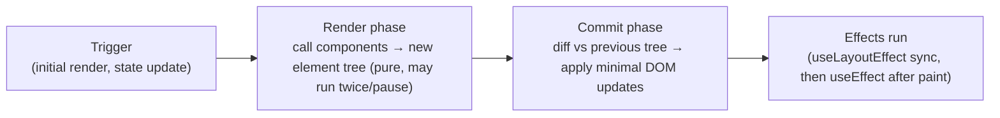

# React Complete Guide - Basic to Advanced

> **Note**: Sections marked **(Interview Imp)** are frequently asked in interviews.
>
> **How to read this file:** Every chapter has **📘 Terms Explained** tables where useful. If you see a word you don't know, check the table right below that section.
>
> **Scope:** JavaScript prerequisites, JSX, components and props, rendering and reconciliation, all core hooks and custom hooks, forms (React Hook Form + Zod), data fetching (TanStack Query), state management (Context, Zustand, Redux Toolkit), routing, rendering strategies (CSR/SSR/SSG/ISR), React Server Components and the Next.js App Router, Suspense and error boundaries, styling, TypeScript, testing, performance, accessibility, security, i18n, architecture and patterns, React internals (Fiber, hooks, concurrency), React 19, deployment, React Native overview, interview questions, projects and a learning path.
>
> **Related files:** [03_Dockerfile_and_Image_Building.md](../docker/03_Dockerfile_and_Image_Building.md#34-multi-stage-builds-interview-imp) (containerising a React app) · [DevOps_Complete_Guide.md](../devops/DevOps_Complete_Guide.md) (CI/CD) · [Java_Complete_Guide.md](../java/Java_Complete_Guide.md) (a typical backend for a React front end) · [01_Scalability_Pattern.md](../design-patterns/03_System_Design/01_Scalability_Pattern.md) (caching, CDN)

| Level | Chapters |
|---|---|
| **Beginner** | 1-3 (JS/JSX, components, props, state and hooks) |
| **Intermediate** | 4-8 (forms, data fetching, state management, routing, SSR/RSC, styling, TypeScript, testing) |
| **Advanced** | 9-13 (performance, a11y/security/i18n, architecture, internals, deployment) |
| **Mastery** | 14-18 (ecosystem, interview questions, projects, learning path, cheat sheet) |

---

## Table of Contents
1. [Getting Started with React](#1-getting-started-with-react)
   - [1.1 What is React?](#11-what-is-react)
   - [1.2 JavaScript Essentials You Need First](#12-javascript-essentials-you-need-first)
   - [1.3 Creating a Project](#13-creating-a-project)
   - [1.4 JSX](#14-jsx)
2. [Components, Props and Rendering](#2-components-props-and-rendering)
   - [2.1 Function Components and Props](#21-function-components-and-props)
   - [2.2 Rendering Lists, Conditionals, Keys](#22-rendering-lists-conditionals-keys)
   - [2.3 How React Renders (Interview Imp)](#23-how-react-renders-interview-imp)
   - [2.4 Handling Events](#24-handling-events)
3. [State and Hooks (Interview Imp)](#3-state-and-hooks-interview-imp)
   - [3.1 `useState`](#31-usestate)
   - [3.2 `useEffect` (Interview Imp)](#32-useeffect-interview-imp)
   - [3.3 `useRef`, `useLayoutEffect`, `useId`](#33-useref-uselayouteffect-useid)
   - [3.4 `useReducer` (Complex State)](#34-usereducer-complex-state)
   - [3.5 Context (Avoiding Prop Drilling)](#35-context-avoiding-prop-drilling)
   - [3.6 The Rules of Hooks (Interview Imp)](#36-the-rules-of-hooks-interview-imp)
   - [3.7 Performance Hooks: `useMemo`, `useCallback`, `memo`](#37-performance-hooks-usememo-usecallback-memo)
   - [3.8 Custom Hooks](#38-custom-hooks)
   - [3.9 Other Built-in Hooks (React 18/19)](#39-other-built-in-hooks-react-1819)
4. [Forms, Data Fetching and State Management](#4-forms-data-fetching-and-state-management)
   - [4.1 Forms](#41-forms)
   - [4.2 Data Fetching (Interview Imp)](#42-data-fetching-interview-imp)
   - [4.3 Client State Management (Interview Imp)](#43-client-state-management-interview-imp)
5. [Routing, Rendering Strategies and Frameworks (Interview Imp)](#5-routing-rendering-strategies-and-frameworks-interview-imp)
   - [5.1 Client-Side Routing (React Router)](#51-client-side-routing-react-router)
   - [5.2 Rendering Strategies](#52-rendering-strategies)
   - [5.3 React Server Components and Next.js App Router (Modern React)](#53-react-server-components-and-nextjs-app-router-modern-react)
   - [5.4 Code Splitting and Suspense](#54-code-splitting-and-suspense)
   - [5.5 Portals, Refs and Misc APIs](#55-portals-refs-and-misc-apis)
6. [Styling and UI Libraries](#6-styling-and-ui-libraries)
7. [TypeScript with React](#7-typescript-with-react)
8. [Testing, Tooling and Quality](#8-testing-tooling-and-quality)
   - [8.1 Testing Pyramid for React](#81-testing-pyramid-for-react)
   - [8.2 Tooling](#82-tooling)
9. [Performance Optimisation (Interview Imp)](#9-performance-optimisation-interview-imp)
   - [9.1 Measure First](#91-measure-first)
   - [9.2 Rendering Performance](#92-rendering-performance)
   - [9.3 Loading Performance](#93-loading-performance)
   - [9.4 Memory and Correctness Pitfalls](#94-memory-and-correctness-pitfalls)
10. [Accessibility, Security, i18n](#10-accessibility-security-i18n)
   - [10.1 Accessibility (a11y) (Interview Imp)](#101-accessibility-a11y-interview-imp)
   - [10.2 Security](#102-security)
   - [10.3 Internationalisation (i18n) and Formatting](#103-internationalisation-i18n-and-formatting)
11. [Architecture, Patterns and Project Structure](#11-architecture-patterns-and-project-structure)
   - [11.1 Folder Structure (feature-based)](#111-folder-structure-feature-based)
   - [11.2 Common Patterns](#112-common-patterns)
   - [11.3 Design System and Storybook](#113-design-system-and-storybook)
   - [11.4 Clean Component Guidelines](#114-clean-component-guidelines)
12. [React Internals (Interview Imp)](#12-react-internals-interview-imp)
   - [12.1 Elements, Components, Instances](#121-elements-components-instances)
   - [12.2 Fiber Architecture](#122-fiber-architecture)
   - [12.3 Reconciliation Heuristics](#123-reconciliation-heuristics)
   - [12.4 How Hooks Work](#124-how-hooks-work)
   - [12.5 Concurrent Features](#125-concurrent-features)
   - [12.6 Synthetic Events and Event Delegation](#126-synthetic-events-and-event-delegation)
   - [12.7 React 19 Highlights](#127-react-19-highlights)
13. [Build, Deploy and Operate](#13-build-deploy-and-operate)
14. [React Native and the Wider Ecosystem (Overview)](#14-react-native-and-the-wider-ecosystem-overview)
15. [React Interview Questions (Basic to Advanced)](#15-react-interview-questions-basic-to-advanced)
   - [15.1 Fundamentals](#151-fundamentals)
   - [15.2 Hooks](#152-hooks)
   - [15.3 Rendering and Performance](#153-rendering-and-performance)
   - [15.4 State, Data and Architecture](#154-state-data-and-architecture)
   - [15.5 Tricky Questions](#155-tricky-questions)
16. [Practice Projects by Level](#16-practice-projects-by-level)
17. [Learning Path](#17-learning-path)
18. [React Cheat Sheet](#18-react-cheat-sheet)

---

# 1. Getting Started with React

## 1.1 What is React?

**React** is a JavaScript library (created at Facebook/Meta, 2013) for building **user interfaces** from small reusable pieces called **components**. You describe *what the UI should look like for a given state*, and React efficiently updates the browser DOM when the state changes.

| Idea | Meaning |
|---|---|
| **Component-based** | UI = tree of small, reusable, self-contained functions returning markup |
| **Declarative** | `UI = f(state)`: describe the result, not DOM manipulation steps |
| **One-way data flow** | Data flows down via props; events/callbacks flow up |
| **Virtual DOM / reconciliation** | React compares the new element tree with the previous one and applies minimal real-DOM updates |
| **Learn once, write anywhere** | Web (React DOM), mobile (React Native), server rendering, desktop (Electron/Tauri) |
| **Huge ecosystem** | Next.js, Remix/React Router, Vite, TanStack Query, Redux Toolkit, Zustand, React Hook Form, shadcn/ui, MUI |

**React vs frameworks:** React is a *library* (view layer). For routing, data fetching, SSR and build tooling you add libraries or use a framework such as **Next.js** (the officially recommended full-stack choice), **React Router (Remix)**, **Expo** (native) or **Vite** (SPA tooling).

#### 📘 Terms Explained

| Term | Simple meaning |
|---|---|
| **UI library** | Code that helps you build user interfaces. |
| **Component** | Reusable piece of UI, a function that returns markup. |
| **DOM** | The browser's tree representation of the page. |
| **Virtual DOM** | In-memory description of the UI that React diffs to find real changes. |
| **SPA** | Single-Page Application: one HTML page; JavaScript updates the view. |
| **SSR / SSG** | Server-Side Rendering / Static Site Generation: HTML generated on the server/at build time. |

---

## 1.2 JavaScript Essentials You Need First

React is "just JavaScript" (or TypeScript). Know these well:

```js
const name = "Asha";  let count = 0;                    // const by default; let if reassigned
const add = (a, b) => a + b;                              // arrow function
const { id, title = "Untitled", ...rest } = post;         // destructuring + default + rest
const [first, second] = list;
const merged = { ...defaults, ...overrides };             // spread (object)
const next = [...items, newItem];                         // spread (array): copy, don't mutate
items.map(x => x * 2); items.filter(Boolean); items.reduce((s, x) => s + x, 0);
items.find(x => x.id === 3); items.some(...); items.every(...); items.includes(5); items.flatMap(...)
const msg = `Hello ${name}, you have ${count} items`;     // template literal
user?.address?.city ?? "unknown";                         // optional chaining + nullish coalescing
isAdmin && <AdminPanel />;                                // short-circuit rendering
import { useState } from "react"; export default function App() {}   // ES modules
async function load() { const res = await fetch(url); if (!res.ok) throw new Error(res.status); return res.json(); }
Promise.all([a(), b()]);  setTimeout(() => {}, 100);
Object.keys(o); Object.entries(o); structuredClone(obj); JSON.parse / stringify
```
**Concepts:** `this` is rarely needed in modern React (function components); **closures** (functions capture variables: crucial for hooks); **immutability** (create new objects/arrays instead of mutating); `===` vs `==`; truthy/falsy; event loop & promises; modules; array methods; destructuring.
**TypeScript** is strongly recommended: `type Props = { title: string; count?: number }`.

## 1.3 Creating a Project

```bash
# Recommended for SPAs: Vite
npm create vite@latest my-app -- --template react-ts
cd my-app && npm install && npm run dev            # http://localhost:5173

# Full-stack framework (routing, SSR, server components, API routes)
npx create-next-app@latest my-next-app             # App Router, TypeScript, ESLint, Tailwind

# Native: Expo
npx create-expo-app@latest
```
(`create-react-app` is deprecated; don't use it for new projects.)

```
my-app/
├── index.html            # root <div id="root">
├── package.json          # dependencies + scripts
├── vite.config.ts
├── tsconfig.json
└── src/
    ├── main.tsx          # entry: createRoot(...).render(<App />)
    ├── App.tsx
    ├── components/
    ├── hooks/
    ├── pages/ (or routes/)
    ├── api/ (services)
    └── assets/
```

```tsx
// main.tsx
import { StrictMode } from "react";
import { createRoot } from "react-dom/client";
import App from "./App";

createRoot(document.getElementById("root")!).render(
  <StrictMode>
    <App />
  </StrictMode>
);
```
`StrictMode` double-invokes renders/effects in development to expose impure code and missing cleanups. It does not affect production.

## 1.4 JSX

**JSX** is syntax that looks like HTML inside JavaScript; compiled to function calls (`jsx()` / `React.createElement`).

```tsx
function Welcome({ name, items }: { name: string; items: string[] }) {
  const isEmpty = items.length === 0;
  return (
    <section className="card" data-testid="welcome">
      <h1>Hello, {name.toUpperCase()}!</h1>                  {/* {} = any JS expression */}
      {isEmpty ? <p>No items</p> : (
        <ul>
          {items.map(item => <li key={item}>{item}</li>)}     {/* key: stable unique id */}
        </ul>
      )}
      {!isEmpty && <small>{items.length} items</small>}
      <label htmlFor="q">Search</label>
      <input id="q" style={{ color: "red" }} disabled />
      <button onClick={() => alert("hi")}>Click</button>
    </section>
  );
}
```
Rules:
- A component returns **one root element** (use a wrapper or a fragment `<>...</>`).
- Attributes are camelCase: `className`, `htmlFor`, `onClick`, `tabIndex`, `style={{ ... }}` (object).
- All tags must be closed (``, `<input />`).
- Components start with a **capital letter** (`<Card />`); lowercase = HTML element.
- JSX expressions can't contain statements (`if`, `for`); use ternaries, `&&`, `.map()`, or compute before `return`.
- `{0 && <X/>}` renders `0`! Use `count > 0 && <X/>`.
- Text is escaped by default (XSS protection); `dangerouslySetInnerHTML` bypasses it: avoid or sanitise (DOMPurify).

#### 📘 Terms Explained

| Term | Simple meaning |
|---|---|
| **JSX** | HTML-like syntax in JavaScript that compiles to React calls. |
| **Fragment** | Wrapper (`<>...</>`) that adds no DOM element. |
| **Vite** | Fast build tool and dev server. |
| **Next.js** | React framework adding routing, SSR, server components, APIs. |
| **Destructuring** | Pulling values out of objects/arrays into variables. |
| **Immutability** | Not changing data in place; creating updated copies. |
| **Key** | Special prop that gives list items stable identity. |

---

# 2. Components, Props and Rendering

## 2.1 Function Components and Props

```tsx
type ButtonProps = {
  label: string;
  variant?: "primary" | "ghost";
  disabled?: boolean;
  onClick?: (e: React.MouseEvent<HTMLButtonElement>) => void;
  children?: React.ReactNode;
} & React.ButtonHTMLAttributes<HTMLButtonElement>;      // accept native button props too

export function Button({ label, variant = "primary", children, ...rest }: ButtonProps) {
  return <button className={`btn btn-${variant}`} {...rest}>{label}{children}</button>;
}

<Button label="Save" variant="ghost" onClick={() => save()} />
```
- **Props are read-only.** A component must be a **pure function of props and state** (same inputs → same output, no side effects during render).
- `children` is the content between tags: enables **composition**.
- Default values via destructuring defaults. Spread props with `{...rest}` carefully.
- Pass functions as props to let children notify parents ("lifting events up").

```tsx
function Card({ title, footer, children }: { title: string; footer?: React.ReactNode; children: React.ReactNode }) {
  return <article><h2>{title}</h2><div>{children}</div>{footer && <footer>{footer}</footer>}</article>;
}
<Card title="Profile" footer={<a href="/edit">Edit</a>}><Avatar /><Bio /></Card>
```

**Composition over inheritance:** build complex UIs by nesting components, passing children/render props, and using hooks. Patterns: container/presentational (less relevant with hooks), compound components (`<Tabs><Tabs.List/><Tabs.Panel/></Tabs>`), render props, slots via props, headless components.

## 2.2 Rendering Lists, Conditionals, Keys

```tsx
{todos.map(t => <TodoItem key={t.id} todo={t} />)}      // key = stable unique id, NOT the array index (unless list is static)
{loading ? <Spinner /> : error ? <ErrorBox error={error} /> : <Data data={data} />}
```
**Why keys?** During reconciliation React uses keys to match old and new items. Index keys on lists that reorder/insert/delete cause state to attach to the wrong item and cause bugs/perf issues. Keys must be unique among siblings, stable across renders, not random (`Math.random()` remounts every time).

## 2.3 How React Renders (Interview Imp)


1. **Trigger:** `setState`, parent re-render, context change, or initial `root.render`.
2. **Render:** React calls your component functions to compute the new UI description. This must be pure.
3. **Reconciliation:** compares trees (same type + position → update; different type → unmount/remount; keys identify list items). Heuristic O(n).
4. **Commit:** applies DOM changes; refs attached; effects scheduled.

**Re-render rules:** a component re-renders when its **state changes**, its **parent re-renders** (even with the same props, unless memoised), or a **context it consumes changes**. Re-render ≠ DOM update: React only touches DOM nodes that changed. Fiber architecture enables **concurrent rendering**: React can pause/interrupt low-priority renders (transitions) to keep the UI responsive.

**Batching:** multiple `setState` calls in an event handler/effect/promise are batched into one render (React 18+).

## 2.4 Handling Events

```tsx
function Form() {
  const [value, setValue] = useState("");
  function handleSubmit(e: React.FormEvent<HTMLFormElement>) {
    e.preventDefault();                                   // stop full page reload
    console.log(value);
  }
  return (
    <form onSubmit={handleSubmit}>
      <input value={value} onChange={e => setValue(e.target.value)} />
      <button type="submit">Send</button>
    </form>
  );
}
```
- Events are **synthetic** (cross-browser wrappers), camelCase; pass a **function**, don't call it: `onClick={handle}` or `onClick={() => handle(id)}`, not `onClick={handle(id)}`.
- `e.stopPropagation()` stops bubbling; `e.preventDefault()` stops default behaviour.
- Capture phase variants: `onClickCapture`. Common types: `ChangeEvent`, `KeyboardEvent`, `FocusEvent`, `MouseEvent`.

#### 📘 Terms Explained

| Term | Simple meaning |
|---|---|
| **Props** | Inputs passed from a parent to a child component. |
| **Pure function** | Same inputs always give the same output with no side effects. |
| **Composition** | Building complex components by combining simpler ones. |
| **Reconciliation** | Diffing the new tree against the old to find minimal updates. |
| **Fiber** | React's internal work scheduling engine enabling interruptible rendering. |
| **Batching** | Grouping several state updates into a single render. |
| **Synthetic event** | React's wrapper around native browser events. |
| **Bubbling** | Event moving up from the target through its ancestors. |

---

# 3. State and Hooks (Interview Imp)

## 3.1 `useState`

```tsx
const [count, setCount] = useState(0);                    // [value, setter]
setCount(count + 1);                                      // uses the value captured in this render
setCount(prev => prev + 1);                               // functional update: use when new value depends on previous
const [user, setUser] = useState<User | null>(null);
const [form, setForm] = useState({ name: "", email: "" });
setForm(f => ({ ...f, name: "Asha" }));                   // objects/arrays: never mutate, replace
const [data] = useState(() => expensiveInit());           // lazy initializer: runs once
```
- **State is a snapshot:** within one render `count` is constant; `setCount(count+1)` three times adds 1, not 3 (use updater form for 3).
- Setting state **schedules** a re-render; it doesn't change the variable immediately.
- If the new value is identical (`Object.is`), React skips re-rendering.
- Keep state **minimal** (derive the rest during render), avoid duplicated/contradictory state, group related values, flatten deep structures.
- Don't store derived data in state:

```tsx
const [items, setItems] = useState<Item[]>([]);
const total = items.reduce((s, i) => s + i.price, 0);     // derive, don't store
```

### Updating arrays and objects immutably
```tsx
setList(l => [...l, item]);                               // add
setList(l => l.filter(x => x.id !== id));                 // remove
setList(l => l.map(x => x.id === id ? { ...x, done: true } : x));   // update
setUser(u => ({ ...u, address: { ...u.address, city: "Pune" } }));  // nested
```
For deep structures use **Immer** (`useImmerReducer`, Redux Toolkit uses it).

## 3.2 `useEffect` (Interview Imp)

Effects **synchronise your component with something outside React** (network, subscriptions, timers, DOM APIs, third-party widgets). They run **after render/commit**.

```tsx
useEffect(() => {
  const id = setInterval(() => setTick(t => t + 1), 1000);
  return () => clearInterval(id);                          // cleanup: runs before next effect and on unmount
}, []);                                                    // dependency array

useEffect(() => {
  const ctrl = new AbortController();
  fetch(`/api/users/${userId}`, { signal: ctrl.signal })
    .then(r => r.json()).then(setUser).catch(e => { if (e.name !== "AbortError") setError(e); });
  return () => ctrl.abort();                               // avoid race conditions / setState after unmount
}, [userId]);                                              // re-run when userId changes
```
| Dependency array | Runs |
|---|---|
| none | After **every** render |
| `[]` | Once after mount (and cleanup on unmount) |
| `[a, b]` | After mount and whenever `a` or `b` changed |

Rules:
- Include **every reactive value** used inside (props, state, derived values) in deps (ESLint `react-hooks/exhaustive-deps`). Don't lie about dependencies.
- Effects aren't lifecycle methods; think "synchronise X with these values".
- In dev StrictMode effects run **setup → cleanup → setup** once to verify you've written proper cleanup.
- **You might not need an effect:** don't use effects to (a) derive state from props/state (compute during render), (b) handle user events (use handlers), (c) reset state on prop change (use `key`), (d) chain state updates, (e) fetch data in production code without caching (use TanStack Query/RSC/framework loaders).
- Race conditions in fetch effects: ignore stale responses (flag or AbortController).

## 3.3 `useRef`, `useLayoutEffect`, `useId`

```tsx
const inputRef = useRef<HTMLInputElement>(null);
useEffect(() => inputRef.current?.focus(), []);
<input ref={inputRef} />

const renders = useRef(0); renders.current++;             // mutable box that survives renders and does NOT trigger re-render
const prev = useRef(value); useEffect(() => { prev.current = value; });   // previous value
```
- `useRef` for DOM nodes, timers IDs, latest-value holders, instance-like variables.
- `useLayoutEffect` runs synchronously after DOM mutations **before paint** (measure layout, prevent flicker); blocks painting so use sparingly. `useId` generates stable IDs for accessibility attributes (SSR-safe). `useImperativeHandle` + `forwardRef` (React 19: `ref` is a normal prop) expose methods to parents.

## 3.4 `useReducer` (Complex State)

```tsx
type State = { items: Item[]; status: "idle" | "loading" | "error" };
type Action =
  | { type: "added"; item: Item }
  | { type: "removed"; id: string }
  | { type: "loaded"; items: Item[] };

function reducer(state: State, action: Action): State {
  switch (action.type) {
    case "added":   return { ...state, items: [...state.items, action.item] };
    case "removed": return { ...state, items: state.items.filter(i => i.id !== action.id) };
    case "loaded":  return { items: action.items, status: "idle" };
  }
}
const [state, dispatch] = useReducer(reducer, { items: [], status: "idle" });
dispatch({ type: "removed", id: "7" });
```
Use when many related transitions exist, next state depends on previous, or logic should be testable/pure. A reducer is a pure function `(state, action) → newState`, the same idea as Redux.

## 3.5 Context (Avoiding Prop Drilling)

```tsx
type Theme = "light" | "dark";
const ThemeContext = createContext<{ theme: Theme; toggle: () => void } | null>(null);

export function ThemeProvider({ children }: { children: React.ReactNode }) {
  const [theme, setTheme] = useState<Theme>("light");
  const value = useMemo(() => ({ theme, toggle: () => setTheme(t => t === "light" ? "dark" : "light") }), [theme]);
  return <ThemeContext value={value}>{children}</ThemeContext>;      // React 19: <Context> directly; earlier: <Context.Provider>
}
export function useTheme() {
  const ctx = useContext(ThemeContext);
  if (!ctx) throw new Error("useTheme must be used inside ThemeProvider");
  return ctx;
}
const { theme, toggle } = useTheme();
```
- Every consumer re-renders when the context **value** changes (new object each render → everyone re-renders; memoise the value).
- Good for low-frequency global data: theme, locale, current user, feature flags. For frequently changing or large state use a state library (Zustand, Redux Toolkit, Jotai) or split contexts.

## 3.6 The Rules of Hooks (Interview Imp)

1. Call hooks **only at the top level** of a component or custom hook (not in loops, conditions, nested functions, after early returns).
2. Call hooks **only from React function components or custom hooks**.
Reason: React identifies each hook by **call order** within a component; changing order corrupts state.

## 3.7 Performance Hooks: `useMemo`, `useCallback`, `memo`

```tsx
const sorted = useMemo(() => [...items].sort(byName), [items]);       // cache an expensive computation
const handleSave = useCallback((id: string) => save(id), [save]);      // stable function identity
const Row = memo(function Row({ item, onSelect }: RowProps) { ... });   // skip re-render if props are shallow-equal
```
- `memo`/`useMemo`/`useCallback` are **optimisations**, not semantics; measure first (React DevTools Profiler). Use when: passing callbacks/objects to memoised children, or truly expensive computations, or stable deps for effects.
- Premature memoisation adds complexity and memory cost. **React Compiler** (stable since React 19-era tooling) auto-memoises code that follows the Rules of React, reducing manual memoisation.
- Cheaper fixes first: move state down, lift content up (children props), split components, avoid creating new objects in props when passing to memoised children, virtualise long lists.

## 3.8 Custom Hooks

Reusable stateful logic = a function whose name starts with `use` that calls other hooks.

```tsx
function useLocalStorage<T>(key: string, initial: T) {
  const [value, setValue] = useState<T>(() => {
    try { const raw = localStorage.getItem(key); return raw ? (JSON.parse(raw) as T) : initial; }
    catch { return initial; }
  });
  useEffect(() => { localStorage.setItem(key, JSON.stringify(value)); }, [key, value]);
  return [value, setValue] as const;
}

function useDebounce<T>(value: T, ms = 300) {
  const [v, setV] = useState(value);
  useEffect(() => { const id = setTimeout(() => setV(value), ms); return () => clearTimeout(id); }, [value, ms]);
  return v;
}

function useFetch<T>(url: string) {
  const [state, setState] = useState<{ data?: T; error?: Error; loading: boolean }>({ loading: true });
  useEffect(() => {
    const ctrl = new AbortController();
    setState({ loading: true });
    fetch(url, { signal: ctrl.signal })
      .then(r => { if (!r.ok) throw new Error(String(r.status)); return r.json() as Promise<T>; })
      .then(data => setState({ data, loading: false }))
      .catch(error => { if (error.name !== "AbortError") setState({ error, loading: false }); });
    return () => ctrl.abort();
  }, [url]);
  return state;
}
```
Each call of a custom hook has **its own independent state**. Share logic, not state (shared state needs context/store).

## 3.9 Other Built-in Hooks (React 18/19)

| Hook | Purpose |
|---|---|
| `useTransition` / `startTransition` | Mark updates as non-urgent so typing stays responsive while heavy UI updates in the background |
| `useDeferredValue` | Defer re-rendering of a value (lagging copy) |
| `useSyncExternalStore` | Subscribe to external stores safely (used by libraries) |
| `useId` | Unique stable ids |
| `useActionState`, `useFormStatus`, `useOptimistic` (React 19) | Form actions, pending state, optimistic UI |
| `use(promise or context)` (React 19) | Read a promise/context during render (with Suspense) |
| `useInsertionEffect` | CSS-in-JS libraries |
| `useDebugValue` | DevTools labels for custom hooks |

#### 📘 Terms Explained

| Term | Simple meaning |
|---|---|
| **Hook** | Function (`useX`) that lets components use React features like state and effects. |
| **State** | Data that changes over time and triggers re-renders. |
| **Effect** | Code that synchronises the component with an external system after rendering. |
| **Cleanup function** | Function returned from an effect to undo it. |
| **Ref** | Mutable container that persists across renders without causing re-render. |
| **Reducer** | Pure function computing next state from current state and an action. |
| **Context** | Mechanism to pass data deep in the tree without props. |
| **Prop drilling** | Passing props through many layers that don't need them. |
| **Memoization** | Caching results to avoid recomputation. |
| **Stale closure** | A function using outdated values captured from an earlier render. |
| **Custom hook** | Your own `useXxx` function reusing hook logic. |

---

# 4. Forms, Data Fetching and State Management

## 4.1 Forms

### Controlled components (React owns the value)
```tsx
function SignUp() {
  const [form, setForm] = useState({ email: "", password: "", agree: false });
  const [errors, setErrors] = useState<Record<string, string>>({});

  const onChange = (e: React.ChangeEvent<HTMLInputElement>) => {
    const { name, type, value, checked } = e.target;
    setForm(f => ({ ...f, [name]: type === "checkbox" ? checked : value }));
  };

  const onSubmit = async (e: React.FormEvent) => {
    e.preventDefault();
    const errs: Record<string, string> = {};
    if (!/^\S+@\S+\.\S+$/.test(form.email)) errs.email = "Invalid email";
    if (form.password.length < 8) errs.password = "Min 8 characters";
    setErrors(errs);
    if (Object.keys(errs).length) return;
    await api.signUp(form);
  };

  return (
    <form onSubmit={onSubmit} noValidate>
      <input name="email" type="email" value={form.email} onChange={onChange} aria-invalid={!!errors.email} />
      {errors.email && <p role="alert">{errors.email}</p>}
      <input name="password" type="password" value={form.password} onChange={onChange} />
      <label><input name="agree" type="checkbox" checked={form.agree} onChange={onChange} /> I agree</label>
      <button disabled={!form.agree}>Create account</button>
    </form>
  );
}
```
**Uncontrolled components:** the DOM keeps the value; read via ref or `FormData` (`new FormData(e.currentTarget)`), cheaper for large forms.

### Libraries (recommended for real forms)
**React Hook Form** (uncontrolled-first, minimal re-renders) + **Zod** schema validation:

```tsx
import { useForm } from "react-hook-form";
import { zodResolver } from "@hookform/resolvers/zod";
import { z } from "zod";

const schema = z.object({
  email: z.string().email(),
  age: z.coerce.number().int().min(18),
});
type FormValues = z.infer<typeof schema>;

function Profile() {
  const { register, handleSubmit, formState: { errors, isSubmitting } } = useForm<FormValues>({ resolver: zodResolver(schema) });
  return (
    <form onSubmit={handleSubmit(async v => { await save(v); })}>
      <input {...register("email")} />{errors.email?.message}
      <input type="number" {...register("age")} />{errors.age?.message}
      <button disabled={isSubmitting}>Save</button>
    </form>
  );
}
```
Alternatives: Formik, TanStack Form, native form actions (React 19 / Next.js Server Actions with `useActionState`). Always validate **on the server too**. Accessibility: labels, `aria-invalid`, `aria-describedby`, focus the first error, keyboard support.

## 4.2 Data Fetching (Interview Imp)

**Server state** (data owned by a backend: cached, async, shared, can be stale) is different from **client/UI state** (modal open, input text). Don't put server state in `useState` + `useEffect` by hand in production: you'd reimplement caching, deduplication, retries, pagination, optimistic updates, and race-condition handling.

**TanStack Query (React Query)**:
```tsx
const queryClient = new QueryClient();
<QueryClientProvider client={queryClient}><App /></QueryClientProvider>

function Users() {
  const { data, isPending, isError, error, refetch } = useQuery({
    queryKey: ["users", { page }],                  // cache key; array form includes params
    queryFn: ({ signal }) => api.getUsers(page, signal),
    staleTime: 60_000,                              // fresh for 60s: no refetch
    placeholderData: keepPreviousData,              // smooth pagination
  });
  if (isPending) return <Spinner />;
  if (isError) return <ErrorBox error={error} onRetry={refetch} />;
  return <UserList users={data} />;
}

const qc = useQueryClient();
const mutation = useMutation({
  mutationFn: api.updateUser,
  onMutate: async (vars) => {                       // optimistic update
    await qc.cancelQueries({ queryKey: ["users"] });
    const prev = qc.getQueryData(["users"]);
    qc.setQueryData(["users"], (old: User[]) => old.map(u => u.id === vars.id ? { ...u, ...vars } : u));
    return { prev };
  },
  onError: (_e, _v, ctx) => qc.setQueryData(["users"], ctx?.prev),
  onSettled: () => qc.invalidateQueries({ queryKey: ["users"] }),
});
```
Features: caching, background refetch on focus/reconnect, retries with backoff, request deduplication, pagination & infinite queries, prefetching, SSR hydration, devtools. Alternatives: **SWR**, **Apollo Client / urql / Relay** (GraphQL), **RTK Query**, **tRPC**, and framework data loading (Next.js Server Components, React Router loaders).

### Fetch best practices
- Check `res.ok`; `fetch` doesn't reject on 4xx/5xx. Handle loading, error, empty, and success states explicitly.
- Use AbortController to cancel; handle race conditions; set timeouts.
- Centralise API calls (`api/` layer; axios/ky wrappers) with typed responses and error mapping; validate responses (Zod) at the boundary.
- Auth: prefer **httpOnly, Secure, SameSite cookies** over localStorage tokens (XSS exposure); refresh tokens server-side.
- Pagination: cursor-based > offset for large data; infinite scroll with IntersectionObserver.
- Real-time: WebSocket, SSE, polling (`refetchInterval`), libraries like Socket.IO.

## 4.3 Client State Management (Interview Imp)

| Need | Tool |
|---|---|
| Local UI state | `useState` / `useReducer` |
| Share a little state nearby | **Lift state up** to the closest common parent |
| Rarely changing global values | **Context** |
| Shared client state (cart, UI prefs, wizard) | **Zustand** (tiny, hooks, no boilerplate), **Jotai/Recoil** (atoms), **Valtio** (proxy) |
| Large apps needing strict patterns, devtools, middleware | **Redux Toolkit** (+ RTK Query) |
| Server state | **TanStack Query / SWR / RTK Query** |
| URL state (filters, tabs, pagination) | Query string via router (`useSearchParams`), `nuqs` |
| Form state | React Hook Form |
| Finite state machines | XState |

```tsx
// Zustand
import { create } from "zustand";
type CartState = { items: Item[]; add: (i: Item) => void; total: () => number };
export const useCart = create<CartState>((set, get) => ({
  items: [],
  add: i => set(s => ({ items: [...s.items, i] })),
  total: () => get().items.reduce((s, i) => s + i.price, 0),
}));
const items = useCart(s => s.items);              // selector: re-render only when `items` changes
```
```tsx
// Redux Toolkit
const cartSlice = createSlice({
  name: "cart",
  initialState: { items: [] as Item[] },
  reducers: {
    added(state, action: PayloadAction<Item>) { state.items.push(action.payload); },   // Immer allows "mutating" syntax
    removed(state, action: PayloadAction<string>) { state.items = state.items.filter(i => i.id !== action.payload); },
  },
});
export const store = configureStore({ reducer: { cart: cartSlice.reducer } });
const items = useSelector((s: RootState) => s.cart.items);   const dispatch = useDispatch();
```
Guidance: **keep state as local as possible**; derive instead of duplicate; separate server vs client state; normalise relational data; use selectors to avoid unnecessary renders.

#### 📘 Terms Explained

| Term | Simple meaning |
|---|---|
| **Controlled component** | Form input whose value is driven by React state. |
| **Server state** | Data that lives on the server and is cached on the client. |
| **Stale-while-revalidate** | Show cached data immediately while refetching in the background. |
| **Optimistic update** | Updating the UI before the server confirms, rolling back on failure. |
| **Selector** | Function picking a slice of store state, limiting re-renders. |
| **Schema validation** | Checking data matches a declared shape (Zod). |
| **Race condition** | Older response arriving after a newer one and overwriting it. |

---

# 5. Routing, Rendering Strategies and Frameworks (Interview Imp)

## 5.1 Client-Side Routing (React Router)

```tsx
import { createBrowserRouter, RouterProvider, Link, NavLink, Outlet, useParams, useNavigate, useSearchParams, Navigate } from "react-router-dom";

const router = createBrowserRouter([
  {
    path: "/", element: <Layout />, errorElement: <ErrorPage />,
    children: [
      { index: true, element: <Home /> },
      { path: "products", element: <Products /> },
      { path: "products/:id", element: <ProductDetail />, loader: ({ params }) => fetchProduct(params.id!) },
      { path: "admin", element: <RequireAuth><Admin /></RequireAuth> },
      { path: "*", element: <NotFound /> },
    ],
  },
]);
<RouterProvider router={router} />

function Layout() { return (<><Nav /><main><Outlet /></main></>); }         // Outlet renders the matched child
function ProductDetail() { const { id } = useParams(); const nav = useNavigate(); const [sp, setSp] = useSearchParams(); ... }
```
Concepts: nested routes/layouts, dynamic params, search params, `Link` (no full reload), protected routes, lazy routes (code splitting), loaders/actions (data APIs), 404 handling, scroll restoration. Alternative: **TanStack Router** (type-safe).

## 5.2 Rendering Strategies

| Strategy | HTML generated | Pros | Cons | Use |
|---|---|---|---|---|
| **CSR** (client-side rendering) | In the browser | Simple hosting, rich interactivity | Slow first paint, weak SEO, JS required | Dashboards behind login |
| **SSR** (server-side rendering) | On the server **per request** | Fast first content, SEO, fresh data | Server cost, TTFB | Personalised pages, SEO |
| **SSG** (static site generation) | At **build time** | Fastest, CDN-cacheable, cheap | Stale until rebuild | Docs, marketing, blogs |
| **ISR** (incremental static regeneration) | Static + revalidated in the background | Static speed with freshness | Framework-specific | Catalogs, news |
| **Streaming SSR + Suspense** | Progressive chunks | Faster perceived load | Complexity | Large pages |
| **Islands / partial hydration** | Static HTML + interactive islands | Less JS | Different frameworks (Astro) | Content sites |

**Hydration:** React attaches event handlers to server-rendered HTML in the browser. Mismatches between server and client HTML cause hydration errors (avoid `Date.now()`, `Math.random()`, `window` access during render).

**Core Web Vitals:** LCP (loading), INP (interactivity, replaced FID), CLS (visual stability).

## 5.3 React Server Components and Next.js App Router (Modern React)

**Server Components (RSC)** run **only on the server** (never shipped to the browser): they can `await` data, access databases/secrets directly, and send serialized UI to the client with zero client JS for those components. **Client Components** (`"use client"`) run in the browser for state, effects, events, browser APIs.

```tsx
// app/products/page.tsx  — Server Component by default
import { db } from "@/lib/db";
export default async function ProductsPage({ searchParams }: { searchParams: Promise<{ q?: string }> }) {
  const { q } = await searchParams;
  const products = await db.product.findMany({ where: { name: { contains: q } } });   // direct DB call, runs on server
  return (<ul>{products.map(p => <li key={p.id}>{p.name} <AddToCart id={p.id} /></li>)}</ul>);
}

// components/AddToCart.tsx
"use client";
import { useState } from "react";
export function AddToCart({ id }: { id: string }) {
  const [pending, setPending] = useState(false);
  return <button onClick={async () => { setPending(true); await addToCart(id); setPending(false); }}>{pending ? "…" : "Add"}</button>;
}

// app/actions.ts — Server Action
"use server";
export async function addToCart(id: string) { await db.cart.add(id); revalidatePath("/cart"); }
```
Next.js App Router features: file-based routing (`app/page.tsx`, `layout.tsx`, `loading.tsx`, `error.tsx`, `not-found.tsx`, `route.ts` API handlers, dynamic `[id]`, route groups), nested layouts, streaming with `<Suspense>`, caching & revalidation (`fetch` options, `revalidatePath/Tag`), middleware, image/font optimisation, metadata API (SEO), Server Actions, parallel/intercepting routes, edge vs Node runtimes.
Rules: server components can't use state/effects/browser APIs; a client component can't import a server component (but can receive it as `children`); pass only **serializable** props across the boundary; keep `"use client"` boundaries small ("leaf" interactivity).

Other frameworks: **Remix / React Router v7** (loaders/actions, web standards), **Astro** (islands), **Gatsby** (legacy SSG), **Expo / React Native** (mobile), **TanStack Start**.

## 5.4 Code Splitting and Suspense

```tsx
const Settings = lazy(() => import("./Settings"));                 // loaded only when rendered
<Suspense fallback={<Spinner />}><Settings /></Suspense>
```
Suspense shows a fallback while children wait (lazy code, data via `use`, RSC streaming, TanStack Query suspense mode). **Error Boundaries** catch render errors in the tree below (class components or `react-error-boundary`): they don't catch event-handler or async errors.

```tsx
import { ErrorBoundary } from "react-error-boundary";
<ErrorBoundary fallbackRender={({ error, resetErrorBoundary }) => <Retry error={error} onRetry={resetErrorBoundary} />}>
  <Suspense fallback={<Skeleton />}><Dashboard /></Suspense>
</ErrorBoundary>
```

## 5.5 Portals, Refs and Misc APIs
`createPortal(children, document.body)` renders modals/tooltips outside parent DOM hierarchy while keeping React tree/events; `forwardRef`/ref-as-prop; `Children`/`cloneElement` (rare); `lazy`; `memo`; `startTransition`; `flushSync`; `React.Profiler`.

#### 📘 Terms Explained

| Term | Simple meaning |
|---|---|
| **CSR / SSR / SSG / ISR** | Render in browser / per request on server / at build / static with background refresh. |
| **Hydration** | Making server-rendered HTML interactive in the browser. |
| **Server Component** | Component rendered only on the server, sending no JS to the client. |
| **Server Action** | Server function callable directly from client code (forms/events). |
| **Suspense** | Boundary showing a fallback while content is loading. |
| **Error boundary** | Component catching rendering errors in its subtree. |
| **Code splitting** | Loading JavaScript in smaller chunks on demand. |
| **Portal** | Render children into a different DOM node. |
| **Core Web Vitals** | Google's loading/interactivity/visual-stability metrics. |

---

# 6. Styling and UI Libraries

| Approach | Notes |
|---|---|
| **Plain CSS / CSS Modules** (`Button.module.css`) | Scoped class names, zero runtime, simple |
| **Tailwind CSS** | Utility classes in JSX (`className="px-4 py-2 rounded bg-blue-600 hover:bg-blue-700"`), design tokens, tiny CSS output, very popular |
| **CSS-in-JS** (styled-components, Emotion) | Dynamic styles in JS; runtime cost and RSC friction; declining |
| **Zero-runtime CSS-in-JS** (vanilla-extract, Panda CSS, StyleX, Linaria) | Type-safe, compiled to CSS |
| **Component libraries** | **shadcn/ui** (copy-paste Radix + Tailwind components), **MUI**, **Chakra**, **Ant Design**, **Mantine**, **Radix UI / React Aria / Headless UI** (unstyled accessible primitives) |
| **Design tokens, theming** | CSS variables, dark mode via `prefers-color-scheme` / class strategy |
| **Animations** | CSS transitions, **Framer Motion (motion)**, React Spring, View Transitions API |

```tsx
import clsx from "clsx";
<button className={clsx("btn", { "btn-primary": primary, "opacity-50": disabled })} />
```
Tips: mobile-first responsive design (flex/grid, media/container queries), semantic HTML, accessible colour contrast, avoid inline styles for everything, consistent spacing scale, `rem` units, respect `prefers-reduced-motion`.

---

# 7. TypeScript with React

```tsx
type User = { id: string; name: string; role: "admin" | "user"; email?: string };

// props & children
type CardProps = React.PropsWithChildren<{ title: string }>;
// events
const onChange = (e: React.ChangeEvent<HTMLInputElement>) => {};
const onSubmit = (e: React.FormEvent<HTMLFormElement>) => {};
// hooks
const [user, setUser] = useState<User | null>(null);
const ref = useRef<HTMLDivElement>(null);
const [state, dispatch] = useReducer(reducer, init);      // typed via reducer
// generic components
function List<T>({ items, render }: { items: T[]; render: (item: T) => React.ReactNode }) {
  return <ul>{items.map((it, i) => <li key={i}>{render(it)}</li>)}</ul>;
}
// discriminated unions for variants/state machines
type Async<T> = { status: "idle" } | { status: "loading" } | { status: "error"; error: Error } | { status: "success"; data: T };
// polymorphic "as" prop, ComponentProps utility
type InputProps = React.ComponentProps<"input"> & { label: string };
// utility types
Partial<User>; Pick<User, "id" | "name">; Omit<User, "email">; Record<string, number>; ReturnType<typeof fn>; Awaited<Promise<X>>;
```
`satisfies`, `as const`, strict mode (`"strict": true`), `unknown` over `any`, runtime validation at boundaries (Zod) since types vanish at run time. Avoid `React.FC` unless needed (children typing nuance); use explicit props.

---

# 8. Testing, Tooling and Quality

## 8.1 Testing Pyramid for React

| Type | Tools | What |
|---|---|---|
| **Unit / component** | **Vitest** (or Jest) + **React Testing Library** + `@testing-library/user-event` | Behaviour from the user's perspective |
| **Integration** | RTL + **MSW** (Mock Service Worker for API mocking) | Components + data fetching |
| **End-to-end** | **Playwright**, Cypress | Real browser flows |
| **Visual** | Storybook + Chromatic, Playwright screenshots | UI regressions |
| **Accessibility** | `jest-axe`, axe-core, Lighthouse, eslint-plugin-jsx-a11y | WCAG issues |
| **Type & lint** | TypeScript, ESLint, Prettier | Static checks |

```tsx
import { render, screen } from "@testing-library/react";
import userEvent from "@testing-library/user-event";
import { describe, it, expect, vi } from "vitest";

describe("Counter", () => {
  it("increments", async () => {
    const user = userEvent.setup();
    render(<Counter />);
    await user.click(screen.getByRole("button", { name: /increment/i }));    // query by role/label like a user
    expect(screen.getByText("Count: 1")).toBeInTheDocument();
  });

  it("calls onSave with form data", async () => {
    const onSave = vi.fn();
    render(<Form onSave={onSave} />);
    await userEvent.type(screen.getByLabelText(/email/i), "a@b.com");
    await userEvent.click(screen.getByRole("button", { name: /save/i }));
    expect(onSave).toHaveBeenCalledWith({ email: "a@b.com" });
  });

  it("shows data after loading", async () => {
    server.use(http.get("/api/users", () => HttpResponse.json([{ id: 1, name: "Asha" }])));   // MSW
    render(<Users />);
    expect(await screen.findByText("Asha")).toBeInTheDocument();                              // async query
  });
});
```
Principles: test **behaviour, not implementation** (avoid testing state or internal methods); prefer `getByRole`/`getByLabelText`; avoid snapshots for large trees; mock the network boundary, not React; use `act` implicitly through RTL; test hooks with `renderHook`.

## 8.2 Tooling
- **Build:** Vite (esbuild/Rollup, Rolldown), Next.js (Turbopack), webpack (legacy), SWC/Babel; Bun/pnpm/npm/yarn for packages.
- **Quality:** ESLint (`eslint-plugin-react-hooks`, `jsx-a11y`), Prettier, TypeScript, Husky + lint-staged, Commitlint.
- **Dev:** React DevTools (components + Profiler), Storybook, Redux/Query devtools, Chrome DevTools (Performance, Lighthouse).
- **Monorepo:** Turborepo, Nx, pnpm workspaces.
- **CI:** lint → typecheck → test → build → e2e → deploy (Vercel, Netlify, Cloudflare Pages, Docker/Nginx, S3+CloudFront).

---

# 9. Performance Optimisation (Interview Imp)

## 9.1 Measure First
- **React DevTools Profiler:** record interactions; see which components rendered and why ("Why did this render?"), render time.
- Browser **Performance** panel and **Lighthouse**; **web-vitals** library (LCP, INP, CLS); bundle analysers (`rollup-plugin-visualizer`, `@next/bundle-analyzer`, `source-map-explorer`).
- Real-user monitoring (Sentry, Datadog RUM, Vercel Analytics).

## 9.2 Rendering Performance

| Technique | When |
|---|---|
| **Move state down** (colocate) | State used by a small subtree shouldn't re-render siblings |
| **Lift content up / `children` pattern** | Pass static content as children so it isn't re-created when wrapper state changes |
| **`React.memo`** | Expensive child with stable props |
| **`useMemo` / `useCallback`** | Expensive derived values; stable props for memoised children or effect deps |
| **Split context / use selectors** (Zustand/Redux) | Avoid re-rendering all consumers |
| **Avoid new object/array/function props in hot paths** | With memoised children |
| **Stable keys** | Prevent remounts |
| **Virtualisation / windowing** (`react-window`, `@tanstack/react-virtual`) | Lists/tables with thousands of rows |
| **`useTransition` / `useDeferredValue`** | Keep input responsive while heavy results render |
| **Debounce/throttle** | Search inputs, resize, scroll handlers |
| **Avoid inline heavy computations in render** | Move out or memoise |
| **Lazy-load offscreen/rarely used UI** | `lazy` + `Suspense` |
| **React Compiler** | Automatic memoisation |
| **Avoid layout thrash** | Batch DOM reads/writes; `useLayoutEffect` sparingly |
| **Production build** | Dev mode is much slower (StrictMode, warnings) |

## 9.3 Loading Performance
- **Code split** by route and by heavy component (charts, editors); dynamic `import()`.
- **Tree shake**: import only what you use (`import debounce from "lodash/debounce"` or `lodash-es`); avoid huge libs (moment → date-fns/Day.js/Temporal).
- **Images:** responsive `srcset`, modern formats (AVIF/WebP), lazy loading (`loading="lazy"`), set width/height (prevents CLS), Next.js `<Image>`, CDN.
- **Fonts:** `font-display: swap`, subset, preload; **preload/prefetch** critical resources.
- **SSR/SSG/streaming/RSC** reduce JS and time to content; **HTTP caching** (immutable hashed assets), compression (Brotli), HTTP/2/3, CDN.
- Reduce third-party scripts; defer analytics.
- Avoid request waterfalls: fetch in parallel (`Promise.all`), prefetch on hover, route loaders.

## 9.4 Memory and Correctness Pitfalls
- Always **clean up** effects (timers, listeners, subscriptions, observers, WebSockets).
- Avoid storing huge objects in state; avoid leaks from closures retained by global listeners.
- Don't mutate state/props; don't read/write refs during render; keep render pure.
- Stale closures: use functional updates, refs for latest values, correct deps.

---

# 10. Accessibility, Security, i18n

## 10.1 Accessibility (a11y) (Interview Imp)
- **Semantic HTML first**: `<button>`, `<a href>`, `<nav>`, `<main>`, `<label>`, headings in order, lists, tables. Don't make `<div onClick>` buttons.
- **Keyboard**: everything operable via keyboard, visible focus styles, logical tab order, trap focus in modals and restore it on close, Escape to close.
- **ARIA** only when semantics are missing: `aria-label`, `aria-labelledby`, `aria-describedby`, `aria-live` for dynamic announcements, `role="dialog"` + `aria-modal`. "No ARIA is better than bad ARIA."
- Forms: labels bound to inputs, error messages tied with `aria-describedby`, `aria-invalid`.
- Images: meaningful `alt` (empty `alt=""` for decorative). Colour contrast ≥ 4.5:1 (WCAG AA), don't rely on colour alone, respect `prefers-reduced-motion`, text resizing/zoom.
- Tools: `eslint-plugin-jsx-a11y`, axe DevTools, Lighthouse, screen readers (NVDA, VoiceOver), Testing Library roles queries, Storybook a11y addon. Use accessible primitives (Radix, React Aria, Headless UI).
- Route changes in SPAs: manage focus and document title; announce updates.

## 10.2 Security
| Risk | React-specific guidance |
|---|---|
| **XSS** | JSX escapes by default. Avoid `dangerouslySetInnerHTML` (sanitise with DOMPurify); validate URLs (`javascript:` in `href`); beware third-party markdown/HTML rendering; set a **Content-Security-Policy** |
| **Token storage** | Avoid long-lived tokens in `localStorage`; prefer httpOnly+Secure+SameSite cookies; short-lived access tokens; CSRF protection when using cookies (SameSite, CSRF tokens) |
| **Secrets** | **Anything bundled in client JS is public**: never put API secrets in React code or `NEXT_PUBLIC_*`/`VITE_*` env vars; call secrets from the server/BFF |
| **Dependencies** | `npm audit`, Dependabot/Renovate, lockfiles, avoid abandoned packages, review postinstall scripts, supply-chain protections |
| **Auth/authorisation** | Client checks are UX only; enforce authorisation on the server for every request |
| **Clickjacking, CORS** | `X-Frame-Options`/CSP `frame-ancestors`; configure CORS on the server narrowly |
| **Open redirects, SSRF (server components)** | Validate redirect targets; restrict fetch hosts |
| **Data exposure in RSC props / serialised state** | Don't pass secrets or entire DB rows to client components |

## 10.3 Internationalisation (i18n) and Formatting
Libraries: **react-i18next**, **FormatJS/react-intl**, **next-intl**, Lingui. Use ICU message format (plurals, gender), externalised strings, locale-aware `Intl.DateTimeFormat`, `Intl.NumberFormat`, `Intl.RelativeTimeFormat`, RTL support (`dir="rtl"`, logical CSS properties), lazy-load translations, avoid string concatenation for sentences.

---

# 11. Architecture, Patterns and Project Structure

## 11.1 Folder Structure (feature-based)

```
src/
├── app/ (providers, router, store setup)
├── features/
│   ├── auth/
│   │   ├── components/ LoginForm.tsx
│   │   ├── hooks/ useLogin.ts
│   │   ├── api.ts          # service calls + query keys
│   │   ├── types.ts
│   │   └── index.ts        # public API of the feature
│   ├── products/ ...
│   └── cart/ ...
├── components/ui/          # design-system primitives (Button, Modal, Input)
├── hooks/                  # shared hooks
├── lib/                    # api client, utils, constants, validators
├── pages/ or routes/
└── styles/
```
Prefer **feature (domain) folders** over type folders (`components/`, `hooks/` for everything) as the app grows; keep a feature's code together and expose a small public interface; enforce boundaries with ESLint import rules.

## 11.2 Common Patterns

| Pattern | Description | Modern replacement |
|---|---|---|
| **Container / Presentational** | Data logic separated from UI | Custom hooks + presentational components |
| **Higher-Order Component (HOC)** | `withAuth(Component)` wraps a component | Hooks, composition |
| **Render props** | Prop that's a function returning UI | Hooks, still useful for headless libs |
| **Compound components** | Related components sharing implicit state via context (`<Select><Select.Option/></Select>`) | Same (very common in design systems) |
| **Controlled vs uncontrolled API** | Parent owns value (`value`/`onChange`) or component keeps it (`defaultValue`) | Support both in reusable components |
| **Provider pattern** | Context providers at root | |
| **State reducer / control props** | Let consumers override internal logic | |
| **Custom hooks** | Share stateful logic | Primary reuse mechanism |
| **Error boundary + Suspense layering** | Resilient async UI | |
| **Feature flags** | Gate features in UI | |
| **Optimistic UI** | Instant feedback then reconcile | `useOptimistic`, TanStack Query |
| **Backend-for-Frontend (BFF)** | Server layer shaping data for the UI, hiding secrets | Next.js route handlers/Server Components |
| **Micro-frontends** | Independently deployed UI modules (Module Federation, single-spa) | Use only for large organisations |

## 11.3 Design System and Storybook
Build reusable, accessible, themed primitives (tokens → components → patterns), document them in **Storybook**, publish as a package, test visually, version semantically. Prefer composition APIs and polymorphic `asChild`/`as` props.

## 11.4 Clean Component Guidelines
- One component = one responsibility; small (< ~150 lines); extract hooks for logic.
- Name by purpose; keep props few and meaningful (group related into objects or use composition when > 5-7 props).
- Avoid boolean-prop explosions; prefer variants (`variant="primary"`) or composition.
- Co-locate tests, styles, stories.
- Handle all UI states: loading, empty, error, success, partial.
- Avoid premature abstraction; duplicate twice, abstract on the third.

---

# 12. React Internals (Interview Imp)

## 12.1 Elements, Components, Instances
- A **React element** is a plain object describing UI: `{ type: 'div' | Component, props, key, ref }` (JSX compiles to creating these).
- A **component** is a function (or class) that returns elements. React calls it to get the description; a component **instance** is React's internal record (Fiber) holding state.

## 12.2 Fiber Architecture
Each component instance/DOM node is a **Fiber**: a JS object linking to parent/child/sibling with `type`, `props`, `memoizedState` (the linked list of hooks), `flags` (effects), and `lanes` (priority). React keeps two trees: **current** (on screen) and **work-in-progress**; after rendering, it swaps them (double buffering). Rendering is **incremental and interruptible**: the scheduler splits work into units, yields to the browser, and prioritises by lanes (discrete events like clicks > transitions > idle).

## 12.3 Reconciliation Heuristics
1. Different element **type** at same position → destroy subtree, mount new (state lost).
2. Same type → keep the instance, update props, recurse.
3. **Keys** match children across renders in lists.
Implication: defining a component *inside* another component creates a new type every render → remounts every time (never do this). Changing a component's `key` resets its state intentionally.

## 12.4 How Hooks Work
Hooks are stored in a linked list on the fiber, in call order. `useState` returns the value at "slot N" of the current fiber; `setState` enqueues an update and schedules a render. That's why order must be stable (rules of hooks). Closures capture the values of **that render**, so event handlers and effects "see" a snapshot. Effects: collected during render, committed after DOM updates (`useLayoutEffect` before paint, `useEffect` after paint), cleanup runs before the next effect run.

## 12.5 Concurrent Features
`startTransition`/`useTransition` mark updates low-priority; React may render them in the background and discard if superseded. `Suspense` enables showing fallbacks and streaming. `useDeferredValue` yields a lagging value. Render may run multiple times or be thrown away, which is why **render must be pure** and side effects must go in effects/handlers.

## 12.6 Synthetic Events and Event Delegation
React attaches listeners at the root container and dispatches to handlers following the component tree (portals keep bubbling through React tree). In React 17+, root-level (not `document`). Event pooling was removed.

## 12.7 React 19 Highlights
Actions (async transitions in forms), `useActionState`, `useFormStatus`, `useOptimistic`, `use()`, ref as a prop (no `forwardRef`), `<Context>` as provider, document metadata tags (`<title>`, `<meta>`) hoisting, resource preloading APIs, improved hydration errors, Server Components & Server Actions stable, React Compiler for auto-memoisation.

---

# 13. Build, Deploy and Operate

```bash
npm run build                 # production bundle (minified, hashed filenames, tree-shaken)
npm run preview               # test the production build locally
```
| Target | How |
|---|---|
| **Vercel / Netlify / Cloudflare Pages** | Git push → build → global CDN (Next.js works best on Vercel; SSR on serverless/edge) |
| **S3 + CloudFront** | Static SPA: upload `dist/`, set `index.html` fallback for client routing, cache hashed assets for a year, `index.html` no-cache |
| **Nginx in Docker** | Multi-stage build (see Docker guide) serving static files with `try_files $uri /index.html;` |
| **Node server / container** | Next.js standalone output (`output: "standalone"`) in a container on Kubernetes/ECS (see Kubernetes guide) |
| **Mobile** | Expo EAS builds → App Store/Play Store |

**Environment variables:** build-time (`VITE_*`, `NEXT_PUBLIC_*` are inlined and public) vs runtime server variables. **Caching:** content-hashed assets = `Cache-Control: public, max-age=31536000, immutable`; HTML short TTL. **CI/CD:** lint → typecheck → unit → build → Playwright e2e against preview deploys → deploy → monitor. **Observability:** Sentry (errors + source maps), web-vitals, logging, feature flags. **SEO:** SSR/SSG, metadata API, sitemap, canonical URLs, structured data, semantic HTML.

---

# 14. React Native and the Wider Ecosystem (Overview)

- **React Native + Expo:** build iOS/Android apps with React components mapped to native views (`View`, `Text`, `FlatList`, `Pressable`); styles via JS objects (Flexbox); navigation (React Navigation / Expo Router); same hooks/state libraries; new architecture (Fabric, TurboModules, JSI) removes the old bridge. Web via React Native Web.
- **Desktop:** Electron, Tauri (Rust) with a React UI.
- **Others:** React Three Fiber (3D), Remotion (video), React Email, Ink (CLI UIs), Storybook, Playwright component testing.
- **Related tech to learn:** HTML/CSS (flex, grid), Web APIs (fetch, IntersectionObserver, Web Workers, Service Workers/PWA), TypeScript, Node.js, REST/GraphQL, WebSockets, SQL/ORM (Prisma/Drizzle) for full-stack Next.js, authentication (NextAuth/Auth.js, Clerk, OAuth/OIDC), accessibility, design systems, testing, CI/CD, Docker.

---

# 15. React Interview Questions (Basic to Advanced)

## 15.1 Fundamentals
**Q1. What is React? Why use it?** Declarative component-based UI library; reusable components, one-way data flow, efficient updates via virtual DOM reconciliation, big ecosystem.

**Q2. What is JSX?** Syntax extension that compiles to `jsx()/createElement` calls; allows describing UI structure in JavaScript.

**Q3. Virtual DOM and reconciliation?** An in-memory tree of elements; React diffs the new tree against the previous one using heuristics (type, key) and updates only changed DOM nodes.

**Q4. Props vs state?** Props: read-only inputs from parent; state: component-owned data that triggers re-render when updated.

**Q5. Controlled vs uncontrolled components?** React state vs DOM holds the input value (`ref`/FormData).

**Q6. Why are keys important in lists?** Stable identity for reconciliation, preventing wrong state reuse and unnecessary remounts; avoid index keys for dynamic lists.

**Q7. Function vs class components?** Function components with hooks are the standard; classes (lifecycle methods) remain supported; error boundaries still need classes (or a library).

**Q8. What is lifting state up?** Moving shared state to the nearest common ancestor and passing it down with callbacks.

**Q9. What is prop drilling and how to avoid it?** Passing props through many levels; use composition (children), context, or a state library.

**Q10. What is a fragment?** Wrapper that groups children without adding DOM nodes.

## 15.2 Hooks
**Q11. How does `useState` work? Why use the functional update?** Returns [value, setter]; updates are batched and based on a snapshot, so use `setX(prev => ...)` when depending on previous state.

**Q12. `useEffect` dependency array and cleanup?** Controls when the effect re-runs; cleanup runs before re-run/unmount; omit nothing used inside.

**Q13. `useEffect` vs `useLayoutEffect`?** After paint (async) vs after DOM mutation before paint (sync); the latter for measurements/flicker.

**Q14. `useMemo` vs `useCallback` vs `React.memo`?** Memoise a value / a function / a component render; all are performance hints with a cost.

**Q15. `useRef` uses?** DOM access, mutable values persisting across renders without re-render, previous values, timers.

**Q16. `useReducer` vs `useState`?** Reducer for complex/related state transitions and testable logic.

**Q17. Rules of Hooks and why?** Top-level, only in components/custom hooks, because hooks rely on call order.

**Q18. What causes infinite loops in `useEffect`?** Setting state in an effect whose deps change every render (new object/array/function each time) or missing deps array.

**Q19. What is a stale closure?** Handler/effect reading old state from the render it was created in; fix with correct deps, functional updates or refs.

**Q20. What are custom hooks? Do they share state?** Functions using hooks to reuse logic; each call has isolated state.

**Q21. When should you NOT use `useEffect`?** Derived state, event handling, resetting state with `key`, chaining state, data fetching without a caching library.

**Q22. What do `useTransition` and `useDeferredValue` do?** Keep the UI responsive by deprioritising heavy updates.

## 15.3 Rendering and Performance
**Q23. When does a component re-render?** State change, parent re-render, context change; props equality doesn't prevent it unless memoised.

**Q24. How do you optimise a slow React app?** Profile; reduce unnecessary renders (state colocation, memo, selectors); virtualise lists; code split; optimise images; defer work (transitions); reduce bundle; SSR/RSC; avoid waterfalls.

**Q25. What is React.memo's comparison?** Shallow prop comparison (custom comparator optional).

**Q26. What is code splitting / lazy loading?** `React.lazy` + `Suspense` / dynamic import to load code on demand.

**Q27. What is hydration and common errors?** Attaching events to server HTML; mismatches from non-deterministic render (dates, random, window).

**Q28. CSR vs SSR vs SSG vs ISR; when use each?** See 5.2.

**Q29. What are Server Components?** Server-only components that fetch data and ship no JS; interleave with client components marked `"use client"`.

**Q30. What is the React Compiler?** Build-time tool that automatically memoises components/hooks following the Rules of React.

## 15.4 State, Data and Architecture
**Q31. Context vs Redux vs Zustand?** Context: simple dependency injection, re-renders all consumers; Redux Toolkit: structured predictable store with tooling; Zustand: minimal, selector-based store.

**Q32. How do you manage server state?** TanStack Query/SWR: caching, dedupe, background refetch, retries, mutations, invalidation.

**Q33. How do you handle forms and validation?** Controlled inputs or React Hook Form + Zod; accessible errors; server-side validation.

**Q34. How would you structure a large React app?** Feature-based folders, shared UI library, typed API layer, query layer, routing with code splitting, strict lint/TS, testing strategy, CI.

**Q35. How do you handle authentication in React?** OIDC/OAuth with httpOnly cookies, protected routes (UX), server-enforced authorisation, token refresh, logout, CSRF protection.

**Q36. Error handling strategy?** Error boundaries for render errors, try/catch + UI states for async, global error reporting (Sentry), retry UX.

**Q37. How do you test React components?** RTL with user-centric queries, MSW for APIs, Playwright for e2e, avoid testing implementation details.

**Q38. How do you make an app accessible?** Semantic HTML, keyboard support, ARIA when needed, focus management, contrast, testing with axe and screen readers.

**Q39. How would you design a reusable component library?** Primitives with tokens, composition APIs, controlled/uncontrolled support, accessibility, theming, Storybook docs, tests, semver releases.

**Q40. How does React differ from Angular and Vue?** React: library, JSX, hooks, unopinionated; Angular: full framework (TypeScript, DI, RxJS); Vue: progressive framework with templates and reactivity system.

## 15.5 Tricky Questions
```tsx
// 1. Why does this log 0 after three clicks of "+3"?
const [n, setN] = useState(0);
function add3() { setN(n + 1); setN(n + 1); setN(n + 1); console.log(n); }
// n is a snapshot (0). Result after render: 1, not 3. Use setN(p => p + 1) x3 to get 3.

// 2. Infinite loop
useEffect(() => { setItems([...items, 1]); }, [items]);          // updates items each run

// 3. Component defined inside another resets state on every render
function Parent() { function Child() { const [x] = useState(0); return <input/>; } return <Child />; }

// 4. Index keys + reordering → inputs keep the wrong text.

// 5. {count && <Badge/>} renders "0" when count === 0 → use count > 0 && <Badge/>

// 6. Object/array/function props defeat React.memo
<Memoised style={{ color: "red" }} onClick={() => go()} />     // new references each render
```

---

# 16. Practice Projects by Level

| Level | Project | Skills |
|---|---|---|
| **Beginner** | Counter, toggle theme, tip calculator | Components, state, events |
| | Todo list (add/edit/delete/filter, localStorage) | Lists, keys, forms, effects |
| | Weather app using a public API | Fetch, loading/error states |
| | Quiz / flashcards / tic-tac-toe (official tutorial) | State modelling |
| **Intermediate** | Movie/recipe browser with search, pagination, routing (React Router) | Routing, query params, debouncing |
| | E-commerce front end: product list, cart (Zustand/Redux), checkout form (RHF + Zod) | State, forms |
| | Dashboard with charts (Recharts/Visx), tables with sorting/filtering/virtualisation | Data viz, performance |
| | Kanban board with drag-and-drop (dnd-kit) and optimistic updates (TanStack Query) | Complex UI |
| | Blog/CMS with TypeScript and tests (Vitest + RTL + MSW) | Testing |
| **Advanced** | Full-stack Next.js app (App Router, Server Components, Server Actions, Prisma/PostgreSQL, Auth.js) | RSC, full-stack |
| | Real-time chat/collab app with WebSockets + presence + offline support (PWA) | Real-time |
| | Design system library + Storybook + a11y tests, published to npm | Architecture |
| | Performance case study: profile, fix re-renders, bundle size, Core Web Vitals | Optimisation |
| | Micro-frontend or monorepo (Turborepo) with shared packages and CI/CD to Vercel/Docker/Kubernetes | Scale, DevOps |
| | AI chat UI: streaming responses (SSE), markdown rendering, tool-call UI, abort/retry | Modern AI front ends |
| | React Native (Expo) companion app sharing logic with web | Cross-platform |

---

# 17. Learning Path

| Stage | Weeks | Cover | Output |
|---|---|---|---|
| 1. Web basics | 1-3 | HTML, CSS (flex/grid, responsive), JavaScript (ES6+, async, DOM, fetch) | Static responsive site; JS mini-apps |
| 2. React core | 4-6 | Ch 1-3 | Todo + weather app |
| 3. TypeScript & tooling | 7-8 | Ch 7-8, Vite, ESLint | Typed, tested app |
| 4. Data & routing | 9-11 | Ch 4-5 (React Router, TanStack Query, forms) | Multi-page data-driven app |
| 5. Frameworks & SSR | 12-14 | Ch 5.2-5.3 (Next.js App Router, RSC) | Full-stack app deployed |
| 6. Quality & performance | 15-17 | Ch 9-10 | Accessible, fast, tested app |
| 7. Architecture & internals | 18+ | Ch 11-12 | Design system / large app; read React source & RFCs |
| 8. Specialise | ongoing | React Native, AI UIs, design systems, performance, micro-frontends | Portfolio |

**Resources:** react.dev (the official docs and "Learn React" are excellent: read "You Might Not Need an Effect"), *Epic React* (Kent C. Dodds), *Joy of React* (Josh Comeau), Overreacted (Dan Abramov), TkDodo's blog (React Query), Jack Herrington, Theo, patterns.dev, *Learning React* (Banks & Porcello), MDN web docs, javascript.info, TypeScript Handbook, web.dev (performance, a11y), roadmap.sh/react, Frontend Mentor challenges, GitHub: bulletproof-react.

---

# 18. React Cheat Sheet

```
JSX        One root (or <>…</>). className/htmlFor/camelCase events. {expr}. Keys on lists. Capitalised components. count>0 && <X/>.
PROPS      Read-only, flow down. children for composition. Callbacks flow up. Pure render: no side effects.
STATE      useState (snapshot; functional updates; immutable updates) | useReducer (complex) | derive, don't duplicate | colocate.
EFFECTS    useEffect(sync with outside world; deps; cleanup) — not for derived state or events. Fetch → TanStack Query/RSC.
           useLayoutEffect (before paint). useRef (DOM, mutable box). StrictMode double-runs in dev.
RULES      Hooks at top level, only in components/custom hooks. Components pure. Never mutate state/props.
CONTEXT    Low-frequency global values; memoise value; consumers re-render. Zustand/Redux for heavy shared client state.
PERF       Profile first. Colocate state, memo/useMemo/useCallback where measured, virtualise lists, lazy+Suspense,
           transitions, code-split, image optimisation, React Compiler. Avoid component-in-component.
DATA       Server state ≠ client state. TanStack Query (keys, staleTime, mutations, invalidation). AbortController. Zod at boundaries.
ROUTING    React Router (nested routes, Outlet, params, loaders) | Next.js App Router (layout/page/loading/error, RSC, Server Actions).
RENDER     CSR | SSR | SSG | ISR | streaming. Hydration needs deterministic render. Server Components: no state/effects; "use client" leaves.
FORMS      Controlled or RHF + Zod; validate on server too; accessible errors.
TESTING    Vitest/Jest + RTL (query by role/label, userEvent) + MSW; Playwright e2e; axe for a11y.
SECURITY   JSX escapes; avoid dangerouslySetInnerHTML; httpOnly cookies; no secrets in bundle; server-side authz; CSP; npm audit.
INTERNALS  Elements → Fibers; current/work-in-progress trees; reconciliation by type+key; hooks = linked list by call order; concurrent lanes.
```

### Top Interview Traps
1. State is a snapshot: `setN(n+1)` three times adds 1; use updater functions.
2. Missing/incorrect `useEffect` deps → stale closures or infinite loops; missing cleanup → leaks and races.
3. Index keys in dynamic lists cause state/DOM mix-ups.
4. Defining components inside components remounts them every render.
5. New object/array/function props break `React.memo`; memoise only when measured.
6. `{count && <X/>}` renders `0`.
7. Mutating state (`arr.push`, `obj.x = 1`) doesn't trigger updates and breaks memoisation.
8. Putting server data into `useState` + `useEffect` instead of a query library/RSC.
9. Secrets in `VITE_*`/`NEXT_PUBLIC_*` env vars are public.
10. Context value changing every render re-renders all consumers.
