# Client-Server Web Architecture - Apache, Nginx, Tomcat and the Whole Request Journey (Architect's Guide)

> **Note**: Sections marked **(Interview Imp)** are frequently asked in interviews. Sections marked **(Architect)** are the decisions and trade-offs an architect owns.
>
> **How to read this file:** Every chapter has **📘 Terms Explained** tables. Diagrams are Mermaid (they render on GitHub). Configuration examples are real, copy-paste-able snippets; defaults quoted are for **Apache HTTP Server 2.4**, **Nginx 1.2x** and **Apache Tomcat 10.1 / 11** (Jakarta EE namespace `jakarta.servlet`), and are marked when they differ between versions.
>
> **Scope:** How a browser and a server really talk (DNS, TCP, TLS, HTTP/1.1, 2, 3), what a web server, an application server and a servlet container are, **Apache HTTPD internals** (MPMs, modules, request phases, config), **Nginx internals**, **Tomcat internals** (Server/Service/Connector/Engine/Host/Context/Wrapper, class loaders, thread pool, sessions, deployment, every config file), how Apache/Nginx and Tomcat are wired together, reverse proxies, load balancers and CDNs, sessions and state, security hardening, capacity planning and performance tuning, observability and troubleshooting, containers/Kubernetes, reference architectures, interview questions and a cheat sheet.
>
> **Related files:** [Java_Complete_Guide.md](../java/Java_Complete_Guide.md) · [00_Docker_Index.md](../docker/00_Docker_Index.md) · [00_Kubernetes_Index.md](../kubernetes/00_Kubernetes_Index.md) · [DevOps_Complete_Guide.md](../devops/DevOps_Complete_Guide.md) · [01_Scalability_Pattern.md](../design-patterns/03_System_Design/01_Scalability_Pattern.md) · [MySQL_Complete_Guide.md](../mysql/MySQL_Complete_Guide.md) · [Oracle_SQL_Complete_Guide.md](../oracle/Oracle_SQL_Complete_Guide.md)

| Level | Chapters |
|---|---|
| **Foundations** | 1-2 (the big picture, networking: DNS, TCP, TLS, HTTP) |
| **Servers** | 3-6 (web vs app servers, Apache HTTPD, Nginx, Tomcat internals) |
| **Wiring** | 7-9 (servlet and Spring Boot, Apache/Nginx + Tomcat integration, proxies and load balancing) |
| **End to end** | 10-12 (full request flows, configuration reference, sessions and state) |
| **Professional** | 13-16 (security, capacity and tuning, observability and troubleshooting, containers/Kubernetes) |
| **Architect** | 17-19 (reference architectures and decisions, interview questions, cheat sheet) |

---

## Table of Contents
1. [The Big Picture: How a Request Travels **(Interview Imp) (Architect)**](#1-the-big-picture-how-a-request-travels-interview-imp-architect)
   - [1.1 The client-server model](#11-the-client-server-model)
   - [1.2 One request, end to end (the 20 steps) **(Interview Imp)**](#12-one-request-end-to-end-the-20-steps-interview-imp)
   - [1.3 Static vs dynamic content **(Interview Imp)**](#13-static-vs-dynamic-content-interview-imp)
   - [1.4 Terminology that confuses everyone](#14-terminology-that-confuses-everyone)
2. [Networking Foundations Every Architect Must Know](#2-networking-foundations-every-architect-must-know)
   - [2.1 The layers (OSI vs TCP/IP) **(Interview Imp)**](#21-the-layers-osi-vs-tcpip-interview-imp)
   - [2.2 IP, ports and sockets](#22-ip-ports-and-sockets)
   - [2.3 DNS in detail **(Interview Imp)**](#23-dns-in-detail-interview-imp)
   - [2.4 TCP: reliable byte streams **(Interview Imp)**](#24-tcp-reliable-byte-streams-interview-imp)
   - [2.5 TLS: encryption and identity **(Interview Imp)**](#25-tls-encryption-and-identity-interview-imp)
   - [2.6 HTTP: the application protocol **(Interview Imp)**](#26-http-the-application-protocol-interview-imp)
3. [Web Server vs Application Server vs Servlet Container **(Interview Imp)**](#3-web-server-vs-application-server-vs-servlet-container-interview-imp)
   - [3.1 What each one does](#31-what-each-one-does)
4. [Apache HTTP Server (httpd) Internals **(Interview Imp)**](#4-apache-http-server-httpd-internals-interview-imp)
   - [4.1 Process model: the parent and its children](#41-process-model-the-parent-and-its-children)
   - [4.2 MPMs: Multi-Processing Modules **(Interview Imp)**](#42-mpms-multi-processing-modules-interview-imp)
   - [4.3 Modules: everything is a module](#43-modules-everything-is-a-module)
   - [4.4 How Apache processes one request (the hook phases) **(Interview Imp)**](#44-how-apache-processes-one-request-the-hook-phases-interview-imp)
   - [4.5 Files and layout](#45-files-and-layout)
   - [4.6 Core directives you must understand](#46-core-directives-you-must-understand)
   - [4.7 Virtual hosts, HTTPS and redirects](#47-virtual-hosts-https-and-redirects)
   - [4.8 `mod_status` and operations](#48-mod_status-and-operations)
5. [Nginx Internals](#5-nginx-internals)
   - [5.1 Event-driven architecture **(Interview Imp)**](#51-event-driven-architecture-interview-imp)
   - [5.2 Configuration structure](#52-configuration-structure)
6. [Apache Tomcat Internals (deep dive) **(Interview Imp) (Architect)**](#6-apache-tomcat-internals-deep-dive-interview-imp-architect)
   - [6.1 The component hierarchy](#61-the-component-hierarchy)
   - [6.2 Inside the Connector: threads and connections **(Interview Imp)**](#62-inside-the-connector-threads-and-connections-interview-imp)
   - [6.3 From Connector to your servlet: Mapper, Pipelines and Valves **(Interview Imp)**](#63-from-connector-to-your-servlet-mapper-pipelines-and-valves-interview-imp)
   - [6.4 Class loaders: why "it works in my IDE but not in Tomcat" **(Interview Imp)**](#64-class-loaders-why-it-works-in-my-ide-but-not-in-tomcat-interview-imp)
   - [6.5 Directory layout and every configuration file **(Interview Imp)**](#65-directory-layout-and-every-configuration-file-interview-imp)
   - [6.6 Startup and deployment lifecycle **(Interview Imp)**](#66-startup-and-deployment-lifecycle-interview-imp)
   - [6.7 Sessions inside Tomcat **(Interview Imp)**](#67-sessions-inside-tomcat-interview-imp)
   - [6.8 Security in Tomcat (summary; full list in chapter 13)](#68-security-in-tomcat-summary-full-list-in-chapter-13)
7. [Servlets and Spring Boot on Tomcat](#7-servlets-and-spring-boot-on-tomcat)
   - [7.1 Servlet lifecycle **(Interview Imp)**](#71-servlet-lifecycle-interview-imp)
   - [7.2 Spring MVC request flow (inside the servlet)](#72-spring-mvc-request-flow-inside-the-servlet)
   - [7.3 Spring Boot embedded Tomcat **(Interview Imp)**](#73-spring-boot-embedded-tomcat-interview-imp)
8. [Wiring Apache/Nginx to Tomcat **(Interview Imp) (Architect)**](#8-wiring-apachenginx-to-tomcat-interview-imp-architect)
   - [8.1 Options](#81-options)
   - [8.2 Apache + Tomcat over HTTP with load balancing (recommended)](#82-apache--tomcat-over-http-with-load-balancing-recommended)
   - [8.3 Apache + Tomcat over AJP (when you must)](#83-apache--tomcat-over-ajp-when-you-must)
   - [8.4 What headers must cross the proxy (and why)](#84-what-headers-must-cross-the-proxy-and-why)
9. [Reverse Proxies, Load Balancers, CDNs and Gateways **(Architect)**](#9-reverse-proxies-load-balancers-cdns-and-gateways-architect)
   - [9.1 L4 vs L7 load balancing **(Interview Imp)**](#91-l4-vs-l7-load-balancing-interview-imp)
   - [9.2 Algorithms](#92-algorithms)
   - [9.3 Health checks, failover and draining](#93-health-checks-failover-and-draining)
   - [9.4 TLS placement options](#94-tls-placement-options)
   - [9.5 CDN, WAF, API gateway](#95-cdn-waf-api-gateway)
10. [End-to-End Request Flows (with sequence diagrams) **(Interview Imp)**](#10-end-to-end-request-flows-with-sequence-diagrams-interview-imp)
   - [10.1 Static file through Nginx (never touches Tomcat)](#101-static-file-through-nginx-never-touches-tomcat)
   - [10.2 Dynamic API call through Apache to Tomcat to MySQL](#102-dynamic-api-call-through-apache-to-tomcat-to-mysql)
   - [10.3 Login and session creation](#103-login-and-session-creation)
   - [10.4 File upload (why limits exist at every layer)](#104-file-upload-why-limits-exist-at-every-layer)
   - [10.5 WebSocket upgrade](#105-websocket-upgrade)
   - [10.6 Failure scenarios (know which layer answers) **(Interview Imp)**](#106-failure-scenarios-know-which-layer-answers-interview-imp)
11. [Configuration Reference: Timeouts, Limits and Pools Across Layers **(Architect)**](#11-configuration-reference-timeouts-limits-and-pools-across-layers-architect)
   - [11.1 The timeout chain **(Interview Imp)**](#111-the-timeout-chain-interview-imp)
   - [11.2 Size limits that must agree](#112-size-limits-that-must-agree)
   - [11.3 Concurrency knobs side by side](#113-concurrency-knobs-side-by-side)
   - [11.4 OS-level settings for busy servers](#114-os-level-settings-for-busy-servers)
12. [Sessions, State and Authentication at Scale **(Interview Imp) (Architect)**](#12-sessions-state-and-authentication-at-scale-interview-imp-architect)
   - [12.1 The problem](#121-the-problem)
   - [12.2 Sticky sessions](#122-sticky-sessions)
   - [12.3 External session store (Spring Session + Redis)](#123-external-session-store-spring-session--redis)
   - [12.4 Token-based (stateless) authentication](#124-token-based-stateless-authentication)
13. [Security Hardening **(Interview Imp) (Architect)**](#13-security-hardening-interview-imp-architect)
   - [13.1 Layered defence](#131-layered-defence)
   - [13.2 Apache / Nginx checklist](#132-apache--nginx-checklist)
   - [13.3 Tomcat checklist](#133-tomcat-checklist)
   - [13.4 Application-level (OWASP Top 10 essentials)](#134-application-level-owasp-top-10-essentials)
14. [Capacity Planning and Performance Tuning **(Interview Imp) (Architect)**](#14-capacity-planning-and-performance-tuning-interview-imp-architect)
   - [14.1 Little's Law, the architect's best friend](#141-littles-law-the-architects-best-friend)
   - [14.2 Pool sizing rules](#142-pool-sizing-rules)
   - [14.3 JVM tuning for Tomcat](#143-jvm-tuning-for-tomcat)
   - [14.4 Web-tier tuning](#144-web-tier-tuning)
   - [14.5 Load testing](#145-load-testing)
15. [Observability and Troubleshooting **(Interview Imp)**](#15-observability-and-troubleshooting-interview-imp)
   - [15.1 What to monitor](#151-what-to-monitor)
   - [15.2 Logs to read, in order](#152-logs-to-read-in-order)
   - [15.3 Toolbox](#153-toolbox)
   - [15.4 Reading a thread dump](#154-reading-a-thread-dump)
   - [15.5 Troubleshooting playbooks](#155-troubleshooting-playbooks)
16. [Containers and Kubernetes **(Architect)**](#16-containers-and-kubernetes-architect)
   - [16.1 Tomcat with WARs in Docker](#161-tomcat-with-wars-in-docker)
   - [16.2 Spring Boot (embedded Tomcat) in Docker](#162-spring-boot-embedded-tomcat-in-docker)
   - [16.3 On Kubernetes](#163-on-kubernetes)
17. [Reference Architectures and Decisions **(Architect)**](#17-reference-architectures-and-decisions-architect)
   - [17.1 Three classic topologies](#171-three-classic-topologies)
   - [17.2 Decision guide](#172-decision-guide)
   - [17.3 Anti-patterns](#173-anti-patterns)
18. [Interview Questions **(Interview Imp)**](#18-interview-questions-interview-imp)
19. [Cheat Sheet](#19-cheat-sheet)

---

# 1. The Big Picture: How a Request Travels **(Interview Imp) (Architect)**

## 1.1 The client-server model

A **client** asks, a **server** answers. The client is usually a browser, a mobile app or another service; the server is a program that listens on a network **port** and responds to **requests** using an agreed **protocol** (here HTTP).

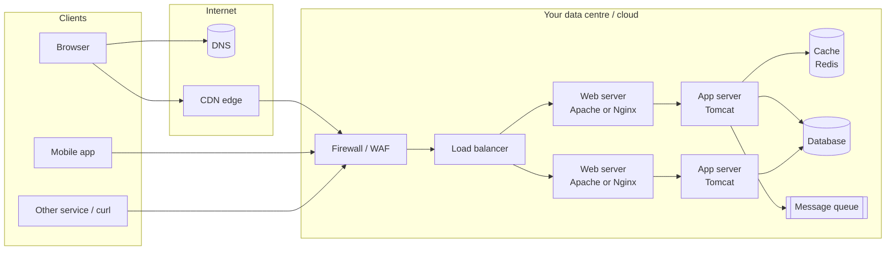

Each box is a separate **tier**:

| Tier | Typical software | Job |
|---|---|---|
| Presentation / edge | CDN, WAF, load balancer | Terminate TLS, absorb traffic, block attacks, route |
| Web tier | Apache HTTPD, Nginx | Serve static files, TLS, compression, caching, reverse-proxy to the app tier |
| Application tier | Tomcat, Jetty, WildFly, Spring Boot (embedded Tomcat) | Run Java business code (servlets, Spring controllers) |
| Data tier | MySQL, Oracle, Redis, Kafka | Persist and cache state |

### 📘 Terms Explained

| Term | Meaning |
|---|---|
| Client | Program that initiates a request |
| Server | Program that listens and answers |
| Port | Number (0-65535) that identifies a service on a host (HTTP 80, HTTPS 443, Tomcat 8080) |
| Protocol | Agreed message format and rules (HTTP, TLS, TCP) |
| Tier | A logical layer that can be scaled and secured separately |
| Reverse proxy | A server that receives client requests and forwards them to backend servers |

---

## 1.2 One request, end to end (the 20 steps) **(Interview Imp)**

You type `https://shop.example.com/orders/42` and press Enter. This is *everything* that happens:

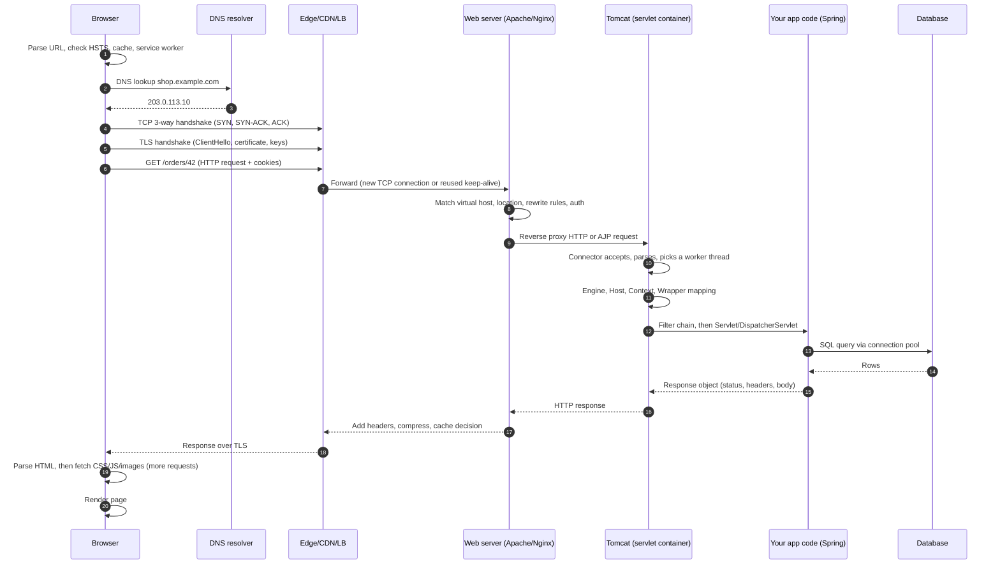

In words:

1. **Browser** parses the URL (scheme `https`, host, port 443, path `/orders/42`). It checks its HSTS list, its HTTP cache and any service worker.
2. **DNS** turns the host name into an IP (browser cache, OS cache, resolver, root/TLD/authoritative servers).
3. **TCP handshake** opens a reliable byte stream to the IP on port 443 (1 round trip).
4. **TLS handshake** negotiates encryption and proves the server's identity with a certificate (1 round trip in TLS 1.3).
5. **HTTP request** is sent: a request line, headers (including `Host`, `Cookie`, `Accept`) and an optional body.
6. The **edge** (CDN / firewall / load balancer) may answer from cache, block, or choose a backend.
7. The **web server** picks the right site (virtual host) by the `Host` header and the right rule by the path, serves static files itself, or proxies dynamic requests.
8. **Tomcat's Connector** accepts the connection, parses HTTP into a `Request` object, and gives it to a **worker thread** from the pool.
9. Tomcat **maps** the URL to a Host, Context (web application) and Servlet, runs **Filters**, then the servlet.
10. **Your code** runs, usually talking to a database or cache through a **connection pool**.
11. The **response** flows back through the same layers; each may add headers, compress or cache.
12. The **browser** renders HTML and issues many more requests for CSS, JS and images; connections are reused (keep-alive / HTTP/2 multiplexing).

### Where time goes (typical, same continent)

| Step | Cost |
|---|---|
| DNS (cold) | 20-120 ms (cached: ~0) |
| TCP handshake | 1 RTT (round trip time) = 10-80 ms |
| TLS 1.3 handshake | 1 RTT (TLS 1.2: 2 RTT; resumption: 0-1 RTT) |
| Request and first byte (TTFB) | RTT + server time |
| Server processing | 1-500 ms (your code + DB) |
| Download | size / bandwidth |

A connection that is **reused** (keep-alive, HTTP/2) skips DNS, TCP and TLS. This is the main reason keep-alive and connection pooling exist.

### 📘 Terms Explained

| Term | Meaning |
|---|---|
| RTT | Round-trip time: a packet going there and back |
| TTFB | Time To First Byte |
| HSTS | Header telling browsers to always use HTTPS for a site |
| Virtual host | One web server serving many sites, chosen by the `Host` header |
| Worker thread | A thread that handles one request at a time |
| Keep-alive | Reusing one TCP connection for many requests |

---

## 1.3 Static vs dynamic content **(Interview Imp)**

| | Static | Dynamic |
|---|---|---|
| Examples | HTML, CSS, JS, images, PDFs | `/orders/42` built from a database, JSON API |
| Produced by | File on disk (or CDN cache) | Code that runs per request |
| Best served by | Nginx/Apache/CDN (sendfile, caching) | Tomcat/Spring |
| Scaling | Trivial (cache, CDN) | Needs CPU, threads, DB capacity |
| Cache | Long-lived (`Cache-Control: max-age=31536000, immutable` with hashed names) | Short or none (or per-user) |

Architect's rule: **let the cheapest layer answer.** Browser cache > CDN > reverse-proxy cache > app cache (Redis) > database.

## 1.4 Terminology that confuses everyone

| Word | Really means |
|---|---|
| **Web server** | Software that speaks HTTP and serves files / proxies (Apache HTTPD, Nginx). Also loosely "the machine" |
| **Application server** | Software that runs application code (Tomcat, Jetty, WildFly, WebLogic, WebSphere) |
| **Servlet container** (web container) | The part of an app server that runs **servlets** and implements the Servlet spec. **Tomcat is a servlet container** (plus an HTTP server) |
| **Full Java EE/Jakarta EE server** | Servlet container + EJB, JMS, JTA, JPA... (WildFly, WebLogic, WebSphere, Payara) |
| **Embedded server** | Server packaged inside your app jar (Spring Boot starts Tomcat in `main`) |
| **Proxy** | Forwards on behalf of **clients** (forward proxy: your company's outbound proxy) |
| **Reverse proxy** | Forwards on behalf of **servers** (client doesn't know the backend) |
| **Gateway** | A reverse proxy with extra policy (auth, rate limit, routing) |
| **Load balancer** | Spreads requests over several backends |
| **CDN** | Geographically distributed caching reverse proxies |

---

# 2. Networking Foundations Every Architect Must Know

## 2.1 The layers (OSI vs TCP/IP) **(Interview Imp)**

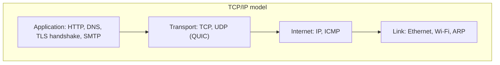

| OSI layer | TCP/IP | Examples | Unit |
|---|---|---|---|
| 7 Application | Application | HTTP, DNS, FTP | message |
| 6 Presentation | Application | TLS, encoding | |
| 5 Session | Application | sessions | |
| 4 Transport | Transport | TCP, UDP | segment / datagram |
| 3 Network | Internet | IP, routing | packet |
| 2 Data link | Link | Ethernet, MAC | frame |
| 1 Physical | Link | cable, radio | bits |

Each layer wraps the one above in its own header (**encapsulation**):

```
[ Ethernet | IP | TCP | TLS | HTTP request ]
```

**L4 vs L7 load balancer:** an L4 balancer looks only at IP and port (fast, can't read URLs). An L7 balancer understands HTTP (route by path/host/header, terminate TLS).

### 📘 Terms Explained

| Term | Meaning |
|---|---|
| Encapsulation | Each layer adds its own header around the data |
| Packet / segment / frame | Data unit at network / transport / link layer |
| MAC address | Hardware address on a local network |
| IP address | Logical address (IPv4 `203.0.113.10`, IPv6 `2001:db8::1`) |
| MTU | Largest frame size (usually 1500 bytes) |
| NAT | Rewriting addresses so many private hosts share one public IP |

---

## 2.2 IP, ports and sockets

- An **IP address** identifies a host; a **port** identifies a program on it. The pair is an **endpoint**: `203.0.113.10:443`.
- A **TCP connection** is uniquely identified by the 4-tuple **(client IP, client port, server IP, server port)**. A server on one port can hold tens of thousands of connections because each client has a different source port.
- A **socket** is the OS handle for one endpoint. A server does: `socket() > bind() > listen() > accept()`; a client does `socket() > connect()`.
- **Ephemeral ports**: the client picks a random high port (32768-60999 on Linux) for each connection.
- Ports below 1024 need root on Linux, which is why Tomcat listens on **8080** and a front proxy on **80/443**.

| Port | Service |
|---|---|
| 22 | SSH |
| 53 | DNS |
| 80 / 443 | HTTP / HTTPS |
| 8080 | Tomcat HTTP (default), alternative HTTP |
| 8443 | Tomcat HTTPS |
| 8005 | Tomcat shutdown port |
| 8009 | Tomcat AJP (disabled by default since 8.5.51/9.0.31) |
| 3306 / 1521 / 5432 / 6379 | MySQL / Oracle / PostgreSQL / Redis |

```bash
ss -ltnp                          # which program listens on which port
ss -tn state established | wc -l  # number of established TCP connections
curl -v https://shop.example.com/ # see DNS, TCP, TLS and HTTP in one go
```

### 📘 Terms Explained

| Term | Meaning |
|---|---|
| Socket | OS object representing one end of a connection |
| 4-tuple | Source IP/port + destination IP/port: identifies a TCP connection |
| `listen()` / `accept()` | Server calls: start waiting / take one incoming connection |
| Backlog | Queue of completed handshakes waiting to be accepted (`acceptCount` in Tomcat, `listen backlog` in Nginx) |
| Ephemeral port | Temporary client-side port |

---

## 2.3 DNS in detail **(Interview Imp)**

DNS maps names to addresses. It is a hierarchical, cached, distributed database.

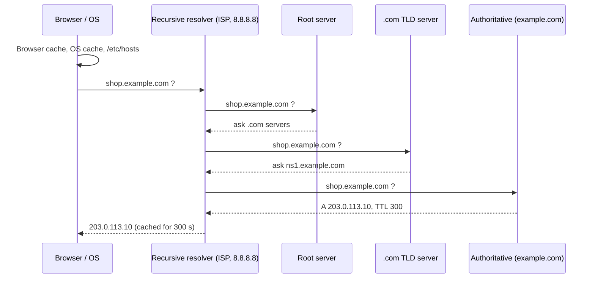

| Record | Meaning | Example |
|---|---|---|
| `A` / `AAAA` | Name to IPv4 / IPv6 | `shop A 203.0.113.10` |
| `CNAME` | Alias to another name | `www CNAME shop.example.com` |
| `MX` | Mail servers | |
| `TXT` | Free text (SPF, domain verification) | |
| `NS` | Name servers of a zone | |
| `SRV` | Host + port of a service | used by Kubernetes, gRPC, SIP |
| `PTR` | Reverse lookup (IP to name) | |

- **TTL** (time to live) controls caching. Lower it (e.g. 60 s) *before* a migration.
- **DNS load balancing**: several `A` records (round robin) or **GeoDNS** / latency-based routing. It cannot see server health by itself and is slowed by caching; use it for coarse routing, not fine balancing.
- Debug: `dig +trace shop.example.com`, `nslookup`, `getent hosts`.
- Java caches DNS lookups (`networkaddress.cache.ttl`); stale DNS after failover is a classic JVM issue.

## 2.4 TCP: reliable byte streams **(Interview Imp)**

**Three-way handshake:**

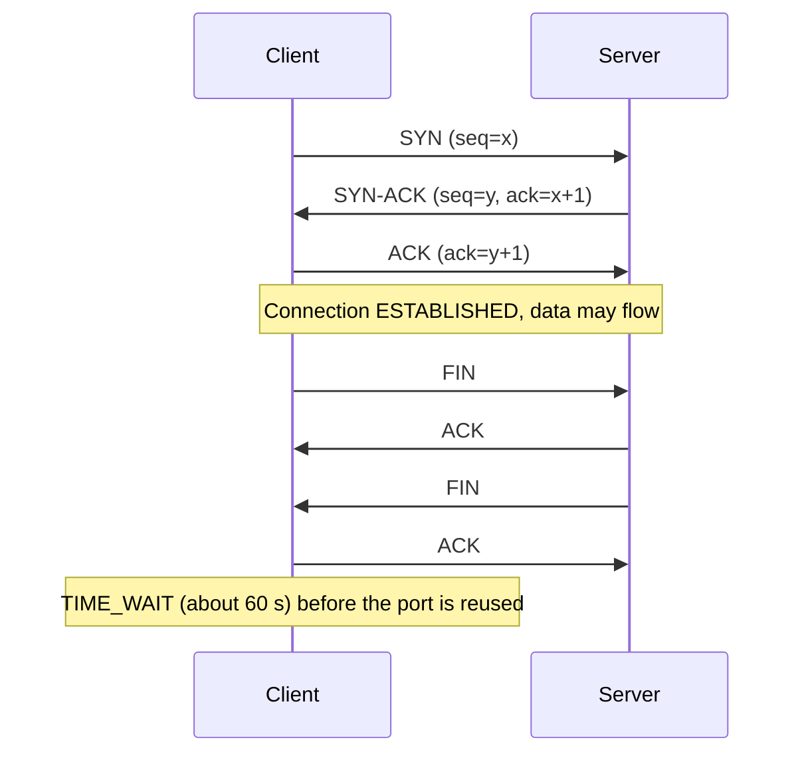

TCP provides: ordered delivery, retransmission of lost packets, flow control (receiver window), congestion control (slow start, then growth until loss), checksums.

**Why architects care:**

| TCP fact | Consequence |
|---|---|
| Every new connection costs 1 RTT | Reuse connections: keep-alive, pools |
| Slow start | A fresh connection is slow for the first few round trips; long-lived connections are faster |
| `TIME_WAIT` sockets | Thousands of short connections exhaust ephemeral ports; use keep-alive, `tcp_tw_reuse` |
| Listen backlog | If full, new SYNs are dropped: clients see timeouts under a burst (`somaxconn`, `acceptCount`) |
| Head-of-line blocking | One lost packet stalls the whole stream (motivation for HTTP/3 / QUIC) |
| Nagle's algorithm / delayed ACK | Can add 40 ms latency for tiny writes: `TCP_NODELAY` |
| Idle connection kills | Firewalls/NAT drop idle flows after 5-60 min: set TCP keep-alive below that |

Connection states you will see in `ss`/`netstat`: `LISTEN`, `SYN_RECV`, `ESTABLISHED`, `CLOSE_WAIT` (the remote closed, **your app has not**: a leak symptom), `TIME_WAIT`, `FIN_WAIT_2`.

### 📘 Terms Explained

| Term | Meaning |
|---|---|
| Handshake | Exchange to set up a connection |
| Congestion control | Sender slows down when the network is overloaded |
| Slow start | Begin with a small window, double each RTT |
| `TIME_WAIT` | Closed connection lingers so late packets are not misread |
| `CLOSE_WAIT` | Peer closed; local program has not closed its side yet |
| Nagle / `TCP_NODELAY` | Batching small writes / turning that batching off |
| TTL (DNS) | How long an answer may be cached |

---

## 2.5 TLS: encryption and identity **(Interview Imp)**

**TLS** (successor of SSL) gives **confidentiality** (encryption), **integrity** (tamper detection) and **authentication** (the server really is `shop.example.com`).

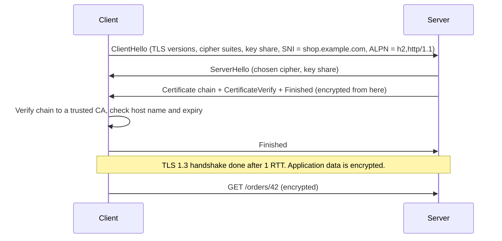

Key ideas:

- **Asymmetric crypto** (ECDHE key exchange + certificate signature) is used to *agree on a shared secret* and prove identity; **symmetric crypto** (AES-GCM, ChaCha20) then encrypts the data fast.
- **Forward secrecy**: ephemeral keys (ECDHE) mean that stealing the server's private key later cannot decrypt recorded traffic.
- **Certificate**: a file binding a public key to a domain, signed by a **Certificate Authority (CA)**. The browser trusts a built-in list of root CAs. The server sends the **chain** (leaf, intermediate); the root is already in the client.
- **SNI** (Server Name Indication) lets one IP serve many certificates (the host name is sent in the ClientHello).
- **ALPN** negotiates the application protocol inside the handshake (`h2` or `http/1.1`).
- **Session resumption / 0-RTT** skip part of the handshake on reconnect.
- **mTLS** (mutual TLS): the client also presents a certificate (service-to-service, zero trust).
- **TLS termination**: decrypt at the edge (LB / Nginx / Apache) and talk plain HTTP (or re-encrypt) to the backend. Tomcat then needs to be told the original scheme (`X-Forwarded-Proto`, `RemoteIpValve`), otherwise redirects go to `http://`.

| Version | Handshake RTT | Status |
|---|---|---|
| SSL 2/3, TLS 1.0, 1.1 | | Broken/deprecated: disable |
| TLS 1.2 | 2 RTT | Acceptable with strong ciphers |
| **TLS 1.3** | 1 RTT (0-RTT resumption) | Preferred |

```bash
openssl s_client -connect shop.example.com:443 -servername shop.example.com -showcerts
openssl x509 -in cert.pem -noout -dates -subject -issuer -ext subjectAltName
keytool -list -keystore keystore.p12 -storetype PKCS12        # Java keystore for Tomcat
```

### 📘 Terms Explained

| Term | Meaning |
|---|---|
| CA | Certificate Authority: trusted organisation that signs certificates |
| Certificate chain | Leaf cert + intermediates up to a trusted root |
| SAN | Subject Alternative Name: the host names a certificate is valid for |
| SNI | Host name sent early so the server can choose the right certificate |
| ALPN | In-handshake choice of HTTP/2 vs HTTP/1.1 |
| Forward secrecy | Past traffic stays safe even if the key leaks later |
| Keystore / truststore | Java files holding your private key+cert / certificates you trust |
| mTLS | Both sides authenticate with certificates |

---

## 2.6 HTTP: the application protocol **(Interview Imp)**

### Anatomy of a message

```
GET /orders/42?expand=items HTTP/1.1          <- request line: method, target, version
Host: shop.example.com                         <- mandatory in 1.1 (selects the virtual host)
Accept: application/json
Cookie: JSESSIONID=9F2A...; theme=dark
User-Agent: Mozilla/5.0 ...
Accept-Encoding: gzip, br
                                               <- blank line ends the headers
(optional body, e.g. JSON for POST)
```

```
HTTP/1.1 200 OK                                <- status line
Content-Type: application/json;charset=UTF-8
Content-Length: 187
Cache-Control: private, max-age=0
Set-Cookie: JSESSIONID=9F2A...; Path=/; Secure; HttpOnly; SameSite=Lax
Date: Wed, 01 May 2024 10:00:00 GMT

{"id":42,"status":"SHIPPED", ...}
```

### Methods

| Method | Purpose | Safe | Idempotent | Body |
|---|---|---|---|---|
| `GET` | Read | Yes | Yes | No |
| `HEAD` | Headers only | Yes | Yes | No |
| `POST` | Create / action | No | No | Yes |
| `PUT` | Replace | No | Yes | Yes |
| `PATCH` | Partial update | No | No (usually) | Yes |
| `DELETE` | Remove | No | Yes | Optional |
| `OPTIONS` | Capabilities (CORS preflight) | Yes | Yes | No |

*Safe* = no server state change. *Idempotent* = repeating gives the same end state (so it can be retried safely).

### Status codes (know these by heart)

| Class | Code | Meaning | Who usually produces it |
|---|---|---|---|
| **1xx** | 101 | Switching Protocols (WebSocket) | server |
| **2xx** | 200 OK, 201 Created, 204 No Content, 206 Partial Content | Success | app |
| **3xx** | 301 Moved Permanently, 302 Found, 304 Not Modified, 307/308 redirect keeping method | Redirect / cache valid | app, web server |
| **4xx** | 400 Bad Request, 401 Unauthorized (really "unauthenticated"), 403 Forbidden, 404 Not Found, 405 Method Not Allowed, 408 Request Timeout, 413 Payload Too Large, 414 URI Too Long, 429 Too Many Requests, 431 Header Fields Too Large | Client error | app / web server |
| **5xx** | 500 Internal Server Error, 502 Bad Gateway, 503 Service Unavailable, 504 Gateway Timeout | Server error | 500 app; **502/504 = proxy couldn't get a good answer from the backend** |

**502 vs 503 vs 504 (very common question):** 502 = backend sent garbage or closed the connection or is down; 503 = backend/proxy overloaded or in maintenance; 504 = backend too slow (proxy timeout fired).

### Headers that matter to an architect

| Header | Use |
|---|---|
| `Host` | Which site (virtual host) |
| `Content-Type`, `Content-Length`, `Transfer-Encoding: chunked` | Body description / streaming |
| `Connection: keep-alive`, `Keep-Alive: timeout=5, max=100` | Connection reuse |
| `Accept-Encoding` / `Content-Encoding: gzip, br` | Compression |
| `Cache-Control`, `ETag`/`If-None-Match`, `Last-Modified`/`If-Modified-Since`, `Expires`, `Vary` | Caching |
| `Cookie` / `Set-Cookie` | State |
| `Authorization: Bearer ...` | Credentials |
| `X-Forwarded-For`, `X-Forwarded-Proto`, `X-Forwarded-Host`, standard `Forwarded` | Original client info through proxies |
| `Location` | Redirect target |
| `Strict-Transport-Security`, `Content-Security-Policy`, `X-Content-Type-Options`, `X-Frame-Options` | Security |
| `Access-Control-Allow-Origin` and friends | CORS |
| `Upgrade: websocket` | Protocol switch |
| `Range` / `Content-Range` | Partial download, resume |

### HTTP versions **(Interview Imp)**

| | HTTP/1.1 (1997) | HTTP/2 (2015) | HTTP/3 (2022) |
|---|---|---|---|
| Transport | TCP | TCP | **QUIC over UDP** |
| Format | Text | Binary frames | Binary frames |
| Concurrency | One request at a time per connection (browsers open ~6 connections per host) | **Multiplexing**: many streams on one connection | Multiplexing without TCP head-of-line blocking |
| Header compression | None | HPACK | QPACK |
| TLS | Optional | Practically required | Built in (TLS 1.3) |
| Server push | n/a | Existed, now removed in browsers | n/a |
| Connection setup | TCP + TLS (2-3 RTT) | same | 1 RTT, 0-RTT resume; survives IP change |

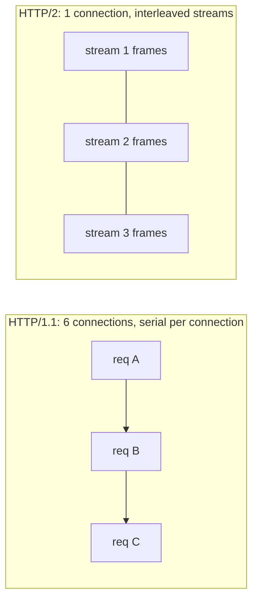

Practical notes: HTTP/2 is typically terminated at the edge (Nginx/Apache `mod_http2`/CDN) and the backend leg uses HTTP/1.1. Tomcat supports HTTP/2 via an `UpgradeProtocol` element. HTTP/3 is usually offered by a CDN or Nginx (QUIC) at the edge.

### Caching in two sentences

A response with `Cache-Control: max-age=N` may be reused for N seconds without asking. After that the cache **revalidates** with `If-None-Match: <ETag>`; the server answers `304 Not Modified` (no body) if unchanged. `private` caches only in the browser; `public` allows shared caches (CDN); `no-store` forbids storing; `Vary: Accept-Encoding` keeps variants apart.

### CORS in two sentences

The browser blocks JavaScript from reading responses from a *different origin* (scheme+host+port) unless the server allows it with `Access-Control-Allow-Origin`. For non-simple requests the browser first sends an `OPTIONS` **preflight**; the server must answer with the allowed methods/headers.

### Cookies and sessions (preview)

`Set-Cookie` stores a small value in the browser; the browser returns it in every request to that site. `JSESSIONID` is the cookie that links the browser to a server-side `HttpSession` (chapter 12).

### WebSocket and Server-Sent Events

HTTP `Upgrade: websocket` converts the connection into a full-duplex channel (chat, live prices). SSE streams one-way events over a normal HTTP response. Both hold **long-lived connections**: proxies need longer timeouts and thread/connection budgets change (chapter 14).

### 📘 Terms Explained

| Term | Meaning |
|---|---|
| Idempotent | Repeating the request has the same effect as doing it once |
| Chunked transfer | Body sent in pieces without knowing the total length up front |
| Multiplexing | Many logical streams over one connection |
| Head-of-line blocking | One slow/lost item delays everything queued behind it |
| QUIC | UDP-based transport with built-in TLS and streams |
| ETag | Version fingerprint of a resource used for revalidation |
| Origin | scheme + host + port; the unit of the browser security model |
| Preflight | Browser's automatic `OPTIONS` check before a cross-origin request |
| Hop-by-hop vs end-to-end headers | Headers that apply to one connection vs the whole request path |

---
# 3. Web Server vs Application Server vs Servlet Container **(Interview Imp)**

## 3.1 What each one does

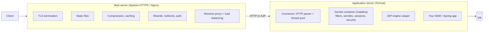

| Aspect | Web server (Apache HTTPD, Nginx) | Servlet container (Tomcat, Jetty, Undertow) | Full Jakarta EE server (WildFly, WebLogic, WebSphere, Payara) |
|---|---|---|---|
| Written in | C | Java | Java |
| Runs | Static files, CGI, PHP via FPM, proxies | Servlets, JSP, WebSocket, Java web apps | + EJB, JMS, JTA, CDI, JPA, clustering, admin console |
| Speaks | HTTP/1.1, HTTP/2, (HTTP/3 Nginx) | HTTP/1.1, HTTP/2, AJP | same |
| Threading | Process/thread pool (Apache) or event loop (Nginx) | Thread per request (NIO connector, virtual threads optional) | same |
| Typical role | Edge / reverse proxy | Application tier | Application tier for "big" enterprise apps |
| Memory | Few MB per worker | JVM heap (hundreds of MB to GBs) | More |

**Is Tomcat a web server?** Yes and no. Tomcat contains a complete HTTP server (the **Coyote** connector) and can serve static files and HTTPS itself, so small deployments often expose Tomcat directly. But it is primarily a **servlet container**; it is not a full Jakarta EE application server.

**Why put Apache/Nginx in front of Tomcat?** (architect's checklist)

1. TLS termination with certificates managed in one place (Let's Encrypt automation, OCSP stapling).
2. Static files served faster and without consuming JVM threads.
3. Load balancing and failover across several Tomcats.
4. Buffering slow clients: the proxy reads the whole request/response at network speed, so Tomcat's thread is freed quickly (protects against slowloris-style slowness).
5. Security: hide the backend, rate limiting, WAF rules (ModSecurity), request size limits.
6. Run on ports 80/443 while Tomcat runs as a non-root user on 8080.
7. URL rewriting, redirects, multiple apps/technologies under one domain.
8. Zero-downtime deploys: drain one backend while others serve.

Today, in cloud and Kubernetes setups, this "front" role is often played by a **cloud load balancer**, an **ingress controller** (Nginx, Envoy, Traefik) or an **API gateway**, with Spring Boot apps running **embedded Tomcat**. The concepts are identical.

### 📘 Terms Explained

| Term | Meaning |
|---|---|
| Servlet | Java class that handles HTTP requests (`jakarta.servlet.http.HttpServlet`) |
| Servlet container | Runtime that manages servlet lifecycle, threads, sessions, security |
| Catalina | Tomcat's servlet container component |
| Coyote | Tomcat's connector (HTTP/AJP protocol handler) |
| Jasper | Tomcat's JSP compiler |
| Jakarta EE | The Java enterprise specs (formerly Java EE, package `javax` became `jakarta` in EE 9) |
| WAR | Web ARchive: a zip of a Java web app (`WEB-INF/web.xml`, `classes`, `lib`) |

---

# 4. Apache HTTP Server (httpd) Internals **(Interview Imp)**

## 4.1 Process model: the parent and its children

When you start httpd, a **parent process** (runs as root to bind ports 80/443) reads the configuration, opens the listening sockets, and forks **child processes** that run as an unprivileged user (`www-data` / `apache`). Children do the real work; the parent only supervises (creates/kills children according to load, handles `graceful` restarts).

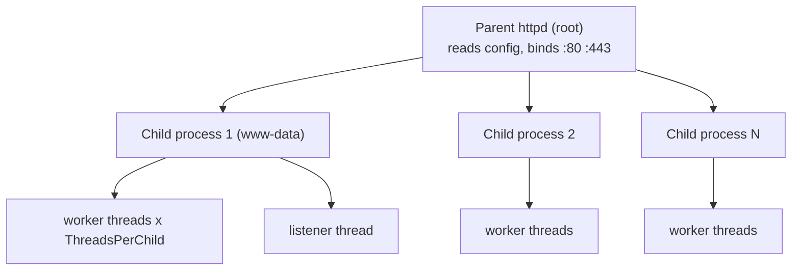

## 4.2 MPMs: Multi-Processing Modules **(Interview Imp)**

How children handle connections is pluggable via an **MPM**. Only one MPM is active.

| MPM | Model | Pros | Cons | Use |
|---|---|---|---|---|
| **prefork** | Many single-threaded processes, one connection each | Isolation, safe for non-thread-safe modules (old `mod_php`) | High memory, few concurrent connections | Legacy PHP |
| **worker** | Several processes, each with many threads; one thread per connection | Far less memory | A keep-alive connection pins a thread while idle | General |
| **event** (default on most distros) | Like worker, but a dedicated **listener thread** handles idle keep-alive connections and hands sockets to workers only when there is a request to process | Thousands of idle keep-alive connections with few threads | Some modules force a thread to stay (e.g. synchronous filters) | **Recommended** |

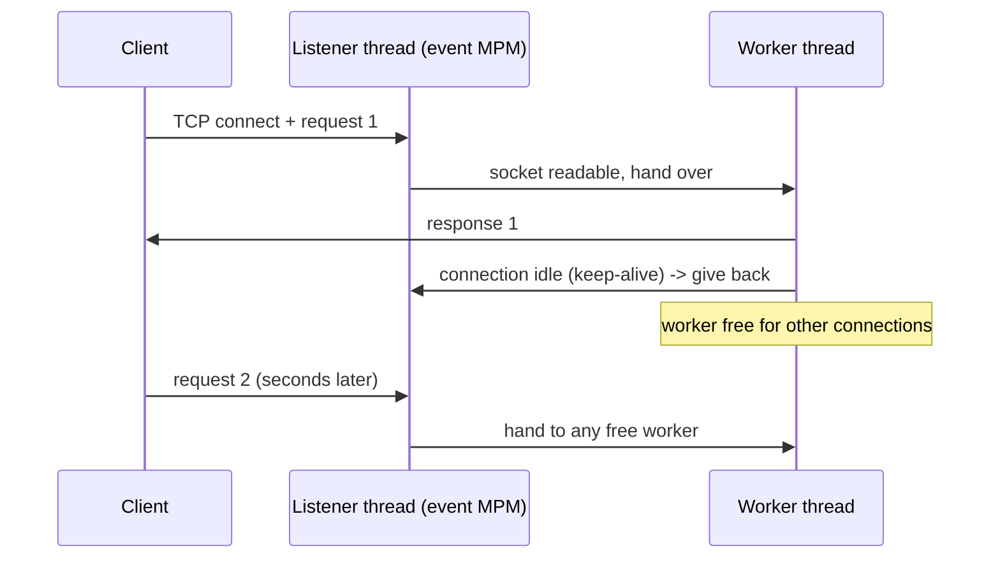

```bash
apachectl -V | grep -i mpm          # which MPM is compiled/loaded
httpd -M  /  apache2ctl -M          # loaded modules
a2dismod mpm_prefork && a2enmod mpm_event   # Debian/Ubuntu switch
```

**event MPM tuning directives** (`mods-available/mpm_event.conf` on Debian, `conf.modules.d/00-mpm.conf` on RHEL):

```apache
<IfModule mpm_event_module>
    StartServers             3        # child processes at start
    ServerLimit             16        # hard upper limit of child processes
    ThreadsPerChild         25        # worker threads per child
    MaxRequestWorkers      400        # max simultaneous requests = ServerLimit x ThreadsPerChild (<=)
    MinSpareThreads         75
    MaxSpareThreads        250
    ThreadLimit             64        # upper bound for ThreadsPerChild
    MaxConnectionsPerChild   0        # 0 = never recycle; set e.g. 10000 to contain memory leaks
    AsyncRequestWorkerFactor 2        # how many extra async (idle keep-alive) connections per worker
</IfModule>
```

Sizing: `MaxRequestWorkers` is the number of requests processed **at the same time**. Memory need ~ (number of children x memory per child). When all workers are busy, new connections queue in the socket backlog (`ListenBacklog`, default 511) and then time out, and the error log shows `server reached MaxRequestWorkers setting`.

### 📘 Terms Explained

| Term | Meaning |
|---|---|
| MPM | Multi-Processing Module: decides processes vs threads |
| Fork | Creating a copy of a process |
| Graceful restart | Reload config without dropping in-flight requests (`apachectl graceful`) |
| Listener thread | Thread that watches sockets and dispatches work |
| Thread-safe | Code that works correctly when used by many threads at once |

---

## 4.3 Modules: everything is a module

Core httpd is small; features come from modules (`LoadModule`). Some you will use:

| Module | Feature |
|---|---|
| `mod_ssl` | HTTPS/TLS |
| `mod_http2` | HTTP/2 |
| `mod_proxy`, `mod_proxy_http`, `mod_proxy_ajp`, `mod_proxy_wstunnel`, `mod_proxy_balancer`, `mod_lbmethod_*` | Reverse proxy, AJP, WebSocket, load balancing |
| `mod_jk` | Legacy Tomcat connector (separate install) |
| `mod_rewrite` | Regex URL rewriting and redirects |
| `mod_alias` | `Alias`, `Redirect`, `ScriptAlias` |
| `mod_headers` | Add/modify request & response headers |
| `mod_deflate`, `mod_brotli` | Compression |
| `mod_expires` | `Expires` / `Cache-Control` for static content |
| `mod_cache`, `mod_cache_disk` | Reverse-proxy cache |
| `mod_auth_basic`, `mod_authnz_ldap`, `mod_auth_openidc` | Authentication |
| `mod_authz_core`, `mod_authz_host` | `Require` authorisation rules |
| `mod_security2` | Web application firewall (OWASP CRS) |
| `mod_status` | Live server status page |
| `mod_log_config` | Access log formats |
| `mod_remoteip` | Trust `X-Forwarded-For` from known proxies |
| `mod_reqtimeout` | Defends against slow-request attacks |
| `mod_evasive`, `mod_qos` | Rate limiting (3rd party) |
| `mod_php` / `proxy_fcgi` + PHP-FPM | PHP |

## 4.4 How Apache processes one request (the hook phases) **(Interview Imp)**

Every module registers functions on **hooks**. A request walks through these phases in order; any phase can finish the request early (for example with 403 or a redirect).

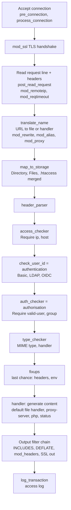

**Filters** are a second pipeline: input filters process the request body (e.g. decryption, size limits) and output filters transform the response (compression, SSI, header edits, TLS encryption) as a stream of **buckets/brigades**.

### Configuration merge order (why "my rule doesn't apply")

Per request, Apache merges config sections in this order; later wins:

1. `<Directory>` (non-regex) and `.htaccess` (from the filesystem root down),
2. `<DirectoryMatch>` and `<Directory ~ regex>`,
3. `<Files>` and `<FilesMatch>`,
4. `<Location>` and `<LocationMatch>` (URL space, applied last, so they override directory rules),
5. `<If>` blocks.

`<VirtualHost>` sections are selected first by IP:port and then by `ServerName`/`ServerAlias` matching the `Host` header (or SNI for TLS). The **first** vhost listed for an IP:port is the **default** used when nothing matches.

### 📘 Terms Explained

| Term | Meaning |
|---|---|
| Hook | Extension point where modules register callbacks |
| Handler | The module that produces the response body |
| Filter / bucket brigade | Streaming transformation pipeline for request/response data |
| `.htaccess` | Per-directory config file read at request time (slow; disable with `AllowOverride None`) |
| Default vhost | First `<VirtualHost>` for an address, used when no name matches |

---

## 4.5 Files and layout

| Item | Debian / Ubuntu | RHEL / CentOS / Rocky |
|---|---|---|
| Main config | `/etc/apache2/apache2.conf` | `/etc/httpd/conf/httpd.conf` |
| Ports | `/etc/apache2/ports.conf` | inside `httpd.conf` (`Listen 80`) |
| Sites | `sites-available/*.conf` + `a2ensite` -> `sites-enabled/` | `/etc/httpd/conf.d/*.conf` |
| Modules | `mods-available` + `a2enmod` | `/etc/httpd/conf.modules.d/` |
| Logs | `/var/log/apache2/` | `/var/log/httpd/` |
| Service | `systemctl reload apache2` | `systemctl reload httpd` |
| Doc root | `/var/www/html` | `/var/www/html` |
| Test config | `apache2ctl configtest` | `apachectl configtest` / `httpd -t` |
| Show vhosts | `apache2ctl -S` | `httpd -S` |

## 4.6 Core directives you must understand

```apache
ServerRoot "/etc/httpd"
Listen 80
Listen 443 https
User apache
Group apache
ServerName www.example.com:80          # avoids "could not reliably determine" warning
ServerAdmin ops@example.com
ServerTokens Prod                      # hide version in Server header
ServerSignature Off
TraceEnable Off

Timeout 60                             # max wait for I/O on a request (default 60s)
KeepAlive On
MaxKeepAliveRequests 100               # requests per connection (0 = unlimited)
KeepAliveTimeout 5                     # idle seconds before closing a keep-alive connection
LimitRequestBody 10485760              # 10 MB max body (default unlimited/1GB depending on version)
LimitRequestFields 100
LimitRequestFieldSize 8190
RequestReadTimeout header=20-40,MinRate=500 body=20,MinRate=500   # mod_reqtimeout: slowloris defence

DocumentRoot "/var/www/html"
<Directory />
    AllowOverride None
    Require all denied                 # deny everything by default
</Directory>
<Directory "/var/www/html">
    Options -Indexes +FollowSymLinks   # no directory listing
    AllowOverride None                 # ignore .htaccess (faster, safer)
    Require all granted
</Directory>

ErrorLog "logs/error_log"
LogLevel warn proxy:info ssl:warn
LogFormat "%h %l %u %t \"%r\" %>s %b \"%{Referer}i\" \"%{User-Agent}i\" %D" combined_time   # %D = microseconds
CustomLog "logs/access_log" combined_time
```

## 4.7 Virtual hosts, HTTPS and redirects

```apache
# HTTP -> HTTPS
<VirtualHost *:80>
    ServerName shop.example.com
    ServerAlias www.shop.example.com
    Redirect permanent / https://shop.example.com/
</VirtualHost>

<VirtualHost *:443>
    ServerName shop.example.com
    DocumentRoot /var/www/shop/static

    SSLEngine on
    SSLCertificateFile      /etc/pki/tls/certs/shop.fullchain.pem
    SSLCertificateKeyFile   /etc/pki/tls/private/shop.key
    SSLProtocol             -all +TLSv1.2 +TLSv1.3
    SSLCipherSuite          ECDHE-ECDSA-AES128-GCM-SHA256:ECDHE-RSA-AES128-GCM-SHA256:ECDHE-ECDSA-AES256-GCM-SHA384:ECDHE-RSA-AES256-GCM-SHA384
    SSLHonorCipherOrder     off
    SSLUseStapling          on
    Protocols h2 http/1.1

    Header always set Strict-Transport-Security "max-age=63072000; includeSubDomains"
    Header always set X-Content-Type-Options "nosniff"
    Header always set X-Frame-Options "DENY"

    # Static assets: long cache
    <LocationMatch "^/assets/">
        Header set Cache-Control "public, max-age=31536000, immutable"
    </LocationMatch>

    # Compression
    AddOutputFilterByType DEFLATE text/html text/css application/javascript application/json

    # Everything else goes to Tomcat (see chapter 8)
    ProxyPreserveHost On
    ProxyPass        /assets/ !
    ProxyPass        /  http://127.0.0.1:8080/  connectiontimeout=5 timeout=60 keepalive=On
    ProxyPassReverse /  http://127.0.0.1:8080/
    RequestHeader set X-Forwarded-Proto "https"

    ErrorLog  /var/log/httpd/shop_error.log
    CustomLog /var/log/httpd/shop_access.log combined_time
</VirtualHost>
```

### `mod_rewrite` in brief

```apache
RewriteEngine On
# Old URL to new URL, permanent
RewriteRule ^/product/(\d+)$ /products/$1 [R=301,L]
# Front-controller pattern: anything that is not a real file goes to index.html (SPA)
RewriteCond %{REQUEST_FILENAME} !-f
RewriteCond %{REQUEST_FILENAME} !-d
RewriteRule ^ /index.html [L]
# Block a bad bot
RewriteCond %{HTTP_USER_AGENT} BadBot [NC]
RewriteRule ^ - [F]
```

Flags: `L` last, `R=301` redirect, `NC` case-insensitive, `F` forbidden, `P` proxy, `QSA` keep the query string, `PT` pass through to the next handler.

## 4.8 `mod_status` and operations

```apache
<Location "/server-status">
    SetHandler server-status
    Require ip 10.0.0.0/8
</Location>
ExtendedStatus On
```

The scoreboard shows each worker's state: `_` waiting, `R` reading, `W` writing (sending reply), `K` keep-alive, `L` logging, `G` gracefully finishing, `.` open slot.

```bash
apachectl configtest && systemctl reload httpd     # always test before reload
apachectl graceful                                  # finish current requests, then reload
apachectl -S                                        # dump vhost resolution
tail -f /var/log/httpd/error_log
```

### 📘 Terms Explained

| Term | Meaning |
|---|---|
| `ProxyPass` / `ProxyPassReverse` | Forward a URL space to a backend / rewrite backend `Location` headers in responses |
| `ProxyPreserveHost` | Send the original `Host` header to the backend |
| OCSP stapling | Server attaches proof that its certificate is not revoked |
| `Require` | Authorisation directive (`all granted`, `ip`, `valid-user`) |
| Scoreboard | Shared-memory table of worker states |

---

# 5. Nginx Internals

## 5.1 Event-driven architecture **(Interview Imp)**

Nginx has one **master** process (reads config, binds ports, manages workers) and a few **worker** processes (normally one per CPU core). Each worker is **single-threaded** and runs an **event loop** using `epoll` (Linux) / `kqueue` (BSD): it handles thousands of connections by reacting to "socket readable/writable" events and never blocking on I/O.

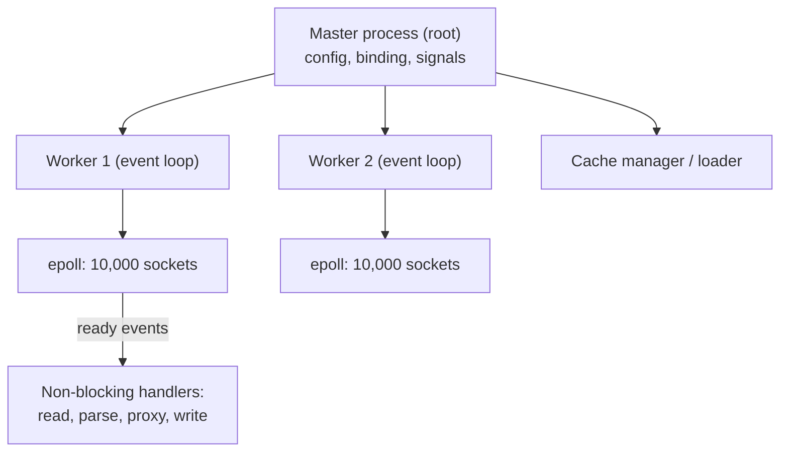

| | Apache (event MPM) | Nginx |
|---|---|---|
| Model | Threads per active request, listener for idle | Fully asynchronous event loop per worker |
| Memory per idle connection | Low (event MPM) | Very low (~few KB) |
| Dynamic modules | Very rich, `.htaccess` | Fewer, compiled or dynamic, no `.htaccess` |
| Config | Per-directory, distributed | Central, hierarchical blocks |
| Typical use | Shared hosting, mature enterprises, modules (mod_security, LDAP) | Reverse proxy, high concurrency, ingress |

Phases of an Nginx request (similar idea to Apache hooks): `post-read` > `server-rewrite` > `find-config` (location match) > `rewrite` > `post-rewrite` > `preaccess` (limit_req) > `access` (allow/deny, auth) > `post-access` > `try-files` > `content` (static, proxy_pass) > `log`.

## 5.2 Configuration structure

```nginx
user  nginx;
worker_processes  auto;                  # one per core
worker_rlimit_nofile 100000;
events {
    worker_connections  10240;           # per worker; total = workers x this (each proxied request uses 2)
    multi_accept on;
}
http {
    include       mime.types;
    sendfile      on;                    # kernel zero-copy for static files
    tcp_nopush    on;
    keepalive_timeout  65;
    client_max_body_size 10m;            # default 1m -> 413 when exceeded
    server_tokens off;
    gzip on; gzip_types text/css application/javascript application/json;

    log_format main '$remote_addr - $remote_user [$time_local] "$request" $status $body_bytes_sent '
                    '"$http_referer" "$http_user_agent" rt=$request_time urt=$upstream_response_time';
    access_log /var/log/nginx/access.log main;

    limit_req_zone $binary_remote_addr zone=perip:10m rate=10r/s;

    upstream tomcat_pool {
        least_conn;                      # or round robin (default), ip_hash, hash $cookie_JSESSIONID
        server 10.0.1.11:8080 max_fails=3 fail_timeout=30s;
        server 10.0.1.12:8080 max_fails=3 fail_timeout=30s;
        server 10.0.1.13:8080 backup;
        keepalive 64;                    # reuse connections to Tomcat
    }

    server {
        listen 80;
        server_name shop.example.com;
        return 301 https://$host$request_uri;
    }

    server {
        listen 443 ssl;
        http2 on;
        server_name shop.example.com;
        ssl_certificate     /etc/nginx/tls/shop.fullchain.pem;
        ssl_certificate_key /etc/nginx/tls/shop.key;
        ssl_protocols TLSv1.2 TLSv1.3;
        add_header Strict-Transport-Security "max-age=63072000" always;

        location /assets/ {
            root /var/www/shop;          # serves /var/www/shop/assets/...
            expires 1y;
            add_header Cache-Control "public, immutable";
        }

        location / {
            limit_req zone=perip burst=20 nodelay;
            proxy_pass http://tomcat_pool;
            proxy_http_version 1.1;
            proxy_set_header Connection "";                 # needed for upstream keepalive
            proxy_set_header Host $host;
            proxy_set_header X-Real-IP $remote_addr;
            proxy_set_header X-Forwarded-For $proxy_add_x_forwarded_for;
            proxy_set_header X-Forwarded-Proto $scheme;
            proxy_connect_timeout 5s;
            proxy_read_timeout 60s;                          # -> 504 when exceeded
            proxy_next_upstream error timeout http_502 http_503;   # retry another server (careful with POST)
        }

        location /ws/ {                                      # WebSocket
            proxy_pass http://tomcat_pool;
            proxy_http_version 1.1;
            proxy_set_header Upgrade $http_upgrade;
            proxy_set_header Connection "upgrade";
            proxy_read_timeout 3600s;
        }
    }
}
```

**`location` matching order:** exact `=` first; then the longest prefix; if that prefix has `^~`, stop; otherwise regex locations (`~`, `~*`) are tried in file order and the first match wins; else the longest prefix is used.

**`proxy_pass` trailing-slash rule:** `proxy_pass http://up;` sends the URI unchanged; `proxy_pass http://up/;` replaces the matched location prefix with `/`.

```bash
nginx -t && nginx -s reload          # test, then reload with zero downtime
nginx -T                             # dump the full effective config
```

### 📘 Terms Explained

| Term | Meaning |
|---|---|
| Event loop | Single thread reacting to ready I/O events, never blocking |
| `epoll` | Linux API to watch many sockets efficiently |
| `upstream` | Named group of backend servers |
| `sendfile` | Kernel copies file to socket without passing through user space |
| `limit_req` | Leaky-bucket rate limiting |
| `proxy_next_upstream` | Retry on another backend after an error |

---
# 6. Apache Tomcat Internals (deep dive) **(Interview Imp) (Architect)**

## 6.1 The component hierarchy

Tomcat is built as a tree of nested components defined in `conf/server.xml`. Learn this tree and every Tomcat config file makes sense.

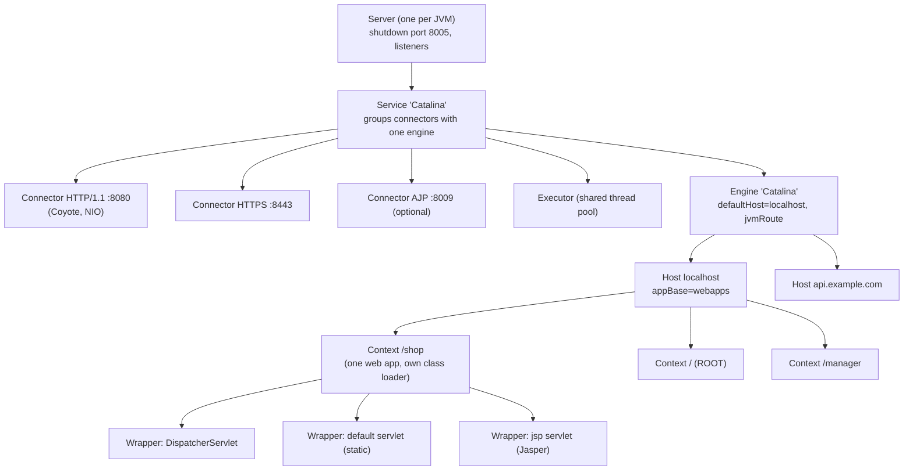

| Component | Interface | What it is | Config element |
|---|---|---|---|
| **Server** | `org.apache.catalina.Server` | The whole Tomcat instance; listens on the shutdown port | `<Server port="8005" shutdown="SHUTDOWN">` |
| **Service** | `Service` | Binds one or more Connectors to exactly one Engine | `<Service name="Catalina">` |
| **Connector** | `Connector` (Coyote) | Accepts connections on a port, speaks HTTP/1.1, HTTP/2 or AJP, turns bytes into `Request` objects | `<Connector port="8080" .../>` |
| **Executor** | `Executor` | Named, shareable thread pool | `<Executor name="tomcatThreadPool" .../>` |
| **Engine** | `Engine` (a `Container`) | Request-processing heart for a Service; picks a Host by the `Host` header | `<Engine name="Catalina" defaultHost="localhost">` |
| **Host** | `Host` (Container) | A virtual host (domain), owns an `appBase` directory and auto-deploys apps | `<Host name="localhost" appBase="webapps">` |
| **Context** | `Context` (Container) | **One web application** (a WAR) with its own class loader, sessions, `ServletContext` | `<Context>` in `META-INF/context.xml` or `conf/Catalina/localhost/app.xml` |
| **Wrapper** | `Wrapper` (Container) | One servlet definition; manages its instance(s) and lifecycle | generated from `web.xml` / annotations |

**Containers** (`Engine`, `Host`, `Context`, `Wrapper`) can each hold **Valves**, a **Realm** (security), a **Loader** (classes), a **Manager** (sessions) and **Listeners**. Settings on an outer container are inherited by inner ones unless overridden.

### The internal modules (names you'll see in logs and stack traces)

| Module | Job |
|---|---|
| **Coyote** | Connectors and protocol handlers: `Http11NioProtocol`, `Http11Nio2Protocol`, `AjpNioProtocol`, `Http2Protocol` (upgrade) |
| **Catalina** | The servlet container: containers, pipelines, valves, sessions, security, deployment |
| **Jasper** | Compiles JSP pages to servlets (Java source under `work/`) |
| **JULI** | Tomcat's logging, a per-web-app aware `java.util.logging` |
| **Naming** | JNDI implementation (`java:comp/env/jdbc/ShopDB`) |
| **Tribes / Cluster** | Group communication for session replication |
| **WebSocket** | Jakarta WebSocket implementation |
| **EL** | Jakarta Expression Language |

### 📘 Terms Explained

| Term | Meaning |
|---|---|
| Container (Tomcat sense) | A component that processes requests and can contain children: Engine > Host > Context > Wrapper |
| Connector | Network endpoint + protocol parser |
| Context | One deployed web application |
| Context path | URL prefix of an app (`/shop`); ROOT app has an empty path |
| `appBase` | Folder a Host scans for apps (`webapps`) |
| `jvmRoute` | Engine identifier appended to the session id for sticky load balancing |

---

## 6.2 Inside the Connector: threads and connections **(Interview Imp)**

The default **NIO** connector separates *connections* from *threads*:

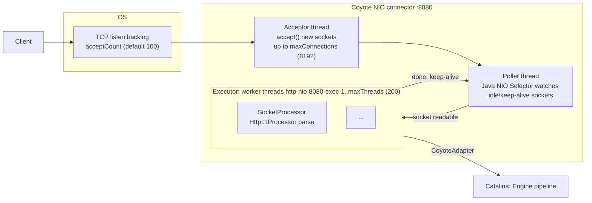

1. The **Acceptor** thread calls `accept()` and registers the socket with the **Poller**. If `maxConnections` is reached, it stops accepting; further clients wait in the **OS backlog** (`acceptCount`). When that is full too, new connection attempts are **refused or time out**.
2. The **Poller** (a Java NIO `Selector`) watches all open sockets. When data arrives it hands a `SocketProcessor` task to the **executor**.
3. A **worker thread** (`http-nio-8080-exec-N`) parses the HTTP request (`Http11Processor`), and the **CoyoteAdapter** turns the Coyote request into the Catalina `Request`/`Response` objects your servlet sees (`HttpServletRequest`).
4. The thread runs the whole servlet call **synchronously** (unless you use Servlet async). After the response is written the socket goes back to the Poller to wait for the next keep-alive request; the thread returns to the pool.

So: **idle keep-alive connections cost no thread**, but each **in-flight request holds one thread** for its whole duration, including the time it waits on the database. That is why slow downstream calls exhaust Tomcat.

### Protocol implementations

| `protocol` attribute | Notes |
|---|---|
| `HTTP/1.1` (default) = `org.apache.coyote.http11.Http11NioProtocol` | Recommended |
| `org.apache.coyote.http11.Http11Nio2Protocol` | NIO2 (async channels) |
| `AJP/1.3` = `AjpNioProtocol` | Binary protocol for Apache `mod_jk`/`mod_proxy_ajp` |
| APR/native (`Http11AprProtocol`) | **Removed in Tomcat 10.1**; Tomcat Native/OpenSSL can still be used for TLS with NIO |
| `<UpgradeProtocol className="org.apache.coyote.http2.Http2Protocol"/>` | Enables HTTP/2 on a connector |

### Key connector attributes and defaults **(Interview Imp)**

| Attribute | Default | Meaning |
|---|---|---|
| `port` | | TCP port |
| `maxThreads` | **200** | Max worker threads = max concurrent requests being processed |
| `minSpareThreads` | 10 | Threads kept alive when idle |
| `maxConnections` | **8192** (NIO/NIO2) | Max open sockets (processing + keep-alive idle) |
| `acceptCount` | **100** | OS backlog when `maxConnections` is reached |
| `connectionTimeout` | 60000 ms (20000 in the shipped `server.xml`) | Wait for the request line after connect, and between reads |
| `keepAliveTimeout` | = `connectionTimeout` | Idle wait for the next request on a keep-alive connection |
| `maxKeepAliveRequests` | 100 | Requests per connection before it is closed (-1 = unlimited) |
| `maxHttpHeaderSize` | 8192 bytes | Larger headers (huge cookies, JWTs) give **400** |
| `maxPostSize` | 2 MB | Limit for form-encoded POST parameter parsing |
| `maxSwallowSize` | 2 MB | Body bytes Tomcat will read and discard after an aborted upload |
| `compression` | off | `on` + `compressibleMimeType` (better done at the proxy) |
| `redirectPort` | 8443 | Where to redirect for `CONFIDENTIAL` security constraints |
| `URIEncoding` | UTF-8 | Decoding of the path |
| `relaxedPathChars`, `relaxedQueryChars` | | Allow characters like `[]\|` that strict RFC parsing rejects with 400 |
| `server` | | Override the `Server` response header |
| `executor` | | Name of a shared `<Executor>` |
| `useVirtualThreads` | false | Tomcat 10.1+/11 on Java 21: one virtual thread per request instead of a platform-thread pool |
| `address` | all interfaces | Bind to a specific IP (e.g. `127.0.0.1` behind a local proxy) |
| `proxyName`, `proxyPort`, `scheme`, `secure` | | Tell Tomcat what the public URL looks like when it sits behind a proxy |

### Capacity formula you should be able to explain

```
Max requests in progress           = maxThreads                        (200)
Max sockets Tomcat holds           = maxConnections                    (8192)
Extra connections queued in the OS = acceptCount                       (100)
Beyond that                        = connection refused / client timeout
```

Little's Law: **threads needed = requests per second x average response time (s)**. At 400 req/s and 250 ms average you need about 100 busy threads. If a dependency slows to 2 s, the same traffic needs 800 threads, so the pool (200) saturates, requests queue and latency explodes. Fix with timeouts, bulkheads, circuit breakers and right-sized pools (chapter 14), not by setting `maxThreads=5000`.

### 📘 Terms Explained

| Term | Meaning |
|---|---|
| Acceptor | Thread that accepts new TCP connections |
| Poller | Thread using a NIO `Selector` to watch sockets for readiness |
| Executor | Thread pool processing requests |
| Backlog | OS queue of connections not yet accepted |
| Keep-alive idle socket | Open connection between requests; consumes no worker thread in NIO |
| Virtual thread | Cheap JVM-managed thread (Java 21) that releases its carrier thread while blocked |
| Little's Law | L = lambda x W: concurrency = arrival rate x time in system |

---

## 6.3 From Connector to your servlet: Mapper, Pipelines and Valves **(Interview Imp)**

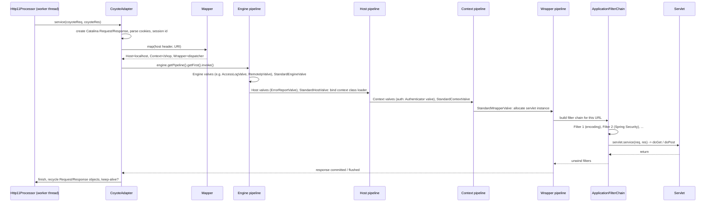

- The **Mapper** keeps an in-memory index of hosts, context paths and servlet mappings, so routing a URL is fast.
- Each container has a **Pipeline**: a chain of **Valves** (Tomcat-specific interceptors) ending in a "basic" valve that calls the child container. Valves see the request *before* the web app's own filters.
- **Filters** (`jakarta.servlet.Filter`) are the standard, portable interceptors defined by the application.
- **Request and Response objects are recycled** after each request; keeping a reference to them after the request ends (e.g. in another thread) causes strange bugs.

### Servlet URL mapping rules (in order)

1. **Exact match** `/orders/list`.
2. **Longest path prefix** `/api/*`.
3. **Extension** `*.jsp`.
4. **Default servlet** `/` (Tomcat's `DefaultServlet` serves static files; Spring's `DispatcherServlet` is usually mapped to `/`).

### Useful built-in valves

| Valve | Purpose |
|---|---|
| `AccessLogValve` | Access log with a pattern (`%h %t "%r" %s %b %D` ...) |
| `RemoteIpValve` | Replace the client IP/scheme with `X-Forwarded-For`/`X-Forwarded-Proto` from trusted proxies |
| `RemoteAddrValve` / `RemoteCIDRValve` | Allow/deny by IP (protect `/manager`) |
| `ErrorReportValve` | Error pages (`showReport="false" showServerInfo="false"` in prod) |
| `StuckThreadDetectionValve` | Log (and optionally interrupt) requests running longer than N seconds |
| `SingleSignOn` | SSO across apps in one Host |
| `CrawlerSessionManagerValve` | Stops bots from creating thousands of sessions |
| `RewriteValve` | `mod_rewrite`-style rules inside Tomcat |
| `SemaphoreValve` | Limit concurrency to a context |
| `HealthCheckValve` | Lightweight `/health` endpoint (9.0.15+) |

### 📘 Terms Explained

| Term | Meaning |
|---|---|
| Mapper | Tomcat component that routes Host + URI to a Context and Wrapper |
| Pipeline / Valve | Tomcat's chain-of-responsibility interceptors on each container |
| Filter chain | Servlet-spec interceptors run before the servlet |
| Default servlet | Servlet mapped to `/` that serves static resources |
| Recycling | Reusing request/response objects to avoid allocations |

---

## 6.4 Class loaders: why "it works in my IDE but not in Tomcat" **(Interview Imp)**

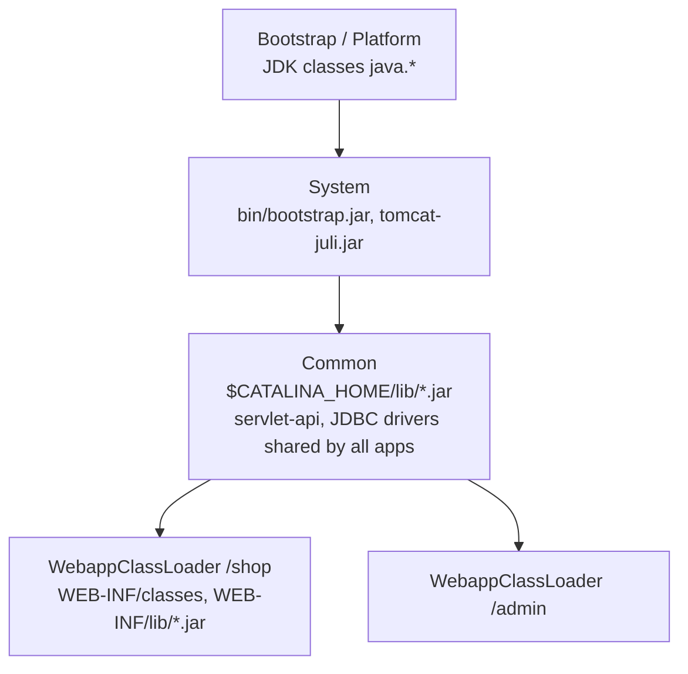

- Standard Java class loading is **parent-first**. Tomcat's **web-app class loader is child-first** (it looks in `WEB-INF/classes` and `WEB-INF/lib` **before** asking the parent), *except* for JRE classes and the Servlet/Jakarta API, which are always taken from the parent.
- Consequences:
  - Each app can ship its own version of a library (e.g. two different Jackson versions in two apps).
  - **Never** put `servlet-api.jar`/`jakarta.servlet-api.jar` in `WEB-INF/lib` (mark it `provided` in Maven).
  - JDBC drivers used by a Tomcat-managed `DataSource` (JNDI) must be in `$CATALINA_HOME/lib` (Common loader), because the pool is created outside the app.
  - **Redeploy memory leaks**: if anything outside the app (a JDBC driver registry, a `ThreadLocal`, a thread the app started, a static cache in a shared library) keeps a reference to a class from the old web-app loader, the whole old app stays in memory (**Metaspace leak**, eventually `OutOfMemoryError: Metaspace`). Tomcat's `JreMemoryLeakPreventionListener` and leak warnings in `catalina.out` ("appears to have started a thread named ... but has failed to stop it") help detect this.
- Tomcat 8.5 to 10 migration: Tomcat 10+ uses **`jakarta.*`** instead of `javax.*`. Old WARs must be migrated (Tomcat Migration Tool for Jakarta EE, or drop them in `webapps-javaee/` for automatic conversion).

### 📘 Terms Explained

| Term | Meaning |
|---|---|
| Class loader | JVM component that loads `.class` files; classes are unique per loader |
| Parent-first / child-first | Which loader is asked first for a class |
| `provided` scope | Maven dependency available at compile time but supplied by the container at runtime |
| Metaspace | JVM memory for class metadata |
| `javax` to `jakarta` | Package rename of the Servlet API since Jakarta EE 9 (Tomcat 10) |

---

## 6.5 Directory layout and every configuration file **(Interview Imp)**

```
$CATALINA_HOME/                  # binaries (can be shared, read-only)
$CATALINA_BASE/                  # one instance's config + apps (defaults to CATALINA_HOME)
├── bin/
│   ├── catalina.sh / .bat       # main control script (start, stop, run, jpda start)
│   ├── startup.sh, shutdown.sh  # wrappers around catalina.sh
│   ├── setenv.sh                # YOUR JVM options (create it; not shipped)
│   └── version.sh, configtest.sh, digest.sh, tool-wrapper.sh
├── conf/
│   ├── server.xml               # Server, Service, Connectors, Engine, Hosts, Realm, Valves
│   ├── web.xml                  # DEFAULT web.xml merged into every app (default servlet, jsp servlet, MIME types, welcome files, session timeout)
│   ├── context.xml              # DEFAULT <Context> for every app (watched resources, shared resources)
│   ├── tomcat-users.xml         # users/roles for UserDatabaseRealm (manager-gui, manager-script)
│   ├── catalina.properties      # class loader paths (common.loader), JAR scan skip list, package access security
│   ├── logging.properties       # JULI logging handlers and levels
│   ├── catalina.policy          # Java security manager policy (obsolete in modern Java)
│   ├── jaspic-providers.xml     # JASPIC auth providers
│   └── Catalina/localhost/      # per-app context descriptors: shop.xml => /shop
├── lib/                         # Common class loader JARs (servlet-api, JDBC drivers, tomcat-*.jar)
├── logs/                        # catalina.out, catalina.YYYY-MM-DD.log, localhost.*.log, localhost_access_log.*.txt
├── webapps/                     # appBase: ROOT/, manager/, host-manager/, docs/, examples/, shop.war
├── work/                        # compiled JSPs, temporary per-app work dirs (safe to delete when stopped)
└── temp/                        # java.io.tmpdir for the JVM
```

**`CATALINA_HOME` vs `CATALINA_BASE`:** HOME holds the Tomcat binaries; BASE holds an instance's `conf`, `logs`, `webapps`, `work`, `temp`. Running several instances from one installation = one HOME + several BASEs (different ports).

### `bin/setenv.sh` - where JVM settings go

```bash
#!/bin/sh
# Never edit catalina.sh; put settings here.
export JAVA_HOME=/usr/lib/jvm/java-21
export CATALINA_PID="$CATALINA_BASE/temp/tomcat.pid"
export CATALINA_OPTS="$CATALINA_OPTS \
  -Xms2g -Xmx2g \
  -XX:+UseG1GC -XX:MaxGCPauseMillis=200 \
  -XX:+HeapDumpOnOutOfMemoryError -XX:HeapDumpPath=$CATALINA_BASE/logs \
  -Xlog:gc*:file=$CATALINA_BASE/logs/gc.log:time,uptime:filecount=5,filesize=20m \
  -Djava.security.egd=file:/dev/urandom \
  -Dfile.encoding=UTF-8 -Duser.timezone=UTC \
  -Dspring.profiles.active=prod"
# JAVA_OPTS applies to start AND stop commands; CATALINA_OPTS only to start/run. Prefer CATALINA_OPTS for heap.
```

### A complete, production-style `server.xml`

```xml
<?xml version="1.0" encoding="UTF-8"?>
<Server port="8005" shutdown="SHUTDOWN-7f3a9c">        <!-- port="-1" disables the shutdown port -->
  <Listener className="org.apache.catalina.startup.VersionLoggerListener" />
  <Listener className="org.apache.catalina.core.AprLifecycleListener" />
  <Listener className="org.apache.catalina.core.JreMemoryLeakPreventionListener" />
  <Listener className="org.apache.catalina.mbeans.GlobalResourcesLifecycleListener" />
  <Listener className="org.apache.catalina.core.ThreadLocalLeakPreventionListener" />

  <GlobalNamingResources>
    <Resource name="UserDatabase" auth="Container" type="org.apache.catalina.UserDatabase"
              factory="org.apache.catalina.users.MemoryUserDatabaseFactory"
              pathname="conf/tomcat-users.xml" />
  </GlobalNamingResources>

  <Service name="Catalina">
    <Executor name="tomcatThreadPool" namePrefix="http-exec-"
              maxThreads="300" minSpareThreads="25" maxIdleTime="60000" />

    <!-- Plain HTTP, only reachable from the local reverse proxy -->
    <Connector executor="tomcatThreadPool"
               address="127.0.0.1" port="8080" protocol="HTTP/1.1"
               connectionTimeout="20000" keepAliveTimeout="15000" maxKeepAliveRequests="200"
               maxConnections="10000" acceptCount="200"
               maxHttpHeaderSize="16384" maxPostSize="10485760"
               URIEncoding="UTF-8" server="webserver"
               redirectPort="443" />

    <!-- Direct HTTPS with HTTP/2 (only if Tomcat terminates TLS itself) -->
    <Connector port="8443" protocol="org.apache.coyote.http11.Http11NioProtocol"
               executor="tomcatThreadPool" SSLEnabled="true" maxConnections="10000">
      <UpgradeProtocol className="org.apache.coyote.http2.Http2Protocol" />
      <SSLHostConfig protocols="TLSv1.2+TLSv1.3">
        <Certificate certificateKeystoreFile="conf/tls/shop.p12"
                     certificateKeystorePassword="${keystore.pass}" type="RSA" />
      </SSLHostConfig>
    </Connector>

    <!-- AJP: keep disabled unless Apache mod_jk/mod_proxy_ajp needs it; then bind to localhost + secret
    <Connector protocol="AJP/1.3" address="127.0.0.1" port="8009" secretRequired="true" secret="s3cr3t" redirectPort="8443" />
    -->

    <Engine name="Catalina" defaultHost="localhost" jvmRoute="node1">
      <Realm className="org.apache.catalina.realm.LockOutRealm">
        <Realm className="org.apache.catalina.realm.UserDatabaseRealm" resourceName="UserDatabase" />
      </Realm>

      <Host name="localhost" appBase="webapps" unpackWARs="true" autoDeploy="false"
            deployOnStartup="true">
        <!-- Trust X-Forwarded-* only from our proxies -->
        <Valve className="org.apache.catalina.valves.RemoteIpValve"
               internalProxies="127\.0\.0\.1|10\.0\.\d{1,3}\.\d{1,3}"
               remoteIpHeader="x-forwarded-for" protocolHeader="x-forwarded-proto" />
        <Valve className="org.apache.catalina.valves.AccessLogValve" directory="logs"
               prefix="access" suffix=".log" rotatable="true"
               pattern="%a %{X-Request-Id}i %t &quot;%r&quot; %s %b %D %{User-Agent}i" />
        <Valve className="org.apache.catalina.valves.ErrorReportValve" showReport="false" showServerInfo="false" />
        <Valve className="org.apache.catalina.valves.StuckThreadDetectionValve" threshold="60" />
      </Host>
    </Engine>
  </Service>
</Server>
```

### `context.xml` - per-application settings (JNDI DataSource, sessions)

Location (highest priority first): `conf/Catalina/localhost/shop.xml` > the app's `META-INF/context.xml` (copied there on deploy if `copyXML`) > global `conf/context.xml` defaults.

```xml
<Context reloadable="false" sessionCookieName="SHOPSESSION" useHttpOnly="true">
    <!-- Tomcat-managed connection pool, looked up as java:comp/env/jdbc/ShopDB -->
    <Resource name="jdbc/ShopDB" auth="Container" type="javax.sql.DataSource"
              factory="org.apache.tomcat.jdbc.pool.DataSourceFactory"
              driverClassName="com.mysql.cj.jdbc.Driver"
              url="jdbc:mysql://db.internal:3306/company_db?useSSL=true"
              username="app" password="${db.pass}"
              initialSize="10" maxActive="50" minIdle="10" maxIdle="50" maxWait="3000"
              validationQuery="SELECT 1" testOnBorrow="true" validationInterval="30000"
              removeAbandoned="true" removeAbandonedTimeout="60" logAbandoned="true" />

    <!-- Session manager: no persistence across restarts -->
    <Manager className="org.apache.catalina.session.StandardManager" pathname="" maxActiveSessions="-1" />

    <WatchedResource>WEB-INF/web.xml</WatchedResource>
    <CookieProcessor sameSiteCookies="lax" />
</Context>
```

(The `${...}` placeholders are resolved from system properties, e.g. `-Ddb.pass=...` or a `PropertySource`; never commit real passwords.)

### `web.xml` - the deployment descriptor (per app in `WEB-INF/web.xml`)

```xml
<web-app xmlns="https://jakarta.ee/xml/ns/jakartaee" version="6.0">
    <display-name>Shop</display-name>

    <context-param><param-name>env</param-name><param-value>prod</param-value></context-param>

    <filter>
        <filter-name>encoding</filter-name>
        <filter-class>org.example.EncodingFilter</filter-class>
    </filter>
    <filter-mapping><filter-name>encoding</filter-name><url-pattern>/*</url-pattern></filter-mapping>

    <servlet>
        <servlet-name>orders</servlet-name>
        <servlet-class>org.example.OrderServlet</servlet-class>
        <load-on-startup>1</load-on-startup>              <!-- init at deploy, not at first request -->
        <multipart-config><max-file-size>10485760</max-file-size></multipart-config>
    </servlet>
    <servlet-mapping><servlet-name>orders</servlet-name><url-pattern>/orders/*</url-pattern></servlet-mapping>

    <listener><listener-class>org.example.AppStartupListener</listener-class></listener>

    <session-config>
        <session-timeout>30</session-timeout>            <!-- minutes -->
        <cookie-config><http-only>true</http-only><secure>true</secure></cookie-config>
        <tracking-mode>COOKIE</tracking-mode>            <!-- never put the session id in URLs -->
    </session-config>

    <error-page><error-code>404</error-code><location>/errors/404.html</location></error-page>
    <error-page><exception-type>java.lang.Throwable</exception-type><location>/errors/500.html</location></error-page>

    <security-constraint>
        <web-resource-collection><web-resource-name>admin</web-resource-name><url-pattern>/admin/*</url-pattern></web-resource-collection>
        <auth-constraint><role-name>admin</role-name></auth-constraint>
        <user-data-constraint><transport-guarantee>CONFIDENTIAL</transport-guarantee></user-data-constraint>
    </security-constraint>
    <login-config><auth-method>FORM</auth-method>
        <form-login-config><form-login-page>/login.html</form-login-page><form-error-page>/login-error.html</form-error-page></form-login-config>
    </login-config>
    <security-role><role-name>admin</role-name></security-role>
</web-app>
```

Since Servlet 3.0, most of this can be annotations (`@WebServlet`, `@WebFilter`, `@WebListener`) or programmatic registration (`ServletContainerInitializer`, Spring's `WebApplicationInitializer`); `web.xml` overrides annotations when both exist. `metadata-complete="true"` stops Tomcat scanning JARs for annotations (faster startup).

### `tomcat-users.xml` and the Manager app

```xml
<tomcat-users>
  <role rolename="manager-gui"/>
  <role rolename="manager-script"/>
  <user username="deployer" password="{use-a-strong-one}" roles="manager-script"/>
</tomcat-users>
```

Roles: `manager-gui` (HTML UI), `manager-script` (text API for CI: `/manager/text/deploy?path=/shop&update=true`), `manager-jmx`, `manager-status`. Restrict `/manager` by IP (`RemoteCIDRValve` in `webapps/manager/META-INF/context.xml`) or remove it in production.

### `logging.properties` and the log files

| File | Contents |
|---|---|
| `catalina.out` | stdout/stderr of the JVM (`System.out`, uncaught exceptions, startup) - not rotated by Tomcat; rotate with `logrotate` or use `CATALINA_OUT=/dev/null` and log to files |
| `catalina.<date>.log` | Container log: startup, deployments, errors |
| `localhost.<date>.log` | Host-level messages, servlet exceptions logged via `ServletContext.log` |
| `localhost_access_log.<date>.txt` / `access.log` | One line per request (AccessLogValve) |
| `manager.*.log`, `host-manager.*.log` | Manager apps |

Application logs (SLF4J/Logback/Log4j2) are configured inside the app and usually written to their own files or to stdout for containers.

### 📘 Terms Explained

| Term | Meaning |
|---|---|
| `CATALINA_HOME` / `CATALINA_BASE` | Tomcat installation / instance directory |
| `setenv.sh` | Script sourced by `catalina.sh` for JVM options |
| Deployment descriptor | `WEB-INF/web.xml` describing servlets, filters, security |
| JNDI | Java Naming and Directory Interface; Tomcat exposes resources like DataSources under `java:comp/env` |
| Realm | Tomcat's user/role database for container-managed security |
| `load-on-startup` | Initialise a servlet at deploy time, in the given order |

---

## 6.6 Startup and deployment lifecycle **(Interview Imp)**

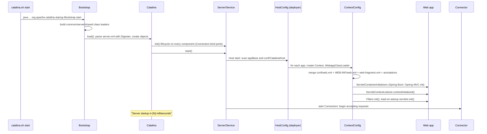

- Lifecycle states of every component: `NEW` > `INITIALIZING` > `INITIALIZED` > `STARTING_PREP` > `STARTING` > `STARTED` > `STOPPING_PREP` > `STOPPING` > `STOPPED` > `DESTROYING` > `DESTROYED` (or `FAILED`). `LifecycleListener`s receive the events.
- Connectors start **after** apps are deployed, so the port answers only when apps are ready (an app that fails to start is marked unavailable; others still run).
- **Shutdown**: the shutdown command on port 8005 (or SIGTERM) stops connectors first, waits for in-flight requests (`unloadDelay`), calls `contextDestroyed`, `destroy()` on servlets/filters, then persists sessions (StandardManager).

### Deployment options

| Method | How | Notes |
|---|---|---|
| Drop a WAR in `webapps/` | `shop.war` => `/shop`, `ROOT.war` => `/`, `api#v2.war` => `/api/v2` | `autoDeploy` (default true) watches for changes; set `false` in prod and deploy deliberately |
| Exploded directory | `webapps/shop/` | Easy for dev |
| Context descriptor | `conf/Catalina/localhost/shop.xml` with `docBase="/opt/apps/shop.war"` | App outside `webapps`, config separate from the artefact |
| Manager app | HTTP API / Maven/Gradle plugins / Jenkins | Remote deploy |
| **Parallel deployment** | `shop##002.war` next to `shop##001.war` | New sessions go to the new version, existing sessions finish on the old: zero-downtime |
| Embedded (Spring Boot) | Fat JAR with Tomcat inside: `java -jar shop.jar` | Dominant style today; one app per JVM/container |

**Hot reload (`reloadable="true"`)** re-creates the class loader when classes change; convenient in dev, a leak risk in prod.

### 📘 Terms Explained

| Term | Meaning |
|---|---|
| Digester | Tomcat's XML-to-object mapper used for `server.xml` |
| `ServletContainerInitializer` | SPI that lets libraries (Spring) configure the app at startup |
| `web-fragment.xml` | `web.xml` pieces shipped inside library JARs |
| Parallel deployment | Several versions of one app side by side, routed by session |
| Exploded WAR | An unzipped WAR directory |

---

## 6.7 Sessions inside Tomcat **(Interview Imp)**

- `request.getSession()` creates an `HttpSession` stored in the Context's **Manager** (in JVM memory) and sends `Set-Cookie: JSESSIONID=<id>[.<jvmRoute>]`.
- Next requests carry the cookie; Tomcat looks the session up by id. A background thread expires sessions after `session-timeout` (default **30 minutes**) of inactivity.
- **Session fixation** protection: Tomcat changes the session id after authentication (`changeSessionIdOnAuthentication`, default true).

| Manager | Behaviour |
|---|---|
| `StandardManager` (default) | In memory; serialises sessions to `SESSIONS.ser` on graceful shutdown and reloads them at start |
| `PersistentManager` | Swaps idle sessions to a `FileStore` or `JDBCStore` |
| `DeltaManager` (cluster) | Replicates every session change to **all** nodes (all-to-all; fine for 2-4 nodes) |
| `BackupManager` (cluster) | Replicates each session to **one** backup node |
| External store (Redis/Memcached via Spring Session or Redisson) | Sessions outside Tomcat: stateless app nodes, best for cloud |

Clustering uses `<Cluster className="org.apache.catalina.ha.tcp.SimpleTcpCluster"/>` in `server.xml` plus `<distributable/>` in `web.xml`; everything in the session must be `Serializable`. Most modern architectures avoid Tomcat clustering and choose **sticky sessions** (cheap but lose sessions on node failure) or an **external session store / stateless JWT** (chapter 12).

## 6.8 Security in Tomcat (summary; full list in chapter 13)

Realms (`UserDatabaseRealm`, `DataSourceRealm`, `JNDIRealm` for LDAP/AD, `JAASRealm`, `LockOutRealm` against brute force, `CombinedRealm`), `security-constraint` in `web.xml`, `CredentialHandler` (hashed passwords: `SecretKeyCredentialHandler` with PBKDF2), `CsrfPreventionFilter`, `HttpHeaderSecurityFilter` (HSTS, X-Frame-Options, nosniff), `RemoteCIDRValve` for admin apps.

### 📘 Terms Explained

| Term | Meaning |
|---|---|
| `HttpSession` | Server-side per-user storage keyed by a session id |
| Session Manager | Tomcat component that creates, stores and expires sessions |
| Session fixation | Attack forcing a victim to use a session id the attacker knows |
| `distributable` | Marks an app as safe for session replication |
| Sticky session | Load balancer sends a user's requests to the same node |

---
# 7. Servlets and Spring Boot on Tomcat

## 7.1 Servlet lifecycle **(Interview Imp)**

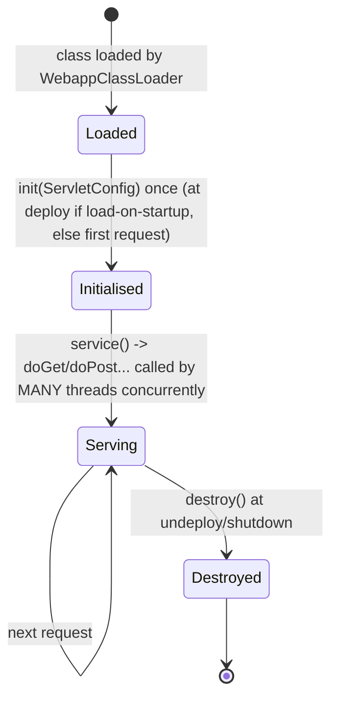

```java
@WebServlet(urlPatterns = "/hello", loadOnStartup = 1)
public class HelloServlet extends HttpServlet {
    private DataSource ds;                                   // shared, thread-safe object: fine

    @Override public void init() throws ServletException {
        try { ds = (DataSource) new InitialContext().lookup("java:comp/env/jdbc/ShopDB"); }
        catch (NamingException e) { throw new ServletException(e); }
    }

    @Override protected void doGet(HttpServletRequest req, HttpServletResponse resp) throws IOException {
        String name = req.getParameter("name");              // local variables are per-thread: safe
        resp.setContentType("text/plain;charset=UTF-8");
        resp.getWriter().println("Hello " + (name == null ? "world" : name));
    }
}
```

**One instance, many threads.** Tomcat creates a single instance of each servlet and calls `service()` from many worker threads at once. Never keep request data in instance fields (it leaks between users); keep it in local variables, the request, or the session.

**Request, response, session, context scopes:**

| Object | Lifetime | Shared by |
|---|---|---|
| `HttpServletRequest` attributes | One request | One thread |
| `HttpSession` attributes | One user session (30 min idle default) | All requests of that user (possibly concurrently: guard mutations) |
| `ServletContext` attributes | Whole app | Everyone |

**Async servlets** (`req.startAsync()`, Servlet 3.0) release the worker thread while waiting (long polling, slow downstream calls) and complete later from another thread. Spring MVC exposes this via `DeferredResult`, `CompletableFuture` return values and `SseEmitter`.

## 7.2 Spring MVC request flow (inside the servlet)

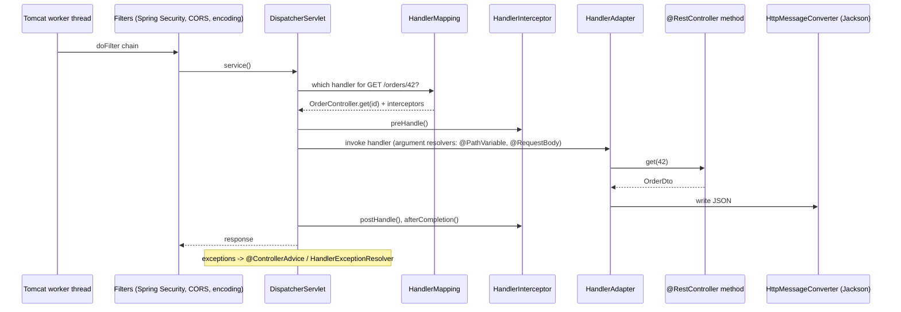

## 7.3 Spring Boot embedded Tomcat **(Interview Imp)**

Spring Boot creates Tomcat **programmatically** (no `server.xml`): `TomcatServletWebServerFactory` builds a `Tomcat` object, adds one Connector and one Context, and registers `DispatcherServlet`. Configure it with `application.yml`:

```yaml
server:
  port: 8080
  address: 0.0.0.0
  shutdown: graceful                 # finish in-flight requests on SIGTERM
  max-http-request-header-size: 16KB
  forward-headers-strategy: native   # honour X-Forwarded-* (uses Tomcat RemoteIpValve)
  compression:
    enabled: true
    mime-types: application/json,text/html,text/css,application/javascript
    min-response-size: 2KB
  http2:
    enabled: true
  ssl:                               # only if the app terminates TLS itself
    enabled: false
  servlet:
    context-path: /
    session:
      timeout: 30m
      cookie: { http-only: true, secure: true, same-site: lax }
  tomcat:
    threads:
      max: 200                       # = maxThreads
      min-spare: 10
    max-connections: 8192
    accept-count: 100
    connection-timeout: 20s
    keep-alive-timeout: 20s
    max-keep-alive-requests: 100
    max-swallow-size: 2MB
    max-http-form-post-size: 2MB
    remoteip:
      internal-proxies: 10\.\d{1,3}\.\d{1,3}\.\d{1,3}
      protocol-header: X-Forwarded-Proto
    accesslog:
      enabled: true
      pattern: '%a %t "%r" %s %b %D'
    mbeanregistry:
      enabled: true                  # expose Tomcat metrics via JMX/Micrometer
spring:
  lifecycle:
    timeout-per-shutdown-phase: 30s
  threads:
    virtual:
      enabled: true                  # Boot 3.2+ on Java 21: virtual threads for request handling
  datasource:
    hikari:
      maximum-pool-size: 20          # DB pool; NOT equal to Tomcat threads (see chapter 14)
      connection-timeout: 3000
```

Programmatic customisation:

```java
@Bean
WebServerFactoryCustomizer<TomcatServletWebServerFactory> tomcatCustomizer() {
    return f -> {
        f.addConnectorCustomizers(c -> c.setProperty("relaxedQueryChars", "[]|{}"));
        f.addContextValves(new StuckThreadDetectionValve());
    };
}
```

| Standalone Tomcat + WAR | Spring Boot embedded |
|---|---|
| Many apps per Tomcat, shared JVM | One app per JVM/container |
| Ops team manages Tomcat version and config | App owns its server version in `pom.xml` |
| `server.xml`, `context.xml`, JNDI | `application.yml`, beans |
| Redeploy WARs without restarting the JVM | Restart the process (fast) / roll pods |
| Classic enterprise | Microservices, containers, Kubernetes |

Alternatives: `spring-boot-starter-jetty`, `spring-boot-starter-undertow`, or reactive **Netty** with WebFlux (event loop, no thread per request).

### 📘 Terms Explained

| Term | Meaning |
|---|---|
| `DispatcherServlet` | Spring MVC's front controller servlet |
| HandlerMapping / HandlerAdapter | Find and invoke the controller method |
| Interceptor | Spring-level hook around controller calls |
| Embedded server | Server started inside the application process |
| Graceful shutdown | Stop accepting, finish in-flight requests, then exit |
| Front controller | One entry servlet that dispatches all requests |

---

# 8. Wiring Apache/Nginx to Tomcat **(Interview Imp) (Architect)**

## 8.1 Options

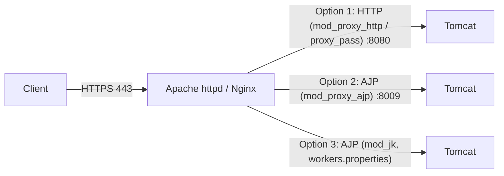

| Option | Protocol | Pros | Cons | Verdict |
|---|---|---|---|---|
| `mod_proxy_http` / Nginx `proxy_pass` | HTTP/1.1 | Simple, standard, debuggable with curl, works with any backend, WebSocket support | Need `X-Forwarded-*` + `RemoteIpValve` to keep client IP/scheme | **Default choice** |
| `mod_proxy_ajp` | AJP 1.3 (binary) | Passes client IP, TLS info, remote user automatically; compact | Port 8009 must be protected (Ghostcat), fewer tools, no WebSocket over AJP | Legacy setups |
| `mod_jk` | AJP 1.3 | Very mature load balancing and status worker | Separate module to build/install, own config language | Legacy |

**Ghostcat (CVE-2020-1938):** an exposed AJP port allowed reading any file in the web app (and sometimes remote code execution). Since Tomcat 9.0.31 / 8.5.51 the AJP connector is **disabled by default**, binds to localhost and requires a `secret`. If you use AJP: `address="127.0.0.1"`, `secretRequired="true"`, firewall the port.

## 8.2 Apache + Tomcat over HTTP with load balancing (recommended)

```apache
LoadModule proxy_module modules/mod_proxy.so
LoadModule proxy_http_module modules/mod_proxy_http.so
LoadModule proxy_balancer_module modules/mod_proxy_balancer.so
LoadModule lbmethod_byrequests_module modules/mod_lbmethod_byrequests.so
LoadModule slotmem_shm_module modules/mod_slotmem_shm.so
LoadModule headers_module modules/mod_headers.so
LoadModule proxy_wstunnel_module modules/mod_proxy_wstunnel.so

<VirtualHost *:443>
    ServerName shop.example.com
    # ... SSL as in 4.7 ...

    # Sticky routing: Tomcat appends .node1/.node2 (jvmRoute) to JSESSIONID
    <Proxy "balancer://tomcats">
        BalancerMember "http://10.0.1.11:8080" route=node1 connectiontimeout=3 timeout=60 retry=30 keepalive=On
        BalancerMember "http://10.0.1.12:8080" route=node2 connectiontimeout=3 timeout=60 retry=30 keepalive=On
        BalancerMember "http://10.0.1.13:8080" status=+H                 # hot standby
        ProxySet lbmethod=byrequests stickysession=JSESSIONID|jsessionid nofailover=Off
    </Proxy>

    ProxyPreserveHost On
    ProxyRequests Off                                    # NEVER On: that makes an open forward proxy
    ProxyTimeout 60
    RequestHeader set X-Forwarded-Proto "https"
    RequestHeader set X-Request-Id "%{UNIQUE_ID}e"       # needs mod_unique_id

    ProxyPass        /static/ !                         # Apache serves these itself
    ProxyPass        /ws/  balancer://tomcats/ws/ upgrade=websocket
    ProxyPass        /     balancer://tomcats/
    ProxyPassReverse /     balancer://tomcats/
    ProxyPassReverseCookiePath /shop /                  # if the app runs under /shop in Tomcat

    <Location "/balancer-manager">                      # live view: enable/disable members
        SetHandler balancer-manager
        Require ip 10.0.0.0/8
    </Location>
</VirtualHost>
```

Load-balancing methods: `byrequests` (weighted request count), `bytraffic` (bytes), `bybusyness` (fewest active requests), `heartbeat`. Parameters: `loadfactor` (weight), `retry` (seconds before retrying a failed member), `status=+H` (hot standby), `+D` (disabled), `+N` (drain).

On the Tomcat side, use `RemoteIpValve` (or Boot's `forward-headers-strategy`) so `request.getRemoteAddr()`, `isSecure()` and `getScheme()` reflect the real client, and set `jvmRoute` in `<Engine>` to match the `route` values.

## 8.3 Apache + Tomcat over AJP (when you must)

```apache
# mod_proxy_ajp
ProxyPass        / "ajp://127.0.0.1:8009/" secret=s3cr3t
ProxyPassReverse / "ajp://127.0.0.1:8009/"
```

```xml
<!-- Tomcat -->
<Connector protocol="AJP/1.3" address="127.0.0.1" port="8009"
           secretRequired="true" secret="s3cr3t" redirectPort="8443" maxThreads="200" />
```

`mod_jk` equivalent:

```properties
# conf/workers.properties
worker.list=lb,status
worker.node1.type=ajp13
worker.node1.host=10.0.1.11
worker.node1.port=8009
worker.node1.secret=s3cr3t
worker.node1.route=node1
worker.node2.type=ajp13
worker.node2.host=10.0.1.12
worker.node2.port=8009
worker.node2.secret=s3cr3t
worker.node2.route=node2
worker.lb.type=lb
worker.lb.balance_workers=node1,node2
worker.lb.sticky_session=true
worker.status.type=status
```

```apache
JkWorkersFile conf/workers.properties
JkLogFile logs/mod_jk.log
JkMount /* lb
JkUnMount /static/* lb
JkMount /jkstatus status
```

## 8.4 What headers must cross the proxy (and why)

| Header | Set by proxy | Read by Tomcat/app to |
|---|---|---|
| `X-Forwarded-For` | append client IP | Know the real client IP (logs, rate limits, audit) |
| `X-Forwarded-Proto` | `https` | Generate correct absolute URLs and redirects, mark cookies `Secure`, `request.isSecure()` |
| `X-Forwarded-Host` / preserve `Host` | original host | Absolute URLs, multi-tenant routing |
| `X-Forwarded-Port` | 443 | Absolute URLs |
| `X-Request-Id` / `traceparent` | unique id | Correlate logs across tiers |
| `Forwarded` (RFC 7239) | standard combined form | Same as above |

**Security rule:** the backend must trust these headers **only from known proxy IPs** (`internalProxies` / `trustedProxies`); otherwise any client can forge its IP.

Classic symptom of a missing `X-Forwarded-Proto`: after login, the app redirects to `http://...` (or into a redirect loop with an HTTPS-only LB).

### 📘 Terms Explained

| Term | Meaning |
|---|---|
| AJP | Apache JServ Protocol: binary proxy protocol between httpd and Tomcat |
| Ghostcat | Vulnerability via an exposed AJP connector |
| Balancer member | One backend inside an Apache `balancer://` group |
| Hot standby | Backend used only when all others fail |
| `ProxyRequests` | Turns Apache into a *forward* proxy; keep Off |
| Route / jvmRoute | Node name used for sticky sessions |

---

# 9. Reverse Proxies, Load Balancers, CDNs and Gateways **(Architect)**

## 9.1 L4 vs L7 load balancing **(Interview Imp)**

| | L4 (transport) | L7 (application) |
|---|---|---|
| Sees | IP, port, TCP/UDP | Full HTTP: host, path, headers, cookies |
| Examples | AWS NLB, HAProxy (mode tcp), LVS/IPVS, kube-proxy | AWS ALB, Nginx, Apache, HAProxy (mode http), Envoy, Traefik |
| TLS | Pass-through (or terminate) | Terminates (can re-encrypt) |
| Routing | By connection | By request (path-based, header-based, canary %) |
| Stickiness | Source-IP | Cookie |
| Cost/latency | Lowest | Higher (parses HTTP) but far more features |

## 9.2 Algorithms

| Algorithm | Idea | Good for |
|---|---|---|
| Round robin | Next server in turn | Equal servers, short uniform requests |
| Weighted round robin | Proportional to weight | Mixed hardware |
| Least connections / least busy | Fewest active connections/requests | Variable request duration |
| Least response time / EWMA | Fastest recent responses | Latency-sensitive |
| IP hash / consistent hash | Same client/key to same server | Caches, stickiness without cookies |
| Random with two choices (P2C) | Pick two at random, take the less loaded | Large fleets (Envoy, Finagle) |

## 9.3 Health checks, failover and draining

- **Passive** checks: mark a backend bad after real requests fail (`max_fails` in Nginx, `retry` in Apache).
- **Active** checks: the LB calls `/health` every N seconds (HAProxy, Nginx Plus, cloud LBs, Kubernetes readiness probes).
- **Liveness vs readiness:** *liveness* = the process is alive (restart if not); *readiness* = it can take traffic now (don't route if not, e.g. during warm-up or when the DB is down).
- **Connection draining / deregistration delay:** stop sending new requests to a node and let in-flight ones finish before stopping it. Combine with Tomcat/Spring graceful shutdown.
- **Retries:** only retry **idempotent** requests (GET, PUT, DELETE) or requests that never reached the backend; add a retry budget to avoid retry storms.

## 9.4 TLS placement options

```mermaid
flowchart LR
    subgraph A["1. Termination at LB (most common)"]
        c1[Client] -->|TLS| lb1[LB] -->|HTTP| t1[Tomcat]
    end
    subgraph B["2. Re-encryption (end-to-end)"]
        c2[Client] -->|TLS| lb2[LB] -->|TLS| t2[Tomcat]
    end
    subgraph C["3. Pass-through (L4)"]
        c3[Client] -->|TLS untouched| lb3[L4 LB] -->|TLS| t3[Tomcat terminates]
    end
```

| Option | Pros | Cons |
|---|---|---|
| Terminate at edge | Central certs, L7 features, less CPU on apps | Plain text inside the network (fine in a trusted VPC; not for strict compliance) |
| Re-encrypt | Encrypted everywhere, L7 features | Double TLS cost, cert management on backends |
| Pass-through | Backend owns certs, true end-to-end | No L7 routing, no WAF, LB can't add headers |

Service meshes (Istio, Linkerd) automate option 2 with **mTLS** between every service.

## 9.5 CDN, WAF, API gateway

| Component | Purpose | Examples |
|---|---|---|
| **CDN** | Cache static (and some dynamic) content at edge locations near users; absorb DDoS; TLS near the user | CloudFront, Cloudflare, Akamai, Fastly |
| **WAF** | Inspect HTTP for attacks (SQLi, XSS, bad bots), rate limit | AWS WAF, Cloudflare, ModSecurity + OWASP CRS |
| **API gateway** | Auth (JWT/OAuth), rate limits, quotas, request transformation, routing to microservices, API keys, analytics | Kong, Apigee, AWS API Gateway, Spring Cloud Gateway |
| **Service mesh** | East-west traffic: mTLS, retries, timeouts, telemetry via sidecars | Istio, Linkerd |
| **Ingress controller** | Kubernetes' L7 entry point | ingress-nginx, Traefik, Envoy Gateway, AWS ALB controller |

```mermaid
flowchart LR
    U[User] --> DNS[GeoDNS] --> CDN[CDN + WAF]
    CDN -->|cache miss / dynamic| GLB[Cloud L7 load balancer]
    GLB --> GW[API gateway]
    GW --> I1[Nginx/Ingress]
    I1 --> S1[Spring Boot pods<br/>embedded Tomcat]
    I1 --> S2[Legacy Tomcat with WARs]
    S1 --> R[(Redis)]
    S1 --> DB[(DB primary)]
    DB --> DBR[(Replica)]
```

### 📘 Terms Explained

| Term | Meaning |
|---|---|
| L4 / L7 | Transport-level vs HTTP-level balancing |
| Health check | Probe to decide whether a backend gets traffic |
| Draining | Letting existing requests finish before removing a node |
| Retry storm | Retries multiplying load on an already failing service |
| CDN | Content Delivery Network |
| WAF | Web Application Firewall |
| East-west / north-south | Service-to-service traffic / client-to-service traffic |

---
# 10. End-to-End Request Flows (with sequence diagrams) **(Interview Imp)**

## 10.1 Static file through Nginx (never touches Tomcat)

```mermaid
sequenceDiagram
    participant B as Browser
    participant N as Nginx worker
    participant K as Linux kernel (page cache)
    B->>N: GET /assets/app.3f9a.js (keep-alive, HTTP/2)
    N->>N: location /assets/ matched, root /var/www/shop
    N->>K: open() + sendfile() (zero copy)
    K-->>B: bytes from page cache straight to socket
    N-->>B: 200, Cache-Control: public, max-age=31536000, immutable
    Note over B: next visit: served from browser cache, no request at all
```

## 10.2 Dynamic API call through Apache to Tomcat to MySQL

```mermaid
sequenceDiagram
    participant B as Browser
    participant LB as Cloud LB (TLS)
    participant A as Apache (event MPM)
    participant T as Tomcat NIO connector
    participant W as Worker thread
    participant S as Spring controller
    participant P as HikariCP pool
    participant D as MySQL
    B->>LB: TLS, GET /api/orders/42, Cookie JSESSIONID=abc.node1
    LB->>A: HTTP, X-Forwarded-For, X-Forwarded-Proto=https
    A->>A: vhost + ProxyPass match, sticky route node1
    A->>T: reuse pooled keep-alive connection to 10.0.1.11:8080
    T->>W: Poller: socket readable, dispatch to exec-17
    W->>W: parse HTTP, RemoteIpValve, AccessLogValve start timer
    W->>S: filters (security: session lookup abc), DispatcherServlet, controller
    S->>P: getConnection() (waits up to 3 s if pool empty)
    P->>D: SELECT ... (connection already open)
    D-->>P: rows
    P-->>S: return connection to pool
    S-->>W: JSON body
    W-->>T: write response, socket back to Poller (keep-alive)
    T-->>A: 200 OK
    A-->>LB: 200 OK (+ headers, gzip)
    LB-->>B: 200 OK over TLS
```

Notice the **pools at every hop**: browser connection pool, LB-to-Apache connections, Apache-to-Tomcat keep-alive connections, Tomcat worker threads, DB connection pool. Every pool has a size and a timeout, and the smallest one is your bottleneck.

## 10.3 Login and session creation

```mermaid
sequenceDiagram
    participant B as Browser
    participant T as Tomcat / Spring Security
    participant M as Session Manager
    participant DB as User DB
    B->>T: POST /login (username, password) over HTTPS
    T->>DB: load user, verify bcrypt hash
    DB-->>T: OK
    T->>M: create HttpSession (change id to prevent fixation)
    M-->>T: id = 7C1E...node1
    T-->>B: 302 Location: /home, Set-Cookie: JSESSIONID=7C1E...node1#59; Secure#59; HttpOnly#59; SameSite=Lax
    B->>T: GET /home, Cookie: JSESSIONID=7C1E...node1
    T->>M: find session 7C1E -> SecurityContext (user, roles)
    T-->>B: 200 personalised page
```

## 10.4 File upload (why limits exist at every layer)

```mermaid
sequenceDiagram
    participant B as Browser
    participant N as Nginx
    participant T as Tomcat
    participant S as Spring (MultipartResolver)
    B->>N: POST /upload, Content-Length 50 MB
    alt client_max_body_size 10m exceeded
        N-->>B: 413 Payload Too Large (Tomcat never sees it)
    else allowed
        N->>N: buffer body to disk/memory (proxy_request_buffering on)
        N->>T: forward fast over LAN
        T->>S: multipart parse (max-file-size, max-request-size)
        S-->>B: 201 Created / 413 if Spring limit hit
    end
```

Buffering at the proxy protects Tomcat threads from slow uploads (a thread would otherwise be held for the whole upload time). For very large files, upload directly to object storage (S3 pre-signed URL) instead.

## 10.5 WebSocket upgrade

```mermaid
sequenceDiagram
    participant B as Browser
    participant N as Nginx
    participant T as Tomcat WebSocket
    B->>N: GET /ws/chat, Upgrade: websocket, Connection: Upgrade, Sec-WebSocket-Key
    N->>T: same headers (proxy_set_header Upgrade/Connection)
    T-->>N: 101 Switching Protocols, Sec-WebSocket-Accept
    N-->>B: 101
    B-->>T: frames both directions for minutes/hours
    Note over N,T: proxy_read_timeout must exceed ping interval, or connections drop at 60 s
```

## 10.6 Failure scenarios (know which layer answers) **(Interview Imp)**

| Situation | What the client sees | Produced by | Where to look |
|---|---|---|---|
| Tomcat process down / port closed | **502 Bad Gateway** (connection refused) | Apache/Nginx | proxy error log: `connect() failed (111: Connection refused)` |
| Tomcat accepted but closed the connection | **502** | proxy | `upstream prematurely closed connection` (often keep-alive timeout mismatch) |
| App too slow, proxy timeout fires | **504 Gateway Timeout** | proxy | `upstream timed out`; Tomcat thread dump |
| All Tomcat threads busy, backlog full | Proxy waits then **504**, or connection refused **502** | proxy | Tomcat `currentThreadsBusy` = `maxThreads` |
| Apache `MaxRequestWorkers` reached | Client connection hangs, times out | Apache | error log `server reached MaxRequestWorkers` |
| LB has no healthy targets | **503 Service Unavailable** | LB | LB target health |
| Maintenance / circuit open / rate limited | **503** / **429** | app, gateway | |
| DB pool exhausted | Request waits `connection-timeout`, then **500** | app | `HikariPool - Connection is not available, request timed out after 3000ms` |
| Header too big (huge cookie) | **400** (Tomcat), **431**, Nginx `400 Request Header Or Cookie Too Large` | Tomcat / Nginx | `maxHttpHeaderSize` / `large_client_header_buffers` |
| Body too big | **413** | Nginx/Apache/Tomcat/Spring | the smallest limit wins |
| Wrong vhost / missing route | **404** from proxy or default site | proxy | `apachectl -S`, `nginx -T` |
| App exception | **500** | Tomcat/Spring | app log stack trace |
| Redirect loop after login | `ERR_TOO_MANY_REDIRECTS` | app | missing `X-Forwarded-Proto` / `RemoteIpValve` |
| Client closes early | Nginx logs **499** | client | slow responses, user navigated away |

### 📘 Terms Explained

| Term | Meaning |
|---|---|
| Zero copy | Moving file data to the socket without copying through user memory |
| Request buffering | Proxy reads the full request body before contacting the backend |
| Pre-signed URL | Time-limited URL that lets a client upload straight to object storage |
| 499 | Nginx-specific code: client closed the connection |
| Upstream | Nginx's word for the backend |

---

# 11. Configuration Reference: Timeouts, Limits and Pools Across Layers **(Architect)**

## 11.1 The timeout chain **(Interview Imp)**

Timeouts must get **shorter as you go deeper** (or at least each layer must time out *before* its caller), so the deepest layer fails first with a meaningful error and the caller can react. Idle keep-alive timeouts go the **other** way: the server side (backend) must keep idle connections open **longer** than the client side (proxy) reuses them, otherwise the proxy sends a request on a connection the backend is just closing (random 502s).

```mermaid
flowchart LR
    B["Browser / client<br/>e.g. 120 s"] --> LB["LB idle timeout<br/>60-120 s"]
    LB --> P["Nginx proxy_read_timeout / Apache ProxyTimeout<br/>60 s"]
    P --> T["Tomcat (no per-request timeout by default)<br/>StuckThreadDetectionValve 60 s"]
    T --> H["HTTP client to other services<br/>connect 2 s, read 10 s"]
    T --> DBP["DB pool wait 3 s,<br/>query timeout 30 s"]
```

| Layer | Setting | Typical value | Notes |
|---|---|---|---|
| Cloud LB | idle timeout | 60 s (ALB) | Raise for WebSocket/SSE |
| Nginx | `proxy_connect_timeout` | 2-5 s | Fail fast if the backend is down |
| Nginx | `proxy_read_timeout` / `proxy_send_timeout` | 30-60 s | Between two reads, not total |
| Nginx | `keepalive_timeout` (client side) | 65 s | |
| Nginx | `upstream keepalive_timeout` | 60 s | Must be **lower** than Tomcat `keepAliveTimeout` |
| Apache | `Timeout`, `ProxyTimeout` | 60 s | |
| Apache | `KeepAliveTimeout` | 5 s | Client side |
| Apache | `BalancerMember ... ttl=` | below Tomcat keep-alive | Recycle pooled backend connections |
| Tomcat | `connectionTimeout` | 20 s | Waiting for request data |
| Tomcat | `keepAliveTimeout` | 20-75 s | **Higher** than proxy's backend idle timeout |
| Spring MVC async | `spring.mvc.async.request-timeout` | 30 s | Async requests only |
| HTTP client (RestClient/WebClient) | connect / read | 1-2 s / 2-10 s | Never infinite (Java default is infinite!) |
| HikariCP | `connection-timeout` | 1-3 s | Wait for a free connection |
| JDBC | statement/query timeout | 5-30 s | `spring.jpa.properties.jakarta.persistence.query.timeout` |
| DB server | `wait_timeout` (MySQL), idle session timeout | 8 h / minutes | Pool `max-lifetime` must be lower |
| HikariCP | `max-lifetime` | 30 min | Below DB/firewall idle kill |

## 11.2 Size limits that must agree

| Limit | Nginx | Apache | Tomcat | Spring |
|---|---|---|---|---|
| Request body | `client_max_body_size` (1m) | `LimitRequestBody` | `maxPostSize` (forms 2 MB), `maxSwallowSize` | `spring.servlet.multipart.max-file-size` (1MB), `max-request-size` (10MB) |
| Header size | `large_client_header_buffers 4 8k` | `LimitRequestFieldSize 8190` | `maxHttpHeaderSize 8192` | `server.max-http-request-header-size` |
| URL length | `large_client_header_buffers` | `LimitRequestLine 8190` | `maxHttpHeaderSize` | |
| Header count | | `LimitRequestFields 100` | `maxHeaderCount 100` | |

## 11.3 Concurrency knobs side by side

| Concept | Apache event | Nginx | Tomcat | DB |
|---|---|---|---|---|
| Max simultaneous requests | `MaxRequestWorkers` | `worker_processes` x `worker_connections` / 2 (proxying) | `maxThreads` | `max_connections` |
| Idle connections | Async keep-alive slots | cheap, effectively unlimited | `maxConnections` | pool idle |
| Queue when full | `ListenBacklog` | `listen ... backlog=` | `acceptCount` | pool wait |
| Pool to backend | `BalancerMember max=` | `upstream keepalive N` | HikariCP `maximum-pool-size` | |

## 11.4 OS-level settings for busy servers

```bash
# /etc/sysctl.d/99-web.conf
net.core.somaxconn = 4096              # max listen backlog (caps acceptCount / ListenBacklog)
net.ipv4.tcp_max_syn_backlog = 8192
net.ipv4.ip_local_port_range = 10240 65535
net.ipv4.tcp_tw_reuse = 1              # reuse TIME_WAIT sockets for outgoing connections
net.ipv4.tcp_fin_timeout = 15
net.ipv4.tcp_keepalive_time = 300      # detect dead peers; below firewall idle timeouts

# /etc/security/limits.d/tomcat.conf  (or LimitNOFILE= in the systemd unit)
tomcat soft nofile 65535
tomcat hard nofile 65535
```

Every socket and every open file is a file descriptor; `Too many open files` means `ulimit -n` is too low or there is a leak.

### systemd unit for Tomcat

```ini
# /etc/systemd/system/tomcat.service
[Unit]
Description=Apache Tomcat
After=network.target

[Service]
Type=forking
User=tomcat
Group=tomcat
Environment=CATALINA_HOME=/opt/tomcat
Environment=CATALINA_BASE=/opt/tomcat
Environment=CATALINA_PID=/opt/tomcat/temp/tomcat.pid
ExecStart=/opt/tomcat/bin/startup.sh
ExecStop=/opt/tomcat/bin/shutdown.sh 30 -force
LimitNOFILE=65535
Restart=on-failure
SuccessExitStatus=143

[Install]
WantedBy=multi-user.target
```

### 📘 Terms Explained

| Term | Meaning |
|---|---|
| Timeout chain | Ordering of timeouts from client to database |
| Idle keep-alive mismatch | Backend closes a pooled connection that the proxy still believes is open |
| File descriptor | OS handle for an open file or socket |
| `somaxconn` | Kernel cap on any socket's listen backlog |
| `max-lifetime` | Pool closes connections older than this, before the network or DB does |

---

# 12. Sessions, State and Authentication at Scale **(Interview Imp) (Architect)**

## 12.1 The problem

HTTP is **stateless**: each request stands alone. Applications need state (who is logged in, the cart). Where you keep it decides how you scale.

```mermaid
flowchart TD
    Q{Where does user state live?} --> A["In Tomcat memory (HttpSession)"]
    Q --> B["Replicated between Tomcats"]
    Q --> C["External store: Redis / DB (Spring Session)"]
    Q --> D["In the client: signed token (JWT) / cookie"]
    A --> A1["+ simple, fast<br/>- needs sticky sessions, lost on node failure, hard to autoscale"]
    B --> B1["+ survives node loss<br/>- network chatter, serialisation, small clusters only"]
    C --> C1["+ any node serves any user, rolling deploys easy<br/>- extra hop, Redis must be HA"]
    D --> D1["+ no server state, great for APIs<br/>- revocation is hard, token size, must protect from XSS"]
```

## 12.2 Sticky sessions

The LB sends a user to the same backend using a cookie (`JSESSIONID` suffix `.node1` from `jvmRoute`, or an LB-generated cookie like `AWSALB`) or source-IP hashing.

| Pros | Cons |
|---|---|
| Zero code change | Uneven load (hot nodes) |
| Local session = fast | Node crash or deploy logs users out |
| Works with legacy apps | Autoscaling-in kills sessions |

## 12.3 External session store (Spring Session + Redis)

```xml
<dependency><groupId>org.springframework.session</groupId><artifactId>spring-session-data-redis</artifactId></dependency>
```

```yaml
spring:
  session:
    redis:
      namespace: shop:session
      flush-mode: on-save
  data:
    redis:
      host: redis.internal
      port: 6379
server:
  servlet:
    session:
      timeout: 30m
```

Spring replaces Tomcat's session with a `SessionRepositoryFilter`: the app still calls `request.getSession()`, but data lives in Redis (cookie name `SESSION`). Any node can serve any request; stickiness is no longer needed.

## 12.4 Token-based (stateless) authentication

```mermaid
sequenceDiagram
    participant C as SPA / mobile
    participant IdP as Identity provider (Keycloak, Okta, Cognito)
    participant API as API (Spring Resource Server on Tomcat)
    C->>IdP: OAuth2 / OIDC login (authorization code + PKCE)
    IdP-->>C: access token (JWT, 5-15 min) + refresh token
    C->>API: GET /orders, Authorization: Bearer eyJ...
    API->>API: verify signature with IdP public key (JWKS, cached), check exp, aud, scopes
    API-->>C: 200
    C->>IdP: refresh before expiry
```

| Session cookie | JWT bearer token |
|---|---|
| Server stores state | Server stores nothing (verifies signature) |
| Easy revocation (delete session) | Revocation needs short expiry or a deny list |
| Small cookie | Larger header (watch `maxHttpHeaderSize`) |
| CSRF protection needed (`SameSite`, tokens) | Not sent automatically (no CSRF), but storage in JS is exposed to XSS |
| Best for server-rendered web apps | Best for APIs, mobile, microservices |

**Cookie attributes:** `Secure` (HTTPS only), `HttpOnly` (no JavaScript access), `SameSite=Lax|Strict|None` (CSRF defence), `Domain`, `Path`, `Max-Age`.

### 📘 Terms Explained

| Term | Meaning |
|---|---|
| Stateless | Server keeps no memory of previous requests |
| Spring Session | Library that moves `HttpSession` to Redis/JDBC/Hazelcast |
| JWT | JSON Web Token: signed claims (`header.payload.signature`) |
| JWKS | Public keys published by the identity provider for verifying JWTs |
| OIDC / OAuth2 | Login and delegated-authorisation standards |
| CSRF | Cross-Site Request Forgery: another site makes the browser send authenticated requests |
| PKCE | Proof Key for Code Exchange: secures the OAuth code flow for public clients |

---
# 13. Security Hardening **(Interview Imp) (Architect)**

## 13.1 Layered defence

```mermaid
flowchart LR
    I[Internet] --> D[DDoS protection / CDN]
    D --> W[WAF rules, bot control, rate limits]
    W --> T[TLS 1.2+/1.3, HSTS]
    T --> P[Reverse proxy: size limits, timeouts, header hygiene]
    P --> A[Tomcat: no default apps, locked admin, minimal connectors]
    A --> C[App: authN/authZ, input validation, CSRF, output encoding]
    C --> DB[DB: least privilege, TLS, parameterised SQL]
```

## 13.2 Apache / Nginx checklist

| Item | Apache | Nginx |
|---|---|---|
| Hide version | `ServerTokens Prod`, `ServerSignature Off` | `server_tokens off;` |
| No directory listing | `Options -Indexes` | `autoindex off;` (default) |
| Disable TRACE | `TraceEnable Off` | not supported by default |
| Not an open proxy | `ProxyRequests Off` | only `proxy_pass` to known upstreams |
| Slow-client defence | `mod_reqtimeout` (`RequestReadTimeout`) | `client_header_timeout`, `client_body_timeout`, `send_timeout` |
| Rate limiting | `mod_evasive`, `mod_qos` | `limit_req`, `limit_conn` |
| Size limits | `LimitRequestBody`, `LimitRequestFieldSize` | `client_max_body_size`, `large_client_header_buffers` |
| WAF | `mod_security2` + OWASP CRS | ModSecurity-nginx / NAXSI / cloud WAF |
| TLS | `SSLProtocol -all +TLSv1.2 +TLSv1.3`, strong ciphers, stapling | `ssl_protocols TLSv1.2 TLSv1.3;` |
| Security headers | `Header always set ...` | `add_header ... always;` |
| Run as | unprivileged `User`/`Group` | `user nginx;` |
| Block hidden files | `<FilesMatch "^\.">Require all denied</FilesMatch>` | `location ~ /\. { deny all; }` |

Recommended response headers:

```
Strict-Transport-Security: max-age=63072000; includeSubDomains; preload
Content-Security-Policy: default-src 'self'; frame-ancestors 'none'
X-Content-Type-Options: nosniff
Referrer-Policy: strict-origin-when-cross-origin
Permissions-Policy: geolocation=(), camera=()
```

## 13.3 Tomcat checklist

1. **Remove default apps** from `webapps/`: `docs`, `examples`, `host-manager`, and `manager` unless needed (then restrict by IP, strong passwords, `manager-script` only).
2. **Shutdown port**: `<Server port="-1">` (disable) or change the `shutdown` string; never expose 8005.
3. **AJP** disabled, or `address="127.0.0.1"` + `secretRequired="true"`.
4. **Bind** HTTP to `127.0.0.1` when only a local proxy talks to it; otherwise firewall it.
5. **Error pages**: `ErrorReportValve showReport="false" showServerInfo="false"`; custom error pages so stack traces never reach users.
6. **Server header**: `server="webserver"` on the Connector.
7. **Run as a non-root `tomcat` user**; `conf/` read-only for that user; `webapps` not writable if `autoDeploy` is on (or turn `autoDeploy` off).
8. **TLS**: only TLS 1.2/1.3 in `SSLHostConfig`; keep keystores out of the web root.
9. **Session cookies**: `HttpOnly`, `Secure`, `SameSite`; tracking mode `COOKIE` only (no `;jsessionid=` in URLs).
10. **`RemoteIpValve` with a strict `internalProxies`** list.
11. **`LockOutRealm`** and hashed credentials (`CredentialHandler`).
12. **Patch** Tomcat and the JDK regularly (follow the Tomcat security pages and CVEs).
13. **Disable `allowTrace`**, `xpoweredBy="false"`, no `listings="true"` in the default servlet.
14. **Secrets** via environment/secret manager, not in `server.xml` in Git.
15. **`HttpHeaderSecurityFilter`** and **`CsrfPreventionFilter`** for apps without a framework doing it.

## 13.4 Application-level (OWASP Top 10 essentials)

Broken access control (check authorisation on every request, server-side), injection (parameterised SQL / JPA, never string concatenation), XSS (output encoding, CSP), CSRF (`SameSite`, CSRF tokens), SSRF (allow-list outbound URLs), security misconfiguration (this chapter), vulnerable dependencies (OWASP Dependency-Check, Snyk, Dependabot), logging without secrets, and rate limiting on login.

### 📘 Terms Explained

| Term | Meaning |
|---|---|
| Defence in depth | Several independent layers of protection |
| Slowloris | Attack that keeps many connections open by sending data very slowly |
| OWASP CRS | Core Rule Set: standard WAF rules |
| CSP | Content Security Policy: tells the browser which sources of scripts/styles are allowed |
| SSRF | Server-Side Request Forgery: tricking the server into calling internal URLs |

---

# 14. Capacity Planning and Performance Tuning **(Interview Imp) (Architect)**

## 14.1 Little's Law, the architect's best friend

```
Concurrency (in-flight requests) = Throughput (req/s) x Latency (s)
```

**Worked example.** Target 1,000 req/s at peak; average latency 150 ms; p99 600 ms.

| Quantity | Calculation | Result |
|---|---|---|
| Average concurrency | 1000 x 0.15 | 150 in-flight requests |
| Peak concurrency (use p99 + headroom) | 1000 x 0.6 x 1.5 | ~900 |
| Tomcat nodes at `maxThreads=200`, target 60% busy | 900 / (200 x 0.6) | **8 nodes** (or fewer with virtual threads, if the DB can cope) |
| DB connections if 40% of request time is in the DB | 1000 x 0.15 x 0.4 | ~60 busy connections total, e.g. 8 nodes x 10 pool = 80 |
| Apache `MaxRequestWorkers` per front node (2 nodes) | 900 / 2 x 1.2 | ~540 |

## 14.2 Pool sizing rules

- **Tomcat threads** cover requests in progress, including time blocked on I/O. More threads only help while the CPU and downstream systems have spare capacity; past that they add context switching and memory (each platform thread reserves ~1 MB of stack address space).
- **DB pool** should be **small**: a database runs only as many queries in parallel as it has cores/disks. A common starting point is `connections = (cores x 2) + effective_spindles` *per DB*, divided across all app nodes. 200 Tomcat threads with a pool of 20 is normal: threads simply wait (bounded by `connection-timeout`).
- **Bulkheads:** separate pools for separate dependencies, so a slow payment service cannot consume every thread used by catalogue browsing.
- **Virtual threads (Java 21)** remove the thread-count limit for blocking I/O, so the **downstream pool** (DB, HTTP client) becomes the real limiter; protect it with semaphores/timeouts. Watch for pinning on `synchronized` blocks around blocking calls (fixed in Java 24, JEP 491).

## 14.3 JVM tuning for Tomcat

| Setting | Guidance |
|---|---|
| Heap | `-Xms` = `-Xmx` (avoid resizing); size from measured live data x 2-3; leave RAM for metaspace, threads, direct buffers, OS page cache |
| Containers | `-XX:MaxRAMPercentage=75` instead of fixed `-Xmx`; the JVM reads the cgroup limit |
| GC | **G1** (default) for most; **ZGC** (`-XX:+UseZGC`, generational in 21+) for very low pauses / big heaps; Parallel for batch throughput |
| Diagnostics | `-XX:+HeapDumpOnOutOfMemoryError`, GC logs `-Xlog:gc*`, JFR `-XX:StartFlightRecording` |
| Startup | Class Data Sharing / AppCDS, Spring AOT, CRaC, GraalVM native image for fast-start services |

## 14.4 Web-tier tuning

| Area | Action |
|---|---|
| Keep-alive | On, client side 5-65 s; upstream keep-alive pools to Tomcat (`keepalive 64` in Nginx, `keepalive=On` in Apache) |
| Compression | gzip/brotli at the proxy for text; not for images/zip; `min_length` |
| Static | Served by Nginx/Apache/CDN with far-future cache and hashed names |
| HTTP/2 | At the edge |
| Buffering | `proxy_buffering on` to free Tomcat quickly from slow clients (off for SSE/streaming) |
| Caching | Proxy cache for public GETs (`proxy_cache`, `mod_cache`), `ETag`s, CDN |
| TLS | Session resumption, ECDSA certificates, OCSP stapling, TLS 1.3 |
| Logging | Buffered access logs (`access_log ... buffer=64k`), avoid DNS lookups (`HostnameLookups Off`) |

## 14.5 Load testing

```bash
ab -n 10000 -c 100 https://shop.example.com/api/health               # Apache Bench (simple)
wrk -t8 -c400 -d60s --latency https://shop.example.com/api/orders/42  # high-throughput, latency histogram
hey -z 60s -c 200 https://shop.example.com/
# JMeter / Gatling / k6 for realistic scenarios, ramp-up and assertions
```

Measure **p50, p95, p99 latency, throughput, error rate**, and on the servers: CPU, GC pauses, `currentThreadsBusy`, pool wait time, DB CPU. Increase load until latency bends upward (the **knee**); plan capacity at about 60-70% of that.

### 📘 Terms Explained

| Term | Meaning |
|---|---|
| p99 | 99% of requests are faster than this value |
| Bulkhead | Isolating resources so one failure cannot sink everything |
| Knee | Load level where latency starts to rise sharply |
| `MaxRAMPercentage` | Heap as a percentage of container memory |
| JFR | Java Flight Recorder: low-overhead profiling |

---

# 15. Observability and Troubleshooting **(Interview Imp)**

## 15.1 What to monitor

| Layer | Metrics |
|---|---|
| LB / proxy | Requests/s, 4xx/5xx rate, upstream response time, active connections, healthy targets |
| Apache | `mod_status`: busy/idle workers, requests/s; error log |
| Nginx | `stub_status`: active, reading, writing, waiting; `$upstream_response_time` in logs |
| Tomcat (JMX / Micrometer) | `tomcat.threads.busy`, `tomcat.threads.config.max`, `tomcat.connections.current`, `tomcat.sessions.active.current`, request count/time, errors |
| JVM | Heap used after GC, GC pause time, threads, CPU, metaspace |
| App | Per-endpoint latency (RED: Rate, Errors, Duration), business KPIs |
| DB pool | Active, idle, pending threads, wait time (HikariCP metrics) |
| OS | CPU, load, memory, file descriptors, TCP states, disk I/O |

Use **trace IDs** (`traceparent` / `X-Request-Id`) logged at every tier, with OpenTelemetry tracing, so one request can be followed from LB to DB.

## 15.2 Logs to read, in order

1. **Proxy access log** (status, upstream time) > 2. **Proxy error log** (upstream errors) > 3. **Tomcat access log** (did the request arrive? `%D` time) > 4. **catalina / localhost logs** (container errors) > 5. **Application log** (exceptions) > 6. **GC log** (pauses) > 7. **DB slow log**.

Access log patterns worth adding: request time (`%D` Tomcat/Apache, `$request_time` Nginx), upstream time, request id, user agent, bytes.

## 15.3 Toolbox

```bash
# Network path
curl -v -o /dev/null -w 'dns=%{time_namelookup} connect=%{time_connect} tls=%{time_appconnect} ttfb=%{time_starttransfer} total=%{time_total}\n' https://shop.example.com/
curl -H 'Host: shop.example.com' http://127.0.0.1:8080/health        # bypass the proxy, hit Tomcat directly
dig shop.example.com +short
openssl s_client -connect shop.example.com:443 -servername shop.example.com
ss -tanp | awk '{print $1}' | sort | uniq -c                         # TCP state counts
tcpdump -i any -nn port 8080 -A | head                                # see raw HTTP on the wire

# JVM / Tomcat
jcmd <pid> Thread.print > threads.txt        # thread dump (or kill -3 <pid> -> catalina.out)
jcmd <pid> GC.heap_info
jcmd <pid> GC.heap_dump /tmp/heap.hprof      # analyse with Eclipse MAT
jcmd <pid> JFR.start duration=60s filename=/tmp/rec.jfr
jstat -gcutil <pid> 1000
top -H -p <pid>                              # which thread burns CPU (convert TID to hex, find in thread dump)
```

## 15.4 Reading a thread dump

```
"http-nio-8080-exec-42" #87 daemon prio=5 tid=0x... nid=0x2f3 waiting on condition
   java.lang.Thread.State: TIMED_WAITING (parking)
        at jdk.internal.misc.Unsafe.park(Native Method)
        at com.zaxxer.hikari.pool.HikariPool.getConnection(HikariPool.java:181)   <- waiting for a DB connection
        at org.example.OrderRepository.find(...)
```

| Pattern across many `exec` threads | Diagnosis |
|---|---|
| All in `HikariPool.getConnection` | DB pool exhausted: slow queries, leaks, pool too small |
| All in `SocketInputStream.read` of an HTTP client | Downstream service slow; missing read timeout |
| `BLOCKED` on the same monitor | Lock contention (synchronized cache, logging appender) |
| `RUNNABLE` in your code, high CPU | Hot loop, regex backtracking, huge JSON |
| Few busy, but clients time out | Problem is in front (proxy limits, backlog, network) |

Take **3 dumps 5-10 seconds apart**; threads stuck in the same frame in all of them are the problem.

## 15.5 Troubleshooting playbooks

| Symptom | Checks |
|---|---|
| Sporadic **502** under low load | Keep-alive mismatch: backend idle timeout shorter than proxy's pooled connection reuse. Raise Tomcat `keepAliveTimeout`, lower proxy upstream idle/`ttl` |
| **504** during peaks | Thread dump: what are threads waiting on? DB slow log, downstream latency, pool metrics |
| Latency climbs, CPU low | Waiting (pools, locks, downstream); thread dump |
| Latency climbs, CPU high | GC (check GC log), hot code (JFR/async-profiler), too many threads |
| `OutOfMemoryError: Java heap space` | Heap dump > largest retainers (session bloat, caches, big result sets) |
| `OutOfMemoryError: Metaspace` after redeploys | Class-loader leak (6.4); restart instead of hot redeploy |
| `Too many open files` | `ulimit -n`, connection leaks, `CLOSE_WAIT` count |
| Many `CLOSE_WAIT` | App not closing sockets (HTTP client responses not closed) |
| Users logged out randomly | Sticky sessions not working (`jvmRoute`/route mismatch), node restarts, session timeout, cookie `Domain`/`Path` |
| Redirects to `http://` | Missing `X-Forwarded-Proto` handling |
| Wrong client IP in logs | `RemoteIpValve`/`mod_remoteip` not configured or proxy IP not trusted |
| App deployed but 404 | Wrong context path (WAR name), app failed to start (check `localhost.log`), `javax` app on Tomcat 10 |
| Tomcat slow to start | Entropy (`-Djava.security.egd=file:/dev/urandom`), JAR scanning (`tomcat.util.scan.StandardJarScanFilter.jarsToSkip`), DNS lookups |

### 📘 Terms Explained

| Term | Meaning |
|---|---|
| RED metrics | Rate, Errors, Duration per endpoint |
| Thread dump | Snapshot of every thread's stack |
| Heap dump | Snapshot of all objects in the heap |
| Trace ID | Identifier that follows a request across services |
| Eclipse MAT | Tool to analyse heap dumps |

---

# 16. Containers and Kubernetes **(Architect)**

## 16.1 Tomcat with WARs in Docker

```dockerfile
FROM tomcat:10.1-jre21-temurin
RUN rm -rf /usr/local/tomcat/webapps/*                      # no default apps
COPY conf/server.xml /usr/local/tomcat/conf/server.xml
COPY target/shop.war /usr/local/tomcat/webapps/ROOT.war
ENV CATALINA_OPTS="-XX:MaxRAMPercentage=75 -XX:+UseG1GC -Dfile.encoding=UTF-8"
USER 1000
EXPOSE 8080
CMD ["catalina.sh", "run"]                                  # foreground: logs to stdout, PID 1 gets SIGTERM
```

## 16.2 Spring Boot (embedded Tomcat) in Docker

```dockerfile
FROM eclipse-temurin:21-jre
WORKDIR /app
COPY target/shop.jar app.jar
USER 1000
EXPOSE 8080
ENTRYPOINT ["java", "-XX:MaxRAMPercentage=75", "-jar", "app.jar"]
```

See [03_Dockerfile_and_Image_Building.md](../docker/03_Dockerfile_and_Image_Building.md#34-multi-stage-builds-interview-imp) for layered JARs, multi-stage builds and image hardening.

## 16.3 On Kubernetes

```mermaid
flowchart LR
    U[Client] --> CLB[Cloud LB]
    CLB --> ING["Ingress controller (Nginx/Envoy)<br/>TLS, routing, rate limit"]
    ING --> SVC["Service shop (ClusterIP)"]
    SVC --> P1["Pod: Spring Boot + embedded Tomcat :8080"]
    SVC --> P2[Pod]
    SVC --> P3[Pod]
    P1 --> REDIS[(Redis sessions)]
    P1 --> DB[(Managed DB)]
```

```yaml
apiVersion: apps/v1
kind: Deployment
metadata: { name: shop }
spec:
  replicas: 3
  strategy: { rollingUpdate: { maxUnavailable: 0, maxSurge: 1 } }
  selector: { matchLabels: { app: shop } }
  template:
    metadata: { labels: { app: shop } }
    spec:
      terminationGracePeriodSeconds: 45
      containers:
        - name: shop
          image: registry.example.com/shop:1.4.2
          ports: [{ containerPort: 8080 }]
          resources:
            requests: { cpu: "500m", memory: "1Gi" }
            limits:   { memory: "1Gi" }
          readinessProbe: { httpGet: { path: /actuator/health/readiness, port: 8080 }, periodSeconds: 5 }
          livenessProbe:  { httpGet: { path: /actuator/health/liveness,  port: 8080 }, initialDelaySeconds: 30, periodSeconds: 10 }
          lifecycle:
            preStop: { exec: { command: ["sh", "-c", "sleep 10"] } }   # let endpoints/ingress stop routing first
---
apiVersion: networking.k8s.io/v1
kind: Ingress
metadata:
  name: shop
  annotations:
    nginx.ingress.kubernetes.io/proxy-body-size: "10m"
    nginx.ingress.kubernetes.io/proxy-read-timeout: "60"
spec:
  ingressClassName: nginx
  tls: [{ hosts: [shop.example.com], secretName: shop-tls }]
  rules:
    - host: shop.example.com
      http:
        paths: [{ path: /, pathType: Prefix, backend: { service: { name: shop, port: { number: 8080 } } } }]
```

Zero-downtime shutdown sequence: pod marked terminating > removed from Service endpoints (takes a few seconds to propagate) > `preStop` sleep covers that gap > SIGTERM > Spring `server.shutdown=graceful` stops accepting and finishes in-flight requests > exit before `terminationGracePeriodSeconds`. Details in [12_Spring_Boot_on_Kubernetes.md](../kubernetes/12_Spring_Boot_on_Kubernetes.md#128-graceful-shutdown-and-prestop-interview-imp).

### 📘 Terms Explained

| Term | Meaning |
|---|---|
| Ingress controller | Reverse proxy running in the cluster that implements Ingress rules |
| Readiness / liveness probe | Should it receive traffic / should it be restarted |
| `preStop` hook | Command run before SIGTERM is sent |
| Rolling update | Replace pods gradually without downtime |
| `catalina.sh run` | Run Tomcat in the foreground (right for containers) |

---

# 17. Reference Architectures and Decisions **(Architect)**

## 17.1 Three classic topologies

**A. Small / internal app**

```mermaid
flowchart LR
    U[Users] --> A["Apache or Nginx (TLS, static)"] --> T["One Tomcat (several WARs)"] --> D[(DB)]
```

**B. Highly available enterprise web app (VMs)**

```mermaid
flowchart LR
    U[Users] --> LB["HA pair of LBs (keepalived VIP / cloud LB)"]
    LB --> A1[Apache 1] & A2[Apache 2]
    A1 --> T1[Tomcat 1] & T2[Tomcat 2] & T3[Tomcat 3]
    A2 --> T1 & T2 & T3
    T1 & T2 & T3 --> R[(Redis sessions)]
    T1 & T2 & T3 --> DBP[(DB primary)] --> DBS[(Standby)]
```

**C. Cloud-native microservices**

```mermaid
flowchart LR
    U[Users] --> CDN[CDN + WAF] --> ALB[Cloud LB] --> GW[API gateway / Ingress]
    GW --> S1[Orders service pods] & S2[Catalog service pods] & S3[Users service pods]
    S1 --> MQ[[Kafka]] --> S4[Notification service]
    S1 --> DB1[(Orders DB)]
    S2 --> DB2[(Catalog DB)]
    S2 --> RC[(Redis cache)]
```

## 17.2 Decision guide

| Question | Recommendation |
|---|---|
| Apache or Nginx in front? | Nginx for high-concurrency reverse proxying and modern setups; Apache when you need its modules (`.htaccess`, mod_security ecosystem, LDAP auth, existing estate). Both are fine |
| Tomcat directly on the internet? | Possible (Tomcat has TLS, HTTP/2), but a proxy/LB in front is standard for TLS management, static, buffering, security |
| HTTP or AJP to Tomcat? | **HTTP** (`mod_proxy_http`/`proxy_pass`) with forwarded headers |
| WAR on shared Tomcat or Spring Boot jar? | Spring Boot jar per service for new work; shared Tomcat for legacy multi-WAR estates |
| Sticky sessions or external store? | External store (Redis) or stateless JWT for anything that autoscales |
| Where to terminate TLS? | At the edge/LB; re-encrypt or mTLS internally if compliance needs it |
| Platform threads or virtual threads? | Virtual threads (Java 21+, Boot 3.2+) for blocking I/O workloads; still bound DB/HTTP concurrency |
| Servlet (Tomcat) or reactive (Netty/WebFlux)? | Servlet + virtual threads for most CRUD apps; reactive for streaming and extreme fan-out with a fully non-blocking stack |
| How many Tomcats? | Little's Law (14.1) + N+1 (or N+2) for failure and deploys, across availability zones |

## 17.3 Anti-patterns

- `maxThreads=2000` to "fix" slowness (just moves the queue into memory and the DB).
- No timeouts on outbound HTTP calls (one slow dependency hangs everything).
- Proxy timeout longer than the client's timeout (wasted work), or backend keep-alive shorter than the proxy's (random 502s).
- Trusting `X-Forwarded-For` from anyone.
- `autoDeploy="true"` with a writable `webapps` in production.
- Storing large objects in `HttpSession` (memory blow-up, slow replication).
- Exposing the AJP or shutdown port.
- Logging only at the app tier (you can't tell whether a request even reached Tomcat).
- Health check that hits the database on every probe (cascading failure when the DB blips).

---

# 18. Interview Questions **(Interview Imp)**

| # | Question | Short answer |
|---|---|---|
| 1 | What happens when you type a URL and press Enter? | 1.2: DNS, TCP, TLS, HTTP, LB, web server, app server, DB, render |
| 2 | Web server vs application server vs servlet container? | 3.1 |
| 3 | Is Tomcat an application server? | It's a servlet container with an HTTP server; not a full Jakarta EE server |
| 4 | Why put Apache/Nginx in front of Tomcat? | 3.1 list: TLS, static, LB, buffering, security, ports |
| 5 | Explain Tomcat's architecture | Server > Service > Connector(s) + Engine > Host > Context > Wrapper (6.1) |
| 6 | What are Catalina, Coyote and Jasper? | Container / connector / JSP engine |
| 7 | How does Tomcat handle a request internally? | Acceptor > Poller > executor thread > CoyoteAdapter > Mapper > Valves > Filters > Servlet (6.2, 6.3) |
| 8 | `maxThreads` vs `maxConnections` vs `acceptCount`? | Concurrent processing / open sockets / OS backlog (6.2) |
| 9 | Default `maxThreads`? | 200 |
| 10 | What is a Valve vs a Filter? | Tomcat-specific container interceptor vs portable Servlet-spec interceptor |
| 11 | Tomcat class-loader hierarchy and why child-first? | 6.4: isolation between apps |
| 12 | Purpose of `server.xml`, `web.xml`, `context.xml`, `tomcat-users.xml`, `setenv.sh`? | 6.5 |
| 13 | `CATALINA_HOME` vs `CATALINA_BASE`? | Binaries vs instance |
| 14 | How do sessions work in Tomcat? How to share them across nodes? | 6.7, 12 |
| 15 | What is `jvmRoute`? | Node id in the session cookie for sticky routing |
| 16 | Servlet lifecycle? Is a servlet thread-safe? | init/service/destroy; one instance, many threads: avoid mutable fields |
| 17 | How does Spring Boot run Tomcat? | Embedded, created programmatically, configured via `server.*` |
| 18 | Apache MPMs? | prefork, worker, event (4.2) |
| 19 | Apache vs Nginx architecture? | Thread/process per request (with async listener) vs event loop (5.1) |
| 20 | `ProxyPass` vs `ProxyPassReverse`? | Forward requests / rewrite `Location` headers in responses |
| 21 | AJP vs HTTP between Apache and Tomcat; what is Ghostcat? | 8.1 |
| 22 | 502 vs 503 vs 504? | 2.6, 10.6 |
| 23 | L4 vs L7 load balancer? | 9.1 |
| 24 | Load-balancing algorithms? | 9.2 |
| 25 | Sticky sessions pros/cons? | 12.2 |
| 26 | Where should TLS terminate? | 9.4 |
| 27 | HTTP/1.1 vs HTTP/2 vs HTTP/3? | 2.6 |
| 28 | What is keep-alive and why does it matter? | Reuse TCP/TLS connections; mismatched idle timeouts cause 502s |
| 29 | How do you size thread pools? | Little's Law (14.1), bounded DB pools (14.2) |
| 30 | How to troubleshoot a slow Tomcat? | Metrics, access log `%D`, thread dumps x3, GC log, DB slow log (15) |
| 31 | `X-Forwarded-For` / `RemoteIpValve`? | Preserve client IP/scheme through proxies; trust only known proxies |
| 32 | How to deploy with zero downtime? | Rolling LB drain, Tomcat parallel deployment, K8s rolling + graceful shutdown |
| 33 | What is a memory leak on redeploy? | Class-loader leak (6.4) |
| 34 | How does HTTPS work? | 2.5 |
| 35 | Cookie attributes for security? | `Secure`, `HttpOnly`, `SameSite` |
| 36 | Session vs JWT? | 12.4 |
| 37 | How do virtual threads change Tomcat sizing? | Thread count no longer limits blocking I/O; downstream pools become the limit |
| 38 | What is CORS and a preflight request? | 2.6 |
| 39 | How do you harden Tomcat? | 13.3 |
| 40 | Walk me through an HA architecture for a Java web app | 17.1 B/C with N+1, multi-AZ, external sessions, DB failover |

---

# 19. Cheat Sheet

```
REQUEST PATH   Browser -> DNS -> TCP(1 RTT) -> TLS 1.3(1 RTT) -> CDN/WAF -> LB -> Apache/Nginx -> Tomcat Connector
               -> worker thread -> Valves -> Filters -> Servlet/DispatcherServlet -> Controller -> DB pool -> DB  (and back)

STATUS         502 backend refused/closed | 503 no capacity/healthy target | 504 backend too slow | 499 client gave up (Nginx)
               400/431 headers too big | 413 body too big | 429 rate limited

TOMCAT TREE    Server(8005) > Service > Connector(8080/8443/8009) + Executor > Engine(jvmRoute) > Host(appBase) > Context(app) > Wrapper(servlet)
MODULES        Coyote = connectors | Catalina = container | Jasper = JSP | JULI = logging
DEFAULTS       maxThreads 200 | maxConnections 8192 | acceptCount 100 | connectionTimeout 20s (shipped) | maxKeepAliveRequests 100
               maxHttpHeaderSize 8 KB | maxPostSize 2 MB | session timeout 30 min
FILES          bin/setenv.sh (JVM opts) | conf/server.xml | conf/web.xml (defaults) | conf/context.xml | conf/Catalina/localhost/app.xml
               conf/tomcat-users.xml | conf/catalina.properties | conf/logging.properties | logs/catalina.out | webapps/ROOT.war = "/"
CLASSLOADERS   Bootstrap > System > Common($CATALINA_HOME/lib) > Webapp (child-first: WEB-INF/classes, WEB-INF/lib)

APACHE         MPM event | Listen, VirtualHost, ServerName | ProxyPass/ProxyPassReverse, ProxyPreserveHost On, ProxyRequests Off
               balancer://  stickysession=JSESSIONID  route=node1 | KeepAliveTimeout 5 | MaxRequestWorkers | apachectl -t / -S / graceful
NGINX          master + workers(event loop) | upstream { least_conn; keepalive 64; } | proxy_pass + proxy_set_header Host/X-Forwarded-*
               client_max_body_size | proxy_read_timeout | nginx -t / -T / -s reload

TIMEOUT RULE   deeper layers time out first; backend keep-alive idle > proxy upstream idle
SIZING         threads = req/s x latency(s);  small DB pools;  bulkheads;  N+1 nodes across zones
HEADERS        X-Forwarded-For/Proto/Host + RemoteIpValve (trust only proxies) | HSTS, CSP, nosniff | Secure HttpOnly SameSite cookies
DEBUG          curl -v -w timings | ss -tan | jcmd <pid> Thread.print (x3) | GC log | access log %D / $upstream_response_time
```

**Top traps:** exposing AJP/8005; `ProxyRequests On`; trusting forwarded headers from anyone; missing `X-Forwarded-Proto` (redirect loops); keep-alive idle mismatch (random 502); huge `maxThreads` instead of timeouts; no outbound HTTP timeouts; `autoDeploy` in prod; sessions without stickiness or an external store; `javax` WAR on Tomcat 10+; servlet instance fields holding request data; JDBC driver inside `WEB-INF/lib` for a JNDI pool; un-rotated `catalina.out` filling the disk.

**Where next:** [Java_Complete_Guide.md](../java/Java_Complete_Guide.md) (Servlets, Spring Boot), [00_Docker_Index.md](../docker/00_Docker_Index.md), [00_Kubernetes_Index.md](../kubernetes/00_Kubernetes_Index.md), [DevOps_Complete_Guide.md](../devops/DevOps_Complete_Guide.md), [01_Scalability_Pattern.md](../design-patterns/03_System_Design/01_Scalability_Pattern.md) (caching, load balancing, sharding patterns).

### 📘 Terms Explained

| Term | Meaning |
|---|---|
| Cheat sheet | One-page revision summary |
| N+1 | Capacity for peak load plus one spare node |
| Edge | The first layer that receives internet traffic |
| Drain | Stop new traffic to a node while in-flight work finishes |

---
